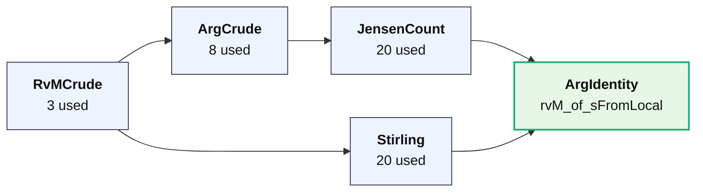

# What `Stage3.rvM_of_sFromLocal` rests on

[`Stage3.rvM_of_sFromLocal`](../lean_stage3/ArgIdentity.md#Stage3-rvM_of_sFromLocal) in `lean_stage3/Stage3/ArgIdentity.lean`, line 1461.

**Why.** hNT from one remaining bound. With the Stirling half already a theorem (`backlundPhase_holds : StmtBacklundPhase phaseTheta 97 98`, entry 140) and the Jensen count discharged (`localCount_holds : StmtLocalCount zetaLocalCount 15 73`, entry 156), the whole Riemann–von Mangoldt band follows from `StmtSFromLocal` alone.

**Proves**

```lean
riemannZeta.Riemann_vonMangoldt_bound (97 + a * 15) 0 (98 + (a * 73 + b))
```

**Needs** (its hypotheses)

  - `` ha : 0 ≤ a ``
  - `` hSF : StmtSFromLocal argS zetaLocalCount a b ``

Behind it: 39 theorems and 14 definitions in 5 files. Every one is listed below; Lean recorded each step.

## The files it passes through



An arrow A → B reads "B uses something proved or defined in A"; indirect arrows are left out. Green: the theorem itself. Yellow: a file in the other tree. The number is how many of that file's declarations are on the way.

## Every declaration on the way

Files in dependency order. ★ marks what the theorem's own proof uses directly.

### [`RvMCrude`](../lean_stage3/RvMCrude.md) — 3

- [`Stage3.StmtBacklundPhase`](../lean_stage3/RvMCrude.md#Stage3-StmtBacklundPhase) — *def*
- [`Stage3.StmtBacklundArg`](../lean_stage3/RvMCrude.md#Stage3-StmtBacklundArg) — *def*
- [`Stage3.RvM_of_phase_arg`](../lean_stage3/RvMCrude.md#Stage3-RvM_of_phase_arg) — `` riemannZeta.Riemann_vonMangoldt_bound (B₁ + B₁') 0 (B₃ + B₃') ``

### [`ArgCrude`](../lean_stage3/ArgCrude.md) — 8

- [`Stage3.StmtArgIdentity`](../lean_stage3/ArgCrude.md#Stage3-StmtArgIdentity) — *def*
- [`Stage3.StmtSCrude`](../lean_stage3/ArgCrude.md#Stage3-StmtSCrude) — *def*
- [`Stage3.StmtLocalCount`](../lean_stage3/ArgCrude.md#Stage3-StmtLocalCount) — *def*
- ★ [`Stage3.StmtSFromLocal`](../lean_stage3/ArgCrude.md#Stage3-StmtSFromLocal) — *def*
- [`Stage3.sCrude_of_local`](../lean_stage3/ArgCrude.md#Stage3-sCrude_of_local) — `` StmtSCrude S (a * A₁) (a * A₃ + b) ``
- [`Stage3.backlundArg_of_identity`](../lean_stage3/ArgCrude.md#Stage3-backlundArg_of_identity) — `` StmtBacklundArg θ B₁ B₃ ``
- [`Stage3.argCrude_of_pieces`](../lean_stage3/ArgCrude.md#Stage3-argCrude_of_pieces) — `` StmtBacklundArg θ (a * A₁) (a * A₃ + b) ``
- ★ [`Stage3.rvM_of_stirling_and_pieces`](../lean_stage3/ArgCrude.md#Stage3-rvM_of_stirling_and_pieces) — `` riemannZeta.Riemann_vonMangoldt_bound (B₁ + a * A₁) 0 (B₃ + (a * A₃ + b)) ``

### [`JensenCount`](../lean_stage3/JensenCount.md) — 20

- [`Stage3.zeta_centre_lower`](../lean_stage3/JensenCount.md#Stage3-zeta_centre_lower) — `` (1 : ℝ) / 3 ≤ ‖ζ (2 + Complex.I * T)‖ ``
- [`Stage3.zeta_disk_upper`](../lean_stage3/JensenCount.md#Stage3-zeta_disk_upper) — `` ‖ζ w‖ ≤ 28 * T ``
- [`Stage3.zeta_centre_ne_zero`](../lean_stage3/JensenCount.md#Stage3-zeta_centre_ne_zero) — `` ζ (2 + Complex.I * (T : ℂ)) ≠ 0 ``
- [`Stage3.pole_away`](../lean_stage3/JensenCount.md#Stage3-pole_away) — `` 2 * z + (2 + Complex.I * (T : ℂ)) ≠ 1 ``
- [`Stage3.pole_away_centre`](../lean_stage3/JensenCount.md#Stage3-pole_away_centre) — `` v ≠ 1 ``
- [`Stage3.zetaWindowTwo_finite`](../lean_stage3/JensenCount.md#Stage3-zetaWindowTwo_finite) — `` {ρ : ℂ | ζ ρ = 0 ∧ ‖ρ - (2 + Complex.I * (T : ℂ))‖ ≤ 2}.Finite ``
- [`Stage3.zetaWindow`](../lean_stage3/JensenCount.md#Stage3-zetaWindow) — *def*
- [`Stage3.zetaWindow_finite`](../lean_stage3/JensenCount.md#Stage3-zetaWindow_finite) — `` (zetaWindow T).Finite ``
- [`Stage3.jensenF`](../lean_stage3/JensenCount.md#Stage3-jensenF) — *def*
- [`Stage3.zeta_comp_analytic`](../lean_stage3/JensenCount.md#Stage3-zeta_comp_analytic) — `` AnalyticAt ℂ (fun z : ℂ => ζ (2 * z + (2 + Complex.I * (T : ℂ)))) w ``
- [`Stage3.jensenF_analytic`](../lean_stage3/JensenCount.md#Stage3-jensenF_analytic) — `` AnalyticOnNhd ℂ (jensenF T) (Metric.closedBall (0 : ℂ) 1) ``
- [`Stage3.jensenF_zero_eq_one`](../lean_stage3/JensenCount.md#Stage3-jensenF_zero_eq_one) — `` jensenF T 0 = 1 ``
- [`Stage3.jensenF_zeros_finite`](../lean_stage3/JensenCount.md#Stage3-jensenF_zeros_finite) — `` (SetOfZeros 1 (jensenF T)).Finite ``
- [`Stage3.jensenF_bound`](../lean_stage3/JensenCount.md#Stage3-jensenF_bound) — `` ‖jensenF T z‖ ≤ 84 * T ``
- [`Stage3.analyticOrderNatAt_fun_comp_affine`](../lean_stage3/JensenCount.md#Stage3-analyticOrderNatAt_fun_comp_affine) — `` analyticOrderNatAt (fun w : ℂ => g (a * w + b)) z = analyticOrderNatAt g (a * z + b) ``
- [`Stage3.jensenF_order`](../lean_stage3/JensenCount.md#Stage3-jensenF_order) — `` analyticOrderNatAt (jensenF T) w = analyticOrderNatAt ζ (2 * w + (2 + Complex.I * (T : ℂ))) ``
- [`Stage3.zeta_local_zero_count`](../lean_stage3/JensenCount.md#Stage3-zeta_local_zero_count) — `` ∑ ρ ∈ (zetaWindow_finite hT).toFinset, (analyticOrderNatAt ζ ρ : ℝ) ≤ 15 * Real.log T + 73 ``
- ★ [`Stage3.zetaLocalCount`](../lean_stage3/JensenCount.md#Stage3-zetaLocalCount) — *def*
- [`Stage3.zetaLocalCount_eq`](../lean_stage3/JensenCount.md#Stage3-zetaLocalCount_eq) — `` zetaLocalCount T = ∑ ρ ∈ (zetaWindow_finite hT).toFinset, (analyticOrderNatAt ζ ρ : ℝ) ``
- ★ [`Stage3.localCount_holds`](../lean_stage3/JensenCount.md#Stage3-localCount_holds) — `` StmtLocalCount zetaLocalCount 15 73 ``

### [`Stirling`](../lean_stage3/Stirling.md) — 20

- [`Stage3.phasePoint`](../lean_stage3/Stirling.md#Stage3-phasePoint) — *def*
- ★ [`Stage3.phaseTheta`](../lean_stage3/Stirling.md#Stage3-phaseTheta) — *def*
- [`Stage3.continuous_phasePoint`](../lean_stage3/Stirling.md#Stage3-continuous_phasePoint) — `` Continuous phasePoint ``
- [`Stage3.intervalIntegrable_phasePoint`](../lean_stage3/Stirling.md#Stage3-intervalIntegrable_phasePoint) — `` IntervalIntegrable phasePoint MeasureTheory.volume a b ``
- [`Stage3.integral_log_half`](../lean_stage3/Stirling.md#Stage3-integral_log_half) — `` (∫ t in (1 : ℝ)..T, Real.log (t / 2)) = T * Real.log (T / 2) - T + 1 + Real.log 2 ``
- [`Stage3.StmtDigammaLog`](../lean_stage3/Stirling.md#Stage3-StmtDigammaLog) — *def*
- [`Stage3.backlundPhase_of_digammaLog`](../lean_stage3/Stirling.md#Stage3-backlundPhase_of_digammaLog) — `` StmtBacklundPhase phaseTheta C (C + 1) ``
- [`Stage3.digamma_term_norm_le`](../lean_stage3/Stirling.md#Stage3-digamma_term_norm_le) — `` ‖1 / ((n : ℂ) + 1) - 1 / ((n : ℂ) + z)‖ ≤ 4 / ((n : ℝ) + 1) ^ 2 ``
- [`Stage3.phasePoint_compact_le`](../lean_stage3/Stirling.md#Stage3-phasePoint_compact_le) — `` ∀ t ∈ Set.Icc (0 : ℝ) 1, |phasePoint t| ≤ 8 ``
- [`Stage3.log_norm_z_le`](../lean_stage3/Stirling.md#Stage3-log_norm_z_le) — `` |Real.log ‖(1 : ℂ) / 4 + (t : ℂ) / 2 * Complex.I‖ - Real.log (t / 2)| ≤ 1 / (4 * t) ``
- [`Stage3.inv_quadratic_tsum_le`](../lean_stage3/Stirling.md#Stage3-inv_quadratic_tsum_le) — `` (∑' n : ℕ, (((n : ℝ) + 1 / 4) ^ 2 + (t / 2) ^ 2)⁻¹) ≤ 12 / t ``
- [`Stage3.re_sub_log_norm_le`](../lean_stage3/Stirling.md#Stage3-re_sub_log_norm_le) — `` |w.re - Real.log ‖1 + w‖| ≤ 8 * ‖w‖ ^ 2 ``
- [`Stage3.zq`](../lean_stage3/Stirling.md#Stage3-zq) — *def*
- [`Stage3.phasePoint_eq`](../lean_stage3/Stirling.md#Stage3-phasePoint_eq) — `` phasePoint t = (Complex.digamma (zq t)).re ``
- [`Stage3.normSq_add_zq`](../lean_stage3/Stirling.md#Stage3-normSq_add_zq) — `` ‖(n : ℂ) + zq t‖ ^ 2 = ((n : ℝ) + 1 / 4) ^ 2 + (t / 2) ^ 2 ``
- [`Stage3.add_zq_ne_zero`](../lean_stage3/Stirling.md#Stage3-add_zq_ne_zero) — `` (n : ℂ) + zq t ≠ 0 ``
- [`Stage3.a_term_le`](../lean_stage3/Stirling.md#Stage3-a_term_le) — `` |(((n : ℂ) + zq t)⁻¹).re - (Real.log ‖((n + 1 : ℕ) : ℂ) + zq t‖ - Real.log ‖(n : ℂ) + zq t‖)| ≤ 8 * ((((n : ℝ) + 1 / 4) ^ 2 + (t / 2) ^ 2)⁻¹) ``
- [`Stage3.re_digamma_sub_log_le`](../lean_stage3/Stirling.md#Stage3-re_digamma_sub_log_le) — `` |phasePoint t - Real.log ‖zq t‖| ≤ 96 / t ``
- [`Stage3.stmtDigammaLog_holds`](../lean_stage3/Stirling.md#Stage3-stmtDigammaLog_holds) — `` StmtDigammaLog 97 ``
- ★ [`Stage3.backlundPhase_holds`](../lean_stage3/Stirling.md#Stage3-backlundPhase_holds) — `` StmtBacklundPhase phaseTheta 97 98 ``

### [`ArgIdentity`](../lean_stage3/ArgIdentity.md) — 2

- ★ [`Stage3.argS`](../lean_stage3/ArgIdentity.md#Stage3-argS) — *def*
- ★ [`Stage3.stmtArgIdentity_holds`](../lean_stage3/ArgIdentity.md#Stage3-stmtArgIdentity_holds) — `` StmtArgIdentity phaseTheta argS ``

