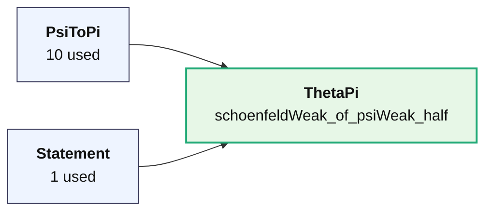

# What `Stage3.schoenfeldWeak_of_psiWeak_half` rests on

[`Stage3.schoenfeldWeak_of_psiWeak_half`](../lean_stage3/ThetaPi.md#Stage3-schoenfeldWeak_of_psiWeak_half) in `lean_stage3/Stage3/ThetaPi.lean`, line 266.

**Why.** `PsiToPi.schoenfeldWeak_of_psiWeak` recovered through the dial.

**Proves**

```lean
StmtSchoenfeldWeak (3 * C + 13) (k - 1) (max (x₀ ^ 2) 9) (fun x => (Nat.primeCounting ⌊x⌋₊ : ℝ)) Li
```

**Needs** (its hypotheses)

  - `` hk : 2 ≤ k ``
  - `` hx₀ : 2 ≤ x₀ ``
  - `` hC : 0 ≤ C ``
  - `` h : StmtPsiWeak C k x₀ ``

Behind it: 15 theorems and 5 definitions in 3 files. Every one is listed below; Lean recorded each step.

## The files it passes through



An arrow A → B reads "B uses something proved or defined in A"; indirect arrows are left out. Green: the theorem itself. Yellow: a file in the other tree. The number is how many of that file's declarations are on the way.

## Every declaration on the way

Files in dependency order. ★ marks what the theorem's own proof uses directly.

### [`PsiToPi`](../lean_stage3/PsiToPi.md) — 10

- ★ [`Stage3.Li`](../lean_stage3/PsiToPi.md#Stage3-Li) — *def*
- [`Stage3.continuousOn_inv_log_sq`](../lean_stage3/PsiToPi.md#Stage3-continuousOn_inv_log_sq) — `` ContinuousOn (fun t : ℝ => 1 / Real.log t ^ 2) (Set.uIcc a x) ``
- [`Stage3.continuousOn_inv_mul_log_sq`](../lean_stage3/PsiToPi.md#Stage3-continuousOn_inv_mul_log_sq) — `` ContinuousOn (fun t : ℝ => (t * Real.log t ^ 2)⁻¹) (Set.uIcc a x) ``
- [`Stage3.integrable_theta_term`](../lean_stage3/PsiToPi.md#Stage3-integrable_theta_term) — `` IntervalIntegrable (fun t => θ t / (t * Real.log t ^ 2)) volume a x ``
- [`Stage3.integrable_err_term`](../lean_stage3/PsiToPi.md#Stage3-integrable_err_term) — `` IntervalIntegrable (fun t => (θ t - t) / (t * Real.log t ^ 2)) volume a x ``
- [`Stage3.pi_sub_Li_eq`](../lean_stage3/PsiToPi.md#Stage3-pi_sub_Li_eq) — `` (Nat.primeCounting ⌊x⌋₊ : ℝ) - Li x = (θ x - x) / Real.log x + ∫ t in (2 : ℝ)..x, (θ t - t) / (t * Real.log t ^ 2) ``
- [`Stage3.theta_err_of_psi`](../lean_stage3/PsiToPi.md#Stage3-theta_err_of_psi) — `` |θ x - x| ≤ E + 2 * Real.sqrt x * Real.log x ``
- ★ [`Stage3.StmtPsiWeak`](../lean_stage3/PsiToPi.md#Stage3-StmtPsiWeak) — *def*
- [`Stage3.abs_theta_sub_le_linear`](../lean_stage3/PsiToPi.md#Stage3-abs_theta_sub_le_linear) — `` |θ t - t| ≤ (1 + Real.log 4) * t ``
- [`Stage3.one_add_log_four_le`](../lean_stage3/PsiToPi.md#Stage3-one_add_log_four_le) — `` 1 + Real.log 4 ≤ 5 * Real.log 2 ^ 2 ``

### [`Statement`](../lean_stage3/Statement.md) — 1

- ★ [`Stage3.StmtSchoenfeldWeak`](../lean_stage3/Statement.md#Stage3-StmtSchoenfeldWeak) — *def*

### [`ThetaPi`](../lean_stage3/ThetaPi.md) — 9

- ★ [`Stage3.StmtPsiWeakTheta`](../lean_stage3/ThetaPi.md#Stage3-StmtPsiWeakTheta) — *def*
- ★ [`Stage3.StmtSchoenfeldWeakTheta`](../lean_stage3/ThetaPi.md#Stage3-StmtSchoenfeldWeakTheta) — *def*
- ★ [`Stage3.stmtPsiWeak_iff_theta_half`](../lean_stage3/ThetaPi.md#Stage3-stmtPsiWeak_iff_theta_half) — `` StmtPsiWeak C k x₀ ↔ StmtPsiWeakTheta (1/2) C k x₀ ``
- ★ [`Stage3.stmtSchoenfeldWeak_iff_theta_half`](../lean_stage3/ThetaPi.md#Stage3-stmtSchoenfeldWeak_iff_theta_half) — `` StmtSchoenfeldWeak C k x₀ pi li ↔ StmtSchoenfeldWeakTheta (1/2) C k x₀ pi li ``
- [`Stage3.sqrt_le_rpow_theta`](../lean_stage3/ThetaPi.md#Stage3-sqrt_le_rpow_theta) — `` Real.sqrt x ≤ x ^ θ ``
- [`Stage3.integral_A_rpow_theta_le`](../lean_stage3/ThetaPi.md#Stage3-integral_A_rpow_theta_le) — `` (∫ t in a..x, A * t ^ (θ - 1)) ≤ 2 * A * x ^ θ ``
- [`Stage3.theta_err_of_psi_theta`](../lean_stage3/ThetaPi.md#Stage3-theta_err_of_psi_theta) — `` |ϑ x - x| ≤ E + 2 * x ^ θ * Real.log x ``
- [`Stage3.rpow_theta_sub_one_mul`](../lean_stage3/ThetaPi.md#Stage3-rpow_theta_sub_one_mul) — `` t ^ (θ - 1) * (t * Real.log t ^ 2) = t ^ θ * Real.log t ^ 2 ``
- ★ [`Stage3.schoenfeldWeakTheta_of_psiWeakTheta`](../lean_stage3/ThetaPi.md#Stage3-schoenfeldWeakTheta_of_psiWeakTheta) — `` StmtSchoenfeldWeakTheta θ (3 * C + 13) (k - 1) (max (x₀ ^ 2) 9) (fun x => (Nat.primeCounting ⌊x⌋₊ : ℝ)) Li ``

