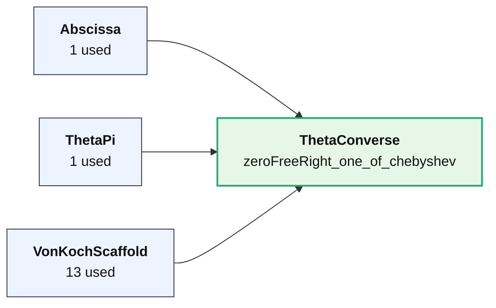

# What `Stage3.zeroFreeRight_one_of_chebyshev` rests on

[`Stage3.zeroFreeRight_one_of_chebyshev`](../lean_stage3/ThetaConverse.md#Stage3-zeroFreeRight_one_of_chebyshev) in `lean_stage3/Stage3/ThetaConverse.lean`, line 401.

**Why.** The primes are a subset of the numbers, so `ψ(x) ≤ c·x` (`Chebyshev.psi_le_const_mul_self`, `c = log 4 + 4`), so the count's fluctuation is at most `x`, so no zero has real part above `1`. The Euler-product wall as a corollary of the converse: this is the `θ = 1`, `k = 0` instance, with `C = log 4 + 5` and floor `1`; the hypothesis is genuinely opened at `θ = 1` since the region `{re > 1}` is convex.

**Proves**

```lean
StmtZeroFreeRight 1
```

Behind it: 20 theorems and 6 definitions in 4 files. Every one is listed below; Lean recorded each step.

## The files it passes through



An arrow A → B reads "B uses something proved or defined in A"; indirect arrows are left out. Green: the theorem itself. Yellow: a file in the other tree. The number is how many of that file's declarations are on the way.

## Every declaration on the way

Files in dependency order. ★ marks what the theorem's own proof uses directly.

### [`Abscissa`](../lean_stage3/Abscissa.md) — 1

- ★ [`Stage3.StmtZeroFreeRight`](../lean_stage3/Abscissa.md#Stage3-StmtZeroFreeRight) — *def*

### [`ThetaPi`](../lean_stage3/ThetaPi.md) — 1

- [`Stage3.StmtPsiWeakTheta`](../lean_stage3/ThetaPi.md#Stage3-StmtPsiWeakTheta) — *def*

### [`VonKochScaffold`](../lean_stage3/VonKochScaffold.md) — 13

- ★ [`VonKoch.E`](../lean_stage3/VonKochScaffold.md#VonKoch-E) — *def*
- [`VonKoch.F`](../lean_stage3/VonKochScaffold.md#VonKoch-F) — *def*
- [`VonKoch.Etr`](../lean_stage3/VonKochScaffold.md#VonKoch-Etr) — *def*
- [`VonKoch.measurable_psi'`](../lean_stage3/VonKochScaffold.md#VonKoch-measurable_psi-) — `` Measurable (fun t : ℝ ↦ ψ t) ``
- [`VonKoch.Etr_measurable`](../lean_stage3/VonKochScaffold.md#VonKoch-Etr_measurable) — `` Measurable Etr ``
- ★ [`VonKoch.E_le_linear`](../lean_stage3/VonKochScaffold.md#VonKoch-E_le_linear) — `` ‖(E t : ℝ)‖ ≤ (Real.log 4 + 5) * t ``
- [`VonKoch.E_integral_eq_mellin`](../lean_stage3/VonKochScaffold.md#VonKoch-E_integral_eq_mellin) — `` ∫ x in Set.Ioi (1:ℝ), (E x : ℂ) * (x : ℂ) ^ (-s - 1) = mellin Etr (-s) ``
- [`VonKoch.Etr_locallyIntegrable`](../lean_stage3/VonKochScaffold.md#VonKoch-Etr_locallyIntegrable) — `` MeasureTheory.LocallyIntegrableOn Etr (Set.Ioi 0) ``
- [`VonKoch.sum_Icc_vonMangoldt`](../lean_stage3/VonKochScaffold.md#VonKoch-sum_Icc_vonMangoldt) — `` ∑ k ∈ Finset.Icc 1 n, ArithmeticFunction.vonMangoldt k = ψ n ``
- [`VonKoch.psi_partial_bigO`](../lean_stage3/VonKochScaffold.md#VonKoch-psi_partial_bigO) — `` (fun n : ℕ ↦ ∑ k ∈ Finset.Icc 1 n, ArithmeticFunction.vonMangoldt k) =O[Filter.atTop] fun n : ℕ ↦ (n : ℝ) ^ (1:ℝ) ``
- [`VonKoch.measurable_psi`](../lean_stage3/VonKochScaffold.md#VonKoch-measurable_psi) — `` Measurable (fun t : ℝ ↦ ψ t) ``
- [`VonKoch.integrable_psi_cpow`](../lean_stage3/VonKochScaffold.md#VonKoch-integrable_psi_cpow) — `` IntegrableOn (fun t : ℝ ↦ ((ψ t : ℝ) : ℂ) * (t : ℂ) ^ (-(s + 1))) (Set.Ioi (1:ℝ)) ``
- [`VonKoch.F_eq_neg_logDeriv`](../lean_stage3/VonKochScaffold.md#VonKoch-F_eq_neg_logDeriv) — `` F s = -deriv riemannZeta s / riemannZeta s ``

### [`ThetaConverse`](../lean_stage3/ThetaConverse.md) — 11

- [`Stage3.regionθ`](../lean_stage3/ThetaConverse.md#Stage3-region-) — *def*
- [`Stage3.isOpen_regionθ`](../lean_stage3/ThetaConverse.md#Stage3-isOpen_region-) — `` IsOpen (regionθ θ) ``
- [`Stage3.preconnected_regionθ`](../lean_stage3/ThetaConverse.md#Stage3-preconnected_region-) — `` IsPreconnected (regionθ θ) ``
- [`Stage3.zeta_analyticOnNhd_regionθ`](../lean_stage3/ThetaConverse.md#Stage3-zeta_analyticOnNhd_region-) — `` AnalyticOnNhd ℂ ζ (regionθ θ) ``
- [`Stage3.log_pow_isBigO_rpow`](../lean_stage3/ThetaConverse.md#Stage3-log_pow_isBigO_rpow) — `` (fun t : ℝ ↦ (Real.log t) ^ k) =O[Filter.atTop] (fun t : ℝ ↦ t ^ δ) ``
- [`Stage3.F_differentiableAt_theta`](../lean_stage3/ThetaConverse.md#Stage3-F_differentiableAt_theta) — `` DifferentiableAt ℂ VonKoch.F s ``
- [`Stage3.F_analyticOnNhd_theta`](../lean_stage3/ThetaConverse.md#Stage3-F_analyticOnNhd_theta) — `` AnalyticOnNhd ℂ VonKoch.F (regionθ θ) ``
- [`Stage3.anchor_mem_regionθ`](../lean_stage3/ThetaConverse.md#Stage3-anchor_mem_region-) — `` ((max θ 1 + 1 : ℝ) : ℂ) ∈ regionθ θ ∧ 1 < ((max θ 1 + 1 : ℝ) : ℂ).re ``
- [`Stage3.F_mul_zeta_add_deriv_eqOn_zero_theta`](../lean_stage3/ThetaConverse.md#Stage3-F_mul_zeta_add_deriv_eqOn_zero_theta) — `` Set.EqOn (fun s : ℂ ↦ VonKoch.F s * ζ s + deriv ζ s) 0 (regionθ θ) ``
- [`Stage3.no_zero_right_of_theta`](../lean_stage3/ThetaConverse.md#Stage3-no_zero_right_of_theta) — `` ζ ρ ≠ 0 ``
- ★ [`Stage3.zeroFreeRight_of_psiWeakTheta`](../lean_stage3/ThetaConverse.md#Stage3-zeroFreeRight_of_psiWeakTheta) — `` StmtZeroFreeRight θ ``

