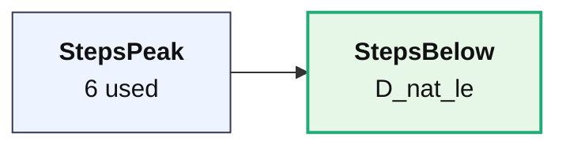

# What `StepsBelow.D_nat_le` rests on

[`StepsBelow.D_nat_le`](../lean_stage3/StepsBelow.md#StepsBelow-D_nat_le) in `lean_stage3/Stage3/StepsBelow.lean`, line 176.

**Proves**

```lean
‖D s N‖ ≤ (|C| + ‖c0 s‖ + ‖c1 s‖) * (N:ℝ) ^ (1 + δ)
```

**Needs** (its hypotheses)

  - `` hN : 2 ≤ N ``
  - `` hs1 : s ≠ 1 ``
  - `` hs2 : s ≠ 2 ``
  - `` hδ : 0 ≤ δ ``
  - `` H : ‖S N s - K N s 1‖ ≤ C * (N:ℝ) ^ δ ``

Behind it: 12 theorems and 12 definitions in 2 files. Every one is listed below; Lean recorded each step.

## The files it passes through



An arrow A → B reads "B uses something proved or defined in A"; indirect arrows are left out. Green: the theorem itself. Yellow: a file in the other tree. The number is how many of that file's declarations are on the way.

## Every declaration on the way

Files in dependency order. ★ marks what the theorem's own proof uses directly.

### [`StepsPeak`](../lean_stage3/StepsPeak.md) — 6

- [`StepsPeak.ramp`](../lean_stage3/StepsPeak.md#StepsPeak-ramp) — *def*
- [`StepsPeak.slope`](../lean_stage3/StepsPeak.md#StepsPeak-slope) — *def*
- ★ [`StepsPeak.S`](../lean_stage3/StepsPeak.md#StepsPeak-S) — *def*
- ★ [`StepsPeak.K`](../lean_stage3/StepsPeak.md#StepsPeak-K) — *def*
- [`StepsPeak.h0_not_mem`](../lean_stage3/StepsPeak.md#StepsPeak-h0_not_mem) — `` (0:ℝ) ∉ Set.uIcc (2:ℝ) N ``
- [`StepsPeak.K_eq`](../lean_stage3/StepsPeak.md#StepsPeak-K_eq) — `` K N s a = s * ((N:ℂ) ^ (a - s) - 2 ^ (a - s)) / (a - s) - (s - 1) * ((N:ℂ) ^ (a - s + 1) - 2 ^ (a - s + 1)) / ((a - s + 1) * N) ``

### [`StepsBelow`](../lean_stage3/StepsBelow.md) — 18

- [`StepsBelow.coef`](../lean_stage3/StepsBelow.md#StepsBelow-coef) — *def*
- [`StepsBelow.tent`](../lean_stage3/StepsBelow.md#StepsBelow-tent) — *def*
- [`StepsBelow.Bk`](../lean_stage3/StepsBelow.md#StepsBelow-Bk) — *def*
- [`StepsBelow.B`](../lean_stage3/StepsBelow.md#StepsBelow-B) — *def*
- [`StepsBelow.tent_eq_zero`](../lean_stage3/StepsBelow.md#StepsBelow-tent_eq_zero) — `` tent n x = 0 ``
- [`StepsBelow.tent_eq`](../lean_stage3/StepsBelow.md#StepsBelow-tent_eq) — `` tent n x = x - n ``
- [`StepsBelow.Bk_eq`](../lean_stage3/StepsBelow.md#StepsBelow-Bk_eq) — `` Bk s K' x = Bk s K x ``
- [`StepsBelow.lt_floor_succ`](../lean_stage3/StepsBelow.md#StepsBelow-lt_floor_succ) — `` x < ((⌊x⌋₊ + 1 : ℕ) : ℝ) ``
- [`StepsBelow.B_eq_Bk`](../lean_stage3/StepsBelow.md#StepsBelow-B_eq_Bk) — `` B s x = Bk s K x ``
- [`StepsBelow.B_nat`](../lean_stage3/StepsBelow.md#StepsBelow-B_nat) — `` B s N = (N : ℂ) * S N s ``
- [`StepsBelow.kap`](../lean_stage3/StepsBelow.md#StepsBelow-kap) — *def*
- ★ [`StepsBelow.c0`](../lean_stage3/StepsBelow.md#StepsBelow-c0) — *def*
- ★ [`StepsBelow.c1`](../lean_stage3/StepsBelow.md#StepsBelow-c1) — *def*
- [`StepsBelow.natC_ne_zero`](../lean_stage3/StepsBelow.md#StepsBelow-natC_ne_zero) — `` (N:ℂ) ≠ 0 ``
- [`StepsBelow.natC_cpow_two_sub`](../lean_stage3/StepsBelow.md#StepsBelow-natC_cpow_two_sub) — `` (N:ℂ) ^ (2 - s) = (N:ℂ) ^ (1 - s) * N ``
- [`StepsBelow.K_one`](../lean_stage3/StepsBelow.md#StepsBelow-K_one) — `` K N s 1 = kap s * (N:ℂ) ^ (1 - s) + c0 s + c1 s / N ``
- ★ [`StepsBelow.D`](../lean_stage3/StepsBelow.md#StepsBelow-D) — *def*
- ★ [`StepsBelow.D_nat`](../lean_stage3/StepsBelow.md#StepsBelow-D_nat) — `` D s N = (N:ℂ) * (S N s - K N s 1) + (N:ℂ) * c0 s + c1 s ``

