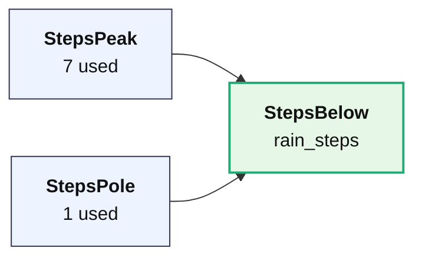

# What `StepsBelow.rain_steps` rests on

[`StepsBelow.rain_steps`](../lean_stage3/StepsBelow.md#StepsBelow-rain_steps) in `lean_stage3/Stage3/StepsBelow.lean`, line 760.

**Why.** The rain comes. At a zero `ρ₀`, the turned steps to a cutoff, less their smooth term, exceed `C·N^δ` at cutoffs beyond any `N₀`, for every `0 ≤ δ < Re ρ₀ − Re s`.

**Proves**

```lean
∃ N : ℕ, N₀ ≤ N ∧ 2 ≤ N ∧ C * (N : ℝ) ^ δ < ‖StepsPeak.S N s - StepsPeak.K N s 1‖
```

**Needs** (its hypotheses)

  - `` ρ₀ : Kadiri.NontrivialZeros ``
  - `` hs : 0 < s.re ``
  - `` hne : (ρ₀ : ℂ) ≠ s ``
  - `` hδ0 : 0 ≤ δ ``
  - `` hδ : δ < (ρ₀ : ℂ).re - s.re ``
  - `` C : ℝ ``
  - `` N₀ : ℕ ``

Behind it: 44 theorems and 14 definitions in 3 files. Every one is listed below; Lean recorded each step.

## The files it passes through



An arrow A → B reads "B uses something proved or defined in A"; indirect arrows are left out. Green: the theorem itself. Yellow: a file in the other tree. The number is how many of that file's declarations are on the way.

## Every declaration on the way

Files in dependency order. ★ marks what the theorem's own proof uses directly.

### [`StepsPeak`](../lean_stage3/StepsPeak.md) — 7

- [`StepsPeak.ramp`](../lean_stage3/StepsPeak.md#StepsPeak-ramp) — *def*
- [`StepsPeak.slope`](../lean_stage3/StepsPeak.md#StepsPeak-slope) — *def*
- ★ [`StepsPeak.S`](../lean_stage3/StepsPeak.md#StepsPeak-S) — *def*
- ★ [`StepsPeak.K`](../lean_stage3/StepsPeak.md#StepsPeak-K) — *def*
- [`StepsPeak.cont_cpow`](../lean_stage3/StepsPeak.md#StepsPeak-cont_cpow) — `` ContinuousOn (fun y : ℝ => (y : ℂ) ^ c) (Set.Ioi 0) ``
- [`StepsPeak.h0_not_mem`](../lean_stage3/StepsPeak.md#StepsPeak-h0_not_mem) — `` (0:ℝ) ∉ Set.uIcc (2:ℝ) N ``
- [`StepsPeak.K_eq`](../lean_stage3/StepsPeak.md#StepsPeak-K_eq) — `` K N s a = s * ((N:ℂ) ^ (a - s) - 2 ^ (a - s)) / (a - s) - (s - 1) * ((N:ℂ) ^ (a - s + 1) - 2 ^ (a - s + 1)) / ((a - s + 1) * N) ``

### [`StepsPole`](../lean_stage3/StepsPole.md) — 1

- [`StepsPole.steps_sum`](../lean_stage3/StepsPole.md#StepsPole-steps_sum) — `` LSeries (fun n => (ArithmeticFunction.vonMangoldt n : ℂ)) s = - deriv riemannZeta s / riemannZeta s ``

### [`StepsBelow`](../lean_stage3/StepsBelow.md) — 50

- [`StepsBelow.coef`](../lean_stage3/StepsBelow.md#StepsBelow-coef) — *def*
- [`StepsBelow.tent`](../lean_stage3/StepsBelow.md#StepsBelow-tent) — *def*
- [`StepsBelow.Bk`](../lean_stage3/StepsBelow.md#StepsBelow-Bk) — *def*
- [`StepsBelow.B`](../lean_stage3/StepsBelow.md#StepsBelow-B) — *def*
- [`StepsBelow.coef_zero`](../lean_stage3/StepsBelow.md#StepsBelow-coef_zero) — `` coef s 0 = 0 ``
- [`StepsBelow.tent_nonneg`](../lean_stage3/StepsBelow.md#StepsBelow-tent_nonneg) — `` 0 ≤ tent n x ``
- [`StepsBelow.tent_eq_zero`](../lean_stage3/StepsBelow.md#StepsBelow-tent_eq_zero) — `` tent n x = 0 ``
- [`StepsBelow.tent_eq`](../lean_stage3/StepsBelow.md#StepsBelow-tent_eq) — `` tent n x = x - n ``
- [`StepsBelow.Bk_eq`](../lean_stage3/StepsBelow.md#StepsBelow-Bk_eq) — `` Bk s K' x = Bk s K x ``
- [`StepsBelow.lt_floor_succ`](../lean_stage3/StepsBelow.md#StepsBelow-lt_floor_succ) — `` x < ((⌊x⌋₊ + 1 : ℕ) : ℝ) ``
- [`StepsBelow.B_eq_Bk`](../lean_stage3/StepsBelow.md#StepsBelow-B_eq_Bk) — `` B s x = Bk s K x ``
- [`StepsBelow.Bk_continuous`](../lean_stage3/StepsBelow.md#StepsBelow-Bk_continuous) — `` Continuous (Bk s K) ``
- [`StepsBelow.B_continuous`](../lean_stage3/StepsBelow.md#StepsBelow-B_continuous) — `` Continuous (B s) ``
- [`StepsBelow.B_nat`](../lean_stage3/StepsBelow.md#StepsBelow-B_nat) — `` B s N = (N : ℂ) * S N s ``
- [`StepsBelow.B_interp`](../lean_stage3/StepsBelow.md#StepsBelow-B_interp) — `` B s x = ((1 - (x - N) : ℝ) : ℂ) * B s N + ((x - N : ℝ) : ℂ) * B s ((N + 1 : ℕ) : ℝ) ``
- [`StepsBelow.kap`](../lean_stage3/StepsBelow.md#StepsBelow-kap) — *def*
- [`StepsBelow.c0`](../lean_stage3/StepsBelow.md#StepsBelow-c0) — *def*
- [`StepsBelow.c1`](../lean_stage3/StepsBelow.md#StepsBelow-c1) — *def*
- [`StepsBelow.natC_ne_zero`](../lean_stage3/StepsBelow.md#StepsBelow-natC_ne_zero) — `` (N:ℂ) ≠ 0 ``
- [`StepsBelow.natC_cpow_two_sub`](../lean_stage3/StepsBelow.md#StepsBelow-natC_cpow_two_sub) — `` (N:ℂ) ^ (2 - s) = (N:ℂ) ^ (1 - s) * N ``
- [`StepsBelow.K_one`](../lean_stage3/StepsBelow.md#StepsBelow-K_one) — `` K N s 1 = kap s * (N:ℂ) ^ (1 - s) + c0 s + c1 s / N ``
- [`StepsBelow.D`](../lean_stage3/StepsBelow.md#StepsBelow-D) — *def*
- [`StepsBelow.D_nat`](../lean_stage3/StepsBelow.md#StepsBelow-D_nat) — `` D s N = (N:ℂ) * (S N s - K N s 1) + (N:ℂ) * c0 s + c1 s ``
- [`StepsBelow.D_nat_le`](../lean_stage3/StepsBelow.md#StepsBelow-D_nat_le) — `` ‖D s N‖ ≤ (|C| + ‖c0 s‖ + ‖c1 s‖) * (N:ℝ) ^ (1 + δ) ``
- [`StepsBelow.pow_diff_le`](../lean_stage3/StepsBelow.md#StepsBelow-pow_diff_le) — `` ‖(y:ℂ) ^ (2 - s) - (x:ℂ) ^ (2 - s)‖ ≤ ‖2 - s‖ * (y * (y - x)) ``
- [`StepsBelow.D_le`](../lean_stage3/StepsBelow.md#StepsBelow-D_le) — `` ‖D s x‖ ≤ ((|C| + ‖c0 s‖ + ‖c1 s‖) * 2 ^ (1 + δ) + 2 * (‖kap s‖ * ‖2 - s‖)) * x ^ (1 + δ) ``
- [`StepsBelow.Rtr`](../lean_stage3/StepsBelow.md#StepsBelow-Rtr) — *def*
- [`StepsBelow.D_continuousOn`](../lean_stage3/StepsBelow.md#StepsBelow-D_continuousOn) — `` ContinuousOn (D s) (Ioi 0) ``
- [`StepsBelow.Rtr_locallyIntegrable`](../lean_stage3/StepsBelow.md#StepsBelow-Rtr_locallyIntegrable) — `` LocallyIntegrableOn (Rtr s) (Ioi 0) ``
- [`StepsBelow.Rtr_bot`](../lean_stage3/StepsBelow.md#StepsBelow-Rtr_bot) — `` Rtr s =O[𝓝[>] 0] (fun x : ℝ => x ^ (-b)) ``
- [`StepsBelow.Rtr_top`](../lean_stage3/StepsBelow.md#StepsBelow-Rtr_top) — `` Rtr s =O[atTop] (fun x : ℝ => x ^ (-(-(1 + δ)))) ``
- [`StepsBelow.tent_mul_eq`](../lean_stage3/StepsBelow.md#StepsBelow-tent_mul_eq) — `` c * (tent n x : ℂ) * (x:ℂ) ^ (-w - 2) = Set.indicator (Set.Ioi (n:ℝ)) (fun x : ℝ => c * ((x:ℂ) ^ (-w - 1) - n * (x:ℂ) ^ (-w - 2))) x ``
- [`StepsBelow.tent_mul_eq_real`](../lean_stage3/StepsBelow.md#StepsBelow-tent_mul_eq_real) — `` c * tent n x * x ^ (-r - 2) = Set.indicator (Set.Ioi (n:ℝ)) (fun x : ℝ => c * (x ^ (-r - 1) - n * x ^ (-r - 2))) x ``
- [`StepsBelow.re_lt_one`](../lean_stage3/StepsBelow.md#StepsBelow-re_lt_one) — `` (-w - 1).re < -1 ∧ (-w - 2).re < -1 ``
- [`StepsBelow.term_integrableOn`](../lean_stage3/StepsBelow.md#StepsBelow-term_integrableOn) — `` IntegrableOn (fun x : ℝ => c * (tent n x : ℂ) * (x:ℂ) ^ (-w - 2)) (Ioi 1) ``
- [`StepsBelow.term_integral`](../lean_stage3/StepsBelow.md#StepsBelow-term_integral) — `` ∫ x in Ioi (1:ℝ), c * (tent n x : ℂ) * (x:ℂ) ^ (-w - 2) = c * (n:ℂ) ^ (-w) / (w * (w + 1)) ``
- [`StepsBelow.term_integral_real`](../lean_stage3/StepsBelow.md#StepsBelow-term_integral_real) — `` ∫ x in Ioi (1:ℝ), c * tent n x * x ^ (-r - 2) = c * (n:ℝ) ^ (-r) / (r * (r + 1)) ``
- [`StepsBelow.term_norm_integral`](../lean_stage3/StepsBelow.md#StepsBelow-term_norm_integral) — `` ∫ x in Ioi (1:ℝ), ‖coef s n * (tent n x : ℂ) * (x:ℂ) ^ (-w - 2)‖ = ‖coef s n‖ * (n:ℝ) ^ (-w.re) / (w.re * (w.re + 1)) ``
- [`StepsBelow.summable_norm_integrals`](../lean_stage3/StepsBelow.md#StepsBelow-summable_norm_integrals) — `` Summable (fun n : ℕ => ∫ x in Ioi (1:ℝ), ‖coef s n * (tent n x : ℂ) * (x:ℂ) ^ (-w - 2)‖) ``
- [`StepsBelow.term_integral_eq`](../lean_stage3/StepsBelow.md#StepsBelow-term_integral_eq) — `` ∫ x in Ioi (1:ℝ), coef s n * (tent n x : ℂ) * (x:ℂ) ^ (-w - 2) = LSeries.term (fun n => (ArithmeticFunction.vonMangoldt n : ℂ)) (s + w) n / (w * (w + 1)) ``
- [`StepsBelow.tsum_terms`](../lean_stage3/StepsBelow.md#StepsBelow-tsum_terms) — `` ∑' n : ℕ, coef s n * (tent n x : ℂ) * (x:ℂ) ^ (-w - 2) = B s x * (x:ℂ) ^ (-w - 2) ``
- [`StepsBelow.D_integral_eq_mellin`](../lean_stage3/StepsBelow.md#StepsBelow-D_integral_eq_mellin) — `` ∫ x in Ioi (1:ℝ), D s x * (x:ℂ) ^ (-w - 2) = mellin (Rtr s) (-w - 1) ``
- [`StepsBelow.mellin_identity`](../lean_stage3/StepsBelow.md#StepsBelow-mellin_identity) — `` -deriv ζ (s + w) / ζ (s + w) = w * (w + 1) * (mellin (Rtr s) (-w - 1) + kap s / (s + w - 1)) ``
- [`StepsBelow.Fz`](../lean_stage3/StepsBelow.md#StepsBelow-Fz) — *def*
- [`StepsBelow.Fz_eq`](../lean_stage3/StepsBelow.md#StepsBelow-Fz_eq) — `` Fz s z = -deriv ζ z / ζ z ``
- [`StepsBelow.Fz_differentiableAt`](../lean_stage3/StepsBelow.md#StepsBelow-Fz_differentiableAt) — `` DifferentiableAt ℂ (Fz s) z ``
- [`StepsBelow.anchor_mem`](../lean_stage3/StepsBelow.md#StepsBelow-anchor_mem) — `` ((max θ X + 1 : ℝ) : ℂ) ∈ Stage3.regionθ θ ∧ X < ((max θ X + 1 : ℝ) : ℂ).re ``
- [`StepsBelow.eqOn_zero_of_agree`](../lean_stage3/StepsBelow.md#StepsBelow-eqOn_zero_of_agree) — `` Set.EqOn (fun z : ℂ ↦ F z * ζ z + deriv ζ z) 0 (Stage3.regionθ θ) ``
- [`StepsBelow.zeta_ne_zero_of_agree`](../lean_stage3/StepsBelow.md#StepsBelow-zeta_ne_zero_of_agree) — `` ζ ρ ≠ 0 ``
- ★ [`StepsBelow.zeta_ne_zero_of_steps_bound`](../lean_stage3/StepsBelow.md#StepsBelow-zeta_ne_zero_of_steps_bound) — `` ζ ρ ≠ 0 ``

