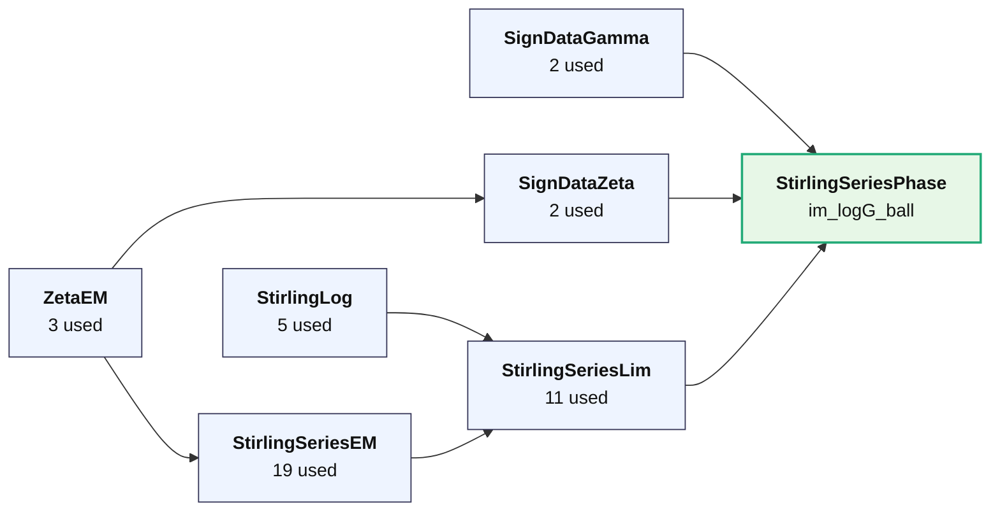

# What `StirlingSeries.im_logG_ball` rests on

[`StirlingSeries.im_logG_ball`](../lean_stage3/StirlingSeriesPhase.md#StirlingSeries-im_logG_ball) in `lean_stage3/Stage3/StirlingSeriesPhase.lean`, line 167.

**Why.** The phase of `Γ(1/4 + it/2)` to `(2/5)/|t|³`: `|Im logG z − Im S₃ z| ≤ (2/5)/|t|³`.

**Proves**

```lean
|(Stirling.logG (zz t)).im - (stirMain 3 (zz t)).im| ≤ 2 / 5 / |t| ^ 3
```

**Needs** (its hypotheses)

  - `` ht : 1 ≤ |t| ``

Behind it: 35 theorems and 10 definitions in 7 files. Every one is listed below; Lean recorded each step.

## The files it passes through



An arrow A → B reads "B uses something proved or defined in A"; indirect arrows are left out. Green: the theorem itself. Yellow: a file in the other tree. The number is how many of that file's declarations are on the way.

## Every declaration on the way

Files in dependency order. ★ marks what the theorem's own proof uses directly.

### [`SignDataGamma`](../lean_stage3/SignDataGamma.md) — 2

- ★ [`SignData.zz`](../lean_stage3/SignDataGamma.md#SignData-zz) — *def*
- [`SignData.zz_re`](../lean_stage3/SignDataGamma.md#SignData-zz_re) — `` (zz t).re = 1 / 4 ``

### [`StirlingLog`](../lean_stage3/StirlingLog.md) — 5

- ★ [`Stirling.logG`](../lean_stage3/StirlingLog.md#Stirling-logG) — *def*
- [`Stirling.tendsto_logG`](../lean_stage3/StirlingLog.md#Stirling-tendsto_logG) — `` Tendsto (Complex.logGammaSeq z) atTop (𝓝 (logG z)) ``
- [`Stirling.sum_inv_sq_le`](../lean_stage3/StirlingLog.md#Stirling-sum_inv_sq_le) — `` ∑ m ∈ Finset.range N, 1 / ((m : ℝ) + Y) ^ 2 ≤ 3 / Y - 3 / ((N : ℝ) + Y) ``
- [`Stirling.normSq_add_nat_ge`](../lean_stage3/StirlingLog.md#Stirling-normSq_add_nat_ge) — `` ((m : ℝ) + |z.im|) ^ 2 / 2 ≤ ‖z + m‖ ^ 2 ``
- [`Stirling.sum_inv_normSq_le`](../lean_stage3/StirlingLog.md#Stirling-sum_inv_normSq_le) — `` ∑ m ∈ Finset.range N, 1 / ‖z + m‖ ^ 2 ≤ 6 / |z.im| ``

### [`ZetaEM`](../lean_stage3/ZetaEM.md) — 3

- [`ZetaEM.bernBound`](../lean_stage3/ZetaEM.md#ZetaEM-bernBound) — *def*
- [`ZetaEM.abs_bernoulliFun_fract_le`](../lean_stage3/ZetaEM.md#ZetaEM-abs_bernoulliFun_fract_le) — `` |bernoulliFun k (Int.fract x)| ≤ bernBound k ``
- [`ZetaEM.bernBound_nonneg`](../lean_stage3/ZetaEM.md#ZetaEM-bernBound_nonneg) — `` 0 ≤ bernBound k ``

### [`SignDataZeta`](../lean_stage3/SignDataZeta.md) — 2

- [`SignData.bernoulliFun_four`](../lean_stage3/SignDataZeta.md#SignData-bernoulliFun_four) — `` bernoulliFun 4 x = x ^ 4 - 2 * x ^ 3 + x ^ 2 - 1 / 30 ``
- [`SignData.bernBound_four_le`](../lean_stage3/SignDataZeta.md#SignData-bernBound_four_le) — `` bernBound 4 ≤ 1 / 30 ``

### [`StirlingSeriesEM`](../lean_stage3/StirlingSeriesEM.md) — 19

- [`StirlingSeries.emJ`](../lean_stage3/StirlingSeriesEM.md#StirlingSeries-emJ) — *def*
- [`StirlingSeries.bdiff`](../lean_stage3/StirlingSeriesEM.md#StirlingSeries-bdiff) — *def*
- [`StirlingSeries.stirC`](../lean_stage3/StirlingSeriesEM.md#StirlingSeries-stirC) — *def*
- [`StirlingSeries.stirSum`](../lean_stage3/StirlingSeriesEM.md#StirlingSeries-stirSum) — *def*
- ★ [`StirlingSeries.stirMain`](../lean_stage3/StirlingSeriesEM.md#StirlingSeries-stirMain) — *def*
- [`StirlingSeries.add_ofReal_ne_zero`](../lean_stage3/StirlingSeriesEM.md#StirlingSeries-add_ofReal_ne_zero) — `` w + (x : ℂ) ≠ 0 ``
- [`StirlingSeries.bern_cast_zero`](../lean_stage3/StirlingSeriesEM.md#StirlingSeries-bern_cast_zero) — `` ((bernoulliFun n 0 : ℝ) : ℂ) = ((bernoulli n : ℚ) : ℂ) ``
- [`StirlingSeries.continuousOn_integrand`](../lean_stage3/StirlingSeriesEM.md#StirlingSeries-continuousOn_integrand) — `` ContinuousOn (fun x : ℝ => ((bernoulliFun m x : ℝ) : ℂ) * ((w + (x : ℂ)) ^ m)⁻¹) (uIcc (0 : ℝ) 1) ``
- [`StirlingSeries.intervalIntegrable_integrand`](../lean_stage3/StirlingSeriesEM.md#StirlingSeries-intervalIntegrable_integrand) — `` IntervalIntegrable (fun x : ℝ => ((bernoulliFun m x : ℝ) : ℂ) * ((w + (x : ℂ)) ^ m)⁻¹) volume 0 1 ``
- [`StirlingSeries.hasDerivAt_inv_pow`](../lean_stage3/StirlingSeriesEM.md#StirlingSeries-hasDerivAt_inv_pow) — `` HasDerivAt (fun y : ℝ => ((w + (y : ℂ)) ^ (p + 1))⁻¹) (-((p : ℂ) + 1) * ((w + (x : ℂ)) ^ (p + 2))⁻¹) x ``
- [`StirlingSeries.emJ_step`](../lean_stage3/StirlingSeriesEM.md#StirlingSeries-emJ_step) — `` ((m : ℂ) + 1) * emJ m w = ((bernoulli (m + 1) : ℚ) : ℂ) * bdiff m w + (m : ℂ) * emJ (m + 1) w ``
- [`StirlingSeries.integral_inv_add`](../lean_stage3/StirlingSeriesEM.md#StirlingSeries-integral_inv_add) — `` ∫ x in (0 : ℝ)..1, (w + (x : ℂ))⁻¹ = log (w + 1) - log w ``
- [`StirlingSeries.emJ_one`](../lean_stage3/StirlingSeriesEM.md#StirlingSeries-emJ_one) — `` emJ 1 w = 1 - (w + 1 / 2) * (log (w + 1) - log w) ``
- [`StirlingSeries.bernoulli_odd_zero`](../lean_stage3/StirlingSeriesEM.md#StirlingSeries-bernoulli_odd_zero) — `` ((bernoulli (2 * K + 1) : ℚ) : ℂ) = 0 ``
- [`StirlingSeries.emJ_one_unroll`](../lean_stage3/StirlingSeriesEM.md#StirlingSeries-emJ_one_unroll) — `` emJ 1 w = ∑ k ∈ Finset.Ico 1 (K + 1), stirC k * bdiff (2 * k - 1) w + emJ (2 * K) w / (2 * K) ``
- [`StirlingSeries.stirMain_step`](../lean_stage3/StirlingSeriesEM.md#StirlingSeries-stirMain_step) — `` stirMain (K + 1) (w + 1) - stirMain (K + 1) w - log w = -(emJ (2 * K) w / (2 * K)) ``
- [`StirlingSeries.abs_bern_le`](../lean_stage3/StirlingSeriesEM.md#StirlingSeries-abs_bern_le) — `` |bernoulliFun m x| ≤ ZetaEM.bernBound m ``
- [`StirlingSeries.norm_le_norm_add`](../lean_stage3/StirlingSeriesEM.md#StirlingSeries-norm_le_norm_add) — `` ‖w‖ ≤ ‖w + (x : ℂ)‖ ``
- [`StirlingSeries.norm_emJ_le`](../lean_stage3/StirlingSeriesEM.md#StirlingSeries-norm_emJ_le) — `` ‖emJ m w‖ ≤ ZetaEM.bernBound m / ‖w‖ ^ m ``

### [`StirlingSeriesLim`](../lean_stage3/StirlingSeriesLim.md) — 11

- [`StirlingSeries.remP`](../lean_stage3/StirlingSeriesLim.md#StirlingSeries-remP) — *def*
- [`StirlingSeries.seqA`](../lean_stage3/StirlingSeriesLim.md#StirlingSeries-seqA) — *def*
- [`StirlingSeries.re_add_nat_pos`](../lean_stage3/StirlingSeriesLim.md#StirlingSeries-re_add_nat_pos) — `` 0 < (z + (n : ℂ)).re ``
- [`StirlingSeries.sum_log_eq`](../lean_stage3/StirlingSeriesLim.md#StirlingSeries-sum_log_eq) — `` ∑ n ∈ Finset.range (N + 1), log (z + (n : ℂ)) = stirMain (K + 1) (z + ((N + 1 : ℕ) : ℂ)) - stirMain (K + 1) z + remP K z N ``
- [`StirlingSeries.log_shift_eq`](../lean_stage3/StirlingSeriesLim.md#StirlingSeries-log_shift_eq) — `` log (z + ((N + 1 : ℕ) : ℂ)) = (Real.log N : ℂ) + log (1 + (z + 1) / (N : ℂ)) ``
- [`StirlingSeries.log_factorial_eq`](../lean_stage3/StirlingSeriesLim.md#StirlingSeries-log_factorial_eq) — `` Real.log (N.factorial) = Real.log (Stirling.stirlingSeq N) + Real.log 2 / 2 + Real.log N / 2 + N * Real.log N - N ``
- [`StirlingSeries.tendsto_inv_pow_shift`](../lean_stage3/StirlingSeriesLim.md#StirlingSeries-tendsto_inv_pow_shift) — `` Tendsto (fun N : ℕ => ((z + ((N + 1 : ℕ) : ℂ)) ^ j)⁻¹) atTop (𝓝 0) ``
- [`StirlingSeries.tendsto_stirSum_shift`](../lean_stage3/StirlingSeriesLim.md#StirlingSeries-tendsto_stirSum_shift) — `` Tendsto (fun N : ℕ => stirSum K (z + ((N + 1 : ℕ) : ℂ))) atTop (𝓝 0) ``
- [`StirlingSeries.tendsto_A`](../lean_stage3/StirlingSeriesLim.md#StirlingSeries-tendsto_A) — `` Tendsto (seqA K z) atTop (𝓝 ((Real.log (2 * Real.pi) / 2 : ℝ) : ℂ)) ``
- [`StirlingSeries.norm_P_le`](../lean_stage3/StirlingSeriesLim.md#StirlingSeries-norm_P_le) — `` ‖remP K z N‖ ≤ ZetaEM.bernBound (2 * K) / (2 * K) * (6 / |z.im|) / ‖z‖ ^ (2 * K - 2) ``
- [`StirlingSeries.stirling_series`](../lean_stage3/StirlingSeriesLim.md#StirlingSeries-stirling_series) — `` ‖Stirling.logG z - stirMain (K + 1) z - ((Real.log (2 * Real.pi) / 2 : ℝ) : ℂ)‖ ≤ ZetaEM.bernBound (2 * K) / (2 * K) * (6 / |z.im|) / ‖z‖ ^ (2 * K - 2) ``

### [`StirlingSeriesPhase`](../lean_stage3/StirlingSeriesPhase.md) — 3

- [`StirlingSeries.zz_im`](../lean_stage3/StirlingSeriesPhase.md#StirlingSeries-zz_im) — `` (zz t).im = t / 2 ``
- [`StirlingSeries.norm_zz_ge`](../lean_stage3/StirlingSeriesPhase.md#StirlingSeries-norm_zz_ge) — `` |t| / 2 ≤ ‖zz t‖ ``
- ★ [`StirlingSeries.delta3_le'`](../lean_stage3/StirlingSeriesPhase.md#StirlingSeries-delta3_le-) — `` ‖Stirling.logG (zz t) - stirMain 3 (zz t) - ((Real.log (2 * Real.pi) / 2 : ℝ) : ℂ)‖ ≤ 2 / 5 / |t| ^ 3 ``

