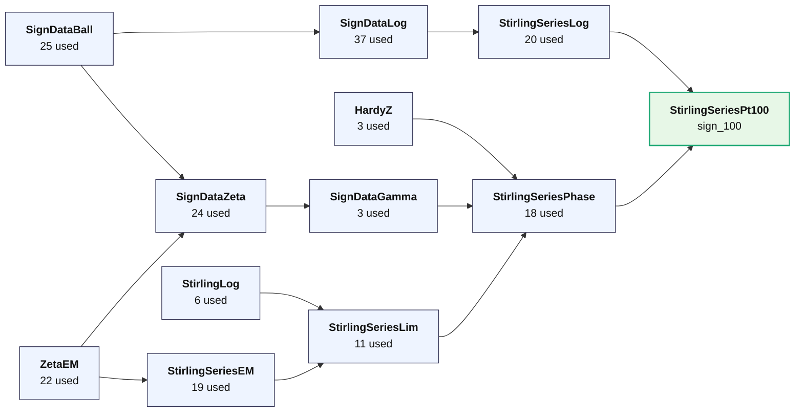

# What `StirlingSeries.sign_100` rests on

[`StirlingSeries.sign_100`](../lean_stage3/StirlingSeriesPt100.md#StirlingSeries-sign_100) in `lean_stage3/Stage3/StirlingSeriesPt100.lean`, line 492.

**Why.** The sign at `t = 100.0` through Stirling's series: `Re Λ(1/2 + it) > 0`.

**Proves**

```lean
0 < (completedRiemannZeta (lineS (100 : ℝ))).re
```

Behind it: 254 theorems and 25 definitions in 12 files. Every one is listed below; Lean recorded each step.

## The files it passes through



An arrow A → B reads "B uses something proved or defined in A"; indirect arrows are left out. Green: the theorem itself. Yellow: a file in the other tree. The number is how many of that file's declarations are on the way.

## Every declaration on the way

Files in dependency order. ★ marks what the theorem's own proof uses directly.

### [`HardyZ`](../lean_stage3/HardyZ.md) — 3

- [`HardyZ.completedRiemannZeta_conj_of_re_pos`](../lean_stage3/HardyZ.md#HardyZ-completedRiemannZeta_conj_of_re_pos) — `` completedRiemannZeta (conj s) = conj (completedRiemannZeta s) ``
- [`HardyZ.re_line`](../lean_stage3/HardyZ.md#HardyZ-re_line) — `` ((1 / 2 : ℂ) + t * I).re = 1 / 2 ``
- [`HardyZ.xi_line_real`](../lean_stage3/HardyZ.md#HardyZ-xi_line_real) — `` (completedRiemannZeta (1/2 + t * Complex.I)).im = 0 ``

### [`SignDataBall`](../lean_stage3/SignDataBall.md) — 25

- [`SignData.cx`](../lean_stage3/SignDataBall.md#SignData-cx) — *def*
- [`SignData.cx_re`](../lean_stage3/SignDataBall.md#SignData-cx_re) — `` (cx a b).re = a ``
- [`SignData.cx_im`](../lean_stage3/SignDataBall.md#SignData-cx_im) — `` (cx a b).im = b ``
- [`SignData.norm_cx_le`](../lean_stage3/SignDataBall.md#SignData-norm_cx_le) — `` ‖cx a b‖ ≤ |a| + |b| ``
- [`SignData.ball_add`](../lean_stage3/SignDataBall.md#SignData-ball_add) — `` ‖z + w - cx e f‖ ≤ R ``
- [`SignData.ball_mul`](../lean_stage3/SignDataBall.md#SignData-ball_mul) — `` ‖z * w - cx e f‖ ≤ R ``
- [`SignData.ball_ofReal`](../lean_stage3/SignDataBall.md#SignData-ball_ofReal) — `` ‖(x : ℂ) - cx c 0‖ ≤ e ``
- [`SignData.re_pos_of_ball`](../lean_stage3/SignDataBall.md#SignData-re_pos_of_ball) — `` 0 < z.re ``
- [`SignData.neg_mul_ball`](../lean_stage3/SignDataBall.md#SignData-neg_mul_ball) — `` |-(t * x) - -(t * a)| ≤ |t| * e ``
- [`SignData.cosP`](../lean_stage3/SignDataBall.md#SignData-cosP) — *def*
- [`SignData.sinP`](../lean_stage3/SignDataBall.md#SignData-sinP) — *def*
- [`SignData.taylor_eq`](../lean_stage3/SignDataBall.md#SignData-taylor_eq) — `` ∑ m ∈ Finset.range (2 * K), ((y : ℂ) * I) ^ m / (m.factorial : ℂ) = cx (cosP K y) (sinP K y) ``
- [`SignData.norm_exp_sub_exp_le`](../lean_stage3/SignDataBall.md#SignData-norm_exp_sub_exp_le) — `` ‖cexp ((y : ℂ) * I) - cexp ((y₀ : ℂ) * I)‖ ≤ |y - y₀| ``
- [`SignData.exp_ball_core`](../lean_stage3/SignDataBall.md#SignData-exp_ball_core) — `` ‖cexp ((y : ℂ) * I) - cx (cosP K y₀) (sinP K y₀)‖ ≤ ε + |y₀| ^ (2 * K) * ((2 * K + 1 : ℝ) / (((2 * K).factorial : ℝ) * (2 * K))) ``
- [`SignData.exp_reduce`](../lean_stage3/SignDataBall.md#SignData-exp_reduce) — `` cexp ((x : ℂ) * I) = cexp (((x - (j * (Real.pi / 2) + k * (2 * Real.pi)) : ℝ) : ℂ) * I) * I ^ j ``
- [`SignData.pi_ball`](../lean_stage3/SignDataBall.md#SignData-pi_ball) — `` |Real.pi - 3.14159265358979323846| ≤ 1 / 10 ^ 20 ``
- [`SignData.red_ball`](../lean_stage3/SignDataBall.md#SignData-red_ball) — `` |(x - (j * (Real.pi / 2) + k * (2 * Real.pi))) - y₀| ≤ ε' ``
- [`SignData.exp_ball_red`](../lean_stage3/SignDataBall.md#SignData-exp_ball_red) — `` ‖cexp (((x - (j * (Real.pi / 2) + k * (2 * Real.pi)) : ℝ) : ℂ) * I) - cx e f‖ ≤ R ``
- [`SignData.exp_ball0`](../lean_stage3/SignDataBall.md#SignData-exp_ball0) — `` ‖cexp ((x : ℂ) * I) - cx e f‖ ≤ R ``
- [`SignData.exp_ball1`](../lean_stage3/SignDataBall.md#SignData-exp_ball1) — `` ‖cexp ((x : ℂ) * I) - cx (-f) e‖ ≤ R ``
- [`SignData.exp_ball2`](../lean_stage3/SignDataBall.md#SignData-exp_ball2) — `` ‖cexp ((x : ℂ) * I) - cx (-e) (-f)‖ ≤ R ``
- [`SignData.exp_ball3`](../lean_stage3/SignDataBall.md#SignData-exp_ball3) — `` ‖cexp ((x : ℂ) * I) - cx f (-e)‖ ≤ R ``
- [`SignData.log_succ_ball`](../lean_stage3/SignDataBall.md#SignData-log_succ_ball) — `` |Real.log q - c| ≤ R ``
- [`SignData.log_pi_ball`](../lean_stage3/SignDataBall.md#SignData-log_pi_ball) — `` |Real.log Real.pi - c| ≤ R ``
- [`SignData.inv_sqrt_ball`](../lean_stage3/SignDataBall.md#SignData-inv_sqrt_ball) — `` |(Real.sqrt m)⁻¹ - c| ≤ R ``

### [`SignDataLog`](../lean_stage3/SignDataLog.md) — 37

- [`SignData.log_ball_2`](../lean_stage3/SignDataLog.md#SignData-log_ball_2) — `` |Real.log ((2 : ℕ) : ℝ) - (0.69314718055)| ≤ (0.00000000025) ``
- [`SignData.log_ball_3`](../lean_stage3/SignDataLog.md#SignData-log_ball_3) — `` |Real.log (((3 : ℕ)) : ℝ) - (1.098612288658164142930964760306)| ≤ (0.000000000250007285403624428292) ``
- [`SignData.log_ball_4`](../lean_stage3/SignDataLog.md#SignData-log_ball_4) — `` |Real.log (((4 : ℕ)) : ℝ) - (1.386294361109944875563750019823)| ≤ (0.000000000250012022355196162294) ``
- [`SignData.log_ball_5`](../lean_stage3/SignDataLog.md#SignData-log_ball_5) — `` |Real.log (((5 : ℕ)) : ℝ) - (1.609437912424154507888186373287)| ≤ (0.000000000250014643795196162295) ``
- [`SignData.log_ball_6`](../lean_stage3/SignDataLog.md#SignData-log_ball_6) — `` |Real.log (((6 : ℕ)) : ℝ) - (1.791759469218109031470825672761)| ≤ (0.000000000250016613075280171998) ``
- [`SignData.log_ball_7`](../lean_stage3/SignDataLog.md#SignData-log_ball_7) — `` |Real.log (((7 : ℕ)) : ℝ) - (1.945910149045367043442249594592)| ≤ (0.000000000250021628181194999771) ``
- [`SignData.log_ball_8`](../lean_stage3/SignDataLog.md#SignData-log_ball_8) — `` |Real.log (((8 : ℕ)) : ℝ) - (2.079441541669889414922705144822)| ≤ (0.000000000250025688425399343201) ``
- [`SignData.log_ball_9`](../lean_stage3/SignDataLog.md#SignData-log_ball_9) — `` |Real.log (((9 : ℕ)) : ℝ) - (2.19722457732627250799617757113)| ≤ (0.000000000250031152478117664421) ``
- [`SignData.log_ball_10`](../lean_stage3/SignDataLog.md#SignData-log_ball_10) — `` |Real.log (((10 : ℕ)) : ℝ) - (2.302585092984098735657405232358)| ≤ (0.000000000250032263589228775533) ``
- [`SignData.log_ball_11`](../lean_stage3/SignDataLog.md#SignData-log_ball_11) — `` |Real.log (((11 : ℕ)) : ℝ) - (2.397895272788423390160638914682)| ≤ (0.000000000250035160233026142414) ``
- [`SignData.log_ball_12`](../lean_stage3/SignDataLog.md#SignData-log_ball_12) — `` |Real.log (((12 : ℕ)) : ℝ) - (2.484906649778053096001283444008)| ≤ (0.00000000025003600990465329859) ``
- [`SignData.log_ball_13`](../lean_stage3/SignDataLog.md#SignData-log_ball_13) — `` |Real.log (((13 : ℕ)) : ℝ) - (2.564949357451589248303973730065)| ≤ (0.000000000250039586736521464553) ``
- [`SignData.log_ball_14`](../lean_stage3/SignDataLog.md#SignData-log_ball_14) — `` |Real.log (((14 : ℕ)) : ℝ) - (2.639057329605311022970451423173)| ≤ (0.000000000250040943550219800809) ``
- [`SignData.log_ball_15`](../lean_stage3/SignDataLog.md#SignData-log_ball_15) — `` |Real.log (((15 : ℕ)) : ℝ) - (2.708050201092261790030957852678)| ≤ (0.00000000025004920142160829253) ``
- [`SignData.log_ball_16`](../lean_stage3/SignDataLog.md#SignData-log_ball_16) — `` |Real.log (((16 : ℕ)) : ℝ) - (2.772588722229832647511359697862)| ≤ (0.000000000250052990982865679732) ``
- [`SignData.log_ball_17`](../lean_stage3/SignDataLog.md#SignData-log_ball_17) — `` |Real.log (((17 : ℕ)) : ℝ) - (2.833213344046267338845182082273)| ≤ (0.000000000250054814634508383847) ``
- [`SignData.log_ball_18`](../lean_stage3/SignDataLog.md#SignData-log_ball_18) — `` |Real.log (((18 : ℕ)) : ℝ) - (2.890371757886215874872377017636)| ≤ (0.00000000025005572991355977543) ``
- [`SignData.log_ball_19`](../lean_stage3/SignDataLog.md#SignData-log_ball_19) — `` |Real.log (((19 : ℕ)) : ℝ) - (2.944438979156490822698758619737)| ≤ (0.000000000250064791233927153323) ``
- [`SignData.log_pi_ball'`](../lean_stage3/SignDataLog.md#SignData-log_pi_ball-) — `` |Real.log Real.pi - (1.144729885839454400081836469865)| ≤ (0.000000000250010002548919421399) ``
- [`SignData.isqrt_ball_2`](../lean_stage3/SignDataLog.md#SignData-isqrt_ball_2) — `` |(Real.sqrt (((2 : ℕ)) : ℝ))⁻¹ - (0.707106781186547524400844362104)| ≤ (0.000000000000000000000000000001) ``
- [`SignData.isqrt_ball_3`](../lean_stage3/SignDataLog.md#SignData-isqrt_ball_3) — `` |(Real.sqrt (((3 : ℕ)) : ℝ))⁻¹ - (0.577350269189625764509148780502)| ≤ (0.000000000000000000000000000001) ``
- [`SignData.isqrt_ball_4`](../lean_stage3/SignDataLog.md#SignData-isqrt_ball_4) — `` |(Real.sqrt (((4 : ℕ)) : ℝ))⁻¹ - (0.5)| ≤ (0.000000000000000000000000000001) ``
- [`SignData.isqrt_ball_5`](../lean_stage3/SignDataLog.md#SignData-isqrt_ball_5) — `` |(Real.sqrt (((5 : ℕ)) : ℝ))⁻¹ - (0.447213595499957939281834733746)| ≤ (0.000000000000000000000000000001) ``
- [`SignData.isqrt_ball_6`](../lean_stage3/SignDataLog.md#SignData-isqrt_ball_6) — `` |(Real.sqrt (((6 : ℕ)) : ℝ))⁻¹ - (0.40824829046386301636621401245)| ≤ (0.000000000000000000000000000001) ``
- [`SignData.isqrt_ball_7`](../lean_stage3/SignDataLog.md#SignData-isqrt_ball_7) — `` |(Real.sqrt (((7 : ℕ)) : ℝ))⁻¹ - (0.377964473009227227214516536234)| ≤ (0.000000000000000000000000000001) ``
- [`SignData.isqrt_ball_8`](../lean_stage3/SignDataLog.md#SignData-isqrt_ball_8) — `` |(Real.sqrt (((8 : ℕ)) : ℝ))⁻¹ - (0.353553390593273762200422181052)| ≤ (0.000000000000000000000000000001) ``
- [`SignData.isqrt_ball_9`](../lean_stage3/SignDataLog.md#SignData-isqrt_ball_9) — `` |(Real.sqrt (((9 : ℕ)) : ℝ))⁻¹ - (0.333333333333333333333333333334)| ≤ (0.000000000000000000000000000001) ``
- [`SignData.isqrt_ball_10`](../lean_stage3/SignDataLog.md#SignData-isqrt_ball_10) — `` |(Real.sqrt (((10 : ℕ)) : ℝ))⁻¹ - (0.316227766016837933199889354444)| ≤ (0.000000000000000000000000000001) ``
- [`SignData.isqrt_ball_11`](../lean_stage3/SignDataLog.md#SignData-isqrt_ball_11) — `` |(Real.sqrt (((11 : ℕ)) : ℝ))⁻¹ - (0.30151134457776362264681206697)| ≤ (0.000000000000000000000000000001) ``
- [`SignData.isqrt_ball_12`](../lean_stage3/SignDataLog.md#SignData-isqrt_ball_12) — `` |(Real.sqrt (((12 : ℕ)) : ℝ))⁻¹ - (0.28867513459481288225457439025)| ≤ (0.000000000000000000000000000001) ``
- [`SignData.isqrt_ball_13`](../lean_stage3/SignDataLog.md#SignData-isqrt_ball_13) — `` |(Real.sqrt (((13 : ℕ)) : ℝ))⁻¹ - (0.277350098112614561009170866728)| ≤ (0.000000000000000000000000000001) ``
- [`SignData.isqrt_ball_14`](../lean_stage3/SignDataLog.md#SignData-isqrt_ball_14) — `` |(Real.sqrt (((14 : ℕ)) : ℝ))⁻¹ - (0.26726124191242438468455348088)| ≤ (0.000000000000000000000000000001) ``
- [`SignData.isqrt_ball_15`](../lean_stage3/SignDataLog.md#SignData-isqrt_ball_15) — `` |(Real.sqrt (((15 : ℕ)) : ℝ))⁻¹ - (0.258198889747161125678617693318)| ≤ (0.000000000000000000000000000001) ``
- [`SignData.isqrt_ball_16`](../lean_stage3/SignDataLog.md#SignData-isqrt_ball_16) — `` |(Real.sqrt (((16 : ℕ)) : ℝ))⁻¹ - (0.25)| ≤ (0.000000000000000000000000000001) ``
- [`SignData.isqrt_ball_17`](../lean_stage3/SignDataLog.md#SignData-isqrt_ball_17) — `` |(Real.sqrt (((17 : ℕ)) : ℝ))⁻¹ - (0.242535625036332973518906462116)| ≤ (0.000000000000000000000000000001) ``
- [`SignData.isqrt_ball_18`](../lean_stage3/SignDataLog.md#SignData-isqrt_ball_18) — `` |(Real.sqrt (((18 : ℕ)) : ℝ))⁻¹ - (0.235702260395515841466948120702)| ≤ (0.000000000000000000000000000001) ``
- [`SignData.isqrt_ball_19`](../lean_stage3/SignDataLog.md#SignData-isqrt_ball_19) — `` |(Real.sqrt (((19 : ℕ)) : ℝ))⁻¹ - (0.229415733870561765907209578098)| ≤ (0.000000000000000000000000000001) ``

### [`StirlingLog`](../lean_stage3/StirlingLog.md) — 6

- [`Stirling.logG`](../lean_stage3/StirlingLog.md#Stirling-logG) — *def*
- [`Stirling.tendsto_logG`](../lean_stage3/StirlingLog.md#Stirling-tendsto_logG) — `` Tendsto (Complex.logGammaSeq z) atTop (𝓝 (logG z)) ``
- [`Stirling.exp_logG`](../lean_stage3/StirlingLog.md#Stirling-exp_logG) — `` cexp (logG z) = Gamma z ``
- [`Stirling.sum_inv_sq_le`](../lean_stage3/StirlingLog.md#Stirling-sum_inv_sq_le) — `` ∑ m ∈ Finset.range N, 1 / ((m : ℝ) + Y) ^ 2 ≤ 3 / Y - 3 / ((N : ℝ) + Y) ``
- [`Stirling.normSq_add_nat_ge`](../lean_stage3/StirlingLog.md#Stirling-normSq_add_nat_ge) — `` ((m : ℝ) + |z.im|) ^ 2 / 2 ≤ ‖z + m‖ ^ 2 ``
- [`Stirling.sum_inv_normSq_le`](../lean_stage3/StirlingLog.md#Stirling-sum_inv_normSq_le) — `` ∑ m ∈ Finset.range N, 1 / ‖z + m‖ ^ 2 ≤ 6 / |z.im| ``

### [`StirlingSeriesLog`](../lean_stage3/StirlingSeriesLog.md) — 20

- [`StirlingSeries.log_ball_20`](../lean_stage3/StirlingSeriesLog.md#StirlingSeries-log_ball_20) — `` |Real.log (((20 : ℕ)) : ℝ) - (2.995732273544040890903123699102)| ≤ (0.000000000250069931036558732271) ``
- [`StirlingSeries.log_ball_21`](../lean_stage3/StirlingSeriesLog.md#StirlingSeries-log_ball_21) — `` |Real.log (((21 : ℕ)) : ℝ) - (3.044522437713472622584109651714)| ≤ (0.000000000250072928659867036761) ``
- [`StirlingSeries.log_ball_22`](../lean_stage3/StirlingSeriesLog.md#StirlingSeries-log_ball_22) — `` |Real.log (((22 : ℕ)) : ℝ) - (3.091042453348365317214688221636)| ≤ (0.0000000002500747215509079107) ``
- [`StirlingSeries.log_ball_23`](../lean_stage3/StirlingSeriesLog.md#StirlingSeries-log_ball_23) — `` |Real.log (((23 : ℕ)) : ℝ) - (3.135494215919199055169006622998)| ≤ (0.000000000250075818784155965857) ``
- [`StirlingSeries.log_ball_24`](../lean_stage3/StirlingSeriesLog.md#StirlingSeries-log_ball_24) — `` |Real.log (((24 : ℕ)) : ℝ) - (3.178053830337994921893530313829)| ≤ (0.000000000250076504524572447879) ``
- [`StirlingSeries.log_ball_25`](../lean_stage3/StirlingSeriesLog.md#StirlingSeries-log_ball_25) — `` |Real.log (((25 : ℕ)) : ℝ) - (3.218875824858250011866355710654)| ≤ (0.000000000250076941431239114547) ``
- [`StirlingSeries.log_ball_26`](../lean_stage3/StirlingSeriesLog.md#StirlingSeries-log_ball_26) — `` |Real.log (((26 : ℕ)) : ℝ) - (3.258096538011530574081236766765)| ≤ (0.000000000250084308587127577629) ``
- [`StirlingSeries.log_ball_27`](../lean_stage3/StirlingSeriesLog.md#StirlingSeries-log_ball_27) — `` |Real.log (((27 : ℕ)) : ℝ) - (3.295836865994377100174496101552)| ≤ (0.000000000250089352328098335678) ``
- [`StirlingSeries.log_ball_28`](../lean_stage3/StirlingSeriesLog.md#StirlingSeries-log_ball_28) — `` |Real.log (((28 : ℕ)) : ℝ) - (3.33220451016525160098260040834)| ≤ (0.000000000250092853504186808688) ``
- [`StirlingSeries.log_ball_29`](../lean_stage3/StirlingSeriesLog.md#StirlingSeries-log_ball_29) — `` |Real.log (((29 : ℕ)) : ℝ) - (3.367295829976521458836542724803)| ≤ (0.000000000250095315345114975566) ``
- [`StirlingSeries.isqrt_ball_20`](../lean_stage3/StirlingSeriesLog.md#StirlingSeries-isqrt_ball_20) — `` |(Real.sqrt (((20 : ℕ)) : ℝ))⁻¹ - (0.223606797749978969640917366874)| ≤ (0.000000000000000000000000000001) ``
- [`StirlingSeries.isqrt_ball_21`](../lean_stage3/StirlingSeriesLog.md#StirlingSeries-isqrt_ball_21) — `` |(Real.sqrt (((21 : ℕ)) : ℝ))⁻¹ - (0.218217890235992381266097485416)| ≤ (0.000000000000000000000000000001) ``
- [`StirlingSeries.isqrt_ball_22`](../lean_stage3/StirlingSeriesLog.md#StirlingSeries-isqrt_ball_22) — `` |(Real.sqrt (((22 : ℕ)) : ℝ))⁻¹ - (0.213200716355610434298437732434)| ≤ (0.000000000000000000000000000001) ``
- [`StirlingSeries.isqrt_ball_23`](../lean_stage3/StirlingSeriesLog.md#StirlingSeries-isqrt_ball_23) — `` |(Real.sqrt (((23 : ℕ)) : ℝ))⁻¹ - (0.20851441405707476267814948105)| ≤ (0.000000000000000000000000000001) ``
- [`StirlingSeries.isqrt_ball_24`](../lean_stage3/StirlingSeriesLog.md#StirlingSeries-isqrt_ball_24) — `` |(Real.sqrt (((24 : ℕ)) : ℝ))⁻¹ - (0.204124145231931508183107006226)| ≤ (0.000000000000000000000000000001) ``
- [`StirlingSeries.isqrt_ball_25`](../lean_stage3/StirlingSeriesLog.md#StirlingSeries-isqrt_ball_25) — `` |(Real.sqrt (((25 : ℕ)) : ℝ))⁻¹ - (0.2)| ≤ (0.000000000000000000000000000001) ``
- [`StirlingSeries.isqrt_ball_26`](../lean_stage3/StirlingSeriesLog.md#StirlingSeries-isqrt_ball_26) — `` |(Real.sqrt (((26 : ℕ)) : ℝ))⁻¹ - (0.196116135138184031924162465732)| ≤ (0.000000000000000000000000000001) ``
- [`StirlingSeries.isqrt_ball_27`](../lean_stage3/StirlingSeriesLog.md#StirlingSeries-isqrt_ball_27) — `` |(Real.sqrt (((27 : ℕ)) : ℝ))⁻¹ - (0.192450089729875254836382926834)| ≤ (0.000000000000000000000000000001) ``
- [`StirlingSeries.isqrt_ball_28`](../lean_stage3/StirlingSeriesLog.md#StirlingSeries-isqrt_ball_28) — `` |(Real.sqrt (((28 : ℕ)) : ℝ))⁻¹ - (0.188982236504613613607258268118)| ≤ (0.000000000000000000000000000001) ``
- [`StirlingSeries.isqrt_ball_29`](../lean_stage3/StirlingSeriesLog.md#StirlingSeries-isqrt_ball_29) — `` |(Real.sqrt (((29 : ℕ)) : ℝ))⁻¹ - (0.185695338177051863146576223846)| ≤ (0.000000000000000000000000000001) ``

### [`ZetaEM`](../lean_stage3/ZetaEM.md) — 22

- [`ZetaEM.emInt`](../lean_stage3/ZetaEM.md#ZetaEM-emInt) — *def*
- [`ZetaEM.emCoef`](../lean_stage3/ZetaEM.md#ZetaEM-emCoef) — *def*
- [`ZetaEM.emTerm`](../lean_stage3/ZetaEM.md#ZetaEM-emTerm) — *def*
- [`ZetaEM.emBoundary`](../lean_stage3/ZetaEM.md#ZetaEM-emBoundary) — *def*
- [`ZetaEM.emRem`](../lean_stage3/ZetaEM.md#ZetaEM-emRem) — *def*
- [`ZetaEM.bernBound`](../lean_stage3/ZetaEM.md#ZetaEM-bernBound) — *def*
- [`ZetaEM.hasDerivWithinAt_fract`](../lean_stage3/ZetaEM.md#ZetaEM-hasDerivWithinAt_fract) — `` HasDerivWithinAt Int.fract 1 (Ioi x) x ``
- [`ZetaEM.continuous_bernoulliFun_fract`](../lean_stage3/ZetaEM.md#ZetaEM-continuous_bernoulliFun_fract) — `` Continuous (fun x : ℝ ↦ bernoulliFun k (Int.fract x)) ``
- [`ZetaEM.abs_bernoulliFun_fract_le`](../lean_stage3/ZetaEM.md#ZetaEM-abs_bernoulliFun_fract_le) — `` |bernoulliFun k (Int.fract x)| ≤ bernBound k ``
- [`ZetaEM.bernBound_nonneg`](../lean_stage3/ZetaEM.md#ZetaEM-bernBound_nonneg) — `` 0 ≤ bernBound k ``
- [`ZetaEM.measurable_bern`](../lean_stage3/ZetaEM.md#ZetaEM-measurable_bern) — `` Measurable (fun x : ℝ ↦ bernoulliFun k (Int.fract x)) ``
- [`ZetaEM.integrableOn_bern_cpow`](../lean_stage3/ZetaEM.md#ZetaEM-integrableOn_bern_cpow) — `` IntegrableOn (fun x : ℝ ↦ ((bernoulliFun k (Int.fract x) : ℝ) : ℂ) * (x:ℂ) ^ w) (Ioi a) ``
- [`ZetaEM.norm_integral_bern_cpow_le`](../lean_stage3/ZetaEM.md#ZetaEM-norm_integral_bern_cpow_le) — `` ‖∫ x in Ioi a, ((bernoulliFun k (Int.fract x) : ℝ) : ℂ) * (x:ℂ) ^ w‖ ≤ bernBound k * (-a ^ (w.re + 1) / (w.re + 1)) ``
- [`ZetaEM.interval_ibp`](../lean_stage3/ZetaEM.md#ZetaEM-interval_ibp) — `` ((k:ℂ) + 1) * ∫ x in a..b, ((bernoulliFun k (Int.fract x) : ℝ) : ℂ) * (x:ℂ) ^ (-(s + k)) = ((bernoulliFun (k+1) (Int.fract b) : ℝ) : ℂ) * (b:ℂ) ^ (-(s + k)) - (… ``
- [`ZetaEM.tail_ibp`](../lean_stage3/ZetaEM.md#ZetaEM-tail_ibp) — `` ((k:ℂ) + 1) * ∫ x in Ioi a, ((bernoulliFun k (Int.fract x) : ℝ) : ℂ) * (x:ℂ) ^ (-(s + k)) = -(((bernoulliFun (k+1) (Int.fract a) : ℝ) : ℂ) * (a:ℂ) ^ (-(s + k)))… ``
- [`ZetaEM.emInt_step`](../lean_stage3/ZetaEM.md#ZetaEM-emInt_step) — `` ((k:ℂ) + 1) * emInt k N s = -((bernoulliFun (k+1) 0 : ℂ) * (N:ℂ) ^ (-(s + k))) + (s + k) * emInt (k+1) N s ``
- [`ZetaEM.emRem_step`](../lean_stage3/ZetaEM.md#ZetaEM-emRem_step) — `` emRem k N s = emTerm k N s + emRem (k+1) N s ``
- [`ZetaEM.sum_range_succ_eq_sum_Icc`](../lean_stage3/ZetaEM.md#ZetaEM-sum_range_succ_eq_sum_Icc) — `` ∑ n ∈ Finset.range (N + 1), 1 / (n : ℂ) ^ s = ∑ n ∈ Finset.Icc 1 N, (n : ℂ) ^ (-s) ``
- [`ZetaEM.zeta_eq_em_one`](../lean_stage3/ZetaEM.md#ZetaEM-zeta_eq_em_one) — `` riemannZeta s = ∑ n ∈ Finset.Icc 1 N, (n : ℂ) ^ (-s) - (N:ℂ) ^ (1 - s) / (1 - s) - (N:ℂ) ^ (-s) / 2 - s * emInt 1 N s ``
- [`ZetaEM.zeta_eq_em`](../lean_stage3/ZetaEM.md#ZetaEM-zeta_eq_em) — `` riemannZeta s = ∑ n ∈ Finset.Icc 1 N, (n : ℂ) ^ (-s) - (N:ℂ) ^ (1 - s) / (1 - s) - (N:ℂ) ^ (-s) / 2 + emBoundary k N s + emRem k N s ``
- [`ZetaEM.norm_emInt_le`](../lean_stage3/ZetaEM.md#ZetaEM-norm_emInt_le) — `` ‖emInt k N s‖ ≤ bernBound k * ((N:ℝ) ^ (1 - s.re - k) / (s.re + k - 1)) ``
- [`ZetaEM.norm_remainder_le`](../lean_stage3/ZetaEM.md#ZetaEM-norm_remainder_le) — `` ‖emRem k N s‖ ≤ (∏ i ∈ Finset.range k, ‖s + i‖) / k.factorial * (bernBound k * ((N:ℝ) ^ (1 - s.re - k) / (s.re + k - 1))) ``

### [`SignDataZeta`](../lean_stage3/SignDataZeta.md) — 24

- ★ [`SignData.lineS`](../lean_stage3/SignDataZeta.md#SignData-lineS) — *def*
- [`SignData.emB`](../lean_stage3/SignDataZeta.md#SignData-emB) — *def*
- [`SignData.Bre`](../lean_stage3/SignDataZeta.md#SignData-Bre) — *def*
- [`SignData.Bim`](../lean_stage3/SignDataZeta.md#SignData-Bim) — *def*
- [`SignData.lineS_re`](../lean_stage3/SignDataZeta.md#SignData-lineS_re) — `` (lineS t).re = 1 / 2 ``
- [`SignData.lineS_ne_zero`](../lean_stage3/SignDataZeta.md#SignData-lineS_ne_zero) — `` lineS t ≠ 0 ``
- [`SignData.lineS_ne_one`](../lean_stage3/SignDataZeta.md#SignData-lineS_ne_one) — `` lineS t ≠ 1 ``
- [`SignData.bernoulliFun_four`](../lean_stage3/SignDataZeta.md#SignData-bernoulliFun_four) — `` bernoulliFun 4 x = x ^ 4 - 2 * x ^ 3 + x ^ 2 - 1 / 30 ``
- [`SignData.bernBound_four_le`](../lean_stage3/SignDataZeta.md#SignData-bernBound_four_le) — `` bernBound 4 ≤ 1 / 30 ``
- [`SignData.bernoulliFun_three_zero`](../lean_stage3/SignDataZeta.md#SignData-bernoulliFun_three_zero) — `` bernoulliFun 3 0 = 0 ``
- [`SignData.bernoulliFun_four_zero`](../lean_stage3/SignDataZeta.md#SignData-bernoulliFun_four_zero) — `` bernoulliFun 4 0 = -1 / 30 ``
- [`SignData.cpow_neg_add_nat`](../lean_stage3/SignDataZeta.md#SignData-cpow_neg_add_nat) — `` (N : ℂ) ^ (-(s + j)) = (N : ℂ) ^ (-s) / (N : ℂ) ^ j ``
- [`SignData.emBoundary_four`](../lean_stage3/SignDataZeta.md#SignData-emBoundary_four) — `` emBoundary 4 N s = (N : ℂ) ^ (-s) * (s / (12 * N) - s * (s + 1) * (s + 2) / (720 * (N : ℂ) ^ 3)) ``
- [`SignData.zeta_em4`](../lean_stage3/SignDataZeta.md#SignData-zeta_em4) — `` ‖riemannZeta (lineS t) - (∑ m ∈ Finset.Icc 1 N, (m : ℂ) ^ (-lineS t) + (N : ℂ) ^ (-lineS t) * emB t N)‖ ≤ (∏ i ∈ Finset.range 4, ‖lineS t + i‖) / 24 * ((1 / 30)… ``
- [`SignData.emB_eq`](../lean_stage3/SignDataZeta.md#SignData-emB_eq) — `` emB t N = cx (Bre t N) (Bim t N) ``
- [`SignData.natCast_cpow_line`](../lean_stage3/SignDataZeta.md#SignData-natCast_cpow_line) — `` (m : ℂ) ^ (-lineS t) = (((Real.sqrt m)⁻¹ : ℝ) : ℂ) * cexp (((-(t * Real.log m)) : ℝ) * I) ``
- [`SignData.norm_le_of_sq`](../lean_stage3/SignDataZeta.md#SignData-norm_le_of_sq) — `` ‖cx a b‖ ≤ q ``
- [`SignData.lineS_add_nat`](../lean_stage3/SignDataZeta.md#SignData-lineS_add_nat) — `` lineS t + i = cx (1 / 2 + i) t ``
- [`SignData.rpow_neg_seven_half`](../lean_stage3/SignDataZeta.md#SignData-rpow_neg_seven_half) — `` N ^ (-(7 / 2) : ℝ) = 1 / (N ^ 3 * Real.sqrt N) ``
- [`SignData.rem_le`](../lean_stage3/SignDataZeta.md#SignData-rem_le) — `` (∏ i ∈ Finset.range 4, ‖lineS t + i‖) / 24 * ((1 / 30) * ((N : ℝ) ^ (-(7 / 2) : ℝ) / (7 / 2))) ≤ Q ``
- [`SignData.emB_ball`](../lean_stage3/SignDataZeta.md#SignData-emB_ball) — `` ‖emB t N - cx (Bre t N) (Bim t N)‖ ≤ 0 ``
- [`SignData.zeta_ball`](../lean_stage3/SignDataZeta.md#SignData-zeta_ball) — `` ‖riemannZeta (lineS t) - cx a b‖ ≤ R ``
- [`SignData.one_term_ball`](../lean_stage3/SignDataZeta.md#SignData-one_term_ball) — `` ‖((1 : ℕ) : ℂ) ^ (-lineS t) - cx 1 0‖ ≤ 0 ``
- [`SignData.sum_one_ball`](../lean_stage3/SignDataZeta.md#SignData-sum_one_ball) — `` ‖∑ m ∈ Finset.Icc 1 1, ((m : ℕ) : ℂ) ^ (-lineS t) - cx 1 0‖ ≤ 0 ``

### [`SignDataGamma`](../lean_stage3/SignDataGamma.md) — 3

- [`SignData.zz`](../lean_stage3/SignDataGamma.md#SignData-zz) — *def*
- [`SignData.zz_re`](../lean_stage3/SignDataGamma.md#SignData-zz_re) — `` (zz t).re = 1 / 4 ``
- [`SignData.lineS_div_two`](../lean_stage3/SignDataGamma.md#SignData-lineS_div_two) — `` lineS t / 2 = zz t ``

### [`StirlingSeriesEM`](../lean_stage3/StirlingSeriesEM.md) — 19

- [`StirlingSeries.emJ`](../lean_stage3/StirlingSeriesEM.md#StirlingSeries-emJ) — *def*
- [`StirlingSeries.bdiff`](../lean_stage3/StirlingSeriesEM.md#StirlingSeries-bdiff) — *def*
- [`StirlingSeries.stirC`](../lean_stage3/StirlingSeriesEM.md#StirlingSeries-stirC) — *def*
- [`StirlingSeries.stirSum`](../lean_stage3/StirlingSeriesEM.md#StirlingSeries-stirSum) — *def*
- [`StirlingSeries.stirMain`](../lean_stage3/StirlingSeriesEM.md#StirlingSeries-stirMain) — *def*
- [`StirlingSeries.add_ofReal_ne_zero`](../lean_stage3/StirlingSeriesEM.md#StirlingSeries-add_ofReal_ne_zero) — `` w + (x : ℂ) ≠ 0 ``
- [`StirlingSeries.bern_cast_zero`](../lean_stage3/StirlingSeriesEM.md#StirlingSeries-bern_cast_zero) — `` ((bernoulliFun n 0 : ℝ) : ℂ) = ((bernoulli n : ℚ) : ℂ) ``
- [`StirlingSeries.continuousOn_integrand`](../lean_stage3/StirlingSeriesEM.md#StirlingSeries-continuousOn_integrand) — `` ContinuousOn (fun x : ℝ => ((bernoulliFun m x : ℝ) : ℂ) * ((w + (x : ℂ)) ^ m)⁻¹) (uIcc (0 : ℝ) 1) ``
- [`StirlingSeries.intervalIntegrable_integrand`](../lean_stage3/StirlingSeriesEM.md#StirlingSeries-intervalIntegrable_integrand) — `` IntervalIntegrable (fun x : ℝ => ((bernoulliFun m x : ℝ) : ℂ) * ((w + (x : ℂ)) ^ m)⁻¹) volume 0 1 ``
- [`StirlingSeries.hasDerivAt_inv_pow`](../lean_stage3/StirlingSeriesEM.md#StirlingSeries-hasDerivAt_inv_pow) — `` HasDerivAt (fun y : ℝ => ((w + (y : ℂ)) ^ (p + 1))⁻¹) (-((p : ℂ) + 1) * ((w + (x : ℂ)) ^ (p + 2))⁻¹) x ``
- [`StirlingSeries.emJ_step`](../lean_stage3/StirlingSeriesEM.md#StirlingSeries-emJ_step) — `` ((m : ℂ) + 1) * emJ m w = ((bernoulli (m + 1) : ℚ) : ℂ) * bdiff m w + (m : ℂ) * emJ (m + 1) w ``
- [`StirlingSeries.integral_inv_add`](../lean_stage3/StirlingSeriesEM.md#StirlingSeries-integral_inv_add) — `` ∫ x in (0 : ℝ)..1, (w + (x : ℂ))⁻¹ = log (w + 1) - log w ``
- [`StirlingSeries.emJ_one`](../lean_stage3/StirlingSeriesEM.md#StirlingSeries-emJ_one) — `` emJ 1 w = 1 - (w + 1 / 2) * (log (w + 1) - log w) ``
- [`StirlingSeries.bernoulli_odd_zero`](../lean_stage3/StirlingSeriesEM.md#StirlingSeries-bernoulli_odd_zero) — `` ((bernoulli (2 * K + 1) : ℚ) : ℂ) = 0 ``
- [`StirlingSeries.emJ_one_unroll`](../lean_stage3/StirlingSeriesEM.md#StirlingSeries-emJ_one_unroll) — `` emJ 1 w = ∑ k ∈ Finset.Ico 1 (K + 1), stirC k * bdiff (2 * k - 1) w + emJ (2 * K) w / (2 * K) ``
- [`StirlingSeries.stirMain_step`](../lean_stage3/StirlingSeriesEM.md#StirlingSeries-stirMain_step) — `` stirMain (K + 1) (w + 1) - stirMain (K + 1) w - log w = -(emJ (2 * K) w / (2 * K)) ``
- [`StirlingSeries.abs_bern_le`](../lean_stage3/StirlingSeriesEM.md#StirlingSeries-abs_bern_le) — `` |bernoulliFun m x| ≤ ZetaEM.bernBound m ``
- [`StirlingSeries.norm_le_norm_add`](../lean_stage3/StirlingSeriesEM.md#StirlingSeries-norm_le_norm_add) — `` ‖w‖ ≤ ‖w + (x : ℂ)‖ ``
- [`StirlingSeries.norm_emJ_le`](../lean_stage3/StirlingSeriesEM.md#StirlingSeries-norm_emJ_le) — `` ‖emJ m w‖ ≤ ZetaEM.bernBound m / ‖w‖ ^ m ``

### [`StirlingSeriesLim`](../lean_stage3/StirlingSeriesLim.md) — 11

- [`StirlingSeries.remP`](../lean_stage3/StirlingSeriesLim.md#StirlingSeries-remP) — *def*
- [`StirlingSeries.seqA`](../lean_stage3/StirlingSeriesLim.md#StirlingSeries-seqA) — *def*
- [`StirlingSeries.re_add_nat_pos`](../lean_stage3/StirlingSeriesLim.md#StirlingSeries-re_add_nat_pos) — `` 0 < (z + (n : ℂ)).re ``
- [`StirlingSeries.sum_log_eq`](../lean_stage3/StirlingSeriesLim.md#StirlingSeries-sum_log_eq) — `` ∑ n ∈ Finset.range (N + 1), log (z + (n : ℂ)) = stirMain (K + 1) (z + ((N + 1 : ℕ) : ℂ)) - stirMain (K + 1) z + remP K z N ``
- [`StirlingSeries.log_shift_eq`](../lean_stage3/StirlingSeriesLim.md#StirlingSeries-log_shift_eq) — `` log (z + ((N + 1 : ℕ) : ℂ)) = (Real.log N : ℂ) + log (1 + (z + 1) / (N : ℂ)) ``
- [`StirlingSeries.log_factorial_eq`](../lean_stage3/StirlingSeriesLim.md#StirlingSeries-log_factorial_eq) — `` Real.log (N.factorial) = Real.log (Stirling.stirlingSeq N) + Real.log 2 / 2 + Real.log N / 2 + N * Real.log N - N ``
- [`StirlingSeries.tendsto_inv_pow_shift`](../lean_stage3/StirlingSeriesLim.md#StirlingSeries-tendsto_inv_pow_shift) — `` Tendsto (fun N : ℕ => ((z + ((N + 1 : ℕ) : ℂ)) ^ j)⁻¹) atTop (𝓝 0) ``
- [`StirlingSeries.tendsto_stirSum_shift`](../lean_stage3/StirlingSeriesLim.md#StirlingSeries-tendsto_stirSum_shift) — `` Tendsto (fun N : ℕ => stirSum K (z + ((N + 1 : ℕ) : ℂ))) atTop (𝓝 0) ``
- [`StirlingSeries.tendsto_A`](../lean_stage3/StirlingSeriesLim.md#StirlingSeries-tendsto_A) — `` Tendsto (seqA K z) atTop (𝓝 ((Real.log (2 * Real.pi) / 2 : ℝ) : ℂ)) ``
- [`StirlingSeries.norm_P_le`](../lean_stage3/StirlingSeriesLim.md#StirlingSeries-norm_P_le) — `` ‖remP K z N‖ ≤ ZetaEM.bernBound (2 * K) / (2 * K) * (6 / |z.im|) / ‖z‖ ^ (2 * K - 2) ``
- [`StirlingSeries.stirling_series`](../lean_stage3/StirlingSeriesLim.md#StirlingSeries-stirling_series) — `` ‖Stirling.logG z - stirMain (K + 1) z - ((Real.log (2 * Real.pi) / 2 : ℝ) : ℂ)‖ ≤ ZetaEM.bernBound (2 * K) / (2 * K) * (6 / |z.im|) / ‖z‖ ^ (2 * K - 2) ``

### [`StirlingSeriesPhase`](../lean_stage3/StirlingSeriesPhase.md) — 18

- [`StirlingSeries.stirPhase`](../lean_stage3/StirlingSeriesPhase.md#StirlingSeries-stirPhase) — *def*
- [`StirlingSeries.stirDir`](../lean_stage3/StirlingSeriesPhase.md#StirlingSeries-stirDir) — *def*
- [`StirlingSeries.zz_im`](../lean_stage3/StirlingSeriesPhase.md#StirlingSeries-zz_im) — `` (zz t).im = t / 2 ``
- [`StirlingSeries.re_of_real_factor`](../lean_stage3/StirlingSeriesPhase.md#StirlingSeries-re_of_real_factor) — `` ∃ c : ℝ, 0 < c ∧ Λ.re = c * X.re ``
- [`StirlingSeries.re_lambda_eq_stir`](../lean_stage3/StirlingSeriesPhase.md#StirlingSeries-re_lambda_eq_stir) — `` ∃ c : ℝ, 0 < c ∧ (completedRiemannZeta (lineS t)).re = c * (stirDir K t * riemannZeta (lineS t)).re ``
- [`StirlingSeries.norm_zz_ge`](../lean_stage3/StirlingSeriesPhase.md#StirlingSeries-norm_zz_ge) — `` |t| / 2 ≤ ‖zz t‖ ``
- [`StirlingSeries.delta3_le'`](../lean_stage3/StirlingSeriesPhase.md#StirlingSeries-delta3_le-) — `` ‖Stirling.logG (zz t) - stirMain 3 (zz t) - ((Real.log (2 * Real.pi) / 2 : ℝ) : ℂ)‖ ≤ 2 / 5 / |t| ^ 3 ``
- [`StirlingSeries.delta3_le`](../lean_stage3/StirlingSeriesPhase.md#StirlingSeries-delta3_le) — `` ‖Stirling.logG (zz t) - stirMain 3 (zz t) - ((Real.log (2 * Real.pi) / 2 : ℝ) : ℂ)‖ ≤ 3 / 2 ``
- [`StirlingSeries.re_lambda_eq_stir3`](../lean_stage3/StirlingSeriesPhase.md#StirlingSeries-re_lambda_eq_stir3) — `` ∃ c : ℝ, 0 < c ∧ (completedRiemannZeta (lineS t)).re = c * (stirDir 3 t * riemannZeta (lineS t)).re ``
- ★ [`StirlingSeries.re_lambda_pos_stir3`](../lean_stage3/StirlingSeriesPhase.md#StirlingSeries-re_lambda_pos_stir3) — `` 0 < (completedRiemannZeta (lineS t)).re ``
- [`StirlingSeries.stirC_one`](../lean_stage3/StirlingSeriesPhase.md#StirlingSeries-stirC_one) — `` stirC 1 = 1 / 12 ``
- [`StirlingSeries.stirC_two`](../lean_stage3/StirlingSeriesPhase.md#StirlingSeries-stirC_two) — `` stirC 2 = -1 / 360 ``
- [`StirlingSeries.stirSum3_eq`](../lean_stage3/StirlingSeriesPhase.md#StirlingSeries-stirSum3_eq) — `` stirSum 3 w = 1 / 12 * w⁻¹ - 1 / 360 * (w ^ 3)⁻¹ ``
- [`StirlingSeries.sig3`](../lean_stage3/StirlingSeriesPhase.md#StirlingSeries-sig3) — *def*
- [`StirlingSeries.stirSum3_im`](../lean_stage3/StirlingSeriesPhase.md#StirlingSeries-stirSum3_im) — `` (stirSum 3 (zz t)).im = sig3 t ``
- [`StirlingSeries.log_zz_eq`](../lean_stage3/StirlingSeriesPhase.md#StirlingSeries-log_zz_eq) — `` log (zz t) = ((Real.log (t / 2) : ℝ) : ℂ) + ((Real.pi / 2 : ℝ) : ℂ) * I + log (1 + cx 0 (-(1 / (2 * t)))) ``
- [`StirlingSeries.log_one_sub_ball`](../lean_stage3/StirlingSeriesPhase.md#StirlingSeries-log_one_sub_ball) — `` ‖log (1 + cx 0 (-y)) - cx (y ^ 2 / 2 - y ^ 4 / 4) (-y + y ^ 3 / 3 - y ^ 5 / 5)‖ ≤ y ^ 6 * (1 - y)⁻¹ / 6 ``
- [`StirlingSeries.stirPhase3_ball`](../lean_stage3/StirlingSeriesPhase.md#StirlingSeries-stirPhase3_ball) — `` |stirPhase 3 t - φ₀| ≤ E ``

### [`StirlingSeriesPt100`](../lean_stage3/StirlingSeriesPt100.md) — 91

- [`StirlingSeries.s100_E2`](../lean_stage3/StirlingSeriesPt100.md#StirlingSeries-s100_E2) — `` ‖cexp ((((-((100 : ℝ) * Real.log (((2 : ℕ)) : ℝ))) : ℝ) : ℂ) * Complex.I) - cx (0.980130166108928452346011677602) (-0.198355381785532403103887577243)‖ ≤ (0.0000… ``
- [`StirlingSeries.s100_T2`](../lean_stage3/StirlingSeriesPt100.md#StirlingSeries-s100_T2) — `` ‖(((2 : ℕ)) : ℂ) ^ (-lineS (100 : ℝ)) - cx (0.693056686901120549375909183829) (-0.140258435545396555353659758633)‖ ≤ (0.000000017677669529819251601885) ``
- [`StirlingSeries.s100_E3`](../lean_stage3/StirlingSeriesPt100.md#StirlingSeries-s100_E3) — `` ‖cexp ((((-((100 : ℝ) * Real.log (((3 : ℕ)) : ℝ))) : ℝ) : ℂ) * Complex.I) - cx (-(0.995536874844560175044276063213)) (-(0.094373358659775006175324633608))‖ ≤ (0… ``
- [`StirlingSeries.s100_T3`](../lean_stage3/StirlingSeriesPt100.md#StirlingSeries-s100_T3) — `` ‖(((3 : ℕ)) : ℂ) ^ (-lineS (100 : ℝ)) - cx (-0.574773482679705591237948362215) (-0.054486484026550199579956270464)‖ ≤ (0.000000014434177352919123146588) ``
- [`StirlingSeries.s100_E4`](../lean_stage3/StirlingSeriesPt100.md#StirlingSeries-s100_E4) — `` ‖cexp ((((-((100 : ℝ) * Real.log (((4 : ℕ)) : ℝ))) : ℝ) : ℂ) * Complex.I) - cx (0.921310284646746566748588693713) (-0.388828187512339204648366963227)‖ ≤ (0.0000… ``
- [`StirlingSeries.s100_T4`](../lean_stage3/StirlingSeriesPt100.md#StirlingSeries-s100_T4) — `` ‖(((4 : ℕ)) : ℂ) ^ (-lineS (100 : ℝ)) - cx (0.460655142323373283374294346856) (-0.194414093756169602324183481614)‖ ≤ (0.000000012500601117982307125851) ``
- [`StirlingSeries.s100_E5`](../lean_stage3/StirlingSeriesPt100.md#StirlingSeries-s100_E5) — `` ‖cexp ((((-((100 : ℝ) * Real.log (((5 : ℕ)) : ℝ))) : ℝ) : ℂ) * Complex.I) - cx (-(0.750111334809617160772942341066)) (-(-0.661311564536818323399243094368))‖ ≤ (… ``
- [`StirlingSeries.s100_T5`](../lean_stage3/StirlingSeriesPt100.md#StirlingSeries-s100_T5) — `` ‖(((5 : ℕ)) : ℂ) ^ (-lineS (100 : ℝ)) - cx (-0.335459987065481648226323104481) (0.29574752252221299929832187181)‖ ≤ (0.000000011180994778158071384627) ``
- [`StirlingSeries.s100_E6`](../lean_stage3/StirlingSeriesPt100.md#StirlingSeries-s100_E6) — `` ‖cexp ((((-((100 : ℝ) * Real.log (((6 : ℕ)) : ℝ))) : ℝ) : ℂ) * Complex.I) - cx (-(0.994475185991911525436531192815)) (-(-0.104971922180900252827291743628))‖ ≤ (… ``
- [`StirlingSeries.s100_T6`](../lean_stage3/StirlingSeriesPt100.md#StirlingSeries-s100_T6) — `` ‖(((6 : ℕ)) : ℂ) ^ (-lineS (100 : ℝ)) - cx (-0.405992794589930093566315142937) (0.042854607777058191333901397355)‖ ≤ (0.000000010206885487788572788831) ``
- [`StirlingSeries.s100_E7`](../lean_stage3/StirlingSeriesPt100.md#StirlingSeries-s100_E7) — `` ‖cexp ((((-((100 : ℝ) * Real.log (((7 : ℕ)) : ℝ))) : ℝ) : ℂ) * Complex.I) - cx (0.98243048564357703340061174777) (0.186628885433432786357525054262)‖ ≤ (0.000000… ``
- [`StirlingSeries.s100_T7`](../lean_stage3/StirlingSeriesPt100.md#StirlingSeries-s100_T7) — `` ‖(((7 : ℕ)) : ℂ) ^ (-lineS (100 : ℝ)) - cx (0.371323820774473768577666728374) (0.070539088331146866807229806492)‖ ≤ (0.000000009449929293877644769697) ``
- [`StirlingSeries.s100_E8`](../lean_stage3/StirlingSeriesPt100.md#StirlingSeries-s100_E8) — `` ‖cexp ((((-((100 : ℝ) * Real.log (((8 : ℕ)) : ℝ))) : ℝ) : ℂ) * Complex.I) - cx (0.825877838184971295114613296044) (-0.563849090089643018981454486578)‖ ≤ (0.0000… ``
- [`StirlingSeries.s100_T8`](../lean_stage3/StirlingSeriesPt100.md#StirlingSeries-s100_T8) — `` ‖(((8 : ℕ)) : ℂ) ^ (-lineS (100 : ℝ)) - cx (0.291991909906139700618411379082) (-0.199350757584125564241494876388)‖ ≤ (0.000000008839742988055270608698) ``
- [`StirlingSeries.s100_E9`](../lean_stage3/StirlingSeriesPt100.md#StirlingSeries-s100_E9) — `` ‖cexp ((((-((100 : ℝ) * Real.log (((9 : ℕ)) : ℝ))) : ℝ) : ℂ) * Complex.I) - cx (0.982187338537403166134062957709) (0.187904316120765531912102083428)‖ ≤ (0.00000… ``
- [`StirlingSeries.s100_T9`](../lean_stage3/StirlingSeriesPt100.md#StirlingSeries-s100_T9) — `` ‖(((9 : ℕ)) : ℂ) ^ (-lineS (100 : ℝ)) - cx (0.32739577951246772204468765257) (0.062634772040255177304034027809)‖ ≤ (0.000000008334371749504669776369) ``
- [`StirlingSeries.s100_E10`](../lean_stage3/StirlingSeriesPt100.md#StirlingSeries-s100_E10) — `` ‖cexp ((((-((100 : ℝ) * Real.log (((10 : ℕ)) : ℝ))) : ℝ) : ℂ) * Complex.I) - cx (-(0.604032038531736553214384362705)) (0.796960034397707252986671720858)‖ ≤ (0.0… ``
- [`StirlingSeries.s100_T10`](../lean_stage3/StirlingSeriesPt100.md#StirlingSeries-s100_T10) — `` ‖(((10 : ℕ)) : ℂ) ^ (-lineS (100 : ℝ)) - cx (-0.191011702147487621438915258786) (0.252020891282289279956142142935)‖ ≤ (0.000000007906714414928114916038) ``
- [`StirlingSeries.s100_E11`](../lean_stage3/StirlingSeriesPt100.md#StirlingSeries-s100_E11) — `` ‖cexp ((((-((100 : ℝ) * Real.log (((11 : ℕ)) : ℝ))) : ℝ) : ℂ) * Complex.I) - cx (0.516116542563805878832381028375) (-(0.85651836786608561007515218839))‖ ≤ (0.00… ``
- [`StirlingSeries.s100_T11`](../lean_stage3/StirlingSeriesPt100.md#StirlingSeries-s100_T11) — `` ‖(((11 : ℕ)) : ℂ) ^ (-lineS (100 : ℝ)) - cx (0.155614992707239679621464412938) (-0.258250004750855039394663526282)‖ ≤ (0.000000007538843735589458665571) ``
- [`StirlingSeries.s100_E12`](../lean_stage3/StirlingSeriesPt100.md#StirlingSeries-s100_E12) — `` ‖cexp ((((-((100 : ℝ) * Real.log (((12 : ℕ)) : ℝ))) : ℝ) : ℂ) * Complex.I) - cx (-(0.953893383238039319739366048696)) (-(-0.300145653666160968043674665418))‖ ≤ … ``
- [`StirlingSeries.s100_T12`](../lean_stage3/StirlingSeriesPt100.md#StirlingSeries-s100_T12) — `` ‖(((12 : ℕ)) : ℂ) ^ (-lineS (100 : ℝ)) - cx (-0.275365300795342427170415825387) (0.086644586970127110068929969938)‖ ≤ (0.000000007217917881506107077943) ``
- [`StirlingSeries.s100_E13`](../lean_stage3/StirlingSeriesPt100.md#StirlingSeries-s100_E13) — `` ‖cexp ((((-((100 : ℝ) * Real.log (((13 : ℕ)) : ℝ))) : ℝ) : ℂ) * Complex.I) - cx (-(-0.43958310581077937969014945169)) (0.898201922223365729952426427711)‖ ≤ (0.0… ``
- [`StirlingSeries.s100_T13`](../lean_stage3/StirlingSeriesPt100.md#StirlingSeries-s100_T13) — `` ‖(((13 : ℕ)) : ℂ) ^ (-lineS (100 : ℝ)) - cx (0.121918417525267488901370987052) (0.249116391253589478260924770808)‖ ≤ (0.000000006934850391567951611095) ``
- [`StirlingSeries.s100_E14`](../lean_stage3/StirlingSeriesPt100.md#StirlingSeries-s100_E14) — `` ‖cexp ((((-((100 : ℝ) * Real.log (((14 : ℕ)) : ℝ))) : ℝ) : ℂ) * Complex.I) - cx (0.999928598894788523382275345387) (-0.011949774571310030160433977041)‖ ≤ (0.000… ``
- [`StirlingSeries.s100_T14`](../lean_stage3/StirlingSeriesPt100.md#StirlingSeries-s100_T14) — `` ‖(((14 : ℕ)) : ℂ) ^ (-lineS (100 : ℝ)) - cx (0.267242159164371645766769528474) (-0.003193711592501827366771691923)‖ ≤ (0.000000006682625310444412098694) ``
- [`StirlingSeries.s100_E15`](../lean_stage3/StirlingSeriesPt100.md#StirlingSeries-s100_E15) — `` ‖cexp ((((-((100 : ℝ) * Real.log (((15 : ℕ)) : ℝ))) : ℝ) : ℂ) * Complex.I) - cx (0.809173686923509358986734929129) (-0.587569523027372871425065571484)‖ ≤ (0.000… ``
- [`StirlingSeries.s100_T15`](../lean_stage3/StirlingSeriesPt100.md#StirlingSeries-s100_T15) — `` ‖(((15 : ℕ)) : ℂ) ^ (-lineS (100 : ℝ)) - cx (0.208927747576267067262763746961) (-0.151709798494936698230272172099)‖ ≤ (0.000000006456242619145501898567) ``
- [`StirlingSeries.s100_E16`](../lean_stage3/StirlingSeriesPt100.md#StirlingSeries-s100_E16) — `` ‖cexp ((((-((100 : ℝ) * Real.log (((16 : ℕ)) : ℝ))) : ℝ) : ℂ) * Complex.I) - cx (0.697625280479366810375979321229) (-(0.716462816924985151140529848865))‖ ≤ (0.0… ``
- [`StirlingSeries.s100_T16`](../lean_stage3/StirlingSeriesPt100.md#StirlingSeries-s100_T16) — `` ‖(((16 : ℕ)) : ℂ) ^ (-lineS (100 : ℝ)) - cx (0.174406320119841702593994830307) (-0.179115704231246287785132462216)‖ ≤ (0.000000006251324774794510803921) ``
- [`StirlingSeries.s100_E17`](../lean_stage3/StirlingSeriesPt100.md#StirlingSeries-s100_E17) — `` ‖cexp ((((-((100 : ℝ) * Real.log (((17 : ℕ)) : ℝ))) : ℝ) : ℂ) * Complex.I) - cx (0.837559438147487834790799894218) (-0.546346215846750877758720948247)‖ ≤ (0.000… ``
- [`StirlingSeries.s100_T17`](../lean_stage3/StirlingSeriesPt100.md#StirlingSeries-s100_T17) — `` ‖(((17 : ℕ)) : ℂ) ^ (-lineS (100 : ℝ)) - cx (0.203138001836180829077606246974) (-0.132508420946627010949024738119)‖ ≤ (0.000000006064720076291205684213) ``
- [`StirlingSeries.s100_E18`](../lean_stage3/StirlingSeriesPt100.md#StirlingSeries-s100_E18) — `` ‖cexp ((((-((100 : ℝ) * Real.log (((18 : ℕ)) : ℝ))) : ℝ) : ℂ) * Complex.I) - cx (0.999943271623443993302203723715) (-0.010651456942752325443595414821)‖ ≤ (0.000… ``
- [`StirlingSeries.s100_T18`](../lean_stage3/StirlingSeriesPt100.md#StirlingSeries-s100_T18) — `` ‖(((18 : ℕ)) : ℂ) ^ (-lineS (100 : ℝ)) - cx (0.235688889388933022700113798481) (-0.002510572477912233682872594454)‖ ≤ (0.000000005893870076765052393515) ``
- [`StirlingSeries.s100_E19`](../lean_stage3/StirlingSeriesPt100.md#StirlingSeries-s100_E19) — `` ‖cexp ((((-((100 : ℝ) * Real.log (((19 : ℕ)) : ℝ))) : ℝ) : ℂ) * Complex.I) - cx (-(-0.648022256775867527270215681679)) (0.761621398545964970604585670705)‖ ≤ (0.… ``
- [`StirlingSeries.s100_T19`](../lean_stage3/StirlingSeriesPt100.md#StirlingSeries-s100_T19) — `` ‖(((19 : ℕ)) : ℂ) ^ (-lineS (100 : ℝ)) - cx (0.148666501602693265685568461795) (0.174727932078946157594468400889)‖ ≤ (0.000000005736879759827565949756) ``
- [`StirlingSeries.s100_E20`](../lean_stage3/StirlingSeriesPt100.md#StirlingSeries-s100_E20) — `` ‖cexp ((((-((100 : ℝ) * Real.log (((20 : ℕ)) : ℝ))) : ℝ) : ℂ) * Complex.I) - cx (-(0.433948709474731235154872988879)) (0.900937576941496710674075058516)‖ ≤ (0.0… ``
- [`StirlingSeries.s100_T20`](../lean_stage3/StirlingSeriesPt100.md#StirlingSeries-s100_T20) — `` ‖(((20 : ℕ)) : ℂ) ^ (-lineS (100 : ℝ)) - cx (-0.097033881313380609937699675514) (0.201455766552513371525234050692)‖ ≤ (0.000000005591733649478372154773) ``
- [`StirlingSeries.s100_E21`](../lean_stage3/StirlingSeriesPt100.md#StirlingSeries-s100_E21) — `` ‖cexp ((((-((100 : ℝ) * Real.log (((21 : ℕ)) : ℝ))) : ℝ) : ℂ) * Complex.I) - cx (-(0.960432980965226943714830415552)) (-(0.278511200985253049502066134429))‖ ≤ (… ``
- [`StirlingSeries.s100_T21`](../lean_stage3/StirlingSeriesPt100.md#StirlingSeries-s100_T21) — `` ‖(((21 : ℕ)) : ℂ) ^ (-lineS (100 : ℝ)) - cx (-0.209583658819296853253079440788) (-0.060776126686094363108196965777)‖ ≤ (0.000000005457038689941083807916) ``
- [`StirlingSeries.s100_E22`](../lean_stage3/StirlingSeriesPt100.md#StirlingSeries-s100_E22) — `` ‖cexp ((((-((100 : ℝ) * Real.log (((22 : ℕ)) : ℝ))) : ℝ) : ℂ) * Complex.I) - cx (0.335966363793826153353671169857) (-(0.941873984352022783470837265696))‖ ≤ (0.0… ``
- [`StirlingSeries.s100_T22`](../lean_stage3/StirlingSeriesPt100.md#StirlingSeries-s100_T22) — `` ‖(((22 : ℕ)) : ℂ) ^ (-lineS (100 : ℝ)) - cx (0.071628269432233356812917939341) (-0.200808208180564270114118237102)‖ ≤ (0.000000005331610977918591556132) ``
- [`StirlingSeries.s100_E23`](../lean_stage3/StirlingSeriesPt100.md#StirlingSeries-s100_E23) — `` ‖cexp ((((-((100 : ℝ) * Real.log (((23 : ℕ)) : ℝ))) : ℝ) : ℂ) * Complex.I) - cx (0.819737508609686202067943426674) (0.572739397089448212630923824822)‖ ≤ (0.0000… ``
- [`StirlingSeries.s100_T23`](../lean_stage3/StirlingSeriesPt100.md#StirlingSeries-s100_T23) — `` ‖(((23 : ℕ)) : ℂ) ^ (-lineS (100 : ℝ)) - cx (0.170927086288354996910358168737) (0.119424419791508564805391153972)‖ ≤ (0.00000000521444128257080624039) ``
- [`StirlingSeries.s100_E24`](../lean_stage3/StirlingSeriesPt100.md#StirlingSeries-s100_E24) — `` ‖cexp ((((-((100 : ℝ) * Real.log (((24 : ℕ)) : ℝ))) : ℝ) : ℂ) * Complex.I) - cx (-(0.875404173958508075709450900972)) (-(-0.483391696469873312842318662763))‖ ≤ … ``
- [`StirlingSeries.s100_T24`](../lean_stage3/StirlingSeriesPt100.md#StirlingSeries-s100_T24) — `` ‖(((24 : ℕ)) : ℂ) ^ (-lineS (100 : ℝ)) - cx (-0.178691128741745536765770678541) (0.098671916854126173447704217246)‖ ≤ (0.000000005104665273073544592674) ``
- [`StirlingSeries.s100_E25`](../lean_stage3/StirlingSeriesPt100.md#StirlingSeries-s100_E25) — `` ‖cexp ((((-((100 : ℝ) * Real.log (((25 : ℕ)) : ℝ))) : ℝ) : ℂ) * Complex.I) - cx (0.125334028233470410498337793327) (-(0.992114600924092660847045288773))‖ ≤ (0.0… ``
- [`StirlingSeries.s100_T25`](../lean_stage3/StirlingSeriesPt100.md#StirlingSeries-s100_T25) — `` ‖(((25 : ℕ)) : ℂ) ^ (-lineS (100 : ℝ)) - cx (0.025066805646694082099667558665) (-0.198422920184818532169409057755)‖ ≤ (0.000000005001538828830668077863) ``
- [`StirlingSeries.s100_E26`](../lean_stage3/StirlingSeriesPt100.md#StirlingSeries-s100_E26) — `` ‖cexp ((((-((100 : ℝ) * Real.log (((26 : ℕ)) : ℝ))) : ℝ) : ℂ) * Complex.I) - cx (-(-0.609011848508619969196626619559)) (0.793161123843140537594149287714)‖ ≤ (0.… ``
- [`StirlingSeries.s100_T26`](../lean_stage3/StirlingSeriesPt100.md#StirlingSeries-s100_T26) — `` ‖(((26 : ℕ)) : ℂ) ^ (-lineS (100 : ℝ)) - cx (0.119437049982871775259169804834) (0.155551694149975270552931868037)‖ ≤ (0.000000004904556806084961971565) ``
- [`StirlingSeries.s100_E27`](../lean_stage3/StirlingSeriesPt100.md#StirlingSeries-s100_E27) — `` ‖cexp ((((-((100 : ℝ) * Real.log (((27 : ℕ)) : ℝ))) : ℝ) : ℂ) * Complex.I) - cx (-(0.960070552378529655773954541115)) (-(0.279757992657198169141607255933))‖ ≤ (… ``
- [`StirlingSeries.s100_T27`](../lean_stage3/StirlingSeriesPt100.md#StirlingSeries-s100_T27) — `` ‖(((27 : ℕ)) : ℂ) ^ (-lineS (100 : ℝ)) - cx (-0.18476566395225893302102317054) (-0.053839450789527570325126827342)‖ ≤ (0.000000004812971829805038786319) ``
- [`StirlingSeries.s100_E28`](../lean_stage3/StirlingSeriesPt100.md#StirlingSeries-s100_E28) — `` ‖cexp ((((-((100 : ℝ) * Real.log (((28 : ℕ)) : ℝ))) : ℝ) : ℂ) * Complex.I) - cx (0.977689881425668544815507998064) (-0.210053554499470874739640853872)‖ ≤ (0.000… ``
- [`StirlingSeries.s100_T28`](../lean_stage3/StirlingSeriesPt100.md#StirlingSeries-s100_T28) — `` ‖(((28 : ℕ)) : ℂ) ^ (-lineS (100 : ℝ)) - cx (0.184766020399753333447559368441) (-0.03969639051505374991220040881)‖ ≤ (0.000000004726310679104520588764) ``
- [`StirlingSeries.s100_E29`](../lean_stage3/StirlingSeriesPt100.md#StirlingSeries-s100_E29) — `` ‖cexp ((((-((100 : ℝ) * Real.log (((29 : ℕ)) : ℝ))) : ℝ) : ℂ) * Complex.I) - cx (-(0.836917734160420441869366372007)) (-(-0.547328700369154603481235208341))‖ ≤ … ``
- [`StirlingSeries.s100_T29`](../lean_stage3/StirlingSeriesPt100.md#StirlingSeries-s100_T29) — `` ‖(((29 : ℕ)) : ℂ) ^ (-lineS (100 : ℝ)) - cx (-0.155411721671291264308554761535) (0.101636388109056455021656933054)‖ ≤ (0.000000004644153416150244195143) ``
- [`StirlingSeries.s100_S2`](../lean_stage3/StirlingSeriesPt100.md#StirlingSeries-s100_S2) — `` ‖∑ m ∈ Finset.Icc 1 (1 + 1), ((m : ℕ) : ℂ) ^ (-lineS (100 : ℝ)) - cx (1.693056686901120549375909183829) (-0.140258435545396555353659758633)‖ ≤ (0.00000001767766… ``
- [`StirlingSeries.s100_S3`](../lean_stage3/StirlingSeriesPt100.md#StirlingSeries-s100_S3) — `` ‖∑ m ∈ Finset.Icc 1 (2 + 1), ((m : ℕ) : ℂ) ^ (-lineS (100 : ℝ)) - cx (1.118283204221414958137960821614) (-0.194744919571946754933616029097)‖ ≤ (0.00000003211184… ``
- [`StirlingSeries.s100_S4`](../lean_stage3/StirlingSeriesPt100.md#StirlingSeries-s100_S4) — `` ‖∑ m ∈ Finset.Icc 1 (3 + 1), ((m : ℕ) : ℂ) ^ (-lineS (100 : ℝ)) - cx (1.57893834654478824151225516847) (-0.389159013328116357257799510711)‖ ≤ (0.000000044612448… ``
- [`StirlingSeries.s100_S5`](../lean_stage3/StirlingSeriesPt100.md#StirlingSeries-s100_S5) — `` ‖∑ m ∈ Finset.Icc 1 (4 + 1), ((m : ℕ) : ℂ) ^ (-lineS (100 : ℝ)) - cx (1.243478359479306593285932063989) (-0.093411490805903357959477638901)‖ ≤ (0.00000005579344… ``
- [`StirlingSeries.s100_S6`](../lean_stage3/StirlingSeriesPt100.md#StirlingSeries-s100_S6) — `` ‖∑ m ∈ Finset.Icc 1 (5 + 1), ((m : ℕ) : ℂ) ^ (-lineS (100 : ℝ)) - cx (0.837485564889376499719616921052) (-0.050556883028845166625576241546)‖ ≤ (0.00000006600032… ``
- [`StirlingSeries.s100_S7`](../lean_stage3/StirlingSeriesPt100.md#StirlingSeries-s100_S7) — `` ‖∑ m ∈ Finset.Icc 1 (6 + 1), ((m : ℕ) : ℂ) ^ (-lineS (100 : ℝ)) - cx (1.208809385663850268297283649426) (0.019982205302301700181653564946)‖ ≤ (0.000000075450257… ``
- [`StirlingSeries.s100_S8`](../lean_stage3/StirlingSeriesPt100.md#StirlingSeries-s100_S8) — `` ‖∑ m ∈ Finset.Icc 1 (7 + 1), ((m : ℕ) : ℂ) ^ (-lineS (100 : ℝ)) - cx (1.500801295569989968915695028508) (-0.179368552281823864059841311442)‖ ≤ (0.00000008429000… ``
- [`StirlingSeries.s100_S9`](../lean_stage3/StirlingSeriesPt100.md#StirlingSeries-s100_S9) — `` ‖∑ m ∈ Finset.Icc 1 (8 + 1), ((m : ℕ) : ℂ) ^ (-lineS (100 : ℝ)) - cx (1.828197075082457690960382681078) (-0.116733780241568686755807283633)‖ ≤ (0.00000009262437… ``
- [`StirlingSeries.s100_S10`](../lean_stage3/StirlingSeriesPt100.md#StirlingSeries-s100_S10) — `` ‖∑ m ∈ Finset.Icc 1 (9 + 1), ((m : ℕ) : ℂ) ^ (-lineS (100 : ℝ)) - cx (1.637185372934970069521467422292) (0.135287111040720593200334859302)‖ ≤ (0.000000100531086… ``
- [`StirlingSeries.s100_S11`](../lean_stage3/StirlingSeriesPt100.md#StirlingSeries-s100_S11) — `` ‖∑ m ∈ Finset.Icc 1 (10 + 1), ((m : ℕ) : ℂ) ^ (-lineS (100 : ℝ)) - cx (1.79280036564220974914293183523) (-0.12296289371013444619432866698)‖ ≤ (0.000000108069930… ``
- [`StirlingSeries.s100_S12`](../lean_stage3/StirlingSeriesPt100.md#StirlingSeries-s100_S12) — `` ‖∑ m ∈ Finset.Icc 1 (11 + 1), ((m : ℕ) : ℂ) ^ (-lineS (100 : ℝ)) - cx (1.517435064846867321972516009843) (-0.036318306740007336125398697042)‖ ≤ (0.0000001152878… ``
- [`StirlingSeries.s100_S13`](../lean_stage3/StirlingSeriesPt100.md#StirlingSeries-s100_S13) — `` ‖∑ m ∈ Finset.Icc 1 (12 + 1), ((m : ℕ) : ℂ) ^ (-lineS (100 : ℝ)) - cx (1.639353482372134810873886996895) (0.212798084513582142135526073766)‖ ≤ (0.00000012222269… ``
- [`StirlingSeries.s100_S14`](../lean_stage3/StirlingSeriesPt100.md#StirlingSeries-s100_S14) — `` ‖∑ m ∈ Finset.Icc 1 (13 + 1), ((m : ℕ) : ℂ) ^ (-lineS (100 : ℝ)) - cx (1.906595641536506456640656525369) (0.209604372921080314768754381843)‖ ≤ (0.00000012890532… ``
- [`StirlingSeries.s100_S15`](../lean_stage3/StirlingSeriesPt100.md#StirlingSeries-s100_S15) — `` ‖∑ m ∈ Finset.Icc 1 (14 + 1), ((m : ℕ) : ℂ) ^ (-lineS (100 : ℝ)) - cx (2.11552338911277352390342027233) (0.057894574426143616538482209744)‖ ≤ (0.000000135361566… ``
- [`StirlingSeries.s100_S16`](../lean_stage3/StirlingSeriesPt100.md#StirlingSeries-s100_S16) — `` ‖∑ m ∈ Finset.Icc 1 (15 + 1), ((m : ℕ) : ℂ) ^ (-lineS (100 : ℝ)) - cx (2.289929709232615226497415102637) (-0.121221129805102671246650252472)‖ ≤ (0.0000001416128… ``
- [`StirlingSeries.s100_S17`](../lean_stage3/StirlingSeriesPt100.md#StirlingSeries-s100_S17) — `` ‖∑ m ∈ Finset.Icc 1 (16 + 1), ((m : ℕ) : ℂ) ^ (-lineS (100 : ℝ)) - cx (2.493067711068796055575021349611) (-0.253729550751729682195674990591)‖ ≤ (0.0000001476776… ``
- [`StirlingSeries.s100_S18`](../lean_stage3/StirlingSeriesPt100.md#StirlingSeries-s100_S18) — `` ‖∑ m ∈ Finset.Icc 1 (17 + 1), ((m : ℕ) : ℂ) ^ (-lineS (100 : ℝ)) - cx (2.728756600457729078275135148092) (-0.256240123229641915878547585045)‖ ≤ (0.0000001535714… ``
- [`StirlingSeries.s100_S19`](../lean_stage3/StirlingSeriesPt100.md#StirlingSeries-s100_S19) — `` ‖∑ m ∈ Finset.Icc 1 (18 + 1), ((m : ℕ) : ℂ) ^ (-lineS (100 : ℝ)) - cx (2.877423102060422343960703609887) (-0.081512191150695758284079184156)‖ ≤ (0.0000001593083… ``
- [`StirlingSeries.s100_S20`](../lean_stage3/StirlingSeriesPt100.md#StirlingSeries-s100_S20) — `` ‖∑ m ∈ Finset.Icc 1 (19 + 1), ((m : ℕ) : ℂ) ^ (-lineS (100 : ℝ)) - cx (2.780389220747041734023003934373) (0.119943575401817613241154866536)‖ ≤ (0.00000016490009… ``
- [`StirlingSeries.s100_S21`](../lean_stage3/StirlingSeriesPt100.md#StirlingSeries-s100_S21) — `` ‖∑ m ∈ Finset.Icc 1 (20 + 1), ((m : ℕ) : ℂ) ^ (-lineS (100 : ℝ)) - cx (2.570805561927744880769924493585) (0.059167448715723250132957900759)‖ ≤ (0.00000017035713… ``
- [`StirlingSeries.s100_S22`](../lean_stage3/StirlingSeriesPt100.md#StirlingSeries-s100_S22) — `` ‖∑ m ∈ Finset.Icc 1 (21 + 1), ((m : ℕ) : ℂ) ^ (-lineS (100 : ℝ)) - cx (2.642433831359978237582842432926) (-0.141640759464841019981160336343)‖ ≤ (0.0000001756887… ``
- [`StirlingSeries.s100_S23`](../lean_stage3/StirlingSeriesPt100.md#StirlingSeries-s100_S23) — `` ‖∑ m ∈ Finset.Icc 1 (22 + 1), ((m : ℕ) : ℂ) ^ (-lineS (100 : ℝ)) - cx (2.813360917648333234493200601663) (-0.022216339673332455175769182371)‖ ≤ (0.0000001809031… ``
- [`StirlingSeries.s100_S24`](../lean_stage3/StirlingSeriesPt100.md#StirlingSeries-s100_S24) — `` ‖∑ m ∈ Finset.Icc 1 (23 + 1), ((m : ℕ) : ℂ) ^ (-lineS (100 : ℝ)) - cx (2.634669788906587697727429923122) (0.076455577180793718271935034875)‖ ≤ (0.00000018600785… ``
- [`StirlingSeries.s100_S25`](../lean_stage3/StirlingSeriesPt100.md#StirlingSeries-s100_S25) — `` ‖∑ m ∈ Finset.Icc 1 (24 + 1), ((m : ℕ) : ℂ) ^ (-lineS (100 : ℝ)) - cx (2.659736594553281779827097481787) (-0.12196734300402481389747402288)‖ ≤ (0.00000019100939… ``
- [`StirlingSeries.s100_S26`](../lean_stage3/StirlingSeriesPt100.md#StirlingSeries-s100_S26) — `` ‖∑ m ∈ Finset.Icc 1 (25 + 1), ((m : ℕ) : ℂ) ^ (-lineS (100 : ℝ)) - cx (2.779173644536153555086267286621) (0.033584351145950456655457845157)‖ ≤ (0.00000019591394… ``
- [`StirlingSeries.s100_S27`](../lean_stage3/StirlingSeriesPt100.md#StirlingSeries-s100_S27) — `` ‖∑ m ∈ Finset.Icc 1 (26 + 1), ((m : ℕ) : ℂ) ^ (-lineS (100 : ℝ)) - cx (2.594407980583894622065244116081) (-0.020255099643577113669668982185)‖ ≤ (0.0000002007269… ``
- [`StirlingSeries.s100_S28`](../lean_stage3/StirlingSeriesPt100.md#StirlingSeries-s100_S28) — `` ‖∑ m ∈ Finset.Icc 1 (27 + 1), ((m : ℕ) : ℂ) ^ (-lineS (100 : ℝ)) - cx (2.779174000983647955512803484522) (-0.059951490158630863581869390995)‖ ≤ (0.0000002054532… ``
- [`StirlingSeries.s100_S29`](../lean_stage3/StirlingSeriesPt100.md#StirlingSeries-s100_S29) — `` ‖∑ m ∈ Finset.Icc 1 (28 + 1), ((m : ℕ) : ℂ) ^ (-lineS (100 : ℝ)) - cx (2.623762279312356691204248722987) (0.041684897950425591439787542059)‖ ≤ (0.00000021009738… ``
- [`StirlingSeries.s100_NB`](../lean_stage3/StirlingSeriesPt100.md#StirlingSeries-s100_NB) — `` ‖(((29 : ℕ)) : ℂ) ^ (-lineS (100 : ℝ)) * emB (100 : ℝ) 29 - cx (0.071793025510645770145717039946) (-0.058994552897739652591341601372)‖ ≤ (0.00000000256231334881… ``
- [`StirlingSeries.s100_Y`](../lean_stage3/StirlingSeriesPt100.md#StirlingSeries-s100_Y) — `` ‖(∑ m ∈ Finset.Icc 1 (28 + 1), ((m : ℕ) : ℂ) ^ (-lineS (100 : ℝ)) + (((28 + 1 : ℕ)) : ℂ) ^ (-lineS (100 : ℝ)) * emB (100 : ℝ) (28 + 1)) - cx (2.6955553048230024… ``
- [`StirlingSeries.s100_zeta`](../lean_stage3/StirlingSeriesPt100.md#StirlingSeries-s100_zeta) — `` ‖riemannZeta (lineS (100 : ℝ)) - cx (2.695555304823002461349965762933) (-0.017309654947314061151554059313)‖ ≤ (0.302456254959454166002267479195) ``
- [`StirlingSeries.s100_logt`](../lean_stage3/StirlingSeriesPt100.md#StirlingSeries-s100_logt) — `` |Real.log ((100 : ℝ) / 2) - (3.912023005398309015776372746574)| ≤ (0.00000000075002928759039232459) ``
- [`StirlingSeries.s100_phase`](../lean_stage3/StirlingSeriesPt100.md#StirlingSeries-s100_phase) — `` |stirPhase 3 (100 : ℝ) - (87.972165230795065475414495752782)| ≤ (0.000000050002096023926636294426) ``
- [`StirlingSeries.s100_dir`](../lean_stage3/StirlingSeriesPt100.md#StirlingSeries-s100_dir) — `` ‖stirDir 3 (100 : ℝ) - cx (0.999971340644235376295815569429) (0.007570857954721813765943243867)‖ ≤ (0.000000050002096024211132047209) ``
- ★ [`StirlingSeries.s100_X`](../lean_stage3/StirlingSeriesPt100.md#StirlingSeries-s100_X) — `` ‖stirDir 3 (100 : ℝ) * riemannZeta (lineS (100 : ℝ)) - cx (2.695609100883389682686282288789) (0.003098507458157048473460490364)‖ ≤ (0.30473759087423612264024713… ``

