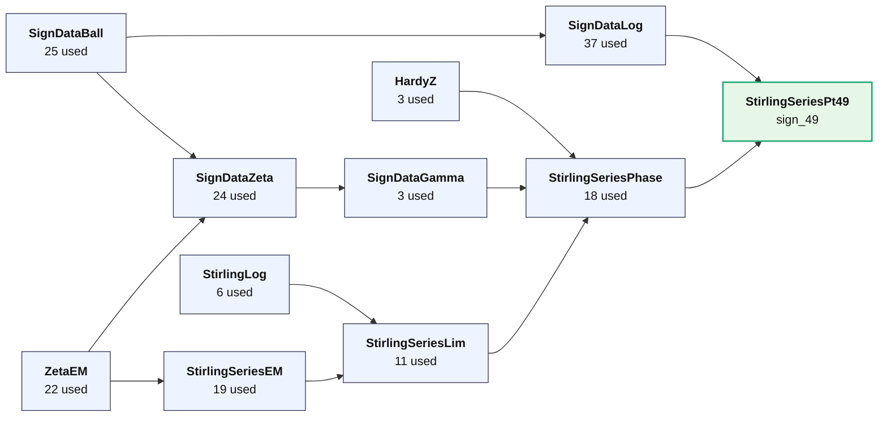

# What `StirlingSeries.sign_49` rests on

[`StirlingSeries.sign_49`](../lean_stage3/StirlingSeriesPt49.md#StirlingSeries-sign_49) in `lean_stage3/Stage3/StirlingSeriesPt49.lean`, line 341.

**Why.** The sign at `t = 49.0` through Stirling's series: `Re Λ(1/2 + it) > 0`.

**Proves**

```lean
0 < (completedRiemannZeta (lineS (49 : ℝ))).re
```

Behind it: 204 theorems and 25 definitions in 11 files. Every one is listed below; Lean recorded each step.

## The files it passes through



An arrow A → B reads "B uses something proved or defined in A"; indirect arrows are left out. Green: the theorem itself. Yellow: a file in the other tree. The number is how many of that file's declarations are on the way.

## Every declaration on the way

Files in dependency order. ★ marks what the theorem's own proof uses directly.

### [`HardyZ`](../lean_stage3/HardyZ.md) — 3

- [`HardyZ.completedRiemannZeta_conj_of_re_pos`](../lean_stage3/HardyZ.md#HardyZ-completedRiemannZeta_conj_of_re_pos) — `` completedRiemannZeta (conj s) = conj (completedRiemannZeta s) ``
- [`HardyZ.re_line`](../lean_stage3/HardyZ.md#HardyZ-re_line) — `` ((1 / 2 : ℂ) + t * I).re = 1 / 2 ``
- [`HardyZ.xi_line_real`](../lean_stage3/HardyZ.md#HardyZ-xi_line_real) — `` (completedRiemannZeta (1/2 + t * Complex.I)).im = 0 ``

### [`SignDataBall`](../lean_stage3/SignDataBall.md) — 25

- [`SignData.cx`](../lean_stage3/SignDataBall.md#SignData-cx) — *def*
- [`SignData.cx_re`](../lean_stage3/SignDataBall.md#SignData-cx_re) — `` (cx a b).re = a ``
- [`SignData.cx_im`](../lean_stage3/SignDataBall.md#SignData-cx_im) — `` (cx a b).im = b ``
- [`SignData.norm_cx_le`](../lean_stage3/SignDataBall.md#SignData-norm_cx_le) — `` ‖cx a b‖ ≤ |a| + |b| ``
- [`SignData.ball_add`](../lean_stage3/SignDataBall.md#SignData-ball_add) — `` ‖z + w - cx e f‖ ≤ R ``
- [`SignData.ball_mul`](../lean_stage3/SignDataBall.md#SignData-ball_mul) — `` ‖z * w - cx e f‖ ≤ R ``
- [`SignData.ball_ofReal`](../lean_stage3/SignDataBall.md#SignData-ball_ofReal) — `` ‖(x : ℂ) - cx c 0‖ ≤ e ``
- [`SignData.re_pos_of_ball`](../lean_stage3/SignDataBall.md#SignData-re_pos_of_ball) — `` 0 < z.re ``
- [`SignData.neg_mul_ball`](../lean_stage3/SignDataBall.md#SignData-neg_mul_ball) — `` |-(t * x) - -(t * a)| ≤ |t| * e ``
- [`SignData.cosP`](../lean_stage3/SignDataBall.md#SignData-cosP) — *def*
- [`SignData.sinP`](../lean_stage3/SignDataBall.md#SignData-sinP) — *def*
- [`SignData.taylor_eq`](../lean_stage3/SignDataBall.md#SignData-taylor_eq) — `` ∑ m ∈ Finset.range (2 * K), ((y : ℂ) * I) ^ m / (m.factorial : ℂ) = cx (cosP K y) (sinP K y) ``
- [`SignData.norm_exp_sub_exp_le`](../lean_stage3/SignDataBall.md#SignData-norm_exp_sub_exp_le) — `` ‖cexp ((y : ℂ) * I) - cexp ((y₀ : ℂ) * I)‖ ≤ |y - y₀| ``
- [`SignData.exp_ball_core`](../lean_stage3/SignDataBall.md#SignData-exp_ball_core) — `` ‖cexp ((y : ℂ) * I) - cx (cosP K y₀) (sinP K y₀)‖ ≤ ε + |y₀| ^ (2 * K) * ((2 * K + 1 : ℝ) / (((2 * K).factorial : ℝ) * (2 * K))) ``
- [`SignData.exp_reduce`](../lean_stage3/SignDataBall.md#SignData-exp_reduce) — `` cexp ((x : ℂ) * I) = cexp (((x - (j * (Real.pi / 2) + k * (2 * Real.pi)) : ℝ) : ℂ) * I) * I ^ j ``
- [`SignData.pi_ball`](../lean_stage3/SignDataBall.md#SignData-pi_ball) — `` |Real.pi - 3.14159265358979323846| ≤ 1 / 10 ^ 20 ``
- [`SignData.red_ball`](../lean_stage3/SignDataBall.md#SignData-red_ball) — `` |(x - (j * (Real.pi / 2) + k * (2 * Real.pi))) - y₀| ≤ ε' ``
- [`SignData.exp_ball_red`](../lean_stage3/SignDataBall.md#SignData-exp_ball_red) — `` ‖cexp (((x - (j * (Real.pi / 2) + k * (2 * Real.pi)) : ℝ) : ℂ) * I) - cx e f‖ ≤ R ``
- [`SignData.exp_ball0`](../lean_stage3/SignDataBall.md#SignData-exp_ball0) — `` ‖cexp ((x : ℂ) * I) - cx e f‖ ≤ R ``
- [`SignData.exp_ball1`](../lean_stage3/SignDataBall.md#SignData-exp_ball1) — `` ‖cexp ((x : ℂ) * I) - cx (-f) e‖ ≤ R ``
- [`SignData.exp_ball2`](../lean_stage3/SignDataBall.md#SignData-exp_ball2) — `` ‖cexp ((x : ℂ) * I) - cx (-e) (-f)‖ ≤ R ``
- [`SignData.exp_ball3`](../lean_stage3/SignDataBall.md#SignData-exp_ball3) — `` ‖cexp ((x : ℂ) * I) - cx f (-e)‖ ≤ R ``
- [`SignData.log_succ_ball`](../lean_stage3/SignDataBall.md#SignData-log_succ_ball) — `` |Real.log q - c| ≤ R ``
- [`SignData.log_pi_ball`](../lean_stage3/SignDataBall.md#SignData-log_pi_ball) — `` |Real.log Real.pi - c| ≤ R ``
- [`SignData.inv_sqrt_ball`](../lean_stage3/SignDataBall.md#SignData-inv_sqrt_ball) — `` |(Real.sqrt m)⁻¹ - c| ≤ R ``

### [`SignDataLog`](../lean_stage3/SignDataLog.md) — 37

- [`SignData.log_ball_2`](../lean_stage3/SignDataLog.md#SignData-log_ball_2) — `` |Real.log ((2 : ℕ) : ℝ) - (0.69314718055)| ≤ (0.00000000025) ``
- [`SignData.log_ball_3`](../lean_stage3/SignDataLog.md#SignData-log_ball_3) — `` |Real.log (((3 : ℕ)) : ℝ) - (1.098612288658164142930964760306)| ≤ (0.000000000250007285403624428292) ``
- [`SignData.log_ball_4`](../lean_stage3/SignDataLog.md#SignData-log_ball_4) — `` |Real.log (((4 : ℕ)) : ℝ) - (1.386294361109944875563750019823)| ≤ (0.000000000250012022355196162294) ``
- [`SignData.log_ball_5`](../lean_stage3/SignDataLog.md#SignData-log_ball_5) — `` |Real.log (((5 : ℕ)) : ℝ) - (1.609437912424154507888186373287)| ≤ (0.000000000250014643795196162295) ``
- [`SignData.log_ball_6`](../lean_stage3/SignDataLog.md#SignData-log_ball_6) — `` |Real.log (((6 : ℕ)) : ℝ) - (1.791759469218109031470825672761)| ≤ (0.000000000250016613075280171998) ``
- [`SignData.log_ball_7`](../lean_stage3/SignDataLog.md#SignData-log_ball_7) — `` |Real.log (((7 : ℕ)) : ℝ) - (1.945910149045367043442249594592)| ≤ (0.000000000250021628181194999771) ``
- [`SignData.log_ball_8`](../lean_stage3/SignDataLog.md#SignData-log_ball_8) — `` |Real.log (((8 : ℕ)) : ℝ) - (2.079441541669889414922705144822)| ≤ (0.000000000250025688425399343201) ``
- [`SignData.log_ball_9`](../lean_stage3/SignDataLog.md#SignData-log_ball_9) — `` |Real.log (((9 : ℕ)) : ℝ) - (2.19722457732627250799617757113)| ≤ (0.000000000250031152478117664421) ``
- [`SignData.log_ball_10`](../lean_stage3/SignDataLog.md#SignData-log_ball_10) — `` |Real.log (((10 : ℕ)) : ℝ) - (2.302585092984098735657405232358)| ≤ (0.000000000250032263589228775533) ``
- [`SignData.log_ball_11`](../lean_stage3/SignDataLog.md#SignData-log_ball_11) — `` |Real.log (((11 : ℕ)) : ℝ) - (2.397895272788423390160638914682)| ≤ (0.000000000250035160233026142414) ``
- [`SignData.log_ball_12`](../lean_stage3/SignDataLog.md#SignData-log_ball_12) — `` |Real.log (((12 : ℕ)) : ℝ) - (2.484906649778053096001283444008)| ≤ (0.00000000025003600990465329859) ``
- [`SignData.log_ball_13`](../lean_stage3/SignDataLog.md#SignData-log_ball_13) — `` |Real.log (((13 : ℕ)) : ℝ) - (2.564949357451589248303973730065)| ≤ (0.000000000250039586736521464553) ``
- [`SignData.log_ball_14`](../lean_stage3/SignDataLog.md#SignData-log_ball_14) — `` |Real.log (((14 : ℕ)) : ℝ) - (2.639057329605311022970451423173)| ≤ (0.000000000250040943550219800809) ``
- [`SignData.log_ball_15`](../lean_stage3/SignDataLog.md#SignData-log_ball_15) — `` |Real.log (((15 : ℕ)) : ℝ) - (2.708050201092261790030957852678)| ≤ (0.00000000025004920142160829253) ``
- [`SignData.log_ball_16`](../lean_stage3/SignDataLog.md#SignData-log_ball_16) — `` |Real.log (((16 : ℕ)) : ℝ) - (2.772588722229832647511359697862)| ≤ (0.000000000250052990982865679732) ``
- [`SignData.log_ball_17`](../lean_stage3/SignDataLog.md#SignData-log_ball_17) — `` |Real.log (((17 : ℕ)) : ℝ) - (2.833213344046267338845182082273)| ≤ (0.000000000250054814634508383847) ``
- [`SignData.log_ball_18`](../lean_stage3/SignDataLog.md#SignData-log_ball_18) — `` |Real.log (((18 : ℕ)) : ℝ) - (2.890371757886215874872377017636)| ≤ (0.00000000025005572991355977543) ``
- [`SignData.log_ball_19`](../lean_stage3/SignDataLog.md#SignData-log_ball_19) — `` |Real.log (((19 : ℕ)) : ℝ) - (2.944438979156490822698758619737)| ≤ (0.000000000250064791233927153323) ``
- [`SignData.log_pi_ball'`](../lean_stage3/SignDataLog.md#SignData-log_pi_ball-) — `` |Real.log Real.pi - (1.144729885839454400081836469865)| ≤ (0.000000000250010002548919421399) ``
- [`SignData.isqrt_ball_2`](../lean_stage3/SignDataLog.md#SignData-isqrt_ball_2) — `` |(Real.sqrt (((2 : ℕ)) : ℝ))⁻¹ - (0.707106781186547524400844362104)| ≤ (0.000000000000000000000000000001) ``
- [`SignData.isqrt_ball_3`](../lean_stage3/SignDataLog.md#SignData-isqrt_ball_3) — `` |(Real.sqrt (((3 : ℕ)) : ℝ))⁻¹ - (0.577350269189625764509148780502)| ≤ (0.000000000000000000000000000001) ``
- [`SignData.isqrt_ball_4`](../lean_stage3/SignDataLog.md#SignData-isqrt_ball_4) — `` |(Real.sqrt (((4 : ℕ)) : ℝ))⁻¹ - (0.5)| ≤ (0.000000000000000000000000000001) ``
- [`SignData.isqrt_ball_5`](../lean_stage3/SignDataLog.md#SignData-isqrt_ball_5) — `` |(Real.sqrt (((5 : ℕ)) : ℝ))⁻¹ - (0.447213595499957939281834733746)| ≤ (0.000000000000000000000000000001) ``
- [`SignData.isqrt_ball_6`](../lean_stage3/SignDataLog.md#SignData-isqrt_ball_6) — `` |(Real.sqrt (((6 : ℕ)) : ℝ))⁻¹ - (0.40824829046386301636621401245)| ≤ (0.000000000000000000000000000001) ``
- [`SignData.isqrt_ball_7`](../lean_stage3/SignDataLog.md#SignData-isqrt_ball_7) — `` |(Real.sqrt (((7 : ℕ)) : ℝ))⁻¹ - (0.377964473009227227214516536234)| ≤ (0.000000000000000000000000000001) ``
- [`SignData.isqrt_ball_8`](../lean_stage3/SignDataLog.md#SignData-isqrt_ball_8) — `` |(Real.sqrt (((8 : ℕ)) : ℝ))⁻¹ - (0.353553390593273762200422181052)| ≤ (0.000000000000000000000000000001) ``
- [`SignData.isqrt_ball_9`](../lean_stage3/SignDataLog.md#SignData-isqrt_ball_9) — `` |(Real.sqrt (((9 : ℕ)) : ℝ))⁻¹ - (0.333333333333333333333333333334)| ≤ (0.000000000000000000000000000001) ``
- [`SignData.isqrt_ball_10`](../lean_stage3/SignDataLog.md#SignData-isqrt_ball_10) — `` |(Real.sqrt (((10 : ℕ)) : ℝ))⁻¹ - (0.316227766016837933199889354444)| ≤ (0.000000000000000000000000000001) ``
- [`SignData.isqrt_ball_11`](../lean_stage3/SignDataLog.md#SignData-isqrt_ball_11) — `` |(Real.sqrt (((11 : ℕ)) : ℝ))⁻¹ - (0.30151134457776362264681206697)| ≤ (0.000000000000000000000000000001) ``
- [`SignData.isqrt_ball_12`](../lean_stage3/SignDataLog.md#SignData-isqrt_ball_12) — `` |(Real.sqrt (((12 : ℕ)) : ℝ))⁻¹ - (0.28867513459481288225457439025)| ≤ (0.000000000000000000000000000001) ``
- [`SignData.isqrt_ball_13`](../lean_stage3/SignDataLog.md#SignData-isqrt_ball_13) — `` |(Real.sqrt (((13 : ℕ)) : ℝ))⁻¹ - (0.277350098112614561009170866728)| ≤ (0.000000000000000000000000000001) ``
- [`SignData.isqrt_ball_14`](../lean_stage3/SignDataLog.md#SignData-isqrt_ball_14) — `` |(Real.sqrt (((14 : ℕ)) : ℝ))⁻¹ - (0.26726124191242438468455348088)| ≤ (0.000000000000000000000000000001) ``
- [`SignData.isqrt_ball_15`](../lean_stage3/SignDataLog.md#SignData-isqrt_ball_15) — `` |(Real.sqrt (((15 : ℕ)) : ℝ))⁻¹ - (0.258198889747161125678617693318)| ≤ (0.000000000000000000000000000001) ``
- [`SignData.isqrt_ball_16`](../lean_stage3/SignDataLog.md#SignData-isqrt_ball_16) — `` |(Real.sqrt (((16 : ℕ)) : ℝ))⁻¹ - (0.25)| ≤ (0.000000000000000000000000000001) ``
- [`SignData.isqrt_ball_17`](../lean_stage3/SignDataLog.md#SignData-isqrt_ball_17) — `` |(Real.sqrt (((17 : ℕ)) : ℝ))⁻¹ - (0.242535625036332973518906462116)| ≤ (0.000000000000000000000000000001) ``
- [`SignData.isqrt_ball_18`](../lean_stage3/SignDataLog.md#SignData-isqrt_ball_18) — `` |(Real.sqrt (((18 : ℕ)) : ℝ))⁻¹ - (0.235702260395515841466948120702)| ≤ (0.000000000000000000000000000001) ``
- [`SignData.isqrt_ball_19`](../lean_stage3/SignDataLog.md#SignData-isqrt_ball_19) — `` |(Real.sqrt (((19 : ℕ)) : ℝ))⁻¹ - (0.229415733870561765907209578098)| ≤ (0.000000000000000000000000000001) ``

### [`StirlingLog`](../lean_stage3/StirlingLog.md) — 6

- [`Stirling.logG`](../lean_stage3/StirlingLog.md#Stirling-logG) — *def*
- [`Stirling.tendsto_logG`](../lean_stage3/StirlingLog.md#Stirling-tendsto_logG) — `` Tendsto (Complex.logGammaSeq z) atTop (𝓝 (logG z)) ``
- [`Stirling.exp_logG`](../lean_stage3/StirlingLog.md#Stirling-exp_logG) — `` cexp (logG z) = Gamma z ``
- [`Stirling.sum_inv_sq_le`](../lean_stage3/StirlingLog.md#Stirling-sum_inv_sq_le) — `` ∑ m ∈ Finset.range N, 1 / ((m : ℝ) + Y) ^ 2 ≤ 3 / Y - 3 / ((N : ℝ) + Y) ``
- [`Stirling.normSq_add_nat_ge`](../lean_stage3/StirlingLog.md#Stirling-normSq_add_nat_ge) — `` ((m : ℝ) + |z.im|) ^ 2 / 2 ≤ ‖z + m‖ ^ 2 ``
- [`Stirling.sum_inv_normSq_le`](../lean_stage3/StirlingLog.md#Stirling-sum_inv_normSq_le) — `` ∑ m ∈ Finset.range N, 1 / ‖z + m‖ ^ 2 ≤ 6 / |z.im| ``

### [`ZetaEM`](../lean_stage3/ZetaEM.md) — 22

- [`ZetaEM.emInt`](../lean_stage3/ZetaEM.md#ZetaEM-emInt) — *def*
- [`ZetaEM.emCoef`](../lean_stage3/ZetaEM.md#ZetaEM-emCoef) — *def*
- [`ZetaEM.emTerm`](../lean_stage3/ZetaEM.md#ZetaEM-emTerm) — *def*
- [`ZetaEM.emBoundary`](../lean_stage3/ZetaEM.md#ZetaEM-emBoundary) — *def*
- [`ZetaEM.emRem`](../lean_stage3/ZetaEM.md#ZetaEM-emRem) — *def*
- [`ZetaEM.bernBound`](../lean_stage3/ZetaEM.md#ZetaEM-bernBound) — *def*
- [`ZetaEM.hasDerivWithinAt_fract`](../lean_stage3/ZetaEM.md#ZetaEM-hasDerivWithinAt_fract) — `` HasDerivWithinAt Int.fract 1 (Ioi x) x ``
- [`ZetaEM.continuous_bernoulliFun_fract`](../lean_stage3/ZetaEM.md#ZetaEM-continuous_bernoulliFun_fract) — `` Continuous (fun x : ℝ ↦ bernoulliFun k (Int.fract x)) ``
- [`ZetaEM.abs_bernoulliFun_fract_le`](../lean_stage3/ZetaEM.md#ZetaEM-abs_bernoulliFun_fract_le) — `` |bernoulliFun k (Int.fract x)| ≤ bernBound k ``
- [`ZetaEM.bernBound_nonneg`](../lean_stage3/ZetaEM.md#ZetaEM-bernBound_nonneg) — `` 0 ≤ bernBound k ``
- [`ZetaEM.measurable_bern`](../lean_stage3/ZetaEM.md#ZetaEM-measurable_bern) — `` Measurable (fun x : ℝ ↦ bernoulliFun k (Int.fract x)) ``
- [`ZetaEM.integrableOn_bern_cpow`](../lean_stage3/ZetaEM.md#ZetaEM-integrableOn_bern_cpow) — `` IntegrableOn (fun x : ℝ ↦ ((bernoulliFun k (Int.fract x) : ℝ) : ℂ) * (x:ℂ) ^ w) (Ioi a) ``
- [`ZetaEM.norm_integral_bern_cpow_le`](../lean_stage3/ZetaEM.md#ZetaEM-norm_integral_bern_cpow_le) — `` ‖∫ x in Ioi a, ((bernoulliFun k (Int.fract x) : ℝ) : ℂ) * (x:ℂ) ^ w‖ ≤ bernBound k * (-a ^ (w.re + 1) / (w.re + 1)) ``
- [`ZetaEM.interval_ibp`](../lean_stage3/ZetaEM.md#ZetaEM-interval_ibp) — `` ((k:ℂ) + 1) * ∫ x in a..b, ((bernoulliFun k (Int.fract x) : ℝ) : ℂ) * (x:ℂ) ^ (-(s + k)) = ((bernoulliFun (k+1) (Int.fract b) : ℝ) : ℂ) * (b:ℂ) ^ (-(s + k)) - (… ``
- [`ZetaEM.tail_ibp`](../lean_stage3/ZetaEM.md#ZetaEM-tail_ibp) — `` ((k:ℂ) + 1) * ∫ x in Ioi a, ((bernoulliFun k (Int.fract x) : ℝ) : ℂ) * (x:ℂ) ^ (-(s + k)) = -(((bernoulliFun (k+1) (Int.fract a) : ℝ) : ℂ) * (a:ℂ) ^ (-(s + k)))… ``
- [`ZetaEM.emInt_step`](../lean_stage3/ZetaEM.md#ZetaEM-emInt_step) — `` ((k:ℂ) + 1) * emInt k N s = -((bernoulliFun (k+1) 0 : ℂ) * (N:ℂ) ^ (-(s + k))) + (s + k) * emInt (k+1) N s ``
- [`ZetaEM.emRem_step`](../lean_stage3/ZetaEM.md#ZetaEM-emRem_step) — `` emRem k N s = emTerm k N s + emRem (k+1) N s ``
- [`ZetaEM.sum_range_succ_eq_sum_Icc`](../lean_stage3/ZetaEM.md#ZetaEM-sum_range_succ_eq_sum_Icc) — `` ∑ n ∈ Finset.range (N + 1), 1 / (n : ℂ) ^ s = ∑ n ∈ Finset.Icc 1 N, (n : ℂ) ^ (-s) ``
- [`ZetaEM.zeta_eq_em_one`](../lean_stage3/ZetaEM.md#ZetaEM-zeta_eq_em_one) — `` riemannZeta s = ∑ n ∈ Finset.Icc 1 N, (n : ℂ) ^ (-s) - (N:ℂ) ^ (1 - s) / (1 - s) - (N:ℂ) ^ (-s) / 2 - s * emInt 1 N s ``
- [`ZetaEM.zeta_eq_em`](../lean_stage3/ZetaEM.md#ZetaEM-zeta_eq_em) — `` riemannZeta s = ∑ n ∈ Finset.Icc 1 N, (n : ℂ) ^ (-s) - (N:ℂ) ^ (1 - s) / (1 - s) - (N:ℂ) ^ (-s) / 2 + emBoundary k N s + emRem k N s ``
- [`ZetaEM.norm_emInt_le`](../lean_stage3/ZetaEM.md#ZetaEM-norm_emInt_le) — `` ‖emInt k N s‖ ≤ bernBound k * ((N:ℝ) ^ (1 - s.re - k) / (s.re + k - 1)) ``
- [`ZetaEM.norm_remainder_le`](../lean_stage3/ZetaEM.md#ZetaEM-norm_remainder_le) — `` ‖emRem k N s‖ ≤ (∏ i ∈ Finset.range k, ‖s + i‖) / k.factorial * (bernBound k * ((N:ℝ) ^ (1 - s.re - k) / (s.re + k - 1))) ``

### [`SignDataZeta`](../lean_stage3/SignDataZeta.md) — 24

- ★ [`SignData.lineS`](../lean_stage3/SignDataZeta.md#SignData-lineS) — *def*
- [`SignData.emB`](../lean_stage3/SignDataZeta.md#SignData-emB) — *def*
- [`SignData.Bre`](../lean_stage3/SignDataZeta.md#SignData-Bre) — *def*
- [`SignData.Bim`](../lean_stage3/SignDataZeta.md#SignData-Bim) — *def*
- [`SignData.lineS_re`](../lean_stage3/SignDataZeta.md#SignData-lineS_re) — `` (lineS t).re = 1 / 2 ``
- [`SignData.lineS_ne_zero`](../lean_stage3/SignDataZeta.md#SignData-lineS_ne_zero) — `` lineS t ≠ 0 ``
- [`SignData.lineS_ne_one`](../lean_stage3/SignDataZeta.md#SignData-lineS_ne_one) — `` lineS t ≠ 1 ``
- [`SignData.bernoulliFun_four`](../lean_stage3/SignDataZeta.md#SignData-bernoulliFun_four) — `` bernoulliFun 4 x = x ^ 4 - 2 * x ^ 3 + x ^ 2 - 1 / 30 ``
- [`SignData.bernBound_four_le`](../lean_stage3/SignDataZeta.md#SignData-bernBound_four_le) — `` bernBound 4 ≤ 1 / 30 ``
- [`SignData.bernoulliFun_three_zero`](../lean_stage3/SignDataZeta.md#SignData-bernoulliFun_three_zero) — `` bernoulliFun 3 0 = 0 ``
- [`SignData.bernoulliFun_four_zero`](../lean_stage3/SignDataZeta.md#SignData-bernoulliFun_four_zero) — `` bernoulliFun 4 0 = -1 / 30 ``
- [`SignData.cpow_neg_add_nat`](../lean_stage3/SignDataZeta.md#SignData-cpow_neg_add_nat) — `` (N : ℂ) ^ (-(s + j)) = (N : ℂ) ^ (-s) / (N : ℂ) ^ j ``
- [`SignData.emBoundary_four`](../lean_stage3/SignDataZeta.md#SignData-emBoundary_four) — `` emBoundary 4 N s = (N : ℂ) ^ (-s) * (s / (12 * N) - s * (s + 1) * (s + 2) / (720 * (N : ℂ) ^ 3)) ``
- [`SignData.zeta_em4`](../lean_stage3/SignDataZeta.md#SignData-zeta_em4) — `` ‖riemannZeta (lineS t) - (∑ m ∈ Finset.Icc 1 N, (m : ℂ) ^ (-lineS t) + (N : ℂ) ^ (-lineS t) * emB t N)‖ ≤ (∏ i ∈ Finset.range 4, ‖lineS t + i‖) / 24 * ((1 / 30)… ``
- [`SignData.emB_eq`](../lean_stage3/SignDataZeta.md#SignData-emB_eq) — `` emB t N = cx (Bre t N) (Bim t N) ``
- [`SignData.natCast_cpow_line`](../lean_stage3/SignDataZeta.md#SignData-natCast_cpow_line) — `` (m : ℂ) ^ (-lineS t) = (((Real.sqrt m)⁻¹ : ℝ) : ℂ) * cexp (((-(t * Real.log m)) : ℝ) * I) ``
- [`SignData.norm_le_of_sq`](../lean_stage3/SignDataZeta.md#SignData-norm_le_of_sq) — `` ‖cx a b‖ ≤ q ``
- [`SignData.lineS_add_nat`](../lean_stage3/SignDataZeta.md#SignData-lineS_add_nat) — `` lineS t + i = cx (1 / 2 + i) t ``
- [`SignData.rpow_neg_seven_half`](../lean_stage3/SignDataZeta.md#SignData-rpow_neg_seven_half) — `` N ^ (-(7 / 2) : ℝ) = 1 / (N ^ 3 * Real.sqrt N) ``
- [`SignData.rem_le`](../lean_stage3/SignDataZeta.md#SignData-rem_le) — `` (∏ i ∈ Finset.range 4, ‖lineS t + i‖) / 24 * ((1 / 30) * ((N : ℝ) ^ (-(7 / 2) : ℝ) / (7 / 2))) ≤ Q ``
- [`SignData.emB_ball`](../lean_stage3/SignDataZeta.md#SignData-emB_ball) — `` ‖emB t N - cx (Bre t N) (Bim t N)‖ ≤ 0 ``
- [`SignData.zeta_ball`](../lean_stage3/SignDataZeta.md#SignData-zeta_ball) — `` ‖riemannZeta (lineS t) - cx a b‖ ≤ R ``
- [`SignData.one_term_ball`](../lean_stage3/SignDataZeta.md#SignData-one_term_ball) — `` ‖((1 : ℕ) : ℂ) ^ (-lineS t) - cx 1 0‖ ≤ 0 ``
- [`SignData.sum_one_ball`](../lean_stage3/SignDataZeta.md#SignData-sum_one_ball) — `` ‖∑ m ∈ Finset.Icc 1 1, ((m : ℕ) : ℂ) ^ (-lineS t) - cx 1 0‖ ≤ 0 ``

### [`SignDataGamma`](../lean_stage3/SignDataGamma.md) — 3

- [`SignData.zz`](../lean_stage3/SignDataGamma.md#SignData-zz) — *def*
- [`SignData.zz_re`](../lean_stage3/SignDataGamma.md#SignData-zz_re) — `` (zz t).re = 1 / 4 ``
- [`SignData.lineS_div_two`](../lean_stage3/SignDataGamma.md#SignData-lineS_div_two) — `` lineS t / 2 = zz t ``

### [`StirlingSeriesEM`](../lean_stage3/StirlingSeriesEM.md) — 19

- [`StirlingSeries.emJ`](../lean_stage3/StirlingSeriesEM.md#StirlingSeries-emJ) — *def*
- [`StirlingSeries.bdiff`](../lean_stage3/StirlingSeriesEM.md#StirlingSeries-bdiff) — *def*
- [`StirlingSeries.stirC`](../lean_stage3/StirlingSeriesEM.md#StirlingSeries-stirC) — *def*
- [`StirlingSeries.stirSum`](../lean_stage3/StirlingSeriesEM.md#StirlingSeries-stirSum) — *def*
- [`StirlingSeries.stirMain`](../lean_stage3/StirlingSeriesEM.md#StirlingSeries-stirMain) — *def*
- [`StirlingSeries.add_ofReal_ne_zero`](../lean_stage3/StirlingSeriesEM.md#StirlingSeries-add_ofReal_ne_zero) — `` w + (x : ℂ) ≠ 0 ``
- [`StirlingSeries.bern_cast_zero`](../lean_stage3/StirlingSeriesEM.md#StirlingSeries-bern_cast_zero) — `` ((bernoulliFun n 0 : ℝ) : ℂ) = ((bernoulli n : ℚ) : ℂ) ``
- [`StirlingSeries.continuousOn_integrand`](../lean_stage3/StirlingSeriesEM.md#StirlingSeries-continuousOn_integrand) — `` ContinuousOn (fun x : ℝ => ((bernoulliFun m x : ℝ) : ℂ) * ((w + (x : ℂ)) ^ m)⁻¹) (uIcc (0 : ℝ) 1) ``
- [`StirlingSeries.intervalIntegrable_integrand`](../lean_stage3/StirlingSeriesEM.md#StirlingSeries-intervalIntegrable_integrand) — `` IntervalIntegrable (fun x : ℝ => ((bernoulliFun m x : ℝ) : ℂ) * ((w + (x : ℂ)) ^ m)⁻¹) volume 0 1 ``
- [`StirlingSeries.hasDerivAt_inv_pow`](../lean_stage3/StirlingSeriesEM.md#StirlingSeries-hasDerivAt_inv_pow) — `` HasDerivAt (fun y : ℝ => ((w + (y : ℂ)) ^ (p + 1))⁻¹) (-((p : ℂ) + 1) * ((w + (x : ℂ)) ^ (p + 2))⁻¹) x ``
- [`StirlingSeries.emJ_step`](../lean_stage3/StirlingSeriesEM.md#StirlingSeries-emJ_step) — `` ((m : ℂ) + 1) * emJ m w = ((bernoulli (m + 1) : ℚ) : ℂ) * bdiff m w + (m : ℂ) * emJ (m + 1) w ``
- [`StirlingSeries.integral_inv_add`](../lean_stage3/StirlingSeriesEM.md#StirlingSeries-integral_inv_add) — `` ∫ x in (0 : ℝ)..1, (w + (x : ℂ))⁻¹ = log (w + 1) - log w ``
- [`StirlingSeries.emJ_one`](../lean_stage3/StirlingSeriesEM.md#StirlingSeries-emJ_one) — `` emJ 1 w = 1 - (w + 1 / 2) * (log (w + 1) - log w) ``
- [`StirlingSeries.bernoulli_odd_zero`](../lean_stage3/StirlingSeriesEM.md#StirlingSeries-bernoulli_odd_zero) — `` ((bernoulli (2 * K + 1) : ℚ) : ℂ) = 0 ``
- [`StirlingSeries.emJ_one_unroll`](../lean_stage3/StirlingSeriesEM.md#StirlingSeries-emJ_one_unroll) — `` emJ 1 w = ∑ k ∈ Finset.Ico 1 (K + 1), stirC k * bdiff (2 * k - 1) w + emJ (2 * K) w / (2 * K) ``
- [`StirlingSeries.stirMain_step`](../lean_stage3/StirlingSeriesEM.md#StirlingSeries-stirMain_step) — `` stirMain (K + 1) (w + 1) - stirMain (K + 1) w - log w = -(emJ (2 * K) w / (2 * K)) ``
- [`StirlingSeries.abs_bern_le`](../lean_stage3/StirlingSeriesEM.md#StirlingSeries-abs_bern_le) — `` |bernoulliFun m x| ≤ ZetaEM.bernBound m ``
- [`StirlingSeries.norm_le_norm_add`](../lean_stage3/StirlingSeriesEM.md#StirlingSeries-norm_le_norm_add) — `` ‖w‖ ≤ ‖w + (x : ℂ)‖ ``
- [`StirlingSeries.norm_emJ_le`](../lean_stage3/StirlingSeriesEM.md#StirlingSeries-norm_emJ_le) — `` ‖emJ m w‖ ≤ ZetaEM.bernBound m / ‖w‖ ^ m ``

### [`StirlingSeriesLim`](../lean_stage3/StirlingSeriesLim.md) — 11

- [`StirlingSeries.remP`](../lean_stage3/StirlingSeriesLim.md#StirlingSeries-remP) — *def*
- [`StirlingSeries.seqA`](../lean_stage3/StirlingSeriesLim.md#StirlingSeries-seqA) — *def*
- [`StirlingSeries.re_add_nat_pos`](../lean_stage3/StirlingSeriesLim.md#StirlingSeries-re_add_nat_pos) — `` 0 < (z + (n : ℂ)).re ``
- [`StirlingSeries.sum_log_eq`](../lean_stage3/StirlingSeriesLim.md#StirlingSeries-sum_log_eq) — `` ∑ n ∈ Finset.range (N + 1), log (z + (n : ℂ)) = stirMain (K + 1) (z + ((N + 1 : ℕ) : ℂ)) - stirMain (K + 1) z + remP K z N ``
- [`StirlingSeries.log_shift_eq`](../lean_stage3/StirlingSeriesLim.md#StirlingSeries-log_shift_eq) — `` log (z + ((N + 1 : ℕ) : ℂ)) = (Real.log N : ℂ) + log (1 + (z + 1) / (N : ℂ)) ``
- [`StirlingSeries.log_factorial_eq`](../lean_stage3/StirlingSeriesLim.md#StirlingSeries-log_factorial_eq) — `` Real.log (N.factorial) = Real.log (Stirling.stirlingSeq N) + Real.log 2 / 2 + Real.log N / 2 + N * Real.log N - N ``
- [`StirlingSeries.tendsto_inv_pow_shift`](../lean_stage3/StirlingSeriesLim.md#StirlingSeries-tendsto_inv_pow_shift) — `` Tendsto (fun N : ℕ => ((z + ((N + 1 : ℕ) : ℂ)) ^ j)⁻¹) atTop (𝓝 0) ``
- [`StirlingSeries.tendsto_stirSum_shift`](../lean_stage3/StirlingSeriesLim.md#StirlingSeries-tendsto_stirSum_shift) — `` Tendsto (fun N : ℕ => stirSum K (z + ((N + 1 : ℕ) : ℂ))) atTop (𝓝 0) ``
- [`StirlingSeries.tendsto_A`](../lean_stage3/StirlingSeriesLim.md#StirlingSeries-tendsto_A) — `` Tendsto (seqA K z) atTop (𝓝 ((Real.log (2 * Real.pi) / 2 : ℝ) : ℂ)) ``
- [`StirlingSeries.norm_P_le`](../lean_stage3/StirlingSeriesLim.md#StirlingSeries-norm_P_le) — `` ‖remP K z N‖ ≤ ZetaEM.bernBound (2 * K) / (2 * K) * (6 / |z.im|) / ‖z‖ ^ (2 * K - 2) ``
- [`StirlingSeries.stirling_series`](../lean_stage3/StirlingSeriesLim.md#StirlingSeries-stirling_series) — `` ‖Stirling.logG z - stirMain (K + 1) z - ((Real.log (2 * Real.pi) / 2 : ℝ) : ℂ)‖ ≤ ZetaEM.bernBound (2 * K) / (2 * K) * (6 / |z.im|) / ‖z‖ ^ (2 * K - 2) ``

### [`StirlingSeriesPhase`](../lean_stage3/StirlingSeriesPhase.md) — 18

- [`StirlingSeries.stirPhase`](../lean_stage3/StirlingSeriesPhase.md#StirlingSeries-stirPhase) — *def*
- [`StirlingSeries.stirDir`](../lean_stage3/StirlingSeriesPhase.md#StirlingSeries-stirDir) — *def*
- [`StirlingSeries.zz_im`](../lean_stage3/StirlingSeriesPhase.md#StirlingSeries-zz_im) — `` (zz t).im = t / 2 ``
- [`StirlingSeries.re_of_real_factor`](../lean_stage3/StirlingSeriesPhase.md#StirlingSeries-re_of_real_factor) — `` ∃ c : ℝ, 0 < c ∧ Λ.re = c * X.re ``
- [`StirlingSeries.re_lambda_eq_stir`](../lean_stage3/StirlingSeriesPhase.md#StirlingSeries-re_lambda_eq_stir) — `` ∃ c : ℝ, 0 < c ∧ (completedRiemannZeta (lineS t)).re = c * (stirDir K t * riemannZeta (lineS t)).re ``
- [`StirlingSeries.norm_zz_ge`](../lean_stage3/StirlingSeriesPhase.md#StirlingSeries-norm_zz_ge) — `` |t| / 2 ≤ ‖zz t‖ ``
- [`StirlingSeries.delta3_le'`](../lean_stage3/StirlingSeriesPhase.md#StirlingSeries-delta3_le-) — `` ‖Stirling.logG (zz t) - stirMain 3 (zz t) - ((Real.log (2 * Real.pi) / 2 : ℝ) : ℂ)‖ ≤ 2 / 5 / |t| ^ 3 ``
- [`StirlingSeries.delta3_le`](../lean_stage3/StirlingSeriesPhase.md#StirlingSeries-delta3_le) — `` ‖Stirling.logG (zz t) - stirMain 3 (zz t) - ((Real.log (2 * Real.pi) / 2 : ℝ) : ℂ)‖ ≤ 3 / 2 ``
- [`StirlingSeries.re_lambda_eq_stir3`](../lean_stage3/StirlingSeriesPhase.md#StirlingSeries-re_lambda_eq_stir3) — `` ∃ c : ℝ, 0 < c ∧ (completedRiemannZeta (lineS t)).re = c * (stirDir 3 t * riemannZeta (lineS t)).re ``
- ★ [`StirlingSeries.re_lambda_pos_stir3`](../lean_stage3/StirlingSeriesPhase.md#StirlingSeries-re_lambda_pos_stir3) — `` 0 < (completedRiemannZeta (lineS t)).re ``
- [`StirlingSeries.stirC_one`](../lean_stage3/StirlingSeriesPhase.md#StirlingSeries-stirC_one) — `` stirC 1 = 1 / 12 ``
- [`StirlingSeries.stirC_two`](../lean_stage3/StirlingSeriesPhase.md#StirlingSeries-stirC_two) — `` stirC 2 = -1 / 360 ``
- [`StirlingSeries.stirSum3_eq`](../lean_stage3/StirlingSeriesPhase.md#StirlingSeries-stirSum3_eq) — `` stirSum 3 w = 1 / 12 * w⁻¹ - 1 / 360 * (w ^ 3)⁻¹ ``
- [`StirlingSeries.sig3`](../lean_stage3/StirlingSeriesPhase.md#StirlingSeries-sig3) — *def*
- [`StirlingSeries.stirSum3_im`](../lean_stage3/StirlingSeriesPhase.md#StirlingSeries-stirSum3_im) — `` (stirSum 3 (zz t)).im = sig3 t ``
- [`StirlingSeries.log_zz_eq`](../lean_stage3/StirlingSeriesPhase.md#StirlingSeries-log_zz_eq) — `` log (zz t) = ((Real.log (t / 2) : ℝ) : ℂ) + ((Real.pi / 2 : ℝ) : ℂ) * I + log (1 + cx 0 (-(1 / (2 * t)))) ``
- [`StirlingSeries.log_one_sub_ball`](../lean_stage3/StirlingSeriesPhase.md#StirlingSeries-log_one_sub_ball) — `` ‖log (1 + cx 0 (-y)) - cx (y ^ 2 / 2 - y ^ 4 / 4) (-y + y ^ 3 / 3 - y ^ 5 / 5)‖ ≤ y ^ 6 * (1 - y)⁻¹ / 6 ``
- [`StirlingSeries.stirPhase3_ball`](../lean_stage3/StirlingSeriesPhase.md#StirlingSeries-stirPhase3_ball) — `` |stirPhase 3 t - φ₀| ≤ E ``

### [`StirlingSeriesPt49`](../lean_stage3/StirlingSeriesPt49.md) — 61

- [`StirlingSeries.s49_E2`](../lean_stage3/StirlingSeriesPt49.md#StirlingSeries-s49_E2) — `` ‖cexp ((((-((49 : ℝ) * Real.log (((2 : ℕ)) : ℝ))) : ℝ) : ℂ) * Complex.I) - cx (-(0.829096061353108815313364206236)) (-(0.559106180478057336877747965187))‖ ≤ (0.… ``
- [`StirlingSeries.s49_T2`](../lean_stage3/StirlingSeriesPt49.md#StirlingSeries-s49_T2) — `` ‖(((2 : ℕ)) : ℂ) ^ (-lineS (49 : ℝ)) - cx (-0.586259447237841096474869491187) (-0.395347771619344038458450246979)‖ ≤ (0.000000008662058069612997835312) ``
- [`StirlingSeries.s49_E3`](../lean_stage3/StirlingSeriesPt49.md#StirlingSeries-s49_E3) — `` ‖cexp ((((-((49 : ℝ) * Real.log (((3 : ℕ)) : ℝ))) : ℝ) : ℂ) * Complex.I) - cx (-(0.911068816247057217206025703191)) (-(-0.4122543050862972991915974641))‖ ≤ (0.0… ``
- [`StirlingSeries.s49_T3`](../lean_stage3/StirlingSeriesPt49.md#StirlingSeries-s49_T3) — `` ‖(((3 : ℕ)) : ℂ) ^ (-lineS (49 : ℝ)) - cx (-0.526005826310512175613583782468) (0.23801513401615585167641926642)‖ ≤ (0.000000007072746902930081675874) ``
- [`StirlingSeries.s49_E4`](../lean_stage3/StirlingSeriesPt49.md#StirlingSeries-s49_E4) — `` ‖cexp ((((-((49 : ℝ) * Real.log (((4 : ℕ)) : ℝ))) : ℝ) : ℂ) * Complex.I) - cx (-(-0.374800558354253429056317946331)) (0.927105464042435611244149114255)‖ ≤ (0.00… ``
- [`StirlingSeries.s49_T4`](../lean_stage3/StirlingSeriesPt49.md#StirlingSeries-s49_T4) — `` ‖(((4 : ℕ)) : ℂ) ^ (-lineS (49 : ℝ)) - cx (0.187400279177126714528158973166) (0.463552732021217805622074557128)‖ ≤ (0.000000006125294547811681462929) ``
- [`StirlingSeries.s49_E5`](../lean_stage3/StirlingSeriesPt49.md#StirlingSeries-s49_E5) — `` ‖cexp ((((-((49 : ℝ) * Real.log (((5 : ℕ)) : ℝ))) : ℝ) : ℂ) * Complex.I) - cx (-(0.948401221349430055776194616157)) (-(-0.317072741406304707550266781262))‖ ≤ (0… ``
- [`StirlingSeries.s49_T5`](../lean_stage3/StirlingSeriesPt49.md#StirlingSeries-s49_T5) — `` ‖(((5 : ℕ)) : ℂ) ^ (-lineS (49 : ℝ)) - cx (-0.424137920176230086682958764925) (0.141799240719341918324916625302)‖ ≤ (0.000000005478687441297565127905) ``
- [`StirlingSeries.s49_E6`](../lean_stage3/StirlingSeriesPt49.md#StirlingSeries-s49_E6) — `` ‖cexp ((((-((49 : ℝ) * Real.log (((6 : ℕ)) : ℝ))) : ℝ) : ℂ) * Complex.I) - cx (0.985857497156174296252574168149) (0.167585784901237340527590176717)‖ ≤ (0.000000… ``
- [`StirlingSeries.s49_T6`](../lean_stage3/StirlingSeriesPt49.md#StirlingSeries-s49_T6) — `` ‖(((6 : ℕ)) : ℂ) ^ (-lineS (49 : ℝ)) - cx (0.402474637854990851725176074064) (0.068416610191974810838923865093)‖ ≤ (0.000000005001373889016359841699) ``
- [`StirlingSeries.s49_E7`](../lean_stage3/StirlingSeriesPt49.md#StirlingSeries-s49_E7) — `` ‖cexp ((((-((49 : ℝ) * Real.log (((7 : ℕ)) : ℝ))) : ℝ) : ℂ) * Complex.I) - cx (0.45197542933921751807375912854) (-(0.892030386967635756881720870862))‖ ≤ (0.0000… ``
- [`StirlingSeries.s49_T7`](../lean_stage3/StirlingSeriesPt49.md#StirlingSeries-s49_T7) — `` ‖(((7 : ℕ)) : ℂ) ^ (-lineS (49 : ℝ)) - cx (0.170830654963316567433007967754) (-0.337155795118439483968559237898)‖ ≤ (0.000000004630465353999668015889) ``
- [`StirlingSeries.s49_E8`](../lean_stage3/StirlingSeriesPt49.md#StirlingSeries-s49_E8) — `` ‖cexp ((((-((49 : ℝ) * Real.log (((8 : ℕ)) : ℝ))) : ℝ) : ℂ) * Complex.I) - cx (0.207604727699979652297942031267) (-(0.978212797420181628482487297357))‖ ≤ (0.000… ``
- [`StirlingSeries.s49_T8`](../lean_stage3/StirlingSeriesPt49.md#StirlingSeries-s49_T8) — `` ‖(((8 : ℕ)) : ℂ) ^ (-lineS (49 : ℝ)) - cx (0.073399355381521146854119823143) (-0.345850451249636455723774531458)‖ ≤ (0.000000004331474064148458809095) ``
- [`StirlingSeries.s49_E9`](../lean_stage3/StirlingSeriesPt49.md#StirlingSeries-s49_E9) — `` ‖cexp ((((-((49 : ℝ) * Real.log (((9 : ℕ)) : ℝ))) : ℝ) : ℂ) * Complex.I) - cx (0.660092775509601089415384514153) (-(0.751184083777093469527807872819))‖ ≤ (0.000… ``
- [`StirlingSeries.s49_T9`](../lean_stage3/StirlingSeriesPt49.md#StirlingSeries-s49_T9) — `` ‖(((9 : ℕ)) : ℂ) ^ (-lineS (49 : ℝ)) - cx (0.220030925169867029805128171385) (-0.250394694592364489842602624274)‖ ≤ (0.000000004083842157258695839116) ``
- [`StirlingSeries.s49_E10`](../lean_stage3/StirlingSeriesPt49.md#StirlingSeries-s49_E10) — `` ‖cexp ((((-((49 : ℝ) * Real.log (((10 : ℕ)) : ℝ))) : ℝ) : ℂ) * Complex.I) - cx (0.963593046714958390139362185665) (0.267373222897477184248616449246)‖ ≤ (0.00000… ``
- [`StirlingSeries.s49_T10`](../lean_stage3/StirlingSeriesPt49.md#StirlingSeries-s49_T10) — `` ‖(((10 : ℕ)) : ℂ) ^ (-lineS (49 : ℝ)) - cx (0.304714876512029845849191264163) (0.084550836969591269477497215954)‖ ≤ (0.000000003874290063315539475378) ``
- [`StirlingSeries.s49_E11`](../lean_stage3/StirlingSeriesPt49.md#StirlingSeries-s49_E11) — `` ‖cexp ((((-((49 : ℝ) * Real.log (((11 : ℕ)) : ℝ))) : ℝ) : ℂ) * Complex.I) - cx (-(0.307777389324773362727021086033)) (0.951458395632949829771669541356)‖ ≤ (0.00… ``
- [`StirlingSeries.s49_T11`](../lean_stage3/StirlingSeriesPt49.md#StirlingSeries-s49_T11) — `` ‖(((11 : ℕ)) : ℂ) ^ (-lineS (49 : ℝ)) - cx (-0.0927983744859462485162829545) (0.286875500177092483317644144247)‖ ≤ (0.000000003694033430438698757343) ``
- [`StirlingSeries.s49_E12`](../lean_stage3/StirlingSeriesPt49.md#StirlingSeries-s49_E12) — `` ‖cexp ((((-((49 : ℝ) * Real.log (((12 : ℕ)) : ℝ))) : ℝ) : ℂ) * Complex.I) - cx (-(0.723672320185348540337092735067)) (-(0.690143733578415086643778195624))‖ ≤ (0… ``
- [`StirlingSeries.s49_T12`](../lean_stage3/StirlingSeriesPt49.md#StirlingSeries-s49_T12) — `` ‖(((12 : ℕ)) : ℂ) ^ (-lineS (49 : ℝ)) - cx (-0.20890620443204601329581702957) (-0.199227335180515657984224451727)‖ ≤ (0.000000003536779761939967637452) ``
- [`StirlingSeries.s49_E13`](../lean_stage3/StirlingSeriesPt49.md#StirlingSeries-s49_E13) — `` ‖cexp ((((-((49 : ℝ) * Real.log (((13 : ℕ)) : ℝ))) : ℝ) : ℂ) * Complex.I) - cx (0.999823052557238879120030502138) (-0.018811261922708483189881440846)‖ ≤ (0.0000… ``
- [`StirlingSeries.s49_T13`](../lean_stage3/StirlingSeriesPt49.md#StirlingSeries-s49_T13) — `` ‖(((13 : ℕ)) : ℂ) ^ (-lineS (49 : ℝ)) - cx (0.277301021722003987883933241242) (-0.005217305339885288241599317569)‖ ≤ (0.000000003398076691869426634091) ``
- [`StirlingSeries.s49_E14`](../lean_stage3/StirlingSeriesPt49.md#StirlingSeries-s49_E14) — `` ‖cexp ((((-((49 : ℝ) * Real.log (((14 : ℕ)) : ℝ))) : ℝ) : ℂ) * Complex.I) - cx (-(0.873470750584130800088945823713)) (-(-0.486876624899979320782963188341))‖ ≤ (… ``
- [`StirlingSeries.s49_T14`](../lean_stage3/StirlingSeriesPt49.md#StirlingSeries-s49_T14) — `` ‖(((14 : ℕ)) : ℂ) ^ (-lineS (49 : ℝ)) - cx (-0.233444877575292284679775199433) (0.130123251428898079038447615086)‖ ≤ (0.000000003274486402117264835227) ``
- [`StirlingSeries.s49_E15`](../lean_stage3/StirlingSeriesPt49.md#StirlingSeries-s49_E15) — `` ‖cexp ((((-((49 : ℝ) * Real.log (((15 : ℕ)) : ℝ))) : ℝ) : ℂ) * Complex.I) - cx (0.733344175060589132142689672711) (-0.679857573984951645728051097535)‖ ≤ (0.0000… ``
- [`StirlingSeries.s49_T15`](../lean_stage3/StirlingSeriesPt49.md#StirlingSeries-s49_T15) — `` ‖(((15 : ℕ)) : ℂ) ^ (-lineS (49 : ℝ)) - cx (0.189348651803191880952843714588) (-0.175538470789112967925434972854)‖ ≤ (0.000000003163558883381518831866) ``
- [`StirlingSeries.s49_E16`](../lean_stage3/StirlingSeriesPt49.md#StirlingSeries-s49_E16) — `` ‖cexp ((((-((49 : ℝ) * Real.log (((16 : ℕ)) : ℝ))) : ℝ) : ℂ) * Complex.I) - cx (-(0.719049082576094237195420023918)) (-(-0.694959291503090280729952259963))‖ ≤ (… ``
- [`StirlingSeries.s49_T16`](../lean_stage3/StirlingSeriesPt49.md#StirlingSeries-s49_T16) — `` ‖(((16 : ℕ)) : ℂ) ^ (-lineS (49 : ℝ)) - cx (-0.17976227064402355929885500598) (0.173739822875772570182488064991)‖ ≤ (0.000000003063149139649003333886) ``
- [`StirlingSeries.s49_E17`](../lean_stage3/StirlingSeriesPt49.md#StirlingSeries-s49_E17) — `` ‖cexp ((((-((49 : ℝ) * Real.log (((17 : ℕ)) : ℝ))) : ℝ) : ℂ) * Complex.I) - cx (0.826813774787536530903078968627) (-0.562475761096942577239946576211)‖ ≤ (0.0000… ``
- [`StirlingSeries.s49_T17`](../lean_stage3/StirlingSeriesPt49.md#StirlingSeries-s49_T17) — `` ‖(((17 : ℕ)) : ℂ) ^ (-lineS (49 : ℝ)) - cx (0.200531795656745017717332728298) (-0.136420410285434070492963190086)‖ ≤ (0.000000002971712837383189161068) ``
- [`StirlingSeries.s49_E18`](../lean_stage3/StirlingSeriesPt49.md#StirlingSeries-s49_E18) — `` ‖cexp ((((-((49 : ℝ) * Real.log (((18 : ℕ)) : ℝ))) : ℝ) : ℂ) * Complex.I) - cx (-(0.967271984095542522771977112434)) (-(-0.25374181520567817691486354267))‖ ≤ (0… ``
- [`StirlingSeries.s49_T18`](../lean_stage3/StirlingSeriesPt49.md#StirlingSeries-s49_T18) — `` ‖(((18 : ℕ)) : ℂ) ^ (-lineS (49 : ℝ)) - cx (-0.227988193068574821260409430495) (0.059807519400839618687937820471)‖ ≤ (0.00000000288799633761525279644) ``
- [`StirlingSeries.s49_E19`](../lean_stage3/StirlingSeriesPt49.md#StirlingSeries-s49_E19) — `` ‖cexp ((((-((49 : ℝ) * Real.log (((19 : ℕ)) : ℝ))) : ℝ) : ℂ) * Complex.I) - cx (0.972338948248275751342291868744) (0.233574334462151320908032602483)‖ ≤ (0.00000… ``
- [`StirlingSeries.s49_T19`](../lean_stage3/StirlingSeriesPt49.md#StirlingSeries-s49_T19) — `` ‖(((19 : ℕ)) : ℂ) ^ (-lineS (49 : ℝ)) - cx (0.223069853383308359327695426272) (0.053585627353962491123006178135)‖ ≤ (0.000000002811071082315611820794) ``
- [`StirlingSeries.s49_S2`](../lean_stage3/StirlingSeriesPt49.md#StirlingSeries-s49_S2) — `` ‖∑ m ∈ Finset.Icc 1 (1 + 1), ((m : ℕ) : ℂ) ^ (-lineS (49 : ℝ)) - cx (0.413740552762158903525130508813) (-0.395347771619344038458450246979)‖ ≤ (0.000000008662058… ``
- [`StirlingSeries.s49_S3`](../lean_stage3/StirlingSeriesPt49.md#StirlingSeries-s49_S3) — `` ‖∑ m ∈ Finset.Icc 1 (2 + 1), ((m : ℕ) : ℂ) ^ (-lineS (49 : ℝ)) - cx (-0.112265273548353272088453273655) (-0.157332637603188186782030980559)‖ ≤ (0.00000001573480… ``
- [`StirlingSeries.s49_S4`](../lean_stage3/StirlingSeriesPt49.md#StirlingSeries-s49_S4) — `` ‖∑ m ∈ Finset.Icc 1 (3 + 1), ((m : ℕ) : ℂ) ^ (-lineS (49 : ℝ)) - cx (0.075135005628773442439705699511) (0.306220094418029618840043576569)‖ ≤ (0.0000000218600995… ``
- [`StirlingSeries.s49_S5`](../lean_stage3/StirlingSeriesPt49.md#StirlingSeries-s49_S5) — `` ‖∑ m ∈ Finset.Icc 1 (4 + 1), ((m : ℕ) : ℂ) ^ (-lineS (49 : ℝ)) - cx (-0.349002914547456644243253065414) (0.448019335137371537164960201871)‖ ≤ (0.000000027338786… ``
- [`StirlingSeries.s49_S6`](../lean_stage3/StirlingSeriesPt49.md#StirlingSeries-s49_S6) — `` ‖∑ m ∈ Finset.Icc 1 (5 + 1), ((m : ℕ) : ℂ) ^ (-lineS (49 : ℝ)) - cx (0.05347172330753420748192300865) (0.516435945329346348003884066964)‖ ≤ (0.00000003234016085… ``
- [`StirlingSeries.s49_S7`](../lean_stage3/StirlingSeriesPt49.md#StirlingSeries-s49_S7) — `` ‖∑ m ∈ Finset.Icc 1 (6 + 1), ((m : ℕ) : ℂ) ^ (-lineS (49 : ℝ)) - cx (0.224302378270850774914930976404) (0.179280150210906864035324829066)‖ ≤ (0.0000000369706262… ``
- [`StirlingSeries.s49_S8`](../lean_stage3/StirlingSeriesPt49.md#StirlingSeries-s49_S8) — `` ‖∑ m ∈ Finset.Icc 1 (7 + 1), ((m : ℕ) : ℂ) ^ (-lineS (49 : ℝ)) - cx (0.297701733652371921769050799547) (-0.166570301038729591688449702392)‖ ≤ (0.000000041302100… ``
- [`StirlingSeries.s49_S9`](../lean_stage3/StirlingSeriesPt49.md#StirlingSeries-s49_S9) — `` ‖∑ m ∈ Finset.Icc 1 (8 + 1), ((m : ℕ) : ℂ) ^ (-lineS (49 : ℝ)) - cx (0.517732658822238951574178970932) (-0.416964995631094081531052326666)‖ ≤ (0.000000045385942… ``
- [`StirlingSeries.s49_S10`](../lean_stage3/StirlingSeriesPt49.md#StirlingSeries-s49_S10) — `` ‖∑ m ∈ Finset.Icc 1 (9 + 1), ((m : ℕ) : ℂ) ^ (-lineS (49 : ℝ)) - cx (0.822447535334268797423370235095) (-0.332414158661502812053555110712)‖ ≤ (0.000000049260232… ``
- [`StirlingSeries.s49_S11`](../lean_stage3/StirlingSeriesPt49.md#StirlingSeries-s49_S11) — `` ‖∑ m ∈ Finset.Icc 1 (10 + 1), ((m : ℕ) : ℂ) ^ (-lineS (49 : ℝ)) - cx (0.729649160848322548907087280595) (-0.045538658484410328735910966465)‖ ≤ (0.00000005295426… ``
- [`StirlingSeries.s49_S12`](../lean_stage3/StirlingSeriesPt49.md#StirlingSeries-s49_S12) — `` ‖∑ m ∈ Finset.Icc 1 (11 + 1), ((m : ℕ) : ℂ) ^ (-lineS (49 : ℝ)) - cx (0.520742956416276535611270251025) (-0.244765993664925986720135418192)‖ ≤ (0.00000005649104… ``
- [`StirlingSeries.s49_S13`](../lean_stage3/StirlingSeriesPt49.md#StirlingSeries-s49_S13) — `` ‖∑ m ∈ Finset.Icc 1 (12 + 1), ((m : ℕ) : ℂ) ^ (-lineS (49 : ℝ)) - cx (0.798043978138280523495203492267) (-0.249983299004811274961734735761)‖ ≤ (0.00000005988912… ``
- [`StirlingSeries.s49_S14`](../lean_stage3/StirlingSeriesPt49.md#StirlingSeries-s49_S14) — `` ‖∑ m ∈ Finset.Icc 1 (13 + 1), ((m : ℕ) : ℂ) ^ (-lineS (49 : ℝ)) - cx (0.564599100562988238815428292834) (-0.119860047575913195923287120675)‖ ≤ (0.00000006316360… ``
- [`StirlingSeries.s49_S15`](../lean_stage3/StirlingSeriesPt49.md#StirlingSeries-s49_S15) — `` ‖∑ m ∈ Finset.Icc 1 (14 + 1), ((m : ℕ) : ℂ) ^ (-lineS (49 : ℝ)) - cx (0.753947752366180119768272007422) (-0.295398518365026163848722093529)‖ ≤ (0.00000006632716… ``
- [`StirlingSeries.s49_S16`](../lean_stage3/StirlingSeriesPt49.md#StirlingSeries-s49_S16) — `` ‖∑ m ∈ Finset.Icc 1 (15 + 1), ((m : ℕ) : ℂ) ^ (-lineS (49 : ℝ)) - cx (0.574185481722156560469417001442) (-0.121658695489253593666234028538)‖ ≤ (0.00000006939031… ``
- [`StirlingSeries.s49_S17`](../lean_stage3/StirlingSeriesPt49.md#StirlingSeries-s49_S17) — `` ‖∑ m ∈ Finset.Icc 1 (16 + 1), ((m : ℕ) : ℂ) ^ (-lineS (49 : ℝ)) - cx (0.77471727737890157818674972974) (-0.258079105774687664159197218624)‖ ≤ (0.000000072362029… ``
- [`StirlingSeries.s49_S18`](../lean_stage3/StirlingSeriesPt49.md#StirlingSeries-s49_S18) — `` ‖∑ m ∈ Finset.Icc 1 (17 + 1), ((m : ℕ) : ℂ) ^ (-lineS (49 : ℝ)) - cx (0.546729084310326756926340299245) (-0.198271586373848045471259398153)‖ ≤ (0.00000007525002… ``
- [`StirlingSeries.s49_S19`](../lean_stage3/StirlingSeriesPt49.md#StirlingSeries-s49_S19) — `` ‖∑ m ∈ Finset.Icc 1 (18 + 1), ((m : ℕ) : ℂ) ^ (-lineS (49 : ℝ)) - cx (0.769798937693635116254035725517) (-0.144685959019885554348253220018)‖ ≤ (0.00000007806109… ``
- [`StirlingSeries.s49_NB`](../lean_stage3/StirlingSeriesPt49.md#StirlingSeries-s49_NB) — `` ‖(((19 : ℕ)) : ℂ) ^ (-lineS (49 : ℝ)) * emB (49 : ℝ) 19 - cx (-0.103454092891434811027331957505) (-0.060015654778742832778070322644)‖ ≤ (0.000000001823295665475… ``
- [`StirlingSeries.s49_Y`](../lean_stage3/StirlingSeriesPt49.md#StirlingSeries-s49_Y) — `` ‖(∑ m ∈ Finset.Icc 1 (18 + 1), ((m : ℕ) : ℂ) ^ (-lineS (49 : ℝ)) + (((18 + 1 : ℕ)) : ℂ) ^ (-lineS (49 : ℝ)) * emB (49 : ℝ) (18 + 1)) - cx (0.6663448448022003052… ``
- [`StirlingSeries.s49_zeta`](../lean_stage3/StirlingSeriesPt49.md#StirlingSeries-s49_zeta) — `` ‖riemannZeta (lineS (49 : ℝ)) - cx (0.666344844802200305226703768012) (-0.204701613798628387126323542662)‖ ≤ (0.076849708918704680267843517608) ``
- [`StirlingSeries.s49_logt`](../lean_stage3/StirlingSeriesPt49.md#StirlingSeries-s49_logt) — `` |Real.log ((49 : ℝ) / 2) - (3.198673117540734086884499189184)| ≤ (0.000000000750043256362389999542) ``
- [`StirlingSeries.s49_phase`](../lean_stage3/StirlingSeriesPt49.md#StirlingSeries-s49_phase) — `` |stirPhase 3 (49 : ℝ) - (25.429335275466978691697713324213)| ≤ (0.000000024506009433967955787846) ``
- [`StirlingSeries.s49_dir`](../lean_stage3/StirlingSeriesPt49.md#StirlingSeries-s49_dir) — `` ‖stirDir 3 (49 : ℝ) - cx (0.956337473994791440150701704316) (0.292264667439055325059383243808)‖ ≤ (0.000000024506009434050242463646) ``
- ★ [`StirlingSeries.s49_X`](../lean_stage3/StirlingSeriesPt49.md#StirlingSeries-s49_X) — `` ‖stirDir 3 (49 : ℝ) * riemannZeta (lineS (49 : ℝ)) - cx (0.697077594768681636744870388233) (-0.001014769796993610291709003529)‖ ≤ (0.095954734353614880084620357… ``

