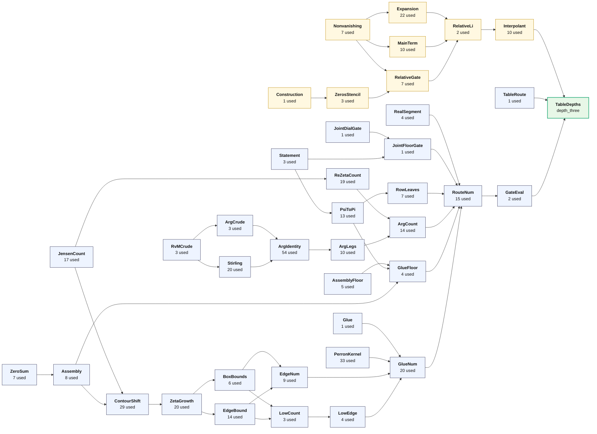

# What `TableDepths.depth_three` rests on

[`TableDepths.depth_three`](../lean_stage3/TableDepths.md#TableDepths-depth_three) in `lean_stage3/Stage3/TableDepths.lean`, line 195.

**Why.** Depth three, from row 76.

**Proves**

```lean
Construction.tableFrom TableRoute.rowN r 3 ≠ 0
```

**Needs** (its hypotheses)

  - `` hRH : RiemannHypothesis ``
  - `` hr : 76 ≤ r ``

Behind it: 352 theorems and 65 definitions in 40 files. Every one is listed below; Lean recorded each step.

## The files it passes through



An arrow A → B reads "B uses something proved or defined in A"; indirect arrows are left out. Green: the theorem itself. Yellow: a file in the other tree. The number is how many of that file's declarations are on the way.

## Every declaration on the way

Files in dependency order. ★ marks what the theorem's own proof uses directly.

### [`Construction`](../lean/Construction.md) — 1

- ★ [`Construction.tableFrom`](../lean/Construction.md#Construction-tableFrom) — *def*

### [`Nonvanishing`](../lean/Nonvanishing.md) — 7

- [`Nonvanishing.bdiffZ`](../lean/Nonvanishing.md#Nonvanishing-bdiffZ) — *def*
- [`Nonvanishing.stencilR`](../lean/Nonvanishing.md#Nonvanishing-stencilR) — *def*
- [`Nonvanishing.iter_bdiffZ_eq_fwdDiff`](../lean/Nonvanishing.md#Nonvanishing-iter_bdiffZ_eq_fwdDiff) — `` (bdiffZ^[n]) g r = (-1 : ℝ) ^ n * (fwdDiff (-1 : ℤ))^[n] g r ``
- [`Nonvanishing.iter_bdiffZ_eq_stencilR`](../lean/Nonvanishing.md#Nonvanishing-iter_bdiffZ_eq_stencilR) — `` (bdiffZ^[n]) g r = stencilR n g r ``
- [`Nonvanishing.stencilR_row`](../lean/Nonvanishing.md#Nonvanishing-stencilR_row) — `` stencilR d (bdiffZ g) r = stencilR (d + 1) g r ``
- [`Nonvanishing.stencilR_sub`](../lean/Nonvanishing.md#Nonvanishing-stencilR_sub) — `` stencilR n (fun x => f x - L x) r = stencilR n f r - stencilR n L r ``
- [`Nonvanishing.Mlow`](../lean/Nonvanishing.md#Nonvanishing-Mlow) — *def*

### [`Expansion`](../lean/Expansion.md) — 22

- [`Expansion.c`](../lean/Expansion.md#Expansion-c) — *def*
- [`Expansion.S`](../lean/Expansion.md#Expansion-S) — *def*
- [`Expansion.F`](../lean/Expansion.md#Expansion-F) — *def*
- [`Expansion.f2x`](../lean/Expansion.md#Expansion-f2x) — *def*
- [`Expansion.exp_eq_rpow`](../lean/Expansion.md#Expansion-exp_eq_rpow) — `` Real.exp (Real.log 2 * x) = (2 : ℝ) ^ x ``
- [`Expansion.F_zero`](../lean/Expansion.md#Expansion-F_zero) — `` F 0 x = f2x x ``
- [`Expansion.c_rec`](../lean/Expansion.md#Expansion-c_rec) — `` c (d + 1) j = Real.log 2 * c d j + (-(j : ℝ)) * c d (j - 1) ``
- [`Expansion.hasDerivAt_S`](../lean/Expansion.md#Expansion-hasDerivAt_S) — `` HasDerivAt (S d) (∑ j ∈ range (d + 1), c d j * (-(j : ℝ) - 1) * x ^ (-(j + 2 : ℤ))) x ``
- [`Expansion.hasDerivAt_F`](../lean/Expansion.md#Expansion-hasDerivAt_F) — `` HasDerivAt (F d) (F (d + 1) x) x ``
- [`Expansion.iteratedDeriv_f2x`](../lean/Expansion.md#Expansion-iteratedDeriv_f2x) — `` ∀ x ∈ Ioi (0 : ℝ), iteratedDeriv d f2x x = F d x ``
- [`Expansion.t`](../lean/Expansion.md#Expansion-t) — *def*
- [`Expansion.t_nonneg`](../lean/Expansion.md#Expansion-t_nonneg) — `` 0 ≤ t d j x ``
- [`Expansion.S_eq_alt`](../lean/Expansion.md#Expansion-S_eq_alt) — `` S d x = ∑ j ∈ range (d + 1), (-1 : ℝ) ^ j * t d j x ``
- [`Expansion.choose_factorial_step`](../lean/Expansion.md#Expansion-choose_factorial_step) — `` d.choose (j + 1) * (j + 1).factorial = d.choose j * j.factorial * (d - j) ``
- [`Expansion.t_halves`](../lean/Expansion.md#Expansion-t_halves) — `` t d (j + 1) x ≤ t d j x / 2 ``
- [`Expansion.B`](../lean/Expansion.md#Expansion-B) — *def*
- [`Expansion.B_peel`](../lean/Expansion.md#Expansion-B_peel) — `` B d x k = t d k x - B d x (k + 1) ``
- [`Expansion.B_bounds`](../lean/Expansion.md#Expansion-B_bounds) — `` ∀ m k, k + m = d → 0 ≤ B d x k ∧ B d x k ≤ t d k x ``
- [`Expansion.t_zero`](../lean/Expansion.md#Expansion-t_zero) — `` t d 0 x = Real.log 2 ^ d * x⁻¹ ``
- [`Expansion.S_floor`](../lean/Expansion.md#Expansion-S_floor) — `` Real.log 2 ^ d / (2 * x) ≤ S d x ``
- [`Expansion.F_floor`](../lean/Expansion.md#Expansion-F_floor) — `` (2 : ℝ) ^ x * (Real.log 2 ^ d / (2 * x)) ≤ F d x ``
- [`Expansion.hD_of_window`](../lean/Expansion.md#Expansion-hD_of_window) — `` ∀ y ∈ Icc ((r : ℝ) - (d + 1)) r, Nonvanishing.Mlow r d ≤ iteratedDeriv (d + 1) G y ``

### [`MainTerm`](../lean/MainTerm.md) — 10

- [`MainTerm.bdiffR`](../lean/MainTerm.md#MainTerm-bdiffR) — *def*
- [`MainTerm.iter_bdiffR_eq_fwdDiff`](../lean/MainTerm.md#MainTerm-iter_bdiffR_eq_fwdDiff) — `` (bdiffR^[n]) g x = (-1 : ℝ) ^ n * (fwdDiff (-1 : ℝ))^[n] g x ``
- [`MainTerm.iter_bdiffR_eq_sum`](../lean/MainTerm.md#MainTerm-iter_bdiffR_eq_sum) — `` (bdiffR^[n]) g x = ∑ k ∈ range (n + 1), (-1 : ℝ) ^ k * (n.choose k) * g (x - k) ``
- [`MainTerm.stencilR_eq_iter`](../lean/MainTerm.md#MainTerm-stencilR_eq_iter) — `` Nonvanishing.stencilR n (fun k : ℤ => G k) r = (bdiffR^[n]) G r ``
- [`MainTerm.deriv_bdiffR`](../lean/MainTerm.md#MainTerm-deriv_bdiffR) — `` deriv (bdiffR g) = bdiffR (deriv g) ``
- [`MainTerm.contDiff_bdiffR`](../lean/MainTerm.md#MainTerm-contDiff_bdiffR) — `` ContDiff ℝ (⊤ : ℕ∞) (bdiffR g) ``
- [`MainTerm.iteratedDeriv_bdiffR`](../lean/MainTerm.md#MainTerm-iteratedDeriv_bdiffR) — `` iteratedDeriv n (bdiffR g) = bdiffR (iteratedDeriv n g) ``
- [`MainTerm.bdiffR_lb`](../lean/MainTerm.md#MainTerm-bdiffR_lb) — `` m ≤ bdiffR g x ``
- [`MainTerm.iter_bdiffR_lb`](../lean/MainTerm.md#MainTerm-iter_bdiffR_lb) — `` m ≤ (bdiffR^[n]) g x ``
- [`MainTerm.stencilR_ge_of`](../lean/MainTerm.md#MainTerm-stencilR_ge_of) — `` c ≤ |Nonvanishing.stencilR (d + 1) (fun k : ℤ => G k) r| ``

### [`ZerosStencil`](../lean/ZerosStencil.md) — 3

- [`Zeros.tableFrom_eq_fwdDiff`](../lean/ZerosStencil.md#Zeros-tableFrom_eq_fwdDiff) — `` Construction.tableFrom N r d = (-1 : ℤ) ^ d * (fwdDiff (-1 : ℤ))^[d] N r ``
- [`Zeros.stencil`](../lean/ZerosStencil.md#Zeros-stencil) — *def*
- [`Zeros.tableFrom_eq_stencil`](../lean/ZerosStencil.md#Zeros-tableFrom_eq_stencil) — `` Construction.tableFrom N r d = stencil d (fun k => N (r - k)) ``

### [`RelativeGate`](../lean/RelativeGate.md) — 7

- [`RelativeGate.StmtRelErrWindow`](../lean/RelativeGate.md#RelativeGate-StmtRelErrWindow) — *def*
- [`RelativeGate.EhighRel`](../lean/RelativeGate.md#RelativeGate-EhighRel) — *def*
- [`RelativeGate.relWindow_term_le`](../lean/RelativeGate.md#RelativeGate-relWindow_term_le) — `` ρ * (2 : ℝ) ^ ((r : ℝ) - k) = ρ * (2 : ℝ) ^ (r : ℝ) * ((2 : ℝ) ^ (-(1 : ℝ))) ^ k ``
- [`RelativeGate.relError_bound`](../lean/RelativeGate.md#RelativeGate-relError_bound) — `` |stencilR n (fun x => f x - L x) r| ≤ EhighRel r n ρ ``
- [`RelativeGate.relGate_iff`](../lean/RelativeGate.md#RelativeGate-relGate_iff) — `` EhighRel r (d + 1) ρ < Mlow r d ↔ ρ < Real.log 2 ^ d / (2 * r * 3 ^ (d + 1)) ``
- [`RelativeGate.nonvanishing_of_relErr`](../lean/RelativeGate.md#RelativeGate-nonvanishing_of_relErr) — `` stencilR (d + 1) f r ≠ 0 ``
- [`RelativeGate.tableFrom_ne_zero_of_relErr`](../lean/RelativeGate.md#RelativeGate-tableFrom_ne_zero_of_relErr) — `` Construction.tableFrom N r d ≠ 0 ``

### [`RelativeLi`](../lean/RelativeLi.md) — 2

- [`RelativeLi.tableFrom_ne_zero_of_relErr_li`](../lean/RelativeLi.md#RelativeLi-tableFrom_ne_zero_of_relErr_li) — `` Construction.tableFrom N r d ≠ 0 ``
- [`RelativeLi.tableFrom_ne_zero_of_relErr_li'`](../lean/RelativeLi.md#RelativeLi-tableFrom_ne_zero_of_relErr_li-) — `` Construction.tableFrom N r d ≠ 0 ``

### [`Interpolant`](../lean/Interpolant.md) — 10

- [`Interpolant.F`](../lean/Interpolant.md#Interpolant-F) — *def*
- [`Interpolant.liRow`](../lean/Interpolant.md#Interpolant-liRow) — *def*
- [`Interpolant.f2x_contDiffOn`](../lean/Interpolant.md#Interpolant-f2x_contDiffOn) — `` ContDiffOn ℝ (⊤ : ℕ∞) Expansion.f2x (Ioi 0) ``
- [`Interpolant.f2x_continuousOn`](../lean/Interpolant.md#Interpolant-f2x_continuousOn) — `` ContinuousOn Expansion.f2x (Ioi 0) ``
- [`Interpolant.F_hasDerivAt`](../lean/Interpolant.md#Interpolant-F_hasDerivAt) — `` HasDerivAt F (Expansion.f2x x) x ``
- [`Interpolant.F_contDiffOn`](../lean/Interpolant.md#Interpolant-F_contDiffOn) — `` ContDiffOn ℝ (⊤ : ℕ∞) F (Ioi 0) ``
- [`Interpolant.liRow_contDiff`](../lean/Interpolant.md#Interpolant-liRow_contDiff) — `` ContDiff ℝ (⊤ : ℕ∞) liRow ``
- [`Interpolant.liRow_eq`](../lean/Interpolant.md#Interpolant-liRow_eq) — `` liRow x = 2 / Real.log 2 + ∫ t in (1 : ℝ)..x, Expansion.f2x t ``
- [`Interpolant.liRow_hasDerivAt`](../lean/Interpolant.md#Interpolant-liRow_hasDerivAt) — `` HasDerivAt liRow (Expansion.f2x x) x ``
- [`Interpolant.tableFrom_ne_zero_of_relErr_liRow`](../lean/Interpolant.md#Interpolant-tableFrom_ne_zero_of_relErr_liRow) — `` Construction.tableFrom N r d ≠ 0 ``

### [`AssemblyFloor`](../lean_stage3/AssemblyFloor.md) — 5

- [`Stage3.floorConst`](../lean_stage3/AssemblyFloor.md#Stage3-floorConst) — *def*
- [`Stage3.floorConst_nonneg`](../lean_stage3/AssemblyFloor.md#Stage3-floorConst_nonneg) — `` 0 ≤ floorConst c₁ c₂ b₁ b₂ b₃ W x₀ ``
- [`Stage3.rem_floor`](../lean_stage3/AssemblyFloor.md#Stage3-rem_floor) — `` c₁ * xx * G ^ 2 / TT ≤ 18 * c₁ * L ^ 2 / xx ``
- [`Stage3.zeroinner_floor`](../lean_stage3/AssemblyFloor.md#Stage3-zeroinner_floor) — `` 2 * (Real.log 2 / (2 * Real.pi) * (KK + 1) * (KK + 2) + 3 * (KK + 1) / Real.pi + 2 * (R + 7 / 8)) + 2 * W ≤ 2 * (L ^ 2 + (4 + 4 * b₁ + 4 * b₂) * L + 2 * b₃ + 2)… ``
- [`Stage3.floor_arith`](../lean_stage3/AssemblyFloor.md#Stage3-floor_arith) — `` A ≤ (4 + P / L₀ + Q / L₀ ^ 2 + 18 * c₁ / (x₀ * S₀) + c₂ / (S₀ * L₀)) * S * L ^ 2 ``

### [`Glue`](../lean_stage3/Glue.md) — 1

- [`Glue.Gf`](../lean_stage3/Glue.md#Glue-Gf) — *def*

### [`JensenCount`](../lean_stage3/JensenCount.md) — 17

- [`Stage3.zeta_centre_lower`](../lean_stage3/JensenCount.md#Stage3-zeta_centre_lower) — `` (1 : ℝ) / 3 ≤ ‖ζ (2 + Complex.I * T)‖ ``
- [`Stage3.zeta_disk_upper`](../lean_stage3/JensenCount.md#Stage3-zeta_disk_upper) — `` ‖ζ w‖ ≤ 28 * T ``
- [`Stage3.zeta_centre_ne_zero`](../lean_stage3/JensenCount.md#Stage3-zeta_centre_ne_zero) — `` ζ (2 + Complex.I * (T : ℂ)) ≠ 0 ``
- [`Stage3.pole_away`](../lean_stage3/JensenCount.md#Stage3-pole_away) — `` 2 * z + (2 + Complex.I * (T : ℂ)) ≠ 1 ``
- [`Stage3.pole_away_centre`](../lean_stage3/JensenCount.md#Stage3-pole_away_centre) — `` v ≠ 1 ``
- [`Stage3.zetaWindowTwo_finite`](../lean_stage3/JensenCount.md#Stage3-zetaWindowTwo_finite) — `` {ρ : ℂ | ζ ρ = 0 ∧ ‖ρ - (2 + Complex.I * (T : ℂ))‖ ≤ 2}.Finite ``
- [`Stage3.zetaWindow`](../lean_stage3/JensenCount.md#Stage3-zetaWindow) — *def*
- [`Stage3.zetaWindow_finite`](../lean_stage3/JensenCount.md#Stage3-zetaWindow_finite) — `` (zetaWindow T).Finite ``
- [`Stage3.jensenF`](../lean_stage3/JensenCount.md#Stage3-jensenF) — *def*
- [`Stage3.zeta_comp_analytic`](../lean_stage3/JensenCount.md#Stage3-zeta_comp_analytic) — `` AnalyticAt ℂ (fun z : ℂ => ζ (2 * z + (2 + Complex.I * (T : ℂ)))) w ``
- [`Stage3.jensenF_analytic`](../lean_stage3/JensenCount.md#Stage3-jensenF_analytic) — `` AnalyticOnNhd ℂ (jensenF T) (Metric.closedBall (0 : ℂ) 1) ``
- [`Stage3.jensenF_zero_eq_one`](../lean_stage3/JensenCount.md#Stage3-jensenF_zero_eq_one) — `` jensenF T 0 = 1 ``
- [`Stage3.jensenF_zeros_finite`](../lean_stage3/JensenCount.md#Stage3-jensenF_zeros_finite) — `` (SetOfZeros 1 (jensenF T)).Finite ``
- [`Stage3.jensenF_bound`](../lean_stage3/JensenCount.md#Stage3-jensenF_bound) — `` ‖jensenF T z‖ ≤ 84 * T ``
- [`Stage3.analyticOrderNatAt_fun_comp_affine`](../lean_stage3/JensenCount.md#Stage3-analyticOrderNatAt_fun_comp_affine) — `` analyticOrderNatAt (fun w : ℂ => g (a * w + b)) z = analyticOrderNatAt g (a * z + b) ``
- [`Stage3.jensenF_order`](../lean_stage3/JensenCount.md#Stage3-jensenF_order) — `` analyticOrderNatAt (jensenF T) w = analyticOrderNatAt ζ (2 * w + (2 + Complex.I * (T : ℂ))) ``
- [`Stage3.zeta_local_zero_count`](../lean_stage3/JensenCount.md#Stage3-zeta_local_zero_count) — `` ∑ ρ ∈ (zetaWindow_finite hT).toFinset, (analyticOrderNatAt ζ ρ : ℝ) ≤ 15 * Real.log T + 73 ``

### [`JointDialGate`](../lean_stage3/JointDialGate.md) — 1

- [`JointDialGate.StmtRelErrWindow`](../lean_stage3/JointDialGate.md#JointDialGate-StmtRelErrWindow) — *def*

### [`PerronKernel`](../lean_stage3/PerronKernel.md) — 33

- [`PerronKernel.perronI`](../lean_stage3/PerronKernel.md#PerronKernel-perronI) — *def*
- [`PerronKernel.perronδ`](../lean_stage3/PerronKernel.md#PerronKernel-perron-) — *def*
- [`PerronKernel.perronI_eq_VIntegral'`](../lean_stage3/PerronKernel.md#PerronKernel-perronI_eq_VIntegral-) — `` perronI y c T = VIntegral' (fun s : ℂ ↦ (y : ℂ) ^ s / s) c (-T) T ``
- [`PerronKernel.kernel_holo`](../lean_stage3/PerronKernel.md#PerronKernel-kernel_holo) — `` HolomorphicOn (fun s : ℂ ↦ (y : ℂ) ^ s / s) {s : ℂ | 0 < s.re} ``
- [`PerronKernel.rect_subset_right`](../lean_stage3/PerronKernel.md#PerronKernel-rect_subset_right) — `` Rectangle ((c : ℂ) - Complex.I * T) ((X : ℂ) + Complex.I * T) ⊆ {s : ℂ | 0 < s.re} ``
- [`PerronKernel.perron_kernel_coarse_lt`](../lean_stage3/PerronKernel.md#PerronKernel-perron_kernel_coarse_lt) — `` ‖perronI y c T - perronδ y‖ ≤ y ^ c ``
- [`PerronKernel.horiz_bound`](../lean_stage3/PerronKernel.md#PerronKernel-horiz_bound) — `` ‖∫ σ in a..b, (y : ℂ) ^ ((σ : ℂ) + (T' : ℂ) * Complex.I) / ((σ : ℂ) + (T' : ℂ) * Complex.I)‖ ≤ max (y ^ a) (y ^ b) / (|T'| * |Real.log y|) ``
- [`PerronKernel.perron_kernel_decay_lt`](../lean_stage3/PerronKernel.md#PerronKernel-perron_kernel_decay_lt) — `` ‖perronI y c T - perronδ y‖ ≤ y ^ c / (T * |Real.log y|) ``
- [`PerronKernel.dslope_kernel_diff`](../lean_stage3/PerronKernel.md#PerronKernel-dslope_kernel_diff) — `` Differentiable ℂ (dslope (fun s : ℂ ↦ (y : ℂ) ^ s) 0) ``
- [`PerronKernel.rect_residue`](../lean_stage3/PerronKernel.md#PerronKernel-rect_residue) — `` RectangleIntegral' (fun s : ℂ ↦ (y : ℂ) ^ s / s) (-(X:ℂ) - Complex.I * T) ((c:ℂ) + Complex.I * T) = 1 ``
- [`PerronKernel.perron_kernel_decay_gt`](../lean_stage3/PerronKernel.md#PerronKernel-perron_kernel_decay_gt) — `` ‖perronI y c T - perronδ y‖ ≤ y ^ c / (T * |Real.log y|) ``
- [`PerronKernel.perron_kernel_decay`](../lean_stage3/PerronKernel.md#PerronKernel-perron_kernel_decay) — `` ‖perronI y c T - perronδ y‖ ≤ y ^ c / (T * |Real.log y|) ``
- [`PerronKernel.coarse_gt_ineq`](../lean_stage3/PerronKernel.md#PerronKernel-coarse_gt_ineq) — `` v * Real.exp u + Real.pi - Real.arctan (v / u) ≤ Real.pi * Real.exp u ``
- [`PerronKernel.seg_inv_integral`](../lean_stage3/PerronKernel.md#PerronKernel-seg_inv_integral) — `` (∫ t in (-T)..T, ((c : ℂ) + Complex.I * t)⁻¹ * Complex.I) = 2 * Real.arctan (T / c) * Complex.I ``
- [`PerronKernel.cpow_sub_one_bound`](../lean_stage3/PerronKernel.md#PerronKernel-cpow_sub_one_bound) — `` ‖(y : ℂ) ^ s - 1‖ ≤ ‖s‖ * Real.log y * y ^ s.re ``
- [`PerronKernel.perron_kernel_coarse_gt`](../lean_stage3/PerronKernel.md#PerronKernel-perron_kernel_coarse_gt) — `` ‖perronI y c T - perronδ y‖ ≤ y ^ c ``
- [`PerronKernel.perron_kernel_coarse`](../lean_stage3/PerronKernel.md#PerronKernel-perron_kernel_coarse) — `` ‖perronI y c T - perronδ y‖ ≤ y ^ c ``
- [`PerronKernel.perron_kernel_truncated`](../lean_stage3/PerronKernel.md#PerronKernel-perron_kernel_truncated) — `` ‖perronI y c T - perronδ y‖ ≤ y ^ c * min 1 (1 / (T * |Real.log y|)) ``
- [`PerronKernel.one_sub_two_neg_rpow`](../lean_stage3/PerronKernel.md#PerronKernel-one_sub_two_neg_rpow) — `` δ / 5 ≤ 1 - (2:ℝ) ^ (-δ) ``
- [`PerronKernel.vonMangoldt_rpow_partial`](../lean_stage3/PerronKernel.md#PerronKernel-vonMangoldt_rpow_partial) — `` ∑ n ∈ s, ArithmeticFunction.vonMangoldt n * (n : ℝ) ^ (-c) ≤ 2 * (Real.log 4 + 4) / (1 - (2:ℝ) ^ (1 - c)) ``
- [`PerronKernel.vonMangoldt_rpow_tsum`](../lean_stage3/PerronKernel.md#PerronKernel-vonMangoldt_rpow_tsum) — `` ∑' n : ℕ, ArithmeticFunction.vonMangoldt n * (n : ℝ) ^ (-c) ≤ 2 * (Real.log 4 + 4) / (1 - (2:ℝ) ^ (1 - c)) ``
- [`PerronKernel.vonMangoldt_rpow_summable`](../lean_stage3/PerronKernel.md#PerronKernel-vonMangoldt_rpow_summable) — `` Summable (fun n : ℕ ↦ ArithmeticFunction.vonMangoldt n * (n : ℝ) ^ (-c)) ``
- [`PerronKernel.far_terms_sum`](../lean_stage3/PerronKernel.md#PerronKernel-far_terms_sum) — `` (∑' n : ℕ, if 1/2 ≤ |Real.log (x / n)| then ArithmeticFunction.vonMangoldt n * (x / n) ^ (1 + 1/Real.log x) / (T * |Real.log (x / n)|) else 0) ≤ 300 * x * Real.… ``
- [`PerronKernel.abs_sub_one_le_two_abs_log`](../lean_stage3/PerronKernel.md#PerronKernel-abs_sub_one_le_two_abs_log) — `` |t - 1| / 2 ≤ |Real.log t| ``
- [`PerronKernel.near_diagonal_sum`](../lean_stage3/PerronKernel.md#PerronKernel-near_diagonal_sum) — `` (∑' n : ℕ, if 0 < |Real.log (x / n)| ∧ |Real.log (x / n)| < 1/2 then ArithmeticFunction.vonMangoldt n * min 1 (1/(T * |Real.log (x / n)|)) else 0) ≤ 100 * x * R… ``
- [`PerronKernel.perronI_one_norm`](../lean_stage3/PerronKernel.md#PerronKernel-perronI_one_norm) — `` ‖perronI 1 c T‖ ≤ 1/2 ``
- [`PerronKernel.kernel_sum_bound`](../lean_stage3/PerronKernel.md#PerronKernel-kernel_sum_bound) — `` ‖(∑' n : ℕ, (ArithmeticFunction.vonMangoldt n : ℂ) * (perronI (x/n) (1 + 1/Real.log x) T - perronδ (x/n)))‖ ≤ 600 * x * Real.log (x * T) ^ 2 / T + 12 * Real.log… ``
- [`PerronKernel.delta_sum_close`](../lean_stage3/PerronKernel.md#PerronKernel-delta_sum_close) — `` ‖(Chebyshev.psi x : ℂ) - ∑' n : ℕ, (ArithmeticFunction.vonMangoldt n : ℂ) * perronδ (x / n)‖ ≤ Real.log x ``
- [`PerronKernel.kernel_diff_summable`](../lean_stage3/PerronKernel.md#PerronKernel-kernel_diff_summable) — `` Summable (fun n : ℕ ↦ (ArithmeticFunction.vonMangoldt n : ℂ) * (perronI (x/n) (1 + 1/Real.log x) T - perronδ (x/n))) ``
- [`PerronKernel.perron_to_psi`](../lean_stage3/PerronKernel.md#PerronKernel-perron_to_psi) — `` ‖(Chebyshev.psi x : ℂ) - ∑' n : ℕ, (ArithmeticFunction.vonMangoldt n : ℂ) * perronI (x/n) (1 + 1/Real.log x) T‖ ≤ 600 * x * Real.log (x * T) ^ 2 / T + 13 * Real… ``
- [`PerronKernel.tsum_vonMangoldt_div_cpow`](../lean_stage3/PerronKernel.md#PerronKernel-tsum_vonMangoldt_div_cpow) — `` (∑' n : ℕ, (ArithmeticFunction.vonMangoldt n : ℂ) * ((x / n : ℝ) : ℂ) ^ s) = (- deriv riemannZeta s / riemannZeta s) * ((x:ℝ):ℂ) ^ s ``
- [`PerronKernel.perron_sum_eq_integral`](../lean_stage3/PerronKernel.md#PerronKernel-perron_sum_eq_integral) — `` (∑' n : ℕ, (ArithmeticFunction.vonMangoldt n : ℂ) * perronI (x/n) (1 + 1/Real.log x) T) = (2 * (Real.pi:ℂ) * Complex.I)⁻¹ * ∫ t in (-T)..T, (- deriv riemannZeta… ``
- [`PerronKernel.explicit_formula_perron`](../lean_stage3/PerronKernel.md#PerronKernel-explicit_formula_perron) — `` ‖(Chebyshev.psi x : ℂ) - (2 * (Real.pi:ℂ) * Complex.I)⁻¹ * ∫ t in (-T)..T, (- deriv riemannZeta (((1 + 1/Real.log x : ℝ):ℂ) + Complex.I * t) / riemannZeta (((1 … ``

### [`ReZetaCount`](../lean_stage3/ReZetaCount.md) — 19

- [`ReZetaCount.G`](../lean_stage3/ReZetaCount.md#ReZetaCount-G) — *def*
- [`ReZetaCount.F`](../lean_stage3/ReZetaCount.md#ReZetaCount-F) — *def*
- [`ReZetaCount.reZeroSet`](../lean_stage3/ReZetaCount.md#ReZetaCount-reZeroSet) — *def*
- [`ReZetaCount.norm_zeta_sub_one_le`](../lean_stage3/ReZetaCount.md#ReZetaCount-norm_zeta_sub_one_le) — `` ‖riemannZeta s - 1‖ ≤ Real.pi ^ 2 / 6 - 1 ``
- [`ReZetaCount.re_zeta_two_line_ge`](../lean_stage3/ReZetaCount.md#ReZetaCount-re_zeta_two_line_ge) — `` 2 - Real.pi ^ 2 / 6 ≤ (riemannZeta (2 + (t : ℂ) * Complex.I)).re ``
- [`ReZetaCount.re_zeta_two_line_pos`](../lean_stage3/ReZetaCount.md#ReZetaCount-re_zeta_two_line_pos) — `` 0 < (riemannZeta (2 + (t : ℂ) * Complex.I)).re ``
- [`ReZetaCount.G_zero_eq`](../lean_stage3/ReZetaCount.md#ReZetaCount-G_zero_eq) — `` G T 0 = ((2 * (riemannZeta (2 + Complex.I * (T : ℂ))).re : ℝ) : ℂ) ``
- [`ReZetaCount.G_real`](../lean_stage3/ReZetaCount.md#ReZetaCount-G_real) — `` G T (x : ℂ) = ((2 * (riemannZeta (2 * (x : ℂ) + 2 + Complex.I * (T : ℂ))).re : ℝ) : ℂ) ``
- [`ReZetaCount.G_zero_ne`](../lean_stage3/ReZetaCount.md#ReZetaCount-G_zero_ne) — `` G T 0 ≠ 0 ``
- [`ReZetaCount.F_zero_eq_one`](../lean_stage3/ReZetaCount.md#ReZetaCount-F_zero_eq_one) — `` F T 0 = 1 ``
- [`ReZetaCount.arg_ne_one`](../lean_stage3/ReZetaCount.md#ReZetaCount-arg_ne_one) — `` 2 * z + 2 + Complex.I * (T : ℂ) ≠ 1 ∧ 2 * z + 2 - Complex.I * (T : ℂ) ≠ 1 ``
- [`ReZetaCount.F_analytic`](../lean_stage3/ReZetaCount.md#ReZetaCount-F_analytic) — `` AnalyticOnNhd ℂ (F T) (Metric.closedBall (0 : ℂ) 1) ``
- [`ReZetaCount.F_bound`](../lean_stage3/ReZetaCount.md#ReZetaCount-F_bound) — `` ‖F T z‖ ≤ 80 * T ``
- [`ReZetaCount.F_zeros_finite`](../lean_stage3/ReZetaCount.md#ReZetaCount-F_zeros_finite) — `` (SetOfZeros 1 (F T)).Finite ``
- [`ReZetaCount.F_count_le`](../lean_stage3/ReZetaCount.md#ReZetaCount-F_count_le) — `` ∑ ρ ∈ (finiteSetOfZeros_mono (by norm_num : (7:ℝ)/8 < 1) (F_zeros_finite hT)).toFinset, (analyticOrderNatAt (F T) ρ : ℝ) ≤ 15 * Real.log T + 73 ``
- [`ReZetaCount.reZeroSet_finite`](../lean_stage3/ReZetaCount.md#ReZetaCount-reZeroSet_finite) — `` (reZeroSet T).Finite ``
- [`ReZetaCount.reZeros`](../lean_stage3/ReZetaCount.md#ReZetaCount-reZeros) — *def*
- [`ReZetaCount.mem_reZeros`](../lean_stage3/ReZetaCount.md#ReZetaCount-mem_reZeros) — `` x ∈ reZeros hT ↔ x ∈ Set.Ioo (1/2 : ℝ) 2 ∧ (riemannZeta ((x : ℂ) + T * Complex.I)).re = 0 ``
- [`ReZetaCount.card_reZeros_le`](../lean_stage3/ReZetaCount.md#ReZetaCount-card_reZeros_le) — `` ((reZeros hT).card : ℝ) ≤ 15 * Real.log T + 73 ``

### [`RealSegment`](../lean_stage3/RealSegment.md) — 4

- [`Stage3.zeta_real_ne_zero_upper`](../lean_stage3/RealSegment.md#Stage3-zeta_real_ne_zero_upper) — `` riemannZeta (σ : ℂ) ≠ 0 ``
- [`Stage3.zeta_real_ne_zero`](../lean_stage3/RealSegment.md#Stage3-zeta_real_ne_zero) — `` riemannZeta (σ : ℂ) ≠ 0 ``
- [`Stage3.isEmpty_zeroHeight`](../lean_stage3/RealSegment.md#Stage3-isEmpty_zeroHeight) — `` IsEmpty Kadiri.ZeroHeightNontrivialZeros ``
- [`Stage3.weightedZeroHeightBucket_eq_zero`](../lean_stage3/RealSegment.md#Stage3-weightedZeroHeightBucket_eq_zero) — `` Kadiri.weightedZeroHeightBucket = 0 ``

### [`RvMCrude`](../lean_stage3/RvMCrude.md) — 3

- [`Stage3.StmtBacklundPhase`](../lean_stage3/RvMCrude.md#Stage3-StmtBacklundPhase) — *def*
- [`Stage3.StmtBacklundArg`](../lean_stage3/RvMCrude.md#Stage3-StmtBacklundArg) — *def*
- [`Stage3.RvM_of_phase_arg`](../lean_stage3/RvMCrude.md#Stage3-RvM_of_phase_arg) — `` riemannZeta.Riemann_vonMangoldt_bound (B₁ + B₁') 0 (B₃ + B₃') ``

### [`ArgCrude`](../lean_stage3/ArgCrude.md) — 3

- [`Stage3.StmtArgIdentity`](../lean_stage3/ArgCrude.md#Stage3-StmtArgIdentity) — *def*
- [`Stage3.StmtSCrude`](../lean_stage3/ArgCrude.md#Stage3-StmtSCrude) — *def*
- [`Stage3.backlundArg_of_identity`](../lean_stage3/ArgCrude.md#Stage3-backlundArg_of_identity) — `` StmtBacklundArg θ B₁ B₃ ``

### [`Statement`](../lean_stage3/Statement.md) — 3

- [`Stage3.StmtSchoenfeldWeak`](../lean_stage3/Statement.md#Stage3-StmtSchoenfeldWeak) — *def*
- [`Stage3.StmtWeakWindow`](../lean_stage3/Statement.md#Stage3-StmtWeakWindow) — *def*
- [`Stage3.weakWindow_of_global`](../lean_stage3/Statement.md#Stage3-weakWindow_of_global) — `` StmtWeakWindow C k f L r n ``

### [`JointFloorGate`](../lean_stage3/JointFloorGate.md) — 1

- [`JointFloorGate.weakWindow_relErr`](../lean_stage3/JointFloorGate.md#JointFloorGate-weakWindow_relErr) — `` JointDialGate.StmtRelErrWindow f L r n (C * (Real.log 2 * r) ^ k * (2 : ℝ) ^ (-(((r : ℝ) - n) / 2))) ``

### [`PsiToPi`](../lean_stage3/PsiToPi.md) — 13

- [`Stage3.Li`](../lean_stage3/PsiToPi.md#Stage3-Li) — *def*
- [`Stage3.continuousOn_inv_log_sq`](../lean_stage3/PsiToPi.md#Stage3-continuousOn_inv_log_sq) — `` ContinuousOn (fun t : ℝ => 1 / Real.log t ^ 2) (Set.uIcc a x) ``
- [`Stage3.continuousOn_inv_mul_log_sq`](../lean_stage3/PsiToPi.md#Stage3-continuousOn_inv_mul_log_sq) — `` ContinuousOn (fun t : ℝ => (t * Real.log t ^ 2)⁻¹) (Set.uIcc a x) ``
- [`Stage3.integrable_theta_term`](../lean_stage3/PsiToPi.md#Stage3-integrable_theta_term) — `` IntervalIntegrable (fun t => θ t / (t * Real.log t ^ 2)) volume a x ``
- [`Stage3.integrable_err_term`](../lean_stage3/PsiToPi.md#Stage3-integrable_err_term) — `` IntervalIntegrable (fun t => (θ t - t) / (t * Real.log t ^ 2)) volume a x ``
- [`Stage3.pi_sub_Li_eq`](../lean_stage3/PsiToPi.md#Stage3-pi_sub_Li_eq) — `` (Nat.primeCounting ⌊x⌋₊ : ℝ) - Li x = (θ x - x) / Real.log x + ∫ t in (2 : ℝ)..x, (θ t - t) / (t * Real.log t ^ 2) ``
- [`Stage3.integral_A_rpow_le`](../lean_stage3/PsiToPi.md#Stage3-integral_A_rpow_le) — `` (∫ t in a..x, A * t ^ (-(1 : ℝ) / 2)) ≤ 2 * A * Real.sqrt x ``
- [`Stage3.theta_err_of_psi`](../lean_stage3/PsiToPi.md#Stage3-theta_err_of_psi) — `` |θ x - x| ≤ E + 2 * Real.sqrt x * Real.log x ``
- [`Stage3.StmtPsiWeak`](../lean_stage3/PsiToPi.md#Stage3-StmtPsiWeak) — *def*
- [`Stage3.abs_theta_sub_le_linear`](../lean_stage3/PsiToPi.md#Stage3-abs_theta_sub_le_linear) — `` |θ t - t| ≤ (1 + Real.log 4) * t ``
- [`Stage3.one_add_log_four_le`](../lean_stage3/PsiToPi.md#Stage3-one_add_log_four_le) — `` 1 + Real.log 4 ≤ 5 * Real.log 2 ^ 2 ``
- [`Stage3.rpow_neg_half_mul`](../lean_stage3/PsiToPi.md#Stage3-rpow_neg_half_mul) — `` t ^ (-(1 : ℝ) / 2) * (t * Real.log t ^ 2) = Real.sqrt t * Real.log t ^ 2 ``
- [`Stage3.schoenfeldWeak_of_psiWeak`](../lean_stage3/PsiToPi.md#Stage3-schoenfeldWeak_of_psiWeak) — `` StmtSchoenfeldWeak (3 * C + 13) (k - 1) (max (x₀ ^ 2) 9) (fun x => (Nat.primeCounting ⌊x⌋₊ : ℝ)) Li ``

### [`RowLeaves`](../lean_stage3/RowLeaves.md) — 7

- [`Stage3.continuousOn_inv_log_sq_Ioi`](../lean_stage3/RowLeaves.md#Stage3-continuousOn_inv_log_sq_Ioi) — `` ContinuousOn (fun t : ℝ => 1 / Real.log t ^ 2) (Ioi 1) ``
- [`Stage3.hasDerivAt_Li`](../lean_stage3/RowLeaves.md#Stage3-hasDerivAt_Li) — `` HasDerivAt Li (1 / Real.log y) y ``
- [`Stage3.hasDerivAt_Li_two_rpow`](../lean_stage3/RowLeaves.md#Stage3-hasDerivAt_Li_two_rpow) — `` HasDerivAt (fun u : ℝ => Li ((2 : ℝ) ^ u)) (Real.exp (Real.log 2 * x) / x) x ``
- [`Stage3.continuousOn_exp_div`](../lean_stage3/RowLeaves.md#Stage3-continuousOn_exp_div) — `` ContinuousOn (fun t : ℝ => Real.exp (Real.log 2 * t) / t) (Ioi 0) ``
- [`Stage3.hasDerivAt_rowIntegral`](../lean_stage3/RowLeaves.md#Stage3-hasDerivAt_rowIntegral) — `` HasDerivAt (fun u : ℝ => 2 / Real.log 2 + ∫ t in (1 : ℝ)..u, Real.exp (Real.log 2 * t) / t) (Real.exp (Real.log 2 * x) / x) x ``
- [`Stage3.Li_two_rpow`](../lean_stage3/RowLeaves.md#Stage3-Li_two_rpow) — `` Li ((2 : ℝ) ^ x) = 2 / Real.log 2 + ∫ t in (1 : ℝ)..x, Real.exp (Real.log 2 * t) / t ``
- [`Stage3.norm_logDerivZeta_zero`](../lean_stage3/RowLeaves.md#Stage3-norm_logDerivZeta_zero) — `` ‖deriv riemannZeta 0 / riemannZeta 0‖ = Real.log (2 * Real.pi) ``

### [`Stirling`](../lean_stage3/Stirling.md) — 20

- [`Stage3.phasePoint`](../lean_stage3/Stirling.md#Stage3-phasePoint) — *def*
- [`Stage3.phaseTheta`](../lean_stage3/Stirling.md#Stage3-phaseTheta) — *def*
- [`Stage3.continuous_phasePoint`](../lean_stage3/Stirling.md#Stage3-continuous_phasePoint) — `` Continuous phasePoint ``
- [`Stage3.intervalIntegrable_phasePoint`](../lean_stage3/Stirling.md#Stage3-intervalIntegrable_phasePoint) — `` IntervalIntegrable phasePoint MeasureTheory.volume a b ``
- [`Stage3.integral_log_half`](../lean_stage3/Stirling.md#Stage3-integral_log_half) — `` (∫ t in (1 : ℝ)..T, Real.log (t / 2)) = T * Real.log (T / 2) - T + 1 + Real.log 2 ``
- [`Stage3.StmtDigammaLog`](../lean_stage3/Stirling.md#Stage3-StmtDigammaLog) — *def*
- [`Stage3.backlundPhase_of_digammaLog`](../lean_stage3/Stirling.md#Stage3-backlundPhase_of_digammaLog) — `` StmtBacklundPhase phaseTheta C (C + 1) ``
- [`Stage3.digamma_term_norm_le`](../lean_stage3/Stirling.md#Stage3-digamma_term_norm_le) — `` ‖1 / ((n : ℂ) + 1) - 1 / ((n : ℂ) + z)‖ ≤ 4 / ((n : ℝ) + 1) ^ 2 ``
- [`Stage3.phasePoint_compact_le`](../lean_stage3/Stirling.md#Stage3-phasePoint_compact_le) — `` ∀ t ∈ Set.Icc (0 : ℝ) 1, |phasePoint t| ≤ 8 ``
- [`Stage3.log_norm_z_le`](../lean_stage3/Stirling.md#Stage3-log_norm_z_le) — `` |Real.log ‖(1 : ℂ) / 4 + (t : ℂ) / 2 * Complex.I‖ - Real.log (t / 2)| ≤ 1 / (4 * t) ``
- [`Stage3.inv_quadratic_tsum_le`](../lean_stage3/Stirling.md#Stage3-inv_quadratic_tsum_le) — `` (∑' n : ℕ, (((n : ℝ) + 1 / 4) ^ 2 + (t / 2) ^ 2)⁻¹) ≤ 12 / t ``
- [`Stage3.re_sub_log_norm_le`](../lean_stage3/Stirling.md#Stage3-re_sub_log_norm_le) — `` |w.re - Real.log ‖1 + w‖| ≤ 8 * ‖w‖ ^ 2 ``
- [`Stage3.zq`](../lean_stage3/Stirling.md#Stage3-zq) — *def*
- [`Stage3.phasePoint_eq`](../lean_stage3/Stirling.md#Stage3-phasePoint_eq) — `` phasePoint t = (Complex.digamma (zq t)).re ``
- [`Stage3.normSq_add_zq`](../lean_stage3/Stirling.md#Stage3-normSq_add_zq) — `` ‖(n : ℂ) + zq t‖ ^ 2 = ((n : ℝ) + 1 / 4) ^ 2 + (t / 2) ^ 2 ``
- [`Stage3.add_zq_ne_zero`](../lean_stage3/Stirling.md#Stage3-add_zq_ne_zero) — `` (n : ℂ) + zq t ≠ 0 ``
- [`Stage3.a_term_le`](../lean_stage3/Stirling.md#Stage3-a_term_le) — `` |(((n : ℂ) + zq t)⁻¹).re - (Real.log ‖((n + 1 : ℕ) : ℂ) + zq t‖ - Real.log ‖(n : ℂ) + zq t‖)| ≤ 8 * ((((n : ℝ) + 1 / 4) ^ 2 + (t / 2) ^ 2)⁻¹) ``
- [`Stage3.re_digamma_sub_log_le`](../lean_stage3/Stirling.md#Stage3-re_digamma_sub_log_le) — `` |phasePoint t - Real.log ‖zq t‖| ≤ 96 / t ``
- [`Stage3.stmtDigammaLog_holds`](../lean_stage3/Stirling.md#Stage3-stmtDigammaLog_holds) — `` StmtDigammaLog 97 ``
- [`Stage3.backlundPhase_holds`](../lean_stage3/Stirling.md#Stage3-backlundPhase_holds) — `` StmtBacklundPhase phaseTheta 97 98 ``

### [`ArgIdentity`](../lean_stage3/ArgIdentity.md) — 54

- [`Stage3.xi`](../lean_stage3/ArgIdentity.md#Stage3-xi) — *def*
- [`Stage3.differentiable_xi`](../lean_stage3/ArgIdentity.md#Stage3-differentiable_xi) — `` Differentiable ℂ xi ``
- [`Stage3.xi_zero`](../lean_stage3/ArgIdentity.md#Stage3-xi_zero) — `` xi 0 = 1 ``
- [`Stage3.xi_one`](../lean_stage3/ArgIdentity.md#Stage3-xi_one) — `` xi 1 = 1 ``
- [`Stage3.xi_eq_completed`](../lean_stage3/ArgIdentity.md#Stage3-xi_eq_completed) — `` xi s = s * (s - 1) * completedRiemannZeta s ``
- [`Stage3.xi_one_sub`](../lean_stage3/ArgIdentity.md#Stage3-xi_one_sub) — `` xi (1 - s) = xi s ``
- [`Stage3.gammaR_conj`](../lean_stage3/ArgIdentity.md#Stage3-gammaR_conj) — `` Gammaℝ (conj s) = conj (Gammaℝ s) ``
- [`Stage3.completed_eq_gammaR_mul_zeta`](../lean_stage3/ArgIdentity.md#Stage3-completed_eq_gammaR_mul_zeta) — `` completedRiemannZeta s = Gammaℝ s * riemannZeta s ``
- [`Stage3.completedZeta₀_conj`](../lean_stage3/ArgIdentity.md#Stage3-completedZeta-_conj) — `` completedRiemannZeta₀ (conj s) = conj (completedRiemannZeta₀ s) ``
- [`Stage3.xi_conj`](../lean_stage3/ArgIdentity.md#Stage3-xi_conj) — `` xi (conj s) = conj (xi s) ``
- [`Stage3.zeta_re_neg_of_real_mem_Ioo`](../lean_stage3/ArgIdentity.md#Stage3-zeta_re_neg_of_real_mem_Ioo) — `` (riemannZeta (σ : ℂ)).re < 0 ``
- [`Stage3.zeta_ne_zero_of_real_mem_Ioo`](../lean_stage3/ArgIdentity.md#Stage3-zeta_ne_zero_of_real_mem_Ioo) — `` riemannZeta (σ : ℂ) ≠ 0 ``
- [`Stage3.completed_eq_gammaR_mul_zeta'`](../lean_stage3/ArgIdentity.md#Stage3-completed_eq_gammaR_mul_zeta-) — `` completedRiemannZeta s = Gammaℝ s * riemannZeta s ``
- [`Stage3.xi_eq_prod`](../lean_stage3/ArgIdentity.md#Stage3-xi_eq_prod) — `` xi s = s * (s - 1) * Gammaℝ s * riemannZeta s ``
- [`Stage3.xi_ne_zero_of_one_le_re`](../lean_stage3/ArgIdentity.md#Stage3-xi_ne_zero_of_one_le_re) — `` xi s ≠ 0 ``
- [`Stage3.xi_ne_zero_of_re_nonpos`](../lean_stage3/ArgIdentity.md#Stage3-xi_ne_zero_of_re_nonpos) — `` xi s ≠ 0 ``
- [`Stage3.xi_ne_zero_of_real`](../lean_stage3/ArgIdentity.md#Stage3-xi_ne_zero_of_real) — `` xi (σ : ℂ) ≠ 0 ``
- [`Stage3.xi_eq_zero_iff`](../lean_stage3/ArgIdentity.md#Stage3-xi_eq_zero_iff) — `` xi s = 0 ↔ riemannZeta s = 0 ∧ 0 < s.re ∧ s.re < 1 ``
- [`Stage3.meromorphicOrderAt_xi_eq_zeta`](../lean_stage3/ArgIdentity.md#Stage3-meromorphicOrderAt_xi_eq_zeta) — `` meromorphicOrderAt xi ρ = meromorphicOrderAt riemannZeta ρ ``
- [`Stage3.xi_analyticAt`](../lean_stage3/ArgIdentity.md#Stage3-xi_analyticAt) — `` AnalyticAt ℂ xi s ``
- [`Stage3.xi_meromorphicOrderAt_ne_top`](../lean_stage3/ArgIdentity.md#Stage3-xi_meromorphicOrderAt_ne_top) — `` meromorphicOrderAt xi p ≠ ⊤ ``
- [`Stage3.logDeriv_xi_meromorphicAt`](../lean_stage3/ArgIdentity.md#Stage3-logDeriv_xi_meromorphicAt) — `` MeromorphicAt (logDeriv xi) s ``
- [`Stage3.N_eq_sum`](../lean_stage3/ArgIdentity.md#Stage3-N_eq_sum) — `` riemannZeta.N T = ∑ ρ ∈ (Kadiri.zeroes_rect_univ_positive_height_finite T).toFinset, (riemannZeta.order ρ : ℝ) ``
- [`Stage3.xi_divisor_support_eq`](../lean_stage3/ArgIdentity.md#Stage3-xi_divisor_support_eq) — `` (MeromorphicOn.divisor xi (Rectangle (-1 : ℂ) (2 + Complex.I * T))).support = riemannZeta.zeroes_rect (Set.univ : Set ℝ) (Set.Ioo 0 T) ``
- [`Stage3.rectangleIntegral_logDeriv_xi_eq_N`](../lean_stage3/ArgIdentity.md#Stage3-rectangleIntegral_logDeriv_xi_eq_N) — `` RectangleIntegral' (logDeriv xi) (-1 : ℂ) (2 + Complex.I * T) = ((riemannZeta.N T : ℝ) : ℂ) ``
- [`Stage3.logDeriv_xi_one_sub`](../lean_stage3/ArgIdentity.md#Stage3-logDeriv_xi_one_sub) — `` logDeriv xi (1 - s) = -logDeriv xi s ``
- [`Stage3.logDeriv_xi_conj`](../lean_stage3/ArgIdentity.md#Stage3-logDeriv_xi_conj) — `` logDeriv xi (conj s) = conj (logDeriv xi s) ``
- [`Stage3.logDeriv_xi_continuousAt`](../lean_stage3/ArgIdentity.md#Stage3-logDeriv_xi_continuousAt) — `` ContinuousAt (logDeriv xi) p ``
- [`Stage3.xi_ne_zero_on_good_top`](../lean_stage3/ArgIdentity.md#Stage3-xi_ne_zero_on_good_top) — `` xi ((x : ℂ) + T * Complex.I) ≠ 0 ``
- [`Stage3.pi_mul_N_eq`](../lean_stage3/ArgIdentity.md#Stage3-pi_mul_N_eq) — `` Real.pi * riemannZeta.N T = (∫ t in (0:ℝ)..T, logDeriv xi (2 + (t : ℂ) * Complex.I)).re - (∫ x in (1/2:ℝ)..2, logDeriv xi ((x : ℂ) + T * Complex.I)).im ``
- [`Stage3.logDeriv_congr_of_eventuallyEq`](../lean_stage3/ArgIdentity.md#Stage3-logDeriv_congr_of_eventuallyEq) — `` logDeriv f x = logDeriv g x ``
- [`Stage3.gammaR_eq_exp_mul`](../lean_stage3/ArgIdentity.md#Stage3-gammaR_eq_exp_mul) — `` Gammaℝ s = Complex.exp (-(Real.log Real.pi : ℂ) / 2 * s) * Complex.Gamma (s / 2) ``
- [`Stage3.differentiableAt_gammaR`](../lean_stage3/ArgIdentity.md#Stage3-differentiableAt_gammaR) — `` DifferentiableAt ℂ Gammaℝ s ``
- [`Stage3.logDeriv_gammaR`](../lean_stage3/ArgIdentity.md#Stage3-logDeriv_gammaR) — `` logDeriv Gammaℝ s = -(Real.log Real.pi : ℂ) / 2 + Complex.digamma (s / 2) / 2 ``
- [`Stage3.logDeriv_xi_split`](../lean_stage3/ArgIdentity.md#Stage3-logDeriv_xi_split) — `` logDeriv xi s = 1 / s + 1 / (s - 1) + logDeriv Gammaℝ s + logDeriv riemannZeta s ``
- [`Stage3.intervalIntegral_re`](../lean_stage3/ArgIdentity.md#Stage3-intervalIntegral_re) — `` (∫ t in a..b, f t).re = ∫ t in a..b, (f t).re ``
- [`Stage3.logDeriv_gammaR_conj`](../lean_stage3/ArgIdentity.md#Stage3-logDeriv_gammaR_conj) — `` logDeriv Gammaℝ (conj s) = conj (logDeriv Gammaℝ s) ``
- [`Stage3.logDeriv_gammaR_im_eq_zero`](../lean_stage3/ArgIdentity.md#Stage3-logDeriv_gammaR_im_eq_zero) — `` (logDeriv Gammaℝ ((x : ℝ) : ℂ)).im = 0 ``
- [`Stage3.integral_inv_vertical`](../lean_stage3/ArgIdentity.md#Stage3-integral_inv_vertical) — `` (∫ t in (0:ℝ)..T, ((c : ℂ) + t * Complex.I)⁻¹) = -Complex.I * (Complex.log ((c : ℂ) + T * Complex.I) - Complex.log (c : ℂ)) ``
- [`Stage3.integral_inv_horizontal`](../lean_stage3/ArgIdentity.md#Stage3-integral_inv_horizontal) — `` (∫ x in a..b, (((x : ℂ) - d) + T * Complex.I)⁻¹) = Complex.log (((b : ℂ) - d) + T * Complex.I) - Complex.log (((a : ℂ) - d) + T * Complex.I) ``
- [`Stage3.arg_sum_eq_pi`](../lean_stage3/ArgIdentity.md#Stage3-arg_sum_eq_pi) — `` Complex.arg ((1/2 : ℝ) + T * Complex.I) + Complex.arg ((-(1/2) : ℝ) + T * Complex.I) = Real.pi ``
- [`Stage3.elemLD`](../lean_stage3/ArgIdentity.md#Stage3-elemLD) — *def*
- [`Stage3.elem_fold_eq_pi`](../lean_stage3/ArgIdentity.md#Stage3-elem_fold_eq_pi) — `` (∫ t in (0:ℝ)..T, elemLD (2 + (t : ℂ) * Complex.I)).re - (∫ x in (1/2:ℝ)..2, elemLD ((x : ℂ) + T * Complex.I)).im = Real.pi ``
- [`Stage3.logDeriv_gammaR_analyticAt`](../lean_stage3/ArgIdentity.md#Stage3-logDeriv_gammaR_analyticAt) — `` AnalyticAt ℂ (logDeriv Gammaℝ) z ``
- [`Stage3.logDeriv_gammaR_continuousAt`](../lean_stage3/ArgIdentity.md#Stage3-logDeriv_gammaR_continuousAt) — `` ContinuousAt (logDeriv Gammaℝ) z ``
- [`Stage3.logDeriv_gammaR_holo`](../lean_stage3/ArgIdentity.md#Stage3-logDeriv_gammaR_holo) — `` HolomorphicOn (logDeriv Gammaℝ) {s : ℂ | 0 < s.re} ``
- [`Stage3.logDeriv_gammaR_comp_continuous`](../lean_stage3/ArgIdentity.md#Stage3-logDeriv_gammaR_comp_continuous) — `` Continuous fun x : ℝ => logDeriv Gammaℝ (g x) ``
- [`Stage3.gammaR_fold_eq_phaseTheta`](../lean_stage3/ArgIdentity.md#Stage3-gammaR_fold_eq_phaseTheta) — `` (∫ t in (0:ℝ)..T, logDeriv Gammaℝ (2 + (t : ℂ) * Complex.I)).re - (∫ x in (1/2:ℝ)..2, logDeriv Gammaℝ ((x : ℂ) + T * Complex.I)).im = phaseTheta T ``
- [`Stage3.argS`](../lean_stage3/ArgIdentity.md#Stage3-argS) — *def*
- [`Stage3.stmtArgIdentity_holds`](../lean_stage3/ArgIdentity.md#Stage3-stmtArgIdentity_holds) — `` StmtArgIdentity phaseTheta argS ``
- [`Stage3.logDeriv_zeta_analyticAt`](../lean_stage3/ArgIdentity.md#Stage3-logDeriv_zeta_analyticAt) — `` AnalyticAt ℂ (logDeriv riemannZeta) z ``
- [`Stage3.logDeriv_zeta_continuousAt`](../lean_stage3/ArgIdentity.md#Stage3-logDeriv_zeta_continuousAt) — `` ContinuousAt (logDeriv riemannZeta) z ``
- [`Stage3.zetaArgContour`](../lean_stage3/ArgIdentity.md#Stage3-zetaArgContour) — *def*
- [`Stage3.argS_eq_zetaArgContour`](../lean_stage3/ArgIdentity.md#Stage3-argS_eq_zetaArgContour) — `` argS T = zetaArgContour T ``

### [`ArgLegs`](../lean_stage3/ArgLegs.md) — 10

- [`ArgLegs.abs_arg_sub_le_pi`](../lean_stage3/ArgLegs.md#ArgLegs-abs_arg_sub_le_pi) — `` |z.arg - w.arg| ≤ Real.pi ``
- [`ArgLegs.mem_slitPlane_of_re_nonneg`](../lean_stage3/ArgLegs.md#ArgLegs-mem_slitPlane_of_re_nonneg) — `` z ∈ Complex.slitPlane ``
- [`ArgLegs.integral_logDeriv_eq_log_sub`](../lean_stage3/ArgLegs.md#ArgLegs-integral_logDeriv_eq_log_sub) — `` ∫ x in a..b, g' x / g x = Complex.log (g b) - Complex.log (g a) ``
- [`ArgLegs.im_integral_le_pi_of_re_nonneg`](../lean_stage3/ArgLegs.md#ArgLegs-im_integral_le_pi_of_re_nonneg) — `` |(∫ x in a..b, g' x / g x).im| ≤ Real.pi ``
- [`ArgLegs.im_integral_le_pi_of_re_nonpos`](../lean_stage3/ArgLegs.md#ArgLegs-im_integral_le_pi_of_re_nonpos) — `` |(∫ x in a..b, g' x / g x).im| ≤ Real.pi ``
- [`ArgLegs.re_sign_const`](../lean_stage3/ArgLegs.md#ArgLegs-re_sign_const) — `` (∀ x ∈ Set.Icc a b, 0 ≤ (g x).re) ∨ (∀ x ∈ Set.Icc a b, (g x).re ≤ 0) ``
- [`ArgLegs.segment_im_integral_le`](../lean_stage3/ArgLegs.md#ArgLegs-segment_im_integral_le) — `` |(∫ x in a..b, g' x / g x).im| ≤ Real.pi * ((Z.card : ℝ) + 1) ``
- [`ArgLegs.vertical_leg_le`](../lean_stage3/ArgLegs.md#ArgLegs-vertical_leg_le) — `` |(∫ t in (0:ℝ)..T, logDeriv riemannZeta (2 + (t : ℂ) * Complex.I)).re| ≤ Real.pi / 2 ``
- [`ArgLegs.horizontal_leg_le`](../lean_stage3/ArgLegs.md#ArgLegs-horizontal_leg_le) — `` |(∫ x in (1/2:ℝ)..2, logDeriv riemannZeta ((x : ℂ) + T * Complex.I)).im| ≤ Real.pi * ((Z.card : ℝ) + 1) ``
- [`ArgLegs.zetaArgContour_le`](../lean_stage3/ArgLegs.md#ArgLegs-zetaArgContour_le) — `` |Stage3.zetaArgContour T| ≤ (Z.card : ℝ) + 3 / 2 ``

### [`ArgCount`](../lean_stage3/ArgCount.md) — 14

- [`ArgCount.good`](../lean_stage3/ArgCount.md#ArgCount-good) — *def*
- [`ArgCount.argS_le_of_good`](../lean_stage3/ArgCount.md#ArgCount-argS_le_of_good) — `` |Stage3.argS T| ≤ 15 * Real.log T + 73 + 3 / 2 ``
- [`ArgCount.N_eq_sum`](../lean_stage3/ArgCount.md#ArgCount-N_eq_sum) — `` riemannZeta.N T = ∑ z ∈ (Kadiri.zeroes_rect_univ_positive_height_finite T).toFinset, (1 : ℝ) * (riemannZeta.order z : ℝ) ``
- [`ArgCount.N_nonneg`](../lean_stage3/ArgCount.md#ArgCount-N_nonneg) — `` 0 ≤ riemannZeta.N T ``
- [`ArgCount.N_mono`](../lean_stage3/ArgCount.md#ArgCount-N_mono) — `` riemannZeta.N T ≤ riemannZeta.N T' ``
- [`ArgCount.N_eq_of_no_zero_between`](../lean_stage3/ArgCount.md#ArgCount-N_eq_of_no_zero_between) — `` riemannZeta.N T = riemannZeta.N T₀ ``
- [`ArgCount.exists_good_below`](../lean_stage3/ArgCount.md#ArgCount-exists_good_below) — `` ∃ T : ℝ, a < T ∧ T < T₀ ∧ good T ∧ ∀ ρ : ℂ, riemannZeta ρ = 0 → ρ.im ∈ Set.Ico T T₀ → False ``
- [`ArgCount.phasePoint_bound_near`](../lean_stage3/ArgCount.md#ArgCount-phasePoint_bound_near) — `` ∃ M : ℝ, 0 ≤ M ∧ ∀ t ∈ Set.Icc (T₀ - 1) T₀, |Stage3.phasePoint t| ≤ M ``
- [`ArgCount.phaseTheta_sub_le`](../lean_stage3/ArgCount.md#ArgCount-phaseTheta_sub_le) — `` |Stage3.phaseTheta T₀ - Stage3.phaseTheta T| ≤ (T₀ - T) * (M / 2 + Real.log Real.pi / 2) ``
- [`ArgCount.argS_le_gt_two`](../lean_stage3/ArgCount.md#ArgCount-argS_le_gt_two) — `` |Stage3.argS T| ≤ 15 * Real.log T + 75 ``
- [`ArgCount.mainTerm_abs_le`](../lean_stage3/ArgCount.md#ArgCount-mainTerm_abs_le) — `` |Kadiri.zetaCountingMainTerm T| ≤ 3 ``
- [`ArgCount.argS_two_le`](../lean_stage3/ArgCount.md#ArgCount-argS_two_le) — `` |Stage3.argS 2| ≤ 15 * Real.log 2 + 600 ``
- [`ArgCount.sCrude_holds`](../lean_stage3/ArgCount.md#ArgCount-sCrude_holds) — `` Stage3.StmtSCrude Stage3.argS 15 600 ``
- [`ArgCount.rvM_crude`](../lean_stage3/ArgCount.md#ArgCount-rvM_crude) — `` riemannZeta.Riemann_vonMangoldt_bound 112 0 698 ``

### [`TableRoute`](../lean_stage3/TableRoute.md) — 1

- ★ [`TableRoute.rowN`](../lean_stage3/TableRoute.md#TableRoute-rowN) — *def*

### [`ZeroSum`](../lean_stage3/ZeroSum.md) — 7

- [`Stage3.log_two_pi_le`](../lean_stage3/ZeroSum.md#Stage3-log_two_pi_le) — `` Real.log (2 * Real.pi) ≤ 2 ``
- [`Stage3.RvM_mono`](../lean_stage3/ZeroSum.md#Stage3-RvM_mono) — `` riemannZeta.RvM b₁ b₂ b₃ T ≤ riemannZeta.RvM b₁ b₂ b₃ T' ``
- [`Stage3.abs_mainterm_le`](../lean_stage3/ZeroSum.md#Stage3-abs_mainterm_le) — `` |zetaCountingMainTerm T| ≤ T / (2 * Real.pi) * (Real.log T + 3) + 7 / 8 ``
- [`Stage3.N_abs_le`](../lean_stage3/ZeroSum.md#Stage3-N_abs_le) — `` |riemannZeta.N T| ≤ T / (2 * Real.pi) * (Real.log T + 3) + riemannZeta.RvM b₁ b₂ b₃ T + 7 / 8 ``
- [`Stage3.sum_range_add_one`](../lean_stage3/ZeroSum.md#Stage3-sum_range_add_one) — `` (∑ j ∈ range n, ((j : ℝ) + 1)) = n * (n + 1) / 2 ``
- [`Stage3.sum_inv_pow_two_le`](../lean_stage3/ZeroSum.md#Stage3-sum_inv_pow_two_le) — `` (∑ j ∈ range n, ((2 : ℝ) ^ j)⁻¹) ≤ 2 ``
- [`Stage3.dyadic_abs_N_sum_le`](../lean_stage3/ZeroSum.md#Stage3-dyadic_abs_N_sum_le) — `` (∑ j ∈ range (K + 1), ((2 : ℝ) ^ j)⁻¹ * |riemannZeta.N ((2 : ℝ) ^ (j + 1))|) ≤ Real.log 2 / (2 * Real.pi) * (K + 1) * (K + 2) + 3 * (K + 1) / Real.pi + 2 * (rie… ``

### [`Assembly`](../lean_stage3/Assembly.md) — 8

- [`Stage3.re_eq_half_of_RH`](../lean_stage3/Assembly.md#Stage3-re_eq_half_of_RH) — `` (ρ : ℂ).re = 1 / 2 ``
- [`Stage3.half_le_norm_of_RH`](../lean_stage3/Assembly.md#Stage3-half_le_norm_of_RH) — `` 1 / 2 ≤ ‖(ρ : ℂ)‖ ``
- [`Stage3.norm_cpow_of_RH`](../lean_stage3/Assembly.md#Stage3-norm_cpow_of_RH) — `` ‖(x : ℂ) ^ (ρ : ℂ)‖ = Real.sqrt x ``
- [`Stage3.zeroPartialSum`](../lean_stage3/Assembly.md#Stage3-zeroPartialSum) — *def*
- [`Stage3.inv_le_dyadic_sum`](../lean_stage3/Assembly.md#Stage3-inv_le_dyadic_sum) — `` ∀ γ : ℝ, 1 ≤ γ → γ < 2 ^ (K + 1) → γ⁻¹ ≤ ∑ j ∈ Finset.range (K + 1), ((2 : ℝ) ^ j)⁻¹ * (if γ < 2 ^ (j + 1) then 1 else 0) ``
- [`Stage3.norm_term_le_dyadic`](../lean_stage3/Assembly.md#Stage3-norm_term_le_dyadic) — `` ‖(x : ℂ) ^ (ρ : ℂ) / (ρ : ℂ)‖ ≤ 2 * Real.sqrt x * ∑ j ∈ Finset.range (K + 1), ((2 : ℝ) ^ j)⁻¹ * (if |(ρ : ℂ).im| < 2 ^ (j + 1) then 1 else 0) ``
- [`Stage3.norm_zeroPartialSum_le_sharp`](../lean_stage3/Assembly.md#Stage3-norm_zeroPartialSum_le_sharp) — `` ‖zeroPartialSum x ((2 : ℝ) ^ (K + 1))‖ ≤ 2 * Real.sqrt x * ∑ j ∈ Finset.range (K + 1), ((2 : ℝ) ^ j)⁻¹ * (2 * |riemannZeta.N ((2 : ℝ) ^ (j + 1))| + weightedZero… ``
- [`Stage3.norm_zeroPartialSum_le_logsq`](../lean_stage3/Assembly.md#Stage3-norm_zeroPartialSum_le_logsq) — `` ‖zeroPartialSum x ((2 : ℝ) ^ (K + 1))‖ ≤ 2 * Real.sqrt x * (2 * (Real.log 2 / (2 * Real.pi) * (K + 1) * (K + 2) + 3 * (K + 1) / Real.pi + 2 * (riemannZeta.RvM b… ``

### [`ContourShift`](../lean_stage3/ContourShift.md) — 29

- [`ContourShift.zeroGap`](../lean_stage3/ContourShift.md#ContourShift-zeroGap) — *def*
- [`ContourShift.zeroGap_pos`](../lean_stage3/ContourShift.md#ContourShift-zeroGap_pos) — `` 0 < zeroGap T ``
- [`ContourShift.zeroGap_le`](../lean_stage3/ContourShift.md#ContourShift-zeroGap_le) — `` zeroGap T ≤ 9/10 ``
- [`ContourShift.zeta_analyticAt`](../lean_stage3/ContourShift.md#ContourShift-zeta_analyticAt) — `` AnalyticAt ℂ riemannZeta ρ ``
- [`ContourShift.one_le_zeta_order`](../lean_stage3/ContourShift.md#ContourShift-one_le_zeta_order) — `` 1 ≤ analyticOrderNatAt riemannZeta ρ ``
- [`ContourShift.partner_zero`](../lean_stage3/ContourShift.md#ContourShift-partner_zero) — `` ∃ ρ' : ℂ, riemannZeta ρ' = 0 ∧ ρ'.im = ρ.im ∧ 1/2 ≤ ρ'.re ∧ ρ'.re < 1 ``
- [`ContourShift.mem_zetaWindow`](../lean_stage3/ContourShift.md#ContourShift-mem_zetaWindow) — `` ρ ∈ Stage3.zetaWindow T₀ ``
- [`ContourShift.goodT_exists`](../lean_stage3/ContourShift.md#ContourShift-goodT_exists) — `` ∃ T' ∈ Set.Icc T (T+1), ∀ ρ : ℂ, riemannZeta ρ = 0 → 0 < ρ.re → zeroGap T ≤ |ρ.im - T'| ``
- [`ContourShift.borderIntegrable_sum_poles`](../lean_stage3/ContourShift.md#ContourShift-borderIntegrable_sum_poles) — `` RectangleBorderIntegrable (fun s ↦ ∑ p ∈ P, A p / (s - p)) z w ``
- [`ContourShift.rectangleIntegral_sum_poles`](../lean_stage3/ContourShift.md#ContourShift-rectangleIntegral_sum_poles) — `` RectangleIntegral' (fun s ↦ ∑ p ∈ P, A p / (s - p)) z w = ∑ p ∈ P, A p ``
- [`ContourShift.residue_rectangle_multi`](../lean_stage3/ContourShift.md#ContourShift-residue_rectangle_multi) — `` RectangleIntegral' f z w = ∑ p ∈ P, A p ``
- [`ContourShift.residue_rectangle_of_local`](../lean_stage3/ContourShift.md#ContourShift-residue_rectangle_of_local) — `` RectangleIntegral' f z w = ∑ p ∈ P, A p ``
- [`ContourShift.analyticAt_dslope`](../lean_stage3/ContourShift.md#ContourShift-analyticAt_dslope) — `` AnalyticAt ℂ (dslope f p) p ``
- [`ContourShift.div_sub_eq_dslope`](../lean_stage3/ContourShift.md#ContourShift-div_sub_eq_dslope) — `` f s / (s - p) = f p / (s - p) + dslope f p s ``
- [`ContourShift.zeta_local_data`](../lean_stage3/ContourShift.md#ContourShift-zeta_local_data) — `` ∃ h : ℂ → ℂ, AnalyticAt ℂ h p ∧ ∀ᶠ s in nhdsWithin p {p}ᶜ, - deriv riemannZeta s / riemannZeta s * ((x:ℝ):ℂ) ^ s / s = h s + (-(n:ℂ) * ((x:ℝ):ℂ) ^ p / p) / (s -… ``
- [`ContourShift.zeta_order_ne_top`](../lean_stage3/ContourShift.md#ContourShift-zeta_order_ne_top) — `` analyticOrderAt riemannZeta ρ ≠ ⊤ ``
- [`ContourShift.zeta_local_data_zero`](../lean_stage3/ContourShift.md#ContourShift-zeta_local_data_zero) — `` ∃ h : ℂ → ℂ, AnalyticAt ℂ h ρ ∧ ∀ᶠ s in nhdsWithin ρ {ρ}ᶜ, - deriv riemannZeta s / riemannZeta s * ((x:ℝ):ℂ) ^ s / s = h s + (-(analyticOrderNatAt riemannZeta ρ… ``
- [`ContourShift.zeta_local_data_one`](../lean_stage3/ContourShift.md#ContourShift-zeta_local_data_one) — `` ∃ h : ℂ → ℂ, AnalyticAt ℂ h 1 ∧ ∀ᶠ s in nhdsWithin 1 {1}ᶜ, - deriv riemannZeta s / riemannZeta s * ((x:ℝ):ℂ) ^ s / s = h s + ((x:ℝ):ℂ) / (s - 1) ``
- [`ContourShift.zeta_local_data_origin`](../lean_stage3/ContourShift.md#ContourShift-zeta_local_data_origin) — `` ∃ h : ℂ → ℂ, AnalyticAt ℂ h 0 ∧ ∀ᶠ s in nhdsWithin 0 {0}ᶜ, - deriv riemannZeta s / riemannZeta s * ((x:ℝ):ℂ) ^ s / s = h s + (- deriv riemannZeta 0 / riemannZet… ``
- [`ContourShift.zeta_ne_zero_of_re_mem`](../lean_stage3/ContourShift.md#ContourShift-zeta_ne_zero_of_re_mem) — `` riemannZeta w ≠ 0 ``
- [`ContourShift.sq_mul_zeta_analyticAt_one`](../lean_stage3/ContourShift.md#ContourShift-sq_mul_zeta_analyticAt_one) — `` AnalyticAt ℂ (fun s ↦ (s - 1)^2 * riemannZeta s) 1 ``
- [`ContourShift.zeta_meromorphicOn`](../lean_stage3/ContourShift.md#ContourShift-zeta_meromorphicOn) — `` MeromorphicOn riemannZeta U ``
- [`ContourShift.zeta_zeros_rectangle_finite`](../lean_stage3/ContourShift.md#ContourShift-zeta_zeros_rectangle_finite) — `` {ρ : ℂ | riemannZeta ρ = 0 ∧ ρ ∈ Rectangle z w}.Finite ``
- [`ContourShift.order_bridge`](../lean_stage3/ContourShift.md#ContourShift-order_bridge) — `` ((riemannZeta.order ρ : ℤ) : ℂ) = ((analyticOrderNatAt riemannZeta ρ : ℕ) : ℂ) ``
- [`ContourShift.zeroPartialSum_eq_sum`](../lean_stage3/ContourShift.md#ContourShift-zeroPartialSum_eq_sum) — `` Stage3.zeroPartialSum x T' = ∑ p ∈ ZF, ((analyticOrderNatAt riemannZeta p : ℂ) * ((x : ℂ) ^ p / p)) ``
- [`ContourShift.analyticAt_conj_conj`](../lean_stage3/ContourShift.md#ContourShift-analyticAt_conj_conj) — `` AnalyticAt ℂ (fun w ↦ (starRingEnd ℂ) (g ((starRingEnd ℂ) w))) ((starRingEnd ℂ) p) ``
- [`ContourShift.zeta_order_conj`](../lean_stage3/ContourShift.md#ContourShift-zeta_order_conj) — `` analyticOrderNatAt riemannZeta ((starRingEnd ℂ) ρ) = analyticOrderNatAt riemannZeta ρ ``
- [`ContourShift.zeta_order_reflect`](../lean_stage3/ContourShift.md#ContourShift-zeta_order_reflect) — `` analyticOrderNatAt riemannZeta (1 - (starRingEnd ℂ) ρ) = analyticOrderNatAt riemannZeta ρ ``
- [`ContourShift.residue_identity`](../lean_stage3/ContourShift.md#ContourShift-residue_identity) — `` RectangleIntegral' (fun s : ℂ ↦ (- deriv riemannZeta s / riemannZeta s) * ((x:ℝ):ℂ) ^ s / s) (((-1/4 : ℝ):ℂ) - Complex.I * T') (((1 + 1/Real.log x : ℝ):ℂ) + Com… ``

### [`GlueFloor`](../lean_stage3/GlueFloor.md) — 4

- [`Stage3.StmtExplicitFormulaSplit`](../lean_stage3/GlueFloor.md#Stage3-StmtExplicitFormulaSplit) — *def*
- [`Stage3.floorConstSplit`](../lean_stage3/GlueFloor.md#Stage3-floorConstSplit) — *def*
- [`Stage3.floorConstSplit_nonneg`](../lean_stage3/GlueFloor.md#Stage3-floorConstSplit_nonneg) — `` 0 ≤ floorConstSplit c₁ c₃ c₄ b₁ b₂ b₃ W x₀ ``
- [`Stage3.psiWeak_floor_split`](../lean_stage3/GlueFloor.md#Stage3-psiWeak_floor_split) — `` StmtPsiWeak (floorConstSplit c₁ c₃ c₄ b₁ b₂ b₃ W x₀) 2 x₀ ``

### [`ZetaGrowth`](../lean_stage3/ZetaGrowth.md) — 20

- [`ZetaGrowth.emA`](../lean_stage3/ZetaGrowth.md#ZetaGrowth-emA) — *def*
- [`ZetaGrowth.emA_nonneg`](../lean_stage3/ZetaGrowth.md#ZetaGrowth-emA_nonneg) — `` 0 ≤ emA x ``
- [`ZetaGrowth.emA_le`](../lean_stage3/ZetaGrowth.md#ZetaGrowth-emA_le) — `` emA x ≤ 1/8 ``
- [`ZetaGrowth.emA_natCast`](../lean_stage3/ZetaGrowth.md#ZetaGrowth-emA_natCast) — `` emA n = 0 ``
- [`ZetaGrowth.emA_eq_poly`](../lean_stage3/ZetaGrowth.md#ZetaGrowth-emA_eq_poly) — `` emA x = ((x - n) - (x - n)^2)/2 ``
- [`ZetaGrowth.integrable_emA_tail`](../lean_stage3/ZetaGrowth.md#ZetaGrowth-integrable_emA_tail) — `` IntegrableOn (fun x : ℝ ↦ (emA x : ℂ) * (x : ℂ) ^ (-(s+2))) (Ioi (N:ℝ)) ``
- [`ZetaGrowth.interval_ibp`](../lean_stage3/ZetaGrowth.md#ZetaGrowth-interval_ibp) — `` ∫ x in (n:ℝ)..((n:ℝ)+1), ((⌊x⌋ : ℂ) + 1/2 - (x:ℂ)) * (x:ℂ) ^ (-(s+1)) = (s+1) * ∫ x in (n:ℝ)..((n:ℝ)+1), (emA x : ℂ) * (x:ℂ) ^ (-(s+2)) ``
- [`ZetaGrowth.tail_ibp`](../lean_stage3/ZetaGrowth.md#ZetaGrowth-tail_ibp) — `` ∫ x in Ioi (N:ℝ), ((⌊x⌋ : ℂ) + 1/2 - (x:ℂ)) * (x:ℂ) ^ (-(s+1)) = (s+1) * ∫ x in Ioi (N:ℝ), (emA x : ℂ) * (x:ℂ) ^ (-(s+2)) ``
- [`ZetaGrowth.zeta1`](../lean_stage3/ZetaGrowth.md#ZetaGrowth-zeta1) — *def*
- [`ZetaGrowth.zeta1_eq_zeta`](../lean_stage3/ZetaGrowth.md#ZetaGrowth-zeta1_eq_zeta) — `` zeta1 N s = riemannZeta s ``
- [`ZetaGrowth.tail_differentiableAt`](../lean_stage3/ZetaGrowth.md#ZetaGrowth-tail_differentiableAt) — `` DifferentiableAt ℂ (fun w : ℂ ↦ ∫ x in Ioi (N:ℝ), (emA x : ℂ) * (x:ℂ) ^ (-(w+2))) z ``
- [`ZetaGrowth.stripRegion`](../lean_stage3/ZetaGrowth.md#ZetaGrowth-stripRegion) — *def*
- [`ZetaGrowth.isOpen_stripRegion`](../lean_stage3/ZetaGrowth.md#ZetaGrowth-isOpen_stripRegion) — `` IsOpen stripRegion ``
- [`ZetaGrowth.preconnected_stripRegion`](../lean_stage3/ZetaGrowth.md#ZetaGrowth-preconnected_stripRegion) — `` IsPreconnected stripRegion ``
- [`ZetaGrowth.zeta1_analyticOnNhd`](../lean_stage3/ZetaGrowth.md#ZetaGrowth-zeta1_analyticOnNhd) — `` AnalyticOnNhd ℂ (zeta1 N) stripRegion ``
- [`ZetaGrowth.zeta1_eq_zeta_strip`](../lean_stage3/ZetaGrowth.md#ZetaGrowth-zeta1_eq_zeta_strip) — `` Set.EqOn (zeta1 N) riemannZeta stripRegion ``
- [`ZetaGrowth.tail_norm_le`](../lean_stage3/ZetaGrowth.md#ZetaGrowth-tail_norm_le) — `` ‖∫ x in Ioi (N:ℝ), (emA x : ℂ) * (x:ℂ) ^ (-(s+2))‖ ≤ (1/4) * (N:ℝ) ^ (-s.re - 1) ``
- [`ZetaGrowth.sum_norm_le`](../lean_stage3/ZetaGrowth.md#ZetaGrowth-sum_norm_le) — `` ‖∑ n ∈ Finset.range N, 1 / ((n:ℂ) + 1) ^ s‖ ≤ (N:ℝ) * (N:ℝ) ^ ((1:ℝ)/2) ``
- [`ZetaGrowth.zeta_growth_strip`](../lean_stage3/ZetaGrowth.md#ZetaGrowth-zeta_growth_strip) — `` ‖riemannZeta s‖ ≤ 15 * |s.im| ^ 2 ``
- [`ZetaGrowth.sq_mul_zeta_analytic`](../lean_stage3/ZetaGrowth.md#ZetaGrowth-sq_mul_zeta_analytic) — `` AnalyticAt ℂ (fun z : ℂ ↦ (z - 1)^2 * riemannZeta z) s ``

### [`BoxBounds`](../lean_stage3/BoxBounds.md) — 6

- [`BoxBounds.norm_le_of_sq`](../lean_stage3/BoxBounds.md#BoxBounds-norm_le_of_sq) — `` ‖z‖ ≤ c ``
- [`BoxBounds.sq_zeta_box`](../lean_stage3/BoxBounds.md#BoxBounds-sq_zeta_box) — `` ‖(s - 1) ^ 2 * riemannZeta s‖ ≤ 135 ``
- [`BoxBounds.sq_zeta_band_explicit`](../lean_stage3/BoxBounds.md#BoxBounds-sq_zeta_band_explicit) — `` ‖(s - 1) ^ 2 * riemannZeta s‖ ≤ 135 * (2 + |s.im|) ^ 4 ``
- [`BoxBounds.norm_zeta_three_halves_le`](../lean_stage3/BoxBounds.md#BoxBounds-norm_zeta_three_halves_le) — `` ‖riemannZeta (3 / 2)‖ ≤ 7 / 2 ``
- [`BoxBounds.one_le_norm_zeta_three`](../lean_stage3/BoxBounds.md#BoxBounds-one_le_norm_zeta_three) — `` 1 ≤ ‖riemannZeta 3‖ ``
- [`BoxBounds.zeta_ratio_ge`](../lean_stage3/BoxBounds.md#BoxBounds-zeta_ratio_ge) — `` 2 / 7 ≤ ‖riemannZeta 3 / riemannZeta (3 / 2)‖ ``

### [`EdgeBound`](../lean_stage3/EdgeBound.md) — 14

- [`EdgeBound.c0`](../lean_stage3/EdgeBound.md#EdgeBound-c0) — *def*
- [`EdgeBound.gz`](../lean_stage3/EdgeBound.md#EdgeBound-gz) — *def*
- [`EdgeBound.gz_analytic`](../lean_stage3/EdgeBound.md#EdgeBound-gz_analytic) — `` AnalyticAt ℂ gz s ``
- [`EdgeBound.c0_im`](../lean_stage3/EdgeBound.md#EdgeBound-c0_im) — `` (c0 T').im = T' ``
- [`EdgeBound.c0_re`](../lean_stage3/EdgeBound.md#EdgeBound-c0_re) — `` (c0 T').re = 3/2 ``
- [`EdgeBound.gz_lower`](../lean_stage3/EdgeBound.md#EdgeBound-gz_lower) — `` 4 * ‖riemannZeta 3 / riemannZeta (3/2)‖ ≤ ‖gz (c0 T')‖ ``
- [`EdgeBound.zeta_ratio_pos`](../lean_stage3/EdgeBound.md#EdgeBound-zeta_ratio_pos) — `` (0:ℝ) < ‖riemannZeta 3 / riemannZeta (3/2)‖ ``
- [`EdgeBound.gz_c0_ne`](../lean_stage3/EdgeBound.md#EdgeBound-gz_c0_ne) — `` gz (c0 T') ≠ 0 ``
- [`EdgeBound.gz_zero_cases`](../lean_stage3/EdgeBound.md#EdgeBound-gz_zero_cases) — `` w = 1 ∨ riemannZeta w = 0 ``
- [`EdgeBound.gz_zeros_ball_finite`](../lean_stage3/EdgeBound.md#EdgeBound-gz_zeros_ball_finite) — `` {w : ℂ | gz w = 0 ∧ ‖w - c0 T'‖ ≤ ρ}.Finite ``
- [`EdgeBound.gz_order_eq`](../lean_stage3/EdgeBound.md#EdgeBound-gz_order_eq) — `` analyticOrderNatAt gz w = analyticOrderNatAt riemannZeta w ``
- [`EdgeBound.ball_zero_shape`](../lean_stage3/EdgeBound.md#EdgeBound-ball_zero_shape) — `` riemannZeta w = 0 ∧ (0 < w.re ∧ w.re < 1) ∧ |w.im - T'| ≤ 46/25 ``
- [`EdgeBound.gz_logderiv`](../lean_stage3/EdgeBound.md#EdgeBound-gz_logderiv) — `` deriv gz u / gz u = 2/(u - 1) + deriv riemannZeta u / riemannZeta u ``
- [`EdgeBound.deriv_zeta_conj`](../lean_stage3/EdgeBound.md#EdgeBound-deriv_zeta_conj) — `` deriv riemannZeta ((starRingEnd ℂ) s) = (starRingEnd ℂ) (deriv riemannZeta s) ``

### [`EdgeNum`](../lean_stage3/EdgeNum.md) — 9

- [`EdgeBound.C1n`](../lean_stage3/EdgeNum.md#EdgeBound-C1n) — *def*
- [`EdgeBound.C1n_pos`](../lean_stage3/EdgeNum.md#EdgeBound-C1n_pos) — `` 0 < C1n ``
- [`EdgeBound.gz_partial_fraction_num`](../lean_stage3/EdgeNum.md#EdgeBound-gz_partial_fraction_num) — `` ∀ T' : ℝ, 2 ≤ T' → ∀ u : ℂ, u.im = T' → -1/4 ≤ u.re → u.re ≤ 2 → gz u ≠ 0 → ‖deriv gz u / gz u - ∑ w ∈ (gz_zeros_ball_finite T' (by norm_num : (0:ℝ) ≤ 46/25)).t… ``
- [`EdgeBound.C2n`](../lean_stage3/EdgeNum.md#EdgeBound-C2n) — *def*
- [`EdgeBound.C2n_pos`](../lean_stage3/EdgeNum.md#EdgeBound-C2n_pos) — `` 0 < C2n ``
- [`EdgeBound.ball_order_sum_le_num`](../lean_stage3/EdgeNum.md#EdgeBound-ball_order_sum_le_num) — `` ∀ T' : ℝ, 2 ≤ T' → (∑ w ∈ (gz_zeros_ball_finite T' (by norm_num : (0:ℝ) ≤ 46/25)).toFinset, (analyticOrderNatAt gz w : ℝ)) ≤ C2n * Real.log T' ``
- [`EdgeBound.Cen`](../lean_stage3/EdgeNum.md#EdgeBound-Cen) — *def*
- [`EdgeBound.Cen_pos`](../lean_stage3/EdgeNum.md#EdgeBound-Cen_pos) — `` 0 < Cen ``
- [`EdgeBound.edge_bound_core_num`](../lean_stage3/EdgeNum.md#EdgeBound-edge_bound_core_num) — `` ∀ t : ℝ, 2 ≤ t → ∀ u : ℂ, u.im = t → -1/4 ≤ u.re → u.re ≤ 2 → riemannZeta u ≠ 0 → ∀ δ : ℝ, 0 < δ → δ ≤ 1 → (∀ w ∈ (gz_zeros_ball_finite t (by norm_num : (0:ℝ) ≤… ``

### [`LowCount`](../lean_stage3/LowCount.md) — 3

- [`EdgeBound.gz_c0_lower`](../lean_stage3/LowCount.md#EdgeBound-gz_c0_lower) — `` 1 / 14 ≤ ‖gz (c0 T')‖ ``
- [`EdgeBound.low_ball_count`](../lean_stage3/LowCount.md#EdgeBound-low_ball_count) — `` (∑ w ∈ (gz_zeros_ball_finite T' (by norm_num : (0 : ℝ) ≤ 8 / 5)).toFinset, (analyticOrderNatAt gz w : ℝ)) ≤ 119 ``
- [`EdgeBound.low_rect_count`](../lean_stage3/LowCount.md#EdgeBound-low_rect_count) — `` (∑ ρ ∈ (ContourShift.zeta_zeros_rectangle_finite (0 : ℂ) ((1 : ℝ) + Complex.I * (6 : ℝ))).toFinset, (analyticOrderNatAt riemannZeta ρ : ℝ)) ≤ 714 ``

### [`LowEdge`](../lean_stage3/LowEdge.md) — 4

- [`EdgeBound.low_ball_count_wide`](../lean_stage3/LowEdge.md#EdgeBound-low_ball_count_wide) — `` (∑ w ∈ (gz_zeros_ball_finite T' (by norm_num : (0 : ℝ) ≤ 46 / 25)).toFinset, (analyticOrderNatAt gz w : ℝ)) ≤ 250 ``
- [`EdgeBound.gz_partial_fraction_low`](../lean_stage3/LowEdge.md#EdgeBound-gz_partial_fraction_low) — `` ‖deriv gz u / gz u - ∑ w ∈ (gz_zeros_ball_finite T' (by norm_num : (0:ℝ) ≤ 46/25)).toFinset, (analyticOrderNatAt gz w : ℂ) / (u - w)‖ ≤ 1617537 ``
- [`EdgeBound.logDerivZeta_low_edge`](../lean_stage3/LowEdge.md#EdgeBound-logDerivZeta_low_edge) — `` ‖deriv riemannZeta u / riemannZeta u‖ ≤ 1620000 ``
- [`EdgeBound.logDerivZeta_short_segment`](../lean_stage3/LowEdge.md#EdgeBound-logDerivZeta_short_segment) — `` ‖deriv riemannZeta (((-1/4 : ℝ):ℂ) + t * Complex.I) / riemannZeta (((-1/4 : ℝ):ℂ) + t * Complex.I)‖ ≤ 1620000 ``

### [`GlueNum`](../lean_stage3/GlueNum.md) — 20

- [`Glue.Csn`](../lean_stage3/GlueNum.md#Glue-Csn) — *def*
- [`Glue.Csn_pos`](../lean_stage3/GlueNum.md#Glue-Csn_pos) — `` 0 < Csn ``
- [`Glue.Cpn`](../lean_stage3/GlueNum.md#Glue-Cpn) — *def*
- [`Glue.Cpn_pos`](../lean_stage3/GlueNum.md#Glue-Cpn_pos) — `` 0 < Cpn ``
- [`Glue.Chn`](../lean_stage3/GlueNum.md#Glue-Chn) — *def*
- [`Glue.Chn_pos`](../lean_stage3/GlueNum.md#Glue-Chn_pos) — `` 0 < Chn ``
- [`Glue.Dln`](../lean_stage3/GlueNum.md#Glue-Dln) — *def*
- [`Glue.Dln_pos`](../lean_stage3/GlueNum.md#Glue-Dln_pos) — `` 0 < Dln ``
- [`Glue.c1n`](../lean_stage3/GlueNum.md#Glue-c1n) — *def*
- [`Glue.c3n`](../lean_stage3/GlueNum.md#Glue-c3n) — *def*
- [`Glue.c4n`](../lean_stage3/GlueNum.md#Glue-c4n) — *def*
- [`Glue.c1n_nonneg`](../lean_stage3/GlueNum.md#Glue-c1n_nonneg) — `` 0 ≤ c1n ``
- [`Glue.c3n_nonneg`](../lean_stage3/GlueNum.md#Glue-c3n_nonneg) — `` 0 ≤ c3n ``
- [`Glue.c4n_nonneg`](../lean_stage3/GlueNum.md#Glue-c4n_nonneg) — `` 0 ≤ c4n ``
- [`Glue.band_order_sum_le_num`](../lean_stage3/GlueNum.md#Glue-band_order_sum_le_num) — `` ∀ T : ℝ, 2 ≤ T → ∀ F : Finset ℂ, (∀ ρ ∈ F, riemannZeta ρ = 0 ∧ (0 < ρ.re ∧ ρ.re < 1) ∧ T ≤ |ρ.im| ∧ |ρ.im| ≤ T + 1) → (∑ ρ ∈ F, (analyticOrderNatAt riemannZeta … ``
- [`Glue.zeroPartialSum_swap_num`](../lean_stage3/GlueNum.md#Glue-zeroPartialSum_swap_num) — `` ∀ x T T' : ℝ, 16 ≤ x → 2 ≤ T → T ≤ T' → T' ≤ T + 1 → ‖Stage3.zeroPartialSum x T' - Stage3.zeroPartialSum x T‖ ≤ Csn * x * Real.log T / T ``
- [`Glue.zeta_logderiv_good_bound_num`](../lean_stage3/GlueNum.md#Glue-zeta_logderiv_good_bound_num) — `` ∀ T T' : ℝ, 2 ≤ T → T' ∈ Set.Icc T (T+1) → (∀ ρ : ℂ, riemannZeta ρ = 0 → 0 < ρ.re → ContourShift.zeroGap T ≤ |ρ.im - T'|) → ∀ u : ℂ, |u.im| = T' → -1/4 ≤ u.re →… ``
- [`Glue.edge_horizontal_bound_num`](../lean_stage3/GlueNum.md#Glue-edge_horizontal_bound_num) — `` ∀ x T T' : ℝ, 16 ≤ x → 2 ≤ T → T' ∈ Set.Icc T (T+1) → (∀ ρ : ℂ, riemannZeta ρ = 0 → 0 < ρ.re → ContourShift.zeroGap T ≤ |ρ.im - T'|) → ∀ y : ℝ, |y| = T' → ‖HInt… ``
- [`Glue.edge_left_sharp_num`](../lean_stage3/GlueNum.md#Glue-edge_left_sharp_num) — `` ∀ x T' : ℝ, 16 ≤ x → 2 ≤ T' → T' ≤ 2*x^2 → ‖VIntegral (Gf x) (-1/4) (-T') T'‖ ≤ 72 * Dln * ((Real.log x)^2 * x ^ (-(1:ℝ)/4)) ``
- [`Glue.explicit_formula_split_num`](../lean_stage3/GlueNum.md#Glue-explicit_formula_split_num) — `` ∀ x T : ℝ, 16 ≤ x → 2 ≤ T → T ≤ x^2 → ‖(Chebyshev.psi x : ℂ) - (x:ℂ) + Stage3.zeroPartialSum x T‖ ≤ c1n * x * Real.log (x*T)^2 / T + c3n * Real.log x + c4n * ((… ``

### [`RouteNum`](../lean_stage3/RouteNum.md) — 15

- [`RouteNum.inv_log_two_le`](../lean_stage3/RouteNum.md#RouteNum-inv_log_two_le) — `` 1 / Real.log 2 ≤ 1.4428 ``
- [`RouteNum.C1n_le`](../lean_stage3/RouteNum.md#RouteNum-C1n_le) — `` EdgeBound.C1n ≤ 1909224 ``
- [`RouteNum.C2n_le`](../lean_stage3/RouteNum.md#RouteNum-C2n_le) — `` EdgeBound.C2n ≤ 2167 ``
- [`RouteNum.Cen_le`](../lean_stage3/RouteNum.md#RouteNum-Cen_le) — `` EdgeBound.Cen ≤ 1911393 ``
- [`RouteNum.Cpn_le`](../lean_stage3/RouteNum.md#RouteNum-Cpn_le) — `` Glue.Cpn ≤ 6534550000 ``
- [`RouteNum.Chn_le`](../lean_stage3/RouteNum.md#RouteNum-Chn_le) — `` Glue.Chn ≤ 44108300000 ``
- [`RouteNum.Csn_le`](../lean_stage3/RouteNum.md#RouteNum-Csn_le) — `` Glue.Csn ≤ 1136 ``
- [`RouteNum.Dln_le`](../lean_stage3/RouteNum.md#RouteNum-Dln_le) — `` Glue.Dln ≤ 89846200 ``
- [`RouteNum.c1n_le`](../lean_stage3/RouteNum.md#RouteNum-c1n_le) — `` Glue.c1n ≤ 88216610000 ``
- [`RouteNum.c3n_le`](../lean_stage3/RouteNum.md#RouteNum-c3n_le) — `` Glue.c3n ≤ 15 ``
- [`RouteNum.c4n_le`](../lean_stage3/RouteNum.md#RouteNum-c4n_le) — `` Glue.c4n ≤ 6468930000 ``
- [`Stage3.stmtEF_split_num`](../lean_stage3/RouteNum.md#Stage3-stmtEF_split_num) — `` StmtExplicitFormulaSplit Glue.c1n Glue.c3n Glue.c4n 16 ``
- [`Stage3.routeConst`](../lean_stage3/RouteNum.md#Stage3-routeConst) — *def*
- [`Stage3.schoenfeldWeak_route_num`](../lean_stage3/RouteNum.md#Stage3-schoenfeldWeak_route_num) — `` StmtSchoenfeldWeak (routeConst x₀) 1 (max (x₀ ^ 2) 9) (fun x => (Nat.primeCounting ⌊x⌋₊ : ℝ)) Li ``
- [`RouteNum.relErrWindow_route_num`](../lean_stage3/RouteNum.md#RouteNum-relErrWindow_route_num) — `` JointDialGate.StmtRelErrWindow (fun m : ℤ => (Nat.primeCounting ⌊(2 : ℝ) ^ (m : ℝ)⌋₊ : ℝ)) (fun m : ℤ => 2 / Real.log 2 + ∫ t in (1 : ℝ)..(m : ℝ), Real.exp (Rea… ``

### [`GateEval`](../lean_stage3/GateEval.md) — 2

- [`GateEval.floor_bound`](../lean_stage3/GateEval.md#GateEval-floor_bound) — `` 3 * (4 + (16 + 16 * 112 + 16 * 0) / ℓ + (8 * 698 + 8 + 4 * 0) / ℓ ^ 2 + 18 * c1 / ((2:ℝ) ^ (36:ℕ) * (2:ℝ) ^ (18:ℕ)) + c3 / ((2:ℝ) ^ (18:ℕ) * ℓ) + c4 * (1 / (2:ℝ… ``
- [`GateEval.routeConst_le`](../lean_stage3/GateEval.md#GateEval-routeConst_le) — `` Stage3.routeConst ((2:ℝ) ^ (36:ℕ)) ≤ 414 ``

### [`TableDepths`](../lean_stage3/TableDepths.md) — 5

- [`TableDepths.sq_le_gen`](../lean_stage3/TableDepths.md#TableDepths-sq_le_gen) — `` r ^ 2 ≤ r₀ ^ 2 * (2:ℝ) ^ ((r - r₀) / 2) ``
- [`TableDepths.gate_ineq_gen`](../lean_stage3/TableDepths.md#TableDepths-gate_ineq_gen) — `` 414 * (Real.log 2 * r) ^ 1 * (2:ℝ) ^ (-((r - ((d:ℝ) + 1)) / 2)) < Real.log 2 ^ d / (2 * r * 3 ^ (d + 1)) ``
- ★ [`TableDepths.cell_ne_zero_gen`](../lean_stage3/TableDepths.md#TableDepths-cell_ne_zero_gen) — `` Construction.tableFrom TableRoute.rowN r d ≠ 0 ``
- ★ [`TableDepths.two_rpow_neg_nat`](../lean_stage3/TableDepths.md#TableDepths-two_rpow_neg_nat) — `` (2:ℝ) ^ (-(n:ℝ)) = 1 / (2:ℝ) ^ n ``
- ★ [`TableDepths.pow_lower`](../lean_stage3/TableDepths.md#TableDepths-pow_lower) — `` (0.6931:ℝ) ^ k ≤ Real.log 2 ^ k ``

