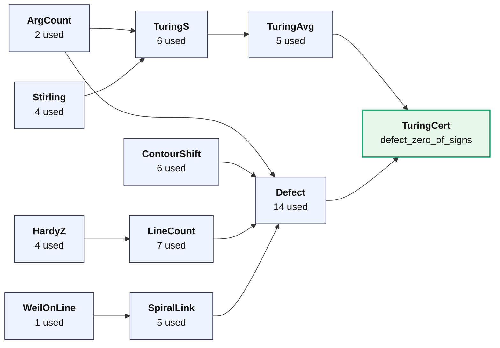

# What `Turing.defect_zero_of_signs` rests on

[`Turing.defect_zero_of_signs`](../lean_stage3/TuringCert.md#Turing-defect_zero_of_signs) in `lean_stage3/Stage3/TuringCert.lean`, line 214.

**Why.** Turing's method, the analytic half. Strict sign changes of `Z` at `k + 1` points up to `T₁` and at `m + 1` points in `(T₁, T₁ + h]`, with Littlewood's bound on `S₁`, give the defect `0` at every height up to `T₁`, once `θ T₁/π + 1 + E < k + 2`.

**Proves**

```lean
∀ T ≤ T₁, defect T = 0
```

**Needs** (its hypotheses)

  - `` hbelow : StmtSignData k t ``
  - `` htT : t (Fin.last k) ≤ T₁ ``
  - `` habove : StmtSignData m s ``
  - `` hsT : T₁ < s 0 ``
  - `` hsh : s (Fin.last m) ≤ T₁ + h ``
  - `` hL : StmtLittlewood a b t₀ ``
  - `` ha : 0 ≤ a ``
  - `` ht₀ : t₀ ≤ T₁ ``
  - `` h1 : 1 ≤ T₁ ``
  - `` hh : 0 < h ``
  - `` hnum : Stage3.phaseTheta T₁ / Real.pi + 1 + turingErr a b h T₁ s < k + 2 ``

Behind it: 49 theorems and 14 definitions in 11 files. Every one is listed below; Lean recorded each step.

## The files it passes through



An arrow A → B reads "B uses something proved or defined in A"; indirect arrows are left out. Green: the theorem itself. Yellow: a file in the other tree. The number is how many of that file's declarations are on the way.

## Every declaration on the way

Files in dependency order. ★ marks what the theorem's own proof uses directly.

### [`ArgCount`](../lean_stage3/ArgCount.md) — 2

- [`ArgCount.N_eq_sum`](../lean_stage3/ArgCount.md#ArgCount-N_eq_sum) — `` riemannZeta.N T = ∑ z ∈ (Kadiri.zeroes_rect_univ_positive_height_finite T).toFinset, (1 : ℝ) * (riemannZeta.order z : ℝ) ``
- [`ArgCount.N_mono`](../lean_stage3/ArgCount.md#ArgCount-N_mono) — `` riemannZeta.N T ≤ riemannZeta.N T' ``

### [`ContourShift`](../lean_stage3/ContourShift.md) — 6

- [`ContourShift.zeta_analyticAt`](../lean_stage3/ContourShift.md#ContourShift-zeta_analyticAt) — `` AnalyticAt ℂ riemannZeta ρ ``
- [`ContourShift.zeta_order_ne_top`](../lean_stage3/ContourShift.md#ContourShift-zeta_order_ne_top) — `` analyticOrderAt riemannZeta ρ ≠ ⊤ ``
- [`ContourShift.order_bridge`](../lean_stage3/ContourShift.md#ContourShift-order_bridge) — `` ((riemannZeta.order ρ : ℤ) : ℂ) = ((analyticOrderNatAt riemannZeta ρ : ℕ) : ℂ) ``
- [`ContourShift.analyticAt_conj_conj`](../lean_stage3/ContourShift.md#ContourShift-analyticAt_conj_conj) — `` AnalyticAt ℂ (fun w ↦ (starRingEnd ℂ) (g ((starRingEnd ℂ) w))) ((starRingEnd ℂ) p) ``
- [`ContourShift.zeta_order_conj`](../lean_stage3/ContourShift.md#ContourShift-zeta_order_conj) — `` analyticOrderNatAt riemannZeta ((starRingEnd ℂ) ρ) = analyticOrderNatAt riemannZeta ρ ``
- [`ContourShift.zeta_order_reflect`](../lean_stage3/ContourShift.md#ContourShift-zeta_order_reflect) — `` analyticOrderNatAt riemannZeta (1 - (starRingEnd ℂ) ρ) = analyticOrderNatAt riemannZeta ρ ``

### [`HardyZ`](../lean_stage3/HardyZ.md) — 4

- [`HardyZ.completedRiemannZeta_conj_of_re_pos`](../lean_stage3/HardyZ.md#HardyZ-completedRiemannZeta_conj_of_re_pos) — `` completedRiemannZeta (conj s) = conj (completedRiemannZeta s) ``
- [`HardyZ.re_line`](../lean_stage3/HardyZ.md#HardyZ-re_line) — `` ((1 / 2 : ℂ) + t * I).re = 1 / 2 ``
- [`HardyZ.xi_line_real`](../lean_stage3/HardyZ.md#HardyZ-xi_line_real) — `` (completedRiemannZeta (1/2 + t * Complex.I)).im = 0 ``
- [`HardyZ.continuous_xi_line`](../lean_stage3/HardyZ.md#HardyZ-continuous_xi_line) — `` Continuous (fun t : ℝ => completedRiemannZeta (1/2 + t * Complex.I)) ``

### [`LineCount`](../lean_stage3/LineCount.md) — 7

- [`LineCount.zerosUpTo`](../lean_stage3/LineCount.md#LineCount-zerosUpTo) — *def*
- ★ [`LineCount.allCount`](../lean_stage3/LineCount.md#LineCount-allCount) — *def*
- ★ [`LineCount.lineCount`](../lean_stage3/LineCount.md#LineCount-lineCount) — *def*
- [`LineCount.mem_zerosUpTo`](../lean_stage3/LineCount.md#LineCount-mem_zerosUpTo) — `` ρ ∈ zerosUpTo T ↔ 0 < (ρ : ℂ).im ∧ (ρ : ℂ).im ≤ T ``
- [`LineCount.strictSignChange_zero_on_line`](../lean_stage3/LineCount.md#LineCount-strictSignChange_zero_on_line) — `` ∃ γ ∈ Set.Ioo t₁ t₂, riemannZeta (1/2 + γ * I) = 0 ``
- [`LineCount.lineCount_le_allCount`](../lean_stage3/LineCount.md#LineCount-lineCount_le_allCount) — `` lineCount T ≤ allCount T ``
- ★ [`LineCount.signChanges_le_line_count`](../lean_stage3/LineCount.md#LineCount-signChanges_le_line_count) — `` (k : ℤ) ≤ lineCount T ``

### [`Stirling`](../lean_stage3/Stirling.md) — 4

- [`Stage3.phasePoint`](../lean_stage3/Stirling.md#Stage3-phasePoint) — *def*
- ★ [`Stage3.phaseTheta`](../lean_stage3/Stirling.md#Stage3-phaseTheta) — *def*
- [`Stage3.continuous_phasePoint`](../lean_stage3/Stirling.md#Stage3-continuous_phasePoint) — `` Continuous phasePoint ``
- [`Stage3.intervalIntegrable_phasePoint`](../lean_stage3/Stirling.md#Stage3-intervalIntegrable_phasePoint) — `` IntervalIntegrable phasePoint MeasureTheory.volume a b ``

### [`TuringS`](../lean_stage3/TuringS.md) — 6

- ★ [`Turing.S`](../lean_stage3/TuringS.md#Turing-S) — *def*
- ★ [`Turing.S₁`](../lean_stage3/TuringS.md#Turing-S-) — *def*
- ★ [`Turing.StmtLittlewood`](../lean_stage3/TuringS.md#Turing-StmtLittlewood) — *def*
- ★ [`Turing.continuous_phaseTheta`](../lean_stage3/TuringS.md#Turing-continuous_phaseTheta) — `` Continuous Stage3.phaseTheta ``
- [`Turing.intervalIntegrable_S`](../lean_stage3/TuringS.md#Turing-intervalIntegrable_S) — `` IntervalIntegrable S volume a b ``
- [`Turing.S₁_sub`](../lean_stage3/TuringS.md#Turing-S-_sub) — `` S₁ t₂ - S₁ t₁ = ∫ t in t₁..t₂, S t ``

### [`TuringAvg`](../lean_stage3/TuringAvg.md) — 5

- ★ [`Turing.theta_sub_le`](../lean_stage3/TuringAvg.md#Turing-theta_sub_le) — `` Stage3.phaseTheta u - Stage3.phaseTheta t ≤ (u - t) * ((Real.log (u / 2) - Real.log Real.pi + 97 / t) / 2) ``
- [`Turing.avg_le`](../lean_stage3/TuringAvg.md#Turing-avg_le) — `` f t ≤ ((∫ u in t..t + h, f u) + ∫ u in t..t + h, e u) / h ``
- [`Turing.integral_lin`](../lean_stage3/TuringAvg.md#Turing-integral_lin) — `` (∫ u in t..t + h, (u - t) * K / Real.pi) = K * h ^ 2 / (2 * Real.pi) ``
- [`Turing.S_le_pointwise`](../lean_stage3/TuringAvg.md#Turing-S_le_pointwise) — `` S t ≤ S u + ((u - t) * K / Real.pi - c) ``
- ★ [`Turing.S_le_of_count`](../lean_stage3/TuringAvg.md#Turing-S_le_of_count) — `` S t ≤ ((S₁ (t + h) - S₁ t) - (∫ u in t..t + h, c u) + K * h ^ 2 / (2 * Real.pi)) / h ``

### [`WeilOnLine`](../lean_stage3/WeilOnLine.md) — 1

- [`WeilOnLine.conj_mem`](../lean_stage3/WeilOnLine.md#WeilOnLine-conj_mem) — `` (starRingEnd ℂ) (ρ : ℂ) ∈ Kadiri.NontrivialZeros ``

### [`SpiralLink`](../lean_stage3/SpiralLink.md) — 5

- [`SpiralLink.mirror_mem`](../lean_stage3/SpiralLink.md#SpiralLink-mirror_mem) — `` (1 - (starRingEnd ℂ) (ρ : ℂ)) ∈ NontrivialZeros ``
- [`SpiralLink.mirrorZ`](../lean_stage3/SpiralLink.md#SpiralLink-mirrorZ) — *def*
- [`SpiralLink.mirrorZ_im`](../lean_stage3/SpiralLink.md#SpiralLink-mirrorZ_im) — `` ((mirrorZ ρ : NontrivialZeros) : ℂ).im = (ρ : ℂ).im ``
- [`SpiralLink.mirrorZ_re`](../lean_stage3/SpiralLink.md#SpiralLink-mirrorZ_re) — `` ((mirrorZ ρ : NontrivialZeros) : ℂ).re = 1 - (ρ : ℂ).re ``
- [`SpiralLink.mirrorZ_eq_iff`](../lean_stage3/SpiralLink.md#SpiralLink-mirrorZ_eq_iff) — `` mirrorZ ρ = ρ ↔ (ρ : ℂ).re = 1 / 2 ``

### [`Defect`](../lean_stage3/Defect.md) — 14

- ★ [`Defect.defect`](../lean_stage3/Defect.md#Defect-defect) — *def*
- [`Defect.offCount`](../lean_stage3/Defect.md#Defect-offCount) — *def*
- [`Defect.defect_eq_offCount`](../lean_stage3/Defect.md#Defect-defect_eq_offCount) — `` defect T = offCount T ``
- [`Defect.defect_nonneg`](../lean_stage3/Defect.md#Defect-defect_nonneg) — `` 0 ≤ defect T ``
- [`Defect.N_eq_sum_lt`](../lean_stage3/Defect.md#Defect-N_eq_sum_lt) — `` riemannZeta.N T = ∑ ρ ∈ (zerosUpTo T).filter (fun ρ : NontrivialZeros => (ρ : ℂ).im < T), ((riemannZeta.order (ρ : ℂ) : ℤ) : ℝ) ``
- [`Defect.allCount_cast`](../lean_stage3/Defect.md#Defect-allCount_cast) — `` (allCount T : ℝ) = ∑ ρ ∈ zerosUpTo T, ((riemannZeta.order (ρ : ℂ) : ℤ) : ℝ) ``
- ★ [`Defect.exists_right`](../lean_stage3/Defect.md#Defect-exists_right) — `` ∃ T' : ℝ, T < T' ∧ ∀ z : ℂ, riemannZeta z = 0 → 0 < z.im → T < z.im → T' < z.im ``
- [`Defect.zerosUpTo_eq_right`](../lean_stage3/Defect.md#Defect-zerosUpTo_eq_right) — `` zerosUpTo T' = zerosUpTo T ``
- ★ [`Defect.N_eq_allCount_right`](../lean_stage3/Defect.md#Defect-N_eq_allCount_right) — `` riemannZeta.N T' = (allCount T : ℝ) ∧ lineCount T' = lineCount T ``
- [`Defect.mirrorZ_order`](../lean_stage3/Defect.md#Defect-mirrorZ_order) — `` riemannZeta.order ((SpiralLink.mirrorZ ρ : NontrivialZeros) : ℂ) = riemannZeta.order (ρ : ℂ) ``
- [`Defect.mirrorZ_mirrorZ`](../lean_stage3/Defect.md#Defect-mirrorZ_mirrorZ) — `` SpiralLink.mirrorZ (SpiralLink.mirrorZ ρ) = ρ ``
- [`Defect.offLine_pair`](../lean_stage3/Defect.md#Defect-offLine_pair) — `` SpiralLink.mirrorZ ρ ∈ (zerosUpTo T).filter (fun ρ : NontrivialZeros => ¬ (ρ : ℂ).re = 1 / 2) ∧ SpiralLink.mirrorZ ρ ≠ ρ ∧ ((SpiralLink.mirrorZ ρ : NontrivialZe… ``
- [`Defect.offCount_eq_two_mul`](../lean_stage3/Defect.md#Defect-offCount_eq_two_mul) — `` offCount T = 2 * ∑ ρ ∈ ((zerosUpTo T).filter (fun ρ : NontrivialZeros => ¬ (ρ : ℂ).re = 1 / 2)).filter (fun ρ : NontrivialZeros => (ρ : ℂ).re < 1 / 2), riemannZ… ``
- [`Defect.defect_even`](../lean_stage3/Defect.md#Defect-defect_even) — `` Even (defect T) ``

### [`TuringCert`](../lean_stage3/TuringCert.md) — 9

- ★ [`Turing.StmtSignData`](../lean_stage3/TuringCert.md#Turing-StmtSignData) — *def*
- ★ [`Turing.turingK`](../lean_stage3/TuringCert.md#Turing-turingK) — *def*
- ★ [`Turing.turingErr`](../lean_stage3/TuringCert.md#Turing-turingErr) — *def*
- [`Turing.defect_mono`](../lean_stage3/TuringCert.md#Turing-defect_mono) — `` defect T ≤ defect T' ``
- ★ [`Turing.defect_eq_zero_of_lt_two`](../lean_stage3/TuringCert.md#Turing-defect_eq_zero_of_lt_two) — `` defect T = 0 ``
- ★ [`Turing.defect_zero_below`](../lean_stage3/TuringCert.md#Turing-defect_zero_below) — `` ∀ T ≤ T₁, defect T = 0 ``
- [`Turing.allCount_add_card_le_N`](../lean_stage3/TuringCert.md#Turing-allCount_add_card_le_N) — `` (allCount T₁ : ℝ) + Z.card ≤ riemannZeta.N u ``
- ★ [`Turing.count_le_N_sub`](../lean_stage3/TuringCert.md#Turing-count_le_N_sub) — `` (∑ j : Fin m, if s j.succ < u then (1 : ℝ) else 0) ≤ riemannZeta.N u - (allCount T₁ : ℝ) ``
- ★ [`Turing.integral_step`](../lean_stage3/TuringCert.md#Turing-integral_step) — `` (∫ u in a..b, if s < u then (1 : ℝ) else 0) = b - s ``

