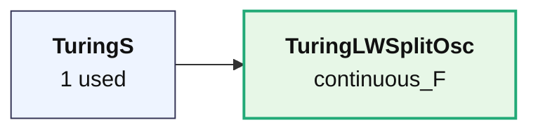

# What `TuringLW.continuous_F` rests on

[`TuringLW.continuous_F`](../lean_stage3/TuringLWSplitOsc.md#TuringLW-continuous_F) in `lean_stage3/Stage3/TuringLWSplitOsc.lean`, line 242.

**Proves**

```lean
Continuous Turing.F
```

Behind it: 17 theorems and 4 definitions in 2 files. Every one is listed below; Lean recorded each step.

## The files it passes through



An arrow A → B reads "B uses something proved or defined in A"; indirect arrows are left out. Green: the theorem itself. Yellow: a file in the other tree. The number is how many of that file's declarations are on the way.

## Every declaration on the way

Files in dependency order. ★ marks what the theorem's own proof uses directly.

### [`TuringS`](../lean_stage3/TuringS.md) — 1

- ★ [`Turing.F`](../lean_stage3/TuringS.md#Turing-F) — *def*

### [`TuringLWSplitOsc`](../lean_stage3/TuringLWSplitOsc.md) — 20

- [`TuringLW.vm`](../lean_stage3/TuringLWSplitOsc.md#TuringLW-vm) — *def*
- [`TuringLW.E`](../lean_stage3/TuringLWSplitOsc.md#TuringLW-E) — *def*
- ★ [`TuringLW.H`](../lean_stage3/TuringLWSplitOsc.md#TuringLW-H) — *def*
- [`TuringLW.vm_nonneg`](../lean_stage3/TuringLWSplitOsc.md#TuringLW-vm_nonneg) — `` 0 ≤ vm n ``
- [`TuringLW.vm_le_log`](../lean_stage3/TuringLWSplitOsc.md#TuringLW-vm_le_log) — `` vm n ≤ Real.log n ``
- [`TuringLW.vm_eq_zero_of_log`](../lean_stage3/TuringLWSplitOsc.md#TuringLW-vm_eq_zero_of_log) — `` vm n = 0 ``
- [`TuringLW.vm_div_log_mul`](../lean_stage3/TuringLWSplitOsc.md#TuringLW-vm_div_log_mul) — `` vm n / Real.log n * Real.log n = vm n ``
- [`TuringLW.vm_div_log_nonneg`](../lean_stage3/TuringLWSplitOsc.md#TuringLW-vm_div_log_nonneg) — `` 0 ≤ vm n / Real.log n ``
- [`TuringLW.vm_div_log_le_one`](../lean_stage3/TuringLWSplitOsc.md#TuringLW-vm_div_log_le_one) — `` vm n / Real.log n ≤ 1 ``
- [`TuringLW.hasDerivAt_E`](../lean_stage3/TuringLWSplitOsc.md#TuringLW-hasDerivAt_E) — `` HasDerivAt (E n) (-(I * (Real.log n : ℂ)) * E n t) t ``
- [`TuringLW.norm_E`](../lean_stage3/TuringLWSplitOsc.md#TuringLW-norm_E) — `` ‖E n t‖ = Real.exp (-2 * Real.log n) ``
- [`TuringLW.E_zero`](../lean_stage3/TuringLWSplitOsc.md#TuringLW-E_zero) — `` E n 0 = ((Real.exp (-2 * Real.log n) : ℝ) : ℂ) ``
- [`TuringLW.term_eq`](../lean_stage3/TuringLWSplitOsc.md#TuringLW-term_eq) — `` LSeries.term (fun n => ((ArithmeticFunction.vonMangoldt n : ℝ) : ℂ)) (2 + (t : ℂ) * I) n = (vm n : ℂ) * E n t ``
- [`TuringLW.summable_v`](../lean_stage3/TuringLWSplitOsc.md#TuringLW-summable_v) — `` Summable fun n : ℕ => Real.exp (-2 * Real.log n) ``
- [`TuringLW.summable_u`](../lean_stage3/TuringLWSplitOsc.md#TuringLW-summable_u) — `` Summable fun n : ℕ => vm n * Real.exp (-2 * Real.log n) ``
- [`TuringLW.logDeriv_eq_tsum`](../lean_stage3/TuringLWSplitOsc.md#TuringLW-logDeriv_eq_tsum) — `` logDeriv riemannZeta (2 + (t : ℂ) * I) = ∑' n : ℕ, -(vm n : ℂ) * E n t ``
- [`TuringLW.hasDerivAt_H`](../lean_stage3/TuringLWSplitOsc.md#TuringLW-hasDerivAt_H) — `` HasDerivAt H (∑' n : ℕ, -(vm n : ℂ) * E n t) t ``
- ★ [`TuringLW.continuous_H`](../lean_stage3/TuringLWSplitOsc.md#TuringLW-continuous_H) — `` Continuous H ``
- [`TuringLW.re_H_zero`](../lean_stage3/TuringLWSplitOsc.md#TuringLW-re_H_zero) — `` (H 0).re = 0 ``
- ★ [`TuringLW.F_eq_re_H`](../lean_stage3/TuringLWSplitOsc.md#TuringLW-F_eq_re_H) — `` Turing.F t = (H t).re ``

