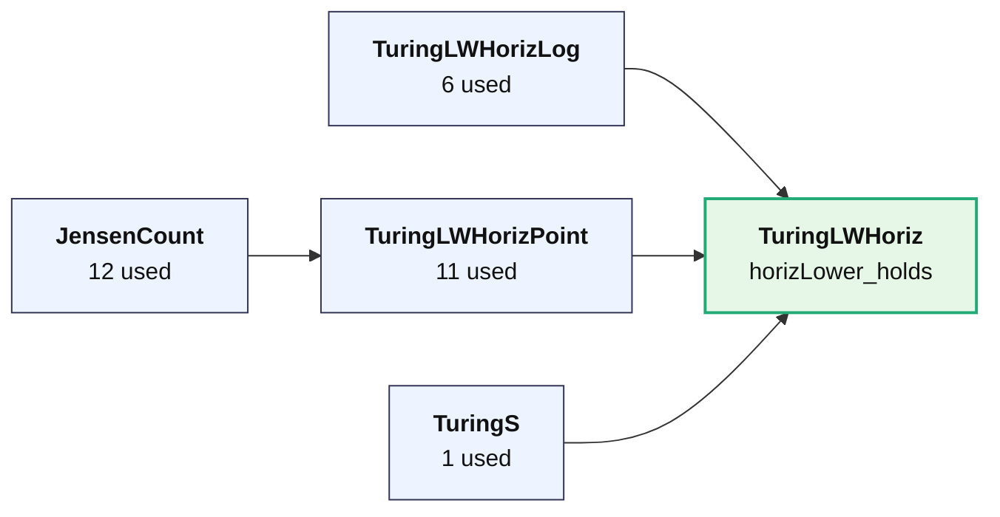

# What `TuringLW.horizLower_holds` rests on

[`TuringLW.horizLower_holds`](../lean_stage3/TuringLWHoriz.md#TuringLW-horizLower_holds) in `lean_stage3/Stage3/TuringLWHoriz.lean`, line 213.

**Why.** The lower side, proved. `StmtHorizLower 102 500`.

**Proves**

```lean
Turing.StmtHorizLower 102 500
```

Behind it: 34 theorems and 7 definitions in 5 files. Every one is listed below; Lean recorded each step.

## The files it passes through



An arrow A → B reads "B uses something proved or defined in A"; indirect arrows are left out. Green: the theorem itself. Yellow: a file in the other tree. The number is how many of that file's declarations are on the way.

## Every declaration on the way

Files in dependency order. ★ marks what the theorem's own proof uses directly.

### [`JensenCount`](../lean_stage3/JensenCount.md) — 12

- [`Stage3.zeta_centre_lower`](../lean_stage3/JensenCount.md#Stage3-zeta_centre_lower) — `` (1 : ℝ) / 3 ≤ ‖ζ (2 + Complex.I * T)‖ ``
- [`Stage3.zeta_disk_upper`](../lean_stage3/JensenCount.md#Stage3-zeta_disk_upper) — `` ‖ζ w‖ ≤ 28 * T ``
- [`Stage3.zeta_centre_ne_zero`](../lean_stage3/JensenCount.md#Stage3-zeta_centre_ne_zero) — `` ζ (2 + Complex.I * (T : ℂ)) ≠ 0 ``
- [`Stage3.pole_away`](../lean_stage3/JensenCount.md#Stage3-pole_away) — `` 2 * z + (2 + Complex.I * (T : ℂ)) ≠ 1 ``
- [`Stage3.pole_away_centre`](../lean_stage3/JensenCount.md#Stage3-pole_away_centre) — `` v ≠ 1 ``
- [`Stage3.zetaWindowTwo_finite`](../lean_stage3/JensenCount.md#Stage3-zetaWindowTwo_finite) — `` {ρ : ℂ | ζ ρ = 0 ∧ ‖ρ - (2 + Complex.I * (T : ℂ))‖ ≤ 2}.Finite ``
- [`Stage3.jensenF`](../lean_stage3/JensenCount.md#Stage3-jensenF) — *def*
- [`Stage3.zeta_comp_analytic`](../lean_stage3/JensenCount.md#Stage3-zeta_comp_analytic) — `` AnalyticAt ℂ (fun z : ℂ => ζ (2 * z + (2 + Complex.I * (T : ℂ)))) w ``
- [`Stage3.jensenF_analytic`](../lean_stage3/JensenCount.md#Stage3-jensenF_analytic) — `` AnalyticOnNhd ℂ (jensenF T) (Metric.closedBall (0 : ℂ) 1) ``
- [`Stage3.jensenF_zero_eq_one`](../lean_stage3/JensenCount.md#Stage3-jensenF_zero_eq_one) — `` jensenF T 0 = 1 ``
- [`Stage3.jensenF_zeros_finite`](../lean_stage3/JensenCount.md#Stage3-jensenF_zeros_finite) — `` (SetOfZeros 1 (jensenF T)).Finite ``
- [`Stage3.jensenF_bound`](../lean_stage3/JensenCount.md#Stage3-jensenF_bound) — `` ‖jensenF T z‖ ≤ 84 * T ``

### [`TuringLWHorizLog`](../lean_stage3/TuringLWHorizLog.md) — 6

- [`TuringLW.mul_log_ge`](../lean_stage3/TuringLWHorizLog.md#TuringLW-mul_log_ge) — `` -1 ≤ u * Real.log u ``
- [`TuringLW.mul_log_nonpos`](../lean_stage3/TuringLWHorizLog.md#TuringLW-mul_log_nonpos) — `` u * Real.log u ≤ 0 ``
- [`TuringLW.mul_log_sub_ge_of_nonneg`](../lean_stage3/TuringLWHorizLog.md#TuringLW-mul_log_sub_ge_of_nonneg) — `` -2 ≤ b * Real.log b - a * Real.log a ``
- [`TuringLW.mul_log_sub_ge`](../lean_stage3/TuringLWHorizLog.md#TuringLW-mul_log_sub_ge) — `` -2 ≤ b * Real.log b - a * Real.log a ``
- [`TuringLW.intervalIntegrable_log_sub`](../lean_stage3/TuringLWHorizLog.md#TuringLW-intervalIntegrable_log_sub) — `` IntervalIntegrable (fun x : ℝ => Real.log (x - β)) volume (1 / 2) 2 ``
- [`TuringLW.integral_log_sub_ge`](../lean_stage3/TuringLWHorizLog.md#TuringLW-integral_log_sub_ge) — `` -(7 / 2) ≤ ∫ x in (1 / 2 : ℝ)..2, Real.log (x - β) ``

### [`TuringLWHorizPoint`](../lean_stage3/TuringLWHorizPoint.md) — 11

- [`TuringLW.h78`](../lean_stage3/TuringLWHorizPoint.md#TuringLW-h78) — `` (7 : ℝ) / 8 < 1 ``
- ★ [`TuringLW.zeroSet`](../lean_stage3/TuringLWHorizPoint.md#TuringLW-zeroSet) — *def*
- [`TuringLW.zeroMass`](../lean_stage3/TuringLWHorizPoint.md#TuringLW-zeroMass) — *def*
- [`TuringLW.log84_le`](../lean_stage3/TuringLWHorizPoint.md#TuringLW-log84_le) — `` Real.log 84 ≤ 4.86 ``
- [`TuringLW.log84T_eq`](../lean_stage3/TuringLWHorizPoint.md#TuringLW-log84T_eq) — `` Real.log (84 * T) = Real.log 84 + Real.log T ``
- [`TuringLW.log84T_pos`](../lean_stage3/TuringLWHorizPoint.md#TuringLW-log84T_pos) — `` 0 < Real.log (84 * T) ``
- [`TuringLW.zeroMass_le`](../lean_stage3/TuringLWHorizPoint.md#TuringLW-zeroMass_le) — `` zeroMass hT ≤ 15 * Real.log (84 * T) ``
- [`TuringLW.log_blaschke_ge`](../lean_stage3/TuringLWHorizPoint.md#TuringLW-log_blaschke_ge) — `` -12 * Real.log (84 * T) ≤ Real.log ‖BlaschkeB (7 / 8) (15 / 16) (jensenF T) z‖ ``
- [`TuringLW.norm_numer_le`](../lean_stage3/TuringLWHorizPoint.md#TuringLW-norm_numer_le) — `` ‖((15 / 16 : ℝ) : ℂ) - z * (starRingEnd ℂ) ρ / ((15 / 16 : ℝ) : ℂ)‖ ≤ 2 ``
- [`TuringLW.norm_blaschke_mul_le`](../lean_stage3/TuringLWHorizPoint.md#TuringLW-norm_blaschke_mul_le) — `` ‖BlaschkeB (7 / 8) (15 / 16) (jensenF T) z‖ * ∏ ρ ∈ zeroSet hT, ‖z - ρ‖ ^ analyticOrderNatAt (jensenF T) ρ ≤ ‖jensenF T z‖ * 2 ^ (∑ ρ ∈ zeroSet hT, analyticOrde… ``
- [`TuringLW.log_jensenF_ge`](../lean_stage3/TuringLWHorizPoint.md#TuringLW-log_jensenF_ge) — `` -12 * Real.log (84 * T) - zeroMass hT * Real.log 2 + ∑ ρ ∈ zeroSet hT, (analyticOrderNatAt (jensenF T) ρ : ℝ) * Real.log ‖z - ρ‖ ≤ Real.log ‖jensenF T z‖ ``

### [`TuringS`](../lean_stage3/TuringS.md) — 1

- ★ [`Turing.StmtHorizLower`](../lean_stage3/TuringS.md#Turing-StmtHorizLower) — *def*

### [`TuringLWHoriz`](../lean_stage3/TuringLWHoriz.md) — 11

- [`TuringLW.zx`](../lean_stage3/TuringLWHoriz.md#TuringLW-zx) — *def*
- ★ [`TuringLW.beta`](../lean_stage3/TuringLWHoriz.md#TuringLW-beta) — *def*
- ★ [`TuringLW.gLow`](../lean_stage3/TuringLWHoriz.md#TuringLW-gLow) — *def*
- [`TuringLW.zx_arg`](../lean_stage3/TuringLWHoriz.md#TuringLW-zx_arg) — `` 2 * zx x + (2 + Complex.I * (t : ℂ)) = (x : ℂ) + (t : ℂ) * Complex.I ``
- [`TuringLW.norm_zx`](../lean_stage3/TuringLWHoriz.md#TuringLW-norm_zx) — `` ‖zx x‖ ≤ 3 / 4 ``
- [`TuringLW.log_sub_le`](../lean_stage3/TuringLWHoriz.md#TuringLW-log_sub_le) — `` Real.log (x - beta ρ) - Real.log 2 ≤ Real.log ‖zx x - ρ‖ ``
- ★ [`TuringLW.log_zeta_ge`](../lean_stage3/TuringLWHoriz.md#TuringLW-log_zeta_ge) — `` gLow ht x ≤ Real.log ‖riemannZeta ((x : ℂ) + (t : ℂ) * Complex.I)‖ ``
- [`TuringLW.intervalIntegrable_sum'`](../lean_stage3/TuringLWHoriz.md#TuringLW-intervalIntegrable_sum-) — `` IntervalIntegrable (fun x => ∑ i ∈ s, f i x) volume a b ``
- ★ [`TuringLW.intervalIntegrable_gLow`](../lean_stage3/TuringLWHoriz.md#TuringLW-intervalIntegrable_gLow) — `` IntervalIntegrable (gLow ht) volume (1 / 2) 2 ``
- [`TuringLW.log3_le`](../lean_stage3/TuringLWHoriz.md#TuringLW-log3_le) — `` Real.log 3 ≤ 2 ``
- ★ [`TuringLW.integral_g_ge`](../lean_stage3/TuringLWHoriz.md#TuringLW-integral_g_ge) — `` -(102 * Real.log t + 500) ≤ ∫ x in (1 / 2 : ℝ)..2, gLow ht x ``

