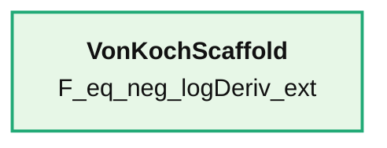

# What `VonKoch.F_eq_neg_logDeriv_ext` rests on

[`VonKoch.F_eq_neg_logDeriv_ext`](../lean_stage3/VonKochScaffold.md#VonKoch-F_eq_neg_logDeriv_ext) in `lean_stage3/Stage3/VonKochScaffold.lean`, line 445.

**Why.** V3 — agreement extends to the punctured half-plane. From `F·ζ + ζ′ ≡ 0` on the region: divide by `ζ` where it does not vanish.

**Proves**

```lean
F s = -deriv riemannZeta s / riemannZeta s
```

**Needs** (its hypotheses)

  - `` hbound : ∀ t : ℝ, x₀ ≤ t → |ψ t - t| ≤ C * Real.sqrt t * (Real.log t) ^ 3 ``
  - `` hs : 1/2 < s.re ``
  - `` hs1 : s ≠ 1 ``
  - `` hz : riemannZeta s ≠ 0 ``

Behind it: 16 theorems and 4 definitions in 1 file. Every one is listed below; Lean recorded each step.

## The files it passes through



An arrow A → B reads "B uses something proved or defined in A"; indirect arrows are left out. Green: the theorem itself. Yellow: a file in the other tree. The number is how many of that file's declarations are on the way.

## Every declaration on the way

Files in dependency order. ★ marks what the theorem's own proof uses directly.

### [`VonKochScaffold`](../lean_stage3/VonKochScaffold.md) — 20

- [`VonKoch.E`](../lean_stage3/VonKochScaffold.md#VonKoch-E) — *def*
- ★ [`VonKoch.F`](../lean_stage3/VonKochScaffold.md#VonKoch-F) — *def*
- [`VonKoch.Etr`](../lean_stage3/VonKochScaffold.md#VonKoch-Etr) — *def*
- [`VonKoch.measurable_psi'`](../lean_stage3/VonKochScaffold.md#VonKoch-measurable_psi-) — `` Measurable (fun t : ℝ ↦ ψ t) ``
- [`VonKoch.Etr_measurable`](../lean_stage3/VonKochScaffold.md#VonKoch-Etr_measurable) — `` Measurable Etr ``
- [`VonKoch.E_le_linear`](../lean_stage3/VonKochScaffold.md#VonKoch-E_le_linear) — `` ‖(E t : ℝ)‖ ≤ (Real.log 4 + 5) * t ``
- [`VonKoch.E_integral_eq_mellin`](../lean_stage3/VonKochScaffold.md#VonKoch-E_integral_eq_mellin) — `` ∫ x in Set.Ioi (1:ℝ), (E x : ℂ) * (x : ℂ) ^ (-s - 1) = mellin Etr (-s) ``
- [`VonKoch.Etr_locallyIntegrable`](../lean_stage3/VonKochScaffold.md#VonKoch-Etr_locallyIntegrable) — `` MeasureTheory.LocallyIntegrableOn Etr (Set.Ioi 0) ``
- [`VonKoch.F_differentiableAt`](../lean_stage3/VonKochScaffold.md#VonKoch-F_differentiableAt) — `` DifferentiableAt ℂ F s ``
- [`VonKoch.sum_Icc_vonMangoldt`](../lean_stage3/VonKochScaffold.md#VonKoch-sum_Icc_vonMangoldt) — `` ∑ k ∈ Finset.Icc 1 n, ArithmeticFunction.vonMangoldt k = ψ n ``
- [`VonKoch.psi_partial_bigO`](../lean_stage3/VonKochScaffold.md#VonKoch-psi_partial_bigO) — `` (fun n : ℕ ↦ ∑ k ∈ Finset.Icc 1 n, ArithmeticFunction.vonMangoldt k) =O[Filter.atTop] fun n : ℕ ↦ (n : ℝ) ^ (1:ℝ) ``
- [`VonKoch.measurable_psi`](../lean_stage3/VonKochScaffold.md#VonKoch-measurable_psi) — `` Measurable (fun t : ℝ ↦ ψ t) ``
- [`VonKoch.integrable_psi_cpow`](../lean_stage3/VonKochScaffold.md#VonKoch-integrable_psi_cpow) — `` IntegrableOn (fun t : ℝ ↦ ((ψ t : ℝ) : ℂ) * (t : ℂ) ^ (-(s + 1))) (Set.Ioi (1:ℝ)) ``
- [`VonKoch.F_eq_neg_logDeriv`](../lean_stage3/VonKochScaffold.md#VonKoch-F_eq_neg_logDeriv) — `` F s = -deriv riemannZeta s / riemannZeta s ``
- ★ [`VonKoch.region`](../lean_stage3/VonKochScaffold.md#VonKoch-region) — *def*
- [`VonKoch.isOpen_region`](../lean_stage3/VonKochScaffold.md#VonKoch-isOpen_region) — `` IsOpen region ``
- [`VonKoch.preconnected_region`](../lean_stage3/VonKochScaffold.md#VonKoch-preconnected_region) — `` IsPreconnected region ``
- [`VonKoch.zeta_analyticOnNhd`](../lean_stage3/VonKochScaffold.md#VonKoch-zeta_analyticOnNhd) — `` AnalyticOnNhd ℂ riemannZeta region ``
- [`VonKoch.F_analyticOnNhd`](../lean_stage3/VonKochScaffold.md#VonKoch-F_analyticOnNhd) — `` AnalyticOnNhd ℂ F region ``
- ★ [`VonKoch.F_mul_zeta_add_deriv_eqOn_zero`](../lean_stage3/VonKochScaffold.md#VonKoch-F_mul_zeta_add_deriv_eqOn_zero) — `` Set.EqOn (fun s : ℂ ↦ F s * riemannZeta s + deriv riemannZeta s) 0 region ``

