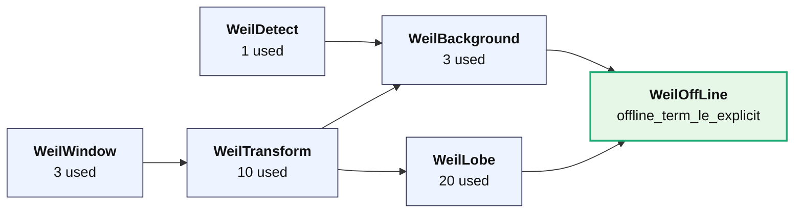

# What `WeilOffLine.offline_term_le_explicit` rests on

[`WeilOffLine.offline_term_le_explicit`](../lean_stage3/WeilOffLine.md#WeilOffLine-offline_term_le_explicit) in `lean_stage3/Stage3/WeilOffLine.lean`, line 120.

**Why.** The same with unit 0319's lobe bound in place of the lobe: for `γ > 0`, if `(2π + π²)·cosh(εh)/(2γh)² ≤ Σ(εh)` then `term.re ≤ −(h/2)²·Σ(εh)·(Σ(εh) − 2(2π + π²)·cosh(εh)/(2γh)²)`.

**Proves**

```lean
(laplace (phiC h γ) (-offPt ε γ) * laplace (phiC h γ) (-(1 - offPt ε γ))).re ≤ -((h / 2) ^ 2 * (WeilWindow.Sigma (ε * h) * (WeilWindow.Sigma (ε * h) - 2 * ((2 * Real.pi + Real.pi ^ 2) * Real.cosh (ε * h) / (2 * γ * h) ^ 2))))
```

**Needs** (its hypotheses)

  - `` hh : 0 < h ``
  - `` hγ : 0 < γ ``
  - `` hs : (2 * Real.pi + Real.pi ^ 2) * Real.cosh (ε * h) / (2 * γ * h) ^ 2 ≤ WeilWindow.Sigma (ε * h) ``

Behind it: 32 theorems and 12 definitions in 6 files. Every one is listed below; Lean recorded each step.

## The files it passes through



An arrow A → B reads "B uses something proved or defined in A"; indirect arrows are left out. Green: the theorem itself. Yellow: a file in the other tree. The number is how many of that file's declarations are on the way.

## Every declaration on the way

Files in dependency order. ★ marks what the theorem's own proof uses directly.

### [`WeilDetect`](../lean_stage3/WeilDetect.md) — 1

- ★ [`WeilDetect.laplace`](../lean_stage3/WeilDetect.md#WeilDetect-laplace) — *def*

### [`WeilWindow`](../lean_stage3/WeilWindow.md) — 3

- [`WeilWindow.P`](../lean_stage3/WeilWindow.md#WeilWindow-P) — *def*
- ★ [`WeilWindow.Sigma`](../lean_stage3/WeilWindow.md#WeilWindow-Sigma) — *def*
- [`WeilWindow.continuous_P`](../lean_stage3/WeilWindow.md#WeilWindow-continuous_P) — `` Continuous P ``

### [`WeilTransform`](../lean_stage3/WeilTransform.md) — 10

- ★ [`WeilTransform.SigmaC`](../lean_stage3/WeilTransform.md#WeilTransform-SigmaC) — *def*
- [`WeilTransform.G`](../lean_stage3/WeilTransform.md#WeilTransform-G) — *def*
- [`WeilTransform.ghat`](../lean_stage3/WeilTransform.md#WeilTransform-ghat) — *def*
- [`WeilTransform.P_even`](../lean_stage3/WeilTransform.md#WeilTransform-P_even) — `` P (-x) = P x ``
- [`WeilTransform.xP_odd`](../lean_stage3/WeilTransform.md#WeilTransform-xP_odd) — `` (-x) * P (-x) = -(x * P x) ``
- [`WeilTransform.continuous_xP`](../lean_stage3/WeilTransform.md#WeilTransform-continuous_xP) — `` Continuous fun x : ℝ => x * P x ``
- [`WeilTransform.SigmaC_ofReal`](../lean_stage3/WeilTransform.md#WeilTransform-SigmaC_ofReal) — `` SigmaC (s : ℂ) = (WeilWindow.Sigma s : ℂ) ``
- [`WeilTransform.odd_integral_exp`](../lean_stage3/WeilTransform.md#WeilTransform-odd_integral_exp) — `` (∫ x in (-1 : ℝ)..1, ((q x : ℝ) : ℂ) * Complex.exp (w * (x : ℂ))) = ∫ x in (-1 : ℝ)..1, ((q x : ℝ) : ℂ) * Complex.sinh (w * (x : ℂ)) ``
- [`WeilTransform.ghat_eq`](../lean_stage3/WeilTransform.md#WeilTransform-ghat_eq) — `` ghat h γ z = ((h : ℂ) / 2) * (SigmaC ((z + Complex.I * (γ : ℂ)) * (h : ℂ)) + SigmaC ((z - Complex.I * (γ : ℂ)) * (h : ℂ))) ``
- [`WeilTransform.ghat_offline`](../lean_stage3/WeilTransform.md#WeilTransform-ghat_offline) — `` ghat h γ ((ε : ℂ) + Complex.I * (γ : ℂ)) = ((h : ℂ) / 2) * (SigmaC (((ε : ℂ) + 2 * Complex.I * (γ : ℂ)) * (h : ℂ)) + (WeilWindow.Sigma (ε * h) : ℂ)) ``

### [`WeilBackground`](../lean_stage3/WeilBackground.md) — 3

- [`WeilBackground.phi`](../lean_stage3/WeilBackground.md#WeilBackground-phi) — *def*
- ★ [`WeilBackground.phiC`](../lean_stage3/WeilBackground.md#WeilBackground-phiC) — *def*
- [`WeilBackground.laplace_phi`](../lean_stage3/WeilBackground.md#WeilBackground-laplace_phi) — `` laplace (phiC h γ) z = ghat h γ (-z - 1 / 2) ``

### [`WeilLobe`](../lean_stage3/WeilLobe.md) — 20

- [`WeilLobe.P_eq`](../lean_stage3/WeilLobe.md#WeilLobe-P_eq) — `` P x = (1 + Real.cos (Real.pi * x)) / 2 ``
- [`WeilLobe.q`](../lean_stage3/WeilLobe.md#WeilLobe-q) — *def*
- [`WeilLobe.q1`](../lean_stage3/WeilLobe.md#WeilLobe-q1) — *def*
- [`WeilLobe.q2`](../lean_stage3/WeilLobe.md#WeilLobe-q2) — *def*
- [`WeilLobe.q_eq`](../lean_stage3/WeilLobe.md#WeilLobe-q_eq) — `` x * P x = q x ``
- [`WeilLobe.hasDerivAt_cos_pi`](../lean_stage3/WeilLobe.md#WeilLobe-hasDerivAt_cos_pi) — `` HasDerivAt (fun y : ℝ => Real.cos (Real.pi * y)) (-Real.sin (Real.pi * x) * Real.pi) x ``
- [`WeilLobe.hasDerivAt_sin_pi`](../lean_stage3/WeilLobe.md#WeilLobe-hasDerivAt_sin_pi) — `` HasDerivAt (fun y : ℝ => Real.sin (Real.pi * y)) (Real.cos (Real.pi * x) * Real.pi) x ``
- [`WeilLobe.hasDerivAt_q`](../lean_stage3/WeilLobe.md#WeilLobe-hasDerivAt_q) — `` HasDerivAt q (q1 x) x ``
- [`WeilLobe.hasDerivAt_q1`](../lean_stage3/WeilLobe.md#WeilLobe-hasDerivAt_q1) — `` HasDerivAt q1 (q2 x) x ``
- [`WeilLobe.q_one`](../lean_stage3/WeilLobe.md#WeilLobe-q_one) — `` q 1 = 0 ``
- [`WeilLobe.q_neg_one`](../lean_stage3/WeilLobe.md#WeilLobe-q_neg_one) — `` q (-1) = 0 ``
- [`WeilLobe.q1_one`](../lean_stage3/WeilLobe.md#WeilLobe-q1_one) — `` q1 1 = 0 ``
- [`WeilLobe.q1_neg_one`](../lean_stage3/WeilLobe.md#WeilLobe-q1_neg_one) — `` q1 (-1) = 0 ``
- [`WeilLobe.continuous_q1`](../lean_stage3/WeilLobe.md#WeilLobe-continuous_q1) — `` Continuous q1 ``
- [`WeilLobe.continuous_q2`](../lean_stage3/WeilLobe.md#WeilLobe-continuous_q2) — `` Continuous q2 ``
- [`WeilLobe.q2_bound`](../lean_stage3/WeilLobe.md#WeilLobe-q2_bound) — `` |q2 x| ≤ Real.pi + Real.pi ^ 2 / 2 ``
- [`WeilLobe.norm_sinh_le`](../lean_stage3/WeilLobe.md#WeilLobe-norm_sinh_le) — `` ‖Complex.sinh z‖ ≤ Real.cosh z.re ``
- [`WeilLobe.SigmaC_eq_ibp`](../lean_stage3/WeilLobe.md#WeilLobe-SigmaC_eq_ibp) — `` SigmaC w = (1 / w ^ 2) * ∫ x in (-1 : ℝ)..1, ((q2 x : ℝ) : ℂ) * Complex.sinh (w * (x : ℂ)) ``
- [`WeilLobe.SigmaC_bound`](../lean_stage3/WeilLobe.md#WeilLobe-SigmaC_bound) — `` ‖SigmaC w‖ ≤ (2 * Real.pi + Real.pi ^ 2) * Real.cosh w.re / ‖w‖ ^ 2 ``
- ★ [`WeilLobe.lobe_bound`](../lean_stage3/WeilLobe.md#WeilLobe-lobe_bound) — `` ‖SigmaC (((ε : ℂ) + 2 * Complex.I * (γ : ℂ)) * (h : ℂ))‖ ≤ (2 * Real.pi + Real.pi ^ 2) * Real.cosh (ε * h) / (2 * γ * h) ^ 2 ``

### [`WeilOffLine`](../lean_stage3/WeilOffLine.md) — 7

- [`WeilOffLine.SigmaC_neg`](../lean_stage3/WeilOffLine.md#WeilOffLine-SigmaC_neg) — `` SigmaC (-w) = -SigmaC w ``
- [`WeilOffLine.ghat_neg`](../lean_stage3/WeilOffLine.md#WeilOffLine-ghat_neg) — `` ghat h γ (-z) = -ghat h γ z ``
- [`WeilOffLine.term_eq_neg_sq`](../lean_stage3/WeilOffLine.md#WeilOffLine-term_eq_neg_sq) — `` laplace (phiC h γ) (-ρ) * laplace (phiC h γ) (-(1 - ρ)) = -(ghat h γ (ρ - 1 / 2)) ^ 2 ``
- [`WeilOffLine.term_re_eq`](../lean_stage3/WeilOffLine.md#WeilOffLine-term_re_eq) — `` (laplace (phiC h γ) (-ρ) * laplace (phiC h γ) (-(1 - ρ))).re = (ghat h γ (ρ - 1 / 2)).im ^ 2 - (ghat h γ (ρ - 1 / 2)).re ^ 2 ``
- ★ [`WeilOffLine.offPt`](../lean_stage3/WeilOffLine.md#WeilOffLine-offPt) — *def*
- [`WeilOffLine.offPt_sub_half`](../lean_stage3/WeilOffLine.md#WeilOffLine-offPt_sub_half) — `` offPt ε γ - 1 / 2 = (ε : ℂ) + Complex.I * (γ : ℂ) ``
- ★ [`WeilOffLine.offline_term_le`](../lean_stage3/WeilOffLine.md#WeilOffLine-offline_term_le) — `` (laplace (phiC h γ) (-offPt ε γ) * laplace (phiC h γ) (-(1 - offPt ε γ))).re ≤ -((h / 2) ^ 2 * (WeilWindow.Sigma (ε * h) * (WeilWindow.Sigma (ε * h) - 2 * ‖Sigm… ``

