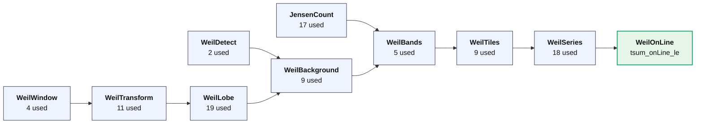

# What `WeilOnLine.tsum_onLine_le` rests on

[`WeilOnLine.tsum_onLine_le`](../lean_stage3/WeilOnLine.md#WeilOnLine-tsum_onLine_le) in `lean_stage3/Stage3/WeilOnLine.lean`, line 286.

**Why.** The on-line background. For `h > 0` and `γ ≥ 11/10`, the full weighted sum over all on-line zeros is at most `onLineBound h γ`.

**Proves**

```lean
∑' ρ : OnLine, weightedTerm h γ ρ.1 ≤ onLineBound h γ
```

**Needs** (its hypotheses)

  - `` hh : 0 < h ``
  - `` hγ : 11 / 10 ≤ γ ``

Behind it: 88 theorems and 26 definitions in 10 files. Every one is listed below; Lean recorded each step.

## The files it passes through



An arrow A → B reads "B uses something proved or defined in A"; indirect arrows are left out. Green: the theorem itself. Yellow: a file in the other tree. The number is how many of that file's declarations are on the way.

## Every declaration on the way

Files in dependency order. ★ marks what the theorem's own proof uses directly.

### [`JensenCount`](../lean_stage3/JensenCount.md) — 17

- [`Stage3.zeta_centre_lower`](../lean_stage3/JensenCount.md#Stage3-zeta_centre_lower) — `` (1 : ℝ) / 3 ≤ ‖ζ (2 + Complex.I * T)‖ ``
- [`Stage3.zeta_disk_upper`](../lean_stage3/JensenCount.md#Stage3-zeta_disk_upper) — `` ‖ζ w‖ ≤ 28 * T ``
- [`Stage3.zeta_centre_ne_zero`](../lean_stage3/JensenCount.md#Stage3-zeta_centre_ne_zero) — `` ζ (2 + Complex.I * (T : ℂ)) ≠ 0 ``
- [`Stage3.pole_away`](../lean_stage3/JensenCount.md#Stage3-pole_away) — `` 2 * z + (2 + Complex.I * (T : ℂ)) ≠ 1 ``
- [`Stage3.pole_away_centre`](../lean_stage3/JensenCount.md#Stage3-pole_away_centre) — `` v ≠ 1 ``
- [`Stage3.zetaWindowTwo_finite`](../lean_stage3/JensenCount.md#Stage3-zetaWindowTwo_finite) — `` {ρ : ℂ | ζ ρ = 0 ∧ ‖ρ - (2 + Complex.I * (T : ℂ))‖ ≤ 2}.Finite ``
- [`Stage3.zetaWindow`](../lean_stage3/JensenCount.md#Stage3-zetaWindow) — *def*
- [`Stage3.zetaWindow_finite`](../lean_stage3/JensenCount.md#Stage3-zetaWindow_finite) — `` (zetaWindow T).Finite ``
- [`Stage3.jensenF`](../lean_stage3/JensenCount.md#Stage3-jensenF) — *def*
- [`Stage3.zeta_comp_analytic`](../lean_stage3/JensenCount.md#Stage3-zeta_comp_analytic) — `` AnalyticAt ℂ (fun z : ℂ => ζ (2 * z + (2 + Complex.I * (T : ℂ)))) w ``
- [`Stage3.jensenF_analytic`](../lean_stage3/JensenCount.md#Stage3-jensenF_analytic) — `` AnalyticOnNhd ℂ (jensenF T) (Metric.closedBall (0 : ℂ) 1) ``
- [`Stage3.jensenF_zero_eq_one`](../lean_stage3/JensenCount.md#Stage3-jensenF_zero_eq_one) — `` jensenF T 0 = 1 ``
- [`Stage3.jensenF_zeros_finite`](../lean_stage3/JensenCount.md#Stage3-jensenF_zeros_finite) — `` (SetOfZeros 1 (jensenF T)).Finite ``
- [`Stage3.jensenF_bound`](../lean_stage3/JensenCount.md#Stage3-jensenF_bound) — `` ‖jensenF T z‖ ≤ 84 * T ``
- [`Stage3.analyticOrderNatAt_fun_comp_affine`](../lean_stage3/JensenCount.md#Stage3-analyticOrderNatAt_fun_comp_affine) — `` analyticOrderNatAt (fun w : ℂ => g (a * w + b)) z = analyticOrderNatAt g (a * z + b) ``
- [`Stage3.jensenF_order`](../lean_stage3/JensenCount.md#Stage3-jensenF_order) — `` analyticOrderNatAt (jensenF T) w = analyticOrderNatAt ζ (2 * w + (2 + Complex.I * (T : ℂ))) ``
- [`Stage3.zeta_local_zero_count`](../lean_stage3/JensenCount.md#Stage3-zeta_local_zero_count) — `` ∑ ρ ∈ (zetaWindow_finite hT).toFinset, (analyticOrderNatAt ζ ρ : ℝ) ≤ 15 * Real.log T + 73 ``

### [`WeilDetect`](../lean_stage3/WeilDetect.md) — 2

- [`WeilDetect.laplace`](../lean_stage3/WeilDetect.md#WeilDetect-laplace) — *def*
- [`WeilDetect.laplace_conj`](../lean_stage3/WeilDetect.md#WeilDetect-laplace_conj) — `` laplace G ((starRingEnd ℂ) z) = (starRingEnd ℂ) (laplace G z) ``

### [`WeilWindow`](../lean_stage3/WeilWindow.md) — 4

- [`WeilWindow.P`](../lean_stage3/WeilWindow.md#WeilWindow-P) — *def*
- [`WeilWindow.P_nonneg`](../lean_stage3/WeilWindow.md#WeilWindow-P_nonneg) — `` 0 ≤ P x ``
- [`WeilWindow.P_le_one`](../lean_stage3/WeilWindow.md#WeilWindow-P_le_one) — `` P x ≤ 1 ``
- [`WeilWindow.continuous_P`](../lean_stage3/WeilWindow.md#WeilWindow-continuous_P) — `` Continuous P ``

### [`WeilTransform`](../lean_stage3/WeilTransform.md) — 11

- [`WeilTransform.SigmaC`](../lean_stage3/WeilTransform.md#WeilTransform-SigmaC) — *def*
- [`WeilTransform.Psi`](../lean_stage3/WeilTransform.md#WeilTransform-Psi) — *def*
- [`WeilTransform.G`](../lean_stage3/WeilTransform.md#WeilTransform-G) — *def*
- [`WeilTransform.ghat`](../lean_stage3/WeilTransform.md#WeilTransform-ghat) — *def*
- [`WeilTransform.P_even`](../lean_stage3/WeilTransform.md#WeilTransform-P_even) — `` P (-x) = P x ``
- [`WeilTransform.xP_odd`](../lean_stage3/WeilTransform.md#WeilTransform-xP_odd) — `` (-x) * P (-x) = -(x * P x) ``
- [`WeilTransform.continuous_xP`](../lean_stage3/WeilTransform.md#WeilTransform-continuous_xP) — `` Continuous fun x : ℝ => x * P x ``
- [`WeilTransform.SigmaC_I_mul`](../lean_stage3/WeilTransform.md#WeilTransform-SigmaC_I_mul) — `` SigmaC (Complex.I * (s : ℂ)) = Complex.I * (Psi s : ℂ) ``
- [`WeilTransform.odd_integral_exp`](../lean_stage3/WeilTransform.md#WeilTransform-odd_integral_exp) — `` (∫ x in (-1 : ℝ)..1, ((q x : ℝ) : ℂ) * Complex.exp (w * (x : ℂ))) = ∫ x in (-1 : ℝ)..1, ((q x : ℝ) : ℂ) * Complex.sinh (w * (x : ℂ)) ``
- [`WeilTransform.ghat_eq`](../lean_stage3/WeilTransform.md#WeilTransform-ghat_eq) — `` ghat h γ z = ((h : ℂ) / 2) * (SigmaC ((z + Complex.I * (γ : ℂ)) * (h : ℂ)) + SigmaC ((z - Complex.I * (γ : ℂ)) * (h : ℂ))) ``
- [`WeilTransform.ghat_ofReal_I`](../lean_stage3/WeilTransform.md#WeilTransform-ghat_ofReal_I) — `` ghat h γ (Complex.I * (t : ℂ)) = Complex.I * ((h : ℂ) / 2) * ((Psi (h * (t + γ)) : ℂ) + (Psi (h * (t - γ)) : ℂ)) ``

### [`WeilLobe`](../lean_stage3/WeilLobe.md) — 19

- [`WeilLobe.P_eq`](../lean_stage3/WeilLobe.md#WeilLobe-P_eq) — `` P x = (1 + Real.cos (Real.pi * x)) / 2 ``
- [`WeilLobe.q`](../lean_stage3/WeilLobe.md#WeilLobe-q) — *def*
- [`WeilLobe.q1`](../lean_stage3/WeilLobe.md#WeilLobe-q1) — *def*
- [`WeilLobe.q2`](../lean_stage3/WeilLobe.md#WeilLobe-q2) — *def*
- [`WeilLobe.q_eq`](../lean_stage3/WeilLobe.md#WeilLobe-q_eq) — `` x * P x = q x ``
- [`WeilLobe.hasDerivAt_cos_pi`](../lean_stage3/WeilLobe.md#WeilLobe-hasDerivAt_cos_pi) — `` HasDerivAt (fun y : ℝ => Real.cos (Real.pi * y)) (-Real.sin (Real.pi * x) * Real.pi) x ``
- [`WeilLobe.hasDerivAt_sin_pi`](../lean_stage3/WeilLobe.md#WeilLobe-hasDerivAt_sin_pi) — `` HasDerivAt (fun y : ℝ => Real.sin (Real.pi * y)) (Real.cos (Real.pi * x) * Real.pi) x ``
- [`WeilLobe.hasDerivAt_q`](../lean_stage3/WeilLobe.md#WeilLobe-hasDerivAt_q) — `` HasDerivAt q (q1 x) x ``
- [`WeilLobe.hasDerivAt_q1`](../lean_stage3/WeilLobe.md#WeilLobe-hasDerivAt_q1) — `` HasDerivAt q1 (q2 x) x ``
- [`WeilLobe.q_one`](../lean_stage3/WeilLobe.md#WeilLobe-q_one) — `` q 1 = 0 ``
- [`WeilLobe.q_neg_one`](../lean_stage3/WeilLobe.md#WeilLobe-q_neg_one) — `` q (-1) = 0 ``
- [`WeilLobe.q1_one`](../lean_stage3/WeilLobe.md#WeilLobe-q1_one) — `` q1 1 = 0 ``
- [`WeilLobe.q1_neg_one`](../lean_stage3/WeilLobe.md#WeilLobe-q1_neg_one) — `` q1 (-1) = 0 ``
- [`WeilLobe.continuous_q1`](../lean_stage3/WeilLobe.md#WeilLobe-continuous_q1) — `` Continuous q1 ``
- [`WeilLobe.continuous_q2`](../lean_stage3/WeilLobe.md#WeilLobe-continuous_q2) — `` Continuous q2 ``
- [`WeilLobe.q2_bound`](../lean_stage3/WeilLobe.md#WeilLobe-q2_bound) — `` |q2 x| ≤ Real.pi + Real.pi ^ 2 / 2 ``
- [`WeilLobe.norm_sinh_le`](../lean_stage3/WeilLobe.md#WeilLobe-norm_sinh_le) — `` ‖Complex.sinh z‖ ≤ Real.cosh z.re ``
- [`WeilLobe.SigmaC_eq_ibp`](../lean_stage3/WeilLobe.md#WeilLobe-SigmaC_eq_ibp) — `` SigmaC w = (1 / w ^ 2) * ∫ x in (-1 : ℝ)..1, ((q2 x : ℝ) : ℂ) * Complex.sinh (w * (x : ℂ)) ``
- [`WeilLobe.SigmaC_bound`](../lean_stage3/WeilLobe.md#WeilLobe-SigmaC_bound) — `` ‖SigmaC w‖ ≤ (2 * Real.pi + Real.pi ^ 2) * Real.cosh w.re / ‖w‖ ^ 2 ``

### [`WeilBackground`](../lean_stage3/WeilBackground.md) — 9

- [`WeilBackground.phi`](../lean_stage3/WeilBackground.md#WeilBackground-phi) — *def*
- [`WeilBackground.phiC`](../lean_stage3/WeilBackground.md#WeilBackground-phiC) — *def*
- [`WeilBackground.phiC_real`](../lean_stage3/WeilBackground.md#WeilBackground-phiC_real) — `` (phiC h γ u).im = 0 ``
- [`WeilBackground.laplace_phi`](../lean_stage3/WeilBackground.md#WeilBackground-laplace_phi) — `` laplace (phiC h γ) z = ghat h γ (-z - 1 / 2) ``
- [`WeilBackground.Psi_bound`](../lean_stage3/WeilBackground.md#WeilBackground-Psi_bound) — `` |WeilTransform.Psi s| ≤ (2 * Real.pi + Real.pi ^ 2) / s ^ 2 ``
- [`WeilBackground.Psi_le_two`](../lean_stage3/WeilBackground.md#WeilBackground-Psi_le_two) — `` |WeilTransform.Psi s| ≤ 2 ``
- [`WeilBackground.online_term_eq`](../lean_stage3/WeilBackground.md#WeilBackground-online_term_eq) — `` laplace (phiC h γ) (-ρ) * laplace (phiC h γ) (-(1 - ρ)) = (((h / 2) ^ 2 * (WeilTransform.Psi (h * (ρ.im + γ)) + WeilTransform.Psi (h * (ρ.im - γ))) ^ 2 : ℝ) : ℂ… ``
- [`WeilBackground.online_term_le_near`](../lean_stage3/WeilBackground.md#WeilBackground-online_term_le_near) — `` (laplace (phiC h γ) (-ρ) * laplace (phiC h γ) (-(1 - ρ))).re ≤ 4 * h ^ 2 ``
- [`WeilBackground.online_term_le_far`](../lean_stage3/WeilBackground.md#WeilBackground-online_term_le_far) — `` (laplace (phiC h γ) (-ρ) * laplace (phiC h γ) (-(1 - ρ))).re ≤ (h / 2) ^ 2 * ((2 * Real.pi + Real.pi ^ 2) / (h * (ρ.im - γ)) ^ 2 + (2 * Real.pi + Real.pi ^ 2) /… ``

### [`WeilBands`](../lean_stage3/WeilBands.md) — 5

- [`WeilBands.order_eq_analyticOrderNatAt`](../lean_stage3/WeilBands.md#WeilBands-order_eq_analyticOrderNatAt) — `` ((riemannZeta.order (ρ : ℂ) : ℤ) : ℝ) = (analyticOrderNatAt riemannZeta (ρ : ℂ) : ℝ) ``
- [`WeilBands.mem_zetaWindow_of_online`](../lean_stage3/WeilBands.md#WeilBands-mem_zetaWindow_of_online) — `` ρ ∈ Stage3.zetaWindow T ``
- [`WeilBands.band_count`](../lean_stage3/WeilBands.md#WeilBands-band_count) — `` ∑ ρ ∈ S, (analyticOrderNatAt riemannZeta ρ : ℝ) ≤ 15 * Real.log T + 73 ``
- ★ [`WeilBands.weightedTerm`](../lean_stage3/WeilBands.md#WeilBands-weightedTerm) — *def*
- [`WeilBands.band_sum_le`](../lean_stage3/WeilBands.md#WeilBands-band_sum_le) — `` ∑ ρ ∈ S, weightedTerm h γ ρ ≤ M * (15 * Real.log T + 73) ``

### [`WeilTiles`](../lean_stage3/WeilTiles.md) — 9

- [`WeilTiles.centre`](../lean_stage3/WeilTiles.md#WeilTiles-centre) — *def*
- [`WeilTiles.idx`](../lean_stage3/WeilTiles.md#WeilTiles-idx) — *def*
- [`WeilTiles.two_le_centre`](../lean_stage3/WeilTiles.md#WeilTiles-two_le_centre) — `` 2 ≤ centre k ``
- [`WeilTiles.idx_spec`](../lean_stage3/WeilTiles.md#WeilTiles-idx_spec) — `` |t - centre (idx t)| ≤ 9 / 10 ``
- [`WeilTiles.online_term_nonneg`](../lean_stage3/WeilTiles.md#WeilTiles-online_term_nonneg) — `` 0 ≤ (laplace (phiC h γ) (-ρ) * laplace (phiC h γ) (-(1 - ρ))).re ``
- ★ [`WeilTiles.weightedTerm_nonneg`](../lean_stage3/WeilTiles.md#WeilTiles-weightedTerm_nonneg) — `` 0 ≤ weightedTerm h γ ρ ``
- [`WeilTiles.sum_by_bands`](../lean_stage3/WeilTiles.md#WeilTiles-sum_by_bands) — `` ∑ ρ ∈ S, weightedTerm h γ ρ ≤ ∑ k ∈ S.image (fun ρ : Kadiri.NontrivialZeros => idx (ρ : ℂ).im), M k * (15 * Real.log (centre k) + 73) ``
- [`WeilTiles.bandSeries_nonneg`](../lean_stage3/WeilTiles.md#WeilTiles-bandSeries_nonneg) — `` 0 ≤ M k * (15 * Real.log (centre k) + 73) ``
- [`WeilTiles.sum_le_bandSeries`](../lean_stage3/WeilTiles.md#WeilTiles-sum_le_bandSeries) — `` ∑ ρ ∈ S, weightedTerm h γ ρ ≤ ∑' k : ℕ, M k * (15 * Real.log (centre k) + 73) ``

### [`WeilSeries`](../lean_stage3/WeilSeries.md) — 18

- [`WeilSeries.cFar`](../lean_stage3/WeilSeries.md#WeilSeries-cFar) — *def*
- [`WeilSeries.cFar_nonneg`](../lean_stage3/WeilSeries.md#WeilSeries-cFar_nonneg) — `` 0 ≤ cFar ``
- [`WeilSeries.M`](../lean_stage3/WeilSeries.md#WeilSeries-M) — *def*
- [`WeilSeries.M_nonneg`](../lean_stage3/WeilSeries.md#WeilSeries-M_nonneg) — `` 0 ≤ M h γ k ``
- [`WeilSeries.two_le_of_one_lt`](../lean_stage3/WeilSeries.md#WeilSeries-two_le_of_one_lt) — `` 2 ≤ |(k : ℝ) - (k0 : ℝ)| ``
- [`WeilSeries.dist_ge`](../lean_stage3/WeilSeries.md#WeilSeries-dist_ge) — `` 9 / 5 * |(idx t : ℝ) - (idx γ : ℝ)| - 9 / 5 ≤ |t - γ| ``
- [`WeilSeries.term_le_M`](../lean_stage3/WeilSeries.md#WeilSeries-term_le_M) — `` (laplace (phiC h γ) (-(ρ : ℂ)) * laplace (phiC h γ) (-(1 - (ρ : ℂ)))).re ≤ M h γ (idx (ρ : ℂ).im) ``
- [`WeilSeries.A`](../lean_stage3/WeilSeries.md#WeilSeries-A) — *def*
- [`WeilSeries.four_h_add_nonneg`](../lean_stage3/WeilSeries.md#WeilSeries-four_h_add_nonneg) — `` 0 ≤ 4 * h ^ 2 + cFar / h ^ 2 ``
- [`WeilSeries.A_nonneg`](../lean_stage3/WeilSeries.md#WeilSeries-A_nonneg) — `` 0 ≤ A h γ ``
- [`WeilSeries.weight_le`](../lean_stage3/WeilSeries.md#WeilSeries-weight_le) — `` 15 * Real.log (centre k) + 73 ≤ 88 * ((k : ℝ) + 1) ``
- [`WeilSeries.weight_nonneg`](../lean_stage3/WeilSeries.md#WeilSeries-weight_nonneg) — `` 0 ≤ 15 * Real.log (centre k) + 73 ``
- [`WeilSeries.bandTerm_le_A`](../lean_stage3/WeilSeries.md#WeilSeries-bandTerm_le_A) — `` M h γ k * (15 * Real.log (centre k) + 73) ≤ A h γ / ((k : ℝ) + 1) ^ 3 ``
- [`WeilSeries.summable_shift3`](../lean_stage3/WeilSeries.md#WeilSeries-summable_shift3) — `` Summable (fun k : ℕ => 1 / ((k : ℝ) + 1) ^ 3) ``
- [`WeilSeries.summable_shift2`](../lean_stage3/WeilSeries.md#WeilSeries-summable_shift2) — `` Summable (fun k : ℕ => 1 / ((k : ℝ) + 1) ^ 2) ``
- [`WeilSeries.bandSeries_summable`](../lean_stage3/WeilSeries.md#WeilSeries-bandSeries_summable) — `` Summable (fun k : ℕ => M h γ k * (15 * Real.log (centre k) + 73)) ``
- [`WeilSeries.tsum_shift2`](../lean_stage3/WeilSeries.md#WeilSeries-tsum_shift2) — `` ∑' k : ℕ, 1 / ((k : ℝ) + 1) ^ 2 = Real.pi ^ 2 / 6 ``
- [`WeilSeries.bandSeries_le`](../lean_stage3/WeilSeries.md#WeilSeries-bandSeries_le) — `` ∑' k : ℕ, M h γ k * (15 * Real.log (centre k) + 73) ≤ A h γ * (Real.pi ^ 2 / 6) ``

### [`WeilOnLine`](../lean_stage3/WeilOnLine.md) — 20

- [`WeilOnLine.Psi_neg`](../lean_stage3/WeilOnLine.md#WeilOnLine-Psi_neg) — `` WeilTransform.Psi (-s) = -WeilTransform.Psi s ``
- [`WeilOnLine.term_conj`](../lean_stage3/WeilOnLine.md#WeilOnLine-term_conj) — `` (laplace (phiC h γ) (-(starRingEnd ℂ) ρ) * laplace (phiC h γ) (-(1 - (starRingEnd ℂ) ρ))).re = (laplace (phiC h γ) (-ρ) * laplace (phiC h γ) (-(1 - ρ))).re ``
- [`WeilOnLine.conj_mem`](../lean_stage3/WeilOnLine.md#WeilOnLine-conj_mem) — `` (starRingEnd ℂ) (ρ : ℂ) ∈ Kadiri.NontrivialZeros ``
- [`WeilOnLine.conjZ`](../lean_stage3/WeilOnLine.md#WeilOnLine-conjZ) — *def*
- [`WeilOnLine.conjZ_injective`](../lean_stage3/WeilOnLine.md#WeilOnLine-conjZ_injective) — `` Function.Injective conjZ ``
- [`WeilOnLine.weightedTerm_conjZ`](../lean_stage3/WeilOnLine.md#WeilOnLine-weightedTerm_conjZ) — `` weightedTerm h γ (conjZ ρ) = weightedTerm h γ ρ ``
- [`WeilOnLine.B`](../lean_stage3/WeilOnLine.md#WeilOnLine-B) — *def*
- [`WeilOnLine.sum_upper_le`](../lean_stage3/WeilOnLine.md#WeilOnLine-sum_upper_le) — `` ∑ ρ ∈ S, weightedTerm h γ ρ ≤ B h γ ``
- [`WeilOnLine.sum_lower_le`](../lean_stage3/WeilOnLine.md#WeilOnLine-sum_lower_le) — `` ∑ ρ ∈ S, weightedTerm h γ ρ ≤ B h γ ``
- [`WeilOnLine.lowSet`](../lean_stage3/WeilOnLine.md#WeilOnLine-lowSet) — *def*
- [`WeilOnLine.lowU`](../lean_stage3/WeilOnLine.md#WeilOnLine-lowU) — *def*
- [`WeilOnLine.lowU_preconnected`](../lean_stage3/WeilOnLine.md#WeilOnLine-lowU_preconnected) — `` IsPreconnected lowU ``
- [`WeilOnLine.lowU_analytic`](../lean_stage3/WeilOnLine.md#WeilOnLine-lowU_analytic) — `` AnalyticOnNhd ℂ riemannZeta lowU ``
- [`WeilOnLine.lowSet_finite`](../lean_stage3/WeilOnLine.md#WeilOnLine-lowSet_finite) — `` lowSet.Finite ``
- [`WeilOnLine.lowCount`](../lean_stage3/WeilOnLine.md#WeilOnLine-lowCount) — *def*
- [`WeilOnLine.sum_low_le`](../lean_stage3/WeilOnLine.md#WeilOnLine-sum_low_le) — `` ∑ ρ ∈ S, weightedTerm h γ ρ ≤ 4 * h ^ 2 * lowCount ``
- ★ [`WeilOnLine.onLineBound`](../lean_stage3/WeilOnLine.md#WeilOnLine-onLineBound) — *def*
- [`WeilOnLine.sum_onLine_le`](../lean_stage3/WeilOnLine.md#WeilOnLine-sum_onLine_le) — `` ∑ ρ ∈ S, weightedTerm h γ ρ ≤ onLineBound h γ ``
- ★ [`WeilOnLine.OnLine`](../lean_stage3/WeilOnLine.md#WeilOnLine-OnLine) — *abbrev*
- ★ [`WeilOnLine.sum_onLine_subtype_le`](../lean_stage3/WeilOnLine.md#WeilOnLine-sum_onLine_subtype_le) — `` ∑ ρ ∈ s, weightedTerm h γ ρ.1 ≤ onLineBound h γ ``

