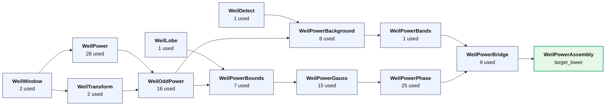

# What `WeilPowerAssembly.target_lower` rests on

[`WeilPowerAssembly.target_lower`](../lean_stage3/WeilPowerAssembly.md#WeilPowerAssembly-target_lower) in `lean_stage3/Stage3/WeilPowerAssembly.lean`, line 286.

**Why.** Target lower. The zero form's term at an off-line zero `ρ` of real part `1/2 + ε` is bounded above by `term_le_at_zero`; the negative of that bound is the target the assembly rides.

**Proves**

```lean
WeilPowerBands.termW h γ m (ρ : ℂ) ≤ -((h / 2) ^ 2 * ((cS m / D m) ^ 2 * Real.exp (2 * ((wm h γ (ρ : ℂ)) ^ 2).re * sigma m) * (((wm h γ (ρ : ℂ)) ^ 2).re * Real.cos (2 * ((wm h γ (ρ : ℂ)) ^ 2).im * sigma m) - ((wm h γ (ρ : ℂ)) ^ 2).im * Real.sin (2 * ((wm h γ (ρ : ℂ)) ^ 2).im * sigma m)) - (cS m / D m) ^ 2 * ‖wm h γ (ρ : ℂ)‖ ^ 2 * Real.exp (2 * ((wm h γ (ρ : ℂ)) ^ 2).re * sigma m) * (4 * WeilPowerPhase.q m (wm h γ (ρ : ℂ)) + 4 * WeilPowerPhase.q m (wm h γ (ρ : ℂ)) ^ 2) - 2 * (cS m * Real.cosh (((ρ : ℂ).re - 1 / 2) * h) * (2 / (((ρ : ℂ).im + γ) * h) ^ 2) ^ (m + 1)) * ‖S m (wm h γ (ρ : ℂ))‖ - (cS m * Real.cosh (((ρ : ℂ).re - 1 / 2) * h) * (2 / (((ρ : ℂ).im + γ) * h) ^ 2) ^ (m + 1)) ^ 2))
```

**Needs** (its hypotheses)

  - `` _hε : 0 < ε ``
  - `` hh : 0 < h ``
  - `` ρ : Kadiri.NontrivialZeros ``
  - `` _hre : (ρ : ℂ).re = 1/2 + ε ``
  - `` _him : (ρ : ℂ).im = γ ``
  - `` hfar : 2 * ((((ρ : ℂ).re - 1 / 2) * h) ^ 2 + Real.pi ^ 2 * ((m : ℝ) + 1) ^ 2) ≤ (((ρ : ℂ).im + γ) * h) ^ 2 ``
  - `` hne : QS m (wm h γ (ρ : ℂ)) ≠ 0 ``
  - `` hsmall : ‖wm h γ (ρ : ℂ)‖ ^ 2 ≤ Real.pi ^ 2 * ((m : ℝ) + 2) ^ 2 / 2 ``
  - `` hq : WeilPowerPhase.q m (wm h γ (ρ : ℂ)) ≤ 1 ``

Behind it: 86 theorems and 29 definitions in 13 files. Every one is listed below; Lean recorded each step.

## The files it passes through



An arrow A → B reads "B uses something proved or defined in A"; indirect arrows are left out. Green: the theorem itself. Yellow: a file in the other tree. The number is how many of that file's declarations are on the way.

## Every declaration on the way

Files in dependency order. ★ marks what the theorem's own proof uses directly.

### [`WeilDetect`](../lean_stage3/WeilDetect.md) — 1

- [`WeilDetect.laplace`](../lean_stage3/WeilDetect.md#WeilDetect-laplace) — *def*

### [`WeilLobe`](../lean_stage3/WeilLobe.md) — 1

- [`WeilLobe.norm_sinh_le`](../lean_stage3/WeilLobe.md#WeilLobe-norm_sinh_le) — `` ‖Complex.sinh z‖ ≤ Real.cosh z.re ``

### [`WeilWindow`](../lean_stage3/WeilWindow.md) — 2

- [`WeilWindow.P`](../lean_stage3/WeilWindow.md#WeilWindow-P) — *def*
- [`WeilWindow.continuous_P`](../lean_stage3/WeilWindow.md#WeilWindow-continuous_P) — `` Continuous P ``

### [`WeilPower`](../lean_stage3/WeilPower.md) — 28

- [`WeilPower.c`](../lean_stage3/WeilPower.md#WeilPower-c) — *def*
- [`WeilPower.P_eq_c_sq`](../lean_stage3/WeilPower.md#WeilPower-P_eq_c_sq) — `` P x = c x ^ 2 ``
- [`WeilPower.P_pow`](../lean_stage3/WeilPower.md#WeilPower-P_pow) — `` P x ^ m = c x ^ (2 * m) ``
- [`WeilPower.c_one`](../lean_stage3/WeilPower.md#WeilPower-c_one) — `` c 1 = 0 ``
- [`WeilPower.c_neg_one`](../lean_stage3/WeilPower.md#WeilPower-c_neg_one) — `` c (-1) = 0 ``
- [`WeilPower.continuous_c`](../lean_stage3/WeilPower.md#WeilPower-continuous_c) — `` Continuous c ``
- [`WeilPower.c_pow_one`](../lean_stage3/WeilPower.md#WeilPower-c_pow_one) — `` c 1 ^ n = 0 ``
- [`WeilPower.c_pow_neg_one`](../lean_stage3/WeilPower.md#WeilPower-c_pow_neg_one) — `` c (-1) ^ n = 0 ``
- [`WeilPower.hasDerivAt_c`](../lean_stage3/WeilPower.md#WeilPower-hasDerivAt_c) — `` HasDerivAt c (-(Real.pi / 2) * Real.sin (Real.pi * x / 2)) x ``
- [`WeilPower.hasDerivAt_s`](../lean_stage3/WeilPower.md#WeilPower-hasDerivAt_s) — `` HasDerivAt (fun y : ℝ => Real.sin (Real.pi * y / 2)) (Real.pi / 2 * c x) x ``
- [`WeilPower.f1`](../lean_stage3/WeilPower.md#WeilPower-f1) — *def*
- [`WeilPower.f2`](../lean_stage3/WeilPower.md#WeilPower-f2) — *def*
- [`WeilPower.hasDerivAt_f`](../lean_stage3/WeilPower.md#WeilPower-hasDerivAt_f) — `` HasDerivAt (fun y : ℝ => c y ^ (k + 1)) (f1 k x) x ``
- [`WeilPower.hasDerivAt_f1`](../lean_stage3/WeilPower.md#WeilPower-hasDerivAt_f1) — `` HasDerivAt (f1 (k + 1)) (f2 k x) x ``
- [`WeilPower.continuous_f1`](../lean_stage3/WeilPower.md#WeilPower-continuous_f1) — `` Continuous (f1 k) ``
- [`WeilPower.continuous_f2`](../lean_stage3/WeilPower.md#WeilPower-continuous_f2) — `` Continuous (f2 k) ``
- [`WeilPower.f1_one`](../lean_stage3/WeilPower.md#WeilPower-f1_one) — `` f1 (k + 1) 1 = 0 ``
- [`WeilPower.f1_neg_one`](../lean_stage3/WeilPower.md#WeilPower-f1_neg_one) — `` f1 (k + 1) (-1) = 0 ``
- [`WeilPower.K`](../lean_stage3/WeilPower.md#WeilPower-K) — *def*
- [`WeilPower.hasDerivAt_E`](../lean_stage3/WeilPower.md#WeilPower-hasDerivAt_E) — `` HasDerivAt (fun y : ℝ => Complex.exp (w * (y : ℂ))) (w * Complex.exp (w * (x : ℂ))) x ``
- [`WeilPower.ibp_twice`](../lean_stage3/WeilPower.md#WeilPower-ibp_twice) — `` w ^ 2 * ∫ x in (-1 : ℝ)..1, ((c x ^ (k + 2) : ℝ) : ℂ) * Complex.exp (w * (x : ℂ)) = ∫ x in (-1 : ℝ)..1, ((f2 k x : ℝ) : ℂ) * Complex.exp (w * (x : ℂ)) ``
- [`WeilPower.K_succ`](../lean_stage3/WeilPower.md#WeilPower-K_succ) — `` K (m + 1) w * (w ^ 2 + (Real.pi : ℂ) ^ 2 * ((m : ℂ) + 1) ^ 2) = ((m : ℂ) + 1) * (2 * (m : ℂ) + 1) * (Real.pi : ℂ) ^ 2 / 2 * K m w ``
- [`WeilPower.Q`](../lean_stage3/WeilPower.md#WeilPower-Q) — *def*
- [`WeilPower.cK`](../lean_stage3/WeilPower.md#WeilPower-cK) — *def*
- [`WeilPower.Q_succ`](../lean_stage3/WeilPower.md#WeilPower-Q_succ) — `` Q (m + 1) w = Q m w * (w ^ 2 + (Real.pi : ℂ) ^ 2 * ((m : ℂ) + 1) ^ 2) ``
- [`WeilPower.cK_succ`](../lean_stage3/WeilPower.md#WeilPower-cK_succ) — `` cK (m + 1) = ((m : ℝ) + 1) * (2 * (m : ℝ) + 1) * Real.pi ^ 2 / 2 * cK m ``
- [`WeilPower.K_zero_mul`](../lean_stage3/WeilPower.md#WeilPower-K_zero_mul) — `` K 0 w * w = 2 * Complex.sinh w ``
- [`WeilPower.K_mul_Q`](../lean_stage3/WeilPower.md#WeilPower-K_mul_Q) — `` K m w * Q m w = (cK m : ℂ) * Complex.sinh w ``

### [`WeilTransform`](../lean_stage3/WeilTransform.md) — 2

- [`WeilTransform.P_even`](../lean_stage3/WeilTransform.md#WeilTransform-P_even) — `` P (-x) = P x ``
- [`WeilTransform.odd_integral_exp`](../lean_stage3/WeilTransform.md#WeilTransform-odd_integral_exp) — `` (∫ x in (-1 : ℝ)..1, ((q x : ℝ) : ℂ) * Complex.exp (w * (x : ℂ))) = ∫ x in (-1 : ℝ)..1, ((q x : ℝ) : ℂ) * Complex.sinh (w * (x : ℂ)) ``

### [`WeilOddPower`](../lean_stage3/WeilOddPower.md) — 16

- [`WeilOddPower.q`](../lean_stage3/WeilOddPower.md#WeilOddPower-q) — *def*
- [`WeilOddPower.q_odd`](../lean_stage3/WeilOddPower.md#WeilOddPower-q_odd) — `` q m (-x) = -q m x ``
- [`WeilOddPower.continuous_q`](../lean_stage3/WeilOddPower.md#WeilOddPower-continuous_q) — `` Continuous (q m) ``
- [`WeilOddPower.sin_pi_mul`](../lean_stage3/WeilOddPower.md#WeilOddPower-sin_pi_mul) — `` Real.sin (Real.pi * x) = 2 * Real.sin (Real.pi * x / 2) * c x ``
- [`WeilOddPower.q_eq`](../lean_stage3/WeilOddPower.md#WeilOddPower-q_eq) — `` q m x = -(2 / (((m : ℝ) + 1) * Real.pi)) * f1 (2 * m + 1) x ``
- ★ [`WeilOddPower.S`](../lean_stage3/WeilOddPower.md#WeilOddPower-S) — *def*
- [`WeilOddPower.ibp_once`](../lean_stage3/WeilOddPower.md#WeilOddPower-ibp_once) — `` (∫ x in (-1 : ℝ)..1, ((f1 (k + 1) x : ℝ) : ℂ) * Complex.exp (w * (x : ℂ))) = -(w * ∫ x in (-1 : ℝ)..1, ((c x ^ (k + 2) : ℝ) : ℂ) * Complex.exp (w * (x : ℂ))) ``
- [`WeilOddPower.S_eq`](../lean_stage3/WeilOddPower.md#WeilOddPower-S_eq) — `` S m w = 2 * w * K (m + 1) w / (((m : ℂ) + 1) * (Real.pi : ℂ)) ``
- ★ [`WeilOddPower.QS`](../lean_stage3/WeilOddPower.md#WeilOddPower-QS) — *def*
- ★ [`WeilOddPower.cS`](../lean_stage3/WeilOddPower.md#WeilOddPower-cS) — *def*
- [`WeilOddPower.Q_succ_eq`](../lean_stage3/WeilOddPower.md#WeilOddPower-Q_succ_eq) — `` Q (m + 1) w = w * QS m w ``
- [`WeilOddPower.cS_eq`](../lean_stage3/WeilOddPower.md#WeilOddPower-cS_eq) — `` cS m * (((m : ℝ) + 1) * Real.pi) = 2 * cK (m + 1) ``
- [`WeilOddPower.S_mul_QS`](../lean_stage3/WeilOddPower.md#WeilOddPower-S_mul_QS) — `` S m w * QS m w = (cS m : ℂ) * Complex.sinh w ``
- [`WeilOddPower.W`](../lean_stage3/WeilOddPower.md#WeilOddPower-W) — *def*
- [`WeilOddPower.what`](../lean_stage3/WeilOddPower.md#WeilOddPower-what) — *def*
- [`WeilOddPower.what_eq`](../lean_stage3/WeilOddPower.md#WeilOddPower-what_eq) — `` what h γ m z = ((h : ℂ) / 2) * (S m ((z + Complex.I * (γ : ℂ)) * (h : ℂ)) + S m ((z - Complex.I * (γ : ℂ)) * (h : ℂ))) ``

### [`WeilPowerBackground`](../lean_stage3/WeilPowerBackground.md) — 8

- [`WeilPowerBackground.phiW`](../lean_stage3/WeilPowerBackground.md#WeilPowerBackground-phiW) — *def*
- [`WeilPowerBackground.phiWC`](../lean_stage3/WeilPowerBackground.md#WeilPowerBackground-phiWC) — *def*
- [`WeilPowerBackground.laplace_phiW`](../lean_stage3/WeilPowerBackground.md#WeilPowerBackground-laplace_phiW) — `` laplace (phiWC h γ m) z = what h γ m (-z - 1 / 2) ``
- [`WeilPowerBackground.S_eq_sinh`](../lean_stage3/WeilPowerBackground.md#WeilPowerBackground-S_eq_sinh) — `` S m w = ∫ x in (-1 : ℝ)..1, ((q m x : ℝ) : ℂ) * Complex.sinh (w * (x : ℂ)) ``
- [`WeilPowerBackground.S_neg`](../lean_stage3/WeilPowerBackground.md#WeilPowerBackground-S_neg) — `` S m (-w) = -S m w ``
- [`WeilPowerBackground.what_neg`](../lean_stage3/WeilPowerBackground.md#WeilPowerBackground-what_neg) — `` what h γ m (-z) = -what h γ m z ``
- [`WeilPowerBackground.term_eq_neg_sq`](../lean_stage3/WeilPowerBackground.md#WeilPowerBackground-term_eq_neg_sq) — `` laplace (phiWC h γ m) (-ρ) * laplace (phiWC h γ m) (-(1 - ρ)) = -(what h γ m (ρ - 1 / 2)) ^ 2 ``
- [`WeilPowerBackground.term_re_eq`](../lean_stage3/WeilPowerBackground.md#WeilPowerBackground-term_re_eq) — `` (laplace (phiWC h γ m) (-ρ) * laplace (phiWC h γ m) (-(1 - ρ))).re = (what h γ m (ρ - 1 / 2)).im ^ 2 - (what h γ m (ρ - 1 / 2)).re ^ 2 ``

### [`WeilPowerBands`](../lean_stage3/WeilPowerBands.md) — 1

- ★ [`WeilPowerBands.termW`](../lean_stage3/WeilPowerBands.md#WeilPowerBands-termW) — *def*

### [`WeilPowerBounds`](../lean_stage3/WeilPowerBounds.md) — 7

- [`WeilPowerBounds.QS_factor`](../lean_stage3/WeilPowerBounds.md#WeilPowerBounds-QS_factor) — `` QS m w = ∏ j ∈ Finset.range (m + 1), (w ^ 2 + ((Real.pi * ((j : ℝ) + 1) : ℝ) : ℂ) ^ 2) ``
- [`WeilPowerBounds.cS_pos`](../lean_stage3/WeilPowerBounds.md#WeilPowerBounds-cS_pos) — `` 0 < cS m ``
- [`WeilPowerBounds.S_eq_div'`](../lean_stage3/WeilPowerBounds.md#WeilPowerBounds-S_eq_div-) — `` S m w = (cS m : ℂ) * Complex.sinh w / QS m w ``
- [`WeilPowerBounds.norm_S_le'`](../lean_stage3/WeilPowerBounds.md#WeilPowerBounds-norm_S_le-) — `` ‖S m w‖ ≤ cS m * Real.cosh w.re / ‖QS m w‖ ``
- [`WeilPowerBounds.norm_factor_ge_far`](../lean_stage3/WeilPowerBounds.md#WeilPowerBounds-norm_factor_ge_far) — `` w.im ^ 2 / 2 ≤ ‖w ^ 2 + (a : ℂ) ^ 2‖ ``
- [`WeilPowerBounds.norm_QS_ge_far`](../lean_stage3/WeilPowerBounds.md#WeilPowerBounds-norm_QS_ge_far) — `` (w.im ^ 2 / 2) ^ (m + 1) ≤ ‖QS m w‖ ``
- [`WeilPowerBounds.norm_S_le_far`](../lean_stage3/WeilPowerBounds.md#WeilPowerBounds-norm_S_le_far) — `` ‖S m w‖ ≤ cS m * Real.cosh w.re * (2 / w.im ^ 2) ^ (m + 1) ``

### [`WeilPowerGauss`](../lean_stage3/WeilPowerGauss.md) — 15

- [`WeilPowerGauss.g`](../lean_stage3/WeilPowerGauss.md#WeilPowerGauss-g) — *def*
- [`WeilPowerGauss.euler_sinh`](../lean_stage3/WeilPowerGauss.md#WeilPowerGauss-euler_sinh) — `` Tendsto (fun n : ℕ => w * ∏ j ∈ Finset.range n, g w j) atTop (𝓝 (Complex.sinh w)) ``
- ★ [`WeilPowerGauss.D`](../lean_stage3/WeilPowerGauss.md#WeilPowerGauss-D) — *def*
- [`WeilPowerGauss.D_pos`](../lean_stage3/WeilPowerGauss.md#WeilPowerGauss-D_pos) — `` 0 < D m ``
- [`WeilPowerGauss.D_eq`](../lean_stage3/WeilPowerGauss.md#WeilPowerGauss-D_eq) — `` D m = Real.pi ^ (2 * (m + 1)) * (((m + 1).factorial : ℕ) : ℝ) ^ 2 ``
- [`WeilPowerGauss.QS_eq_D_mul`](../lean_stage3/WeilPowerGauss.md#WeilPowerGauss-QS_eq_D_mul) — `` QS m w = (D m : ℂ) * ∏ j ∈ Finset.range (m + 1), g w j ``
- [`WeilPowerGauss.cprime_eq`](../lean_stage3/WeilPowerGauss.md#WeilPowerGauss-cprime_eq) — `` cS m / D m = ((Nat.centralBinom (m + 1) : ℕ) : ℝ) / (Real.pi * ((m : ℝ) + 1) * 4 ^ m) ``
- [`WeilPowerGauss.cprime_ge`](../lean_stage3/WeilPowerGauss.md#WeilPowerGauss-cprime_ge) — `` 4 / (Real.pi * ((m : ℝ) + 1) * (2 * (m : ℝ) + 3)) ≤ cS m / D m ``
- [`WeilPowerGauss.cprime_pos`](../lean_stage3/WeilPowerGauss.md#WeilPowerGauss-cprime_pos) — `` 0 < cS m / D m ``
- [`WeilPowerGauss.T`](../lean_stage3/WeilPowerGauss.md#WeilPowerGauss-T) — *def*
- [`WeilPowerGauss.tendsto_S`](../lean_stage3/WeilPowerGauss.md#WeilPowerGauss-tendsto_S) — `` Tendsto (fun n : ℕ => ((cS m / D m : ℝ) : ℂ) * w * T m w n) atTop (𝓝 (S m w)) ``
- [`WeilPowerGauss.sum_inv_sq_le`](../lean_stage3/WeilPowerGauss.md#WeilPowerGauss-sum_inv_sq_le) — `` ∑ j ∈ Finset.Ico (m + 1) n, 1 / ((j : ℝ) + 1) ^ 2 ≤ 1 / ((m : ℝ) + 1) ``
- [`WeilPowerGauss.sum_inv_pow4_le`](../lean_stage3/WeilPowerGauss.md#WeilPowerGauss-sum_inv_pow4_le) — `` ∑ j ∈ Finset.Ico (m + 1) n, 1 / ((j : ℝ) + 1) ^ 4 ≤ 1 / ((m : ℝ) + 1) ^ 3 ``
- [`WeilPowerGauss.norm_x_le`](../lean_stage3/WeilPowerGauss.md#WeilPowerGauss-norm_x_le) — `` ‖w ^ 2 / ((Real.pi : ℂ) ^ 2 * ((j : ℂ) + 1) ^ 2)‖ ≤ 1 / 2 ``
- [`WeilPowerGauss.x_norm`](../lean_stage3/WeilPowerGauss.md#WeilPowerGauss-x_norm) — `` ‖w ^ 2 / ((Real.pi : ℂ) ^ 2 * ((j : ℂ) + 1) ^ 2)‖ = ‖w‖ ^ 2 / (Real.pi ^ 2 * ((j : ℝ) + 1) ^ 2) ``

### [`WeilPowerPhase`](../lean_stage3/WeilPowerPhase.md) — 25

- [`WeilPowerPhase.hterm`](../lean_stage3/WeilPowerPhase.md#WeilPowerPhase-hterm) — *def*
- [`WeilPowerPhase.sigmaN`](../lean_stage3/WeilPowerPhase.md#WeilPowerPhase-sigmaN) — *def*
- ★ [`WeilPowerPhase.sigma`](../lean_stage3/WeilPowerPhase.md#WeilPowerPhase-sigma) — *def*
- [`WeilPowerPhase.summable_hterm`](../lean_stage3/WeilPowerPhase.md#WeilPowerPhase-summable_hterm) — `` Summable hterm ``
- [`WeilPowerPhase.summable_shift`](../lean_stage3/WeilPowerPhase.md#WeilPowerPhase-summable_shift) — `` Summable (fun k : ℕ => hterm (k + (m + 1))) ``
- [`WeilPowerPhase.sigmaN_tendsto`](../lean_stage3/WeilPowerPhase.md#WeilPowerPhase-sigmaN_tendsto) — `` Tendsto (fun n => sigmaN m n) atTop (𝓝 (sigma m)) ``
- [`WeilPowerPhase.x`](../lean_stage3/WeilPowerPhase.md#WeilPowerPhase-x) — *def*
- [`WeilPowerPhase.g_eq`](../lean_stage3/WeilPowerPhase.md#WeilPowerPhase-g_eq) — `` g w j = 1 + x w j ``
- [`WeilPowerPhase.x_eq_mul`](../lean_stage3/WeilPowerPhase.md#WeilPowerPhase-x_eq_mul) — `` x w j = w ^ 2 * ((hterm j : ℝ) : ℂ) ``
- [`WeilPowerPhase.g_ne_zero`](../lean_stage3/WeilPowerPhase.md#WeilPowerPhase-g_ne_zero) — `` g w j ≠ 0 ``
- [`WeilPowerPhase.T_eq_exp`](../lean_stage3/WeilPowerPhase.md#WeilPowerPhase-T_eq_exp) — `` T m w n = Complex.exp (∑ j ∈ Finset.Ico (m + 1) n, Complex.log (g w j)) ``
- [`WeilPowerPhase.delta`](../lean_stage3/WeilPowerPhase.md#WeilPowerPhase-delta) — *def*
- [`WeilPowerPhase.norm_log_sub_le`](../lean_stage3/WeilPowerPhase.md#WeilPowerPhase-norm_log_sub_le) — `` ‖Complex.log (g w j) - x w j‖ ≤ ‖x w j‖ ^ 2 ``
- ★ [`WeilPowerPhase.q`](../lean_stage3/WeilPowerPhase.md#WeilPowerPhase-q) — *def*
- [`WeilPowerPhase.q_nonneg`](../lean_stage3/WeilPowerPhase.md#WeilPowerPhase-q_nonneg) — `` 0 ≤ q m w ``
- [`WeilPowerPhase.norm_delta_le`](../lean_stage3/WeilPowerPhase.md#WeilPowerPhase-norm_delta_le) — `` ‖delta m w n‖ ≤ q m w ``
- [`WeilPowerPhase.T_eq_mul`](../lean_stage3/WeilPowerPhase.md#WeilPowerPhase-T_eq_mul) — `` T m w n = Complex.exp (w ^ 2 * ((sigmaN m n : ℝ) : ℂ)) * Complex.exp (delta m w n) ``
- [`WeilPowerPhase.norm_exp_delta_sub_one_le`](../lean_stage3/WeilPowerPhase.md#WeilPowerPhase-norm_exp_delta_sub_one_le) — `` ‖Complex.exp (delta m w n) - 1‖ ≤ 2 * q m w ``
- [`WeilPowerPhase.P`](../lean_stage3/WeilPowerPhase.md#WeilPowerPhase-P) — *def*
- [`WeilPowerPhase.P_tendsto`](../lean_stage3/WeilPowerPhase.md#WeilPowerPhase-P_tendsto) — `` Tendsto (fun n => Complex.exp (w ^ 2 * ((sigmaN m n : ℝ) : ℂ))) atTop (𝓝 (P m w)) ``
- [`WeilPowerPhase.norm_S_sub_le`](../lean_stage3/WeilPowerPhase.md#WeilPowerPhase-norm_S_sub_le) — `` ‖S m w - ((cS m / D m : ℝ) : ℂ) * w * P m w‖ ≤ 2 * q m w * ‖((cS m / D m : ℝ) : ℂ) * w * P m w‖ ``
- [`WeilPowerPhase.norm_A_sq`](../lean_stage3/WeilPowerPhase.md#WeilPowerPhase-norm_A_sq) — `` ‖((cS m / D m : ℝ) : ℂ) * w * P m w‖ ^ 2 = (cS m / D m) ^ 2 * ‖w‖ ^ 2 * Real.exp (2 * (w ^ 2).re * sigma m) ``
- [`WeilPowerPhase.re_A_sq`](../lean_stage3/WeilPowerPhase.md#WeilPowerPhase-re_A_sq) — `` ((((cS m / D m : ℝ) : ℂ) * w * P m w) ^ 2).re = (cS m / D m) ^ 2 * Real.exp (2 * (w ^ 2).re * sigma m) * ((w ^ 2).re * Real.cos (2 * (w ^ 2).im * sigma m) - (w … ``
- [`WeilPowerPhase.re_sq_ge`](../lean_stage3/WeilPowerPhase.md#WeilPowerPhase-re_sq_ge) — `` ((((cS m / D m : ℝ) : ℂ) * w * P m w) ^ 2).re - ‖((cS m / D m : ℝ) : ℂ) * w * P m w‖ ^ 2 * (4 * q m w + 4 * q m w ^ 2) ≤ ((S m w) ^ 2).re ``
- [`WeilPowerPhase.re_S_sq_ge`](../lean_stage3/WeilPowerPhase.md#WeilPowerPhase-re_S_sq_ge) — `` (cS m / D m) ^ 2 * Real.exp (2 * (w ^ 2).re * sigma m) * ((w ^ 2).re * Real.cos (2 * (w ^ 2).im * sigma m) - (w ^ 2).im * Real.sin (2 * (w ^ 2).im * sigma m)) -… ``

### [`WeilPowerBridge`](../lean_stage3/WeilPowerBridge.md) — 9

- [`WeilPowerBridge.wp`](../lean_stage3/WeilPowerBridge.md#WeilPowerBridge-wp) — *def*
- ★ [`WeilPowerBridge.wm`](../lean_stage3/WeilPowerBridge.md#WeilPowerBridge-wm) — *def*
- [`WeilPowerBridge.im_sq_sub_re_sq`](../lean_stage3/WeilPowerBridge.md#WeilPowerBridge-im_sq_sub_re_sq) — `` z.im ^ 2 - z.re ^ 2 = -(z ^ 2).re ``
- [`WeilPowerBridge.term_eq_sidebands`](../lean_stage3/WeilPowerBridge.md#WeilPowerBridge-term_eq_sidebands) — `` WeilPowerBands.termW h γ m ρ = -((h / 2) ^ 2 * (((S m (wm h γ ρ)) ^ 2).re + 2 * (S m (wp h γ ρ) * S m (wm h γ ρ)).re + ((S m (wp h γ ρ)) ^ 2).re)) ``
- [`WeilPowerBridge.term_le_sidebands`](../lean_stage3/WeilPowerBridge.md#WeilPowerBridge-term_le_sidebands) — `` WeilPowerBands.termW h γ m ρ ≤ -((h / 2) ^ 2 * (((S m (wm h γ ρ)) ^ 2).re - 2 * ‖S m (wp h γ ρ)‖ * ‖S m (wm h γ ρ)‖ - ‖S m (wp h γ ρ)‖ ^ 2)) ``
- [`WeilPowerBridge.wp_re`](../lean_stage3/WeilPowerBridge.md#WeilPowerBridge-wp_re) — `` (wp h γ ρ).re = (ρ.re - 1 / 2) * h ``
- [`WeilPowerBridge.wp_im`](../lean_stage3/WeilPowerBridge.md#WeilPowerBridge-wp_im) — `` (wp h γ ρ).im = (ρ.im + γ) * h ``
- [`WeilPowerBridge.far_sideband_le`](../lean_stage3/WeilPowerBridge.md#WeilPowerBridge-far_sideband_le) — `` ‖S m (wp h γ ρ)‖ ≤ cS m * Real.cosh ((ρ.re - 1 / 2) * h) * (2 / ((ρ.im + γ) * h) ^ 2) ^ (m + 1) ``
- ★ [`WeilPowerBridge.term_le_at_zero`](../lean_stage3/WeilPowerBridge.md#WeilPowerBridge-term_le_at_zero) — `` WeilPowerBands.termW h γ m (ρ : ℂ) ≤ -((h / 2) ^ 2 * ((cS m / D m) ^ 2 * Real.exp (2 * ((wm h γ (ρ : ℂ)) ^ 2).re * sigma m) * (((wm h γ (ρ : ℂ)) ^ 2).re * Real.… ``

