# What `WeilPowerNear.shellSum_nonneg_abs` rests on

[`WeilPowerNear.shellSum_nonneg_abs`](../lean_stage3/WeilPowerNear.md#WeilPowerNear-shellSum_nonneg_abs) in `lean_stage3/Stage3/WeilPowerNear.lean`, line 208.

**Why.** The same with `|Δ|`, the sign of `Δ` split off through `shellSum_neg`.

**Proves**

```lean
0 ≤ WeilPowerShell.shellSum e' D e lam a b
```

**Needs** (its hypotheses)

  - `` h1 : 0 < e' ``
  - `` hD0 : D ≠ 0 ``
  - `` hD : |D| < e' ``
  - `` h5 : 0 < e ``
  - `` hl : 1 ≤ lam ``
  - `` ha : 1 ≤ a ``
  - `` hN : 4 * e' * |D| * ((b : ℝ) / ((lam : ℝ) * Real.pi ^ 2)) * (2 * e' * |D| + 2 * (e' ^ 2 - |D| ^ 2) / Real.pi) ≤ e' ^ 2 - |D| ^ 2 ``

Behind it: 29 theorems and 8 definitions in 6 files. Every one is listed below; Lean recorded each step.

## The files it passes through

```mermaid
flowchart LR
  f0["<b>WeilPowerSharp</b><br/>2 used"]:::thm
  f1["<b>WeilPowerPhase</b><br/>8 used"]:::thm
  f2["<b>WeilPowerSigma</b><br/>10 used"]:::thm
  f3["<b>WeilPowerGeomGen</b><br/>3 used"]:::thm
  f4["<b>WeilPowerShell</b><br/>6 used"]:::thm
  f5["<b>WeilPowerNear</b><br/>shellSum_nonneg_abs"]:::end_
  f0 --> f1
  f1 --> f2
  f2 --> f3
  f3 --> f4
  f4 --> f5
  classDef cnt fill:#dff5ec,stroke:#17694a,color:#111
  classDef shp fill:#f1ecfb,stroke:#5b3fa0,color:#111
  classDef rh fill:#ffe5e5,stroke:#c22,color:#111,stroke-width:2px
  classDef thm fill:#eef4ff,stroke:#335,color:#111
  classDef end_ fill:#e7f7e7,stroke:#2a7,color:#111,stroke-width:2px
  classDef lone fill:#fff,stroke:#999,color:#111,stroke-dasharray:4 3
  classDef bad fill:#ffe5e5,stroke:#c22,color:#111,stroke-width:2px
  classDef ext fill:#fff8e1,stroke:#b80,color:#111
```



An arrow A → B reads "B uses something proved or defined in A"; indirect arrows are left out. Green: the theorem itself. Yellow: a file in the other tree. The number is how many of that file's declarations are on the way.

## Every declaration on the way

Files in dependency order. ★ marks what the theorem's own proof uses directly.

### [`WeilPowerSharp`](../lean_stage3/WeilPowerSharp.md) — 2

- [`WeilPowerSharp.sum_telescope`](../lean_stage3/WeilPowerSharp.md#WeilPowerSharp-sum_telescope) — `` ∀ n : ℕ, m + 1 ≤ n → ∑ j ∈ Finset.Ico (m + 1) n, 1 / (((j : ℝ) + 1) * ((j : ℝ) + 2)) = 1 / ((m : ℝ) + 2) - 1 / ((n : ℝ) + 1) ``
- [`WeilPowerSharp.sum_inv_sq_ge_sharp`](../lean_stage3/WeilPowerSharp.md#WeilPowerSharp-sum_inv_sq_ge_sharp) — `` 1 / ((m : ℝ) + 2) - 1 / ((n : ℝ) + 1) ≤ ∑ j ∈ Finset.Ico (m + 1) n, 1 / ((j : ℝ) + 1) ^ 2 ``

### [`WeilPowerPhase`](../lean_stage3/WeilPowerPhase.md) — 8

- [`WeilPowerPhase.hterm`](../lean_stage3/WeilPowerPhase.md#WeilPowerPhase-hterm) — *def*
- [`WeilPowerPhase.sigmaN`](../lean_stage3/WeilPowerPhase.md#WeilPowerPhase-sigmaN) — *def*
- [`WeilPowerPhase.sigma`](../lean_stage3/WeilPowerPhase.md#WeilPowerPhase-sigma) — *def*
- [`WeilPowerPhase.summable_hterm`](../lean_stage3/WeilPowerPhase.md#WeilPowerPhase-summable_hterm) — `` Summable hterm ``
- [`WeilPowerPhase.summable_shift`](../lean_stage3/WeilPowerPhase.md#WeilPowerPhase-summable_shift) — `` Summable (fun k : ℕ => hterm (k + (m + 1))) ``
- [`WeilPowerPhase.sigmaN_eq`](../lean_stage3/WeilPowerPhase.md#WeilPowerPhase-sigmaN_eq) — `` sigmaN m n = 1 / Real.pi ^ 2 * ∑ j ∈ Finset.Ico (m + 1) n, 1 / ((j : ℝ) + 1) ^ 2 ``
- [`WeilPowerPhase.sigmaN_tendsto`](../lean_stage3/WeilPowerPhase.md#WeilPowerPhase-sigmaN_tendsto) — `` Tendsto (fun n => sigmaN m n) atTop (𝓝 (sigma m)) ``
- [`WeilPowerPhase.sigma_ge`](../lean_stage3/WeilPowerPhase.md#WeilPowerPhase-sigma_ge) — `` 1 / (Real.pi ^ 2 * ((m : ℝ) + 2)) ≤ sigma m ``

### [`WeilPowerSigma`](../lean_stage3/WeilPowerSigma.md) — 10

- [`WeilPowerSigma.sum_telescope_half`](../lean_stage3/WeilPowerSigma.md#WeilPowerSigma-sum_telescope_half) — `` ∀ n : ℕ, m + 1 ≤ n → ∑ j ∈ Finset.Ico (m + 1) n, (1 / ((j : ℝ) + 1 / 2) - 1 / ((j : ℝ) + 3 / 2)) = 1 / ((m : ℝ) + 3 / 2) - 1 / ((n : ℝ) + 1 / 2) ``
- [`WeilPowerSigma.sum_upper_half`](../lean_stage3/WeilPowerSigma.md#WeilPowerSigma-sum_upper_half) — `` ∑ j ∈ Finset.Ico (m + 1) n, 1 / ((j : ℝ) + 1) ^ 2 ≤ 2 / (2 * (m : ℝ) + 3) ``
- [`WeilPowerSigma.sum_telescope_amgm`](../lean_stage3/WeilPowerSigma.md#WeilPowerSigma-sum_telescope_amgm) — `` ∀ n : ℕ, m + 1 ≤ n → ∑ j ∈ Finset.Ico (m + 1) n, ((1 / ((j : ℝ) + 1) - 1 / ((j : ℝ) + 2)) + (1 / (2 * ((j : ℝ) + 1) ^ 2) - 1 / (2 * ((j : ℝ) + 2) ^ 2))) = (1 / … ``
- [`WeilPowerSigma.sum_lower_amgm`](../lean_stage3/WeilPowerSigma.md#WeilPowerSigma-sum_lower_amgm) — `` 1 / ((m : ℝ) + 2) + 1 / (2 * ((m : ℝ) + 2) ^ 2) - 1 / ((n : ℝ) + 1) - 1 / (2 * ((n : ℝ) + 1) ^ 2) ≤ ∑ j ∈ Finset.Ico (m + 1) n, 1 / ((j : ℝ) + 1) ^ 2 ``
- [`WeilPowerSigma.sigma_le_half`](../lean_stage3/WeilPowerSigma.md#WeilPowerSigma-sigma_le_half) — `` sigma m ≤ 2 / (Real.pi ^ 2 * (2 * (m : ℝ) + 3)) ``
- [`WeilPowerSigma.sigma_ge_amgm`](../lean_stage3/WeilPowerSigma.md#WeilPowerSigma-sigma_ge_amgm) — `` 1 / (Real.pi ^ 2 * ((m : ℝ) + 2)) + 1 / (2 * Real.pi ^ 2 * ((m : ℝ) + 2) ^ 2) ≤ sigma m ``
- [`WeilPowerSigma.u`](../lean_stage3/WeilPowerSigma.md#WeilPowerSigma-u) — *def*
- [`WeilPowerSigma.u_def`](../lean_stage3/WeilPowerSigma.md#WeilPowerSigma-u_def) — `` u m = ((m : ℝ) + 1) ^ 2 * sigma m ``
- [`WeilPowerSigma.r_pos`](../lean_stage3/WeilPowerSigma.md#WeilPowerSigma-r_pos) — `` 1 / (2 * Real.pi ^ 2 * ((m : ℝ) + 2) ^ 2) ≤ u m - ((m : ℝ) + 1 / 2) / Real.pi ^ 2 ``
- [`WeilPowerSigma.r_le`](../lean_stage3/WeilPowerSigma.md#WeilPowerSigma-r_le) — `` u m - ((m : ℝ) + 1 / 2) / Real.pi ^ 2 ≤ 1 / (Real.pi ^ 2 * (4 * (m : ℝ) + 6)) ``

### [`WeilPowerGeomGen`](../lean_stage3/WeilPowerGeomGen.md) — 3

- [`WeilPowerGeomGen.uLam`](../lean_stage3/WeilPowerGeomGen.md#WeilPowerGeomGen-uLam) — *def*
- [`WeilPowerGeomGen.uLam_eq`](../lean_stage3/WeilPowerGeomGen.md#WeilPowerGeomGen-uLam_eq) — `` uLam lam h = WeilPowerSigma.u (lam * h - 1) / (lam : ℝ) ^ 2 ``
- [`WeilPowerGeomGen.uLam_bracket`](../lean_stage3/WeilPowerGeomGen.md#WeilPowerGeomGen-uLam_bracket) — `` 0 ≤ uLam lam h - ((h : ℝ) / ((lam : ℝ) * Real.pi ^ 2) - 1 / (2 * (lam : ℝ) ^ 2 * Real.pi ^ 2)) ∧ uLam lam h - ((h : ℝ) / ((lam : ℝ) * Real.pi ^ 2) - 1 / (2 * (l… ``

### [`WeilPowerShell`](../lean_stage3/WeilPowerShell.md) — 6

- [`WeilPowerShell.zOf`](../lean_stage3/WeilPowerShell.md#WeilPowerShell-zOf) — *def*
- [`WeilPowerShell.coef`](../lean_stage3/WeilPowerShell.md#WeilPowerShell-coef) — *def*
- ★ [`WeilPowerShell.shellSum`](../lean_stage3/WeilPowerShell.md#WeilPowerShell-shellSum) — *def*
- [`WeilPowerShell.zOf_re`](../lean_stage3/WeilPowerShell.md#WeilPowerShell-zOf_re) — `` (zOf e' D e).re = 2 * (e' ^ 2 - D ^ 2 - e ^ 2) ``
- [`WeilPowerShell.zOf_im`](../lean_stage3/WeilPowerShell.md#WeilPowerShell-zOf_im) — `` (zOf e' D e).im = 4 * e' * D ``
- ★ [`WeilPowerShell.shellSum_neg`](../lean_stage3/WeilPowerShell.md#WeilPowerShell-shellSum_neg) — `` shellSum e' (-D) e lam a b = shellSum e' D e lam a b ``

### [`WeilPowerNear`](../lean_stage3/WeilPowerNear.md) — 8

- [`WeilPowerNear.uLam_nonneg`](../lean_stage3/WeilPowerNear.md#WeilPowerNear-uLam_nonneg) — `` 0 ≤ WeilPowerGeomGen.uLam lam h ``
- [`WeilPowerNear.uLam_le`](../lean_stage3/WeilPowerNear.md#WeilPowerNear-uLam_le) — `` WeilPowerGeomGen.uLam lam h ≤ (h : ℝ) / ((lam : ℝ) * Real.pi ^ 2) ``
- [`WeilPowerNear.cos_ge_lin`](../lean_stage3/WeilPowerNear.md#WeilPowerNear-cos_ge_lin) — `` 1 - 2 * θ / Real.pi ≤ Real.cos θ ``
- [`WeilPowerNear.bracket_nonneg`](../lean_stage3/WeilPowerNear.md#WeilPowerNear-bracket_nonneg) — `` 0 ≤ (e' ^ 2 - D ^ 2) * Real.cos θ - 2 * e' * D * Real.sin θ ``
- [`WeilPowerNear.re_term_eq`](../lean_stage3/WeilPowerNear.md#WeilPowerNear-re_term_eq) — `` (WeilPowerShell.coef e' D e * Complex.exp (WeilPowerShell.zOf e' D e * (u : ℂ))).re = Real.exp (2 * (e' ^ 2 - D ^ 2 - e ^ 2) * u) / e ^ 2 * ((e' ^ 2 - D ^ 2) * … ``
- [`WeilPowerNear.phase_le`](../lean_stage3/WeilPowerNear.md#WeilPowerNear-phase_le) — `` 4 * e' * D * WeilPowerGeomGen.uLam lam h ≤ 4 * e' * D * ((b : ℝ) / ((lam : ℝ) * Real.pi ^ 2)) ``
- [`WeilPowerNear.term_nonneg`](../lean_stage3/WeilPowerNear.md#WeilPowerNear-term_nonneg) — `` 0 ≤ (WeilPowerShell.coef e' D e * Complex.exp (WeilPowerShell.zOf e' D e * ((WeilPowerGeomGen.uLam lam h : ℝ) : ℂ))).re ``
- ★ [`WeilPowerNear.shellSum_nonneg`](../lean_stage3/WeilPowerNear.md#WeilPowerNear-shellSum_nonneg) — `` 0 ≤ WeilPowerShell.shellSum e' D e lam a b ``

