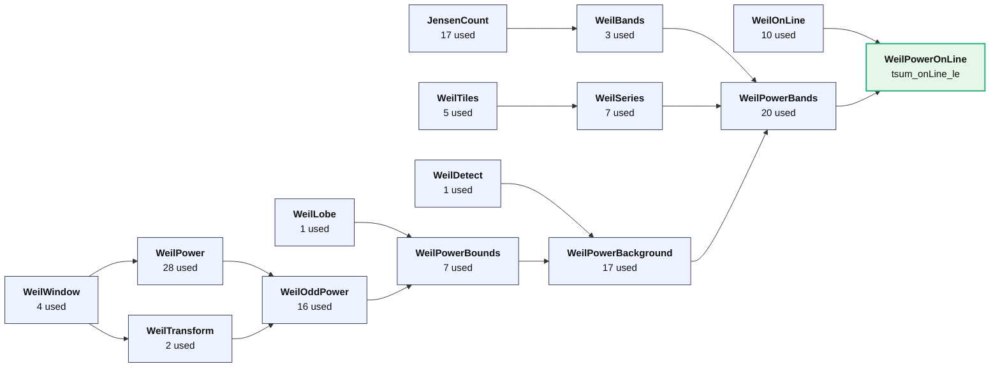

# What `WeilPowerOnLine.tsum_onLine_le` rests on

[`WeilPowerOnLine.tsum_onLine_le`](../lean_stage3/WeilPowerOnLine.md#WeilPowerOnLine-tsum_onLine_le) in `lean_stage3/Stage3/WeilPowerOnLine.lean`, line 186.

**Why.** The on-line background of the switched window.

**Proves**

```lean
∑' ρ : OnLine, weightedTermW h γ m ρ.1 ≤ onLineBound h γ m
```

**Needs** (its hypotheses)

  - `` hh : 0 < h ``
  - `` hγ : 11 / 10 ≤ γ ``
  - `` m : ℕ ``

Behind it: 114 theorems and 34 definitions in 15 files. Every one is listed below; Lean recorded each step.

## The files it passes through



An arrow A → B reads "B uses something proved or defined in A"; indirect arrows are left out. Green: the theorem itself. Yellow: a file in the other tree. The number is how many of that file's declarations are on the way.

## Every declaration on the way

Files in dependency order. ★ marks what the theorem's own proof uses directly.

### [`JensenCount`](../lean_stage3/JensenCount.md) — 17

- [`Stage3.zeta_centre_lower`](../lean_stage3/JensenCount.md#Stage3-zeta_centre_lower) — `` (1 : ℝ) / 3 ≤ ‖ζ (2 + Complex.I * T)‖ ``
- [`Stage3.zeta_disk_upper`](../lean_stage3/JensenCount.md#Stage3-zeta_disk_upper) — `` ‖ζ w‖ ≤ 28 * T ``
- [`Stage3.zeta_centre_ne_zero`](../lean_stage3/JensenCount.md#Stage3-zeta_centre_ne_zero) — `` ζ (2 + Complex.I * (T : ℂ)) ≠ 0 ``
- [`Stage3.pole_away`](../lean_stage3/JensenCount.md#Stage3-pole_away) — `` 2 * z + (2 + Complex.I * (T : ℂ)) ≠ 1 ``
- [`Stage3.pole_away_centre`](../lean_stage3/JensenCount.md#Stage3-pole_away_centre) — `` v ≠ 1 ``
- [`Stage3.zetaWindowTwo_finite`](../lean_stage3/JensenCount.md#Stage3-zetaWindowTwo_finite) — `` {ρ : ℂ | ζ ρ = 0 ∧ ‖ρ - (2 + Complex.I * (T : ℂ))‖ ≤ 2}.Finite ``
- [`Stage3.zetaWindow`](../lean_stage3/JensenCount.md#Stage3-zetaWindow) — *def*
- [`Stage3.zetaWindow_finite`](../lean_stage3/JensenCount.md#Stage3-zetaWindow_finite) — `` (zetaWindow T).Finite ``
- [`Stage3.jensenF`](../lean_stage3/JensenCount.md#Stage3-jensenF) — *def*
- [`Stage3.zeta_comp_analytic`](../lean_stage3/JensenCount.md#Stage3-zeta_comp_analytic) — `` AnalyticAt ℂ (fun z : ℂ => ζ (2 * z + (2 + Complex.I * (T : ℂ)))) w ``
- [`Stage3.jensenF_analytic`](../lean_stage3/JensenCount.md#Stage3-jensenF_analytic) — `` AnalyticOnNhd ℂ (jensenF T) (Metric.closedBall (0 : ℂ) 1) ``
- [`Stage3.jensenF_zero_eq_one`](../lean_stage3/JensenCount.md#Stage3-jensenF_zero_eq_one) — `` jensenF T 0 = 1 ``
- [`Stage3.jensenF_zeros_finite`](../lean_stage3/JensenCount.md#Stage3-jensenF_zeros_finite) — `` (SetOfZeros 1 (jensenF T)).Finite ``
- [`Stage3.jensenF_bound`](../lean_stage3/JensenCount.md#Stage3-jensenF_bound) — `` ‖jensenF T z‖ ≤ 84 * T ``
- [`Stage3.analyticOrderNatAt_fun_comp_affine`](../lean_stage3/JensenCount.md#Stage3-analyticOrderNatAt_fun_comp_affine) — `` analyticOrderNatAt (fun w : ℂ => g (a * w + b)) z = analyticOrderNatAt g (a * z + b) ``
- [`Stage3.jensenF_order`](../lean_stage3/JensenCount.md#Stage3-jensenF_order) — `` analyticOrderNatAt (jensenF T) w = analyticOrderNatAt ζ (2 * w + (2 + Complex.I * (T : ℂ))) ``
- [`Stage3.zeta_local_zero_count`](../lean_stage3/JensenCount.md#Stage3-zeta_local_zero_count) — `` ∑ ρ ∈ (zetaWindow_finite hT).toFinset, (analyticOrderNatAt ζ ρ : ℝ) ≤ 15 * Real.log T + 73 ``

### [`WeilBands`](../lean_stage3/WeilBands.md) — 3

- [`WeilBands.order_eq_analyticOrderNatAt`](../lean_stage3/WeilBands.md#WeilBands-order_eq_analyticOrderNatAt) — `` ((riemannZeta.order (ρ : ℂ) : ℤ) : ℝ) = (analyticOrderNatAt riemannZeta (ρ : ℂ) : ℝ) ``
- [`WeilBands.mem_zetaWindow_of_online`](../lean_stage3/WeilBands.md#WeilBands-mem_zetaWindow_of_online) — `` ρ ∈ Stage3.zetaWindow T ``
- [`WeilBands.band_count`](../lean_stage3/WeilBands.md#WeilBands-band_count) — `` ∑ ρ ∈ S, (analyticOrderNatAt riemannZeta ρ : ℝ) ≤ 15 * Real.log T + 73 ``

### [`WeilDetect`](../lean_stage3/WeilDetect.md) — 1

- [`WeilDetect.laplace`](../lean_stage3/WeilDetect.md#WeilDetect-laplace) — *def*

### [`WeilLobe`](../lean_stage3/WeilLobe.md) — 1

- [`WeilLobe.norm_sinh_le`](../lean_stage3/WeilLobe.md#WeilLobe-norm_sinh_le) — `` ‖Complex.sinh z‖ ≤ Real.cosh z.re ``

### [`WeilOnLine`](../lean_stage3/WeilOnLine.md) — 10

- [`WeilOnLine.conj_mem`](../lean_stage3/WeilOnLine.md#WeilOnLine-conj_mem) — `` (starRingEnd ℂ) (ρ : ℂ) ∈ Kadiri.NontrivialZeros ``
- [`WeilOnLine.conjZ`](../lean_stage3/WeilOnLine.md#WeilOnLine-conjZ) — *def*
- [`WeilOnLine.conjZ_injective`](../lean_stage3/WeilOnLine.md#WeilOnLine-conjZ_injective) — `` Function.Injective conjZ ``
- [`WeilOnLine.lowSet`](../lean_stage3/WeilOnLine.md#WeilOnLine-lowSet) — *def*
- [`WeilOnLine.lowU`](../lean_stage3/WeilOnLine.md#WeilOnLine-lowU) — *def*
- [`WeilOnLine.lowU_preconnected`](../lean_stage3/WeilOnLine.md#WeilOnLine-lowU_preconnected) — `` IsPreconnected lowU ``
- [`WeilOnLine.lowU_analytic`](../lean_stage3/WeilOnLine.md#WeilOnLine-lowU_analytic) — `` AnalyticOnNhd ℂ riemannZeta lowU ``
- [`WeilOnLine.lowSet_finite`](../lean_stage3/WeilOnLine.md#WeilOnLine-lowSet_finite) — `` lowSet.Finite ``
- [`WeilOnLine.lowCount`](../lean_stage3/WeilOnLine.md#WeilOnLine-lowCount) — *def*
- ★ [`WeilOnLine.OnLine`](../lean_stage3/WeilOnLine.md#WeilOnLine-OnLine) — *abbrev*

### [`WeilTiles`](../lean_stage3/WeilTiles.md) — 5

- [`WeilTiles.centre`](../lean_stage3/WeilTiles.md#WeilTiles-centre) — *def*
- [`WeilTiles.idx`](../lean_stage3/WeilTiles.md#WeilTiles-idx) — *def*
- [`WeilTiles.two_le_centre`](../lean_stage3/WeilTiles.md#WeilTiles-two_le_centre) — `` 2 ≤ centre k ``
- [`WeilTiles.idx_spec`](../lean_stage3/WeilTiles.md#WeilTiles-idx_spec) — `` |t - centre (idx t)| ≤ 9 / 10 ``
- [`WeilTiles.bandSeries_nonneg`](../lean_stage3/WeilTiles.md#WeilTiles-bandSeries_nonneg) — `` 0 ≤ M k * (15 * Real.log (centre k) + 73) ``

### [`WeilSeries`](../lean_stage3/WeilSeries.md) — 7

- [`WeilSeries.two_le_of_one_lt`](../lean_stage3/WeilSeries.md#WeilSeries-two_le_of_one_lt) — `` 2 ≤ |(k : ℝ) - (k0 : ℝ)| ``
- [`WeilSeries.dist_ge`](../lean_stage3/WeilSeries.md#WeilSeries-dist_ge) — `` 9 / 5 * |(idx t : ℝ) - (idx γ : ℝ)| - 9 / 5 ≤ |t - γ| ``
- [`WeilSeries.weight_le`](../lean_stage3/WeilSeries.md#WeilSeries-weight_le) — `` 15 * Real.log (centre k) + 73 ≤ 88 * ((k : ℝ) + 1) ``
- [`WeilSeries.weight_nonneg`](../lean_stage3/WeilSeries.md#WeilSeries-weight_nonneg) — `` 0 ≤ 15 * Real.log (centre k) + 73 ``
- [`WeilSeries.summable_shift3`](../lean_stage3/WeilSeries.md#WeilSeries-summable_shift3) — `` Summable (fun k : ℕ => 1 / ((k : ℝ) + 1) ^ 3) ``
- [`WeilSeries.summable_shift2`](../lean_stage3/WeilSeries.md#WeilSeries-summable_shift2) — `` Summable (fun k : ℕ => 1 / ((k : ℝ) + 1) ^ 2) ``
- [`WeilSeries.tsum_shift2`](../lean_stage3/WeilSeries.md#WeilSeries-tsum_shift2) — `` ∑' k : ℕ, 1 / ((k : ℝ) + 1) ^ 2 = Real.pi ^ 2 / 6 ``

### [`WeilWindow`](../lean_stage3/WeilWindow.md) — 4

- [`WeilWindow.P`](../lean_stage3/WeilWindow.md#WeilWindow-P) — *def*
- [`WeilWindow.P_nonneg`](../lean_stage3/WeilWindow.md#WeilWindow-P_nonneg) — `` 0 ≤ P x ``
- [`WeilWindow.P_le_one`](../lean_stage3/WeilWindow.md#WeilWindow-P_le_one) — `` P x ≤ 1 ``
- [`WeilWindow.continuous_P`](../lean_stage3/WeilWindow.md#WeilWindow-continuous_P) — `` Continuous P ``

### [`WeilPower`](../lean_stage3/WeilPower.md) — 28

- [`WeilPower.c`](../lean_stage3/WeilPower.md#WeilPower-c) — *def*
- [`WeilPower.P_eq_c_sq`](../lean_stage3/WeilPower.md#WeilPower-P_eq_c_sq) — `` P x = c x ^ 2 ``
- [`WeilPower.P_pow`](../lean_stage3/WeilPower.md#WeilPower-P_pow) — `` P x ^ m = c x ^ (2 * m) ``
- [`WeilPower.c_one`](../lean_stage3/WeilPower.md#WeilPower-c_one) — `` c 1 = 0 ``
- [`WeilPower.c_neg_one`](../lean_stage3/WeilPower.md#WeilPower-c_neg_one) — `` c (-1) = 0 ``
- [`WeilPower.continuous_c`](../lean_stage3/WeilPower.md#WeilPower-continuous_c) — `` Continuous c ``
- [`WeilPower.c_pow_one`](../lean_stage3/WeilPower.md#WeilPower-c_pow_one) — `` c 1 ^ n = 0 ``
- [`WeilPower.c_pow_neg_one`](../lean_stage3/WeilPower.md#WeilPower-c_pow_neg_one) — `` c (-1) ^ n = 0 ``
- [`WeilPower.hasDerivAt_c`](../lean_stage3/WeilPower.md#WeilPower-hasDerivAt_c) — `` HasDerivAt c (-(Real.pi / 2) * Real.sin (Real.pi * x / 2)) x ``
- [`WeilPower.hasDerivAt_s`](../lean_stage3/WeilPower.md#WeilPower-hasDerivAt_s) — `` HasDerivAt (fun y : ℝ => Real.sin (Real.pi * y / 2)) (Real.pi / 2 * c x) x ``
- [`WeilPower.f1`](../lean_stage3/WeilPower.md#WeilPower-f1) — *def*
- [`WeilPower.f2`](../lean_stage3/WeilPower.md#WeilPower-f2) — *def*
- [`WeilPower.hasDerivAt_f`](../lean_stage3/WeilPower.md#WeilPower-hasDerivAt_f) — `` HasDerivAt (fun y : ℝ => c y ^ (k + 1)) (f1 k x) x ``
- [`WeilPower.hasDerivAt_f1`](../lean_stage3/WeilPower.md#WeilPower-hasDerivAt_f1) — `` HasDerivAt (f1 (k + 1)) (f2 k x) x ``
- [`WeilPower.continuous_f1`](../lean_stage3/WeilPower.md#WeilPower-continuous_f1) — `` Continuous (f1 k) ``
- [`WeilPower.continuous_f2`](../lean_stage3/WeilPower.md#WeilPower-continuous_f2) — `` Continuous (f2 k) ``
- [`WeilPower.f1_one`](../lean_stage3/WeilPower.md#WeilPower-f1_one) — `` f1 (k + 1) 1 = 0 ``
- [`WeilPower.f1_neg_one`](../lean_stage3/WeilPower.md#WeilPower-f1_neg_one) — `` f1 (k + 1) (-1) = 0 ``
- [`WeilPower.K`](../lean_stage3/WeilPower.md#WeilPower-K) — *def*
- [`WeilPower.hasDerivAt_E`](../lean_stage3/WeilPower.md#WeilPower-hasDerivAt_E) — `` HasDerivAt (fun y : ℝ => Complex.exp (w * (y : ℂ))) (w * Complex.exp (w * (x : ℂ))) x ``
- [`WeilPower.ibp_twice`](../lean_stage3/WeilPower.md#WeilPower-ibp_twice) — `` w ^ 2 * ∫ x in (-1 : ℝ)..1, ((c x ^ (k + 2) : ℝ) : ℂ) * Complex.exp (w * (x : ℂ)) = ∫ x in (-1 : ℝ)..1, ((f2 k x : ℝ) : ℂ) * Complex.exp (w * (x : ℂ)) ``
- [`WeilPower.K_succ`](../lean_stage3/WeilPower.md#WeilPower-K_succ) — `` K (m + 1) w * (w ^ 2 + (Real.pi : ℂ) ^ 2 * ((m : ℂ) + 1) ^ 2) = ((m : ℂ) + 1) * (2 * (m : ℂ) + 1) * (Real.pi : ℂ) ^ 2 / 2 * K m w ``
- [`WeilPower.Q`](../lean_stage3/WeilPower.md#WeilPower-Q) — *def*
- [`WeilPower.cK`](../lean_stage3/WeilPower.md#WeilPower-cK) — *def*
- [`WeilPower.Q_succ`](../lean_stage3/WeilPower.md#WeilPower-Q_succ) — `` Q (m + 1) w = Q m w * (w ^ 2 + (Real.pi : ℂ) ^ 2 * ((m : ℂ) + 1) ^ 2) ``
- [`WeilPower.cK_succ`](../lean_stage3/WeilPower.md#WeilPower-cK_succ) — `` cK (m + 1) = ((m : ℝ) + 1) * (2 * (m : ℝ) + 1) * Real.pi ^ 2 / 2 * cK m ``
- [`WeilPower.K_zero_mul`](../lean_stage3/WeilPower.md#WeilPower-K_zero_mul) — `` K 0 w * w = 2 * Complex.sinh w ``
- [`WeilPower.K_mul_Q`](../lean_stage3/WeilPower.md#WeilPower-K_mul_Q) — `` K m w * Q m w = (cK m : ℂ) * Complex.sinh w ``

### [`WeilTransform`](../lean_stage3/WeilTransform.md) — 2

- [`WeilTransform.P_even`](../lean_stage3/WeilTransform.md#WeilTransform-P_even) — `` P (-x) = P x ``
- [`WeilTransform.odd_integral_exp`](../lean_stage3/WeilTransform.md#WeilTransform-odd_integral_exp) — `` (∫ x in (-1 : ℝ)..1, ((q x : ℝ) : ℂ) * Complex.exp (w * (x : ℂ))) = ∫ x in (-1 : ℝ)..1, ((q x : ℝ) : ℂ) * Complex.sinh (w * (x : ℂ)) ``

### [`WeilOddPower`](../lean_stage3/WeilOddPower.md) — 16

- [`WeilOddPower.q`](../lean_stage3/WeilOddPower.md#WeilOddPower-q) — *def*
- [`WeilOddPower.q_odd`](../lean_stage3/WeilOddPower.md#WeilOddPower-q_odd) — `` q m (-x) = -q m x ``
- [`WeilOddPower.continuous_q`](../lean_stage3/WeilOddPower.md#WeilOddPower-continuous_q) — `` Continuous (q m) ``
- [`WeilOddPower.sin_pi_mul`](../lean_stage3/WeilOddPower.md#WeilOddPower-sin_pi_mul) — `` Real.sin (Real.pi * x) = 2 * Real.sin (Real.pi * x / 2) * c x ``
- [`WeilOddPower.q_eq`](../lean_stage3/WeilOddPower.md#WeilOddPower-q_eq) — `` q m x = -(2 / (((m : ℝ) + 1) * Real.pi)) * f1 (2 * m + 1) x ``
- [`WeilOddPower.S`](../lean_stage3/WeilOddPower.md#WeilOddPower-S) — *def*
- [`WeilOddPower.ibp_once`](../lean_stage3/WeilOddPower.md#WeilOddPower-ibp_once) — `` (∫ x in (-1 : ℝ)..1, ((f1 (k + 1) x : ℝ) : ℂ) * Complex.exp (w * (x : ℂ))) = -(w * ∫ x in (-1 : ℝ)..1, ((c x ^ (k + 2) : ℝ) : ℂ) * Complex.exp (w * (x : ℂ))) ``
- [`WeilOddPower.S_eq`](../lean_stage3/WeilOddPower.md#WeilOddPower-S_eq) — `` S m w = 2 * w * K (m + 1) w / (((m : ℂ) + 1) * (Real.pi : ℂ)) ``
- [`WeilOddPower.QS`](../lean_stage3/WeilOddPower.md#WeilOddPower-QS) — *def*
- [`WeilOddPower.cS`](../lean_stage3/WeilOddPower.md#WeilOddPower-cS) — *def*
- [`WeilOddPower.Q_succ_eq`](../lean_stage3/WeilOddPower.md#WeilOddPower-Q_succ_eq) — `` Q (m + 1) w = w * QS m w ``
- [`WeilOddPower.cS_eq`](../lean_stage3/WeilOddPower.md#WeilOddPower-cS_eq) — `` cS m * (((m : ℝ) + 1) * Real.pi) = 2 * cK (m + 1) ``
- [`WeilOddPower.S_mul_QS`](../lean_stage3/WeilOddPower.md#WeilOddPower-S_mul_QS) — `` S m w * QS m w = (cS m : ℂ) * Complex.sinh w ``
- [`WeilOddPower.W`](../lean_stage3/WeilOddPower.md#WeilOddPower-W) — *def*
- [`WeilOddPower.what`](../lean_stage3/WeilOddPower.md#WeilOddPower-what) — *def*
- [`WeilOddPower.what_eq`](../lean_stage3/WeilOddPower.md#WeilOddPower-what_eq) — `` what h γ m z = ((h : ℂ) / 2) * (S m ((z + Complex.I * (γ : ℂ)) * (h : ℂ)) + S m ((z - Complex.I * (γ : ℂ)) * (h : ℂ))) ``

### [`WeilPowerBounds`](../lean_stage3/WeilPowerBounds.md) — 7

- [`WeilPowerBounds.QS_factor`](../lean_stage3/WeilPowerBounds.md#WeilPowerBounds-QS_factor) — `` QS m w = ∏ j ∈ Finset.range (m + 1), (w ^ 2 + ((Real.pi * ((j : ℝ) + 1) : ℝ) : ℂ) ^ 2) ``
- [`WeilPowerBounds.cS_pos`](../lean_stage3/WeilPowerBounds.md#WeilPowerBounds-cS_pos) — `` 0 < cS m ``
- [`WeilPowerBounds.S_eq_div'`](../lean_stage3/WeilPowerBounds.md#WeilPowerBounds-S_eq_div-) — `` S m w = (cS m : ℂ) * Complex.sinh w / QS m w ``
- [`WeilPowerBounds.norm_S_le'`](../lean_stage3/WeilPowerBounds.md#WeilPowerBounds-norm_S_le-) — `` ‖S m w‖ ≤ cS m * Real.cosh w.re / ‖QS m w‖ ``
- [`WeilPowerBounds.norm_factor_ge_far`](../lean_stage3/WeilPowerBounds.md#WeilPowerBounds-norm_factor_ge_far) — `` w.im ^ 2 / 2 ≤ ‖w ^ 2 + (a : ℂ) ^ 2‖ ``
- [`WeilPowerBounds.norm_QS_ge_far`](../lean_stage3/WeilPowerBounds.md#WeilPowerBounds-norm_QS_ge_far) — `` (w.im ^ 2 / 2) ^ (m + 1) ≤ ‖QS m w‖ ``
- [`WeilPowerBounds.norm_S_le_far`](../lean_stage3/WeilPowerBounds.md#WeilPowerBounds-norm_S_le_far) — `` ‖S m w‖ ≤ cS m * Real.cosh w.re * (2 / w.im ^ 2) ^ (m + 1) ``

### [`WeilPowerBackground`](../lean_stage3/WeilPowerBackground.md) — 17

- [`WeilPowerBackground.phiW`](../lean_stage3/WeilPowerBackground.md#WeilPowerBackground-phiW) — *def*
- [`WeilPowerBackground.phiWC`](../lean_stage3/WeilPowerBackground.md#WeilPowerBackground-phiWC) — *def*
- [`WeilPowerBackground.laplace_phiW`](../lean_stage3/WeilPowerBackground.md#WeilPowerBackground-laplace_phiW) — `` laplace (phiWC h γ m) z = what h γ m (-z - 1 / 2) ``
- [`WeilPowerBackground.S_eq_sinh`](../lean_stage3/WeilPowerBackground.md#WeilPowerBackground-S_eq_sinh) — `` S m w = ∫ x in (-1 : ℝ)..1, ((q m x : ℝ) : ℂ) * Complex.sinh (w * (x : ℂ)) ``
- [`WeilPowerBackground.S_neg`](../lean_stage3/WeilPowerBackground.md#WeilPowerBackground-S_neg) — `` S m (-w) = -S m w ``
- [`WeilPowerBackground.what_neg`](../lean_stage3/WeilPowerBackground.md#WeilPowerBackground-what_neg) — `` what h γ m (-z) = -what h γ m z ``
- [`WeilPowerBackground.term_eq_neg_sq`](../lean_stage3/WeilPowerBackground.md#WeilPowerBackground-term_eq_neg_sq) — `` laplace (phiWC h γ m) (-ρ) * laplace (phiWC h γ m) (-(1 - ρ)) = -(what h γ m (ρ - 1 / 2)) ^ 2 ``
- [`WeilPowerBackground.PsiW`](../lean_stage3/WeilPowerBackground.md#WeilPowerBackground-PsiW) — *def*
- [`WeilPowerBackground.S_I_mul`](../lean_stage3/WeilPowerBackground.md#WeilPowerBackground-S_I_mul) — `` S m (Complex.I * (t : ℂ)) = Complex.I * (PsiW m t : ℂ) ``
- [`WeilPowerBackground.what_I`](../lean_stage3/WeilPowerBackground.md#WeilPowerBackground-what_I) — `` what h γ m (Complex.I * (t : ℂ)) = Complex.I * ((h : ℂ) / 2) * ((PsiW m (h * (t + γ)) : ℂ) + (PsiW m (h * (t - γ)) : ℂ)) ``
- [`WeilPowerBackground.online_term_eq`](../lean_stage3/WeilPowerBackground.md#WeilPowerBackground-online_term_eq) — `` laplace (phiWC h γ m) (-ρ) * laplace (phiWC h γ m) (-(1 - ρ)) = (((h / 2) ^ 2 * (PsiW m (h * (ρ.im + γ)) + PsiW m (h * (ρ.im - γ))) ^ 2 : ℝ) : ℂ) ``
- [`WeilPowerBackground.online_term_nonneg`](../lean_stage3/WeilPowerBackground.md#WeilPowerBackground-online_term_nonneg) — `` 0 ≤ (laplace (phiWC h γ m) (-ρ) * laplace (phiWC h γ m) (-(1 - ρ))).re ``
- [`WeilPowerBackground.abs_q_le_one`](../lean_stage3/WeilPowerBackground.md#WeilPowerBackground-abs_q_le_one) — `` |q m x| ≤ 1 ``
- [`WeilPowerBackground.PsiW_le_two`](../lean_stage3/WeilPowerBackground.md#WeilPowerBackground-PsiW_le_two) — `` |PsiW m t| ≤ 2 ``
- [`WeilPowerBackground.online_term_le_near`](../lean_stage3/WeilPowerBackground.md#WeilPowerBackground-online_term_le_near) — `` (laplace (phiWC h γ m) (-ρ) * laplace (phiWC h γ m) (-(1 - ρ))).re ≤ 4 * h ^ 2 ``
- [`WeilPowerBackground.PsiW_le_far`](../lean_stage3/WeilPowerBackground.md#WeilPowerBackground-PsiW_le_far) — `` |PsiW m t| ≤ cS m * (2 / t ^ 2) ^ (m + 1) ``
- [`WeilPowerBackground.online_term_le_far`](../lean_stage3/WeilPowerBackground.md#WeilPowerBackground-online_term_le_far) — `` (laplace (phiWC h γ m) (-ρ) * laplace (phiWC h γ m) (-(1 - ρ))).re ≤ (h / 2) ^ 2 * (cS m * (2 / (h * (ρ.im - γ)) ^ 2) ^ (m + 1) + cS m * (2 / (h * (ρ.im + γ)) ^… ``

### [`WeilPowerBands`](../lean_stage3/WeilPowerBands.md) — 20

- [`WeilPowerBands.termW`](../lean_stage3/WeilPowerBands.md#WeilPowerBands-termW) — *def*
- ★ [`WeilPowerBands.weightedTermW`](../lean_stage3/WeilPowerBands.md#WeilPowerBands-weightedTermW) — *def*
- [`WeilPowerBands.termW_nonneg`](../lean_stage3/WeilPowerBands.md#WeilPowerBands-termW_nonneg) — `` 0 ≤ termW h γ m ρ ``
- ★ [`WeilPowerBands.weightedTermW_nonneg`](../lean_stage3/WeilPowerBands.md#WeilPowerBands-weightedTermW_nonneg) — `` 0 ≤ weightedTermW h γ m ρ ``
- [`WeilPowerBands.band_sum_le`](../lean_stage3/WeilPowerBands.md#WeilPowerBands-band_sum_le) — `` ∑ ρ ∈ S, weightedTermW h γ m ρ ≤ M * (15 * Real.log T + 73) ``
- [`WeilPowerBands.sum_by_bands`](../lean_stage3/WeilPowerBands.md#WeilPowerBands-sum_by_bands) — `` ∑ ρ ∈ S, weightedTermW h γ m ρ ≤ ∑ k ∈ S.image (fun ρ : Kadiri.NontrivialZeros => idx (ρ : ℂ).im), M k * (15 * Real.log (centre k) + 73) ``
- [`WeilPowerBands.sum_le_bandSeries`](../lean_stage3/WeilPowerBands.md#WeilPowerBands-sum_le_bandSeries) — `` ∑ ρ ∈ S, weightedTermW h γ m ρ ≤ ∑' k : ℕ, M k * (15 * Real.log (centre k) + 73) ``
- [`WeilPowerBands.r`](../lean_stage3/WeilPowerBands.md#WeilPowerBands-r) — *def*
- [`WeilPowerBands.one_le_r`](../lean_stage3/WeilPowerBands.md#WeilPowerBands-one_le_r) — `` 1 ≤ r h m ``
- [`WeilPowerBands.cFarM`](../lean_stage3/WeilPowerBands.md#WeilPowerBands-cFarM) — *def*
- [`WeilPowerBands.cFarM_nonneg`](../lean_stage3/WeilPowerBands.md#WeilPowerBands-cFarM_nonneg) — `` 0 ≤ cFarM m ``
- [`WeilPowerBands.M`](../lean_stage3/WeilPowerBands.md#WeilPowerBands-M) — *def*
- [`WeilPowerBands.M_nonneg`](../lean_stage3/WeilPowerBands.md#WeilPowerBands-M_nonneg) — `` 0 ≤ M h γ m k ``
- [`WeilPowerBands.term_le_M`](../lean_stage3/WeilPowerBands.md#WeilPowerBands-term_le_M) — `` termW h γ m ρ ≤ M h γ m (idx (ρ : ℂ).im) ``
- [`WeilPowerBands.A`](../lean_stage3/WeilPowerBands.md#WeilPowerBands-A) — *def*
- [`WeilPowerBands.four_h_add_nonneg`](../lean_stage3/WeilPowerBands.md#WeilPowerBands-four_h_add_nonneg) — `` 0 ≤ 4 * h ^ 2 + cFarM m / h ^ 2 ``
- [`WeilPowerBands.A_nonneg`](../lean_stage3/WeilPowerBands.md#WeilPowerBands-A_nonneg) — `` 0 ≤ A h γ m ``
- [`WeilPowerBands.bandTerm_le_A`](../lean_stage3/WeilPowerBands.md#WeilPowerBands-bandTerm_le_A) — `` M h γ m k * (15 * Real.log (centre k) + 73) ≤ A h γ m / ((k : ℝ) + 1) ^ 3 ``
- [`WeilPowerBands.bandSeries_summable`](../lean_stage3/WeilPowerBands.md#WeilPowerBands-bandSeries_summable) — `` Summable (fun k : ℕ => M h γ m k * (15 * Real.log (centre k) + 73)) ``
- [`WeilPowerBands.bandSeries_le`](../lean_stage3/WeilPowerBands.md#WeilPowerBands-bandSeries_le) — `` ∑' k : ℕ, M h γ m k * (15 * Real.log (centre k) + 73) ≤ A h γ m * (Real.pi ^ 2 / 6) ``

### [`WeilPowerOnLine`](../lean_stage3/WeilPowerOnLine.md) — 10

- [`WeilPowerOnLine.PsiW_neg`](../lean_stage3/WeilPowerOnLine.md#WeilPowerOnLine-PsiW_neg) — `` PsiW m (-t) = -PsiW m t ``
- [`WeilPowerOnLine.term_conj`](../lean_stage3/WeilPowerOnLine.md#WeilPowerOnLine-term_conj) — `` termW h γ m ((starRingEnd ℂ) ρ) = termW h γ m ρ ``
- [`WeilPowerOnLine.weightedTermW_conjZ`](../lean_stage3/WeilPowerOnLine.md#WeilPowerOnLine-weightedTermW_conjZ) — `` weightedTermW h γ m (conjZ ρ) = weightedTermW h γ m ρ ``
- [`WeilPowerOnLine.B`](../lean_stage3/WeilPowerOnLine.md#WeilPowerOnLine-B) — *def*
- [`WeilPowerOnLine.sum_upper_le`](../lean_stage3/WeilPowerOnLine.md#WeilPowerOnLine-sum_upper_le) — `` ∑ ρ ∈ S, weightedTermW h γ m ρ ≤ B h γ m ``
- [`WeilPowerOnLine.sum_lower_le`](../lean_stage3/WeilPowerOnLine.md#WeilPowerOnLine-sum_lower_le) — `` ∑ ρ ∈ S, weightedTermW h γ m ρ ≤ B h γ m ``
- [`WeilPowerOnLine.sum_low_le`](../lean_stage3/WeilPowerOnLine.md#WeilPowerOnLine-sum_low_le) — `` ∑ ρ ∈ S, weightedTermW h γ m ρ ≤ 4 * h ^ 2 * lowCount ``
- ★ [`WeilPowerOnLine.onLineBound`](../lean_stage3/WeilPowerOnLine.md#WeilPowerOnLine-onLineBound) — *def*
- [`WeilPowerOnLine.sum_onLine_le`](../lean_stage3/WeilPowerOnLine.md#WeilPowerOnLine-sum_onLine_le) — `` ∑ ρ ∈ S, weightedTermW h γ m ρ ≤ onLineBound h γ m ``
- ★ [`WeilPowerOnLine.sum_onLine_subtype_le`](../lean_stage3/WeilPowerOnLine.md#WeilPowerOnLine-sum_onLine_subtype_le) — `` ∑ ρ ∈ s, weightedTermW h γ m ρ.1 ≤ onLineBound h γ m ``

