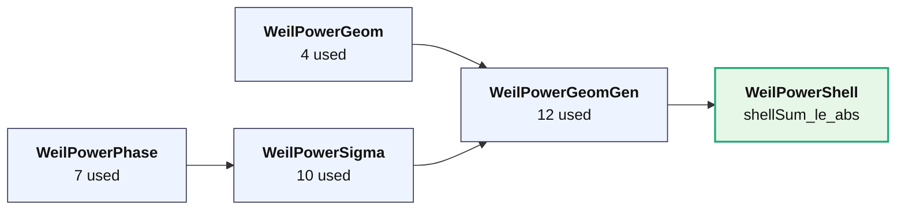

# What `WeilPowerShell.shellSum_le_abs` rests on

[`WeilPowerShell.shellSum_le_abs`](../lean_stage3/WeilPowerShell.md#WeilPowerShell-shellSum_le_abs) in `lean_stage3/Stage3/WeilPowerShell.lean`, line 474.

**Why.** The bound at a signed `Δ`, through the evenness.

**Proves**

```lean
|shellSum e' D e lam a b| ≤ (e' ^ 2 + |D| ^ 2) / e ^ 2 * Real.exp (2 * eta * (b : ℝ) / ((lam : ℝ) * Real.pi ^ 2)) * ((lam : ℝ) * Real.pi ^ 3 * Real.exp (2 * (e' ^ 2 + |D| ^ 2 + e ^ 2) * (1 / ((lam : ℝ) * Real.pi ^ 2))) / (4 * e' * |D|) + 2 * (e' ^ 2 + |D| ^ 2 + e ^ 2) * (Real.log b - Real.log a) / ((lam : ℝ) ^ 3 * Real.pi ^ 2))
```

**Needs** (its hypotheses)

  - `` h1 : 0 < e' ``
  - `` h2 : e' ≤ 1 / 2 ``
  - `` hD0 : D ≠ 0 ``
  - `` h4 : |D| ≤ 1 / 2 ``
  - `` h5 : 0 < e ``
  - `` h6 : e ≤ 1 / 2 ``
  - `` h7 : e' ^ 2 - D ^ 2 - e ^ 2 ≤ eta ``
  - `` h8 : 0 ≤ eta ``
  - `` hl : 1 ≤ lam ``
  - `` ha : 1 ≤ a ``
  - `` hab : a ≤ b ``

Behind it: 40 theorems and 11 definitions in 5 files. Every one is listed below; Lean recorded each step.

## The files it passes through



An arrow A → B reads "B uses something proved or defined in A"; indirect arrows are left out. Green: the theorem itself. Yellow: a file in the other tree. The number is how many of that file's declarations are on the way.

## Every declaration on the way

Files in dependency order. ★ marks what the theorem's own proof uses directly.

### [`WeilPowerGeom`](../lean_stage3/WeilPowerGeom.md) — 4

- [`WeilPowerGeom.norm_one_sub_exp_ge`](../lean_stage3/WeilPowerGeom.md#WeilPowerGeom-norm_one_sub_exp_ge) — `` Real.exp w.re * |Real.sin w.im| ≤ ‖1 - Complex.exp w‖ ``
- [`WeilPowerGeom.geom_Ico`](../lean_stage3/WeilPowerGeom.md#WeilPowerGeom-geom_Ico) — `` ∑ m ∈ Finset.Ico a b, x ^ m = (x ^ b - x ^ a) / (x - 1) ``
- [`WeilPowerGeom.log_step`](../lean_stage3/WeilPowerGeom.md#WeilPowerGeom-log_step) — `` 1 / ((m : ℝ) + 1) ≤ Real.log ((m : ℝ) + 1) - Real.log m ``
- [`WeilPowerGeom.log_telescope`](../lean_stage3/WeilPowerGeom.md#WeilPowerGeom-log_telescope) — `` ∀ b : ℕ, a ≤ b → ∑ m ∈ Finset.Ico a b, 1 / ((m : ℝ) + 1) ≤ Real.log b - Real.log a ``

### [`WeilPowerPhase`](../lean_stage3/WeilPowerPhase.md) — 7

- [`WeilPowerPhase.hterm`](../lean_stage3/WeilPowerPhase.md#WeilPowerPhase-hterm) — *def*
- [`WeilPowerPhase.sigmaN`](../lean_stage3/WeilPowerPhase.md#WeilPowerPhase-sigmaN) — *def*
- [`WeilPowerPhase.sigma`](../lean_stage3/WeilPowerPhase.md#WeilPowerPhase-sigma) — *def*
- [`WeilPowerPhase.summable_hterm`](../lean_stage3/WeilPowerPhase.md#WeilPowerPhase-summable_hterm) — `` Summable hterm ``
- [`WeilPowerPhase.summable_shift`](../lean_stage3/WeilPowerPhase.md#WeilPowerPhase-summable_shift) — `` Summable (fun k : ℕ => hterm (k + (m + 1))) ``
- [`WeilPowerPhase.sigmaN_eq`](../lean_stage3/WeilPowerPhase.md#WeilPowerPhase-sigmaN_eq) — `` sigmaN m n = 1 / Real.pi ^ 2 * ∑ j ∈ Finset.Ico (m + 1) n, 1 / ((j : ℝ) + 1) ^ 2 ``
- [`WeilPowerPhase.sigmaN_tendsto`](../lean_stage3/WeilPowerPhase.md#WeilPowerPhase-sigmaN_tendsto) — `` Tendsto (fun n => sigmaN m n) atTop (𝓝 (sigma m)) ``

### [`WeilPowerSigma`](../lean_stage3/WeilPowerSigma.md) — 10

- [`WeilPowerSigma.sum_telescope_half`](../lean_stage3/WeilPowerSigma.md#WeilPowerSigma-sum_telescope_half) — `` ∀ n : ℕ, m + 1 ≤ n → ∑ j ∈ Finset.Ico (m + 1) n, (1 / ((j : ℝ) + 1 / 2) - 1 / ((j : ℝ) + 3 / 2)) = 1 / ((m : ℝ) + 3 / 2) - 1 / ((n : ℝ) + 1 / 2) ``
- [`WeilPowerSigma.sum_upper_half`](../lean_stage3/WeilPowerSigma.md#WeilPowerSigma-sum_upper_half) — `` ∑ j ∈ Finset.Ico (m + 1) n, 1 / ((j : ℝ) + 1) ^ 2 ≤ 2 / (2 * (m : ℝ) + 3) ``
- [`WeilPowerSigma.sum_telescope_amgm`](../lean_stage3/WeilPowerSigma.md#WeilPowerSigma-sum_telescope_amgm) — `` ∀ n : ℕ, m + 1 ≤ n → ∑ j ∈ Finset.Ico (m + 1) n, ((1 / ((j : ℝ) + 1) - 1 / ((j : ℝ) + 2)) + (1 / (2 * ((j : ℝ) + 1) ^ 2) - 1 / (2 * ((j : ℝ) + 2) ^ 2))) = (1 / … ``
- [`WeilPowerSigma.sum_lower_amgm`](../lean_stage3/WeilPowerSigma.md#WeilPowerSigma-sum_lower_amgm) — `` 1 / ((m : ℝ) + 2) + 1 / (2 * ((m : ℝ) + 2) ^ 2) - 1 / ((n : ℝ) + 1) - 1 / (2 * ((n : ℝ) + 1) ^ 2) ≤ ∑ j ∈ Finset.Ico (m + 1) n, 1 / ((j : ℝ) + 1) ^ 2 ``
- [`WeilPowerSigma.sigma_le_half`](../lean_stage3/WeilPowerSigma.md#WeilPowerSigma-sigma_le_half) — `` sigma m ≤ 2 / (Real.pi ^ 2 * (2 * (m : ℝ) + 3)) ``
- [`WeilPowerSigma.sigma_ge_amgm`](../lean_stage3/WeilPowerSigma.md#WeilPowerSigma-sigma_ge_amgm) — `` 1 / (Real.pi ^ 2 * ((m : ℝ) + 2)) + 1 / (2 * Real.pi ^ 2 * ((m : ℝ) + 2) ^ 2) ≤ sigma m ``
- [`WeilPowerSigma.u`](../lean_stage3/WeilPowerSigma.md#WeilPowerSigma-u) — *def*
- [`WeilPowerSigma.u_def`](../lean_stage3/WeilPowerSigma.md#WeilPowerSigma-u_def) — `` u m = ((m : ℝ) + 1) ^ 2 * sigma m ``
- [`WeilPowerSigma.r_pos`](../lean_stage3/WeilPowerSigma.md#WeilPowerSigma-r_pos) — `` 1 / (2 * Real.pi ^ 2 * ((m : ℝ) + 2) ^ 2) ≤ u m - ((m : ℝ) + 1 / 2) / Real.pi ^ 2 ``
- [`WeilPowerSigma.r_le`](../lean_stage3/WeilPowerSigma.md#WeilPowerSigma-r_le) — `` u m - ((m : ℝ) + 1 / 2) / Real.pi ^ 2 ≤ 1 / (Real.pi ^ 2 * (4 * (m : ℝ) + 6)) ``

### [`WeilPowerGeomGen`](../lean_stage3/WeilPowerGeomGen.md) — 12

- [`WeilPowerGeomGen.MabGen`](../lean_stage3/WeilPowerGeomGen.md#WeilPowerGeomGen-MabGen) — *def*
- [`WeilPowerGeomGen.geomBoundGen`](../lean_stage3/WeilPowerGeomGen.md#WeilPowerGeomGen-geomBoundGen) — *def*
- [`WeilPowerGeomGen.uLam`](../lean_stage3/WeilPowerGeomGen.md#WeilPowerGeomGen-uLam) — *def*
- [`WeilPowerGeomGen.exp_shift_gen`](../lean_stage3/WeilPowerGeomGen.md#WeilPowerGeomGen-exp_shift_gen) — `` Complex.exp (z * ((α * (h : ℝ) + β₀ : ℝ) : ℂ)) = Complex.exp (z * ((β₀ : ℝ) : ℂ)) * Complex.exp (z * ((α : ℝ) : ℂ)) ^ h ``
- [`WeilPowerGeomGen.sin_im_ge_gen`](../lean_stage3/WeilPowerGeomGen.md#WeilPowerGeomGen-sin_im_ge_gen) — `` 2 * (z.im * α) / Real.pi ≤ Real.sin (z.im * α) ``
- [`WeilPowerGeomGen.rho_ne_one_gen`](../lean_stage3/WeilPowerGeomGen.md#WeilPowerGeomGen-rho_ne_one_gen) — `` Complex.exp (z * ((α : ℝ) : ℂ)) ≠ 1 ``
- [`WeilPowerGeomGen.norm_geom_le_gen`](../lean_stage3/WeilPowerGeomGen.md#WeilPowerGeomGen-norm_geom_le_gen) — `` ‖∑ h ∈ Finset.Ico a b, Complex.exp (z * ((α * (h : ℝ) + β₀ : ℝ) : ℂ))‖ ≤ geomBoundGen z α β₀ a b ``
- [`WeilPowerGeomGen.exp_lin_le_MabGen`](../lean_stage3/WeilPowerGeomGen.md#WeilPowerGeomGen-exp_lin_le_MabGen) — `` Real.exp (z.re * (α * (h : ℝ) + β₀)) ≤ MabGen z α β₀ a b ``
- [`WeilPowerGeomGen.norm_corr_le_gen`](../lean_stage3/WeilPowerGeomGen.md#WeilPowerGeomGen-norm_corr_le_gen) — `` ‖Complex.exp (z * (u h : ℂ)) - Complex.exp (z * ((α * (h : ℝ) + β₀ : ℝ) : ℂ))‖ ≤ Real.exp (z.re * (α * (h : ℝ) + β₀)) * (2 * ‖z‖) * (c / ((h : ℝ) + 1)) ``
- [`WeilPowerGeomGen.norm_sum_exp_u_le_gen`](../lean_stage3/WeilPowerGeomGen.md#WeilPowerGeomGen-norm_sum_exp_u_le_gen) — `` ‖∑ h ∈ Finset.Ico a b, Complex.exp (z * (u h : ℂ))‖ ≤ geomBoundGen z α β₀ a b + 2 * ‖z‖ * c * MabGen z α β₀ a b * (Real.log b - Real.log a) ``
- [`WeilPowerGeomGen.uLam_eq`](../lean_stage3/WeilPowerGeomGen.md#WeilPowerGeomGen-uLam_eq) — `` uLam lam h = WeilPowerSigma.u (lam * h - 1) / (lam : ℝ) ^ 2 ``
- [`WeilPowerGeomGen.uLam_bracket`](../lean_stage3/WeilPowerGeomGen.md#WeilPowerGeomGen-uLam_bracket) — `` 0 ≤ uLam lam h - ((h : ℝ) / ((lam : ℝ) * Real.pi ^ 2) - 1 / (2 * (lam : ℝ) ^ 2 * Real.pi ^ 2)) ∧ uLam lam h - ((h : ℝ) / ((lam : ℝ) * Real.pi ^ 2) - 1 / (2 * (l… ``

### [`WeilPowerShell`](../lean_stage3/WeilPowerShell.md) — 18

- [`WeilPowerShell.zOf`](../lean_stage3/WeilPowerShell.md#WeilPowerShell-zOf) — *def*
- [`WeilPowerShell.coef`](../lean_stage3/WeilPowerShell.md#WeilPowerShell-coef) — *def*
- [`WeilPowerShell.uSh`](../lean_stage3/WeilPowerShell.md#WeilPowerShell-uSh) — *def*
- ★ [`WeilPowerShell.shellSum`](../lean_stage3/WeilPowerShell.md#WeilPowerShell-shellSum) — *def*
- [`WeilPowerShell.zOf_re`](../lean_stage3/WeilPowerShell.md#WeilPowerShell-zOf_re) — `` (zOf e' D e).re = 2 * (e' ^ 2 - D ^ 2 - e ^ 2) ``
- [`WeilPowerShell.zOf_im`](../lean_stage3/WeilPowerShell.md#WeilPowerShell-zOf_im) — `` (zOf e' D e).im = 4 * e' * D ``
- [`WeilPowerShell.norm_zOf_le`](../lean_stage3/WeilPowerShell.md#WeilPowerShell-norm_zOf_le) — `` ‖zOf e' D e‖ ≤ 2 * (e' ^ 2 + D ^ 2 + e ^ 2) ``
- [`WeilPowerShell.norm_coef`](../lean_stage3/WeilPowerShell.md#WeilPowerShell-norm_coef) — `` ‖coef e' D e‖ = (e' ^ 2 + D ^ 2) / e ^ 2 ``
- [`WeilPowerShell.uSh_bracket`](../lean_stage3/WeilPowerShell.md#WeilPowerShell-uSh_bracket) — `` ∀ k : ℕ, 0 ≤ uSh lam k - ((k : ℝ) / ((lam : ℝ) * Real.pi ^ 2) - 1 / (2 * (lam : ℝ) ^ 2 * Real.pi ^ 2)) ∧ uSh lam k - ((k : ℝ) / ((lam : ℝ) * Real.pi ^ 2) - 1 / … ``
- [`WeilPowerShell.sum_uSh_eq`](../lean_stage3/WeilPowerShell.md#WeilPowerShell-sum_uSh_eq) — `` ∑ h ∈ Finset.Ico a b, coef e' D e * Complex.exp (zOf e' D e * ((WeilPowerGeomGen.uLam lam h : ℝ) : ℂ)) = ∑ h ∈ Finset.Ico a b, coef e' D e * Complex.exp (zOf e'… ``
- [`WeilPowerShell.im_alpha_le`](../lean_stage3/WeilPowerShell.md#WeilPowerShell-im_alpha_le) — `` (zOf e' D e).im * (1 / ((lam : ℝ) * Real.pi ^ 2)) ≤ Real.pi / 2 ``
- [`WeilPowerShell.norm_zOf_c_le`](../lean_stage3/WeilPowerShell.md#WeilPowerShell-norm_zOf_c_le) — `` ‖zOf e' D e‖ * (1 / (2 * (lam : ℝ) ^ 3 * Real.pi ^ 2)) ≤ (a : ℝ) + 1 ``
- [`WeilPowerShell.exp_end_le`](../lean_stage3/WeilPowerShell.md#WeilPowerShell-exp_end_le) — `` Real.exp ((zOf e' D e).re * (1 / ((lam : ℝ) * Real.pi ^ 2) * (k : ℝ) + -1 / (2 * (lam : ℝ) ^ 2 * Real.pi ^ 2))) ≤ Real.exp (2 * eta * (b : ℝ) / ((lam : ℝ) * Rea… ``
- [`WeilPowerShell.MabGen_le`](../lean_stage3/WeilPowerShell.md#WeilPowerShell-MabGen_le) — `` WeilPowerGeomGen.MabGen (zOf e' D e) (1 / ((lam : ℝ) * Real.pi ^ 2)) (-1 / (2 * (lam : ℝ) ^ 2 * Real.pi ^ 2)) a b ≤ Real.exp (2 * eta * (b : ℝ) / ((lam : ℝ) * R… ``
- [`WeilPowerShell.inv_exp_le`](../lean_stage3/WeilPowerShell.md#WeilPowerShell-inv_exp_le) — `` 1 / Real.exp ((zOf e' D e).re * (1 / ((lam : ℝ) * Real.pi ^ 2))) ≤ Real.exp (2 * (e' ^ 2 + D ^ 2 + e ^ 2) * (1 / ((lam : ℝ) * Real.pi ^ 2))) ``
- [`WeilPowerShell.geomBound_le`](../lean_stage3/WeilPowerShell.md#WeilPowerShell-geomBound_le) — `` WeilPowerGeomGen.geomBoundGen (zOf e' D e) (1 / ((lam : ℝ) * Real.pi ^ 2)) (-1 / (2 * (lam : ℝ) ^ 2 * Real.pi ^ 2)) a b ≤ Real.exp (2 * eta * (b : ℝ) / ((lam : … ``
- ★ [`WeilPowerShell.shellSum_le`](../lean_stage3/WeilPowerShell.md#WeilPowerShell-shellSum_le) — `` |shellSum e' D e lam a b| ≤ (e' ^ 2 + D ^ 2) / e ^ 2 * Real.exp (2 * eta * (b : ℝ) / ((lam : ℝ) * Real.pi ^ 2)) * ((lam : ℝ) * Real.pi ^ 3 * Real.exp (2 * (e' ^… ``
- ★ [`WeilPowerShell.shellSum_neg`](../lean_stage3/WeilPowerShell.md#WeilPowerShell-shellSum_neg) — `` shellSum e' (-D) e lam a b = shellSum e' D e lam a b ``

