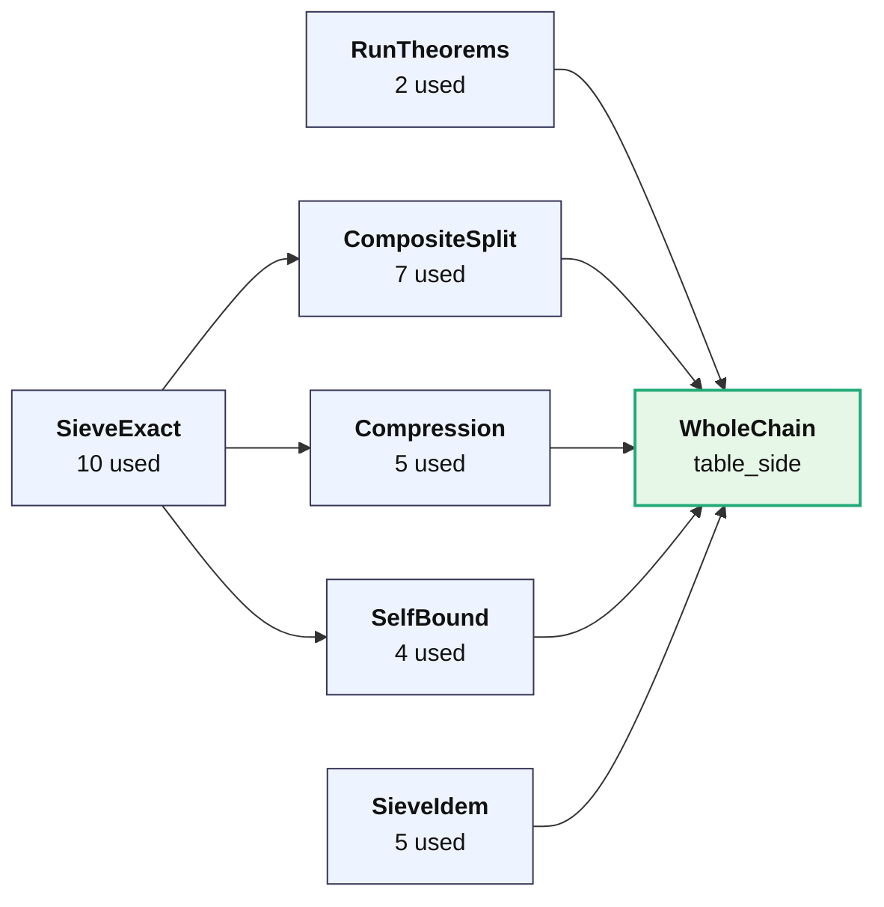

# What `WholeChain.table_side` rests on

[`WholeChain.table_side`](../lean_stage3/WholeChain.md#WholeChain-table_side) in `lean_stage3/Stage3/WholeChain.lean`, line 61.

**Why.** The table's side. What is proved of the table at every `N`, with no zero in the statement.

**Proves**

```lean
(∀ N : ℕ, 2 ≤ N → (Nat.primeCounting N : ℤ) = (Nat.primeCounting (Nat.sqrt N) : ℤ) - 1 + ∑ T ∈ (SieveExact.smallPrimes N).powerset, (-1 : ℤ) ^ T.card * ((N / ∏ p ∈ T, p : ℕ) : ℤ)) ∧ (∀ N : ℕ, ((Finset.Icc 2 N).filter (fun n => ¬ n.Prime)).card + (SieveExact.smallPrimes N).card = ∑ p ∈ SieveExact.smallPrimes N, CompositeSplit.rough N p) ∧ (∀ N : ℕ, N = Compression.smooth N + ∑ p ∈ Compression.newPrimes N, N / p) ∧ (∀ N : ℕ, ∑ k ∈ Finset.Icc 1 N, Chebyshev.psi ((N : ℝ) / (k : ℝ)) = ∑ n ∈ Finset.Icc 1 N, Real.log (n : ℝ)) ∧ (∀ (ρ : ℂ) (k : ℤ), (2 : ℂ) ^ (ρ + 2 * Real.pi * Complex.I * (k : ℂ) / (Real.log 2 : ℂ)) = (2 : ℂ) ^ ρ) ∧ (∀ (p : ℕ) (A : Finset ℕ), SieveIdem.sieveStep p (SieveIdem.sieveStep p A) = SieveIdem.sieveStep p A) ∧ (∀ (p : ℕ), p.Prime → ∀ A : Finset ℕ, SieveIdem.sieveBelow (p + 1) A = SieveIdem.sieveStep p (SieveIdem.sieveBelow p A)) ∧ (∀ m : ℕ, 2 ≤ m → (∀ q : ℕ, q.Prime → q < m → ¬ q ∣ m) → m.Prime)
```

Behind it: 26 theorems and 7 definitions in 7 files. Every one is listed below; Lean recorded each step.

## The files it passes through



An arrow A → B reads "B uses something proved or defined in A"; indirect arrows are left out. Green: the theorem itself. Yellow: a file in the other tree. The number is how many of that file's declarations are on the way.

## Every declaration on the way

Files in dependency order. ★ marks what the theorem's own proof uses directly.

### [`RunTheorems`](../lean_stage3/RunTheorems.md) — 2

- [`RunTheorems.two_cpow`](../lean_stage3/RunTheorems.md#RunTheorems-two_cpow) — `` (2:ℂ) ^ ρ = Complex.exp (ρ * (Real.log 2 : ℂ)) ``
- ★ [`RunTheorems.mode_fold`](../lean_stage3/RunTheorems.md#RunTheorems-mode_fold) — `` (2:ℂ) ^ (ρ + 2 * Real.pi * Complex.I * (k : ℂ) / (Real.log 2 : ℂ)) = (2:ℂ) ^ ρ ``

### [`SieveExact`](../lean_stage3/SieveExact.md) — 10

- ★ [`SieveExact.smallPrimes`](../lean_stage3/SieveExact.md#SieveExact-smallPrimes) — *def*
- [`SieveExact.survivors`](../lean_stage3/SieveExact.md#SieveExact-survivors) — *def*
- [`SieveExact.prime_of_mem_smallPrimes`](../lean_stage3/SieveExact.md#SieveExact-prime_of_mem_smallPrimes) — `` p.Prime ``
- [`SieveExact.forall_dvd_iff_prod_dvd`](../lean_stage3/SieveExact.md#SieveExact-forall_dvd_iff_prod_dvd) — `` (∀ p ∈ T, p ∣ n) ↔ (∏ p ∈ T, p) ∣ n ``
- [`SieveExact.card_filter_not_dvd`](../lean_stage3/SieveExact.md#SieveExact-card_filter_not_dvd) — `` ((A.filter (fun n => ∀ p ∈ s, ¬ p ∣ n)).card : ℤ) = ∑ T ∈ s.powerset, (-1 : ℤ) ^ T.card * ((A.filter (fun n => (∏ p ∈ T, p) ∣ n)).card : ℤ) ``
- [`SieveExact.card_multiples`](../lean_stage3/SieveExact.md#SieveExact-card_multiples) — `` ((Finset.Icc 1 N).filter (fun n => d ∣ n)).card = N / d ``
- [`SieveExact.sieve_sum`](../lean_stage3/SieveExact.md#SieveExact-sieve_sum) — `` ((survivors N).card : ℤ) = ∑ T ∈ (smallPrimes N).powerset, (-1 : ℤ) ^ T.card * ((N / ∏ p ∈ T, p : ℕ) : ℤ) ``
- [`SieveExact.survivors_eq`](../lean_stage3/SieveExact.md#SieveExact-survivors_eq) — `` survivors N = insert 1 ((Finset.Icc 1 N).filter (fun n => Nat.Prime n ∧ Nat.sqrt N < n)) ``
- [`SieveExact.card_survivors`](../lean_stage3/SieveExact.md#SieveExact-card_survivors) — `` (survivors N).card + Nat.primeCounting (Nat.sqrt N) = 1 + Nat.primeCounting N ``
- ★ [`SieveExact.pi_by_sieve`](../lean_stage3/SieveExact.md#SieveExact-pi_by_sieve) — `` (Nat.primeCounting N : ℤ) = (Nat.primeCounting (Nat.sqrt N) : ℤ) - 1 + ∑ T ∈ (smallPrimes N).powerset, (-1 : ℤ) ^ T.card * ((N / ∏ p ∈ T, p : ℕ) : ℤ) ``

### [`CompositeSplit`](../lean_stage3/CompositeSplit.md) — 7

- ★ [`CompositeSplit.rough`](../lean_stage3/CompositeSplit.md#CompositeSplit-rough) — *def*
- [`CompositeSplit.least_prime_fiber`](../lean_stage3/CompositeSplit.md#CompositeSplit-least_prime_fiber) — `` (Icc 2 N).filter (fun n => n.minFac = p) = ((Icc 1 (N / p)).filter (fun m => ∀ q : ℕ, q.Prime → q < p → ¬ q ∣ m)).image (fun m => p * m) ``
- [`CompositeSplit.card_least_prime`](../lean_stage3/CompositeSplit.md#CompositeSplit-card_least_prime) — `` ((Icc 2 N).filter (fun n => n.minFac = p)).card = rough N p ``
- [`CompositeSplit.minFac_mem_smallPrimes`](../lean_stage3/CompositeSplit.md#CompositeSplit-minFac_mem_smallPrimes) — `` n.minFac ∈ smallPrimes N ``
- [`CompositeSplit.composites_by_least_prime`](../lean_stage3/CompositeSplit.md#CompositeSplit-composites_by_least_prime) — `` ((Icc 2 N).filter (fun n => ¬ n.Prime)).card = ∑ p ∈ smallPrimes N, ((Icc 2 N).filter (fun n => ¬ n.Prime ∧ n.minFac = p)).card ``
- [`CompositeSplit.composite_part`](../lean_stage3/CompositeSplit.md#CompositeSplit-composite_part) — `` ((Icc 2 N).filter (fun n => ¬ n.Prime ∧ n.minFac = p)).card + 1 = rough N p ``
- ★ [`CompositeSplit.composites_no_signs`](../lean_stage3/CompositeSplit.md#CompositeSplit-composites_no_signs) — `` ((Icc 2 N).filter (fun n => ¬ n.Prime)).card + (smallPrimes N).card = ∑ p ∈ smallPrimes N, rough N p ``

### [`Compression`](../lean_stage3/Compression.md) — 5

- ★ [`Compression.smooth`](../lean_stage3/Compression.md#Compression-smooth) — *def*
- ★ [`Compression.newPrimes`](../lean_stage3/Compression.md#Compression-newPrimes) — *def*
- [`Compression.unique_new_prime`](../lean_stage3/Compression.md#Compression-unique_new_prime) — `` p = q ``
- [`Compression.nonSmooth_eq_biUnion`](../lean_stage3/Compression.md#Compression-nonSmooth_eq_biUnion) — `` (Icc 1 N).filter (fun n => ¬ ∀ p : ℕ, p.Prime → p ∣ n → p ≤ Nat.sqrt N) = (newPrimes N).biUnion (fun p => (Icc 1 N).filter (fun n => p ∣ n)) ``
- ★ [`Compression.compression`](../lean_stage3/Compression.md#Compression-compression) — `` N = smooth N + ∑ p ∈ newPrimes N, N / p ``

### [`SelfBound`](../lean_stage3/SelfBound.md) — 4

- [`SelfBound.log_sum_eq`](../lean_stage3/SelfBound.md#SelfBound-log_sum_eq) — `` ∑ n ∈ Icc 1 N, Real.log (n : ℝ) = ∑ d ∈ Icc 1 N, vonMangoldt d * ((N / d : ℕ) : ℝ) ``
- [`SelfBound.psi_scale`](../lean_stage3/SelfBound.md#SelfBound-psi_scale) — `` Chebyshev.psi ((N : ℝ) / (k : ℝ)) = ∑ d ∈ Icc 1 N, if d * k ≤ N then vonMangoldt d else 0 ``
- [`SelfBound.card_scales`](../lean_stage3/SelfBound.md#SelfBound-card_scales) — `` ((Icc 1 N).filter fun k => d * k ≤ N).card = N / d ``
- ★ [`SelfBound.self_bound`](../lean_stage3/SelfBound.md#SelfBound-self_bound) — `` ∑ k ∈ Icc 1 N, Chebyshev.psi ((N : ℝ) / (k : ℝ)) = ∑ n ∈ Icc 1 N, Real.log (n : ℝ) ``

### [`SieveIdem`](../lean_stage3/SieveIdem.md) — 5

- ★ [`SieveIdem.sieveStep`](../lean_stage3/SieveIdem.md#SieveIdem-sieveStep) — *def*
- ★ [`SieveIdem.sieveStep_idem`](../lean_stage3/SieveIdem.md#SieveIdem-sieveStep_idem) — `` sieveStep p (sieveStep p A) = sieveStep p A ``
- ★ [`SieveIdem.sieveBelow`](../lean_stage3/SieveIdem.md#SieveIdem-sieveBelow) — *def*
- ★ [`SieveIdem.sieveBelow_succ`](../lean_stage3/SieveIdem.md#SieveIdem-sieveBelow_succ) — `` sieveBelow (p + 1) A = sieveStep p (sieveBelow p A) ``
- ★ [`SieveIdem.settles_on_prime`](../lean_stage3/SieveIdem.md#SieveIdem-settles_on_prime) — `` m.Prime ``

