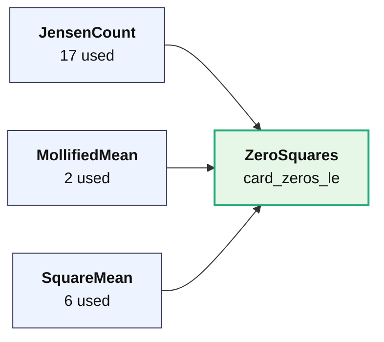

# What `ZeroSquares.card_zeros_le` rests on

[`ZeroSquares.card_zeros_le`](../lean_stage3/ZeroSquares.md#ZeroSquares-card_zeros_le) in `lean_stage3/Stage3/ZeroSquares.lean`, line 306.

**Why.** For a finite set `Z` of zeros of ζ with `σ ≤ Re ρ < 1` and `2 ≤ Im ρ ≤ T − 2`, where `1/2 < σ − δ`, `0 < δ ≤ 1/4`, `σ ≤ 1` and `T ≥ 5`, the count of `Z` times `π δ²` is at most `3 (15 log T + 73)` times the integral of `‖f X‖²` over the strip `[σ − δ, 1 + δ] × [1, T]`.

**Proves**

```lean
Real.pi * δ ^ 2 * (Z.card : ℝ) ≤ 3 * (15 * Real.log T + 73) * ∫ u in (σ - δ)..(1 + δ), ∫ t in (1:ℝ)..T, ‖MollifiedMean.f X ((u : ℂ) + Complex.I * (t : ℂ))‖ ^ 2
```

**Needs** (its hypotheses)

  - `` hσ : 1 / 2 < σ - δ ``
  - `` hσ1 : σ ≤ 1 ``
  - `` hδ : 0 < δ ``
  - `` hδ4 : δ ≤ 1 / 4 ``
  - `` hT : 5 ≤ T ``
  - `` X : ℕ ``
  - `` Z : Finset ℂ ``
  - `` hZ : ∀ ρ ∈ Z, riemannZeta ρ = 0 ∧ σ ≤ ρ.re ∧ ρ.re < 1 ∧ 2 ≤ ρ.im ∧ ρ.im ≤ T - 2 ``

Behind it: 37 theorems and 6 definitions in 4 files. Every one is listed below; Lean recorded each step.

## The files it passes through



An arrow A → B reads "B uses something proved or defined in A"; indirect arrows are left out. Green: the theorem itself. Yellow: a file in the other tree. The number is how many of that file's declarations are on the way.

## Every declaration on the way

Files in dependency order. ★ marks what the theorem's own proof uses directly.

### [`JensenCount`](../lean_stage3/JensenCount.md) — 17

- [`Stage3.zeta_centre_lower`](../lean_stage3/JensenCount.md#Stage3-zeta_centre_lower) — `` (1 : ℝ) / 3 ≤ ‖ζ (2 + Complex.I * T)‖ ``
- [`Stage3.zeta_disk_upper`](../lean_stage3/JensenCount.md#Stage3-zeta_disk_upper) — `` ‖ζ w‖ ≤ 28 * T ``
- [`Stage3.zeta_centre_ne_zero`](../lean_stage3/JensenCount.md#Stage3-zeta_centre_ne_zero) — `` ζ (2 + Complex.I * (T : ℂ)) ≠ 0 ``
- [`Stage3.pole_away`](../lean_stage3/JensenCount.md#Stage3-pole_away) — `` 2 * z + (2 + Complex.I * (T : ℂ)) ≠ 1 ``
- [`Stage3.pole_away_centre`](../lean_stage3/JensenCount.md#Stage3-pole_away_centre) — `` v ≠ 1 ``
- [`Stage3.zetaWindowTwo_finite`](../lean_stage3/JensenCount.md#Stage3-zetaWindowTwo_finite) — `` {ρ : ℂ | ζ ρ = 0 ∧ ‖ρ - (2 + Complex.I * (T : ℂ))‖ ≤ 2}.Finite ``
- [`Stage3.zetaWindow`](../lean_stage3/JensenCount.md#Stage3-zetaWindow) — *def*
- [`Stage3.zetaWindow_finite`](../lean_stage3/JensenCount.md#Stage3-zetaWindow_finite) — `` (zetaWindow T).Finite ``
- [`Stage3.jensenF`](../lean_stage3/JensenCount.md#Stage3-jensenF) — *def*
- [`Stage3.zeta_comp_analytic`](../lean_stage3/JensenCount.md#Stage3-zeta_comp_analytic) — `` AnalyticAt ℂ (fun z : ℂ => ζ (2 * z + (2 + Complex.I * (T : ℂ)))) w ``
- [`Stage3.jensenF_analytic`](../lean_stage3/JensenCount.md#Stage3-jensenF_analytic) — `` AnalyticOnNhd ℂ (jensenF T) (Metric.closedBall (0 : ℂ) 1) ``
- [`Stage3.jensenF_zero_eq_one`](../lean_stage3/JensenCount.md#Stage3-jensenF_zero_eq_one) — `` jensenF T 0 = 1 ``
- [`Stage3.jensenF_zeros_finite`](../lean_stage3/JensenCount.md#Stage3-jensenF_zeros_finite) — `` (SetOfZeros 1 (jensenF T)).Finite ``
- [`Stage3.jensenF_bound`](../lean_stage3/JensenCount.md#Stage3-jensenF_bound) — `` ‖jensenF T z‖ ≤ 84 * T ``
- [`Stage3.analyticOrderNatAt_fun_comp_affine`](../lean_stage3/JensenCount.md#Stage3-analyticOrderNatAt_fun_comp_affine) — `` analyticOrderNatAt (fun w : ℂ => g (a * w + b)) z = analyticOrderNatAt g (a * z + b) ``
- [`Stage3.jensenF_order`](../lean_stage3/JensenCount.md#Stage3-jensenF_order) — `` analyticOrderNatAt (jensenF T) w = analyticOrderNatAt ζ (2 * w + (2 + Complex.I * (T : ℂ))) ``
- [`Stage3.zeta_local_zero_count`](../lean_stage3/JensenCount.md#Stage3-zeta_local_zero_count) — `` ∑ ρ ∈ (zetaWindow_finite hT).toFinset, (analyticOrderNatAt ζ ρ : ℝ) ≤ 15 * Real.log T + 73 ``

### [`MollifiedMean`](../lean_stage3/MollifiedMean.md) — 2

- [`MollifiedMean.M`](../lean_stage3/MollifiedMean.md#MollifiedMean-M) — *def*
- ★ [`MollifiedMean.f`](../lean_stage3/MollifiedMean.md#MollifiedMean-f) — *def*

### [`SquareMean`](../lean_stage3/SquareMean.md) — 6

- [`SquareMean.circle_sq_mean`](../lean_stage3/SquareMean.md#SquareMean-circle_sq_mean) — `` 2 * π * ‖f c‖ ^ 2 ≤ ∫ θ in Ioo (-π) π, ‖f (c + (r : ℂ) * ((Real.cos θ : ℂ) + (Real.sin θ : ℂ) * Complex.I))‖ ^ 2 ``
- [`SquareMean.ball_subset_sq`](../lean_stage3/SquareMean.md#SquareMean-ball_subset_sq) — `` closedBall c δ ⊆ (Icc (c.re - δ) (c.re + δ)) ×ℂ (Icc (c.im - δ) (c.im + δ)) ``
- [`SquareMean.norm_polar`](../lean_stage3/SquareMean.md#SquareMean-norm_polar) — `` ‖(r : ℂ) * ((Real.cos θ : ℂ) + (Real.sin θ : ℂ) * Complex.I)‖ = |r| ``
- [`SquareMean.disc_sq_mean`](../lean_stage3/SquareMean.md#SquareMean-disc_sq_mean) — `` π * δ ^ 2 * ‖f c‖ ^ 2 ≤ ∫ z, (ball c δ).indicator (fun z => ‖f z‖ ^ 2) z ``
- [`SquareMean.sq_set_integral`](../lean_stage3/SquareMean.md#SquareMean-sq_set_integral) — `` ∫ z in (Icc (c.re - δ) (c.re + δ)) ×ℂ (Icc (c.im - δ) (c.im + δ)), F z = ∫ u in (c.re - δ)..(c.re + δ), ∫ t in (c.im - δ)..(c.im + δ), F ((u : ℂ) + Complex.I * … ``
- [`SquareMean.sq_mean_lower`](../lean_stage3/SquareMean.md#SquareMean-sq_mean_lower) — `` π * δ ^ 2 * ‖f c‖ ^ 2 ≤ ∫ u in (c.re - δ)..(c.re + δ), ∫ t in (c.im - δ)..(c.im + δ), ‖f ((u : ℂ) + Complex.I * (t : ℂ))‖ ^ 2 ``

### [`ZeroSquares`](../lean_stage3/ZeroSquares.md) — 18

- [`ZeroSquares.one_le_zeta_order`](../lean_stage3/ZeroSquares.md#ZeroSquares-one_le_zeta_order) — `` 1 ≤ analyticOrderNatAt riemannZeta ρ ``
- [`ZeroSquares.differentiable_M`](../lean_stage3/ZeroSquares.md#ZeroSquares-differentiable_M) — `` Differentiable ℂ (MollifiedMean.M X) ``
- [`ZeroSquares.differentiableOn_f`](../lean_stage3/ZeroSquares.md#ZeroSquares-differentiableOn_f) — `` DifferentiableOn ℂ (MollifiedMean.f X) ({(1:ℂ)}ᶜ : Set ℂ) ``
- [`ZeroSquares.f_at_zero`](../lean_stage3/ZeroSquares.md#ZeroSquares-f_at_zero) — `` MollifiedMean.f X ρ = -1 ``
- [`ZeroSquares.sqG`](../lean_stage3/ZeroSquares.md#ZeroSquares-sqG) — *def*
- [`ZeroSquares.continuous_sqG`](../lean_stage3/ZeroSquares.md#ZeroSquares-continuous_sqG) — `` Continuous (Function.uncurry (sqG X)) ``
- [`ZeroSquares.sqG_nonneg`](../lean_stage3/ZeroSquares.md#ZeroSquares-sqG_nonneg) — `` 0 ≤ sqG X u t ``
- ★ [`ZeroSquares.innerI`](../lean_stage3/ZeroSquares.md#ZeroSquares-innerI) — *def*
- [`ZeroSquares.continuous_sqG_slice`](../lean_stage3/ZeroSquares.md#ZeroSquares-continuous_sqG_slice) — `` Continuous (sqG X u) ``
- ★ [`ZeroSquares.continuous_innerI`](../lean_stage3/ZeroSquares.md#ZeroSquares-continuous_innerI) — `` Continuous (innerI X a b) ``
- ★ [`ZeroSquares.innerI_nonneg`](../lean_stage3/ZeroSquares.md#ZeroSquares-innerI_nonneg) — `` 0 ≤ innerI X a b u ``
- [`ZeroSquares.innerI_mono`](../lean_stage3/ZeroSquares.md#ZeroSquares-innerI_mono) — `` innerI X a b u ≤ innerI X c d u ``
- ★ [`ZeroSquares.innerI_eq`](../lean_stage3/ZeroSquares.md#ZeroSquares-innerI_eq) — `` innerI X a b u = ∫ t in a..b, ‖MollifiedMean.f X ((u : ℂ) + Complex.I * (t : ℂ))‖ ^ 2 ``
- ★ [`ZeroSquares.square_lower`](../lean_stage3/ZeroSquares.md#ZeroSquares-square_lower) — `` Real.pi * δ ^ 2 ≤ ∫ u in (σ - δ)..(1 + δ), innerI X ((n : ℝ) + 7 / 4) ((n : ℝ) + 13 / 4) u ``
- [`ZeroSquares.window_mem`](../lean_stage3/ZeroSquares.md#ZeroSquares-window_mem) — `` ρ ∈ Stage3.zetaWindow ((n : ℝ) + 5 / 2) ``
- ★ [`ZeroSquares.card_fiber_le`](../lean_stage3/ZeroSquares.md#ZeroSquares-card_fiber_le) — `` (W.card : ℝ) ≤ 15 * Real.log T + 73 ``
- [`ZeroSquares.sum_unit_strips`](../lean_stage3/ZeroSquares.md#ZeroSquares-sum_unit_strips) — `` ∑ n ∈ Finset.range L, innerI X ((n : ℝ) + c) ((n : ℝ) + 1 + c) u = innerI X c ((L : ℝ) + c) u ``
- ★ [`ZeroSquares.strips_le`](../lean_stage3/ZeroSquares.md#ZeroSquares-strips_le) — `` ∑ n ∈ Finset.range L, innerI X ((n : ℝ) + 7 / 4) ((n : ℝ) + 13 / 4) u ≤ 3 * innerI X 1 T u ``

