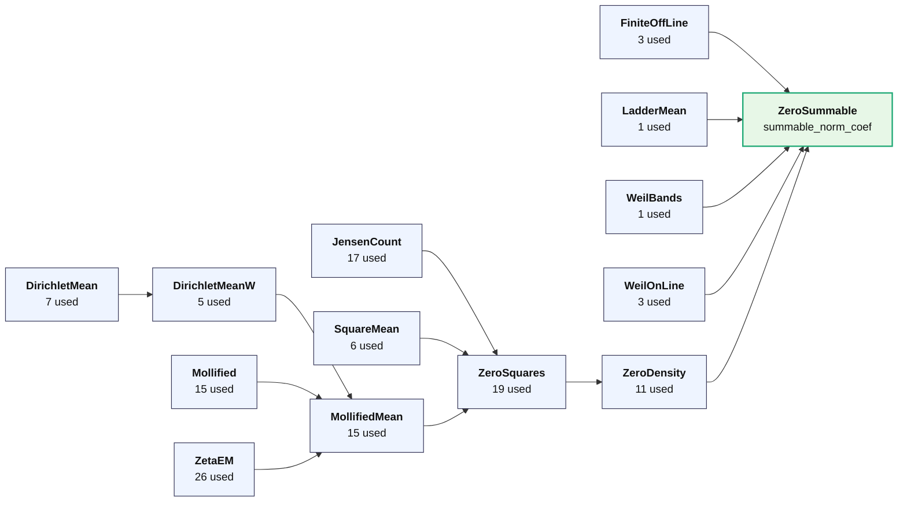

# What `ZeroSummable.summable_norm_coef` rests on

[`ZeroSummable.summable_norm_coef`](../lean_stage3/ZeroSummable.md#ZeroSummable-summable_norm_coef) in `lean_stage3/Stage3/ZeroSummable.lean`, line 372.

**Why.** For `σ > 1/2` and any set `S` of nontrivial zeros all with `Re ρ ≥ σ`, the norms of the cell coefficients `‖LadderMean.coef ρ‖` are summable over `S`.

**Proves**

```lean
Summable fun ρ : S => ‖LadderMean.coef ρ‖
```

**Needs** (its hypotheses)

  - `` S : Set NontrivialZeros ``
  - `` hσ : 1 / 2 < σ ``
  - `` hS : ∀ ρ ∈ S, σ ≤ (ρ : ℂ).re ``

Behind it: 120 theorems and 22 definitions in 14 files. Every one is listed below; Lean recorded each step.

## The files it passes through



An arrow A → B reads "B uses something proved or defined in A"; indirect arrows are left out. Green: the theorem itself. Yellow: a file in the other tree. The number is how many of that file's declarations are on the way.

## Every declaration on the way

Files in dependency order. ★ marks what the theorem's own proof uses directly.

### [`DirichletMean`](../lean_stage3/DirichletMean.md) — 7

- [`DirichletMean.natCast_cpow_neg_I_mul`](../lean_stage3/DirichletMean.md#DirichletMean-natCast_cpow_neg_I_mul) — `` (n : ℂ) ^ (-(Complex.I * (t : ℂ))) = Complex.exp (Complex.I * ((-Real.log n : ℝ) : ℂ) * t) ``
- [`DirichletMean.sq_norm_sum_eq`](../lean_stage3/DirichletMean.md#DirichletMean-sq_norm_sum_eq) — `` ((‖∑ n ∈ Icc 1 N, a n * (n : ℂ) ^ (-(Complex.I * (t : ℂ)))‖ ^ 2 : ℝ) : ℂ) = ∑ m ∈ Icc 1 N, ∑ n ∈ Icc 1 N, a m * (starRingEnd ℂ) (a n) * Complex.exp (Complex.I *… ``
- [`DirichletMean.integral_sq_norm_eq`](../lean_stage3/DirichletMean.md#DirichletMean-integral_sq_norm_eq) — `` ((∫ t in T₁..T₂, ‖∑ n ∈ Icc 1 N, a n * (n : ℂ) ^ (-(Complex.I * (t : ℂ)))‖ ^ 2 : ℝ) : ℂ) = ∑ m ∈ Icc 1 N, ∑ n ∈ Icc 1 N, a m * (starRingEnd ℂ) (a n) * ∫ t in T₁… ``
- [`DirichletMean.norm_integral_exp_le`](../lean_stage3/DirichletMean.md#DirichletMean-norm_integral_exp_le) — `` ‖∫ t in T₁..T₂, Complex.exp (Complex.I * (θ : ℂ) * t)‖ ≤ 2 / |θ| ``
- [`DirichletMean.sum_inv_le_harmonic`](../lean_stage3/DirichletMean.md#DirichletMean-sum_inv_le_harmonic) — `` ∑ n ∈ s, ((g n : ℕ) : ℝ)⁻¹ ≤ ∑ k ∈ Icc 1 N, (k : ℝ)⁻¹ ``
- [`DirichletMean.sum_inv_Icc_le`](../lean_stage3/DirichletMean.md#DirichletMean-sum_inv_Icc_le) — `` ∑ k ∈ Icc 1 N, (k : ℝ)⁻¹ ≤ 1 + Real.log N ``
- [`DirichletMean.sum_inv_dist_le`](../lean_stage3/DirichletMean.md#DirichletMean-sum_inv_dist_le) — `` ∑ n ∈ Icc 1 N, (if m = n then 0 else |(m : ℝ) - n|⁻¹) ≤ 2 * (1 + Real.log N) ``

### [`DirichletMeanW`](../lean_stage3/DirichletMeanW.md) — 5

- [`DirichletMeanW.log_gap_larger`](../lean_stage3/DirichletMeanW.md#DirichletMeanW-log_gap_larger) — `` ((q : ℝ) - p) / q ≤ Real.log q - Real.log p ``
- [`DirichletMeanW.weighted_gap`](../lean_stage3/DirichletMeanW.md#DirichletMeanW-weighted_gap) — `` 2 / |Real.log n - Real.log m| * ((m : ℝ) / n) ≤ 2 * m * (|(m : ℝ) - n|⁻¹ + (n : ℝ)⁻¹) ``
- [`DirichletMeanW.sum_mul_mul_le_weighted`](../lean_stage3/DirichletMeanW.md#DirichletMeanW-sum_mul_mul_le_weighted) — `` ∑ m ∈ s, ∑ n ∈ s, A m * A n * K m n ≤ ∑ m ∈ s, A m ^ 2 * R m ``
- [`DirichletMeanW.dirichlet_mean_value_weighted`](../lean_stage3/DirichletMeanW.md#DirichletMeanW-dirichlet_mean_value_weighted) — `` ∫ t in T₁..T₂, ‖∑ n ∈ Finset.Icc 1 N, a n * (n : ℂ) ^ (-(Complex.I * (t : ℂ)))‖ ^ 2 ≤ ∑ n ∈ Finset.Icc 1 N, ‖a n‖ ^ 2 * ((T₂ - T₁) + 6 * n * (1 + Real.log N)) ``
- [`DirichletMeanW.dirichlet_mean_value_weighted_sigma`](../lean_stage3/DirichletMeanW.md#DirichletMeanW-dirichlet_mean_value_weighted_sigma) — `` ∫ t in T₁..T₂, ‖∑ n ∈ Finset.Icc 1 N, a n * (n : ℂ) ^ (-((σ : ℂ) + Complex.I * (t : ℂ)))‖ ^ 2 ≤ ∑ n ∈ Finset.Icc 1 N, ‖a n‖ ^ 2 * (n : ℝ) ^ (-2 * σ) * ((T₂ - T₁… ``

### [`FiniteOffLine`](../lean_stage3/FiniteOffLine.md) — 3

- [`FiniteOffLine.ZF`](../lean_stage3/FiniteOffLine.md#FiniteOffLine-ZF) — *def*
- [`FiniteOffLine.mem_ZF`](../lean_stage3/FiniteOffLine.md#FiniteOffLine-mem_ZF) — `` ρ ∈ ZF T ↔ |(ρ : ℂ).im| < T ``
- [`FiniteOffLine.order_nonneg`](../lean_stage3/FiniteOffLine.md#FiniteOffLine-order_nonneg) — `` (0 : ℝ) ≤ ((riemannZeta.order (ρ : ℂ) : ℤ) : ℝ) ``

### [`JensenCount`](../lean_stage3/JensenCount.md) — 17

- [`Stage3.zeta_centre_lower`](../lean_stage3/JensenCount.md#Stage3-zeta_centre_lower) — `` (1 : ℝ) / 3 ≤ ‖ζ (2 + Complex.I * T)‖ ``
- [`Stage3.zeta_disk_upper`](../lean_stage3/JensenCount.md#Stage3-zeta_disk_upper) — `` ‖ζ w‖ ≤ 28 * T ``
- [`Stage3.zeta_centre_ne_zero`](../lean_stage3/JensenCount.md#Stage3-zeta_centre_ne_zero) — `` ζ (2 + Complex.I * (T : ℂ)) ≠ 0 ``
- [`Stage3.pole_away`](../lean_stage3/JensenCount.md#Stage3-pole_away) — `` 2 * z + (2 + Complex.I * (T : ℂ)) ≠ 1 ``
- [`Stage3.pole_away_centre`](../lean_stage3/JensenCount.md#Stage3-pole_away_centre) — `` v ≠ 1 ``
- [`Stage3.zetaWindowTwo_finite`](../lean_stage3/JensenCount.md#Stage3-zetaWindowTwo_finite) — `` {ρ : ℂ | ζ ρ = 0 ∧ ‖ρ - (2 + Complex.I * (T : ℂ))‖ ≤ 2}.Finite ``
- [`Stage3.zetaWindow`](../lean_stage3/JensenCount.md#Stage3-zetaWindow) — *def*
- [`Stage3.zetaWindow_finite`](../lean_stage3/JensenCount.md#Stage3-zetaWindow_finite) — `` (zetaWindow T).Finite ``
- [`Stage3.jensenF`](../lean_stage3/JensenCount.md#Stage3-jensenF) — *def*
- [`Stage3.zeta_comp_analytic`](../lean_stage3/JensenCount.md#Stage3-zeta_comp_analytic) — `` AnalyticAt ℂ (fun z : ℂ => ζ (2 * z + (2 + Complex.I * (T : ℂ)))) w ``
- [`Stage3.jensenF_analytic`](../lean_stage3/JensenCount.md#Stage3-jensenF_analytic) — `` AnalyticOnNhd ℂ (jensenF T) (Metric.closedBall (0 : ℂ) 1) ``
- [`Stage3.jensenF_zero_eq_one`](../lean_stage3/JensenCount.md#Stage3-jensenF_zero_eq_one) — `` jensenF T 0 = 1 ``
- [`Stage3.jensenF_zeros_finite`](../lean_stage3/JensenCount.md#Stage3-jensenF_zeros_finite) — `` (SetOfZeros 1 (jensenF T)).Finite ``
- [`Stage3.jensenF_bound`](../lean_stage3/JensenCount.md#Stage3-jensenF_bound) — `` ‖jensenF T z‖ ≤ 84 * T ``
- [`Stage3.analyticOrderNatAt_fun_comp_affine`](../lean_stage3/JensenCount.md#Stage3-analyticOrderNatAt_fun_comp_affine) — `` analyticOrderNatAt (fun w : ℂ => g (a * w + b)) z = analyticOrderNatAt g (a * z + b) ``
- [`Stage3.jensenF_order`](../lean_stage3/JensenCount.md#Stage3-jensenF_order) — `` analyticOrderNatAt (jensenF T) w = analyticOrderNatAt ζ (2 * w + (2 + Complex.I * (T : ℂ))) ``
- [`Stage3.zeta_local_zero_count`](../lean_stage3/JensenCount.md#Stage3-zeta_local_zero_count) — `` ∑ ρ ∈ (zetaWindow_finite hT).toFinset, (analyticOrderNatAt ζ ρ : ℝ) ≤ 15 * Real.log T + 73 ``

### [`LadderMean`](../lean_stage3/LadderMean.md) — 1

- ★ [`LadderMean.coef`](../lean_stage3/LadderMean.md#LadderMean-coef) — *def*

### [`Mollified`](../lean_stage3/Mollified.md) — 15

- [`Mollified.tauBelow`](../lean_stage3/Mollified.md#Mollified-tauBelow) — *def*
- [`Mollified.coef`](../lean_stage3/Mollified.md#Mollified-coef) — *def*
- [`Mollified.prod_eq_sum`](../lean_stage3/Mollified.md#Mollified-prod_eq_sum) — `` (∑ m ∈ Icc 1 N, (m : ℂ) ^ (-s)) * (∑ d ∈ Ico 1 X, (ArithmeticFunction.moebius d : ℂ) * (d : ℂ) ^ (-s)) = ∑ n ∈ Icc 1 (N * X), (coef X N n : ℂ) * (n : ℂ) ^ (-s) ``
- [`Mollified.coef_one`](../lean_stage3/Mollified.md#Mollified-coef_one) — `` coef X N 1 = 1 ``
- [`Mollified.coef_eq_zero`](../lean_stage3/Mollified.md#Mollified-coef_eq_zero) — `` coef X N n = 0 ``
- [`Mollified.abs_coef_le`](../lean_stage3/Mollified.md#Mollified-abs_coef_le) — `` |coef X N n| ≤ tauBelow X n ``
- [`Mollified.card_Icc_dvd`](../lean_stage3/Mollified.md#Mollified-card_Icc_dvd) — `` ((Icc 1 Y).filter (k ∣ ·)).card = Y / k ``
- [`Mollified.triples`](../lean_stage3/Mollified.md#Mollified-triples) — *def*
- [`Mollified.tauBelow_sq_le`](../lean_stage3/Mollified.md#Mollified-tauBelow_sq_le) — `` tauBelow X n ^ 2 ≤ ((triples X).filter (fun t => t.1 * t.2.1 * t.2.2 ∣ n)).card ``
- [`Mollified.sum_inv_Ico_le`](../lean_stage3/Mollified.md#Mollified-sum_inv_Ico_le) — `` ∑ k ∈ Ico 1 X, ((k : ℝ))⁻¹ ≤ 1 + Real.log X ``
- [`Mollified.sum_tauBelow_sq_le`](../lean_stage3/Mollified.md#Mollified-sum_tauBelow_sq_le) — `` ∑ n ∈ Icc 1 Y, (tauBelow X n : ℝ) ^ 2 ≤ Y * (1 + Real.log X) ^ 3 ``
- [`Mollified.coef_sq_le`](../lean_stage3/Mollified.md#Mollified-coef_sq_le) — `` (coef X N n : ℝ) ^ 2 ≤ (tauBelow X n : ℝ) ^ 2 ``
- [`Mollified.sum_coef_sq_le`](../lean_stage3/Mollified.md#Mollified-sum_coef_sq_le) — `` ∑ n ∈ Icc 1 Y, (coef X N n : ℝ) ^ 2 ≤ Y * (1 + Real.log X) ^ 3 ``
- [`Mollified.sum_Ico_dyadic`](../lean_stage3/Mollified.md#Mollified-sum_Ico_dyadic) — `` ∑ n ∈ Ico X (2 ^ J * X), f n = ∑ j ∈ range J, ∑ n ∈ Ico (2 ^ j * X) (2 ^ (j + 1) * X), f n ``
- [`Mollified.sum_coef_sq_weighted_le`](../lean_stage3/Mollified.md#Mollified-sum_coef_sq_weighted_le) — `` ∑ n ∈ Icc X Y, (coef X N n : ℝ) ^ 2 * (n : ℝ) ^ (-2 * u) ≤ 2 / (1 - (2 : ℝ) ^ (1 - 2 * u)) * (X : ℝ) ^ (1 - 2 * u) * (1 + Real.log X) ^ 3 ``

### [`SquareMean`](../lean_stage3/SquareMean.md) — 6

- [`SquareMean.circle_sq_mean`](../lean_stage3/SquareMean.md#SquareMean-circle_sq_mean) — `` 2 * π * ‖f c‖ ^ 2 ≤ ∫ θ in Ioo (-π) π, ‖f (c + (r : ℂ) * ((Real.cos θ : ℂ) + (Real.sin θ : ℂ) * Complex.I))‖ ^ 2 ``
- [`SquareMean.ball_subset_sq`](../lean_stage3/SquareMean.md#SquareMean-ball_subset_sq) — `` closedBall c δ ⊆ (Icc (c.re - δ) (c.re + δ)) ×ℂ (Icc (c.im - δ) (c.im + δ)) ``
- [`SquareMean.norm_polar`](../lean_stage3/SquareMean.md#SquareMean-norm_polar) — `` ‖(r : ℂ) * ((Real.cos θ : ℂ) + (Real.sin θ : ℂ) * Complex.I)‖ = |r| ``
- [`SquareMean.disc_sq_mean`](../lean_stage3/SquareMean.md#SquareMean-disc_sq_mean) — `` π * δ ^ 2 * ‖f c‖ ^ 2 ≤ ∫ z, (ball c δ).indicator (fun z => ‖f z‖ ^ 2) z ``
- [`SquareMean.sq_set_integral`](../lean_stage3/SquareMean.md#SquareMean-sq_set_integral) — `` ∫ z in (Icc (c.re - δ) (c.re + δ)) ×ℂ (Icc (c.im - δ) (c.im + δ)), F z = ∫ u in (c.re - δ)..(c.re + δ), ∫ t in (c.im - δ)..(c.im + δ), F ((u : ℂ) + Complex.I * … ``
- [`SquareMean.sq_mean_lower`](../lean_stage3/SquareMean.md#SquareMean-sq_mean_lower) — `` π * δ ^ 2 * ‖f c‖ ^ 2 ≤ ∫ u in (c.re - δ)..(c.re + δ), ∫ t in (c.im - δ)..(c.im + δ), ‖f ((u : ℂ) + Complex.I * (t : ℂ))‖ ^ 2 ``

### [`WeilBands`](../lean_stage3/WeilBands.md) — 1

- [`WeilBands.order_eq_analyticOrderNatAt`](../lean_stage3/WeilBands.md#WeilBands-order_eq_analyticOrderNatAt) — `` ((riemannZeta.order (ρ : ℂ) : ℤ) : ℝ) = (analyticOrderNatAt riemannZeta (ρ : ℂ) : ℝ) ``

### [`WeilOnLine`](../lean_stage3/WeilOnLine.md) — 3

- [`WeilOnLine.conj_mem`](../lean_stage3/WeilOnLine.md#WeilOnLine-conj_mem) — `` (starRingEnd ℂ) (ρ : ℂ) ∈ Kadiri.NontrivialZeros ``
- [`WeilOnLine.conjZ`](../lean_stage3/WeilOnLine.md#WeilOnLine-conjZ) — *def*
- [`WeilOnLine.conjZ_injective`](../lean_stage3/WeilOnLine.md#WeilOnLine-conjZ_injective) — `` Function.Injective conjZ ``

### [`ZetaEM`](../lean_stage3/ZetaEM.md) — 26

- [`ZetaEM.emInt`](../lean_stage3/ZetaEM.md#ZetaEM-emInt) — *def*
- [`ZetaEM.emCoef`](../lean_stage3/ZetaEM.md#ZetaEM-emCoef) — *def*
- [`ZetaEM.emTerm`](../lean_stage3/ZetaEM.md#ZetaEM-emTerm) — *def*
- [`ZetaEM.emBoundary`](../lean_stage3/ZetaEM.md#ZetaEM-emBoundary) — *def*
- [`ZetaEM.emRem`](../lean_stage3/ZetaEM.md#ZetaEM-emRem) — *def*
- [`ZetaEM.bernBound`](../lean_stage3/ZetaEM.md#ZetaEM-bernBound) — *def*
- [`ZetaEM.hasDerivWithinAt_fract`](../lean_stage3/ZetaEM.md#ZetaEM-hasDerivWithinAt_fract) — `` HasDerivWithinAt Int.fract 1 (Ioi x) x ``
- [`ZetaEM.continuous_bernoulliFun_fract`](../lean_stage3/ZetaEM.md#ZetaEM-continuous_bernoulliFun_fract) — `` Continuous (fun x : ℝ ↦ bernoulliFun k (Int.fract x)) ``
- [`ZetaEM.abs_bernoulliFun_fract_le`](../lean_stage3/ZetaEM.md#ZetaEM-abs_bernoulliFun_fract_le) — `` |bernoulliFun k (Int.fract x)| ≤ bernBound k ``
- [`ZetaEM.bernBound_nonneg`](../lean_stage3/ZetaEM.md#ZetaEM-bernBound_nonneg) — `` 0 ≤ bernBound k ``
- [`ZetaEM.measurable_bern`](../lean_stage3/ZetaEM.md#ZetaEM-measurable_bern) — `` Measurable (fun x : ℝ ↦ bernoulliFun k (Int.fract x)) ``
- [`ZetaEM.integrableOn_bern_cpow`](../lean_stage3/ZetaEM.md#ZetaEM-integrableOn_bern_cpow) — `` IntegrableOn (fun x : ℝ ↦ ((bernoulliFun k (Int.fract x) : ℝ) : ℂ) * (x:ℂ) ^ w) (Ioi a) ``
- [`ZetaEM.norm_integral_bern_cpow_le`](../lean_stage3/ZetaEM.md#ZetaEM-norm_integral_bern_cpow_le) — `` ‖∫ x in Ioi a, ((bernoulliFun k (Int.fract x) : ℝ) : ℂ) * (x:ℂ) ^ w‖ ≤ bernBound k * (-a ^ (w.re + 1) / (w.re + 1)) ``
- [`ZetaEM.interval_ibp`](../lean_stage3/ZetaEM.md#ZetaEM-interval_ibp) — `` ((k:ℂ) + 1) * ∫ x in a..b, ((bernoulliFun k (Int.fract x) : ℝ) : ℂ) * (x:ℂ) ^ (-(s + k)) = ((bernoulliFun (k+1) (Int.fract b) : ℝ) : ℂ) * (b:ℂ) ^ (-(s + k)) - (… ``
- [`ZetaEM.tail_ibp`](../lean_stage3/ZetaEM.md#ZetaEM-tail_ibp) — `` ((k:ℂ) + 1) * ∫ x in Ioi a, ((bernoulliFun k (Int.fract x) : ℝ) : ℂ) * (x:ℂ) ^ (-(s + k)) = -(((bernoulliFun (k+1) (Int.fract a) : ℝ) : ℂ) * (a:ℂ) ^ (-(s + k)))… ``
- [`ZetaEM.emInt_step`](../lean_stage3/ZetaEM.md#ZetaEM-emInt_step) — `` ((k:ℂ) + 1) * emInt k N s = -((bernoulliFun (k+1) 0 : ℂ) * (N:ℂ) ^ (-(s + k))) + (s + k) * emInt (k+1) N s ``
- [`ZetaEM.emRem_step`](../lean_stage3/ZetaEM.md#ZetaEM-emRem_step) — `` emRem k N s = emTerm k N s + emRem (k+1) N s ``
- [`ZetaEM.sum_range_succ_eq_sum_Icc`](../lean_stage3/ZetaEM.md#ZetaEM-sum_range_succ_eq_sum_Icc) — `` ∑ n ∈ Finset.range (N + 1), 1 / (n : ℂ) ^ s = ∑ n ∈ Finset.Icc 1 N, (n : ℂ) ^ (-s) ``
- [`ZetaEM.zeta_eq_em_one`](../lean_stage3/ZetaEM.md#ZetaEM-zeta_eq_em_one) — `` riemannZeta s = ∑ n ∈ Finset.Icc 1 N, (n : ℂ) ^ (-s) - (N:ℂ) ^ (1 - s) / (1 - s) - (N:ℂ) ^ (-s) / 2 - s * emInt 1 N s ``
- [`ZetaEM.zeta_eq_em`](../lean_stage3/ZetaEM.md#ZetaEM-zeta_eq_em) — `` riemannZeta s = ∑ n ∈ Finset.Icc 1 N, (n : ℂ) ^ (-s) - (N:ℂ) ^ (1 - s) / (1 - s) - (N:ℂ) ^ (-s) / 2 + emBoundary k N s + emRem k N s ``
- [`ZetaEM.norm_emInt_le`](../lean_stage3/ZetaEM.md#ZetaEM-norm_emInt_le) — `` ‖emInt k N s‖ ≤ bernBound k * ((N:ℝ) ^ (1 - s.re - k) / (s.re + k - 1)) ``
- [`ZetaEM.norm_remainder_le`](../lean_stage3/ZetaEM.md#ZetaEM-norm_remainder_le) — `` ‖emRem k N s‖ ≤ (∏ i ∈ Finset.range k, ‖s + i‖) / k.factorial * (bernBound k * ((N:ℝ) ^ (1 - s.re - k) / (s.re + k - 1))) ``
- [`ZetaEM.norm_emTerm`](../lean_stage3/ZetaEM.md#ZetaEM-norm_emTerm) — `` ‖emTerm j N s‖ = (∏ i ∈ Finset.range j, ‖s + i‖) * |bernoulliFun (j+1) 0| / (j+1).factorial * (N:ℝ) ^ (-s.re - j) ``
- [`ZetaEM.prod_norm_le`](../lean_stage3/ZetaEM.md#ZetaEM-prod_norm_le) — `` ∏ i ∈ Finset.range j, ‖s + i‖ ≤ (‖s‖ + k) ^ j ``
- [`ZetaEM.emConst`](../lean_stage3/ZetaEM.md#ZetaEM-emConst) — *def*
- [`ZetaEM.norm_zeta_sub_partial_le`](../lean_stage3/ZetaEM.md#ZetaEM-norm_zeta_sub_partial_le) — `` ‖riemannZeta s - ∑ n ∈ Finset.Icc 1 N, (n : ℂ) ^ (-s) + (N : ℂ) ^ (1 - s) / (1 - s)‖ ≤ emConst k * (N : ℝ) ^ (-s.re) * (1 + (‖s‖ + k) ^ k * (N : ℝ) ^ (1 - (k : … ``

### [`MollifiedMean`](../lean_stage3/MollifiedMean.md) — 15

- [`MollifiedMean.M`](../lean_stage3/MollifiedMean.md#MollifiedMean-M) — *def*
- [`MollifiedMean.f`](../lean_stage3/MollifiedMean.md#MollifiedMean-f) — *def*
- [`MollifiedMean.b`](../lean_stage3/MollifiedMean.md#MollifiedMean-b) — *def*
- [`MollifiedMean.emConst_nonneg`](../lean_stage3/MollifiedMean.md#MollifiedMean-emConst_nonneg) — `` 0 ≤ ZetaEM.emConst k ``
- [`MollifiedMean.norm_M_le`](../lean_stage3/MollifiedMean.md#MollifiedMean-norm_M_le) — `` ‖M X s‖ ≤ X ``
- [`MollifiedMean.norm_smooth_le`](../lean_stage3/MollifiedMean.md#MollifiedMean-norm_smooth_le) — `` ‖(N : ℂ) ^ (1 - ((u : ℂ) + Complex.I * (t : ℂ))) / (1 - ((u : ℂ) + Complex.I * (t : ℂ)))‖ ≤ (N : ℝ) ^ (1 - u) / t ``
- [`MollifiedMean.PM_sub_one_eq`](../lean_stage3/MollifiedMean.md#MollifiedMean-PM_sub_one_eq) — `` (∑ m ∈ Icc 1 N, (m : ℂ) ^ (-s)) * M X s - 1 = ∑ n ∈ Icc 1 (N * X), (b X N n : ℂ) * (n : ℂ) ^ (-s) ``
- [`MollifiedMean.f_eq`](../lean_stage3/MollifiedMean.md#MollifiedMean-f_eq) — `` f X s = ∑ n ∈ Icc 1 (N * X), (b X N n : ℂ) * (n : ℂ) ^ (-s) + (-((N : ℂ) ^ (1 - s) / (1 - s))) * M X s + (riemannZeta s - ∑ n ∈ Icc 1 N, (n : ℂ) ^ (-s) + (N : ℂ… ``
- [`MollifiedMean.norm_sq_add_three`](../lean_stage3/MollifiedMean.md#MollifiedMean-norm_sq_add_three) — `` ‖x + y + z‖ ^ 2 ≤ 3 * (‖x‖ ^ 2 + ‖y‖ ^ 2 + ‖z‖ ^ 2) ``
- [`MollifiedMean.rpow_sq`](../lean_stage3/MollifiedMean.md#MollifiedMean-rpow_sq) — `` (x ^ a) ^ 2 = x ^ (2 * a) ``
- [`MollifiedMean.sum_b_sq_eq`](../lean_stage3/MollifiedMean.md#MollifiedMean-sum_b_sq_eq) — `` ∑ n ∈ Icc 1 Y, b X N n ^ 2 * w n = ∑ n ∈ Icc X Y, (Mollified.coef X N n : ℝ) ^ 2 * w n ``
- [`MollifiedMean.sum_coef_sq_up_le`](../lean_stage3/MollifiedMean.md#MollifiedMean-sum_coef_sq_up_le) — `` ∑ n ∈ Icc 1 Y, (Mollified.coef X N n : ℝ) ^ 2 * (n : ℝ) ^ (1 - 2 * u) ≤ 4 * (1 + Real.log X) ^ 3 * (1 + Real.log Y) * max 1 ((Y : ℝ) ^ (2 - 2 * u)) ``
- [`MollifiedMean.integral_inv_sq_le`](../lean_stage3/MollifiedMean.md#MollifiedMean-integral_inv_sq_le) — `` ∫ t in (1:ℝ)..T, (t ^ 2)⁻¹ ≤ 1 ``
- [`MollifiedMean.mean_sq_main_le`](../lean_stage3/MollifiedMean.md#MollifiedMean-mean_sq_main_le) — `` ∫ t in (1:ℝ)..T, ‖∑ n ∈ Icc 1 (N * X), (b X N n : ℂ) * (n : ℂ) ^ (-((u : ℂ) + Complex.I * (t : ℂ)))‖ ^ 2 ≤ T * (2 / (1 - (2:ℝ) ^ (1 - 2 * u))) * (X:ℝ) ^ (1 - 2 … ``
- [`MollifiedMean.mean_sq_f_le`](../lean_stage3/MollifiedMean.md#MollifiedMean-mean_sq_f_le) — `` ∫ t in (1:ℝ)..T, ‖f X ((u : ℂ) + Complex.I * (t : ℂ))‖ ^ 2 ≤ 3 * (T * (2 / (1 - (2:ℝ) ^ (1 - 2 * u))) * (X:ℝ) ^ (1 - 2 * u) * (1 + Real.log X) ^ 3 + 24 * (1 + R… ``

### [`ZeroSquares`](../lean_stage3/ZeroSquares.md) — 19

- [`ZeroSquares.one_le_zeta_order`](../lean_stage3/ZeroSquares.md#ZeroSquares-one_le_zeta_order) — `` 1 ≤ analyticOrderNatAt riemannZeta ρ ``
- [`ZeroSquares.differentiable_M`](../lean_stage3/ZeroSquares.md#ZeroSquares-differentiable_M) — `` Differentiable ℂ (MollifiedMean.M X) ``
- [`ZeroSquares.differentiableOn_f`](../lean_stage3/ZeroSquares.md#ZeroSquares-differentiableOn_f) — `` DifferentiableOn ℂ (MollifiedMean.f X) ({(1:ℂ)}ᶜ : Set ℂ) ``
- [`ZeroSquares.f_at_zero`](../lean_stage3/ZeroSquares.md#ZeroSquares-f_at_zero) — `` MollifiedMean.f X ρ = -1 ``
- [`ZeroSquares.sqG`](../lean_stage3/ZeroSquares.md#ZeroSquares-sqG) — *def*
- [`ZeroSquares.continuous_sqG`](../lean_stage3/ZeroSquares.md#ZeroSquares-continuous_sqG) — `` Continuous (Function.uncurry (sqG X)) ``
- [`ZeroSquares.sqG_nonneg`](../lean_stage3/ZeroSquares.md#ZeroSquares-sqG_nonneg) — `` 0 ≤ sqG X u t ``
- [`ZeroSquares.innerI`](../lean_stage3/ZeroSquares.md#ZeroSquares-innerI) — *def*
- [`ZeroSquares.continuous_sqG_slice`](../lean_stage3/ZeroSquares.md#ZeroSquares-continuous_sqG_slice) — `` Continuous (sqG X u) ``
- [`ZeroSquares.continuous_innerI`](../lean_stage3/ZeroSquares.md#ZeroSquares-continuous_innerI) — `` Continuous (innerI X a b) ``
- [`ZeroSquares.innerI_nonneg`](../lean_stage3/ZeroSquares.md#ZeroSquares-innerI_nonneg) — `` 0 ≤ innerI X a b u ``
- [`ZeroSquares.innerI_mono`](../lean_stage3/ZeroSquares.md#ZeroSquares-innerI_mono) — `` innerI X a b u ≤ innerI X c d u ``
- [`ZeroSquares.innerI_eq`](../lean_stage3/ZeroSquares.md#ZeroSquares-innerI_eq) — `` innerI X a b u = ∫ t in a..b, ‖MollifiedMean.f X ((u : ℂ) + Complex.I * (t : ℂ))‖ ^ 2 ``
- [`ZeroSquares.square_lower`](../lean_stage3/ZeroSquares.md#ZeroSquares-square_lower) — `` Real.pi * δ ^ 2 ≤ ∫ u in (σ - δ)..(1 + δ), innerI X ((n : ℝ) + 7 / 4) ((n : ℝ) + 13 / 4) u ``
- [`ZeroSquares.window_mem`](../lean_stage3/ZeroSquares.md#ZeroSquares-window_mem) — `` ρ ∈ Stage3.zetaWindow ((n : ℝ) + 5 / 2) ``
- [`ZeroSquares.card_fiber_le`](../lean_stage3/ZeroSquares.md#ZeroSquares-card_fiber_le) — `` (W.card : ℝ) ≤ 15 * Real.log T + 73 ``
- [`ZeroSquares.sum_unit_strips`](../lean_stage3/ZeroSquares.md#ZeroSquares-sum_unit_strips) — `` ∑ n ∈ Finset.range L, innerI X ((n : ℝ) + c) ((n : ℝ) + 1 + c) u = innerI X c ((L : ℝ) + c) u ``
- [`ZeroSquares.strips_le`](../lean_stage3/ZeroSquares.md#ZeroSquares-strips_le) — `` ∑ n ∈ Finset.range L, innerI X ((n : ℝ) + 7 / 4) ((n : ℝ) + 13 / 4) u ≤ 3 * innerI X 1 T u ``
- [`ZeroSquares.card_zeros_le`](../lean_stage3/ZeroSquares.md#ZeroSquares-card_zeros_le) — `` Real.pi * δ ^ 2 * (Z.card : ℝ) ≤ 3 * (15 * Real.log T + 73) * ∫ u in (σ - δ)..(1 + δ), ∫ t in (1:ℝ)..T, ‖MollifiedMean.f X ((u : ℂ) + Complex.I * (t : ℂ))‖ ^ 2 ``

### [`ZeroDensity`](../lean_stage3/ZeroDensity.md) — 11

- [`ZeroDensity.ceil_bounds`](../lean_stage3/ZeroDensity.md#ZeroDensity-ceil_bounds) — `` y ≤ (⌈y⌉₊ : ℝ) ∧ (⌈y⌉₊ : ℝ) ≤ 2 * y ``
- [`ZeroDensity.one_add_log_le`](../lean_stage3/ZeroDensity.md#ZeroDensity-one_add_log_le) — `` 1 + Real.log T ≤ (1 + 1 / ε) * T ^ ε ``
- [`ZeroDensity.sq_rpow_le`](../lean_stage3/ZeroDensity.md#ZeroDensity-sq_rpow_le) — `` (X:ℝ) ^ 2 ≤ 4 * T ^ (2 * δ) ``
- [`ZeroDensity.term1_le`](../lean_stage3/ZeroDensity.md#ZeroDensity-term1_le) — `` T * (2 / (1 - (2:ℝ) ^ (1 - 2 * u))) * (X:ℝ) ^ (1 - 2 * u) * (1 + Real.log X) ^ 3 ≤ T * (2 / (1 - (2:ℝ) ^ (-(6 * δ)))) * T ^ (-(6 * δ ^ 2)) * L ^ 3 ``
- [`ZeroDensity.term2_le`](../lean_stage3/ZeroDensity.md#ZeroDensity-term2_le) — `` 24 * (1 + Real.log ((N * X : ℕ) : ℝ)) ^ 2 * (1 + Real.log X) ^ 3 * max 1 (((N * X : ℕ) : ℝ) ^ (2 - 2 * u)) ≤ 24 * (4 * L) ^ 2 * (2 * L) ^ 3 * (4 * T ^ (1 - 4 * … ``
- [`ZeroDensity.term3_le`](../lean_stage3/ZeroDensity.md#ZeroDensity-term3_le) — `` (X:ℝ) ^ 2 * (N:ℝ) ^ (2 - 2 * u) ≤ 8 * T ^ (1 - 3 * δ) ``
- [`ZeroDensity.term4_le`](../lean_stage3/ZeroDensity.md#ZeroDensity-term4_le) — `` T * (X:ℝ) ^ 2 * E ^ 2 * (N:ℝ) ^ (-2 * u) * (1 + (T + 2 + k) ^ k * (N:ℝ) ^ (1 - (k:ℝ))) ^ 2 ≤ 4 * E ^ 2 * (1 + 2 ^ k) ^ 2 * T ^ δ ``
- [`ZeroDensity.bConst`](../lean_stage3/ZeroDensity.md#ZeroDensity-bConst) — *def*
- [`ZeroDensity.bConst_nonneg`](../lean_stage3/ZeroDensity.md#ZeroDensity-bConst_nonneg) — `` 0 ≤ bConst δ k ``
- [`ZeroDensity.inner_le`](../lean_stage3/ZeroDensity.md#ZeroDensity-inner_le) — `` ∫ t in (1:ℝ)..T, ‖MollifiedMean.f X ((u : ℂ) + Complex.I * (t : ℂ))‖ ^ 2 ≤ bConst δ k * T ^ (1 - 6 * δ ^ 2) * (1 + Real.log T) ^ 5 ``
- [`ZeroDensity.zero_density`](../lean_stage3/ZeroDensity.md#ZeroDensity-zero_density) — `` ∃ θ C T₀ : ℝ, θ < 1 ∧ 0 ≤ C ∧ ∀ T : ℝ, T₀ ≤ T → ∀ Z : Finset ℂ, (∀ ρ ∈ Z, riemannZeta ρ = 0 ∧ σ ≤ ρ.re ∧ ρ.re < 1 ∧ 2 ≤ ρ.im ∧ ρ.im ≤ T - 2) → (Z.card : ℝ) ≤ C … ``

### [`ZeroSummable`](../lean_stage3/ZeroSummable.md) — 13

- ★ [`ZeroSummable.w`](../lean_stage3/ZeroSummable.md#ZeroSummable-w) — *def*
- ★ [`ZeroSummable.w_nonneg`](../lean_stage3/ZeroSummable.md#ZeroSummable-w_nonneg) — `` 0 ≤ w ρ ``
- [`ZeroSummable.mem_nt`](../lean_stage3/ZeroSummable.md#ZeroSummable-mem_nt) — `` riemannZeta (ρ : ℂ) = 0 ∧ 0 < (ρ : ℂ).re ∧ (ρ : ℂ).re < 1 ``
- [`ZeroSummable.order_le_log_pos`](../lean_stage3/ZeroSummable.md#ZeroSummable-order_le_log_pos) — `` ((riemannZeta.order (ρ : ℂ) : ℤ) : ℝ) ≤ 15 * Real.log ((ρ : ℂ).im + 1) + 73 ``
- [`ZeroSummable.order_le_log`](../lean_stage3/ZeroSummable.md#ZeroSummable-order_le_log) — `` ((riemannZeta.order (ρ : ℂ) : ℤ) : ℝ) ≤ 15 * Real.log (|(ρ : ℂ).im| + 1) + 73 ``
- [`ZeroSummable.order_le_shell`](../lean_stage3/ZeroSummable.md#ZeroSummable-order_le_shell) — `` ((riemannZeta.order (ρ : ℂ) : ℤ) : ℝ) ≤ 103 * ((j : ℝ) + 1) ``
- [`ZeroSummable.card_shell_le`](../lean_stage3/ZeroSummable.md#ZeroSummable-card_shell_le) — `` (F.card : ℝ) ≤ 2 * (C * ((2 : ℝ) ^ (j + 1) + 2) ^ θ) ``
- [`ZeroSummable.shell_sum_le`](../lean_stage3/ZeroSummable.md#ZeroSummable-shell_sum_le) — `` ∑ ρ ∈ F, w ρ ≤ 2 * (C * ((2 : ℝ) ^ (j + 1) + 2) ^ θ) * (103 * ((j : ℝ) + 1) / 2 ^ j) ``
- [`ZeroSummable.shell_bound_le`](../lean_stage3/ZeroSummable.md#ZeroSummable-shell_bound_le) — `` 2 * (C * ((2 : ℝ) ^ (j + 1) + 2) ^ θ) * (103 * ((j : ℝ) + 1) / 2 ^ j) ≤ 206 * C * (4 : ℝ) ^ (max θ 0) * (((j : ℝ) + 1) * ((2 : ℝ) ^ (max θ 0) / 2) ^ j) ``
- [`ZeroSummable.summable_shell`](../lean_stage3/ZeroSummable.md#ZeroSummable-summable_shell) — `` Summable fun j : ℕ => K * (((j : ℝ) + 1) * r ^ j) ``
- [`ZeroSummable.dyadic_index`](../lean_stage3/ZeroSummable.md#ZeroSummable-dyadic_index) — `` (2 : ℝ) ^ (Nat.log 2 ⌊x⌋₊) ≤ x ∧ x < 2 ^ (Nat.log 2 ⌊x⌋₊ + 1) ``
- ★ [`ZeroSummable.sum_le_const`](../lean_stage3/ZeroSummable.md#ZeroSummable-sum_le_const) — `` ∃ M : ℝ, ∀ v : Finset NontrivialZeros, (∀ ρ ∈ v, σ ≤ (ρ : ℂ).re) → ∑ ρ ∈ v, w ρ ≤ M ``
- ★ [`ZeroSummable.norm_coef`](../lean_stage3/ZeroSummable.md#ZeroSummable-norm_coef) — `` ‖LadderMean.coef ρ‖ = w ρ ``

