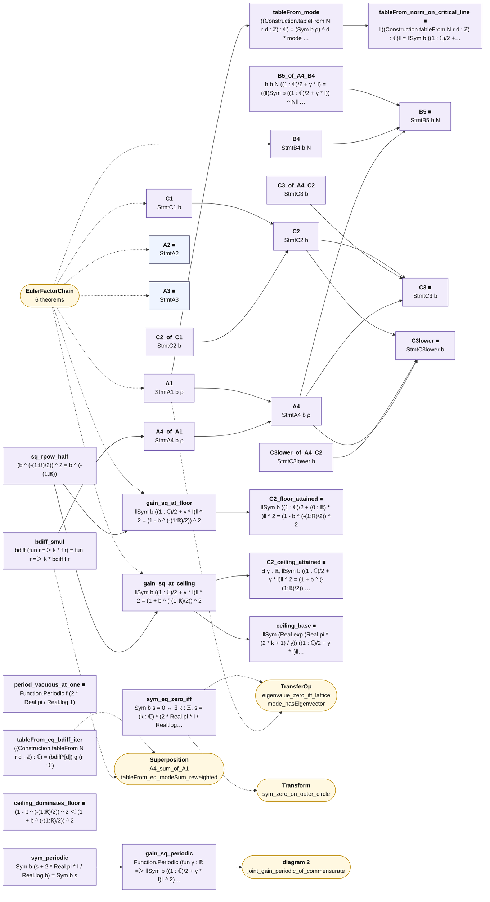
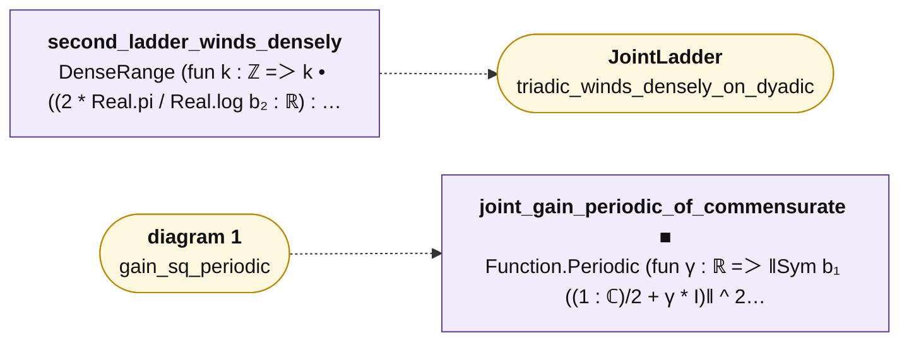

# `lean/Chain.lean`

The Euler Factor Chain, as a chain. Companion to papers/Euler-Factor-Chain.md.

32 theorems, 14 definitions, 713 lines. Arrows are Lean's own record of what each proof uses.

**Imports:** [`Construction`](../lean/Construction.md), [`EulerFactorChain`](../lean/EulerFactorChain.md)  
**Imported by:** [`JointLadder`](../lean/JointLadder.md), [`Measured`](../lean/Measured.md), [`NyquistPeak`](../lean/NyquistPeak.md), [`Superposition`](../lean/Superposition.md), [`TransferOp`](../lean/TransferOp.md), [`Transform`](../lean/Transform.md)

## The picture

### Diagram 1 of 2: `bdiff_smul` to `ceiling_dominates_floor`



### Diagram 2 of 2: `joint_gain_periodic_of_commensurate` to `second_ladder_winds_densely`



An arrow A → B reads "A is used in the proof of B". Green: counting, integers only. Violet: shape, analysis with no ζ. Blue: reads ζ. A name ending in ■ is an end: nothing else uses it. Red: contains `sorry`. Yellow: theorems in another file, counted; a dotted arrow crosses files. Definitions are not drawn; they are listed below the diagram.

## Definitions

<a name="Chain-Sym"></a>
### `Chain.Sym`

def · line 29

The reciprocal Euler factor at `b`.

- **Is:** `` Sym (b : ℝ) (s : ℂ) : ℂ := 1 - (b : ℂ) ^ (-s) ``
- **Used by 51:** [`Chain.A1`](#Chain-A1), [`Chain.A3`](#Chain-A3), [`Chain.A4_of_A1`](#Chain-A4_of_A1), [`Chain.B5_of_A4_B4`](#Chain-B5_of_A4_B4), [`Chain.C1`](#Chain-C1), [`Chain.C2_ceiling_attained`](#Chain-C2_ceiling_attained), [`Chain.C2_floor_attained`](#Chain-C2_floor_attained), [`Chain.C2_of_C1`](#Chain-C2_of_C1), [`Chain.C3_of_A4_C2`](#Chain-C3_of_A4_C2), [`Chain.C3lower_of_A4_C2`](#Chain-C3lower_of_A4_C2), [`Chain.StmtA1`](#Chain-StmtA1), [`Chain.StmtA3`](#Chain-StmtA3), [`Chain.StmtA4`](#Chain-StmtA4), [`Chain.StmtB4`](#Chain-StmtB4), [`Chain.StmtB5`](#Chain-StmtB5), [`Chain.StmtC1`](#Chain-StmtC1), [`Chain.StmtC2`](#Chain-StmtC2), [`Chain.ceiling_base`](#Chain-ceiling_base), [`Chain.gain_sq_at_ceiling`](#Chain-gain_sq_at_ceiling), [`Chain.gain_sq_at_floor`](#Chain-gain_sq_at_floor), [`Chain.gain_sq_periodic`](#Chain-gain_sq_periodic), [`Chain.joint_gain_periodic_of_commensurate`](#Chain-joint_gain_periodic_of_commensurate), [`Chain.sym_eq_zero_iff`](#Chain-sym_eq_zero_iff), [`Chain.sym_periodic`](#Chain-sym_periodic), [`Chain.tableFrom_mode`](#Chain-tableFrom_mode), [`Chain.tableFrom_norm_on_critical_line`](#Chain-tableFrom_norm_on_critical_line), [`JointLadder.d2_iter_jmode`](../lean/JointLadder.md#JointLadder-d2_iter_jmode), [`JointLadder.d2_jmode`](../lean/JointLadder.md#JointLadder-d2_jmode), [`JointLadder.d3_iter_jmode`](../lean/JointLadder.md#JointLadder-d3_iter_jmode), [`JointLadder.d3_jmode`](../lean/JointLadder.md#JointLadder-d3_jmode), [`NyquistPeak.gain_eq_norm_sym_pow`](../lean/NyquistPeak.md#NyquistPeak-gain_eq_norm_sym_pow), [`NyquistPeak.norm_sym_on_imaginary_axis`](../lean/NyquistPeak.md#NyquistPeak-norm_sym_on_imaginary_axis), [`NyquistPeak.norm_sym_pow_at_boundaryBase`](../lean/NyquistPeak.md#NyquistPeak-norm_sym_pow_at_boundaryBase), [`NyquistPeak.sym_on_imaginary_axis`](../lean/NyquistPeak.md#NyquistPeak-sym_on_imaginary_axis), [`Superposition.A4_sum_of_A1`](../lean/Superposition.md#Superposition-A4_sum_of_A1), [`Superposition.depth_reweights_each_mode`](../lean/Superposition.md#Superposition-depth_reweights_each_mode), [`Superposition.tableFrom_eq_modeSum_reweighted`](../lean/Superposition.md#Superposition-tableFrom_eq_modeSum_reweighted), [`TransferOp.eigenvalue_zero_iff_lattice`](../lean/TransferOp.md#TransferOp-eigenvalue_zero_iff_lattice), [`TransferOp.mode_hasEigenvector`](../lean/TransferOp.md#TransferOp-mode_hasEigenvector), [`TransferOp.mode_pow`](../lean/TransferOp.md#TransferOp-mode_pow), and 11 more (full list in `map/lean_map.json`)

<a name="Chain-mode"></a>
### `Chain.mode`

def · line 32

A mode on the ladder, indexed by `r`.

- **Is:** `` mode (b : ℝ) (ρ : ℂ) : ℂ → ℂ := fun r => (b : ℂ) ^ (r * ρ) ``
- **Used by 27:** [`Chain.A1`](#Chain-A1), [`Chain.A4_of_A1`](#Chain-A4_of_A1), [`Chain.B5_of_A4_B4`](#Chain-B5_of_A4_B4), [`Chain.C3_of_A4_C2`](#Chain-C3_of_A4_C2), [`Chain.C3lower_of_A4_C2`](#Chain-C3lower_of_A4_C2), [`Chain.StmtA1`](#Chain-StmtA1), [`Chain.StmtA4`](#Chain-StmtA4), [`Chain.StmtC3`](#Chain-StmtC3), [`Chain.StmtC3lower`](#Chain-StmtC3lower), [`Chain.tableFrom_mode`](#Chain-tableFrom_mode), [`Chain.tableFrom_norm_on_critical_line`](#Chain-tableFrom_norm_on_critical_line), [`Superposition.A4_sum_of_A1`](../lean/Superposition.md#Superposition-A4_sum_of_A1), [`Superposition.depth_reweights_each_mode`](../lean/Superposition.md#Superposition-depth_reweights_each_mode), [`Superposition.modeSum`](../lean/Superposition.md#Superposition-modeSum), [`TransferOp.eigenvalue_zero_iff_lattice`](../lean/TransferOp.md#TransferOp-eigenvalue_zero_iff_lattice), [`TransferOp.mode_hasEigenvector`](../lean/TransferOp.md#TransferOp-mode_hasEigenvector), [`TransferOp.mode_ne_zero`](../lean/TransferOp.md#TransferOp-mode_ne_zero), [`TransferOp.mode_ne_zero'`](../lean/TransferOp.md#TransferOp-mode_ne_zero-), [`TransferOp.mode_pow`](../lean/TransferOp.md#TransferOp-mode_pow), [`TransferOp.sym_hasEigenvalue`](../lean/TransferOp.md#TransferOp-sym_hasEigenvalue), [`AliasClass.alias_weight`](../lean_stage3/AliasClass.md#AliasClass-alias_weight), [`AliasClass.alias_weight_ne_zero`](../lean_stage3/AliasClass.md#AliasClass-alias_weight_ne_zero), [`AliasClass.mode_eq_of_alias`](../lean_stage3/AliasClass.md#AliasClass-mode_eq_of_alias), [`CellModes.cell_eq_modeSum`](../lean_stage3/CellModes.md#CellModes-cell_eq_modeSum), [`CellModes.mode_two_int`](../lean_stage3/CellModes.md#CellModes-mode_two_int), [`LadderFading.line_not_fading`](../lean_stage3/LadderFading.md#LadderFading-line_not_fading), [`LadderMean.line_not_fading_summable`](../lean_stage3/LadderMean.md#LadderMean-line_not_fading_summable)

<a name="Chain-bdiff"></a>
### `Chain.bdiff`

def · line 35

Backward differencing in the ladder index.

- **Is:** `` bdiff (f : ℂ → ℂ) : ℂ → ℂ := fun r => f r - f (r - 1) ``
- **Used by 19:** [`Chain.A1`](#Chain-A1), [`Chain.A4_of_A1`](#Chain-A4_of_A1), [`Chain.B5_of_A4_B4`](#Chain-B5_of_A4_B4), [`Chain.C3_of_A4_C2`](#Chain-C3_of_A4_C2), [`Chain.C3lower_of_A4_C2`](#Chain-C3lower_of_A4_C2), [`Chain.StmtA1`](#Chain-StmtA1), [`Chain.StmtA4`](#Chain-StmtA4), [`Chain.StmtC3`](#Chain-StmtC3), [`Chain.StmtC3lower`](#Chain-StmtC3lower), [`Chain.bdiff_smul`](#Chain-bdiff_smul), [`Chain.tableFrom_eq_bdiff_iter`](#Chain-tableFrom_eq_bdiff_iter), [`Superposition.A4_sum_of_A1`](../lean/Superposition.md#Superposition-A4_sum_of_A1), [`Superposition.bdiff_sum`](../lean/Superposition.md#Superposition-bdiff_sum), [`Superposition.depth_reweights_each_mode`](../lean/Superposition.md#Superposition-depth_reweights_each_mode), [`Superposition.tableFrom_eq_modeSum_reweighted`](../lean/Superposition.md#Superposition-tableFrom_eq_modeSum_reweighted), [`TransferOp.bdiffL`](../lean/TransferOp.md#TransferOp-bdiffL), [`TransferOp.bdiffL_apply`](../lean/TransferOp.md#TransferOp-bdiffL_apply), [`TransferOp.eigenvalue_zero_iff_lattice`](../lean/TransferOp.md#TransferOp-eigenvalue_zero_iff_lattice), [`TransferOp.mode_hasEigenvector`](../lean/TransferOp.md#TransferOp-mode_hasEigenvector)

<a name="Chain-h"></a>
### `Chain.h`

def · line 38

The Weil test function of order `N`.

- **Is:** `` h (b : ℝ) (N : ℕ) (s : ℂ) : ℂ := (1 - (b : ℂ) ^ (-s)) ^ N * (1 - (b : ℂ) ^ (s - 1)) ^ N ``
- **Used by 3:** [`Chain.B5_of_A4_B4`](#Chain-B5_of_A4_B4), [`Chain.StmtB4`](#Chain-StmtB4), [`Chain.StmtB5`](#Chain-StmtB5)

<a name="Chain-StmtA1"></a>
### `Chain.StmtA1`

def · line 44

A1. One backward difference multiplies a mode by the symbol.

- **Is:** `` StmtA1 (b : ℝ) (ρ : ℂ) : Prop := ∀ r : ℂ, bdiff (mode b ρ) r = Sym b ρ * mode b ρ r ``
- **Built from:** [`Chain.Sym`](#Chain-Sym), [`Chain.bdiff`](#Chain-bdiff), [`Chain.mode`](#Chain-mode)
- **Used by 5:** [`Chain.A1`](#Chain-A1), [`Chain.A4_of_A1`](#Chain-A4_of_A1), [`Superposition.A4_sum_of_A1`](../lean/Superposition.md#Superposition-A4_sum_of_A1), [`Superposition.depth_reweights_each_mode`](../lean/Superposition.md#Superposition-depth_reweights_each_mode), [`Superposition.tableFrom_eq_modeSum_reweighted`](../lean/Superposition.md#Superposition-tableFrom_eq_modeSum_reweighted)

<a name="Chain-StmtA2"></a>
### `Chain.StmtA2`

def · line 51

A2. Euler's product. It is a statement about *all* primes at once, so it carries no base index `b`, and it holds only where the product converges — hence the `1 < s.re` hypothesis, which is Euler's own content and not a technicality.

- **Is:** `` StmtA2 : Prop := ∀ s : ℂ, 1 < s.re → ∏' p : Nat.Primes, (1 - (p : ℂ) ^ (-s))⁻¹ = riemannZeta s ``
- **Used by 1:** [`Chain.A2`](#Chain-A2)

<a name="Chain-StmtA3"></a>
### `Chain.StmtA3`

def · line 69

A3. The single-base reading, with the `b` index kept. Two conjuncts. The first says the chain's `Sym` at a prime base is the Euler product's factor at that prime. It is definitional — `Sym b s` unfolds to `1 - b^(-s)` and the only content is the `ℕ → ℝ → ℂ` cast — and it is stated rather than dressed up, because the paper's A3 ("therefore `1 − b^(−s)` is the reciprocal Euler factor at `b`") is precisely a renaming, not an inference.

- **Is:** `` StmtA3 : Prop := (∀ (p : Nat.Primes) (s : ℂ), Sym ((p : ℕ) : ℝ) s = 1 - (p : ℂ) ^ (-s)) ∧ (∀ s : ℂ, 1 < s.re → ∏' p : Nat.Primes, (Sym ((p : ℕ) : ℝ) s)⁻¹ = riemannZeta s) ``
- **Built from:** [`Chain.Sym`](#Chain-Sym)
- **Used by 1:** [`Chain.A3`](#Chain-A3)

<a name="Chain-StmtA4"></a>
### `Chain.StmtA4`

def · line 75

A4. `N` differences multiply a mode by the `N`-th power of the symbol.

- **Is:** `` StmtA4 (b : ℝ) (ρ : ℂ) : Prop := ∀ (N : ℕ) (r : ℂ), (bdiff^[N]) (mode b ρ) r = (Sym b ρ) ^ N * mode b ρ r ``
- **Built from:** [`Chain.Sym`](#Chain-Sym), [`Chain.bdiff`](#Chain-bdiff), [`Chain.mode`](#Chain-mode)
- **Used by 5:** [`Chain.A4`](#Chain-A4), [`Chain.A4_of_A1`](#Chain-A4_of_A1), [`Chain.B5_of_A4_B4`](#Chain-B5_of_A4_B4), [`Chain.C3_of_A4_C2`](#Chain-C3_of_A4_C2), [`Chain.C3lower_of_A4_C2`](#Chain-C3lower_of_A4_C2)

<a name="Chain-StmtB4"></a>
### `Chain.StmtB4`

def · line 80

B4. On the critical line the Weil function is the symbol's modulus to the `2N`.

- **Is:** `` StmtB4 (b : ℝ) (N : ℕ) : Prop := ∀ t : ℝ, h b N ((1 : ℂ)/2 + t * I) = ((‖Sym b ((1 : ℂ)/2 + t * I)‖ ^ (2 * N) : ℝ) : ℂ) ``
- **Built from:** [`Chain.Sym`](#Chain-Sym), [`Chain.h`](#Chain-h)
- **Used by 2:** [`Chain.B4`](#Chain-B4), [`Chain.B5_of_A4_B4`](#Chain-B5_of_A4_B4)

<a name="Chain-StmtB5"></a>
### `Chain.StmtB5`

def · line 84

B5. The depth-`N` transfer gain and the Weil weight are one quantity.

- **Is:** `` StmtB5 (b : ℝ) (N : ℕ) : Prop := ∀ t : ℝ, h b N ((1 : ℂ)/2 + t * I) = ((‖(Sym b ((1 : ℂ)/2 + t * I)) ^ N‖ ^ 2 : ℝ) : ℂ) ``
- **Built from:** [`Chain.Sym`](#Chain-Sym), [`Chain.h`](#Chain-h)
- **Used by 1:** [`Chain.B5`](#Chain-B5)

<a name="Chain-StmtC1"></a>
### `Chain.StmtC1`

def · line 89

C1. The squared modulus on the critical line, expanded.

- **Is:** `` StmtC1 (b : ℝ) : Prop := ∀ γ : ℝ, ‖Sym b ((1 : ℂ)/2 + γ * I)‖ ^ 2 = 1 - 2 * b ^ (-(1:ℝ)/2) * Real.cos (γ * Real.log b) + b ^ (-(1:ℝ)) ``
- **Built from:** [`Chain.Sym`](#Chain-Sym)
- **Used by 2:** [`Chain.C1`](#Chain-C1), [`Chain.C2_of_C1`](#Chain-C2_of_C1)

<a name="Chain-StmtC2"></a>
### `Chain.StmtC2`

def · line 94

C2. The gain is bounded by `1 ± b^(-1/2)`.

- **Is:** `` StmtC2 (b : ℝ) : Prop := ∀ γ : ℝ, (1 - b ^ (-(1:ℝ)/2)) ^ 2 ≤ ‖Sym b ((1 : ℂ)/2 + γ * I)‖ ^ 2 ∧ ‖Sym b ((1 : ℂ)/2 + γ * I)‖ ^ 2 ≤ (1 + b ^ (-(1:ℝ)/2)) ^ 2 ``
- **Built from:** [`Chain.Sym`](#Chain-Sym)
- **Used by 4:** [`Chain.C2`](#Chain-C2), [`Chain.C2_of_C1`](#Chain-C2_of_C1), [`Chain.C3_of_A4_C2`](#Chain-C3_of_A4_C2), [`Chain.C3lower_of_A4_C2`](#Chain-C3lower_of_A4_C2)

<a name="Chain-StmtC3"></a>
### `Chain.StmtC3`

def · line 99

C3. No mode's depth-`N` gain escapes those bounds.

- **Is:** `` StmtC3 (b : ℝ) : Prop := ∀ (N : ℕ) (γ : ℝ) (r : ℂ), ‖(bdiff^[N]) (mode b ((1 : ℂ)/2 + γ * I)) r‖ ≤ (1 + b ^ (-(1:ℝ)/2)) ^ N * ‖mode b ((1 : ℂ)/2 + γ * I) r‖ ``
- **Built from:** [`Chain.bdiff`](#Chain-bdiff), [`Chain.mode`](#Chain-mode)
- **Used by 2:** [`Chain.C3`](#Chain-C3), [`Chain.C3_of_A4_C2`](#Chain-C3_of_A4_C2)

<a name="Chain-StmtC3lower"></a>
### `Chain.StmtC3lower`

def · line 118

C3, the other half. The paper's C3 reads "no mode grows *or decays* without bound under depth". `StmtC3` is the growth half only. This is the decay half, and the ingredient was already present and unused: `StmtC2`'s FIRST conjunct bounds the gain below, `C2_of_C1` proves it, and `C3_of_A4_C2` calls only `.2`.

- **Is:** `` StmtC3lower (b : ℝ) : Prop := ∀ (N : ℕ) (γ : ℝ) (r : ℂ), |1 - b ^ (-(1:ℝ)/2)| ^ N * ‖mode b ((1 : ℂ)/2 + γ * I) r‖ ≤ ‖(bdiff^[N]) (mode b ((1 : ℂ)/2 + γ * I)) r‖ ``
- **Built from:** [`Chain.bdiff`](#Chain-bdiff), [`Chain.mode`](#Chain-mode)
- **Used by 2:** [`Chain.C3lower`](#Chain-C3lower), [`Chain.C3lower_of_A4_C2`](#Chain-C3lower_of_A4_C2)

## Theorems

<a name="Chain-bdiff_smul"></a>
### `Chain.bdiff_smul`

line 126

**Shape.** Uses real or complex analysis; nothing in it or beneath it reads ζ.

**Why.** `bdiff` is homogeneous: scalars pass through.

**Proves**

```lean
bdiff (fun r => k * f r) = fun r => k * bdiff f r
```

**Needs** (its hypotheses)

  - `` k : ℂ ``
  - `` f : ℂ → ℂ ``

**Stated with:** [`Chain.bdiff`](#Chain-bdiff)

**Fed by:** no theorem of this repo; it stands on Mathlib and the definitions below.

**Feeds** (2 that use it)

  - [`Chain.A4_of_A1`](#Chain-A4_of_A1) — `` StmtA4 b ρ ``
  - [`Superposition.A4_sum_of_A1`](../lean/Superposition.md#Superposition-A4_sum_of_A1) (Superposition) — `` ∀ (N : ℕ) (r : ℂ), (bdiff^[N]) (modeSum b ρ c s) r = ∑ i ∈ s, c i * (Sym b (ρ i)) ^ N * mode b (ρ i) r ``

<a name="Chain-A4_of_A1"></a>
### `Chain.A4_of_A1`

line 132

**Shape.** Uses real or complex analysis; nothing in it or beneath it reads ζ.

**Why.** A1 → A4. The arrow that turns one difference into `N`, by induction. This is the paper's A3–A4 step and it uses A1 essentially.

**Proves**

```lean
StmtA4 b ρ
```

**Needs** (its hypotheses)

  - `` hA1 : StmtA1 b ρ ``

**Stated with:** [`Chain.StmtA1`](#Chain-StmtA1), [`Chain.StmtA4`](#Chain-StmtA4)

**Fed by** (1 theorem its proof uses)

  - [`Chain.bdiff_smul`](#Chain-bdiff_smul) — `` bdiff (fun r => k * f r) = fun r => k * bdiff f r ``

**Definitions its proof touches:** [`Chain.Sym`](#Chain-Sym), [`Chain.bdiff`](#Chain-bdiff), [`Chain.mode`](#Chain-mode)

**Feeds** (1 that use it)

  - [`Chain.A4`](#Chain-A4) — `` StmtA4 b ρ ``

<a name="Chain-B5_of_A4_B4"></a>
### `Chain.B5_of_A4_B4`

line 157

**Shape.** Uses real or complex analysis; nothing in it or beneath it reads ζ.

**Why.** A4 ∧ B4 → B5. The payoff arrow: the depth gain *is* the Weil weight. Lean needs only `hB4`. The proof rewrites by it, then moves the exponent inside the norm — `‖Sym‖^(2N) = ‖Sym^N‖^2`, which is `norm_pow` and nothing else. `hA4` is carried to mirror the paper's stated dependency, not because the proof consumes it: the `have` binding it is inert, and it is instantiated at `r = 1`, which appears nowhere in the goal.

**Proves**

```lean
h b N ((1 : ℂ)/2 + γ * I) = ((‖(Sym b ((1 : ℂ)/2 + γ * I)) ^ N‖ ^ 2 : ℝ) : ℂ)
```

**Needs** (its hypotheses)

  - `` hA4 : StmtA4 b ((1 : ℂ)/2 + γ * I) ``
  - `` hB4 : StmtB4 b N ``

**Stated with:** [`Chain.StmtA4`](#Chain-StmtA4), [`Chain.StmtB4`](#Chain-StmtB4), [`Chain.Sym`](#Chain-Sym), [`Chain.h`](#Chain-h)

**Fed by:** no theorem of this repo; it stands on Mathlib and the definitions below.

**Definitions its proof touches:** [`Chain.bdiff`](#Chain-bdiff), [`Chain.mode`](#Chain-mode)

**Feeds** (1 that use it)

  - [`Chain.B5`](#Chain-B5) — `` StmtB5 b N ``

<a name="Chain-C2_of_C1"></a>
### `Chain.C2_of_C1`

line 167

**Shape.** Uses real or complex analysis; nothing in it or beneath it reads ζ.

**Why.** C1 → C2. The bound follows from the expansion and `|cos| ≤ 1`.

**Proves**

```lean
StmtC2 b
```

**Needs** (its hypotheses)

  - `` hb : 0 < b ``
  - `` hC1 : StmtC1 b ``

**Stated with:** [`Chain.StmtC1`](#Chain-StmtC1), [`Chain.StmtC2`](#Chain-StmtC2)

**Fed by:** no theorem of this repo; it stands on Mathlib and the definitions below.

**Definitions its proof touches:** [`Chain.Sym`](#Chain-Sym)

**Feeds** (1 that use it)

  - [`Chain.C2`](#Chain-C2) — `` StmtC2 b ``

<a name="Chain-C3_of_A4_C2"></a>
### `Chain.C3_of_A4_C2`

line 182

**Shape.** Uses real or complex analysis; nothing in it or beneath it reads ζ.

**Why.** A4 ∧ C2 → C3. Depth cannot escape the bound. Uses A4 to name the depth-`N` multiplier and C2 to bound it.

**Proves**

```lean
StmtC3 b
```

**Needs** (its hypotheses)

  - `` hb : 0 < b ``
  - `` hA4 : ∀ γ : ℝ, StmtA4 b ((1 : ℂ)/2 + γ * I) ``
  - `` hC2 : StmtC2 b ``

**Stated with:** [`Chain.StmtA4`](#Chain-StmtA4), [`Chain.StmtC2`](#Chain-StmtC2), [`Chain.StmtC3`](#Chain-StmtC3)

**Fed by:** no theorem of this repo; it stands on Mathlib and the definitions below.

**Definitions its proof touches:** [`Chain.Sym`](#Chain-Sym), [`Chain.bdiff`](#Chain-bdiff), [`Chain.mode`](#Chain-mode)

**Feeds** (1 that use it)

  - [`Chain.C3`](#Chain-C3) — `` StmtC3 b ``

<a name="Chain-C3lower_of_A4_C2"></a>
### `Chain.C3lower_of_A4_C2`

line 201

**Shape.** Uses real or complex analysis; nothing in it or beneath it reads ζ.

**Why.** A4 ∧ C2 → C3 (decay half). A strict mirror of `C3_of_A4_C2`, reading `(hC2 γ).1` where that reads `.2`.

**Proves**

```lean
StmtC3lower b
```

**Needs** (its hypotheses)

  - `` hA4 : ∀ γ : ℝ, StmtA4 b ((1 : ℂ)/2 + γ * I) ``
  - `` hC2 : StmtC2 b ``

**Stated with:** [`Chain.StmtA4`](#Chain-StmtA4), [`Chain.StmtC2`](#Chain-StmtC2), [`Chain.StmtC3lower`](#Chain-StmtC3lower)

**Fed by:** no theorem of this repo; it stands on Mathlib and the definitions below.

**Definitions its proof touches:** [`Chain.Sym`](#Chain-Sym), [`Chain.bdiff`](#Chain-bdiff), [`Chain.mode`](#Chain-mode)

**Feeds** (1 that use it)

  - [`Chain.C3lower`](#Chain-C3lower) — `` StmtC3lower b ``

<a name="Chain-A2"></a>
### `Chain.A2`

line 221

**Reads ζ.** It, or something it rests on, uses the zeta function, its zeros or the Riemann hypothesis.

**Why.** A2, proved rather than assumed, from `EulerFactorChain.euler_product_riemannZeta` (Mathlib's `riemannZeta_eulerProduct_tprod`). No base index, and the convergence hypothesis travels with it.

**Proves**

```lean
StmtA2
```

**Stated with:** [`Chain.StmtA2`](#Chain-StmtA2)

**Fed by** (1 theorem its proof uses)

  - [`EulerFactorChain.euler_product_riemannZeta`](../lean/EulerFactorChain.md#EulerFactorChain-euler_product_riemannZeta) (EulerFactorChain) — `` ∏' p : Nat.Primes, (1 - (p : ℂ) ^ (-s))⁻¹ = riemannZeta s ``

**Feeds:** nothing. It is an end.

<a name="Chain-A3"></a>
### `Chain.A3`

line 226

**Reads ζ.** It, or something it rests on, uses the zeta function, its zeros or the Riemann hypothesis.

**Why.** A3, proved rather than assumed. The first conjunct is `EulerFactorChain.sym_natCast`, which is a cast lemma; the second is `EulerFactorChain.euler_product_sym`, i.e. A2 with `Sym` substituted in.

**Proves**

```lean
StmtA3
```

**Stated with:** [`Chain.StmtA3`](#Chain-StmtA3)

**Fed by** (2 theorems its proof uses)

  - [`EulerFactorChain.euler_product_sym`](../lean/EulerFactorChain.md#EulerFactorChain-euler_product_sym) (EulerFactorChain) — `` ∏' p : Nat.Primes, (sym ((p : ℕ) : ℝ) s)⁻¹ = riemannZeta s ``
  - [`EulerFactorChain.sym_natCast`](../lean/EulerFactorChain.md#EulerFactorChain-sym_natCast) (EulerFactorChain) — `` sym (n : ℝ) s = 1 - (n : ℂ) ^ (-s) ``

**Definitions its proof touches:** [`Chain.Sym`](#Chain-Sym)

**Feeds:** nothing. It is an end.

<a name="Chain-C1"></a>
### `Chain.C1`

line 239

**Shape.** Uses real or complex analysis; nothing in it or beneath it reads ζ.

**Why.** C1, proved rather than assumed. The expansion is `EulerFactorChain.gain_sq_on_critical_line`, the law of cosines with sides `1` and `b^(-1/2)`. Needs only `0 < b`.

**Proves**

```lean
StmtC1 b
```

**Needs** (its hypotheses)

  - `` hb : 0 < b ``

**Stated with:** [`Chain.StmtC1`](#Chain-StmtC1)

**Fed by** (1 theorem its proof uses)

  - [`EulerFactorChain.gain_sq_on_critical_line`](../lean/EulerFactorChain.md#EulerFactorChain-gain_sq_on_critical_line) (EulerFactorChain) — `` ‖1 - (b : ℂ) ^ (-((1 : ℂ)/2 + γ * I))‖ ^ 2 = 1 - 2 * b ^ (-(1:ℝ)/2) * Real.cos (γ * Real.log b) + b ^ (-(1:ℝ)) ``

**Definitions its proof touches:** [`Chain.Sym`](#Chain-Sym)

**Feeds** (1 that use it)

  - [`Chain.C2`](#Chain-C2) — `` StmtC2 b ``

<a name="Chain-C2"></a>
### `Chain.C2`

line 246

**Shape.** Uses real or complex analysis; nothing in it or beneath it reads ζ.

**Why.** C2, now unconditional. Same arrow as `C2_of_C1`, with its hypothesis supplied by `C1`; the implication is still the thing Lean checks.

**Proves**

```lean
StmtC2 b
```

**Needs** (its hypotheses)

  - `` hb : 0 < b ``

**Stated with:** [`Chain.StmtC2`](#Chain-StmtC2)

**Fed by** (2 theorems its proof uses)

  - [`Chain.C1`](#Chain-C1) — `` StmtC1 b ``
  - [`Chain.C2_of_C1`](#Chain-C2_of_C1) — `` StmtC2 b ``

**Feeds** (2 that use it)

  - [`Chain.C3`](#Chain-C3) — `` StmtC3 b ``
  - [`Chain.C3lower`](#Chain-C3lower) — `` StmtC3lower b ``

<a name="Chain-A1"></a>
### `Chain.A1`

line 257

**Shape.** Uses real or complex analysis; nothing in it or beneath it reads ζ.

**Why.** A1, proved rather than assumed, from `EulerFactorChain.symbol_of_backward_difference`. Needs only `b ≠ 0`.

**Proves**

```lean
StmtA1 b ρ
```

**Needs** (its hypotheses)

  - `` hb : b ≠ 0 ``
  - `` ρ : ℂ ``

**Stated with:** [`Chain.StmtA1`](#Chain-StmtA1)

**Fed by** (1 theorem its proof uses)

  - [`EulerFactorChain.symbol_of_backward_difference`](../lean/EulerFactorChain.md#EulerFactorChain-symbol_of_backward_difference) (EulerFactorChain) — `` (b : ℂ) ^ (r * ρ) - (b : ℂ) ^ ((r - 1) * ρ) = sym b ρ * (b : ℂ) ^ (r * ρ) ``

**Definitions its proof touches:** [`Chain.Sym`](#Chain-Sym), [`Chain.bdiff`](#Chain-bdiff), [`Chain.mode`](#Chain-mode)

**Feeds** (4 that use it)

  - [`Chain.A4`](#Chain-A4) — `` StmtA4 b ρ ``
  - [`Chain.tableFrom_mode`](#Chain-tableFrom_mode) — `` ((Construction.tableFrom N r d : ℤ) : ℂ) = (Sym b ρ) ^ d * mode b ρ (r : ℂ) ``
  - [`TransferOp.eigenvalue_zero_iff_lattice`](../lean/TransferOp.md#TransferOp-eigenvalue_zero_iff_lattice) (TransferOp) — `` bdiffL (mode b ρ) = 0 ↔ ∃ k : ℤ, ρ = (k : ℂ) * (2 * Real.pi * I / Real.log b) ``
  - [`TransferOp.mode_hasEigenvector`](../lean/TransferOp.md#TransferOp-mode_hasEigenvector) (TransferOp) — `` bdiffL.HasEigenvector (Sym b ρ) (mode b ρ) ``

<a name="Chain-A4"></a>
### `Chain.A4`

line 264

**Shape.** Uses real or complex analysis; nothing in it or beneath it reads ζ.

**Why.** A4, now unconditional. Same arrow as `A4_of_A1`, with its hypothesis supplied by `A1`.

**Proves**

```lean
StmtA4 b ρ
```

**Needs** (its hypotheses)

  - `` hb : b ≠ 0 ``
  - `` ρ : ℂ ``

**Stated with:** [`Chain.StmtA4`](#Chain-StmtA4)

**Fed by** (2 theorems its proof uses)

  - [`Chain.A1`](#Chain-A1) — `` StmtA1 b ρ ``
  - [`Chain.A4_of_A1`](#Chain-A4_of_A1) — `` StmtA4 b ρ ``

**Feeds** (3 that use it)

  - [`Chain.B5`](#Chain-B5) — `` StmtB5 b N ``
  - [`Chain.C3`](#Chain-C3) — `` StmtC3 b ``
  - [`Chain.C3lower`](#Chain-C3lower) — `` StmtC3lower b ``

<a name="Chain-B4"></a>
### `Chain.B4`

line 268

**Shape.** Uses real or complex analysis; nothing in it or beneath it reads ζ.

**Why.** B4, proved rather than assumed, from `EulerFactorChain.h_eq_gain_pow_on_critical_line`. Needs only `0 < b`.

**Proves**

```lean
StmtB4 b N
```

**Needs** (its hypotheses)

  - `` hb : 0 < b ``
  - `` N : ℕ ``

**Stated with:** [`Chain.StmtB4`](#Chain-StmtB4)

**Fed by** (1 theorem its proof uses)

  - [`EulerFactorChain.h_eq_gain_pow_on_critical_line`](../lean/EulerFactorChain.md#EulerFactorChain-h_eq_gain_pow_on_critical_line) (EulerFactorChain) — `` h b N ((1 : ℂ)/2 + t * I) = ((‖1 - (b : ℂ) ^ (-((1 : ℂ)/2 + t * I))‖ : ℝ) ^ (2 * N) : ℝ) ``

**Feeds** (1 that use it)

  - [`Chain.B5`](#Chain-B5) — `` StmtB5 b N ``

<a name="Chain-B5"></a>
### `Chain.B5`

line 275

**Shape.** Uses real or complex analysis; nothing in it or beneath it reads ζ.

**Why.** B5, now unconditional. Same arrow as `B5_of_A4_B4`, with both hypotheses supplied. The depth gain *is* the Weil weight, with nothing assumed.

**Proves**

```lean
StmtB5 b N
```

**Needs** (its hypotheses)

  - `` hb : 0 < b ``
  - `` N : ℕ ``

**Stated with:** [`Chain.StmtB5`](#Chain-StmtB5)

**Fed by** (3 theorems its proof uses)

  - [`Chain.A4`](#Chain-A4) — `` StmtA4 b ρ ``
  - [`Chain.B4`](#Chain-B4) — `` StmtB4 b N ``
  - [`Chain.B5_of_A4_B4`](#Chain-B5_of_A4_B4) — `` h b N ((1 : ℂ)/2 + γ * I) = ((‖(Sym b ((1 : ℂ)/2 + γ * I)) ^ N‖ ^ 2 : ℝ) : ℂ) ``

**Feeds:** nothing. It is an end.

<a name="Chain-C3"></a>
### `Chain.C3`

line 280

**Shape.** Uses real or complex analysis; nothing in it or beneath it reads ζ.

**Why.** C3, now unconditional. Same arrow as `C3_of_A4_C2`, with `A4` and `C2` supplied. No mode's depth-`N` gain escapes the bound, with nothing assumed.

**Proves**

```lean
StmtC3 b
```

**Needs** (its hypotheses)

  - `` hb : 0 < b ``

**Stated with:** [`Chain.StmtC3`](#Chain-StmtC3)

**Fed by** (3 theorems its proof uses)

  - [`Chain.A4`](#Chain-A4) — `` StmtA4 b ρ ``
  - [`Chain.C2`](#Chain-C2) — `` StmtC2 b ``
  - [`Chain.C3_of_A4_C2`](#Chain-C3_of_A4_C2) — `` StmtC3 b ``

**Feeds:** nothing. It is an end.

<a name="Chain-C3lower"></a>
### `Chain.C3lower`

line 288

**Shape.** Uses real or complex analysis; nothing in it or beneath it reads ζ.

**Why.** C3's decay half, unconditional. Same arrow as `C3lower_of_A4_C2` with both hypotheses supplied. With `C3` this is the paper's C3 in full: a mode's depth-`N` amplitude is trapped between `|1 − b^(−1/2)|^N` and `(1 + b^(−1/2))^N` times its undifferenced amplitude, at every rung and every `γ`.

**Proves**

```lean
StmtC3lower b
```

**Needs** (its hypotheses)

  - `` hb : 0 < b ``

**Stated with:** [`Chain.StmtC3lower`](#Chain-StmtC3lower)

**Fed by** (3 theorems its proof uses)

  - [`Chain.A4`](#Chain-A4) — `` StmtA4 b ρ ``
  - [`Chain.C2`](#Chain-C2) — `` StmtC2 b ``
  - [`Chain.C3lower_of_A4_C2`](#Chain-C3lower_of_A4_C2) — `` StmtC3lower b ``

**Feeds:** nothing. It is an end.

<a name="Chain-tableFrom_eq_bdiff_iter"></a>
### `Chain.tableFrom_eq_bdiff_iter`

line 303

**Shape.** Uses real or complex analysis; nothing in it or beneath it reads ζ.

**Why.** The weld. `Construction.tableFrom` and `bdiff` are the same operation on two domains. If `g : ℂ → ℂ` agrees with the integer row `N` at every integer, the table's cell at `(r,d)` IS `bdiff` iterated `d` times on `g` at `r`.

**Proves**

```lean
((Construction.tableFrom N r d : ℤ) : ℂ) = (bdiff^[d]) g (r : ℂ)
```

**Needs** (its hypotheses)

  - `` hag : ∀ n : ℤ, ((N n : ℤ) : ℂ) = g (n : ℂ) ``
  - `` r : ℤ ``
  - `` d : ℕ ``

**Stated with:** [`Chain.bdiff`](#Chain-bdiff), [`Construction.tableFrom`](../lean/Construction.md#Construction-tableFrom)

**Fed by:** no theorem of this repo; it stands on Mathlib and the definitions below.

**Feeds** (1 that use it)

  - [`Superposition.tableFrom_eq_modeSum_reweighted`](../lean/Superposition.md#Superposition-tableFrom_eq_modeSum_reweighted) (Superposition) — `` ((Construction.tableFrom N r d : ℤ) : ℂ) = modeSum b ρ (fun i => c i * (Sym b (ρ i)) ^ d) s (r : ℂ) ``

<a name="Chain-tableFrom_mode"></a>
### `Chain.tableFrom_mode`

line 327

**Shape.** Uses real or complex analysis; nothing in it or beneath it reads ζ.

**Why.** The chain, welded. An integer row agreeing with a mode across the window a cell reads: the cell is the symbol to the `d`, times the mode.

**Proves**

```lean
((Construction.tableFrom N r d : ℤ) : ℂ) = (Sym b ρ) ^ d * mode b ρ (r : ℂ)
```

**Needs** (its hypotheses)

  - `` hb : b ≠ 0 ``
  - `` ρ : ℂ ``
  - `` r : ℤ ``
  - `` d : ℕ ``
  - `` hag : ∀ k : ℕ, k ≤ d → ((N (r - k) : ℤ) : ℂ) = mode b ρ ((r : ℂ) - k) ``

**Stated with:** [`Chain.Sym`](#Chain-Sym), [`Chain.mode`](#Chain-mode), [`Construction.tableFrom`](../lean/Construction.md#Construction-tableFrom)

**Fed by** (1 theorem its proof uses)

  - [`Chain.A1`](#Chain-A1) — `` StmtA1 b ρ ``

**Feeds** (1 that use it)

  - [`Chain.tableFrom_norm_on_critical_line`](#Chain-tableFrom_norm_on_critical_line) — `` ‖((Construction.tableFrom N r d : ℤ) : ℂ)‖ = ‖Sym b ((1 : ℂ)/2 + γ * I)‖ ^ d * ‖mode b ((1 : ℂ)/2 + γ * I) (r : ℂ)‖ ``

<a name="Chain-tableFrom_norm_on_critical_line"></a>
### `Chain.tableFrom_norm_on_critical_line`

line 359

**Shape.** Uses real or complex analysis; nothing in it or beneath it reads ζ.

**Why.** The table on the critical line. The cell's modulus is `‖Sym‖^d` times the mode's — which is what `StmtC2` and `StmtC3` bound, and what the periodicity below makes an angle.

**Proves**

```lean
‖((Construction.tableFrom N r d : ℤ) : ℂ)‖ = ‖Sym b ((1 : ℂ)/2 + γ * I)‖ ^ d * ‖mode b ((1 : ℂ)/2 + γ * I) (r : ℂ)‖
```

**Needs** (its hypotheses)

  - `` hb : b ≠ 0 ``
  - `` γ : ℝ ``
  - `` r : ℤ ``
  - `` d : ℕ ``
  - `` hag : ∀ k : ℕ, k ≤ d → ((N (r - k) : ℤ) : ℂ) = mode b ((1 : ℂ)/2 + γ * I) ((r : ℂ) - k) ``

**Stated with:** [`Chain.Sym`](#Chain-Sym), [`Chain.mode`](#Chain-mode), [`Construction.tableFrom`](../lean/Construction.md#Construction-tableFrom)

**Fed by** (1 theorem its proof uses)

  - [`Chain.tableFrom_mode`](#Chain-tableFrom_mode) — `` ((Construction.tableFrom N r d : ℤ) : ℂ) = (Sym b ρ) ^ d * mode b ρ (r : ℂ) ``

**Feeds:** nothing. It is an end.

<a name="Chain-sym_eq_zero_iff"></a>
### `Chain.sym_eq_zero_iff`

line 381

**Shape.** Uses real or complex analysis; nothing in it or beneath it reads ζ.

**Why.** The pole lattice. `Sym b s = 0` exactly on `s ∈ (2πi / log b)·ℤ`.

**Proves**

```lean
Sym b s = 0 ↔ ∃ k : ℤ, s = (k : ℂ) * (2 * Real.pi * I / Real.log b)
```

**Needs** (its hypotheses)

  - `` hb : 0 < b ``
  - `` hb1 : b ≠ 1 ``
  - `` s : ℂ ``

**Stated with:** [`Chain.Sym`](#Chain-Sym)

**Fed by:** no theorem of this repo; it stands on Mathlib and the definitions below.

**Feeds** (2 that use it)

  - [`TransferOp.eigenvalue_zero_iff_lattice`](../lean/TransferOp.md#TransferOp-eigenvalue_zero_iff_lattice) (TransferOp) — `` bdiffL (mode b ρ) = 0 ↔ ∃ k : ℤ, ρ = (k : ℂ) * (2 * Real.pi * I / Real.log b) ``
  - [`Transform.sym_zero_on_outer_circle`](../lean/Transform.md#Transform-sym_zero_on_outer_circle) (Transform) — `` ‖(b : ℂ) ^ (-s)‖ = 1 ``

<a name="Chain-sym_periodic"></a>
### `Chain.sym_periodic`

line 405

**Shape.** Uses real or complex analysis; nothing in it or beneath it reads ζ.

**Why.** The symbol is periodic with the lattice period. One step along the pole lattice returns `Sym` to itself, because `b^(−2πi/log b) = exp(−2πi) = 1`. This is the origin of the circle.

**Proves**

```lean
Sym b (s + 2 * Real.pi * I / Real.log b) = Sym b s
```

**Needs** (its hypotheses)

  - `` hb : 0 < b ``
  - `` hb1 : b ≠ 1 ``
  - `` s : ℂ ``

**Stated with:** [`Chain.Sym`](#Chain-Sym)

**Fed by:** no theorem of this repo; it stands on Mathlib and the definitions below.

**Feeds** (1 that use it)

  - [`Chain.gain_sq_periodic`](#Chain-gain_sq_periodic) — `` Function.Periodic (fun γ : ℝ => ‖Sym b ((1 : ℂ)/2 + γ * I)‖ ^ 2) (2 * Real.pi / Real.log b) ``

<a name="Chain-gain_sq_periodic"></a>
### `Chain.gain_sq_periodic`

line 429

**Shape.** Uses real or complex analysis; nothing in it or beneath it reads ζ.

**Why.** The circle. The gain on the critical line is periodic in `γ` with period `2π / log b`.

**Proves**

```lean
Function.Periodic (fun γ : ℝ => ‖Sym b ((1 : ℂ)/2 + γ * I)‖ ^ 2) (2 * Real.pi / Real.log b)
```

**Needs** (its hypotheses)

  - `` hb : 0 < b ``
  - `` hb1 : b ≠ 1 ``

**Stated with:** [`Chain.Sym`](#Chain-Sym)

**Fed by** (1 theorem its proof uses)

  - [`Chain.sym_periodic`](#Chain-sym_periodic) — `` Sym b (s + 2 * Real.pi * I / Real.log b) = Sym b s ``

**Feeds** (1 that use it)

  - [`Chain.joint_gain_periodic_of_commensurate`](#Chain-joint_gain_periodic_of_commensurate) — `` Function.Periodic (fun γ : ℝ => ‖Sym b₁ ((1 : ℂ)/2 + γ * I)‖ ^ 2 * ‖Sym b₂ ((1 : ℂ)/2 + γ * I)‖ ^ 2) ((m : ℝ) * (2 * Real.pi / Real.log b₁)) ``

<a name="Chain-period_vacuous_at_one"></a>
### `Chain.period_vacuous_at_one`

line 444

**Shape.** Uses real or complex analysis; nothing in it or beneath it reads ζ.

**Why.** The trap `gain_sq_periodic`'s `b ≠ 1` closes: at `b = 1` the period is zero and the statement holds for any function whatsoever.

**Proves**

```lean
Function.Periodic f (2 * Real.pi / Real.log 1)
```

**Needs** (its hypotheses)

  - `` f : ℝ → ℝ ``

**Fed by:** no theorem of this repo; it stands on Mathlib.

**Feeds:** nothing. It connects to nothing.

<a name="Chain-sq_rpow_half"></a>
### `Chain.sq_rpow_half`

line 474

**Shape.** Uses real or complex analysis; nothing in it or beneath it reads ζ.

**Proves**

```lean
(b ^ (-(1:ℝ)/2)) ^ 2 = b ^ (-(1:ℝ))
```

**Needs** (its hypotheses)

  - `` hb : 0 < b ``

**Fed by:** no theorem of this repo; it stands on Mathlib.

**Feeds** (2 that use it)

  - [`Chain.gain_sq_at_ceiling`](#Chain-gain_sq_at_ceiling) — `` ‖Sym b ((1 : ℂ)/2 + γ * I)‖ ^ 2 = (1 + b ^ (-(1:ℝ)/2)) ^ 2 ``
  - [`Chain.gain_sq_at_floor`](#Chain-gain_sq_at_floor) — `` ‖Sym b ((1 : ℂ)/2 + γ * I)‖ ^ 2 = (1 - b ^ (-(1:ℝ)/2)) ^ 2 ``

<a name="Chain-gain_sq_at_floor"></a>
### `Chain.gain_sq_at_floor`

line 480

**Shape.** Uses real or complex analysis; nothing in it or beneath it reads ζ.

**Why.** D1, floor half. Where `cos(γ log b) = 1` the gain is the floor of C2.

**Proves**

```lean
‖Sym b ((1 : ℂ)/2 + γ * I)‖ ^ 2 = (1 - b ^ (-(1:ℝ)/2)) ^ 2
```

**Needs** (its hypotheses)

  - `` hb : 0 < b ``
  - `` γ : ℝ ``
  - `` hcos : Real.cos (γ * Real.log b) = 1 ``

**Stated with:** [`Chain.Sym`](#Chain-Sym)

**Fed by** (2 theorems its proof uses)

  - [`Chain.sq_rpow_half`](#Chain-sq_rpow_half) — `` (b ^ (-(1:ℝ)/2)) ^ 2 = b ^ (-(1:ℝ)) ``
  - [`EulerFactorChain.gain_sq_on_critical_line`](../lean/EulerFactorChain.md#EulerFactorChain-gain_sq_on_critical_line) (EulerFactorChain) — `` ‖1 - (b : ℂ) ^ (-((1 : ℂ)/2 + γ * I))‖ ^ 2 = 1 - 2 * b ^ (-(1:ℝ)/2) * Real.cos (γ * Real.log b) + b ^ (-(1:ℝ)) ``

**Feeds** (1 that use it)

  - [`Chain.C2_floor_attained`](#Chain-C2_floor_attained) — `` ‖Sym b ((1 : ℂ)/2 + (0 : ℝ) * I)‖ ^ 2 = (1 - b ^ (-(1:ℝ)/2)) ^ 2 ``

<a name="Chain-gain_sq_at_ceiling"></a>
### `Chain.gain_sq_at_ceiling`

line 488

**Shape.** Uses real or complex analysis; nothing in it or beneath it reads ζ.

**Why.** D1, ceiling half. Where `cos(γ log b) = −1` the gain is the ceiling.

**Proves**

```lean
‖Sym b ((1 : ℂ)/2 + γ * I)‖ ^ 2 = (1 + b ^ (-(1:ℝ)/2)) ^ 2
```

**Needs** (its hypotheses)

  - `` hb : 0 < b ``
  - `` γ : ℝ ``
  - `` hcos : Real.cos (γ * Real.log b) = -1 ``

**Stated with:** [`Chain.Sym`](#Chain-Sym)

**Fed by** (2 theorems its proof uses)

  - [`Chain.sq_rpow_half`](#Chain-sq_rpow_half) — `` (b ^ (-(1:ℝ)/2)) ^ 2 = b ^ (-(1:ℝ)) ``
  - [`EulerFactorChain.gain_sq_on_critical_line`](../lean/EulerFactorChain.md#EulerFactorChain-gain_sq_on_critical_line) (EulerFactorChain) — `` ‖1 - (b : ℂ) ^ (-((1 : ℂ)/2 + γ * I))‖ ^ 2 = 1 - 2 * b ^ (-(1:ℝ)/2) * Real.cos (γ * Real.log b) + b ^ (-(1:ℝ)) ``

**Feeds** (2 that use it)

  - [`Chain.C2_ceiling_attained`](#Chain-C2_ceiling_attained) — `` ∃ γ : ℝ, ‖Sym b ((1 : ℂ)/2 + γ * I)‖ ^ 2 = (1 + b ^ (-(1:ℝ)/2)) ^ 2 ``
  - [`Chain.ceiling_base`](#Chain-ceiling_base) — `` ‖Sym (Real.exp (Real.pi * (2 * k + 1) / γ)) ((1 : ℂ)/2 + γ * I)‖ ^ 2 = (1 + (Real.exp (Real.pi * (2 * k + 1) / γ)) ^ (-(1:ℝ)/2)) ^ 2 ``

<a name="Chain-C2_floor_attained"></a>
### `Chain.C2_floor_attained`

line 497

**Shape.** Uses real or complex analysis; nothing in it or beneath it reads ζ.

**Why.** D2. The smooth term has `γ = 0`, so it sits exactly ON the floor. This is why differencing dissipates it fastest of anything in the band.

**Proves**

```lean
‖Sym b ((1 : ℂ)/2 + (0 : ℝ) * I)‖ ^ 2 = (1 - b ^ (-(1:ℝ)/2)) ^ 2
```

**Needs** (its hypotheses)

  - `` hb : 0 < b ``

**Stated with:** [`Chain.Sym`](#Chain-Sym)

**Fed by** (1 theorem its proof uses)

  - [`Chain.gain_sq_at_floor`](#Chain-gain_sq_at_floor) — `` ‖Sym b ((1 : ℂ)/2 + γ * I)‖ ^ 2 = (1 - b ^ (-(1:ℝ)/2)) ^ 2 ``

**Feeds:** nothing. It is an end.

<a name="Chain-C2_ceiling_attained"></a>
### `Chain.C2_ceiling_attained`

line 503

**Shape.** Uses real or complex analysis; nothing in it or beneath it reads ζ.

**Why.** C2's upper bound is ATTAINED. `StmtC2` proves containment; this exhibits a `γ` that reaches the ceiling. Witness `γ = π / log b`.

**Proves**

```lean
∃ γ : ℝ, ‖Sym b ((1 : ℂ)/2 + γ * I)‖ ^ 2 = (1 + b ^ (-(1:ℝ)/2)) ^ 2
```

**Needs** (its hypotheses)

  - `` hb : 0 < b ``
  - `` hb1 : b ≠ 1 ``

**Stated with:** [`Chain.Sym`](#Chain-Sym)

**Fed by** (1 theorem its proof uses)

  - [`Chain.gain_sq_at_ceiling`](#Chain-gain_sq_at_ceiling) — `` ‖Sym b ((1 : ℂ)/2 + γ * I)‖ ^ 2 = (1 + b ^ (-(1:ℝ)/2)) ^ 2 ``

**Feeds:** nothing. It is an end.

<a name="Chain-ceiling_base"></a>
### `Chain.ceiling_base`

line 512

**Shape.** Uses real or complex analysis; nothing in it or beneath it reads ζ.

**Why.** D4. The bases placing `γ` exactly at the ceiling are `exp(π(2k+1)/γ)`. For `γ₁` the paper lists `1.2489, 1.948, 3.039, 4.741, 7.395 …`; `1.2489` is the O45 locked family's `k = 2`.

**Proves**

```lean
‖Sym (Real.exp (Real.pi * (2 * k + 1) / γ)) ((1 : ℂ)/2 + γ * I)‖ ^ 2 = (1 + (Real.exp (Real.pi * (2 * k + 1) / γ)) ^ (-(1:ℝ)/2)) ^ 2
```

**Needs** (its hypotheses)

  - `` hγ : γ ≠ 0 ``
  - `` k : ℤ ``

**Stated with:** [`Chain.Sym`](#Chain-Sym)

**Fed by** (1 theorem its proof uses)

  - [`Chain.gain_sq_at_ceiling`](#Chain-gain_sq_at_ceiling) — `` ‖Sym b ((1 : ℂ)/2 + γ * I)‖ ^ 2 = (1 + b ^ (-(1:ℝ)/2)) ^ 2 ``

**Feeds:** nothing. It is an end.

<a name="Chain-ceiling_dominates_floor"></a>
### `Chain.ceiling_dominates_floor`

line 523

**Shape.** Uses real or complex analysis; nothing in it or beneath it reads ζ.

**Why.** D3. Differencing amplifies ceiling modes strictly more than floor modes. That is the power iteration, as an inequality — and it needs only `0 < b`, not `b ≠ 1`, because the proof does not consume one.

**Proves**

```lean
(1 - b ^ (-(1:ℝ)/2)) ^ 2 < (1 + b ^ (-(1:ℝ)/2)) ^ 2
```

**Needs** (its hypotheses)

  - `` hb : 0 < b ``

**Fed by:** no theorem of this repo; it stands on Mathlib.

**Feeds:** nothing. It connects to nothing.

<a name="Chain-joint_gain_periodic_of_commensurate"></a>
### `Chain.joint_gain_periodic_of_commensurate`

line 545

**Shape.** Uses real or complex analysis; nothing in it or beneath it reads ζ.

**Why.** The collapse. Each base contributes a circle of period `2π / log b`. If the two periods are commensurate — an integer multiple of one equals an integer multiple of the other — the joint gain is periodic in a SINGLE variable and the two circles are one.

**Proves**

```lean
Function.Periodic (fun γ : ℝ => ‖Sym b₁ ((1 : ℂ)/2 + γ * I)‖ ^ 2 * ‖Sym b₂ ((1 : ℂ)/2 + γ * I)‖ ^ 2) ((m : ℝ) * (2 * Real.pi / Real.log b₁))
```

**Needs** (its hypotheses)

  - `` h₁ : 0 < b₁ ``
  - `` hn₁ : b₁ ≠ 1 ``
  - `` h₂ : 0 < b₂ ``
  - `` hn₂ : b₂ ≠ 1 ``
  - `` m n : ℕ ``
  - `` hm : 0 < m ``
  - `` hn : 0 < n ``
  - `` hcomm : (m : ℝ) * (2 * Real.pi / Real.log b₁) = (n : ℝ) * (2 * Real.pi / Real.log b₂) ``

**Stated with:** [`Chain.Sym`](#Chain-Sym)

**Fed by** (1 theorem its proof uses)

  - [`Chain.gain_sq_periodic`](#Chain-gain_sq_periodic) — `` Function.Periodic (fun γ : ℝ => ‖Sym b ((1 : ℂ)/2 + γ * I)‖ ^ 2) (2 * Real.pi / Real.log b) ``

**Feeds:** nothing. It is an end.

<a name="Chain-second_ladder_winds_densely"></a>
### `Chain.second_ladder_winds_densely`

line 566

**Shape.** Uses real or complex analysis; nothing in it or beneath it reads ζ.

**Why.** The torus. Take the `b₁`-ladder's circle. The `b₂`-ladder steps around it by its own period. Those steps are DENSE — the second ladder winds forever without closing — exactly when `log b₁ / log b₂` is irrational. Rational, and the orbit is finite and the two circles collapse, which is the theorem above.

**Proves**

```lean
DenseRange (fun k : ℤ => k • ((2 * Real.pi / Real.log b₂ : ℝ) : AddCircle (2 * Real.pi / Real.log b₁))) ↔ Irrational (Real.log b₁ / Real.log b₂)
```

**Needs** (its hypotheses)

  - `` h₁ : 0 < b₁ ``
  - `` hn₁ : b₁ ≠ 1 ``
  - `` h₂ : 0 < b₂ ``
  - `` hn₂ : b₂ ≠ 1 ``

**Fed by:** no theorem of this repo; it stands on Mathlib.

**Feeds** (1 that use it)

  - [`JointLadder.triadic_winds_densely_on_dyadic`](../lean/JointLadder.md#JointLadder-triadic_winds_densely_on_dyadic) (JointLadder) — `` DenseRange (fun k : ℤ => k • ((2 * Real.pi / Real.log 3 : ℝ) : AddCircle (2 * Real.pi / Real.log 2))) ``

