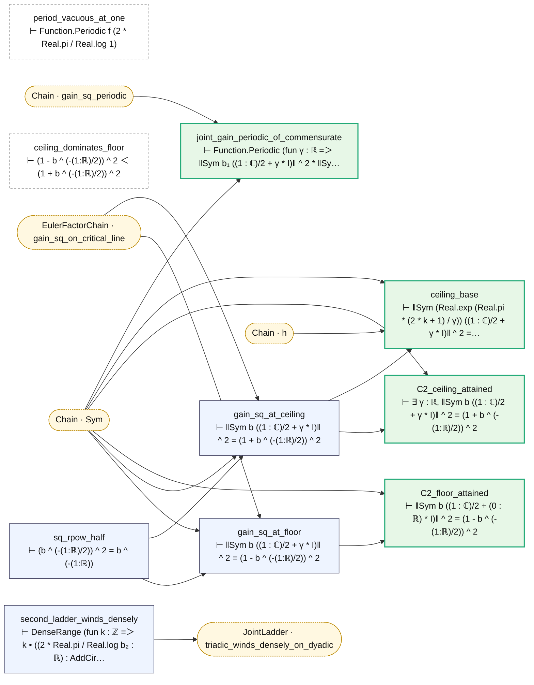

# `lean/Chain.lean`

**What it does** (its own header): The Euler Factor Chain, as a chain. Companion to papers/Euler-Factor-Chain.md.

**Imports:** [`Construction`](../lean/Construction.md), [`EulerFactorChain`](../lean/EulerFactorChain.md).
**Imported by:** [`JointLadder`](../lean/JointLadder.md), [`Measured`](../lean/Measured.md), [`NyquistPeak`](../lean/NyquistPeak.md), [`Superposition`](../lean/Superposition.md), [`TransferOp`](../lean/TransferOp.md), [`Transform`](../lean/Transform.md).

### Diagram 1 of 2

```mermaid
flowchart LR
  n0["Sym<br/>(def)"]:::dfn
  n1["mode<br/>(def)"]:::dfn
  n2["bdiff<br/>(def)"]:::dfn
  n3["h<br/>(def)"]:::dfn
  n4["StmtA1<br/>(def)"]:::dfn
  n5["StmtA2<br/>(def)"]:::dfn
  n6["StmtA3<br/>(def)"]:::dfn
  n7["StmtA4<br/>(def)"]:::dfn
  n8["StmtB4<br/>(def)"]:::dfn
  n9["StmtB5<br/>(def)"]:::dfn
  n10["StmtC1<br/>(def)"]:::dfn
  n11["StmtC2<br/>(def)"]:::dfn
  n12["StmtC3<br/>(def)"]:::dfn
  n13["StmtC3lower<br/>(def)"]:::dfn
  n14["bdiff_smul<br/>⊢ bdiff (fun r =＞ k * f r) = fun r =＞ k * bdiff f r"]:::thm
  n15["A4_of_A1<br/>⊢ StmtA4 b ρ"]:::thm
  n16["B5_of_A4_B4<br/>⊢ h b N ((1 : ℂ)/2 + γ * I) = ((‖(Sym b ((1 : ℂ)/2 + γ * I)) ^ N‖ ^ 2 : …"]:::thm
  n17["C2_of_C1<br/>⊢ StmtC2 b"]:::thm
  n18["C3_of_A4_C2<br/>⊢ StmtC3 b"]:::thm
  n19["C3lower_of_A4_C2<br/>⊢ StmtC3lower b"]:::thm
  n20["A2<br/>⊢ StmtA2"]:::end_
  n21["A3<br/>⊢ StmtA3"]:::end_
  n22["C1<br/>⊢ StmtC1 b"]:::thm
  n23["C2<br/>⊢ StmtC2 b"]:::thm
  n24["A1<br/>⊢ StmtA1 b ρ"]:::thm
  n25["A4<br/>⊢ StmtA4 b ρ"]:::thm
  n26["B4<br/>⊢ StmtB4 b N"]:::thm
  n27["B5<br/>⊢ StmtB5 b N"]:::end_
  n28["C3<br/>⊢ StmtC3 b"]:::end_
  n29["C3lower<br/>⊢ StmtC3lower b"]:::end_
  n30["tableFrom_eq_bdiff_iter<br/>⊢ ((Construction.tableFrom N r d : ℤ) : ℂ) = (bdiff^[d]) g (r : ℂ)"]:::thm
  n31["tableFrom_mode<br/>⊢ ((Construction.tableFrom N r d : ℤ) : ℂ) = (Sym b ρ) ^ d * mode b ρ (r…"]:::thm
  n32["tableFrom_norm_on_critical_line<br/>⊢ ‖((Construction.tableFrom N r d : ℤ) : ℂ)‖ = ‖Sym b ((1 : ℂ)/2 + γ * I…"]:::end_
  n33["sym_eq_zero_iff<br/>⊢ Sym b s = 0 ↔ ∃ k : ℤ, s = (k : ℂ) * (2 * Real.pi * I / Real.log b)"]:::thm
  n34["sym_periodic<br/>⊢ Sym b (s + 2 * Real.pi * I / Real.log b) = Sym b s"]:::thm
  n35["gain_sq_periodic<br/>⊢ Function.Periodic (fun γ : ℝ =＞ ‖Sym b ((1 : ℂ)/2 + γ * I)‖ ^ 2) (2 * …"]:::thm
  x0(["Chain · C2_ceiling_attained"]):::ext
  x1(["Chain · C2_floor_attained"]):::ext
  x2(["Chain · ceiling_base"]):::ext
  x3(["Chain · gain_sq_at_ceiling"]):::ext
  x4(["Chain · gain_sq_at_floor"]):::ext
  x5(["Chain · joint_gain_periodic_of_commensurate"]):::ext
  x6(["Construction · tableFrom"]):::ext
  x7(["EulerFactorChain · euler_product_riemannZeta"]):::ext
  x8(["EulerFactorChain · euler_product_sym"]):::ext
  x9(["EulerFactorChain · gain_sq_on_critical_line"]):::ext
  x10(["EulerFactorChain · h_eq_gain_pow_on_critical_line"]):::ext
  x11(["EulerFactorChain · sym_natCast"]):::ext
  x12(["EulerFactorChain · symbol_of_backward_difference"]):::ext
  x13(["JointLadder · d2_iter_jmode"]):::ext
  x14(["JointLadder · d2_jmode"]):::ext
  x15(["JointLadder · d3_iter_jmode"]):::ext
  x16(["JointLadder · d3_jmode"]):::ext
  x17(["NyquistPeak · gain_eq_norm_sym_pow"]):::ext
  x18(["NyquistPeak · norm_sym_on_imaginary_axis"]):::ext
  x19(["NyquistPeak · norm_sym_pow_at_boundaryBase"]):::ext
  x20(["NyquistPeak · sym_on_imaginary_axis"]):::ext
  x21(["Superposition · A4_sum_of_A1"]):::ext
  x22(["Superposition · bdiff_sum"]):::ext
  x23(["Superposition · depth_reweights_each_mode"]):::ext
  x24(["Superposition · modeSum"]):::ext
  x25(["Superposition · tableFrom_eq_modeSum_reweighted"]):::ext
  x26(["TransferOp · bdiffL"]):::ext
  x27(["TransferOp · bdiffL_apply"]):::ext
  x28(["TransferOp · eigenvalue_zero_iff_lattice"]):::ext
  x29(["TransferOp · mode_hasEigenvector"]):::ext
  x30(["TransferOp · mode_ne_zero"]):::ext
  x31(["TransferOp · mode_ne_zero'"]):::ext
  x32(["TransferOp · mode_pow"]):::ext
  x33(["TransferOp · sym_hasEigenvalue"]):::ext
  x34(["Transform · critical_circle_is_lattice_inversion_mean"]):::ext
  x35(["Transform · sym_zero_on_outer_circle"]):::ext
  x36(["Transform · sym_zero_partner_on_inner_circle"]):::ext
  x37(["CellModes · cell_eq_modeSum"]):::ext
  x38(["CellModes · mode_two_int"]):::ext
  x39(["CellModes · sym_two"]):::ext
  n0 --> n10
  n0 --> n11
  n0 --> n15
  n0 --> n16
  n0 --> n18
  n0 --> n19
  n0 --> n31
  n0 --> n32
  n0 --> n33
  n0 --> n34
  n0 --> n35
  n0 --> n4
  n0 --> n6
  n0 --> n7
  n0 --> n8
  n0 --> n9
  n0 --> x0
  n0 --> x1
  n0 --> x13
  n0 --> x14
  n0 --> x15
  n0 --> x16
  n0 --> x17
  n0 --> x18
  n0 --> x19
  n0 --> x2
  n0 --> x20
  n0 --> x21
  n0 --> x23
  n0 --> x25
  n0 --> x29
  n0 --> x3
  n0 --> x32
  n0 --> x33
  n0 --> x34
  n0 --> x35
  n0 --> x36
  n0 --> x37
  n0 --> x39
  n0 --> x4
  n0 --> x5
  n1 --> n12
  n1 --> n13
  n1 --> n15
  n1 --> n31
  n1 --> n32
  n1 --> n4
  n1 --> n7
  n1 --> x21
  n1 --> x24
  n1 --> x28
  n1 --> x29
  n1 --> x30
  n1 --> x31
  n1 --> x32
  n1 --> x37
  n1 --> x38
  n10 --> n17
  n10 --> n22
  n11 --> n17
  n11 --> n18
  n11 --> n19
  n11 --> n23
  n12 --> n18
  n12 --> n28
  n13 --> n19
  n13 --> n29
  n14 --> n15
  n14 --> x21
  n15 --> n25
  n16 --> n27
  n17 --> n23
  n18 --> n28
  n19 --> n29
  n2 --> n12
  n2 --> n13
  n2 --> n14
  n2 --> n15
  n2 --> n30
  n2 --> n4
  n2 --> n7
  n2 --> x21
  n2 --> x22
  n2 --> x23
  n2 --> x26
  n2 --> x27
  n2 --> x29
  n22 --> n23
  n23 --> n28
  n23 --> n29
  n24 --> n25
  n24 --> n31
  n24 --> x28
  n24 --> x29
  n25 --> n27
  n25 --> n28
  n25 --> n29
  n26 --> n27
  n3 --> n16
  n3 --> n8
  n3 --> n9
  n3 --> x2
  n3 --> x28
  n3 --> x30
  n30 --> x25
  n31 --> n32
  n33 --> x28
  n33 --> x35
  n34 --> n35
  n35 --> x5
  n4 --> n15
  n4 --> n24
  n4 --> x21
  n4 --> x23
  n4 --> x25
  n5 --> n20
  n6 --> n21
  n7 --> n15
  n7 --> n16
  n7 --> n18
  n7 --> n19
  n7 --> n25
  n8 --> n16
  n8 --> n26
  n9 --> n27
  x10 --> n26
  x11 --> n21
  x12 --> n24
  x6 --> n30
  x6 --> n31
  x6 --> n32
  x7 --> n20
  x8 --> n21
  x9 --> n22
  classDef thm fill:#eef4ff,stroke:#335,color:#111
  classDef dfn fill:#f2f2f2,stroke:#777,color:#111
  classDef end_ fill:#e7f7e7,stroke:#2a7,color:#111,stroke-width:2px
  classDef lone fill:#fff,stroke:#999,color:#111,stroke-dasharray:4 3
  classDef bad fill:#ffe5e5,stroke:#c22,color:#111,stroke-width:2px
  classDef ext fill:#fff8e1,stroke:#b80,color:#111,stroke-dasharray:2 2
```

### Diagram 2 of 2

Blue: theorem. Green: a theorem nothing else uses (an end). Dashed white: connects to nothing. Grey: definition. Red: contains `sorry`. Yellow: in another file. An arrow A → B reads "A is used by B".

## Every declaration

| declaration | proves (output) | needs (input) | why (its own docstring) | uses | used by |
|---|---|---|---|---|---|
| `Chain.Sym` def, line 29 | ℂ | b : ℝ; s : ℂ | The reciprocal Euler factor at `b`. | — | `Chain.A4_of_A1`, `Chain.B5_of_A4_B4`, `Chain.C2_ceiling_attained`, `Chain.C2_floor_attained`, `Chain.C3_of_A4_C2`, `Chain.C3lower_of_A4_C2`, `Chain.StmtA1`, `Chain.StmtA3`, `Chain.StmtA4`, `Chain.StmtB4`, `Chain.StmtB5`, `Chain.StmtC1`, `Chain.StmtC2`, `Chain.ceiling_base`, `Chain.gain_sq_at_ceiling`, `Chain.gain_sq_at_floor`, `Chain.gain_sq_periodic`, `Chain.joint_gain_periodic_of_commensurate`, `Chain.sym_eq_zero_iff`, `Chain.sym_periodic`, `Chain.tableFrom_mode`, `Chain.tableFrom_norm_on_critical_line`, `JointLadder.d2_iter_jmode`, `JointLadder.d2_jmode`, `JointLadder.d3_iter_jmode`, `JointLadder.d3_jmode`, `NyquistPeak.gain_eq_norm_sym_pow`, `NyquistPeak.norm_sym_on_imaginary_axis`, `NyquistPeak.norm_sym_pow_at_boundaryBase`, `NyquistPeak.sym_on_imaginary_axis` … |
| `Chain.mode` def, line 32 | ℂ → ℂ | b : ℝ; ρ : ℂ | A mode on the ladder, indexed by `r`. | — | `Chain.A4_of_A1`, `Chain.StmtA1`, `Chain.StmtA4`, `Chain.StmtC3`, `Chain.StmtC3lower`, `Chain.tableFrom_mode`, `Chain.tableFrom_norm_on_critical_line`, `Superposition.A4_sum_of_A1`, `Superposition.modeSum`, `TransferOp.eigenvalue_zero_iff_lattice`, `TransferOp.mode_hasEigenvector`, `TransferOp.mode_ne_zero`, `TransferOp.mode_ne_zero'`, `TransferOp.mode_pow`, `CellModes.cell_eq_modeSum`, `CellModes.mode_two_int` |
| `Chain.bdiff` def, line 35 | ℂ → ℂ | f : ℂ → ℂ | Backward differencing in the ladder index. | — | `Chain.A4_of_A1`, `Chain.StmtA1`, `Chain.StmtA4`, `Chain.StmtC3`, `Chain.StmtC3lower`, `Chain.bdiff_smul`, `Chain.tableFrom_eq_bdiff_iter`, `Superposition.A4_sum_of_A1`, `Superposition.bdiff_sum`, `Superposition.depth_reweights_each_mode`, `TransferOp.bdiffL`, `TransferOp.bdiffL_apply`, `TransferOp.mode_hasEigenvector` |
| `Chain.h` def, line 38 | ℂ | b : ℝ; N : ℕ; s : ℂ | The Weil test function of order `N`. | — | `Chain.B5_of_A4_B4`, `Chain.StmtB4`, `Chain.StmtB5`, `Chain.ceiling_base`, `TransferOp.eigenvalue_zero_iff_lattice`, `TransferOp.mode_ne_zero` |
| `Chain.StmtA1` def, line 44 | Prop | b : ℝ; ρ : ℂ | A1. One backward difference multiplies a mode by the symbol. | `Chain.Sym`, `Chain.bdiff`, `Chain.mode` | `Chain.A1`, `Chain.A4_of_A1`, `Superposition.A4_sum_of_A1`, `Superposition.depth_reweights_each_mode`, `Superposition.tableFrom_eq_modeSum_reweighted` |
| `Chain.StmtA2` def, line 51 | Prop | — | A2. Euler's product. It is a statement about *all* primes at once, so it carries no base index `b`, and it holds only where the product converges — hence the `1 &lt; s.re` hypothesis, which is Euler's own content and not a technicality. | — | `Chain.A2` |
| `Chain.StmtA3` def, line 69 | Prop | — | A3. The single-base reading, with the `b` index kept. Two conjuncts. The first says the chain's `Sym` at a prime base is the Euler product's factor at that prime. It is definitional — `Sym b s` unfolds to `1 - b^(-s)` and the only content is the `ℕ → ℝ → ℂ` cast — and it is stated rather than dressed up, because the paper's A3 ("therefore `1 − b^(−s)` is the… | `Chain.Sym` | `Chain.A3` |
| `Chain.StmtA4` def, line 75 | Prop | b : ℝ; ρ : ℂ | A4. `N` differences multiply a mode by the `N`-th power of the symbol. | `Chain.Sym`, `Chain.bdiff`, `Chain.mode` | `Chain.A4`, `Chain.A4_of_A1`, `Chain.B5_of_A4_B4`, `Chain.C3_of_A4_C2`, `Chain.C3lower_of_A4_C2` |
| `Chain.StmtB4` def, line 80 | Prop | b : ℝ; N : ℕ | B4. On the critical line the Weil function is the symbol's modulus to the `2N`. | `Chain.Sym`, `Chain.h` | `Chain.B4`, `Chain.B5_of_A4_B4` |
| `Chain.StmtB5` def, line 84 | Prop | b : ℝ; N : ℕ | B5. The depth-`N` transfer gain and the Weil weight are one quantity. | `Chain.Sym`, `Chain.h` | `Chain.B5` |
| `Chain.StmtC1` def, line 89 | Prop | b : ℝ | C1. The squared modulus on the critical line, expanded. | `Chain.Sym` | `Chain.C1`, `Chain.C2_of_C1` |
| `Chain.StmtC2` def, line 94 | Prop | b : ℝ | C2. The gain is bounded by `1 ± b^(-1/2)`. | `Chain.Sym` | `Chain.C2`, `Chain.C2_of_C1`, `Chain.C3_of_A4_C2`, `Chain.C3lower_of_A4_C2` |
| `Chain.StmtC3` def, line 99 | Prop | b : ℝ | C3. No mode's depth-`N` gain escapes those bounds. | `Chain.bdiff`, `Chain.mode` | `Chain.C3`, `Chain.C3_of_A4_C2` |
| `Chain.StmtC3lower` def, line 118 | Prop | b : ℝ | C3, the other half. The paper's C3 reads "no mode grows *or decays* without bound under depth". `StmtC3` is the growth half only. This is the decay half, and the ingredient was already present and unused: `StmtC2`'s FIRST conjunct bounds the gain below, `C2_of_C1` proves it, and `C3_of_A4_C2` calls only `.2`. | `Chain.bdiff`, `Chain.mode` | `Chain.C3lower`, `Chain.C3lower_of_A4_C2` |
| `Chain.bdiff_smul` theorem, line 126 | bdiff (fun r =&gt; k * f r) = fun r =&gt; k * bdiff f r | k : ℂ; f : ℂ → ℂ | `bdiff` is homogeneous: scalars pass through. | `Chain.bdiff` | `Chain.A4_of_A1`, `Superposition.A4_sum_of_A1` |
| `Chain.A4_of_A1` theorem, line 132 | StmtA4 b ρ | hA1 : StmtA1 b ρ | A1 → A4. The arrow that turns one difference into `N`, by induction. This is the paper's A3–A4 step and it uses A1 essentially. | `Chain.StmtA1`, `Chain.StmtA4`, `Chain.Sym`, `Chain.bdiff`, `Chain.bdiff_smul`, `Chain.mode` | `Chain.A4` |
| `Chain.B5_of_A4_B4` theorem, line 157 | h b N ((1 : ℂ)/2 + γ * I) = ((‖(Sym b ((1 : ℂ)/2 + γ * I)) ^ N‖ ^ 2 : ℝ) : ℂ) | hA4 : StmtA4 b ((1 : ℂ)/2 + γ * I); hB4 : StmtB4 b N | A4 ∧ B4 → B5. The payoff arrow: the depth gain *is* the Weil weight. Lean needs only `hB4`. The proof rewrites by it, then moves the exponent inside the norm — `‖Sym‖^(2N) = ‖Sym^N‖^2`, which is `norm_pow` and nothing else. `hA4` is carried to mirror the paper's stated dependency, not because the proof consumes it: the `have` binding it is inert, and it is i… | `Chain.StmtA4`, `Chain.StmtB4`, `Chain.Sym`, `Chain.h` | `Chain.B5` |
| `Chain.C2_of_C1` theorem, line 167 | StmtC2 b | hb : 0 &lt; b; hC1 : StmtC1 b | C1 → C2. The bound follows from the expansion and `\|cos\| ≤ 1`. | `Chain.StmtC1`, `Chain.StmtC2` | `Chain.C2` |
| `Chain.C3_of_A4_C2` theorem, line 182 | StmtC3 b | hb : 0 &lt; b; hA4 : ∀ γ : ℝ, StmtA4 b ((1 : ℂ)/2 + γ * I); hC2 : StmtC2 b | A4 ∧ C2 → C3. Depth cannot escape the bound. Uses A4 to name the depth-`N` multiplier and C2 to bound it. | `Chain.StmtA4`, `Chain.StmtC2`, `Chain.StmtC3`, `Chain.Sym` | `Chain.C3` |
| `Chain.C3lower_of_A4_C2` theorem, line 201 | StmtC3lower b | hA4 : ∀ γ : ℝ, StmtA4 b ((1 : ℂ)/2 + γ * I); hC2 : StmtC2 b | A4 ∧ C2 → C3 (decay half). A strict mirror of `C3_of_A4_C2`, reading `(hC2 γ).1` where that reads `.2`. | `Chain.StmtA4`, `Chain.StmtC2`, `Chain.StmtC3lower`, `Chain.Sym` | `Chain.C3lower` |
| `Chain.A2` theorem, line 221 | StmtA2 | — | A2, proved rather than assumed, from `EulerFactorChain.euler_product_riemannZeta` (Mathlib's `riemannZeta_eulerProduct_tprod`). No base index, and the convergence hypothesis travels with it. | `Chain.StmtA2`, `EulerFactorChain.euler_product_riemannZeta` | — |
| `Chain.A3` theorem, line 226 | StmtA3 | — | A3, proved rather than assumed. The first conjunct is `EulerFactorChain.sym_natCast`, which is a cast lemma; the second is `EulerFactorChain.euler_product_sym`, i.e. A2 with `Sym` substituted in. | `Chain.StmtA3`, `EulerFactorChain.euler_product_sym`, `EulerFactorChain.sym_natCast` | — |
| `Chain.C1` theorem, line 239 | StmtC1 b | hb : 0 &lt; b | C1, proved rather than assumed. The expansion is `EulerFactorChain.gain_sq_on_critical_line`, the law of cosines with sides `1` and `b^(-1/2)`. Needs only `0 &lt; b`. | `Chain.StmtC1`, `EulerFactorChain.gain_sq_on_critical_line` | `Chain.C2` |
| `Chain.C2` theorem, line 246 | StmtC2 b | hb : 0 &lt; b | C2, now unconditional. Same arrow as `C2_of_C1`, with its hypothesis supplied by `C1`; the implication is still the thing Lean checks. | `Chain.C1`, `Chain.C2_of_C1`, `Chain.StmtC2` | `Chain.C3`, `Chain.C3lower` |
| `Chain.A1` theorem, line 257 | StmtA1 b ρ | hb : b ≠ 0; ρ : ℂ | A1, proved rather than assumed, from `EulerFactorChain.symbol_of_backward_difference`. Needs only `b ≠ 0`. | `Chain.StmtA1`, `EulerFactorChain.symbol_of_backward_difference` | `Chain.A4`, `Chain.tableFrom_mode`, `TransferOp.eigenvalue_zero_iff_lattice`, `TransferOp.mode_hasEigenvector` |
| `Chain.A4` theorem, line 264 | StmtA4 b ρ | hb : b ≠ 0; ρ : ℂ | A4, now unconditional. Same arrow as `A4_of_A1`, with its hypothesis supplied by `A1`. | `Chain.A1`, `Chain.A4_of_A1`, `Chain.StmtA4` | `Chain.B5`, `Chain.C3`, `Chain.C3lower` |
| `Chain.B4` theorem, line 268 | StmtB4 b N | hb : 0 &lt; b; N : ℕ | B4, proved rather than assumed, from `EulerFactorChain.h_eq_gain_pow_on_critical_line`. Needs only `0 &lt; b`. | `Chain.StmtB4`, `EulerFactorChain.h_eq_gain_pow_on_critical_line` | `Chain.B5` |
| `Chain.B5` theorem, line 275 | StmtB5 b N | hb : 0 &lt; b; N : ℕ | B5, now unconditional. Same arrow as `B5_of_A4_B4`, with both hypotheses supplied. The depth gain *is* the Weil weight, with nothing assumed. | `Chain.A4`, `Chain.B4`, `Chain.B5_of_A4_B4`, `Chain.StmtB5` | — |
| `Chain.C3` theorem, line 280 | StmtC3 b | hb : 0 &lt; b | C3, now unconditional. Same arrow as `C3_of_A4_C2`, with `A4` and `C2` supplied. No mode's depth-`N` gain escapes the bound, with nothing assumed. | `Chain.A4`, `Chain.C2`, `Chain.C3_of_A4_C2`, `Chain.StmtC3` | — |
| `Chain.C3lower` theorem, line 288 | StmtC3lower b | hb : 0 &lt; b | C3's decay half, unconditional. Same arrow as `C3lower_of_A4_C2` with both hypotheses supplied. With `C3` this is the paper's C3 in full: a mode's depth-`N` amplitude is trapped between `\|1 − b^(−1/2)\|^N` and `(1 + b^(−1/2))^N` times its undifferenced amplitude, at every rung and every `γ`. | `Chain.A4`, `Chain.C2`, `Chain.C3lower_of_A4_C2`, `Chain.StmtC3lower` | — |
| `Chain.tableFrom_eq_bdiff_iter` theorem, line 303 | ((Construction.tableFrom N r d : ℤ) : ℂ) = (bdiff^[d]) g (r : ℂ) | hag : ∀ n : ℤ, ((N n : ℤ) : ℂ) = g (n : ℂ); r : ℤ; d : ℕ | The weld. `Construction.tableFrom` and `bdiff` are the same operation on two domains. If `g : ℂ → ℂ` agrees with the integer row `N` at every integer, the table's cell at `(r,d)` IS `bdiff` iterated `d` times on `g` at `r`. | `Chain.bdiff`, `Construction.tableFrom` | `Superposition.tableFrom_eq_modeSum_reweighted` |
| `Chain.tableFrom_mode` theorem, line 327 | ((Construction.tableFrom N r d : ℤ) : ℂ) = (Sym b ρ) ^ d * mode b ρ (r : ℂ) | hb : b ≠ 0; ρ : ℂ; r : ℤ; d : ℕ; hag : ∀ k : ℕ, k ≤ d → ((N (r - k) : ℤ) : ℂ) = mode b ρ ((r : ℂ) - k) | The chain, welded. An integer row agreeing with a mode across the window a cell reads: the cell is the symbol to the `d`, times the mode. | `Chain.A1`, `Chain.Sym`, `Chain.mode`, `Construction.tableFrom` | `Chain.tableFrom_norm_on_critical_line` |
| `Chain.tableFrom_norm_on_critical_line` theorem, line 359 | ‖((Construction.tableFrom N r d : ℤ) : ℂ)‖ = ‖Sym b ((1 : ℂ)/2 + γ * I)‖ ^ d * ‖mode b ((1 : ℂ)/2 + γ * I) (r : ℂ)‖ | hb : b ≠ 0; γ : ℝ; r : ℤ; d : ℕ; hag : ∀ k : ℕ, k ≤ d → ((N (r - k) : ℤ) : ℂ) = mode b ((1 : ℂ)/2 + γ * I) ((r : ℂ) - k) | The table on the critical line. The cell's modulus is `‖Sym‖^d` times the mode's — which is what `StmtC2` and `StmtC3` bound, and what the periodicity below makes an angle. | `Chain.Sym`, `Chain.mode`, `Chain.tableFrom_mode`, `Construction.tableFrom` | — |
| `Chain.sym_eq_zero_iff` theorem, line 381 | Sym b s = 0 ↔ ∃ k : ℤ, s = (k : ℂ) * (2 * Real.pi * I / Real.log b) | hb : 0 &lt; b; hb1 : b ≠ 1; s : ℂ | The pole lattice. `Sym b s = 0` exactly on `s ∈ (2πi / log b)·ℤ`. | `Chain.Sym` | `TransferOp.eigenvalue_zero_iff_lattice`, `Transform.sym_zero_on_outer_circle` |
| `Chain.sym_periodic` theorem, line 405 | Sym b (s + 2 * Real.pi * I / Real.log b) = Sym b s | hb : 0 &lt; b; hb1 : b ≠ 1; s : ℂ | The symbol is periodic with the lattice period. One step along the pole lattice returns `Sym` to itself, because `b^(−2πi/log b) = exp(−2πi) = 1`. This is the origin of the circle. | `Chain.Sym` | `Chain.gain_sq_periodic` |
| `Chain.gain_sq_periodic` theorem, line 429 | Function.Periodic (fun γ : ℝ =&gt; ‖Sym b ((1 : ℂ)/2 + γ * I)‖ ^ 2) (2 * Real.pi / Real.log b) | hb : 0 &lt; b; hb1 : b ≠ 1 | The circle. The gain on the critical line is periodic in `γ` with period `2π / log b`. | `Chain.Sym`, `Chain.sym_periodic` | `Chain.joint_gain_periodic_of_commensurate` |
| `Chain.period_vacuous_at_one` theorem, line 444 | Function.Periodic f (2 * Real.pi / Real.log 1) | f : ℝ → ℝ | The trap `gain_sq_periodic`'s `b ≠ 1` closes: at `b = 1` the period is zero and the statement holds for any function whatsoever. | — | — |
| `Chain.sq_rpow_half` theorem, line 474 | (b ^ (-(1:ℝ)/2)) ^ 2 = b ^ (-(1:ℝ)) | hb : 0 &lt; b | — | — | `Chain.gain_sq_at_ceiling`, `Chain.gain_sq_at_floor` |
| `Chain.gain_sq_at_floor` theorem, line 480 | ‖Sym b ((1 : ℂ)/2 + γ * I)‖ ^ 2 = (1 - b ^ (-(1:ℝ)/2)) ^ 2 | hb : 0 &lt; b; γ : ℝ; hcos : Real.cos (γ * Real.log b) = 1 | D1, floor half. Where `cos(γ log b) = 1` the gain is the floor of C2. | `Chain.Sym`, `Chain.sq_rpow_half`, `EulerFactorChain.gain_sq_on_critical_line` | `Chain.C2_floor_attained` |
| `Chain.gain_sq_at_ceiling` theorem, line 488 | ‖Sym b ((1 : ℂ)/2 + γ * I)‖ ^ 2 = (1 + b ^ (-(1:ℝ)/2)) ^ 2 | hb : 0 &lt; b; γ : ℝ; hcos : Real.cos (γ * Real.log b) = -1 | D1, ceiling half. Where `cos(γ log b) = −1` the gain is the ceiling. | `Chain.Sym`, `Chain.sq_rpow_half`, `EulerFactorChain.gain_sq_on_critical_line` | `Chain.C2_ceiling_attained`, `Chain.ceiling_base` |
| `Chain.C2_floor_attained` theorem, line 497 | ‖Sym b ((1 : ℂ)/2 + (0 : ℝ) * I)‖ ^ 2 = (1 - b ^ (-(1:ℝ)/2)) ^ 2 | hb : 0 &lt; b | D2. The smooth term has `γ = 0`, so it sits exactly ON the floor. This is why differencing dissipates it fastest of anything in the band. | `Chain.Sym`, `Chain.gain_sq_at_floor` | — |
| `Chain.C2_ceiling_attained` theorem, line 503 | ∃ γ : ℝ, ‖Sym b ((1 : ℂ)/2 + γ * I)‖ ^ 2 = (1 + b ^ (-(1:ℝ)/2)) ^ 2 | hb : 0 &lt; b; hb1 : b ≠ 1 | C2's upper bound is ATTAINED. `StmtC2` proves containment; this exhibits a `γ` that reaches the ceiling. Witness `γ = π / log b`. | `Chain.Sym`, `Chain.gain_sq_at_ceiling` | — |
| `Chain.ceiling_base` theorem, line 512 | ‖Sym (Real.exp (Real.pi * (2 * k + 1) / γ)) ((1 : ℂ)/2 + γ * I)‖ ^ 2 = (1 + (Real.exp (Real.pi * (2 * k + 1) / γ)) ^ (-(1:ℝ)/2)) ^ 2 | hγ : γ ≠ 0; k : ℤ | D4. The bases placing `γ` exactly at the ceiling are `exp(π(2k+1)/γ)`. For `γ₁` the paper lists `1.2489, 1.948, 3.039, 4.741, 7.395 …`; `1.2489` is the O45 locked family's `k = 2`. | `Chain.Sym`, `Chain.gain_sq_at_ceiling`, `Chain.h` | — |
| `Chain.ceiling_dominates_floor` theorem, line 523 | (1 - b ^ (-(1:ℝ)/2)) ^ 2 &lt; (1 + b ^ (-(1:ℝ)/2)) ^ 2 | hb : 0 &lt; b | D3. Differencing amplifies ceiling modes strictly more than floor modes. That is the power iteration, as an inequality — and it needs only `0 &lt; b`, not `b ≠ 1`, because the proof does not consume one. | — | — |
| `Chain.joint_gain_periodic_of_commensurate` theorem, line 545 | Function.Periodic (fun γ : ℝ =&gt; ‖Sym b₁ ((1 : ℂ)/2 + γ * I)‖ ^ 2 * ‖Sym b₂ ((1 : ℂ)/2 + γ * I)‖ ^ 2) ((m : ℝ) * (2 * Real.pi / Real.log b₁)) | h₁ : 0 &lt; b₁; hn₁ : b₁ ≠ 1; h₂ : 0 &lt; b₂; hn₂ : b₂ ≠ 1; m n : ℕ; hm : 0 &lt; m; hn : 0 &lt; n; hcomm : (m : ℝ) * (2 * Real.pi / Real.log b₁) = (n : ℝ) * (2 * Real.pi / Real.log b₂) | The collapse. Each base contributes a circle of period `2π / log b`. If the two periods are commensurate — an integer multiple of one equals an integer multiple of the other — the joint gain is periodic in a SINGLE variable and the two circles are one. | `Chain.Sym`, `Chain.gain_sq_periodic` | — |
| `Chain.second_ladder_winds_densely` theorem, line 566 | DenseRange (fun k : ℤ =&gt; k • ((2 * Real.pi / Real.log b₂ : ℝ) : AddCircle (2 * Real.pi / Real.log b₁))) ↔ Irrational (Real.log b₁ / Real.log b₂) | h₁ : 0 &lt; b₁; hn₁ : b₁ ≠ 1; h₂ : 0 &lt; b₂; hn₂ : b₂ ≠ 1 | The torus. Take the `b₁`-ladder's circle. The `b₂`-ladder steps around it by its own period. Those steps are DENSE — the second ladder winds forever without closing — exactly when `log b₁ / log b₂` is irrational. Rational, and the orbit is finite and the two circles collapse, which is the theorem above. | — | `JointLadder.triadic_winds_densely_on_dyadic` |
