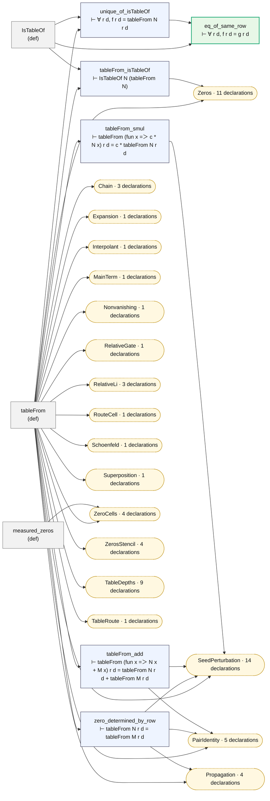

# `lean/Construction.lean`

**What it does** (its own header): Construction — the table has no free parameter, so the zeros were not placed. `Zeros.lean` records that nothing predicts WHERE the four exact zeros are. That is true and stays true. This file proves the complementary thing, which is what makes them structural rather than arbitrary:

**Imports:** nothing in this tree.
**Imported by:** [`Chain`](../lean/Chain.md), [`PairIdentity`](../lean/PairIdentity.md), [`Propagation`](../lean/Propagation.md), [`SeedPerturbation`](../lean/SeedPerturbation.md), [`Zeros`](../lean/Zeros.md), [`ZerosStencil`](../lean/ZerosStencil.md).

Blue: theorem. Green: a theorem nothing else uses (an end). Dashed white: connects to nothing. Grey: definition. Red: contains `sorry`. Yellow: in another file. An arrow A → B reads "A is used by B".

## Every declaration

| declaration | proves (output) | needs (input) | why (its own docstring) | uses | used by |
|---|---|---|---|---|---|
| `Construction.tableFrom` def, line 49 | ℤ → ℕ → ℤ | N : ℤ → ℤ | The table built from a depth-0 row by repeated backward differencing. | — | `Chain.tableFrom_eq_bdiff_iter`, `Chain.tableFrom_mode`, `Chain.tableFrom_norm_on_critical_line`, `Construction.tableFrom_add`, `Construction.tableFrom_isTableOf`, `Construction.tableFrom_smul`, `Construction.unique_of_isTableOf`, `Construction.zero_determined_by_row`, `Expansion.tableFrom_ne_zero_of_li`, `Interpolant.tableFrom_ne_zero_of_relErr_liRow`, `MainTerm.tableFrom_ne_zero_of_deriv`, `Nonvanishing.tableFrom_ne_zero_of`, `PairIdentity.composite_at_zero_20_6`, `PairIdentity.composite_of_prime_zero`, `PairIdentity.pair_identity`, `PairIdentity.tableFrom_add_window`, `PairIdentity.tableFrom_of_geometric`, `Propagation.cone_filled`, `Propagation.flux_form`, `Propagation.outside_cone_zero`, `Propagation.propagator`, `RelativeGate.tableFrom_ne_zero_of_relErr`, `RelativeLi.tableFrom_ne_zero_of_powerSaving`, `RelativeLi.tableFrom_ne_zero_of_relErr_li`, `RelativeLi.tableFrom_ne_zero_of_relErr_li'`, `RouteCell.cell_ne_zero_of_route`, `Schoenfeld.tableFrom_ne_zero_of_schoenfeld`, `SeedPerturbation.boundary_can_move`, `SeedPerturbation.cell_eq_of_seed_perturbation`, `SeedPerturbation.cell_ne_at_boundary` … |
| `Construction.IsTableOf` def, line 54 | Prop | N : ℤ → ℤ; f : ℤ → ℕ → ℤ | The defining recurrence, as a property a function may or may not have. | — | `Construction.eq_of_same_row`, `Construction.tableFrom_isTableOf`, `Construction.unique_of_isTableOf` |
| `Construction.tableFrom_isTableOf` theorem, line 58 | IsTableOf N (tableFrom N) | N : ℤ → ℤ | `tableFrom` satisfies its own recurrence. | `Construction.IsTableOf`, `Construction.tableFrom` | `Zeros.tableFrom_isTable` |
| `Construction.unique_of_isTableOf` theorem, line 68 | ∀ r d, f r d = tableFrom N r d | hf : IsTableOf N f | Uniqueness. Any function satisfying the recurrence with the same depth-0 row IS the table. There is no choice at any cell — fix the row and the entire table, to every depth, is determined. | `Construction.IsTableOf`, `Construction.tableFrom` | `Construction.eq_of_same_row` |
| `Construction.eq_of_same_row` theorem, line 76 | ∀ r d, f r d = g r d | hf : IsTableOf N f; hg : IsTableOf N g | Two tables over the same row agree everywhere. | `Construction.IsTableOf`, `Construction.unique_of_isTableOf` | — |
| `Construction.zero_determined_by_row` theorem, line 84 | tableFrom N r d = tableFrom M r d | r : ℤ; d : ℕ; h : ∀ k : ℕ, k ≤ d → N (r - k) = M (r - k) | A zero is determined by the row. If two counting functions agree on the window a cell reads, that cell is the same for both — in particular one vanishes exactly when the other does. Nothing outside the window can move it, and nothing inside the construction can either. | `Construction.tableFrom` | `PairIdentity.tableFrom_add_window`, `Propagation.outside_cone_zero`, `SeedPerturbation.tableFrom_eq_zero_of_vanishing_above` |
| `Construction.tableFrom_add` theorem, line 112 | tableFrom (fun x =&gt; N x + M x) r d = tableFrom N r d + tableFrom M r d | N M : ℤ → ℤ; r : ℤ; d : ℕ | Differencing is linear, at every depth. The operator carries no parameter to tune — this is what forces Pascal's weights rather than selecting them. | `Construction.tableFrom` | `PairIdentity.tableFrom_add_window`, `SeedPerturbation.tableFrom_sub` |
| `Construction.tableFrom_smul` theorem, line 125 | tableFrom (fun x =&gt; c * N x) r d = c * tableFrom N r d | c : ℤ; N : ℤ → ℤ; r : ℤ; d : ℕ | Scalars pass through the table: the table of `c·N` is `c` times the table of `N`. The other half of linearity, beside `tableFrom_add`. | `Construction.tableFrom` | `SeedPerturbation.tableFrom_sub` |
| `Construction.measured_zeros` def, line 149 | List (ℕ × ℕ) | — | The four exact zeros. Determined by pi through a parameter-free construction; located by nothing. `results/O16_run2.log`. | — | `ZeroCells.construction_all_vanish`, `ZeroCells.construction_eq` |
