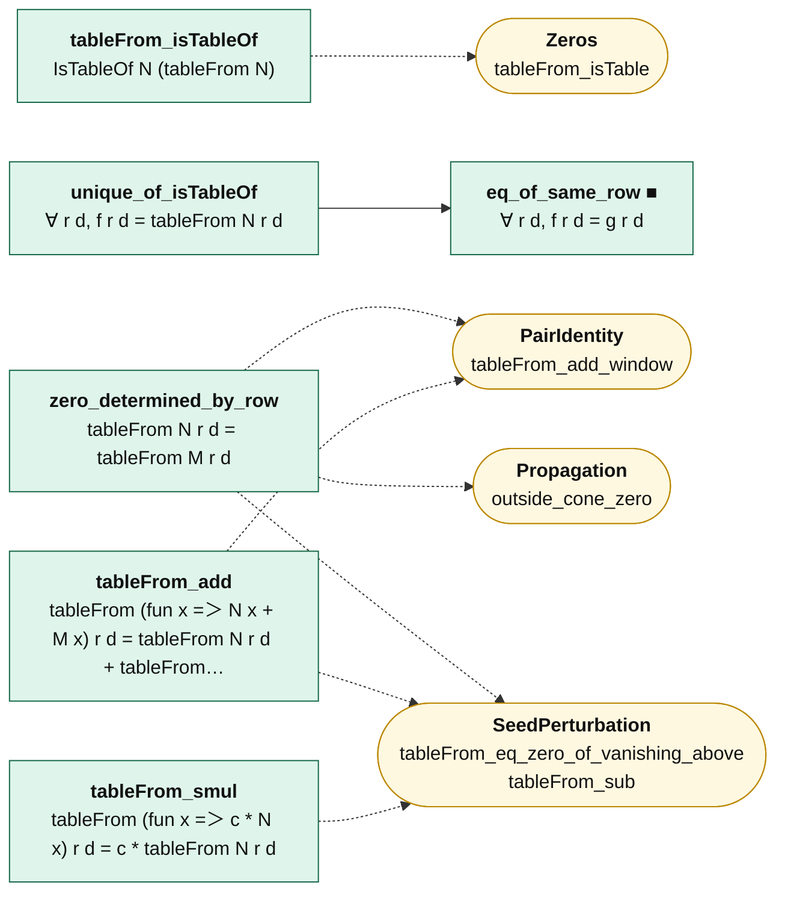

# `lean/Construction.lean`

Construction — the table has no free parameter, so the zeros were not placed. `Zeros.lean` records that nothing predicts WHERE the four exact zeros are. That is true and stays true. This file proves the complementary thing, which is what makes them structural rather than arbitrary:

6 theorems, 3 definitions, 193 lines. Arrows are Lean's own record of what each proof uses.

**Imports:** nothing in this tree  
**Imported by:** [`Chain`](../lean/Chain.md), [`PairIdentity`](../lean/PairIdentity.md), [`Propagation`](../lean/Propagation.md), [`SeedPerturbation`](../lean/SeedPerturbation.md), [`Zeros`](../lean/Zeros.md), [`ZerosStencil`](../lean/ZerosStencil.md)

## The picture



An arrow A → B reads "A is used in the proof of B". Green: counting, integers only. Violet: shape, analysis with no ζ. Blue: reads ζ. A name ending in ■ is an end: nothing else uses it. Red: contains `sorry`. Yellow: theorems in another file, counted; a dotted arrow crosses files. Definitions are not drawn; they are listed below the diagram.

## Definitions

<a name="Construction-tableFrom"></a>
### `Construction.tableFrom`

def · line 49

The table built from a depth-0 row by repeated backward differencing.

- **Is:** `` tableFrom (N : ℤ → ℤ) : ℤ → ℕ → ℤ | r, 0 => N r | r, d + 1 => tableFrom N r d - tableFrom N (r - 1) d ``
- **Used by 81:** [`Chain.tableFrom_eq_bdiff_iter`](../lean/Chain.md#Chain-tableFrom_eq_bdiff_iter), [`Chain.tableFrom_mode`](../lean/Chain.md#Chain-tableFrom_mode), [`Chain.tableFrom_norm_on_critical_line`](../lean/Chain.md#Chain-tableFrom_norm_on_critical_line), [`Construction.eq_of_same_row`](#Construction-eq_of_same_row), [`Construction.tableFrom_add`](#Construction-tableFrom_add), [`Construction.tableFrom_isTableOf`](#Construction-tableFrom_isTableOf), [`Construction.tableFrom_smul`](#Construction-tableFrom_smul), [`Construction.unique_of_isTableOf`](#Construction-unique_of_isTableOf), [`Construction.zero_determined_by_row`](#Construction-zero_determined_by_row), [`DeepZeroBand.composite_cell_20_6`](../lean/DeepZeroBand.md#DeepZeroBand-composite_cell_20_6), [`DeepZeroBand.deep_cell_15_6`](../lean/DeepZeroBand.md#DeepZeroBand-deep_cell_15_6), [`DeepZeroBand.deep_zero_inverse_share`](../lean/DeepZeroBand.md#DeepZeroBand-deep_zero_inverse_share), [`DeepZeroBand.deep_zero_share`](../lean/DeepZeroBand.md#DeepZeroBand-deep_zero_share), [`DeepZeroBand.share`](../lean/DeepZeroBand.md#DeepZeroBand-share), [`DeepZeroBand.share_15_6_neg`](../lean/DeepZeroBand.md#DeepZeroBand-share_15_6_neg), [`DeepZeroBand.share_add`](../lean/DeepZeroBand.md#DeepZeroBand-share_add), [`Expansion.tableFrom_ne_zero_of_li`](../lean/Expansion.md#Expansion-tableFrom_ne_zero_of_li), [`Interpolant.tableFrom_ne_zero_of_relErr_liRow`](../lean/Interpolant.md#Interpolant-tableFrom_ne_zero_of_relErr_liRow), [`MainTerm.tableFrom_ne_zero_of_deriv`](../lean/MainTerm.md#MainTerm-tableFrom_ne_zero_of_deriv), [`Nonvanishing.tableFrom_ne_zero_of`](../lean/Nonvanishing.md#Nonvanishing-tableFrom_ne_zero_of), [`PairIdentity.composite_at_zero_20_6`](../lean/PairIdentity.md#PairIdentity-composite_at_zero_20_6), [`PairIdentity.composite_of_prime_zero`](../lean/PairIdentity.md#PairIdentity-composite_of_prime_zero), [`PairIdentity.pair_identity`](../lean/PairIdentity.md#PairIdentity-pair_identity), [`PairIdentity.tableFrom_add_window`](../lean/PairIdentity.md#PairIdentity-tableFrom_add_window), [`PairIdentity.tableFrom_of_geometric`](../lean/PairIdentity.md#PairIdentity-tableFrom_of_geometric), [`Propagation.cone_filled`](../lean/Propagation.md#Propagation-cone_filled), [`Propagation.flux_form`](../lean/Propagation.md#Propagation-flux_form), [`Propagation.outside_cone_zero`](../lean/Propagation.md#Propagation-outside_cone_zero), [`Propagation.propagator`](../lean/Propagation.md#Propagation-propagator), [`RelativeGate.tableFrom_ne_zero_of_relErr`](../lean/RelativeGate.md#RelativeGate-tableFrom_ne_zero_of_relErr), [`RelativeLi.tableFrom_ne_zero_of_powerSaving`](../lean/RelativeLi.md#RelativeLi-tableFrom_ne_zero_of_powerSaving), [`RelativeLi.tableFrom_ne_zero_of_relErr_li`](../lean/RelativeLi.md#RelativeLi-tableFrom_ne_zero_of_relErr_li), [`RelativeLi.tableFrom_ne_zero_of_relErr_li'`](../lean/RelativeLi.md#RelativeLi-tableFrom_ne_zero_of_relErr_li-), [`RouteCell.cell_ne_zero_of_route`](../lean/RouteCell.md#RouteCell-cell_ne_zero_of_route), [`Schoenfeld.tableFrom_ne_zero_of_schoenfeld`](../lean/Schoenfeld.md#Schoenfeld-tableFrom_ne_zero_of_schoenfeld), [`SeedPerturbation.boundary_can_move`](../lean/SeedPerturbation.md#SeedPerturbation-boundary_can_move), [`SeedPerturbation.cell_eq_of_seed_perturbation`](../lean/SeedPerturbation.md#SeedPerturbation-cell_eq_of_seed_perturbation), [`SeedPerturbation.cell_ne_at_boundary`](../lean/SeedPerturbation.md#SeedPerturbation-cell_ne_at_boundary), [`SeedPerturbation.emptied_protected_cells_fixed`](../lean/SeedPerturbation.md#SeedPerturbation-emptied_protected_cells_fixed), [`SeedPerturbation.measured_emptied_matches_shift`](../lean/SeedPerturbation.md#SeedPerturbation-measured_emptied_matches_shift), and 41 more (full list in `map/lean_map.json`)

<a name="Construction-IsTableOf"></a>
### `Construction.IsTableOf`

def · line 54

The defining recurrence, as a property a function may or may not have.

- **Is:** `` IsTableOf (N : ℤ → ℤ) (f : ℤ → ℕ → ℤ) : Prop := (∀ r, f r 0 = N r) ∧ (∀ r d, f r (d + 1) = f r d - f (r - 1) d) ``
- **Used by 3:** [`Construction.eq_of_same_row`](#Construction-eq_of_same_row), [`Construction.tableFrom_isTableOf`](#Construction-tableFrom_isTableOf), [`Construction.unique_of_isTableOf`](#Construction-unique_of_isTableOf)

<a name="Construction-measured_zeros"></a>
### `Construction.measured_zeros`

def · line 149

The four exact zeros. Determined by pi through a parameter-free construction; located by nothing. `results/O16_run2.log`.

- **Is:** `` measured_zeros : List (ℕ × ℕ) := [(2, 1), (4, 1), (8, 3), (20, 6)] ``
- **Used by 3:** [`ZeroCells.all_four_have_length_four`](../lean/ZeroCells.md#ZeroCells-all_four_have_length_four), [`ZeroCells.construction_all_vanish`](../lean/ZeroCells.md#ZeroCells-construction_all_vanish), [`ZeroCells.construction_eq`](../lean/ZeroCells.md#ZeroCells-construction_eq)

## Theorems

<a name="Construction-tableFrom_isTableOf"></a>
### `Construction.tableFrom_isTableOf`

line 58

**Counting.** Integers only: nothing in its statement or proof, or in anything it rests on, uses analysis or ζ.

**Why.** `tableFrom` satisfies its own recurrence.

**Proves**

```lean
IsTableOf N (tableFrom N)
```

**Needs** (its hypotheses)

  - `` N : ℤ → ℤ ``

**Stated with:** [`Construction.IsTableOf`](#Construction-IsTableOf), [`Construction.tableFrom`](#Construction-tableFrom)

**Fed by:** no theorem of this repo; it stands on Mathlib and the definitions below.

**Feeds** (1 that use it)

  - [`Zeros.tableFrom_isTable`](../lean/Zeros.md#Zeros-tableFrom_isTable) (Zeros) — `` IsTable (Construction.tableFrom N) ``

<a name="Construction-unique_of_isTableOf"></a>
### `Construction.unique_of_isTableOf`

line 68

**Counting.** Integers only: nothing in its statement or proof, or in anything it rests on, uses analysis or ζ.

**Why.** Uniqueness. Any function satisfying the recurrence with the same depth-0 row IS the table. There is no choice at any cell — fix the row and the entire table, to every depth, is determined.

**Proves**

```lean
∀ r d, f r d = tableFrom N r d
```

**Needs** (its hypotheses)

  - `` hf : IsTableOf N f ``

**Stated with:** [`Construction.IsTableOf`](#Construction-IsTableOf), [`Construction.tableFrom`](#Construction-tableFrom)

**Fed by:** no theorem of this repo; it stands on Mathlib and the definitions below.

**Feeds** (1 that use it)

  - [`Construction.eq_of_same_row`](#Construction-eq_of_same_row) — `` ∀ r d, f r d = g r d ``

<a name="Construction-eq_of_same_row"></a>
### `Construction.eq_of_same_row`

line 76

**Counting.** Integers only: nothing in its statement or proof, or in anything it rests on, uses analysis or ζ.

**Why.** Two tables over the same row agree everywhere.

**Proves**

```lean
∀ r d, f r d = g r d
```

**Needs** (its hypotheses)

  - `` hf : IsTableOf N f ``
  - `` hg : IsTableOf N g ``

**Stated with:** [`Construction.IsTableOf`](#Construction-IsTableOf)

**Fed by** (1 theorem its proof uses)

  - [`Construction.unique_of_isTableOf`](#Construction-unique_of_isTableOf) — `` ∀ r d, f r d = tableFrom N r d ``

**Definitions its proof touches:** [`Construction.tableFrom`](#Construction-tableFrom)

**Feeds:** nothing. It is an end.

<a name="Construction-zero_determined_by_row"></a>
### `Construction.zero_determined_by_row`

line 84

**Counting.** Integers only: nothing in its statement or proof, or in anything it rests on, uses analysis or ζ.

**Why.** A zero is determined by the row. If two counting functions agree on the window a cell reads, that cell is the same for both — in particular one vanishes exactly when the other does. Nothing outside the window can move it, and nothing inside the construction can either.

**Proves**

```lean
tableFrom N r d = tableFrom M r d
```

**Needs** (its hypotheses)

  - `` r : ℤ ``
  - `` d : ℕ ``
  - `` h : ∀ k : ℕ, k ≤ d → N (r - k) = M (r - k) ``

**Stated with:** [`Construction.tableFrom`](#Construction-tableFrom)

**Fed by:** no theorem of this repo; it stands on Mathlib and the definitions below.

**Feeds** (3 that use it)

  - [`PairIdentity.tableFrom_add_window`](../lean/PairIdentity.md#PairIdentity-tableFrom_add_window) (PairIdentity) — `` tableFrom P r d + tableFrom C r d = tableFrom T r d ``
  - [`Propagation.outside_cone_zero`](../lean/Propagation.md#Propagation-outside_cone_zero) (Propagation) — `` tableFrom (deltaRow s) r d = 0 ``
  - [`SeedPerturbation.tableFrom_eq_zero_of_vanishing_above`](../lean/SeedPerturbation.md#SeedPerturbation-tableFrom_eq_zero_of_vanishing_above) (SeedPerturbation) — `` tableFrom e r d = 0 ``

<a name="Construction-tableFrom_add"></a>
### `Construction.tableFrom_add`

line 112

**Counting.** Integers only: nothing in its statement or proof, or in anything it rests on, uses analysis or ζ.

**Why.** Differencing is linear, at every depth. The operator carries no parameter to tune — this is what forces Pascal's weights rather than selecting them.

**Proves**

```lean
tableFrom (fun x => N x + M x) r d = tableFrom N r d + tableFrom M r d
```

**Needs** (its hypotheses)

  - `` N M : ℤ → ℤ ``
  - `` r : ℤ ``
  - `` d : ℕ ``

**Stated with:** [`Construction.tableFrom`](#Construction-tableFrom)

**Fed by:** no theorem of this repo; it stands on Mathlib and the definitions below.

**Feeds** (2 that use it)

  - [`PairIdentity.tableFrom_add_window`](../lean/PairIdentity.md#PairIdentity-tableFrom_add_window) (PairIdentity) — `` tableFrom P r d + tableFrom C r d = tableFrom T r d ``
  - [`SeedPerturbation.tableFrom_sub`](../lean/SeedPerturbation.md#SeedPerturbation-tableFrom_sub) (SeedPerturbation) — `` tableFrom (fun x => N x - e x) r d = tableFrom N r d - tableFrom e r d ``

<a name="Construction-tableFrom_smul"></a>
### `Construction.tableFrom_smul`

line 125

**Counting.** Integers only: nothing in its statement or proof, or in anything it rests on, uses analysis or ζ.

**Why.** Scalars pass through the table: the table of `c·N` is `c` times the table of `N`. The other half of linearity, beside `tableFrom_add`.

**Proves**

```lean
tableFrom (fun x => c * N x) r d = c * tableFrom N r d
```

**Needs** (its hypotheses)

  - `` c : ℤ ``
  - `` N : ℤ → ℤ ``
  - `` r : ℤ ``
  - `` d : ℕ ``

**Stated with:** [`Construction.tableFrom`](#Construction-tableFrom)

**Fed by:** no theorem of this repo; it stands on Mathlib and the definitions below.

**Feeds** (1 that use it)

  - [`SeedPerturbation.tableFrom_sub`](../lean/SeedPerturbation.md#SeedPerturbation-tableFrom_sub) (SeedPerturbation) — `` tableFrom (fun x => N x - e x) r d = tableFrom N r d - tableFrom e r d ``

