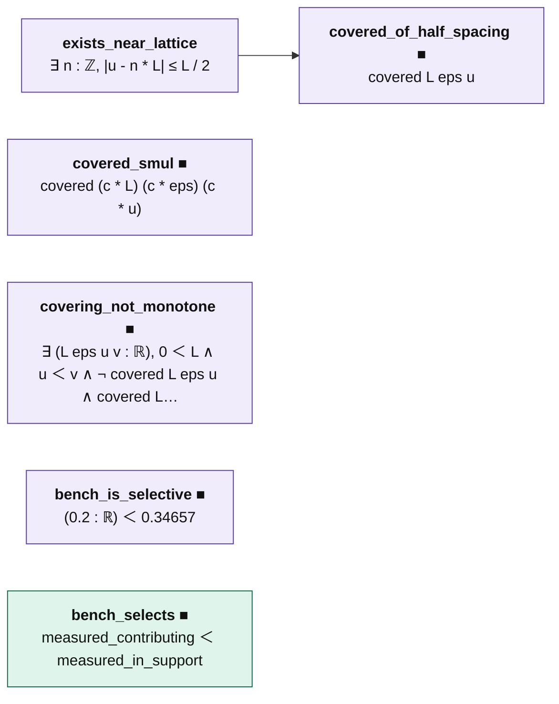

# `lean/Covering.lean`

Covering — why 25 of 36 primes contribute, and why the set skips 13. THE MEASUREMENT (results/O37_weil_form_on_stencil_run1.log): with b = 2, N = 7, W = 0.05, K = 2, the mollified Weil form has 36 primes inside its support and exactly 25 contribute:

6 theorems, 5 definitions, 158 lines. Arrows are Lean's own record of what each proof uses.

**Imports:** nothing in this tree  
**Imported by:** nothing

## The picture



An arrow A → B reads "A is used in the proof of B". Green: counting, integers only. Violet: shape, analysis with no ζ. Blue: reads ζ. A name ending in ■ is an end: nothing else uses it. Red: contains `sorry`. Yellow: theorems in another file, counted; a dotted arrow crosses files. Definitions are not drawn; they are listed below the diagram.

## Definitions

<a name="Covering-covered"></a>
### `Covering.covered`

def · line 50

`u` is covered by the lattice `n * L` at tolerance `eps`. This is the condition a prime power must satisfy to contribute to the mollified form.

- **Is:** `` covered (L eps u : ℝ) : Prop := ∃ n : ℤ, |u - n * L| < eps ``
- **Used by 3:** [`Covering.covered_of_half_spacing`](#Covering-covered_of_half_spacing), [`Covering.covered_smul`](#Covering-covered_smul), [`Covering.covering_not_monotone`](#Covering-covering_not_monotone)

<a name="Covering-measured_eps"></a>
### `Covering.measured_eps`

def · line 108

Kernel half-width: `eps = 2K*W` with `K = 2`, `W = 0.05`.

- **Is:** `` measured_eps : ℝ := 0.2 ``
- **Used by 0:** nothing

<a name="Covering-measured_spacing"></a>
### `Covering.measured_spacing`

def · line 111

Lattice spacing: `log 2`.

- **Is:** `` measured_spacing : ℝ := Real.log 2 ``
- **Used by 0:** nothing

<a name="Covering-measured_in_support"></a>
### `Covering.measured_in_support`

def · line 114

Primes inside the support, and primes contributing.

- **Is:** `` measured_in_support : ℕ := 36 ``
- **Used by 1:** [`Covering.bench_selects`](#Covering-bench_selects)

<a name="Covering-measured_contributing"></a>
### `Covering.measured_contributing`

def · line 115

- **Is:** `` measured_contributing : ℕ := 25 ``
- **Used by 1:** [`Covering.bench_selects`](#Covering-bench_selects)

## Theorems

<a name="Covering-exists_near_lattice"></a>
### `Covering.exists_near_lattice`

line 56

**Shape.** Uses real or complex analysis; nothing in it or beneath it reads ζ.

**Why.** The covering lemma. No real is further than `L/2` from the lattice `n * L`. Take `n` to be the nearest integer to `u / L`.

**Proves**

```lean
∃ n : ℤ, |u - n * L| ≤ L / 2
```

**Needs** (its hypotheses)

  - `` hL : 0 < L ``
  - `` u : ℝ ``

**Fed by:** no theorem of this repo; it stands on Mathlib.

**Feeds** (1 that use it)

  - [`Covering.covered_of_half_spacing`](#Covering-covered_of_half_spacing) — `` covered L eps u ``

<a name="Covering-covered_of_half_spacing"></a>
### `Covering.covered_of_half_spacing`

line 68

**Shape.** Uses real or complex analysis; nothing in it or beneath it reads ζ.

**Why.** Vacuity. Once the tolerance exceeds half the lattice spacing, EVERY point is covered — the condition selects nothing.

**Proves**

```lean
covered L eps u
```

**Needs** (its hypotheses)

  - `` hL : 0 < L ``
  - `` heps : L / 2 < eps ``
  - `` u : ℝ ``

**Stated with:** [`Covering.covered`](#Covering-covered)

**Fed by** (1 theorem its proof uses)

  - [`Covering.exists_near_lattice`](#Covering-exists_near_lattice) — `` ∃ n : ℤ, |u - n * L| ≤ L / 2 ``

**Feeds:** nothing. It is an end.

<a name="Covering-covered_smul"></a>
### `Covering.covered_smul`

line 77

**Shape.** Uses real or complex analysis; nothing in it or beneath it reads ζ.

**Why.** Selectivity is a ratio. Covering is homogeneous: scaling the spacing, the tolerance and the point together changes nothing. So how much the form selects depends only on `eps / L` — never on the size of the point tested, and never on which prime it came from.

**Proves**

```lean
covered (c * L) (c * eps) (c * u)
```

**Needs** (its hypotheses)

  - `` hc : 0 < c ``
  - `` h : covered L eps u ``

**Stated with:** [`Covering.covered`](#Covering-covered)

**Fed by:** no theorem of this repo; it stands on Mathlib and the definitions below.

**Feeds:** nothing. It is an end.

<a name="Covering-covering_not_monotone"></a>
### `Covering.covering_not_monotone`

line 88

**Shape.** Uses real or complex analysis; nothing in it or beneath it reads ζ.

**Why.** Non-monotone by construction. Covering is not inherited by smaller points: a point can fail while a larger one succeeds. This is exactly why the contributing set is not an initial segment — 13 fails where 17 passes.

**Proves**

```lean
∃ (L eps u v : ℝ), 0 < L ∧ u < v ∧ ¬ covered L eps u ∧ covered L eps v
```

**Stated with:** [`Covering.covered`](#Covering-covered)

**Fed by:** no theorem of this repo; it stands on Mathlib and the definitions below.

**Feeds:** nothing. It is an end.

<a name="Covering-bench_is_selective"></a>
### `Covering.bench_is_selective`

line 119

**Shape.** Uses real or complex analysis; nothing in it or beneath it reads ζ.

**Why.** The bench sits BELOW the vacuity threshold, so the form genuinely selects. `log 2 / 2 = 0.34657... > 0.2 = eps`.

**Proves**

```lean
(0.2 : ℝ) < 0.34657
```

**Fed by:** no theorem of this repo; it stands on Mathlib.

**Feeds:** nothing. It connects to nothing.

<a name="Covering-bench_selects"></a>
### `Covering.bench_selects`

line 122

**Counting.** Integers only: nothing in its statement or proof, or in anything it rests on, uses analysis or ζ.

**Why.** And it does select: 25 of 36, not all.

**Proves**

```lean
measured_contributing < measured_in_support
```

**Stated with:** [`Covering.measured_contributing`](#Covering-measured_contributing), [`Covering.measured_in_support`](#Covering-measured_in_support)

**Fed by:** no theorem of this repo; it stands on Mathlib and the definitions below.

**Feeds:** nothing. It is an end.

