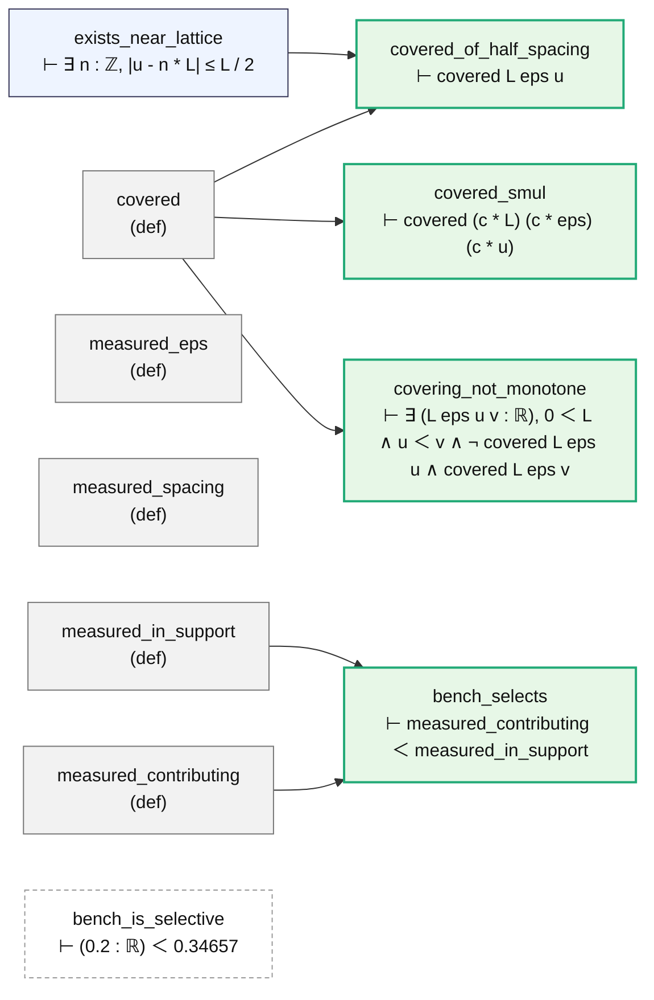

# `lean/Covering.lean`

**What it does** (its own header): Covering — why 25 of 36 primes contribute, and why the set skips 13. THE MEASUREMENT (results/O37_weil_form_on_stencil_run1.log): with b = 2, N = 7, W = 0.05, K = 2, the mollified Weil form has 36 primes inside its support and exactly 25 contribute:

**Imports:** nothing in this tree.
**Imported by:** nothing.

Blue: theorem. Green: a theorem nothing else uses (an end). Dashed white: connects to nothing. Grey: definition. Red: contains `sorry`. Yellow: in another file. An arrow A → B reads "A is used by B".

## Every declaration

| declaration | proves (output) | needs (input) | why (its own docstring) | uses | used by |
|---|---|---|---|---|---|
| `Covering.covered` def, line 50 | Prop | L eps u : ℝ | `u` is covered by the lattice `n * L` at tolerance `eps`. This is the condition a prime power must satisfy to contribute to the mollified form. | — | `Covering.covered_of_half_spacing`, `Covering.covered_smul`, `Covering.covering_not_monotone` |
| `Covering.exists_near_lattice` theorem, line 56 | ∃ n : ℤ, \|u - n * L\| ≤ L / 2 | hL : 0 &lt; L; u : ℝ | The covering lemma. No real is further than `L/2` from the lattice `n * L`. Take `n` to be the nearest integer to `u / L`. | — | `Covering.covered_of_half_spacing` |
| `Covering.covered_of_half_spacing` theorem, line 68 | covered L eps u | hL : 0 &lt; L; heps : L / 2 &lt; eps; u : ℝ | Vacuity. Once the tolerance exceeds half the lattice spacing, EVERY point is covered — the condition selects nothing. | `Covering.covered`, `Covering.exists_near_lattice` | — |
| `Covering.covered_smul` theorem, line 77 | covered (c * L) (c * eps) (c * u) | hc : 0 &lt; c; h : covered L eps u | Selectivity is a ratio. Covering is homogeneous: scaling the spacing, the tolerance and the point together changes nothing. So how much the form selects depends only on `eps / L` — never on the size of the point tested, and never on which prime it came from. | `Covering.covered` | — |
| `Covering.covering_not_monotone` theorem, line 88 | ∃ (L eps u v : ℝ), 0 &lt; L ∧ u &lt; v ∧ ¬ covered L eps u ∧ covered L eps v | — | Non-monotone by construction. Covering is not inherited by smaller points: a point can fail while a larger one succeeds. This is exactly why the contributing set is not an initial segment — 13 fails where 17 passes. | `Covering.covered` | — |
| `Covering.measured_eps` def, line 108 | ℝ | — | Kernel half-width: `eps = 2K*W` with `K = 2`, `W = 0.05`. | — | — |
| `Covering.measured_spacing` def, line 111 | ℝ | — | Lattice spacing: `log 2`. | — | — |
| `Covering.measured_in_support` def, line 114 | ℕ | — | Primes inside the support, and primes contributing. | — | `Covering.bench_selects` |
| `Covering.measured_contributing` def, line 115 | ℕ | — | — | — | `Covering.bench_selects` |
| `Covering.bench_is_selective` theorem, line 119 | (0.2 : ℝ) &lt; 0.34657 | — | The bench sits BELOW the vacuity threshold, so the form genuinely selects. `log 2 / 2 = 0.34657... &gt; 0.2 = eps`. | — | — |
| `Covering.bench_selects` theorem, line 122 | measured_contributing &lt; measured_in_support | — | And it does select: 25 of 36, not all. | `Covering.measured_contributing`, `Covering.measured_in_support` | — |
