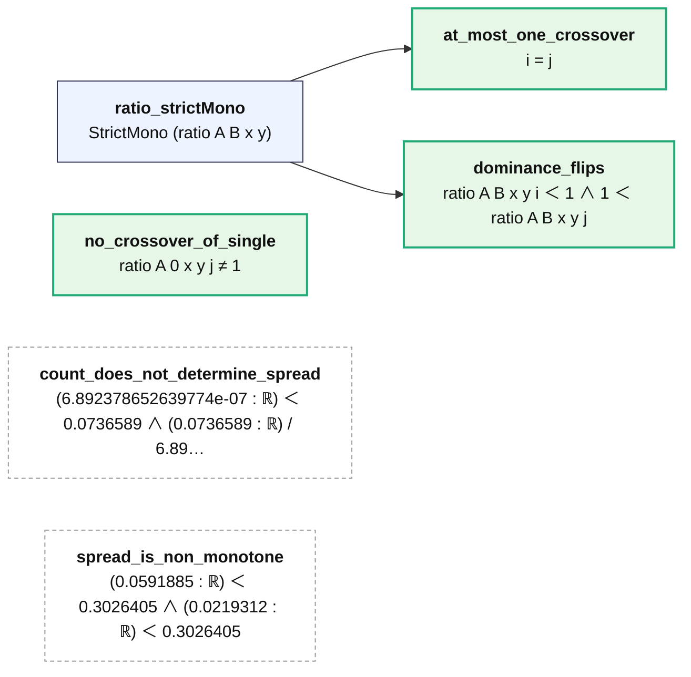

# `lean/Crossover.lean`

Crossover — what the "breakdown depth" actually is. THE MEASUREMENT (results/transform_radius.json → summary.breakdown_rel_spread_by_depth): relative spread of the z-transform's root moduli, by depth, at R = 45.

6 theorems, 5 definitions, 144 lines. Arrows are Lean's own record of what each proof uses.

**Imports:** nothing in this tree  
**Imported by:** nothing

## The picture



An arrow A → B reads "A is used in the proof of B". Blue: theorem. Green: a theorem nothing else uses (an end). Dashed: connects to nothing. Red: contains `sorry`. Yellow: theorems in another file, counted; a dotted arrow crosses files. Definitions are not drawn; they are listed below the diagram.

## Definitions

<a name="Crossover-xterm"></a>
### `Crossover.xterm`

def · line 40

The modulus of the `x`-term and the `y`-term at index `j`.

- **Is:** `` xterm (A x : ℝ) (j : ℝ) : ℝ := A * x ^ j ``
- **Used by 0:** nothing

<a name="Crossover-yterm"></a>
### `Crossover.yterm`

def · line 41

- **Is:** `` yterm (B y : ℝ) (j : ℝ) : ℝ := B * y ^ j ``
- **Used by 0:** nothing

<a name="Crossover-ratio"></a>
### `Crossover.ratio`

def · line 44

The dominance ratio: how far the `y`-family leads the `x`-family.

- **Is:** `` ratio (A B x y : ℝ) (j : ℝ) : ℝ := (B / A) * (y / x) ^ j ``
- **Used by 4:** [`Crossover.at_most_one_crossover`](#Crossover-at_most_one_crossover), [`Crossover.dominance_flips`](#Crossover-dominance_flips), [`Crossover.no_crossover_of_single`](#Crossover-no_crossover_of_single), [`Crossover.ratio_strictMono`](#Crossover-ratio_strictMono)

<a name="Crossover-spread_prime"></a>
### `Crossover.spread_prime`

def · line 90

Relative spread of the prime table's root moduli, depths 0, 13, 20, 30, 40.

- **Is:** `` spread_prime : List ℝ := [0.007915045300832617, 0.0591885, 0.3026405, 0.0219312, 0.0736589] ``
- **Used by 0:** nothing

<a name="Crossover-spread_smooth"></a>
### `Crossover.spread_smooth`

def · line 93

Same depths, smooth control.

- **Is:** `` spread_smooth : List ℝ := [0.0024515, 0.0001498, 0.0000503, 0.0000103, 6.892378652639774e-07] ``
- **Used by 0:** nothing

## Theorems

<a name="Crossover-ratio_strictMono"></a>
### `Crossover.ratio_strictMono`

line 50

**Why.** With distinct ratios `x < y`, the dominance ratio is strictly increasing — the `y`-family gains on the `x`-family monotonically, at every index.

**Proves**

```lean
StrictMono (ratio A B x y)
```

**Needs** (its hypotheses)

  - `` hA : 0 < A ``
  - `` hB : 0 < B ``
  - `` hx : 0 < x ``
  - `` hxy : x < y ``

**Stated with:** [`Crossover.ratio`](#Crossover-ratio)

**Fed by:** no theorem of this repo; it stands on Mathlib and the definitions below.

**Feeds** (2 that use it)

  - [`Crossover.at_most_one_crossover`](#Crossover-at_most_one_crossover) — `` i = j ``
  - [`Crossover.dominance_flips`](#Crossover-dominance_flips) — `` ratio A B x y i < 1 ∧ 1 < ratio A B x y j ``

<a name="Crossover-at_most_one_crossover"></a>
### `Crossover.at_most_one_crossover`

line 62

**Why.** At most one crossover. Because the dominance ratio is strictly increasing it is injective, so it can equal 1 at no more than one index. The transition happens once. This is what makes the spread single-peaked rather than oscillating: there is one place where neither family dominates.

**Proves**

```lean
i = j
```

**Needs** (its hypotheses)

  - `` hA : 0 < A ``
  - `` hB : 0 < B ``
  - `` hx : 0 < x ``
  - `` hxy : x < y ``
  - `` hi : ratio A B x y i = 1 ``
  - `` hj : ratio A B x y j = 1 ``

**Stated with:** [`Crossover.ratio`](#Crossover-ratio)

**Fed by** (1 theorem its proof uses)

  - [`Crossover.ratio_strictMono`](#Crossover-ratio_strictMono) — `` StrictMono (ratio A B x y) ``

**Feeds:** nothing. It is an end.

<a name="Crossover-dominance_flips"></a>
### `Crossover.dominance_flips`

line 68

**Why.** Before the crossover the `x`-family leads; after it, the `y`-family. Strict monotonicity gives both sides at once.

**Proves**

```lean
ratio A B x y i < 1 ∧ 1 < ratio A B x y j
```

**Needs** (its hypotheses)

  - `` hA : 0 < A ``
  - `` hB : 0 < B ``
  - `` hx : 0 < x ``
  - `` hxy : x < y ``
  - `` hc : ratio A B x y c = 1 ``
  - `` hi : i < c ``
  - `` hj : c < j ``

**Stated with:** [`Crossover.ratio`](#Crossover-ratio)

**Fed by** (1 theorem its proof uses)

  - [`Crossover.ratio_strictMono`](#Crossover-ratio_strictMono) — `` StrictMono (ratio A B x y) ``

**Feeds:** nothing. It is an end.

<a name="Crossover-no_crossover_of_single"></a>
### `Crossover.no_crossover_of_single`

line 78

**Why.** A single family has no crossover. If the second amplitude vanishes the dominance ratio is identically zero — it never reaches 1, at any index. This is the smooth control: one radius, so nothing to cross.

**Proves**

```lean
ratio A 0 x y j ≠ 1
```

**Needs** (its hypotheses)

  - `` hA : 0 < A ``
  - `` hx : 0 < x ``
  - `` j : ℝ ``

**Stated with:** [`Crossover.ratio`](#Crossover-ratio)

**Fed by:** no theorem of this repo; it stands on Mathlib and the definitions below.

**Feeds:** nothing. It is an end.

<a name="Crossover-count_does_not_determine_spread"></a>
### `Crossover.count_does_not_determine_spread`

line 98

**Why.** The coefficient-count account fails. At depth 40 both triangles have the same number of coefficients — five. Their spreads differ by five orders of magnitude. So spread is not a function of coefficient count.

**Proves**

```lean
(6.892378652639774e-07 : ℝ) < 0.0736589 ∧ (0.0736589 : ℝ) / 6.892378652639774e-07 > 100000
```

**Fed by:** no theorem of this repo; it stands on Mathlib.

**Feeds:** nothing. It connects to nothing.

<a name="Crossover-spread_is_non_monotone"></a>
### `Crossover.spread_is_non_monotone`

line 107

**Why.** The spread is non-monotone. It rises from depth 13 to depth 20 and falls again by depth 30 — a crossover completing, not an exhaustion worsening.

**Proves**

```lean
(0.0591885 : ℝ) < 0.3026405 ∧ (0.0219312 : ℝ) < 0.3026405
```

**Fed by:** no theorem of this repo; it stands on Mathlib.

**Feeds:** nothing. It connects to nothing.

