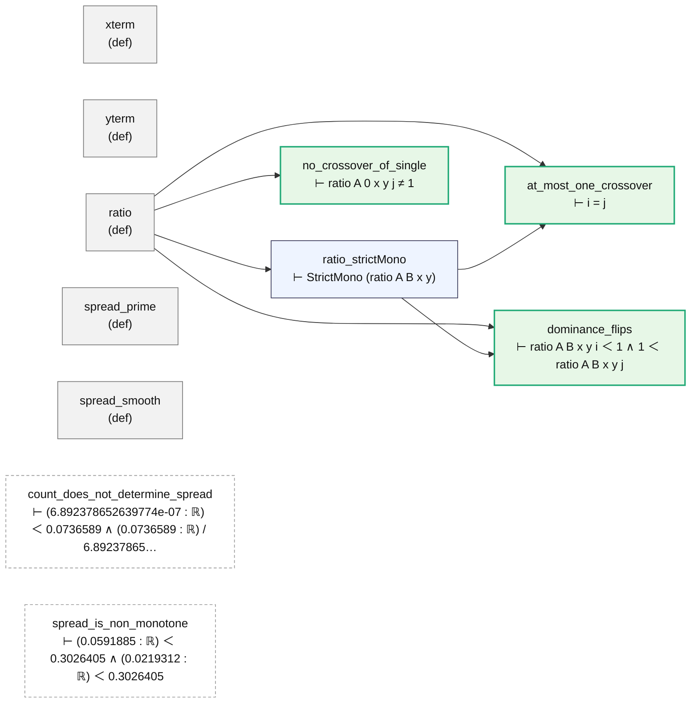

# `lean/Crossover.lean`

**What it does** (its own header): Crossover — what the "breakdown depth" actually is. THE MEASUREMENT (results/transform_radius.json → summary.breakdown_rel_spread_by_depth): relative spread of the z-transform's root moduli, by depth, at R = 45.

**Imports:** nothing in this tree.
**Imported by:** nothing.

Blue: theorem. Green: a theorem nothing else uses (an end). Dashed white: connects to nothing. Grey: definition. Red: contains `sorry`. Yellow: in another file. An arrow A → B reads "A is used by B".

## Every declaration

| declaration | proves (output) | needs (input) | why (its own docstring) | uses | used by |
|---|---|---|---|---|---|
| `Crossover.xterm` def, line 40 | ℝ | A x : ℝ; j : ℝ | The modulus of the `x`-term and the `y`-term at index `j`. | — | — |
| `Crossover.yterm` def, line 41 | ℝ | B y : ℝ; j : ℝ | — | — | — |
| `Crossover.ratio` def, line 44 | ℝ | A B x y : ℝ; j : ℝ | The dominance ratio: how far the `y`-family leads the `x`-family. | — | `Crossover.at_most_one_crossover`, `Crossover.dominance_flips`, `Crossover.no_crossover_of_single`, `Crossover.ratio_strictMono` |
| `Crossover.ratio_strictMono` theorem, line 50 | StrictMono (ratio A B x y) | hA : 0 &lt; A; hB : 0 &lt; B; hx : 0 &lt; x; hxy : x &lt; y | With distinct ratios `x &lt; y`, the dominance ratio is strictly increasing — the `y`-family gains on the `x`-family monotonically, at every index. | `Crossover.ratio` | `Crossover.at_most_one_crossover`, `Crossover.dominance_flips` |
| `Crossover.at_most_one_crossover` theorem, line 62 | i = j | hA : 0 &lt; A; hB : 0 &lt; B; hx : 0 &lt; x; hxy : x &lt; y; hi : ratio A B x y i = 1; hj : ratio A B x y j = 1 | At most one crossover. Because the dominance ratio is strictly increasing it is injective, so it can equal 1 at no more than one index. The transition happens once. This is what makes the spread single-peaked rather than oscillating: there is one place where neither family dominates. | `Crossover.ratio`, `Crossover.ratio_strictMono` | — |
| `Crossover.dominance_flips` theorem, line 68 | ratio A B x y i &lt; 1 ∧ 1 &lt; ratio A B x y j | hA : 0 &lt; A; hB : 0 &lt; B; hx : 0 &lt; x; hxy : x &lt; y; hc : ratio A B x y c = 1; hi : i &lt; c; hj : c &lt; j | Before the crossover the `x`-family leads; after it, the `y`-family. Strict monotonicity gives both sides at once. | `Crossover.ratio`, `Crossover.ratio_strictMono` | — |
| `Crossover.no_crossover_of_single` theorem, line 78 | ratio A 0 x y j ≠ 1 | hA : 0 &lt; A; hx : 0 &lt; x; j : ℝ | A single family has no crossover. If the second amplitude vanishes the dominance ratio is identically zero — it never reaches 1, at any index. This is the smooth control: one radius, so nothing to cross. | `Crossover.ratio` | — |
| `Crossover.spread_prime` def, line 90 | List ℝ | — | Relative spread of the prime table's root moduli, depths 0, 13, 20, 30, 40. | — | — |
| `Crossover.spread_smooth` def, line 93 | List ℝ | — | Same depths, smooth control. | — | — |
| `Crossover.count_does_not_determine_spread` theorem, line 98 | (6.892378652639774e-07 : ℝ) &lt; 0.0736589 ∧ (0.0736589 : ℝ) / 6.892378652639774e-07 &gt; 100000 | — | The coefficient-count account fails. At depth 40 both triangles have the same number of coefficients — five. Their spreads differ by five orders of magnitude. So spread is not a function of coefficient count. | — | — |
| `Crossover.spread_is_non_monotone` theorem, line 107 | (0.0591885 : ℝ) &lt; 0.3026405 ∧ (0.0219312 : ℝ) &lt; 0.3026405 | — | The spread is non-monotone. It rises from depth 13 to depth 20 and falls again by depth 30 — a crossover completing, not an exhaustion worsening. | — | — |
