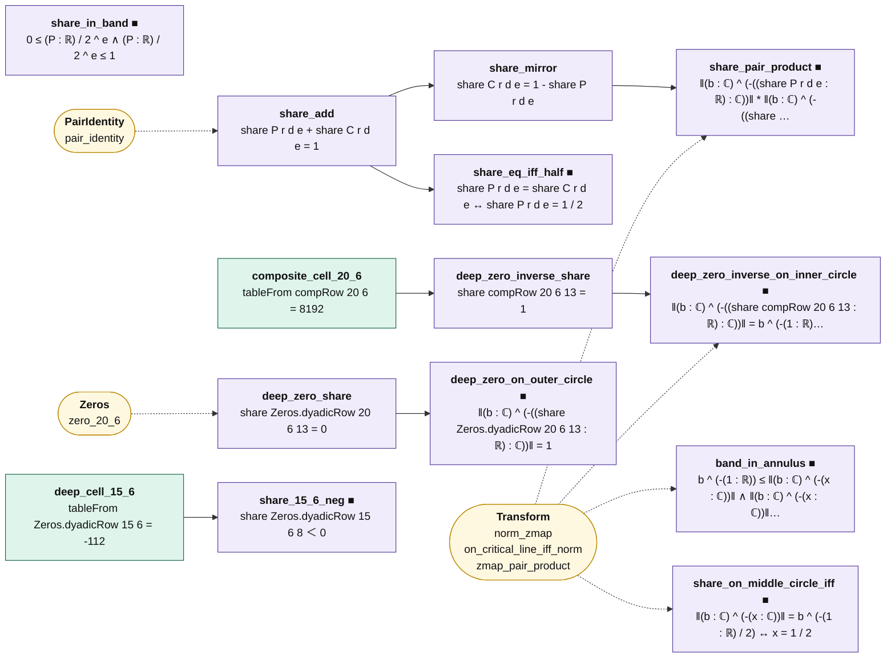

# `lean/DeepZeroBand.lean`

DeepZeroBand — the deep zero, inverted, and the band between the two. Joins three things already in this tree:

14 theorems, 2 definitions, 215 lines. Arrows are Lean's own record of what each proof uses.

**Imports:** [`PairIdentity`](../lean/PairIdentity.md), [`Transform`](../lean/Transform.md), [`Zeros`](../lean/Zeros.md)  
**Imported by:** nothing

## The picture



An arrow A → B reads "A is used in the proof of B". Green: counting, integers only. Violet: shape, analysis with no ζ. Blue: reads ζ. A name ending in ■ is an end: nothing else uses it. Red: contains `sorry`. Yellow: theorems in another file, counted; a dotted arrow crosses files. Definitions are not drawn; they are listed below the diagram.

## Definitions

<a name="DeepZeroBand-compRow"></a>
### `DeepZeroBand.compRow`

def · line 53

The composites in the rung `(2^(r−1), 2^r]`: the integers it holds, less the primes it holds.

- **Is:** `` compRow : ℤ → ℤ := fun r => 2 ^ (r - 1).toNat - Zeros.dyadicRow r ``
- **Built from:** [`Zeros.dyadicRow`](../lean/Zeros.md#Zeros-dyadicRow)
- **Used by 3:** [`DeepZeroBand.composite_cell_20_6`](#DeepZeroBand-composite_cell_20_6), [`DeepZeroBand.deep_zero_inverse_on_inner_circle`](#DeepZeroBand-deep_zero_inverse_on_inner_circle), [`DeepZeroBand.deep_zero_inverse_share`](#DeepZeroBand-deep_zero_inverse_share)

<a name="DeepZeroBand-share"></a>
### `DeepZeroBand.share`

def · line 56

A cell over its total `2^e`, `e = r − 1 − d`.

- **Is:** `` share (P : ℤ → ℤ) (r : ℤ) (d e : ℕ) : ℝ := (tableFrom P r d : ℝ) / 2 ^ e ``
- **Built from:** [`Construction.tableFrom`](../lean/Construction.md#Construction-tableFrom)
- **Used by 9:** [`DeepZeroBand.deep_zero_inverse_on_inner_circle`](#DeepZeroBand-deep_zero_inverse_on_inner_circle), [`DeepZeroBand.deep_zero_inverse_share`](#DeepZeroBand-deep_zero_inverse_share), [`DeepZeroBand.deep_zero_on_outer_circle`](#DeepZeroBand-deep_zero_on_outer_circle), [`DeepZeroBand.deep_zero_share`](#DeepZeroBand-deep_zero_share), [`DeepZeroBand.share_15_6_neg`](#DeepZeroBand-share_15_6_neg), [`DeepZeroBand.share_add`](#DeepZeroBand-share_add), [`DeepZeroBand.share_eq_iff_half`](#DeepZeroBand-share_eq_iff_half), [`DeepZeroBand.share_mirror`](#DeepZeroBand-share_mirror), [`DeepZeroBand.share_pair_product`](#DeepZeroBand-share_pair_product)

## Theorems

<a name="DeepZeroBand-composite_cell_20_6"></a>
### `DeepZeroBand.composite_cell_20_6`

line 61

**Counting.** Integers only: nothing in its statement or proof, or in anything it rests on, uses analysis or ζ.

**Why.** The inverse of the deep zero. The composite cell at (20,6) is the whole total, `2^13`, computed.

**Proves**

```lean
tableFrom compRow 20 6 = 8192
```

**Stated with:** [`Construction.tableFrom`](../lean/Construction.md#Construction-tableFrom), [`DeepZeroBand.compRow`](#DeepZeroBand-compRow)

**Fed by:** no theorem of this repo; it stands on Mathlib and the definitions below.

**Feeds** (1 that use it)

  - [`DeepZeroBand.deep_zero_inverse_share`](#DeepZeroBand-deep_zero_inverse_share) — `` share compRow 20 6 13 = 1 ``

<a name="DeepZeroBand-share_add"></a>
### `DeepZeroBand.share_add`

line 65

**Shape.** Uses real or complex analysis; nothing in it or beneath it reads ζ.

**Why.** The two shares add to one, at every cell of any pair of rows that partition the rungs.

**Proves**

```lean
share P r d e + share C r d e = 1
```

**Needs** (its hypotheses)

  - `` P C : ℤ → ℤ ``
  - `` r : ℤ ``
  - `` d e : ℕ ``
  - `` hr : r = (d : ℤ) + 1 + e ``
  - `` hpair : ∀ k : ℕ, k ≤ d → P (r - k) + C (r - k) = (2 - 1) * 2 ^ (e + (d - k)) ``

**Stated with:** [`DeepZeroBand.share`](#DeepZeroBand-share)

**Fed by** (1 theorem its proof uses)

  - [`PairIdentity.pair_identity`](../lean/PairIdentity.md#PairIdentity-pair_identity) (PairIdentity) — `` tableFrom P r d + tableFrom C r d = (b - 1) ^ (d + 1) * b ^ e ``

**Definitions its proof touches:** [`Construction.tableFrom`](../lean/Construction.md#Construction-tableFrom)

**Feeds** (2 that use it)

  - [`DeepZeroBand.share_eq_iff_half`](#DeepZeroBand-share_eq_iff_half) — `` share P r d e = share C r d e ↔ share P r d e = 1 / 2 ``
  - [`DeepZeroBand.share_mirror`](#DeepZeroBand-share_mirror) — `` share C r d e = 1 - share P r d e ``

<a name="DeepZeroBand-share_mirror"></a>
### `DeepZeroBand.share_mirror`

line 76

**Shape.** Uses real or complex analysis; nothing in it or beneath it reads ζ.

**Why.** Passing to the composite table is `x ↦ 1 − x` on shares.

**Proves**

```lean
share C r d e = 1 - share P r d e
```

**Needs** (its hypotheses)

  - `` P C : ℤ → ℤ ``
  - `` r : ℤ ``
  - `` d e : ℕ ``
  - `` hr : r = (d : ℤ) + 1 + e ``
  - `` hpair : ∀ k : ℕ, k ≤ d → P (r - k) + C (r - k) = (2 - 1) * 2 ^ (e + (d - k)) ``

**Stated with:** [`DeepZeroBand.share`](#DeepZeroBand-share)

**Fed by** (1 theorem its proof uses)

  - [`DeepZeroBand.share_add`](#DeepZeroBand-share_add) — `` share P r d e + share C r d e = 1 ``

**Feeds** (1 that use it)

  - [`DeepZeroBand.share_pair_product`](#DeepZeroBand-share_pair_product) — `` ‖(b : ℂ) ^ (-((share P r d e : ℝ) : ℂ))‖ * ‖(b : ℂ) ^ (-((share C r d e : ℝ) : ℂ))‖ = b ^ (-(1 : ℝ)) ``

<a name="DeepZeroBand-share_eq_iff_half"></a>
### `DeepZeroBand.share_eq_iff_half`

line 82

**Shape.** Uses real or complex analysis; nothing in it or beneath it reads ζ.

**Why.** The two shares are equal exactly at one half.

**Proves**

```lean
share P r d e = share C r d e ↔ share P r d e = 1 / 2
```

**Needs** (its hypotheses)

  - `` P C : ℤ → ℤ ``
  - `` r : ℤ ``
  - `` d e : ℕ ``
  - `` hr : r = (d : ℤ) + 1 + e ``
  - `` hpair : ∀ k : ℕ, k ≤ d → P (r - k) + C (r - k) = (2 - 1) * 2 ^ (e + (d - k)) ``

**Stated with:** [`DeepZeroBand.share`](#DeepZeroBand-share)

**Fed by** (1 theorem its proof uses)

  - [`DeepZeroBand.share_add`](#DeepZeroBand-share_add) — `` share P r d e + share C r d e = 1 ``

**Feeds:** nothing. It is an end.

<a name="DeepZeroBand-deep_zero_share"></a>
### `DeepZeroBand.deep_zero_share`

line 89

**Shape.** Uses real or complex analysis; nothing in it or beneath it reads ζ.

**Why.** At the deep zero the prime share is zero.

**Proves**

```lean
share Zeros.dyadicRow 20 6 13 = 0
```

**Stated with:** [`DeepZeroBand.share`](#DeepZeroBand-share), [`Zeros.dyadicRow`](../lean/Zeros.md#Zeros-dyadicRow)

**Fed by** (1 theorem its proof uses)

  - [`Zeros.zero_20_6`](../lean/Zeros.md#Zeros-zero_20_6) (Zeros) — `` Construction.tableFrom dyadicRow 20 6 = 0 ``

**Definitions its proof touches:** [`Construction.tableFrom`](../lean/Construction.md#Construction-tableFrom)

**Feeds** (1 that use it)

  - [`DeepZeroBand.deep_zero_on_outer_circle`](#DeepZeroBand-deep_zero_on_outer_circle) — `` ‖(b : ℂ) ^ (-((share Zeros.dyadicRow 20 6 13 : ℝ) : ℂ))‖ = 1 ``

<a name="DeepZeroBand-deep_zero_inverse_share"></a>
### `DeepZeroBand.deep_zero_inverse_share`

line 95

**Shape.** Uses real or complex analysis; nothing in it or beneath it reads ζ.

**Why.** At the deep zero the composite share is one.

**Proves**

```lean
share compRow 20 6 13 = 1
```

**Stated with:** [`DeepZeroBand.compRow`](#DeepZeroBand-compRow), [`DeepZeroBand.share`](#DeepZeroBand-share)

**Fed by** (1 theorem its proof uses)

  - [`DeepZeroBand.composite_cell_20_6`](#DeepZeroBand-composite_cell_20_6) — `` tableFrom compRow 20 6 = 8192 ``

**Definitions its proof touches:** [`Construction.tableFrom`](../lean/Construction.md#Construction-tableFrom)

**Feeds** (1 that use it)

  - [`DeepZeroBand.deep_zero_inverse_on_inner_circle`](#DeepZeroBand-deep_zero_inverse_on_inner_circle) — `` ‖(b : ℂ) ^ (-((share compRow 20 6 13 : ℝ) : ℂ))‖ = b ^ (-(1 : ℝ)) ``

<a name="DeepZeroBand-deep_zero_on_outer_circle"></a>
### `DeepZeroBand.deep_zero_on_outer_circle`

line 102

**Shape.** Uses real or complex analysis; nothing in it or beneath it reads ζ.

**Why.** The deep zero is on the outer circle, where the zeros of the table's own symbol are.

**Proves**

```lean
‖(b : ℂ) ^ (-((share Zeros.dyadicRow 20 6 13 : ℝ) : ℂ))‖ = 1
```

**Needs** (its hypotheses)

  - `` b : ℝ ``

**Stated with:** [`DeepZeroBand.share`](#DeepZeroBand-share), [`Zeros.dyadicRow`](../lean/Zeros.md#Zeros-dyadicRow)

**Fed by** (1 theorem its proof uses)

  - [`DeepZeroBand.deep_zero_share`](#DeepZeroBand-deep_zero_share) — `` share Zeros.dyadicRow 20 6 13 = 0 ``

**Feeds:** nothing. It is an end.

<a name="DeepZeroBand-deep_zero_inverse_on_inner_circle"></a>
### `DeepZeroBand.deep_zero_inverse_on_inner_circle`

line 108

**Shape.** Uses real or complex analysis; nothing in it or beneath it reads ζ.

**Why.** Its inverse is on the inner circle.

**Proves**

```lean
‖(b : ℂ) ^ (-((share compRow 20 6 13 : ℝ) : ℂ))‖ = b ^ (-(1 : ℝ))
```

**Needs** (its hypotheses)

  - `` hb : 0 < b ``

**Stated with:** [`DeepZeroBand.compRow`](#DeepZeroBand-compRow), [`DeepZeroBand.share`](#DeepZeroBand-share)

**Fed by** (2 theorems its proof uses)

  - [`DeepZeroBand.deep_zero_inverse_share`](#DeepZeroBand-deep_zero_inverse_share) — `` share compRow 20 6 13 = 1 ``
  - [`Transform.norm_zmap`](../lean/Transform.md#Transform-norm_zmap) (Transform) — `` ‖(b : ℂ) ^ (-s)‖ = b ^ (-s.re) ``

**Feeds:** nothing. It is an end.

<a name="DeepZeroBand-share_pair_product"></a>
### `DeepZeroBand.share_pair_product`

line 114

**Shape.** Uses real or complex analysis; nothing in it or beneath it reads ζ.

**Why.** At every cell the two images multiply to `b^(−1)`.

**Proves**

```lean
‖(b : ℂ) ^ (-((share P r d e : ℝ) : ℂ))‖ * ‖(b : ℂ) ^ (-((share C r d e : ℝ) : ℂ))‖ = b ^ (-(1 : ℝ))
```

**Needs** (its hypotheses)

  - `` hb : 0 < b ``
  - `` P C : ℤ → ℤ ``
  - `` r : ℤ ``
  - `` d e : ℕ ``
  - `` hr : r = (d : ℤ) + 1 + e ``
  - `` hpair : ∀ k : ℕ, k ≤ d → P (r - k) + C (r - k) = (2 - 1) * 2 ^ (e + (d - k)) ``

**Stated with:** [`DeepZeroBand.share`](#DeepZeroBand-share)

**Fed by** (2 theorems its proof uses)

  - [`DeepZeroBand.share_mirror`](#DeepZeroBand-share_mirror) — `` share C r d e = 1 - share P r d e ``
  - [`Transform.zmap_pair_product`](../lean/Transform.md#Transform-zmap_pair_product) (Transform) — `` ‖(b : ℂ) ^ (-s)‖ * ‖(b : ℂ) ^ (-(1 - s))‖ = b ^ (-(1 : ℝ)) ``

**Feeds:** nothing. It is an end.

<a name="DeepZeroBand-share_on_middle_circle_iff"></a>
### `DeepZeroBand.share_on_middle_circle_iff`

line 123

**Shape.** Uses real or complex analysis; nothing in it or beneath it reads ζ.

**Why.** The middle circle is share one half.

**Proves**

```lean
‖(b : ℂ) ^ (-(x : ℂ))‖ = b ^ (-(1 : ℝ) / 2) ↔ x = 1 / 2
```

**Needs** (its hypotheses)

  - `` hb : 1 < b ``
  - `` x : ℝ ``

**Fed by** (1 theorem its proof uses)

  - [`Transform.on_critical_line_iff_norm`](../lean/Transform.md#Transform-on_critical_line_iff_norm) (Transform) — `` s.re = 1 / 2 ↔ ‖(b : ℂ) ^ (-s)‖ = b ^ (-(1 : ℝ) / 2) ``

**Feeds:** nothing. It is an end.

<a name="DeepZeroBand-share_in_band"></a>
### `DeepZeroBand.share_in_band`

line 130

**Shape.** Uses real or complex analysis; nothing in it or beneath it reads ζ.

**Why.** The band of shares. A count and its complement, both nonnegative, have share between zero and one.

**Proves**

```lean
0 ≤ (P : ℝ) / 2 ^ e ∧ (P : ℝ) / 2 ^ e ≤ 1
```

**Needs** (its hypotheses)

  - `` hP : 0 ≤ P ``
  - `` hC : 0 ≤ C ``
  - `` h : P + C = 2 ^ e ``

**Fed by:** no theorem of this repo; it stands on Mathlib.

**Feeds:** nothing. It connects to nothing.

<a name="DeepZeroBand-band_in_annulus"></a>
### `DeepZeroBand.band_in_annulus`

line 139

**Shape.** Uses real or complex analysis; nothing in it or beneath it reads ζ.

**Why.** The band between the circles. A share between zero and one lands between the inner circle and the outer circle.

**Proves**

```lean
b ^ (-(1 : ℝ)) ≤ ‖(b : ℂ) ^ (-(x : ℂ))‖ ∧ ‖(b : ℂ) ^ (-(x : ℂ))‖ ≤ 1
```

**Needs** (its hypotheses)

  - `` hb : 1 < b ``
  - `` h0 : 0 ≤ x ``
  - `` h1 : x ≤ 1 ``

**Fed by** (1 theorem its proof uses)

  - [`Transform.norm_zmap`](../lean/Transform.md#Transform-norm_zmap) (Transform) — `` ‖(b : ℂ) ^ (-s)‖ = b ^ (-s.re) ``

**Feeds:** nothing. It is an end.

<a name="DeepZeroBand-deep_cell_15_6"></a>
### `DeepZeroBand.deep_cell_15_6`

line 149

**Counting.** Integers only: nothing in its statement or proof, or in anything it rests on, uses analysis or ζ.

**Why.** A differenced cell can be negative: (15,6) is `−112`, computed.

**Proves**

```lean
tableFrom Zeros.dyadicRow 15 6 = -112
```

**Stated with:** [`Construction.tableFrom`](../lean/Construction.md#Construction-tableFrom), [`Zeros.dyadicRow`](../lean/Zeros.md#Zeros-dyadicRow)

**Fed by:** no theorem of this repo; it stands on Mathlib and the definitions below.

**Feeds** (1 that use it)

  - [`DeepZeroBand.share_15_6_neg`](#DeepZeroBand-share_15_6_neg) — `` share Zeros.dyadicRow 15 6 8 < 0 ``

<a name="DeepZeroBand-share_15_6_neg"></a>
### `DeepZeroBand.share_15_6_neg`

line 152

**Shape.** Uses real or complex analysis; nothing in it or beneath it reads ζ.

**Why.** So its share is below the band.

**Proves**

```lean
share Zeros.dyadicRow 15 6 8 < 0
```

**Stated with:** [`DeepZeroBand.share`](#DeepZeroBand-share), [`Zeros.dyadicRow`](../lean/Zeros.md#Zeros-dyadicRow)

**Fed by** (1 theorem its proof uses)

  - [`DeepZeroBand.deep_cell_15_6`](#DeepZeroBand-deep_cell_15_6) — `` tableFrom Zeros.dyadicRow 15 6 = -112 ``

**Definitions its proof touches:** [`Construction.tableFrom`](../lean/Construction.md#Construction-tableFrom)

**Feeds:** nothing. It is an end.

