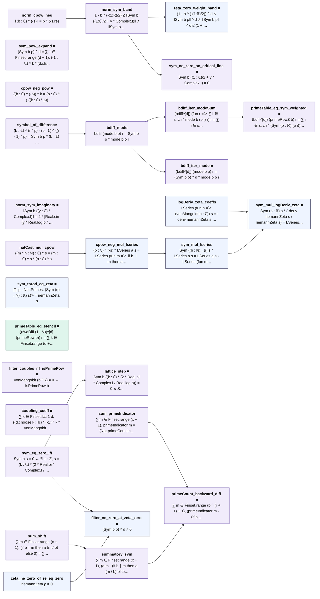

# `lean/Elephant.lean`

# Elephant.lean — the one object, derived from nothing Standalone. This file imports Mathlib and imports no module of this development. It defines

29 theorems, 7 definitions, 667 lines. Arrows are Lean's own record of what each proof uses.

**Imports:** nothing in this tree  
**Imported by:** nothing

## The picture



An arrow A → B reads "A is used in the proof of B". Green: counting, integers only. Violet: shape, analysis with no ζ. Blue: reads ζ. A name ending in ■ is an end: nothing else uses it. Red: contains `sorry`. Yellow: theorems in another file, counted; a dotted arrow crosses files. Definitions are not drawn; they are listed below the diagram.

## Definitions

<a name="Elephant-Sym"></a>
### `Elephant.Sym`

def · line 31

The reciprocal Euler factor at `b`.

- **Is:** `` Sym (b : ℝ) (s : ℂ) : ℂ := 1 - (b : ℂ) ^ (-s) ``
- **Used by 16:** [`Elephant.bdiff_iter_mode`](#Elephant-bdiff_iter_mode), [`Elephant.bdiff_iter_modeSum`](#Elephant-bdiff_iter_modeSum), [`Elephant.bdiff_mode`](#Elephant-bdiff_mode), [`Elephant.filter_ne_zero_at_zeta_zero`](#Elephant-filter_ne_zero_at_zeta_zero), [`Elephant.lattice_step`](#Elephant-lattice_step), [`Elephant.norm_sym_band`](#Elephant-norm_sym_band), [`Elephant.norm_sym_imaginary`](#Elephant-norm_sym_imaginary), [`Elephant.primeTable_eq_sym_weighted`](#Elephant-primeTable_eq_sym_weighted), [`Elephant.sym_eq_zero_iff`](#Elephant-sym_eq_zero_iff), [`Elephant.sym_mul_logDeriv_zeta`](#Elephant-sym_mul_logDeriv_zeta), [`Elephant.sym_mul_lseries`](#Elephant-sym_mul_lseries), [`Elephant.sym_ne_zero_on_critical_line`](#Elephant-sym_ne_zero_on_critical_line), [`Elephant.sym_pow_expand`](#Elephant-sym_pow_expand), [`Elephant.sym_tprod_eq_zeta`](#Elephant-sym_tprod_eq_zeta), [`Elephant.symbol_of_difference`](#Elephant-symbol_of_difference), [`Elephant.zeta_zero_weight_band`](#Elephant-zeta_zero_weight_band)

<a name="Elephant-primeRow"></a>
### `Elephant.primeRow`

def · line 179

The table is a difference of prime counts. `Δ^d` applied to `n ↦ π(bⁿ)` is the alternating binomial stencil on `d+1` values of `π` — the dyadic prime difference table, for `b = 2`.

- **Is:** `` primeRow (b : ℕ) : ℕ → ℤ := fun n => (Nat.primeCounting (b ^ n) : ℤ) ``
- **Used by 1:** [`Elephant.primeTable_eq_stencil`](#Elephant-primeTable_eq_stencil)

<a name="Elephant-bdiff"></a>
### `Elephant.bdiff`

def · line 232

A backward difference on a row indexed by `ℤ`.

- **Is:** `` bdiff (f : ℤ → ℂ) : ℤ → ℂ := fun r => f r - f (r - 1) ``
- **Used by 4:** [`Elephant.bdiff_iter_mode`](#Elephant-bdiff_iter_mode), [`Elephant.bdiff_iter_modeSum`](#Elephant-bdiff_iter_modeSum), [`Elephant.bdiff_mode`](#Elephant-bdiff_mode), [`Elephant.primeTable_eq_sym_weighted`](#Elephant-primeTable_eq_sym_weighted)

<a name="Elephant-mode"></a>
### `Elephant.mode`

def · line 235

The mode `r ↦ b ^ (r ρ)`.

- **Is:** `` mode (b : ℝ) (ρ : ℂ) : ℤ → ℂ := fun r => (b : ℂ) ^ ((r : ℂ) * ρ) ``
- **Used by 5:** [`Elephant.IsModeRow`](#Elephant-IsModeRow), [`Elephant.bdiff_iter_mode`](#Elephant-bdiff_iter_mode), [`Elephant.bdiff_iter_modeSum`](#Elephant-bdiff_iter_modeSum), [`Elephant.bdiff_mode`](#Elephant-bdiff_mode), [`Elephant.primeTable_eq_sym_weighted`](#Elephant-primeTable_eq_sym_weighted)

<a name="Elephant-IsModeRow"></a>
### `Elephant.IsModeRow`

def · line 285

The explicit-formula hypothesis, named and visible. A row is a mode row when its values on the `b`-ladder are a finite superposition of `b^(rρ)`. This is NOT satisfiable by `π` with a finite index set — `π` is a step function, and the explicit formula is an infinite sum with a main term. Trying to discharge it is what showed that. It is kept because it is the correct shape of the bridge and because `coupling_coeff` below reaches the same base law by a route that needs no such hypothesis.

- **Is:** `` IsModeRow {ι : Type*} (b : ℝ) (N : ℤ → ℂ) (ρ : ι → ℂ) (c : ι → ℂ) (s : Finset ι) : Prop := ∀ r : ℤ, N r = ∑ i ∈ s, c i * mode b (ρ i) r ``
- **Built from:** [`Elephant.mode`](#Elephant-mode)
- **Used by 1:** [`Elephant.primeTable_eq_sym_weighted`](#Elephant-primeTable_eq_sym_weighted)

<a name="Elephant-primeRowZ"></a>
### `Elephant.primeRowZ`

def · line 290

The prime-counting row on the `b`-ladder, `r ↦ π(b^r)`.

- **Is:** `` primeRowZ (b : ℕ) : ℤ → ℂ := fun r => (Nat.primeCounting (b ^ r.toNat) : ℂ) ``
- **Used by 1:** [`Elephant.primeTable_eq_sym_weighted`](#Elephant-primeTable_eq_sym_weighted)

<a name="Elephant-primeIndicator"></a>
### `Elephant.primeIndicator`

def · line 453

The prime indicator, whose partial sums are `π`.

- **Is:** `` primeIndicator : ℕ → ℂ := fun n => if n.Prime then 1 else 0 ``
- **Used by 2:** [`Elephant.primeCount_backward_diff`](#Elephant-primeCount_backward_diff), [`Elephant.sum_primeIndicator`](#Elephant-sum_primeIndicator)

## Theorems

<a name="Elephant-symbol_of_difference"></a>
### `Elephant.symbol_of_difference`

line 38

**Shape.** Uses real or complex analysis; nothing in it or beneath it reads ζ.

**Why.** The symbol is the difference operator. Differencing a mode in `r` multiplies it by `Sym b ρ`. This is the whole reason the table and the Euler factor are the same thing.

**Proves**

```lean
(b : ℂ) ^ (r * ρ) - (b : ℂ) ^ ((r - 1) * ρ) = Sym b ρ * (b : ℂ) ^ (r * ρ)
```

**Needs** (its hypotheses)

  - `` hb : 0 < b ``
  - `` ρ r : ℂ ``

**Stated with:** [`Elephant.Sym`](#Elephant-Sym)

**Fed by:** no theorem of this repo; it stands on Mathlib and the definitions below.

**Feeds** (1 that use it)

  - [`Elephant.bdiff_mode`](#Elephant-bdiff_mode) — `` bdiff (mode b ρ) r = Sym b ρ * mode b ρ r ``

<a name="Elephant-sym_pow_expand"></a>
### `Elephant.sym_pow_expand`

line 51

**Shape.** Uses real or complex analysis; nothing in it or beneath it reads ζ.

**Why.** The stencil is the symbol, expanded. No hypothesis on `b`.

**Proves**

```lean
(Sym b ρ) ^ d = ∑ k ∈ Finset.range (d + 1), (-1 : ℂ) ^ k * (d.choose k : ℂ) * ((b : ℂ) ^ (-ρ)) ^ k
```

**Needs** (its hypotheses)

  - `` b : ℝ ``
  - `` ρ : ℂ ``
  - `` d : ℕ ``

**Stated with:** [`Elephant.Sym`](#Elephant-Sym)

**Fed by:** no theorem of this repo; it stands on Mathlib and the definitions below.

**Feeds:** nothing. It is an end.

<a name="Elephant-cpow_neg_pow"></a>
### `Elephant.cpow_neg_pow`

line 65

**Shape.** Uses real or complex analysis; nothing in it or beneath it reads ζ.

**Why.** Each term sits at a power of the base. The expansion of `Sym ^ d` is a Dirichlet polynomial supported on `{1, b, …, b^d}`.

**Proves**

```lean
((b : ℂ) ^ (-ρ)) ^ k = (b : ℂ) ^ (-((k : ℂ) * ρ))
```

**Needs** (its hypotheses)

  - `` hb : 0 < b ``
  - `` ρ : ℂ ``
  - `` k : ℕ ``

**Fed by:** no theorem of this repo; it stands on Mathlib.

**Feeds:** nothing. It connects to nothing.

<a name="Elephant-norm_cpow_neg"></a>
### `Elephant.norm_cpow_neg`

line 79

**Shape.** Uses real or complex analysis; nothing in it or beneath it reads ζ.

**Why.** The modulus of `b ^ (-s)` is `b ^ (-s.re)`.

**Proves**

```lean
‖(b : ℂ) ^ (-s)‖ = b ^ (-s.re)
```

**Needs** (its hypotheses)

  - `` hb : 0 < b ``
  - `` s : ℂ ``

**Fed by:** no theorem of this repo; it stands on Mathlib.

**Feeds** (1 that use it)

  - [`Elephant.norm_sym_band`](#Elephant-norm_sym_band) — `` 1 - b ^ (-(1:ℝ)/2) ≤ ‖Sym b ((1:ℂ)/2 + γ * Complex.I)‖ ∧ ‖Sym b ((1:ℂ)/2 + γ * Complex.I)‖ ≤ 1 + b ^ (-(1:ℝ)/2) ``

<a name="Elephant-norm_sym_band"></a>
### `Elephant.norm_sym_band`

line 87

**Shape.** Uses real or complex analysis; nothing in it or beneath it reads ζ.

**Why.** The band. On the critical line the symbol's modulus lies between `1 - b^(-1/2)` and `1 + b^(-1/2)` — the law of cosines on sides `1` and `b^(-1/2)`.

**Proves**

```lean
1 - b ^ (-(1:ℝ)/2) ≤ ‖Sym b ((1:ℂ)/2 + γ * Complex.I)‖ ∧ ‖Sym b ((1:ℂ)/2 + γ * Complex.I)‖ ≤ 1 + b ^ (-(1:ℝ)/2)
```

**Needs** (its hypotheses)

  - `` hb : 0 < b ``
  - `` γ : ℝ ``

**Stated with:** [`Elephant.Sym`](#Elephant-Sym)

**Fed by** (1 theorem its proof uses)

  - [`Elephant.norm_cpow_neg`](#Elephant-norm_cpow_neg) — `` ‖(b : ℂ) ^ (-s)‖ = b ^ (-s.re) ``

**Feeds** (2 that use it)

  - [`Elephant.sym_ne_zero_on_critical_line`](#Elephant-sym_ne_zero_on_critical_line) — `` Sym b ((1 : ℂ)/2 + γ * Complex.I) ≠ 0 ``
  - [`Elephant.zeta_zero_weight_band`](#Elephant-zeta_zero_weight_band) — `` (1 - b ^ (-(1:ℝ)/2)) ^ d ≤ ‖Sym b ρ‖ ^ d ∧ ‖Sym b ρ‖ ^ d ≤ (1 + b ^ (-(1:ℝ)/2)) ^ d ``

<a name="Elephant-norm_sym_imaginary"></a>
### `Elephant.norm_sym_imaginary`

line 107

**Shape.** Uses real or complex analysis; nothing in it or beneath it reads ζ.

**Why.** The gain. On the imaginary axis the symbol's modulus is `2|sin(γ log b / 2)|`; raised to the depth this is the depth-`d` gain, and its maximum `2` at phase `π` is the ceiling.

**Proves**

```lean
‖Sym b ((γ : ℂ) * Complex.I)‖ = 2 * |Real.sin (γ * Real.log b / 2)|
```

**Needs** (its hypotheses)

  - `` hb : 0 < b ``
  - `` γ : ℝ ``

**Stated with:** [`Elephant.Sym`](#Elephant-Sym)

**Fed by:** no theorem of this repo; it stands on Mathlib and the definitions below.

**Feeds:** nothing. It is an end.

<a name="Elephant-sym_eq_zero_iff"></a>
### `Elephant.sym_eq_zero_iff`

line 123

**Shape.** Uses real or complex analysis; nothing in it or beneath it reads ζ.

**Why.** The lattice. `Sym b s = 0` exactly on `(2πi / log b) ℤ`.

**Proves**

```lean
Sym b s = 0 ↔ ∃ k : ℤ, s = (k : ℂ) * (2 * Real.pi * Complex.I / Real.log b)
```

**Needs** (its hypotheses)

  - `` hb : 0 < b ``
  - `` hb1 : b ≠ 1 ``
  - `` s : ℂ ``

**Stated with:** [`Elephant.Sym`](#Elephant-Sym)

**Fed by:** no theorem of this repo; it stands on Mathlib and the definitions below.

**Feeds** (2 that use it)

  - [`Elephant.filter_ne_zero_at_zeta_zero`](#Elephant-filter_ne_zero_at_zeta_zero) — `` (Sym b ρ) ^ d ≠ 0 ``
  - [`Elephant.lattice_step`](#Elephant-lattice_step) — `` Sym b ((k : ℂ) * (2 * Real.pi * Complex.I / Real.log b)) = 0 ∧ Sym b (((k + 1 : ℤ) : ℂ) * (2 * Real.pi * Complex.I / Real.log b)) = 0 ∧ ((k + 1 : ℤ) :… ``

<a name="Elephant-lattice_step"></a>
### `Elephant.lattice_step`

line 150

**Shape.** Uses real or complex analysis; nothing in it or beneath it reads ζ.

**Why.** The step. Consecutive zeros of `Sym` are `2πi / log b` apart. This is the actual spacing statement; `2π/L = 2(π/L)` is arithmetic and proves nothing.

**Proves**

```lean
Sym b ((k : ℂ) * (2 * Real.pi * Complex.I / Real.log b)) = 0 ∧ Sym b (((k + 1 : ℤ) : ℂ) * (2 * Real.pi * Complex.I / Real.log b)) = 0 ∧ ((k + 1 : ℤ) : ℂ) * (2 * Real.pi * Complex.I / Real.log b) - (k : ℂ) * (2 * Real.pi * Complex.I / Real.log b) = 2 * Real.pi * Complex.I / Real.log b
```

**Needs** (its hypotheses)

  - `` hb : 0 < b ``
  - `` hb1 : b ≠ 1 ``
  - `` k : ℤ ``

**Stated with:** [`Elephant.Sym`](#Elephant-Sym)

**Fed by** (1 theorem its proof uses)

  - [`Elephant.sym_eq_zero_iff`](#Elephant-sym_eq_zero_iff) — `` Sym b s = 0 ↔ ∃ k : ℤ, s = (k : ℂ) * (2 * Real.pi * Complex.I / Real.log b) ``

**Feeds:** nothing. It is an end.

<a name="Elephant-sym_tprod_eq_zeta"></a>
### `Elephant.sym_tprod_eq_zeta`

line 168

**Reads ζ.** It, or something it rests on, uses the zeta function, its zeros or the Riemann hypothesis.

**Why.** The definition is not an analogy. The reciprocal of `Sym` at the primes, multiplied over all of them, is `riemannZeta`. Everything above is therefore a statement about ζ's Euler factors, and the base law does NOT follow from this product's index set -- bases 4, 9, 16, 27 index no factor here either, yet they carry full signal. The correct mechanism is `Λ(b) ≠ 0`, i.e. von Mangoldt support, which is the prime POWERS.

**Proves**

```lean
∏' p : Nat.Primes, (Sym ((p : ℕ) : ℝ) s)⁻¹ = riemannZeta s
```

**Needs** (its hypotheses)

  - `` hs : 1 < s.re ``

**Stated with:** [`Elephant.Sym`](#Elephant-Sym)

**Fed by:** no theorem of this repo; it stands on Mathlib and the definitions below.

**Feeds:** nothing. It is an end.

<a name="Elephant-primeTable_eq_stencil"></a>
### `Elephant.primeTable_eq_stencil`

line 183

**Counting.** Integers only: nothing in its statement or proof, or in anything it rests on, uses analysis or ζ.

**Why.** The `d`-fold forward difference of the prime row `n ↦ π(bⁿ)` at `r` equals the alternating binomial stencil `∑ k ≤ d, (−1)^(d−k)·C(d,k)·π(b^(r+k))`.

**Proves**

```lean
((fwdDiff (1 : ℕ))^[d] (primeRow b)) r = ∑ k ∈ Finset.range (d + 1), ((-1 : ℤ) ^ (d - k) * d.choose k) • primeRow b (r + k • 1)
```

**Needs** (its hypotheses)

  - `` b : ℕ ``
  - `` d r : ℕ ``

**Stated with:** [`Elephant.primeRow`](#Elephant-primeRow)

**Fed by:** no theorem of this repo; it stands on Mathlib and the definitions below.

**Feeds:** nothing. It is an end.

<a name="Elephant-sym_ne_zero_on_critical_line"></a>
### `Elephant.sym_ne_zero_on_critical_line`

line 196

**Shape.** Uses real or complex analysis; nothing in it or beneath it reads ζ.

**Why.** The filter and ζ's nontrivial zeros never collide. `Sym`'s zeros sit on the imaginary axis (`sym_eq_zero_iff`), and every nontrivial zero of ζ has real part strictly between `0` and `1`; on the critical line the modulus is bounded below by `1 - b^(-1/2) > 0`. So no zeta zero is killed by the table's weight at any depth.

**Proves**

```lean
Sym b ((1 : ℂ)/2 + γ * Complex.I) ≠ 0
```

**Needs** (its hypotheses)

  - `` hb : 1 < b ``
  - `` γ : ℝ ``

**Stated with:** [`Elephant.Sym`](#Elephant-Sym)

**Fed by** (1 theorem its proof uses)

  - [`Elephant.norm_sym_band`](#Elephant-norm_sym_band) — `` 1 - b ^ (-(1:ℝ)/2) ≤ ‖Sym b ((1:ℂ)/2 + γ * Complex.I)‖ ∧ ‖Sym b ((1:ℂ)/2 + γ * Complex.I)‖ ≤ 1 + b ^ (-(1:ℝ)/2) ``

**Feeds:** nothing. It is an end.

<a name="Elephant-zeta_zero_weight_band"></a>
### `Elephant.zeta_zero_weight_band`

line 211

**Reads ζ.** It, or something it rests on, uses the zeta function, its zeros or the Riemann hypothesis.

**Why.** The band, at a zeta zero on the critical line, to every depth. This is the ceiling and floor of what the depth-`d` table can do to a zero of ζ. The hypothesis `riemannZeta ρ = 0` is carried to say what the point is; the bound itself needs only `ρ.re = 1/2`.

**Proves**

```lean
(1 - b ^ (-(1:ℝ)/2)) ^ d ≤ ‖Sym b ρ‖ ^ d ∧ ‖Sym b ρ‖ ^ d ≤ (1 + b ^ (-(1:ℝ)/2)) ^ d
```

**Needs** (its hypotheses)

  - `` hb : 1 ≤ b ``
  - `` _hρ : riemannZeta ρ = 0 ``
  - `` hcrit : ρ.re = 1/2 ``
  - `` d : ℕ ``

**Stated with:** [`Elephant.Sym`](#Elephant-Sym)

**Fed by** (1 theorem its proof uses)

  - [`Elephant.norm_sym_band`](#Elephant-norm_sym_band) — `` 1 - b ^ (-(1:ℝ)/2) ≤ ‖Sym b ((1:ℂ)/2 + γ * Complex.I)‖ ∧ ‖Sym b ((1:ℂ)/2 + γ * Complex.I)‖ ≤ 1 + b ^ (-(1:ℝ)/2) ``

**Feeds:** nothing. It is an end.

<a name="Elephant-bdiff_mode"></a>
### `Elephant.bdiff_mode`

line 238

**Shape.** Uses real or complex analysis; nothing in it or beneath it reads ζ.

**Why.** One difference multiplies a mode by `Sym`.

**Proves**

```lean
bdiff (mode b ρ) r = Sym b ρ * mode b ρ r
```

**Needs** (its hypotheses)

  - `` hb : 0 < b ``
  - `` ρ : ℂ ``
  - `` r : ℤ ``

**Stated with:** [`Elephant.Sym`](#Elephant-Sym), [`Elephant.bdiff`](#Elephant-bdiff), [`Elephant.mode`](#Elephant-mode)

**Fed by** (1 theorem its proof uses)

  - [`Elephant.symbol_of_difference`](#Elephant-symbol_of_difference) — `` (b : ℂ) ^ (r * ρ) - (b : ℂ) ^ ((r - 1) * ρ) = Sym b ρ * (b : ℂ) ^ (r * ρ) ``

**Feeds** (2 that use it)

  - [`Elephant.bdiff_iter_mode`](#Elephant-bdiff_iter_mode) — `` (bdiff^[d]) (mode b ρ) r = (Sym b ρ) ^ d * mode b ρ r ``
  - [`Elephant.bdiff_iter_modeSum`](#Elephant-bdiff_iter_modeSum) — `` (bdiff^[d]) (fun r => ∑ i ∈ s, c i * mode b (ρ i) r) r = ∑ i ∈ s, c i * (Sym b (ρ i)) ^ d * mode b (ρ i) r ``

<a name="Elephant-bdiff_iter_mode"></a>
### `Elephant.bdiff_iter_mode`

line 247

**Shape.** Uses real or complex analysis; nothing in it or beneath it reads ζ.

**Why.** Depth. `d` differences multiply a mode by `Sym ^ d`. This is the step the prose called "depth `d` gives `Sym ^ d`", which had no theorem.

**Proves**

```lean
(bdiff^[d]) (mode b ρ) r = (Sym b ρ) ^ d * mode b ρ r
```

**Needs** (its hypotheses)

  - `` hb : 0 < b ``
  - `` ρ : ℂ ``
  - `` d : ℕ ``
  - `` r : ℤ ``

**Stated with:** [`Elephant.Sym`](#Elephant-Sym), [`Elephant.bdiff`](#Elephant-bdiff), [`Elephant.mode`](#Elephant-mode)

**Fed by** (1 theorem its proof uses)

  - [`Elephant.bdiff_mode`](#Elephant-bdiff_mode) — `` bdiff (mode b ρ) r = Sym b ρ * mode b ρ r ``

**Feeds:** nothing. It is an end.

<a name="Elephant-bdiff_iter_modeSum"></a>
### `Elephant.bdiff_iter_modeSum`

line 261

**Shape.** Uses real or complex analysis; nothing in it or beneath it reads ζ.

**Why.** The same for a finite superposition of modes.

**Proves**

```lean
(bdiff^[d]) (fun r => ∑ i ∈ s, c i * mode b (ρ i) r) r = ∑ i ∈ s, c i * (Sym b (ρ i)) ^ d * mode b (ρ i) r
```

**Needs** (its hypotheses)

  - `` hb : 0 < b ``
  - `` ρ : ι → ℂ ``
  - `` c : ι → ℂ ``
  - `` s : Finset ι ``
  - `` d : ℕ ``
  - `` r : ℤ ``

**Stated with:** [`Elephant.Sym`](#Elephant-Sym), [`Elephant.bdiff`](#Elephant-bdiff), [`Elephant.mode`](#Elephant-mode)

**Fed by** (1 theorem its proof uses)

  - [`Elephant.bdiff_mode`](#Elephant-bdiff_mode) — `` bdiff (mode b ρ) r = Sym b ρ * mode b ρ r ``

**Feeds** (1 that use it)

  - [`Elephant.primeTable_eq_sym_weighted`](#Elephant-primeTable_eq_sym_weighted) — `` (bdiff^[d]) (primeRowZ b) r = ∑ i ∈ s, c i * (Sym (b : ℝ) (ρ i)) ^ d * mode (b : ℝ) (ρ i) r ``

<a name="Elephant-primeTable_eq_sym_weighted"></a>
### `Elephant.primeTable_eq_sym_weighted`

line 298

**Shape.** Uses real or complex analysis; nothing in it or beneath it reads ζ.

**Why.** The join. If the prime-counting row on the `b`-ladder is a mode row, then differencing it `d` times multiplies every mode by `Sym ^ d` — the Euler factor at `b`, to the `d`. This is the statement that `Nat.primeCounting` and `Sym` never met in; it holds under `IsModeRow` and under nothing weaker that this file provides.

**Proves**

```lean
(bdiff^[d]) (primeRowZ b) r = ∑ i ∈ s, c i * (Sym (b : ℝ) (ρ i)) ^ d * mode (b : ℝ) (ρ i) r
```

**Needs** (its hypotheses)

  - `` hb : 0 < b ``
  - `` h : IsModeRow (b : ℝ) (primeRowZ b) ρ c s ``
  - `` d : ℕ ``
  - `` r : ℤ ``

**Stated with:** [`Elephant.IsModeRow`](#Elephant-IsModeRow), [`Elephant.Sym`](#Elephant-Sym), [`Elephant.bdiff`](#Elephant-bdiff), [`Elephant.mode`](#Elephant-mode), [`Elephant.primeRowZ`](#Elephant-primeRowZ)

**Fed by** (1 theorem its proof uses)

  - [`Elephant.bdiff_iter_modeSum`](#Elephant-bdiff_iter_modeSum) — `` (bdiff^[d]) (fun r => ∑ i ∈ s, c i * mode b (ρ i) r) r = ∑ i ∈ s, c i * (Sym b (ρ i)) ^ d * mode b (ρ i) r ``

**Feeds:** nothing. It is an end.

<a name="Elephant-logDeriv_zeta_coeffs"></a>
### `Elephant.logDeriv_zeta_coeffs`

line 315

**Reads ζ.** It, or something it rests on, uses the zeta function, its zeros or the Riemann hypothesis.

**Why.** The Dirichlet coefficients of `-ζ'/ζ` are von Mangoldt. This is the side of ζ the table actually reads: not the Euler product's index set, but the log-derivative's coefficients.

**Proves**

```lean
LSeries (fun n => (vonMangoldt n : ℂ)) s = -deriv riemannZeta s / riemannZeta s
```

**Needs** (its hypotheses)

  - `` hs : 1 < s.re ``

**Fed by:** no theorem of this repo; it stands on Mathlib.

**Feeds** (1 that use it)

  - [`Elephant.sym_mul_logDeriv_zeta`](#Elephant-sym_mul_logDeriv_zeta) — `` Sym (b : ℝ) s * (-deriv riemannZeta s / riemannZeta s) = LSeries (fun n => (vonMangoldt n : ℂ)) s - LSeries (fun m => if b ∣ m then (vonMangoldt (m / … ``

<a name="Elephant-filter_couples_iff_isPrimePow"></a>
### `Elephant.filter_couples_iff_isPrimePow`

line 330

**Shape.** Uses real or complex analysis; nothing in it or beneath it reads ζ.

**Why.** The base law. `Sym b ρ ^ d` expanded is supported exactly on the frequencies `b ^ k` (`cpow_neg_pow`), and the coefficient of `-ζ'/ζ` at frequency `n` is `Λ n` (`logDeriv_zeta_coeffs`). So the table's filter reads ζ at `b ^ k` with weight `Λ (b ^ k)`, and that weight is nonzero for every `k ≥ 1` exactly when `b` is a PRIME POWER.

**Proves**

```lean
vonMangoldt (b ^ k) ≠ 0 ↔ IsPrimePow b
```

**Needs** (its hypotheses)

  - `` hk : k ≠ 0 ``

**Fed by:** no theorem of this repo; it stands on Mathlib.

**Feeds:** nothing. It connects to nothing.

<a name="Elephant-coupling_coeff"></a>
### `Elephant.coupling_coeff`

line 350

**Shape.** Uses real or complex analysis; nothing in it or beneath it reads ζ.

**Why.** The base law with its magnitude, proved. The filter `Sym b ρ ^ d` expanded is supported on `b ^ k` (`cpow_neg_pow`); the coefficient of `-ζ'/ζ` at `b ^ k` is `Λ (b ^ k)` (`logDeriv_zeta_coeffs`). Summing the filter against those coefficients over `k = 1 … d` collapses:

**Proves**

```lean
∑ k ∈ Finset.Icc 1 d, ((d.choose k : ℝ) * (-1) ^ k * vonMangoldt (b ^ k) * ((b : ℝ)⁻¹) ^ k) = -(vonMangoldt b) * (1 - (1 - (b : ℝ)⁻¹) ^ d)
```

**Needs** (its hypotheses)

  - `` b : ℕ ``
  - `` d : ℕ ``

**Fed by:** no theorem of this repo; it stands on Mathlib.

**Feeds:** nothing. It connects to nothing.

<a name="Elephant-natCast_mul_cpow"></a>
### `Elephant.natCast_mul_cpow`

line 388

**Shape.** Uses real or complex analysis; nothing in it or beneath it reads ζ.

**Why.** New lemma. `cpow` splits over a product of positive naturals. Mathlib's product rules for `cpow` carry branch-cut side conditions that do not fit here; on the positive reals there is no cut, and this is the form the shift needs.

**Proves**

```lean
((m * n : ℕ) : ℂ) ^ s = (m : ℂ) ^ s * (n : ℂ) ^ s
```

**Needs** (its hypotheses)

  - `` hm : 0 < m ``
  - `` hn : 0 < n ``
  - `` s : ℂ ``

**Fed by:** no theorem of this repo; it stands on Mathlib.

**Feeds** (1 that use it)

  - [`Elephant.cpow_neg_mul_lseries`](#Elephant-cpow_neg_mul_lseries) — `` (b : ℂ) ^ (-s) * LSeries a s = LSeries (fun m => if b ∣ m then a (m / b) else 0) s ``

<a name="Elephant-cpow_neg_mul_lseries"></a>
### `Elephant.cpow_neg_mul_lseries`

line 403

**Reads ζ.** It, or something it rests on, uses the zeta function, its zeros or the Riemann hypothesis.

**Why.** Multiplying by `b^(-s)` shifts an L-series' coefficients up the `b`-ladder.

**Proves**

```lean
(b : ℂ) ^ (-s) * LSeries a s = LSeries (fun m => if b ∣ m then a (m / b) else 0) s
```

**Needs** (its hypotheses)

  - `` hb : 0 < b ``
  - `` a : ℕ → ℂ ``
  - `` s : ℂ ``

**Fed by** (1 theorem its proof uses)

  - [`Elephant.natCast_mul_cpow`](#Elephant-natCast_mul_cpow) — `` ((m * n : ℕ) : ℂ) ^ s = (m : ℂ) ^ s * (n : ℂ) ^ s ``

**Feeds** (1 that use it)

  - [`Elephant.sym_mul_lseries`](#Elephant-sym_mul_lseries) — `` Sym ((b : ℕ) : ℝ) s * LSeries a s = LSeries a s - LSeries (fun m => if b ∣ m then a (m / b) else 0) s ``

<a name="Elephant-sym_mul_lseries"></a>
### `Elephant.sym_mul_lseries`

line 433

**Reads ζ.** It, or something it rests on, uses the zeta function, its zeros or the Riemann hypothesis.

**Why.** The central sentence. `Sym b s` applied to an L-series differences its coefficients along the `b`-ladder. No summability hypothesis, no explicit formula, no assumption on what the coefficients are.

**Proves**

```lean
Sym ((b : ℕ) : ℝ) s * LSeries a s = LSeries a s - LSeries (fun m => if b ∣ m then a (m / b) else 0) s
```

**Needs** (its hypotheses)

  - `` hb : 0 < b ``
  - `` a : ℕ → ℂ ``
  - `` s : ℂ ``

**Stated with:** [`Elephant.Sym`](#Elephant-Sym)

**Fed by** (1 theorem its proof uses)

  - [`Elephant.cpow_neg_mul_lseries`](#Elephant-cpow_neg_mul_lseries) — `` (b : ℂ) ^ (-s) * LSeries a s = LSeries (fun m => if b ∣ m then a (m / b) else 0) s ``

**Feeds** (1 that use it)

  - [`Elephant.sym_mul_logDeriv_zeta`](#Elephant-sym_mul_logDeriv_zeta) — `` Sym (b : ℝ) s * (-deriv riemannZeta s / riemannZeta s) = LSeries (fun n => (vonMangoldt n : ℂ)) s - LSeries (fun m => if b ∣ m then (vonMangoldt (m / … ``

<a name="Elephant-sym_mul_logDeriv_zeta"></a>
### `Elephant.sym_mul_logDeriv_zeta`

line 443

**Reads ζ.** It, or something it rests on, uses the zeta function, its zeros or the Riemann hypothesis.

**Why.** On ζ. Differencing the von Mangoldt data along the `b`-ladder IS multiplying `-ζ'/ζ` by the Euler factor at `b`. Primes on the left, ζ on the right, and the operator between them is `Sym`.

**Proves**

```lean
Sym (b : ℝ) s * (-deriv riemannZeta s / riemannZeta s) = LSeries (fun n => (vonMangoldt n : ℂ)) s - LSeries (fun m => if b ∣ m then (vonMangoldt (m / b) : ℂ) else 0) s
```

**Needs** (its hypotheses)

  - `` hb : 0 < b ``
  - `` hs : 1 < s.re ``

**Stated with:** [`Elephant.Sym`](#Elephant-Sym)

**Fed by** (2 theorems its proof uses)

  - [`Elephant.logDeriv_zeta_coeffs`](#Elephant-logDeriv_zeta_coeffs) — `` LSeries (fun n => (vonMangoldt n : ℂ)) s = -deriv riemannZeta s / riemannZeta s ``
  - [`Elephant.sym_mul_lseries`](#Elephant-sym_mul_lseries) — `` Sym ((b : ℕ) : ℝ) s * LSeries a s = LSeries a s - LSeries (fun m => if b ∣ m then a (m / b) else 0) s ``

**Feeds:** nothing. It is an end.

<a name="Elephant-sum_primeIndicator"></a>
### `Elephant.sum_primeIndicator`

line 456

**Shape.** Uses real or complex analysis; nothing in it or beneath it reads ζ.

**Why.** Its partial sums ARE `Nat.primeCounting`.

**Proves**

```lean
∑ m ∈ Finset.range (x + 1), primeIndicator m = (Nat.primeCounting x : ℂ)
```

**Needs** (its hypotheses)

  - `` x : ℕ ``

**Stated with:** [`Elephant.primeIndicator`](#Elephant-primeIndicator)

**Fed by:** no theorem of this repo; it stands on Mathlib and the definitions below.

**Feeds** (1 that use it)

  - [`Elephant.primeCount_backward_diff`](#Elephant-primeCount_backward_diff) — `` ∑ m ∈ Finset.range (b ^ (r + 1) + 1), (primeIndicator m - (if b ∣ m then primeIndicator (m / b) else 0)) = (Nat.primeCounting (b ^ (r + 1)) : ℂ) - (Na… ``

<a name="Elephant-sum_shift"></a>
### `Elephant.sum_shift`

line 463

**Shape.** Uses real or complex analysis; nothing in it or beneath it reads ζ.

**Why.** New lemma. Summing the `b`-shifted coefficients up to `x` is summing the originals up to `x / b`. A finite reindexing along `k ↦ b·k`; no analysis.

**Proves**

```lean
∑ m ∈ Finset.range (x + 1), (if b ∣ m then a (m / b) else 0) = ∑ k ∈ Finset.range (x / b + 1), a k
```

**Needs** (its hypotheses)

  - `` hb : 0 < b ``
  - `` a : ℕ → ℂ ``
  - `` x : ℕ ``

**Fed by:** no theorem of this repo; it stands on Mathlib.

**Feeds** (1 that use it)

  - [`Elephant.summatory_sym`](#Elephant-summatory_sym) — `` ∑ m ∈ Finset.range (x + 1), (a m - (if b ∣ m then a (m / b) else 0)) = (∑ m ∈ Finset.range (x + 1), a m) - ∑ k ∈ Finset.range (x / b + 1), a k ``

<a name="Elephant-summatory_sym"></a>
### `Elephant.summatory_sym`

line 487

**Shape.** Uses real or complex analysis; nothing in it or beneath it reads ζ.

**Why.** The summatory reading of `Sym`. Multiplying by the Euler factor at `b` on the Dirichlet side is the operation `A(x) ↦ A(x) - A(x/b)` on the summatory side.

**Proves**

```lean
∑ m ∈ Finset.range (x + 1), (a m - (if b ∣ m then a (m / b) else 0)) = (∑ m ∈ Finset.range (x + 1), a m) - ∑ k ∈ Finset.range (x / b + 1), a k
```

**Needs** (its hypotheses)

  - `` hb : 0 < b ``
  - `` a : ℕ → ℂ ``
  - `` x : ℕ ``

**Fed by** (1 theorem its proof uses)

  - [`Elephant.sum_shift`](#Elephant-sum_shift) — `` ∑ m ∈ Finset.range (x + 1), (if b ∣ m then a (m / b) else 0) = ∑ k ∈ Finset.range (x / b + 1), a k ``

**Feeds** (1 that use it)

  - [`Elephant.primeCount_backward_diff`](#Elephant-primeCount_backward_diff) — `` ∑ m ∈ Finset.range (b ^ (r + 1) + 1), (primeIndicator m - (if b ∣ m then primeIndicator (m / b) else 0)) = (Nat.primeCounting (b ^ (r + 1)) : ℂ) - (Na… ``

<a name="Elephant-primeCount_backward_diff"></a>
### `Elephant.primeCount_backward_diff`

line 495

**Shape.** Uses real or complex analysis; nothing in it or beneath it reads ζ.

**Why.** For π. At `x = b^(r+1)` the summatory reading is exactly the table's backward difference of the prime counting function along the `b`-ladder. This is the sentence for `π`, not only for `Λ`.

**Proves**

```lean
∑ m ∈ Finset.range (b ^ (r + 1) + 1), (primeIndicator m - (if b ∣ m then primeIndicator (m / b) else 0)) = (Nat.primeCounting (b ^ (r + 1)) : ℂ) - (Nat.primeCounting (b ^ r) : ℂ)
```

**Needs** (its hypotheses)

  - `` hb : 0 < b ``
  - `` r : ℕ ``

**Stated with:** [`Elephant.primeIndicator`](#Elephant-primeIndicator)

**Fed by** (2 theorems its proof uses)

  - [`Elephant.sum_primeIndicator`](#Elephant-sum_primeIndicator) — `` ∑ m ∈ Finset.range (x + 1), primeIndicator m = (Nat.primeCounting x : ℂ) ``
  - [`Elephant.summatory_sym`](#Elephant-summatory_sym) — `` ∑ m ∈ Finset.range (x + 1), (a m - (if b ∣ m then a (m / b) else 0)) = (∑ m ∈ Finset.range (x + 1), a m) - ∑ k ∈ Finset.range (x / b + 1), a k ``

**Feeds:** nothing. It is an end.

<a name="Elephant-zeta_ne_zero_of_re_eq_zero"></a>
### `Elephant.zeta_ne_zero_of_re_eq_zero`

line 509

**Reads ζ.** It, or something it rests on, uses the zeta function, its zeros or the Riemann hypothesis.

**Why.** ζ has no zeros on the imaginary axis. `ζ 0 = -1/2`, and for `ρ = it` with `t ≠ 0` the functional equation carries `ζ ρ` to `ζ (1 - ρ)`, which sits on the zero-free line `re = 1`.

**Proves**

```lean
riemannZeta ρ ≠ 0
```

**Needs** (its hypotheses)

  - `` hre : ρ.re = 0 ``

**Fed by:** no theorem of this repo; it stands on Mathlib.

**Feeds** (1 that use it)

  - [`Elephant.filter_ne_zero_at_zeta_zero`](#Elephant-filter_ne_zero_at_zeta_zero) — `` (Sym b ρ) ^ d ≠ 0 ``

<a name="Elephant-filter_ne_zero_at_zeta_zero"></a>
### `Elephant.filter_ne_zero_at_zeta_zero`

line 536

**Reads ζ.** It, or something it rests on, uses the zeta function, its zeros or the Riemann hypothesis.

**Why.** The step. `Sym`'s zeros lie on the imaginary axis (`sym_eq_zero_iff`); ζ has none there. So at every zero of ζ the table's depth-`d` weight is nonzero: the table loses no zero of ζ, at any base and any depth. This is the link from the table to the zeros that needs no explicit formula.

**Proves**

```lean
(Sym b ρ) ^ d ≠ 0
```

**Needs** (its hypotheses)

  - `` hb : 0 < b ``
  - `` hb1 : b ≠ 1 ``
  - `` hρ : riemannZeta ρ = 0 ``
  - `` d : ℕ ``

**Stated with:** [`Elephant.Sym`](#Elephant-Sym)

**Fed by** (2 theorems its proof uses)

  - [`Elephant.sym_eq_zero_iff`](#Elephant-sym_eq_zero_iff) — `` Sym b s = 0 ↔ ∃ k : ℤ, s = (k : ℂ) * (2 * Real.pi * Complex.I / Real.log b) ``
  - [`Elephant.zeta_ne_zero_of_re_eq_zero`](#Elephant-zeta_ne_zero_of_re_eq_zero) — `` riemannZeta ρ ≠ 0 ``

**Feeds:** nothing. It is an end.

