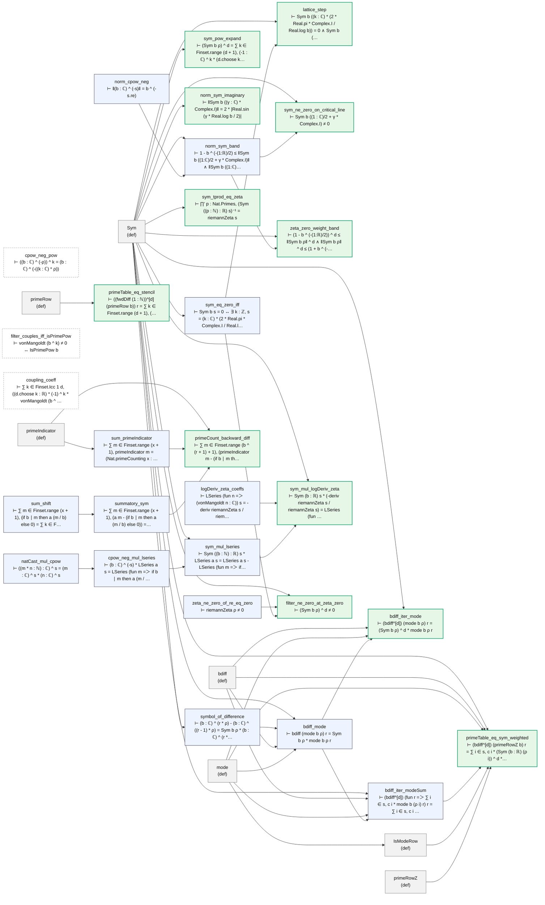

# `lean/Elephant.lean`

**What it does** (its own header): # Elephant.lean — the one object, derived from nothing Standalone. This file imports Mathlib and imports no module of this development. It defines

**Imports:** nothing in this tree.
**Imported by:** nothing.

Blue: theorem. Green: a theorem nothing else uses (an end). Dashed white: connects to nothing. Grey: definition. Red: contains `sorry`. Yellow: in another file. An arrow A → B reads "A is used by B".

## Every declaration

| declaration | proves (output) | needs (input) | why (its own docstring) | uses | used by |
|---|---|---|---|---|---|
| `Elephant.Sym` def, line 31 | ℂ | b : ℝ; s : ℂ | The reciprocal Euler factor at `b`. | — | `Elephant.bdiff_iter_mode`, `Elephant.bdiff_iter_modeSum`, `Elephant.bdiff_mode`, `Elephant.filter_ne_zero_at_zeta_zero`, `Elephant.lattice_step`, `Elephant.norm_sym_band`, `Elephant.norm_sym_imaginary`, `Elephant.primeTable_eq_sym_weighted`, `Elephant.sym_eq_zero_iff`, `Elephant.sym_mul_logDeriv_zeta`, `Elephant.sym_mul_lseries`, `Elephant.sym_ne_zero_on_critical_line`, `Elephant.sym_pow_expand`, `Elephant.sym_tprod_eq_zeta`, `Elephant.symbol_of_difference`, `Elephant.zeta_zero_weight_band` |
| `Elephant.symbol_of_difference` theorem, line 38 | (b : ℂ) ^ (r * ρ) - (b : ℂ) ^ ((r - 1) * ρ) = Sym b ρ * (b : ℂ) ^ (r * ρ) | hb : 0 &lt; b; ρ r : ℂ | The symbol is the difference operator. Differencing a mode in `r` multiplies it by `Sym b ρ`. This is the whole reason the table and the Euler factor are the same thing. | `Elephant.Sym` | `Elephant.bdiff_mode` |
| `Elephant.sym_pow_expand` theorem, line 51 | (Sym b ρ) ^ d = ∑ k ∈ Finset.range (d + 1), (-1 : ℂ) ^ k * (d.choose k : ℂ) * ((b : ℂ) ^ (-ρ)) ^ k | b : ℝ; ρ : ℂ; d : ℕ | The stencil is the symbol, expanded. No hypothesis on `b`. | `Elephant.Sym` | — |
| `Elephant.cpow_neg_pow` theorem, line 65 | ((b : ℂ) ^ (-ρ)) ^ k = (b : ℂ) ^ (-((k : ℂ) * ρ)) | hb : 0 &lt; b; ρ : ℂ; k : ℕ | Each term sits at a power of the base. The expansion of `Sym ^ d` is a Dirichlet polynomial supported on `{1, b, …, b^d}`. | — | — |
| `Elephant.norm_cpow_neg` theorem, line 79 | ‖(b : ℂ) ^ (-s)‖ = b ^ (-s.re) | hb : 0 &lt; b; s : ℂ | The modulus of `b ^ (-s)` is `b ^ (-s.re)`. | — | `Elephant.norm_sym_band` |
| `Elephant.norm_sym_band` theorem, line 87 | 1 - b ^ (-(1:ℝ)/2) ≤ ‖Sym b ((1:ℂ)/2 + γ * Complex.I)‖ ∧ ‖Sym b ((1:ℂ)/2 + γ * Complex.I)‖ ≤ 1 + b ^ (-(1:ℝ)/2) | hb : 0 &lt; b; γ : ℝ | The band. On the critical line the symbol's modulus lies between `1 - b^(-1/2)` and `1 + b^(-1/2)` — the law of cosines on sides `1` and `b^(-1/2)`. | `Elephant.Sym`, `Elephant.norm_cpow_neg` | `Elephant.sym_ne_zero_on_critical_line`, `Elephant.zeta_zero_weight_band` |
| `Elephant.norm_sym_imaginary` theorem, line 107 | ‖Sym b ((γ : ℂ) * Complex.I)‖ = 2 * \|Real.sin (γ * Real.log b / 2)\| | hb : 0 &lt; b; γ : ℝ | The gain. On the imaginary axis the symbol's modulus is `2\|sin(γ log b / 2)\|`; raised to the depth this is the depth-`d` gain, and its maximum `2` at phase `π` is the ceiling. | `Elephant.Sym` | — |
| `Elephant.sym_eq_zero_iff` theorem, line 123 | Sym b s = 0 ↔ ∃ k : ℤ, s = (k : ℂ) * (2 * Real.pi * Complex.I / Real.log b) | hb : 0 &lt; b; hb1 : b ≠ 1; s : ℂ | The lattice. `Sym b s = 0` exactly on `(2πi / log b) ℤ`. | `Elephant.Sym` | `Elephant.filter_ne_zero_at_zeta_zero`, `Elephant.lattice_step` |
| `Elephant.lattice_step` theorem, line 150 | Sym b ((k : ℂ) * (2 * Real.pi * Complex.I / Real.log b)) = 0 ∧ Sym b (((k + 1 : ℤ) : ℂ) * (2 * Real.pi * Complex.I / Real.log b)) = 0 ∧ ((k + 1 : ℤ) : ℂ) * (2 * Real.pi * Complex.I / Real.log b) - (k : ℂ) * (2 * Real.pi * Complex.I / Real.log b) = 2 * Real.pi * Complex.I / Real.log b | hb : 0 &lt; b; hb1 : b ≠ 1; k : ℤ | The step. Consecutive zeros of `Sym` are `2πi / log b` apart. This is the actual spacing statement; `2π/L = 2(π/L)` is arithmetic and proves nothing. | `Elephant.Sym`, `Elephant.sym_eq_zero_iff` | — |
| `Elephant.sym_tprod_eq_zeta` theorem, line 168 | ∏' p : Nat.Primes, (Sym ((p : ℕ) : ℝ) s)⁻¹ = riemannZeta s | hs : 1 &lt; s.re | The definition is not an analogy. The reciprocal of `Sym` at the primes, multiplied over all of them, is `riemannZeta`. Everything above is therefore a statement about ζ's Euler factors, and the base law does NOT follow from this product's index set -- bases 4, 9, 16, 27 index no factor here either, yet they carry full signal. The correct mechanism is `Λ(b) … | `Elephant.Sym` | — |
| `Elephant.primeRow` def, line 179 | ℕ → ℤ | b : ℕ | The table is a difference of prime counts. `Δ^d` applied to `n ↦ π(bⁿ)` is the alternating binomial stencil on `d+1` values of `π` — the dyadic prime difference table, for `b = 2`. | — | `Elephant.primeTable_eq_stencil` |
| `Elephant.primeTable_eq_stencil` theorem, line 181 | ((fwdDiff (1 : ℕ))^[d] (primeRow b)) r = ∑ k ∈ Finset.range (d + 1), ((-1 : ℤ) ^ (d - k) * d.choose k) • primeRow b (r + k • 1) | b : ℕ; d r : ℕ | — | `Elephant.primeRow` | — |
| `Elephant.sym_ne_zero_on_critical_line` theorem, line 194 | Sym b ((1 : ℂ)/2 + γ * Complex.I) ≠ 0 | hb : 1 &lt; b; γ : ℝ | The filter and ζ's nontrivial zeros never collide. `Sym`'s zeros sit on the imaginary axis (`sym_eq_zero_iff`), and every nontrivial zero of ζ has real part strictly between `0` and `1`; on the critical line the modulus is bounded below by `1 - b^(-1/2) &gt; 0`. So no zeta zero is killed by the table's weight at any depth. | `Elephant.Sym`, `Elephant.norm_sym_band` | — |
| `Elephant.zeta_zero_weight_band` theorem, line 209 | (1 - b ^ (-(1:ℝ)/2)) ^ d ≤ ‖Sym b ρ‖ ^ d ∧ ‖Sym b ρ‖ ^ d ≤ (1 + b ^ (-(1:ℝ)/2)) ^ d | hb : 1 ≤ b; _hρ : riemannZeta ρ = 0; hcrit : ρ.re = 1/2; d : ℕ | The band, at a zeta zero on the critical line, to every depth. This is the ceiling and floor of what the depth-`d` table can do to a zero of ζ. The hypothesis `riemannZeta ρ = 0` is carried to say what the point is; the bound itself needs only `ρ.re = 1/2`. | `Elephant.Sym`, `Elephant.norm_sym_band` | — |
| `Elephant.bdiff` def, line 230 | ℤ → ℂ | f : ℤ → ℂ | A backward difference on a row indexed by `ℤ`. | — | `Elephant.bdiff_iter_mode`, `Elephant.bdiff_iter_modeSum`, `Elephant.bdiff_mode`, `Elephant.primeTable_eq_sym_weighted` |
| `Elephant.mode` def, line 233 | ℤ → ℂ | b : ℝ; ρ : ℂ | The mode `r ↦ b ^ (r ρ)`. | — | `Elephant.IsModeRow`, `Elephant.bdiff_iter_mode`, `Elephant.bdiff_iter_modeSum`, `Elephant.bdiff_mode`, `Elephant.primeTable_eq_sym_weighted` |
| `Elephant.bdiff_mode` theorem, line 236 | bdiff (mode b ρ) r = Sym b ρ * mode b ρ r | hb : 0 &lt; b; ρ : ℂ; r : ℤ | One difference multiplies a mode by `Sym`. | `Elephant.Sym`, `Elephant.bdiff`, `Elephant.mode`, `Elephant.symbol_of_difference` | `Elephant.bdiff_iter_mode`, `Elephant.bdiff_iter_modeSum` |
| `Elephant.bdiff_iter_mode` theorem, line 245 | (bdiff^[d]) (mode b ρ) r = (Sym b ρ) ^ d * mode b ρ r | hb : 0 &lt; b; ρ : ℂ; d : ℕ; r : ℤ | Depth. `d` differences multiply a mode by `Sym ^ d`. This is the step the prose called "depth `d` gives `Sym ^ d`", which had no theorem. | `Elephant.Sym`, `Elephant.bdiff`, `Elephant.bdiff_mode`, `Elephant.mode` | — |
| `Elephant.bdiff_iter_modeSum` theorem, line 259 | (bdiff^[d]) (fun r =&gt; ∑ i ∈ s, c i * mode b (ρ i) r) r = ∑ i ∈ s, c i * (Sym b (ρ i)) ^ d * mode b (ρ i) r | hb : 0 &lt; b; ρ : ι → ℂ; c : ι → ℂ; s : Finset ι; d : ℕ; r : ℤ | The same for a finite superposition of modes. | `Elephant.Sym`, `Elephant.bdiff`, `Elephant.bdiff_mode`, `Elephant.mode` | `Elephant.primeTable_eq_sym_weighted` |
| `Elephant.IsModeRow` def, line 283 | Prop | b : ℝ; N : ℤ → ℂ; ρ : ι → ℂ; c : ι → ℂ; s : Finset ι | The explicit-formula hypothesis, named and visible. A row is a mode row when its values on the `b`-ladder are a finite superposition of `b^(rρ)`. This is NOT satisfiable by `π` with a finite index set — `π` is a step function, and the explicit formula is an infinite sum with a main term. Trying to discharge it is what showed that. It is kept because it is th… | `Elephant.mode` | `Elephant.primeTable_eq_sym_weighted` |
| `Elephant.primeRowZ` def, line 288 | ℤ → ℂ | b : ℕ | The prime-counting row on the `b`-ladder, `r ↦ π(b^r)`. | — | `Elephant.primeTable_eq_sym_weighted` |
| `Elephant.primeTable_eq_sym_weighted` theorem, line 296 | (bdiff^[d]) (primeRowZ b) r = ∑ i ∈ s, c i * (Sym (b : ℝ) (ρ i)) ^ d * mode (b : ℝ) (ρ i) r | hb : 0 &lt; b; h : IsModeRow (b : ℝ) (primeRowZ b) ρ c s; d : ℕ; r : ℤ | The join. If the prime-counting row on the `b`-ladder is a mode row, then differencing it `d` times multiplies every mode by `Sym ^ d` — the Euler factor at `b`, to the `d`. This is the statement that `Nat.primeCounting` and `Sym` never met in; it holds under `IsModeRow` and under nothing weaker that this file provides. | `Elephant.IsModeRow`, `Elephant.Sym`, `Elephant.bdiff`, `Elephant.bdiff_iter_modeSum`, `Elephant.mode`, `Elephant.primeRowZ` | — |
| `Elephant.logDeriv_zeta_coeffs` theorem, line 313 | LSeries (fun n =&gt; (vonMangoldt n : ℂ)) s = -deriv riemannZeta s / riemannZeta s | hs : 1 &lt; s.re | The Dirichlet coefficients of `-ζ'/ζ` are von Mangoldt. This is the side of ζ the table actually reads: not the Euler product's index set, but the log-derivative's coefficients. | — | `Elephant.sym_mul_logDeriv_zeta` |
| `Elephant.filter_couples_iff_isPrimePow` theorem, line 328 | vonMangoldt (b ^ k) ≠ 0 ↔ IsPrimePow b | hk : k ≠ 0 | The base law. `Sym b ρ ^ d` expanded is supported exactly on the frequencies `b ^ k` (`cpow_neg_pow`), and the coefficient of `-ζ'/ζ` at frequency `n` is `Λ n` (`logDeriv_zeta_coeffs`). So the table's filter reads ζ at `b ^ k` with weight `Λ (b ^ k)`, and that weight is nonzero for every `k ≥ 1` exactly when `b` is a PRIME POWER. | — | — |
| `Elephant.coupling_coeff` theorem, line 348 | ∑ k ∈ Finset.Icc 1 d, ((d.choose k : ℝ) * (-1) ^ k * vonMangoldt (b ^ k) * ((b : ℝ)⁻¹) ^ k) = -(vonMangoldt b) * (1 - (1 - (b : ℝ)⁻¹) ^ d) | b : ℕ; d : ℕ | The base law with its magnitude, proved. The filter `Sym b ρ ^ d` expanded is supported on `b ^ k` (`cpow_neg_pow`); the coefficient of `-ζ'/ζ` at `b ^ k` is `Λ (b ^ k)` (`logDeriv_zeta_coeffs`). Summing the filter against those coefficients over `k = 1 … d` collapses: | — | — |
| `Elephant.natCast_mul_cpow` theorem, line 386 | ((m * n : ℕ) : ℂ) ^ s = (m : ℂ) ^ s * (n : ℂ) ^ s | hm : 0 &lt; m; hn : 0 &lt; n; s : ℂ | New lemma. `cpow` splits over a product of positive naturals. Mathlib's product rules for `cpow` carry branch-cut side conditions that do not fit here; on the positive reals there is no cut, and this is the form the shift needs. | — | `Elephant.cpow_neg_mul_lseries` |
| `Elephant.cpow_neg_mul_lseries` theorem, line 401 | (b : ℂ) ^ (-s) * LSeries a s = LSeries (fun m =&gt; if b ∣ m then a (m / b) else 0) s | hb : 0 &lt; b; a : ℕ → ℂ; s : ℂ | Multiplying by `b^(-s)` shifts an L-series' coefficients up the `b`-ladder. | `Elephant.natCast_mul_cpow` | `Elephant.sym_mul_lseries` |
| `Elephant.sym_mul_lseries` theorem, line 431 | Sym ((b : ℕ) : ℝ) s * LSeries a s = LSeries a s - LSeries (fun m =&gt; if b ∣ m then a (m / b) else 0) s | hb : 0 &lt; b; a : ℕ → ℂ; s : ℂ | The central sentence. `Sym b s` applied to an L-series differences its coefficients along the `b`-ladder. No summability hypothesis, no explicit formula, no assumption on what the coefficients are. | `Elephant.Sym`, `Elephant.cpow_neg_mul_lseries` | `Elephant.sym_mul_logDeriv_zeta` |
| `Elephant.sym_mul_logDeriv_zeta` theorem, line 441 | Sym (b : ℝ) s * (-deriv riemannZeta s / riemannZeta s) = LSeries (fun n =&gt; (vonMangoldt n : ℂ)) s - LSeries (fun m =&gt; if b ∣ m then (vonMangoldt (m / b) : ℂ) else 0) s | hb : 0 &lt; b; hs : 1 &lt; s.re | On ζ. Differencing the von Mangoldt data along the `b`-ladder IS multiplying `-ζ'/ζ` by the Euler factor at `b`. Primes on the left, ζ on the right, and the operator between them is `Sym`. | `Elephant.Sym`, `Elephant.logDeriv_zeta_coeffs`, `Elephant.sym_mul_lseries` | — |
| `Elephant.primeIndicator` def, line 451 | ℕ → ℂ | — | The prime indicator, whose partial sums are `π`. | — | `Elephant.primeCount_backward_diff`, `Elephant.sum_primeIndicator` |
| `Elephant.sum_primeIndicator` theorem, line 454 | ∑ m ∈ Finset.range (x + 1), primeIndicator m = (Nat.primeCounting x : ℂ) | x : ℕ | Its partial sums ARE `Nat.primeCounting`. | `Elephant.primeIndicator` | `Elephant.primeCount_backward_diff` |
| `Elephant.sum_shift` theorem, line 461 | ∑ m ∈ Finset.range (x + 1), (if b ∣ m then a (m / b) else 0) = ∑ k ∈ Finset.range (x / b + 1), a k | hb : 0 &lt; b; a : ℕ → ℂ; x : ℕ | New lemma. Summing the `b`-shifted coefficients up to `x` is summing the originals up to `x / b`. A finite reindexing along `k ↦ b·k`; no analysis. | — | `Elephant.summatory_sym` |
| `Elephant.summatory_sym` theorem, line 485 | ∑ m ∈ Finset.range (x + 1), (a m - (if b ∣ m then a (m / b) else 0)) = (∑ m ∈ Finset.range (x + 1), a m) - ∑ k ∈ Finset.range (x / b + 1), a k | hb : 0 &lt; b; a : ℕ → ℂ; x : ℕ | The summatory reading of `Sym`. Multiplying by the Euler factor at `b` on the Dirichlet side is the operation `A(x) ↦ A(x) - A(x/b)` on the summatory side. | `Elephant.sum_shift` | `Elephant.primeCount_backward_diff` |
| `Elephant.primeCount_backward_diff` theorem, line 493 | ∑ m ∈ Finset.range (b ^ (r + 1) + 1), (primeIndicator m - (if b ∣ m then primeIndicator (m / b) else 0)) = (Nat.primeCounting (b ^ (r + 1)) : ℂ) - (Nat.primeCounting (b ^ r) : ℂ) | hb : 0 &lt; b; r : ℕ | For π. At `x = b^(r+1)` the summatory reading is exactly the table's backward difference of the prime counting function along the `b`-ladder. This is the sentence for `π`, not only for `Λ`. | `Elephant.primeIndicator`, `Elephant.sum_primeIndicator`, `Elephant.summatory_sym` | — |
| `Elephant.zeta_ne_zero_of_re_eq_zero` theorem, line 507 | riemannZeta ρ ≠ 0 | hre : ρ.re = 0 | ζ has no zeros on the imaginary axis. `ζ 0 = -1/2`, and for `ρ = it` with `t ≠ 0` the functional equation carries `ζ ρ` to `ζ (1 - ρ)`, which sits on the zero-free line `re = 1`. | — | `Elephant.filter_ne_zero_at_zeta_zero` |
| `Elephant.filter_ne_zero_at_zeta_zero` theorem, line 534 | (Sym b ρ) ^ d ≠ 0 | hb : 0 &lt; b; hb1 : b ≠ 1; hρ : riemannZeta ρ = 0; d : ℕ | The step. `Sym`'s zeros lie on the imaginary axis (`sym_eq_zero_iff`); ζ has none there. So at every zero of ζ the table's depth-`d` weight is nonzero: the table loses no zero of ζ, at any base and any depth. This is the link from the table to the zeros that needs no explicit formula. | `Elephant.Sym`, `Elephant.sym_eq_zero_iff`, `Elephant.zeta_ne_zero_of_re_eq_zero` | — |
