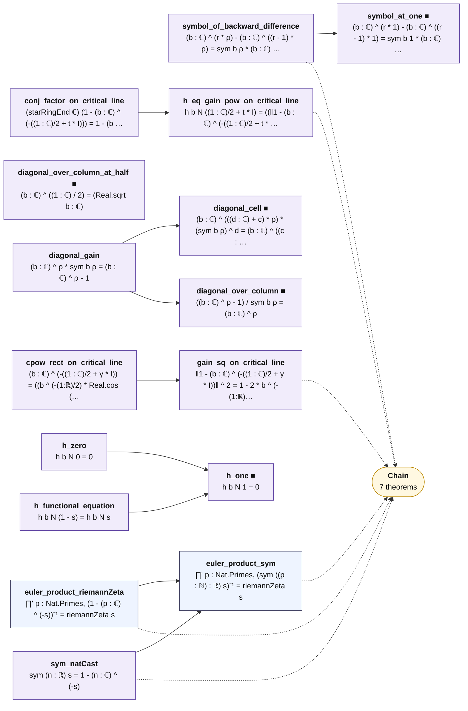

# `lean/EulerFactorChain.lean`

Euler Factor Chain — the algebraic core, formalised. Companion to papers/Euler-Factor-Chain.md (statements A1, A2, A3, B1, B2, B4, C1).

16 theorems, 2 definitions, 313 lines. Arrows are Lean's own record of what each proof uses.

**Imports:** nothing in this tree  
**Imported by:** [`Chain`](../lean/Chain.md), [`Transform`](../lean/Transform.md)

## The picture



An arrow A → B reads "A is used in the proof of B". Green: counting, integers only. Violet: shape, analysis with no ζ. Blue: reads ζ. A name ending in ■ is an end: nothing else uses it. Red: contains `sorry`. Yellow: theorems in another file, counted; a dotted arrow crosses files. Definitions are not drawn; they are listed below the diagram.

## Definitions

<a name="EulerFactorChain-sym"></a>
### `EulerFactorChain.sym`

def · line 40

The reciprocal Euler factor at `b`, as a function of `s`.

- **Is:** `` sym (b : ℝ) (s : ℂ) : ℂ := 1 - (b : ℂ) ^ (-s) ``
- **Used by 7:** [`EulerFactorChain.diagonal_cell`](#EulerFactorChain-diagonal_cell), [`EulerFactorChain.diagonal_gain`](#EulerFactorChain-diagonal_gain), [`EulerFactorChain.diagonal_over_column`](#EulerFactorChain-diagonal_over_column), [`EulerFactorChain.euler_product_sym`](#EulerFactorChain-euler_product_sym), [`EulerFactorChain.sym_natCast`](#EulerFactorChain-sym_natCast), [`EulerFactorChain.symbol_at_one`](#EulerFactorChain-symbol_at_one), [`EulerFactorChain.symbol_of_backward_difference`](#EulerFactorChain-symbol_of_backward_difference)

<a name="EulerFactorChain-h"></a>
### `EulerFactorChain.h`

def · line 142

The Weil test function built from an order-`N` stencil.

- **Is:** `` h (b : ℝ) (N : ℕ) (s : ℂ) : ℂ := (1 - (b : ℂ) ^ (-s)) ^ N * (1 - (b : ℂ) ^ (s - 1)) ^ N ``
- **Used by 4:** [`EulerFactorChain.h_eq_gain_pow_on_critical_line`](#EulerFactorChain-h_eq_gain_pow_on_critical_line), [`EulerFactorChain.h_functional_equation`](#EulerFactorChain-h_functional_equation), [`EulerFactorChain.h_one`](#EulerFactorChain-h_one), [`EulerFactorChain.h_zero`](#EulerFactorChain-h_zero)

## Theorems

<a name="EulerFactorChain-symbol_of_backward_difference"></a>
### `EulerFactorChain.symbol_of_backward_difference`

line 45

**Shape.** Uses real or complex analysis; nothing in it or beneath it reads ζ.

**Why.** A1. Backward differencing the mode `r ↦ b^(r*ρ)` on the ladder multiplies it by `1 - b^(-ρ)`. The symbol of `Δ` is the reciprocal Euler factor.

**Proves**

```lean
(b : ℂ) ^ (r * ρ) - (b : ℂ) ^ ((r - 1) * ρ) = sym b ρ * (b : ℂ) ^ (r * ρ)
```

**Needs** (its hypotheses)

  - `` b : ℝ ``
  - `` hb : b ≠ 0 ``
  - `` ρ r : ℂ ``

**Stated with:** [`EulerFactorChain.sym`](#EulerFactorChain-sym)

**Fed by:** no theorem of this repo; it stands on Mathlib and the definitions below.

**Feeds** (2 that use it)

  - [`Chain.A1`](../lean/Chain.md#Chain-A1) (Chain) — `` StmtA1 b ρ ``
  - [`EulerFactorChain.symbol_at_one`](#EulerFactorChain-symbol_at_one) — `` (b : ℂ) ^ (r * 1) - (b : ℂ) ^ ((r - 1) * 1) = sym b 1 * (b : ℂ) ^ (r * 1) ``

<a name="EulerFactorChain-diagonal_gain"></a>
### `EulerFactorChain.diagonal_gain`

line 69

**Shape.** Uses real or complex analysis; nothing in it or beneath it reads ζ.

**Why.** The diagonal gain. `b^ρ · sym b ρ = b^ρ − 1`.

**Proves**

```lean
(b : ℂ) ^ ρ * sym b ρ = (b : ℂ) ^ ρ - 1
```

**Needs** (its hypotheses)

  - `` b : ℝ ``
  - `` hb : b ≠ 0 ``
  - `` ρ : ℂ ``

**Stated with:** [`EulerFactorChain.sym`](#EulerFactorChain-sym)

**Fed by:** no theorem of this repo; it stands on Mathlib and the definitions below.

**Feeds** (2 that use it)

  - [`EulerFactorChain.diagonal_cell`](#EulerFactorChain-diagonal_cell) — `` (b : ℂ) ^ (((d : ℂ) + c) * ρ) * (sym b ρ) ^ d = (b : ℂ) ^ ((c : ℂ) * ρ) * ((b : ℂ) ^ ρ - 1) ^ d ``
  - [`EulerFactorChain.diagonal_over_column`](#EulerFactorChain-diagonal_over_column) — `` ((b : ℂ) ^ ρ - 1) / sym b ρ = (b : ℂ) ^ ρ ``

<a name="EulerFactorChain-diagonal_cell"></a>
### `EulerFactorChain.diagonal_cell`

line 78

**Shape.** Uses real or complex analysis; nothing in it or beneath it reads ζ.

**Why.** The cell value along a diagonal in closed form: with `r = d + c`, the mode's `b^(rρ)·(sym b ρ)^d` collapses to `b^(cρ)·(b^ρ − 1)^d`.

**Proves**

```lean
(b : ℂ) ^ (((d : ℂ) + c) * ρ) * (sym b ρ) ^ d = (b : ℂ) ^ ((c : ℂ) * ρ) * ((b : ℂ) ^ ρ - 1) ^ d
```

**Needs** (its hypotheses)

  - `` b : ℝ ``
  - `` hb : b ≠ 0 ``
  - `` ρ : ℂ ``
  - `` c d : ℕ ``

**Stated with:** [`EulerFactorChain.sym`](#EulerFactorChain-sym)

**Fed by** (1 theorem its proof uses)

  - [`EulerFactorChain.diagonal_gain`](#EulerFactorChain-diagonal_gain) — `` (b : ℂ) ^ ρ * sym b ρ = (b : ℂ) ^ ρ - 1 ``

**Feeds:** nothing. It is an end.

<a name="EulerFactorChain-diagonal_over_column"></a>
### `EulerFactorChain.diagonal_over_column`

line 87

**Shape.** Uses real or complex analysis; nothing in it or beneath it reads ζ.

**Why.** dia/col = `b^ρ`. The ratio of the diagonal gain to the column gain.

**Proves**

```lean
((b : ℂ) ^ ρ - 1) / sym b ρ = (b : ℂ) ^ ρ
```

**Needs** (its hypotheses)

  - `` b : ℝ ``
  - `` hb : b ≠ 0 ``
  - `` ρ : ℂ ``
  - `` hs : sym b ρ ≠ 0 ``

**Stated with:** [`EulerFactorChain.sym`](#EulerFactorChain-sym)

**Fed by** (1 theorem its proof uses)

  - [`EulerFactorChain.diagonal_gain`](#EulerFactorChain-diagonal_gain) — `` (b : ℂ) ^ ρ * sym b ρ = (b : ℂ) ^ ρ - 1 ``

**Feeds:** nothing. It is an end.

<a name="EulerFactorChain-diagonal_over_column_at_half"></a>
### `EulerFactorChain.diagonal_over_column_at_half`

line 94

**Shape.** Uses real or complex analysis; nothing in it or beneath it reads ζ.

**Why.** At `ρ = 1/2` that ratio is `√b`. The critical line, read as the table's own geometry: moving along a diagonal outruns moving down a column by exactly `√b`, which at `b = 2` is 1.414214.

**Proves**

```lean
(b : ℂ) ^ ((1 : ℂ) / 2) = (Real.sqrt b : ℂ)
```

**Needs** (its hypotheses)

  - `` hb : 0 ≤ b ``

**Fed by:** no theorem of this repo; it stands on Mathlib.

**Feeds:** nothing. It connects to nothing.

<a name="EulerFactorChain-symbol_at_one"></a>
### `EulerFactorChain.symbol_at_one`

line 104

**Shape.** Uses real or complex analysis; nothing in it or beneath it reads ζ.

**Why.** A1 at `ρ = 1`. Moved here from `PairIdentity` when that module went Mathlib-free; it is the only ℂ-valued statement that file had. A1 at `ρ = 1`. `symbol_of_backward_difference` says backward differencing the mode `b^(rρ)` multiplies it by `1 − b^(−ρ)`. At `ρ = 1` the multiplier is `1 − b⁻¹`. Stated here only to name the instance the rest of this file uses; it carries no content of its own.

**Proves**

```lean
(b : ℂ) ^ (r * 1) - (b : ℂ) ^ ((r - 1) * 1) = sym b 1 * (b : ℂ) ^ (r * 1)
```

**Needs** (its hypotheses)

  - `` b : ℝ ``
  - `` hb : b ≠ 0 ``
  - `` r : ℂ ``

**Stated with:** [`EulerFactorChain.sym`](#EulerFactorChain-sym)

**Fed by** (1 theorem its proof uses)

  - [`EulerFactorChain.symbol_of_backward_difference`](#EulerFactorChain-symbol_of_backward_difference) — `` (b : ℂ) ^ (r * ρ) - (b : ℂ) ^ ((r - 1) * ρ) = sym b ρ * (b : ℂ) ^ (r * ρ) ``

**Feeds:** nothing. It is an end.

<a name="EulerFactorChain-euler_product_riemannZeta"></a>
### `EulerFactorChain.euler_product_riemannZeta`

line 115

**Reads ζ.** It, or something it rests on, uses the zeta function, its zeros or the Riemann hypothesis.

**Why.** A2. Euler's product, 1737, in the form Mathlib proves it: over *all* primes at once, and only in the half-plane where the product converges. The hypothesis `1 < s.re` is not decoration — it is the honest content of the statement, and it excludes the whole `sym b s = 0` lattice on which the old `(sym s)⁻¹ * sym s = 1` reading of A2 was false. Cited from `riemannZeta_eulerProduct_tprod`, not reproved.

**Proves**

```lean
∏' p : Nat.Primes, (1 - (p : ℂ) ^ (-s))⁻¹ = riemannZeta s
```

**Needs** (its hypotheses)

  - `` hs : 1 < s.re ``

**Fed by:** no theorem of this repo; it stands on Mathlib.

**Feeds** (2 that use it)

  - [`Chain.A2`](../lean/Chain.md#Chain-A2) (Chain) — `` StmtA2 ``
  - [`EulerFactorChain.euler_product_sym`](#EulerFactorChain-euler_product_sym) — `` ∏' p : Nat.Primes, (sym ((p : ℕ) : ℝ) s)⁻¹ = riemannZeta s ``

<a name="EulerFactorChain-sym_natCast"></a>
### `EulerFactorChain.sym_natCast`

line 124

**Shape.** Uses real or complex analysis; nothing in it or beneath it reads ζ.

**Why.** The chain's `sym` at a natural-number base, written the way the Euler product writes its factors. This is definitional: `sym` unfolds to `1 - b^(-s)` and the only work is the `ℕ → ℝ → ℂ` cast. It is stated as a lemma solely so that `euler_product_sym` below can be written in the chain's own vocabulary.

**Proves**

```lean
sym (n : ℝ) s = 1 - (n : ℂ) ^ (-s)
```

**Needs** (its hypotheses)

  - `` n : ℕ ``
  - `` s : ℂ ``

**Stated with:** [`EulerFactorChain.sym`](#EulerFactorChain-sym)

**Fed by:** no theorem of this repo; it stands on Mathlib and the definitions below.

**Feeds** (2 that use it)

  - [`Chain.A3`](../lean/Chain.md#Chain-A3) (Chain) — `` StmtA3 ``
  - [`EulerFactorChain.euler_product_sym`](#EulerFactorChain-euler_product_sym) — `` ∏' p : Nat.Primes, (sym ((p : ℕ) : ℝ) s)⁻¹ = riemannZeta s ``

<a name="EulerFactorChain-euler_product_sym"></a>
### `EulerFactorChain.euler_product_sym`

line 136

**Reads ζ.** It, or something it rests on, uses the zeta function, its zeros or the Riemann hypothesis.

**Why.** A3, the single-base reading with the `b` index retained. For a prime `p`, `sym ↑p` is exactly the factor A2 inverts: substituting the chain's symbol into Euler's product leaves the product unchanged and still equal to `ζ s`.

**Proves**

```lean
∏' p : Nat.Primes, (sym ((p : ℕ) : ℝ) s)⁻¹ = riemannZeta s
```

**Needs** (its hypotheses)

  - `` hs : 1 < s.re ``

**Stated with:** [`EulerFactorChain.sym`](#EulerFactorChain-sym)

**Fed by** (2 theorems its proof uses)

  - [`EulerFactorChain.euler_product_riemannZeta`](#EulerFactorChain-euler_product_riemannZeta) — `` ∏' p : Nat.Primes, (1 - (p : ℂ) ^ (-s))⁻¹ = riemannZeta s ``
  - [`EulerFactorChain.sym_natCast`](#EulerFactorChain-sym_natCast) — `` sym (n : ℝ) s = 1 - (n : ℂ) ^ (-s) ``

**Feeds** (1 that use it)

  - [`Chain.A3`](../lean/Chain.md#Chain-A3) (Chain) — `` StmtA3 ``

<a name="EulerFactorChain-h_functional_equation"></a>
### `EulerFactorChain.h_functional_equation`

line 146

**Shape.** Uses real or complex analysis; nothing in it or beneath it reads ζ.

**Why.** B2a. `h` is symmetric under `s ↦ 1 - s`: the functional equation.

**Proves**

```lean
h b N (1 - s) = h b N s
```

**Needs** (its hypotheses)

  - `` b : ℝ ``
  - `` N : ℕ ``
  - `` s : ℂ ``

**Stated with:** [`EulerFactorChain.h`](#EulerFactorChain-h)

**Fed by:** no theorem of this repo; it stands on Mathlib and the definitions below.

**Feeds** (1 that use it)

  - [`EulerFactorChain.h_one`](#EulerFactorChain-h_one) — `` h b N 1 = 0 ``

<a name="EulerFactorChain-h_zero"></a>
### `EulerFactorChain.h_zero`

line 154

**Shape.** Uses real or complex analysis; nothing in it or beneath it reads ζ.

**Why.** B2b. `h` vanishes at `s = 0`: the stencil annihilates constants.

**Proves**

```lean
h b N 0 = 0
```

**Needs** (its hypotheses)

  - `` b : ℝ ``
  - `` hb : b ≠ 0 ``
  - `` hN : N ≠ 0 ``

**Stated with:** [`EulerFactorChain.h`](#EulerFactorChain-h)

**Fed by:** no theorem of this repo; it stands on Mathlib and the definitions below.

**Feeds** (1 that use it)

  - [`EulerFactorChain.h_one`](#EulerFactorChain-h_one) — `` h b N 1 = 0 ``

<a name="EulerFactorChain-h_one"></a>
### `EulerFactorChain.h_one`

line 161

**Shape.** Uses real or complex analysis; nothing in it or beneath it reads ζ.

**Why.** B2b. `h` vanishes at `s = 1`, so there is no pole contribution.

**Proves**

```lean
h b N 1 = 0
```

**Needs** (its hypotheses)

  - `` b : ℝ ``
  - `` hb : b ≠ 0 ``
  - `` hN : N ≠ 0 ``

**Stated with:** [`EulerFactorChain.h`](#EulerFactorChain-h)

**Fed by** (2 theorems its proof uses)

  - [`EulerFactorChain.h_functional_equation`](#EulerFactorChain-h_functional_equation) — `` h b N (1 - s) = h b N s ``
  - [`EulerFactorChain.h_zero`](#EulerFactorChain-h_zero) — `` h b N 0 = 0 ``

**Feeds:** nothing. It is an end.

<a name="EulerFactorChain-conj_factor_on_critical_line"></a>
### `EulerFactorChain.conj_factor_on_critical_line`

line 168

**Shape.** Uses real or complex analysis; nothing in it or beneath it reads ζ.

**Why.** On the critical line the second factor is the conjugate of the first.

**Proves**

```lean
(starRingEnd ℂ) (1 - (b : ℂ) ^ (-((1 : ℂ)/2 + t * I))) = 1 - (b : ℂ) ^ (((1 : ℂ)/2 + t * I) - 1)
```

**Needs** (its hypotheses)

  - `` hb : 0 < b ``
  - `` t : ℝ ``

**Fed by:** no theorem of this repo; it stands on Mathlib.

**Feeds** (1 that use it)

  - [`EulerFactorChain.h_eq_gain_pow_on_critical_line`](#EulerFactorChain-h_eq_gain_pow_on_critical_line) — `` h b N ((1 : ℂ)/2 + t * I) = ((‖1 - (b : ℂ) ^ (-((1 : ℂ)/2 + t * I))‖ : ℝ) ^ (2 * N) : ℝ) ``

<a name="EulerFactorChain-h_eq_gain_pow_on_critical_line"></a>
### `EulerFactorChain.h_eq_gain_pow_on_critical_line`

line 188

**Shape.** Uses real or complex analysis; nothing in it or beneath it reads ζ.

**Why.** B4. On the critical line, `h = ‖1 - b^(-s)‖^(2N)` — real, non-negative, and equal to the depth-transfer gain raised to the `2N`.

**Proves**

```lean
h b N ((1 : ℂ)/2 + t * I) = ((‖1 - (b : ℂ) ^ (-((1 : ℂ)/2 + t * I))‖ : ℝ) ^ (2 * N) : ℝ)
```

**Needs** (its hypotheses)

  - `` hb : 0 < b ``
  - `` N : ℕ ``
  - `` t : ℝ ``

**Stated with:** [`EulerFactorChain.h`](#EulerFactorChain-h)

**Fed by** (1 theorem its proof uses)

  - [`EulerFactorChain.conj_factor_on_critical_line`](#EulerFactorChain-conj_factor_on_critical_line) — `` (starRingEnd ℂ) (1 - (b : ℂ) ^ (-((1 : ℂ)/2 + t * I))) = 1 - (b : ℂ) ^ (((1 : ℂ)/2 + t * I) - 1) ``

**Feeds** (1 that use it)

  - [`Chain.B4`](../lean/Chain.md#Chain-B4) (Chain) — `` StmtB4 b N ``

<a name="EulerFactorChain-cpow_rect_on_critical_line"></a>
### `EulerFactorChain.cpow_rect_on_critical_line`

line 201

**Shape.** Uses real or complex analysis; nothing in it or beneath it reads ζ.

**Why.** Rectangular form of the Euler factor's reciprocal on the critical line. Writing `θ = γ · log b`, `b^(-(1/2 + γi)) = b^(-1/2)·(cos θ - i sin θ)`.

**Proves**

```lean
(b : ℂ) ^ (-((1 : ℂ)/2 + γ * I)) = ((b ^ (-(1:ℝ)/2) * Real.cos (γ * Real.log b) : ℝ) : ℂ) + ((-(b ^ (-(1:ℝ)/2) * Real.sin (γ * Real.log b)) : ℝ) : ℂ) * I
```

**Needs** (its hypotheses)

  - `` hb : 0 < b ``
  - `` γ : ℝ ``

**Fed by:** no theorem of this repo; it stands on Mathlib.

**Feeds** (1 that use it)

  - [`EulerFactorChain.gain_sq_on_critical_line`](#EulerFactorChain-gain_sq_on_critical_line) — `` ‖1 - (b : ℂ) ^ (-((1 : ℂ)/2 + γ * I))‖ ^ 2 = 1 - 2 * b ^ (-(1:ℝ)/2) * Real.cos (γ * Real.log b) + b ^ (-(1:ℝ)) ``

<a name="EulerFactorChain-gain_sq_on_critical_line"></a>
### `EulerFactorChain.gain_sq_on_critical_line`

line 225

**Shape.** Uses real or complex analysis; nothing in it or beneath it reads ζ.

**Why.** C1. On the critical line `s = 1/2 + γi`, the squared modulus of the reciprocal Euler factor expands as the law of cosines with sides `1` and `b^(-1/2)` and included angle `θ = γ · log b`:

**Proves**

```lean
‖1 - (b : ℂ) ^ (-((1 : ℂ)/2 + γ * I))‖ ^ 2 = 1 - 2 * b ^ (-(1:ℝ)/2) * Real.cos (γ * Real.log b) + b ^ (-(1:ℝ))
```

**Needs** (its hypotheses)

  - `` hb : 0 < b ``
  - `` γ : ℝ ``

**Fed by** (1 theorem its proof uses)

  - [`EulerFactorChain.cpow_rect_on_critical_line`](#EulerFactorChain-cpow_rect_on_critical_line) — `` (b : ℂ) ^ (-((1 : ℂ)/2 + γ * I)) = ((b ^ (-(1:ℝ)/2) * Real.cos (γ * Real.log b) : ℝ) : ℂ) + ((-(b ^ (-(1:ℝ)/2) * Real.sin (γ * Real.log b)) : ℝ) : ℂ) … ``

**Feeds** (3 that use it)

  - [`Chain.C1`](../lean/Chain.md#Chain-C1) (Chain) — `` StmtC1 b ``
  - [`Chain.gain_sq_at_ceiling`](../lean/Chain.md#Chain-gain_sq_at_ceiling) (Chain) — `` ‖Sym b ((1 : ℂ)/2 + γ * I)‖ ^ 2 = (1 + b ^ (-(1:ℝ)/2)) ^ 2 ``
  - [`Chain.gain_sq_at_floor`](../lean/Chain.md#Chain-gain_sq_at_floor) (Chain) — `` ‖Sym b ((1 : ℂ)/2 + γ * I)‖ ^ 2 = (1 - b ^ (-(1:ℝ)/2)) ^ 2 ``

