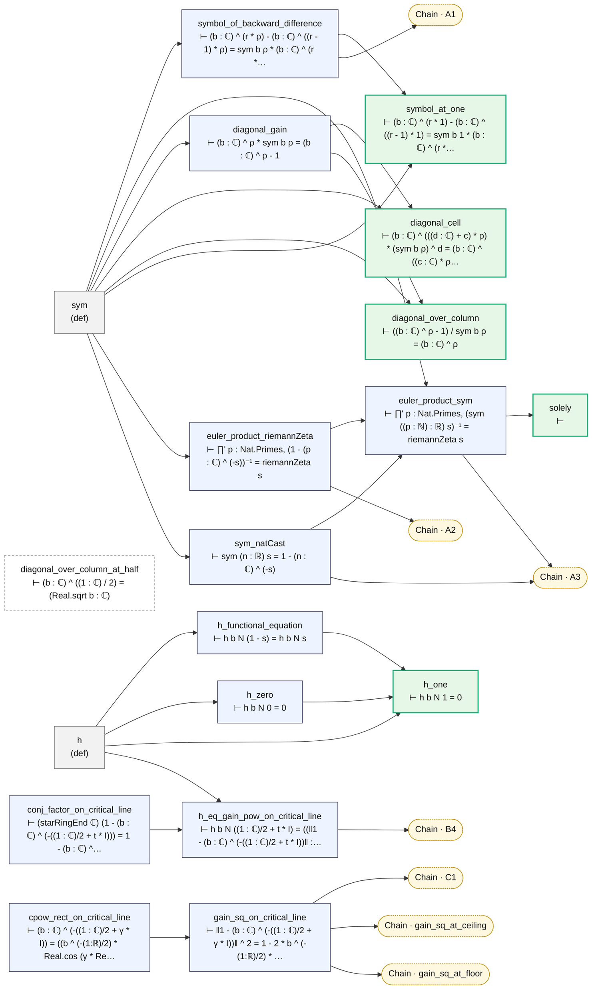

# `lean/EulerFactorChain.lean`

**What it does** (its own header): Euler Factor Chain — the algebraic core, formalised. Companion to papers/Euler-Factor-Chain.md (statements A1, A2, A3, B1, B2, B4, C1).

**Imports:** nothing in this tree.
**Imported by:** [`Chain`](../lean/Chain.md), [`Transform`](../lean/Transform.md).

Blue: theorem. Green: a theorem nothing else uses (an end). Dashed white: connects to nothing. Grey: definition. Red: contains `sorry`. Yellow: in another file. An arrow A → B reads "A is used by B".

## Every declaration

| declaration | proves (output) | needs (input) | why (its own docstring) | uses | used by |
|---|---|---|---|---|---|
| `EulerFactorChain.sym` def, line 40 | ℂ | b : ℝ; s : ℂ | The reciprocal Euler factor at `b`, as a function of `s`. | — | `EulerFactorChain.diagonal_cell`, `EulerFactorChain.diagonal_gain`, `EulerFactorChain.diagonal_over_column`, `EulerFactorChain.euler_product_riemannZeta`, `EulerFactorChain.euler_product_sym`, `EulerFactorChain.sym_natCast`, `EulerFactorChain.symbol_at_one`, `EulerFactorChain.symbol_of_backward_difference` |
| `EulerFactorChain.symbol_of_backward_difference` theorem, line 45 | (b : ℂ) ^ (r * ρ) - (b : ℂ) ^ ((r - 1) * ρ) = sym b ρ * (b : ℂ) ^ (r * ρ) | b : ℝ; hb : b ≠ 0; ρ r : ℂ | A1. Backward differencing the mode `r ↦ b^(r*ρ)` on the ladder multiplies it by `1 - b^(-ρ)`. The symbol of `Δ` is the reciprocal Euler factor. | `EulerFactorChain.sym` | `Chain.A1`, `EulerFactorChain.symbol_at_one` |
| `EulerFactorChain.diagonal_gain` theorem, line 69 | (b : ℂ) ^ ρ * sym b ρ = (b : ℂ) ^ ρ - 1 | b : ℝ; hb : b ≠ 0; ρ : ℂ | The diagonal gain. `b^ρ · sym b ρ = b^ρ − 1`. | `EulerFactorChain.sym` | `EulerFactorChain.diagonal_cell`, `EulerFactorChain.diagonal_over_column` |
| `EulerFactorChain.diagonal_cell` theorem, line 78 | (b : ℂ) ^ (((d : ℂ) + c) * ρ) * (sym b ρ) ^ d = (b : ℂ) ^ ((c : ℂ) * ρ) * ((b : ℂ) ^ ρ - 1) ^ d | b : ℝ; hb : b ≠ 0; ρ : ℂ; c d : ℕ | The cell value along a diagonal in closed form: with `r = d + c`, the mode's `b^(rρ)·(sym b ρ)^d` collapses to `b^(cρ)·(b^ρ − 1)^d`. | `EulerFactorChain.diagonal_gain`, `EulerFactorChain.sym` | — |
| `EulerFactorChain.diagonal_over_column` theorem, line 87 | ((b : ℂ) ^ ρ - 1) / sym b ρ = (b : ℂ) ^ ρ | b : ℝ; hb : b ≠ 0; ρ : ℂ; hs : sym b ρ ≠ 0 | dia/col = `b^ρ`. The ratio of the diagonal gain to the column gain. | `EulerFactorChain.diagonal_gain`, `EulerFactorChain.sym` | — |
| `EulerFactorChain.diagonal_over_column_at_half` theorem, line 94 | (b : ℂ) ^ ((1 : ℂ) / 2) = (Real.sqrt b : ℂ) | hb : 0 ≤ b | At `ρ = 1/2` that ratio is `√b`. The critical line, read as the table's own geometry: moving along a diagonal outruns moving down a column by exactly `√b`, which at `b = 2` is 1.414214. | — | — |
| `EulerFactorChain.symbol_at_one` theorem, line 104 | (b : ℂ) ^ (r * 1) - (b : ℂ) ^ ((r - 1) * 1) = sym b 1 * (b : ℂ) ^ (r * 1) | b : ℝ; hb : b ≠ 0; r : ℂ | A1 at `ρ = 1`. Moved here from `PairIdentity` when that module went Mathlib-free; it is the only ℂ-valued statement that file had. A1 at `ρ = 1`. `symbol_of_backward_difference` says backward differencing the mode `b^(rρ)` multiplies it by `1 − b^(−ρ)`. At `ρ = 1` the multiplier is `1 − b⁻¹`. Stated here only to name the instance the rest of this file uses; … | `EulerFactorChain.sym`, `EulerFactorChain.symbol_of_backward_difference` | — |
| `EulerFactorChain.euler_product_riemannZeta` theorem, line 115 | ∏' p : Nat.Primes, (1 - (p : ℂ) ^ (-s))⁻¹ = riemannZeta s | hs : 1 &lt; s.re | A2. Euler's product, 1737, in the form Mathlib proves it: over *all* primes at once, and only in the half-plane where the product converges. The hypothesis `1 &lt; s.re` is not decoration — it is the honest content of the statement, and it excludes the whole `sym b s = 0` lattice on which the old `(sym s)⁻¹ * sym s = 1` reading of A2 was false. Cited from `riem… | `EulerFactorChain.sym` | `Chain.A2`, `EulerFactorChain.euler_product_sym` |
| `EulerFactorChain.solely` theorem, line 122 | — | — | — | `EulerFactorChain.euler_product_sym` | — |
| `EulerFactorChain.sym_natCast` theorem, line 124 | sym (n : ℝ) s = 1 - (n : ℂ) ^ (-s) | n : ℕ; s : ℂ | The chain's `sym` at a natural-number base, written the way the Euler product writes its factors. This is definitional: `sym` unfolds to `1 - b^(-s)` and the only work is the `ℕ → ℝ → ℂ` cast. It is stated as a lemma solely so that `euler_product_sym` below can be written in the chain's own vocabulary. | `EulerFactorChain.sym` | `Chain.A3`, `EulerFactorChain.euler_product_sym` |
| `EulerFactorChain.euler_product_sym` theorem, line 136 | ∏' p : Nat.Primes, (sym ((p : ℕ) : ℝ) s)⁻¹ = riemannZeta s | hs : 1 &lt; s.re | A3, the single-base reading with the `b` index retained. For a prime `p`, `sym ↑p` is exactly the factor A2 inverts: substituting the chain's symbol into Euler's product leaves the product unchanged and still equal to `ζ s`. | `EulerFactorChain.euler_product_riemannZeta`, `EulerFactorChain.sym`, `EulerFactorChain.sym_natCast` | `Chain.A3`, `EulerFactorChain.solely` |
| `EulerFactorChain.h` def, line 142 | ℂ | b : ℝ; N : ℕ; s : ℂ | The Weil test function built from an order-`N` stencil. | — | `EulerFactorChain.h_eq_gain_pow_on_critical_line`, `EulerFactorChain.h_functional_equation`, `EulerFactorChain.h_one`, `EulerFactorChain.h_zero` |
| `EulerFactorChain.h_functional_equation` theorem, line 146 | h b N (1 - s) = h b N s | b : ℝ; N : ℕ; s : ℂ | B2a. `h` is symmetric under `s ↦ 1 - s`: the functional equation. | `EulerFactorChain.h` | `EulerFactorChain.h_one` |
| `EulerFactorChain.h_zero` theorem, line 154 | h b N 0 = 0 | b : ℝ; hb : b ≠ 0; hN : N ≠ 0 | B2b. `h` vanishes at `s = 0`: the stencil annihilates constants. | `EulerFactorChain.h` | `EulerFactorChain.h_one` |
| `EulerFactorChain.h_one` theorem, line 161 | h b N 1 = 0 | b : ℝ; hb : b ≠ 0; hN : N ≠ 0 | B2b. `h` vanishes at `s = 1`, so there is no pole contribution. | `EulerFactorChain.h`, `EulerFactorChain.h_functional_equation`, `EulerFactorChain.h_zero` | — |
| `EulerFactorChain.conj_factor_on_critical_line` theorem, line 168 | (starRingEnd ℂ) (1 - (b : ℂ) ^ (-((1 : ℂ)/2 + t * I))) = 1 - (b : ℂ) ^ (((1 : ℂ)/2 + t * I) - 1) | hb : 0 &lt; b; t : ℝ | On the critical line the second factor is the conjugate of the first. | — | `EulerFactorChain.h_eq_gain_pow_on_critical_line` |
| `EulerFactorChain.h_eq_gain_pow_on_critical_line` theorem, line 188 | h b N ((1 : ℂ)/2 + t * I) = ((‖1 - (b : ℂ) ^ (-((1 : ℂ)/2 + t * I))‖ : ℝ) ^ (2 * N) : ℝ) | hb : 0 &lt; b; N : ℕ; t : ℝ | B4. On the critical line, `h = ‖1 - b^(-s)‖^(2N)` — real, non-negative, and equal to the depth-transfer gain raised to the `2N`. | `EulerFactorChain.conj_factor_on_critical_line`, `EulerFactorChain.h` | `Chain.B4` |
| `EulerFactorChain.cpow_rect_on_critical_line` theorem, line 201 | (b : ℂ) ^ (-((1 : ℂ)/2 + γ * I)) = ((b ^ (-(1:ℝ)/2) * Real.cos (γ * Real.log b) : ℝ) : ℂ) + ((-(b ^ (-(1:ℝ)/2) * Real.sin (γ * Real.log b)) : ℝ) : ℂ) * I | hb : 0 &lt; b; γ : ℝ | Rectangular form of the Euler factor's reciprocal on the critical line. Writing `θ = γ · log b`, `b^(-(1/2 + γi)) = b^(-1/2)·(cos θ - i sin θ)`. | — | `EulerFactorChain.gain_sq_on_critical_line` |
| `EulerFactorChain.gain_sq_on_critical_line` theorem, line 225 | ‖1 - (b : ℂ) ^ (-((1 : ℂ)/2 + γ * I))‖ ^ 2 = 1 - 2 * b ^ (-(1:ℝ)/2) * Real.cos (γ * Real.log b) + b ^ (-(1:ℝ)) | hb : 0 &lt; b; γ : ℝ | C1. On the critical line `s = 1/2 + γi`, the squared modulus of the reciprocal Euler factor expands as the law of cosines with sides `1` and `b^(-1/2)` and included angle `θ = γ · log b`: | `EulerFactorChain.cpow_rect_on_critical_line` | `Chain.C1`, `Chain.gain_sq_at_ceiling`, `Chain.gain_sq_at_floor` |
