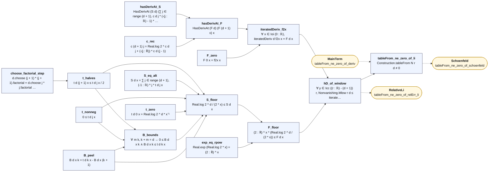

# `lean/Expansion.lean`

Expansion — stage 2b: the derivative of 2^x/x, explicitly, and its floor. `MainTerm.lean` reduced O67's main-term hypothesis to `hD`: a floor on the `(d+1)`-th derivative of the li-interpolant on the window — equivalently, on the `d`-th derivative of `2^x/x`. This module supplies both halves:

17 theorems, 6 definitions, 530 lines. Arrows are Lean's own record of what each proof uses.

**Imports:** [`MainTerm`](../lean/MainTerm.md)  
**Imported by:** [`RelativeLi`](../lean/RelativeLi.md), [`Schoenfeld`](../lean/Schoenfeld.md)

## The picture



An arrow A → B reads "A is used in the proof of B". Blue: theorem. Green: a theorem nothing else uses (an end). Dashed: connects to nothing. Red: contains `sorry`. Yellow: theorems in another file, counted; a dotted arrow crosses files. Definitions are not drawn; they are listed below the diagram.

## Definitions

<a name="Expansion-c"></a>
### `Expansion.c`

def · line 43

The expansion coefficients: `C(d,j)·(log 2)^(d−j)·(−1)^j·j!`. `Nat.choose` vanishes past the diagonal, so no `ite` is needed.

- **Is:** `` c (d j : ℕ) : ℝ := (d.choose j) * Real.log 2 ^ (d - j) * (-1) ^ j * (j.factorial) ``
- **Used by 6:** [`Expansion.F_zero`](#Expansion-F_zero), [`Expansion.S`](#Expansion-S), [`Expansion.S_eq_alt`](#Expansion-S_eq_alt), [`Expansion.c_rec`](#Expansion-c_rec), [`Expansion.hasDerivAt_F`](#Expansion-hasDerivAt_F), [`Expansion.hasDerivAt_S`](#Expansion-hasDerivAt_S)

<a name="Expansion-S"></a>
### `Expansion.S`

def · line 47

The rational part of the `d`-th derivative of `2^x/x`.

- **Is:** `` S (d : ℕ) (x : ℝ) : ℝ := ∑ j ∈ range (d + 1), c d j * x ^ (-(j + 1 : ℤ)) ``
- **Built from:** [`Expansion.c`](#Expansion-c)
- **Used by 7:** [`Expansion.F`](#Expansion-F), [`Expansion.F_floor`](#Expansion-F_floor), [`Expansion.F_zero`](#Expansion-F_zero), [`Expansion.S_eq_alt`](#Expansion-S_eq_alt), [`Expansion.S_floor`](#Expansion-S_floor), [`Expansion.hasDerivAt_F`](#Expansion-hasDerivAt_F), [`Expansion.hasDerivAt_S`](#Expansion-hasDerivAt_S)

<a name="Expansion-F"></a>
### `Expansion.F`

def · line 51

The `d`-th derivative of `2^x/x`, in closed form.

- **Is:** `` F (d : ℕ) (x : ℝ) : ℝ := Real.exp (Real.log 2 * x) * S d x ``
- **Built from:** [`Expansion.S`](#Expansion-S)
- **Used by 5:** [`Expansion.F_floor`](#Expansion-F_floor), [`Expansion.F_zero`](#Expansion-F_zero), [`Expansion.hD_of_window`](#Expansion-hD_of_window), [`Expansion.hasDerivAt_F`](#Expansion-hasDerivAt_F), [`Expansion.iteratedDeriv_f2x`](#Expansion-iteratedDeriv_f2x)

<a name="Expansion-f2x"></a>
### `Expansion.f2x`

def · line 54

The function itself, in the exp form the calculus uses.

- **Is:** `` f2x (x : ℝ) : ℝ := Real.exp (Real.log 2 * x) / x ``
- **Used by 17:** [`Expansion.F_zero`](#Expansion-F_zero), [`Expansion.hD_of_window`](#Expansion-hD_of_window), [`Expansion.iteratedDeriv_f2x`](#Expansion-iteratedDeriv_f2x), [`Expansion.tableFrom_ne_zero_of_li`](#Expansion-tableFrom_ne_zero_of_li), [`Interpolant.F`](../lean/Interpolant.md#Interpolant-F), [`Interpolant.F_contDiffOn`](../lean/Interpolant.md#Interpolant-F_contDiffOn), [`Interpolant.F_hasDerivAt`](../lean/Interpolant.md#Interpolant-F_hasDerivAt), [`Interpolant.f2x_contDiffOn`](../lean/Interpolant.md#Interpolant-f2x_contDiffOn), [`Interpolant.f2x_continuousOn`](../lean/Interpolant.md#Interpolant-f2x_continuousOn), [`Interpolant.liRow_eq`](../lean/Interpolant.md#Interpolant-liRow_eq), [`Interpolant.liRow_hasDerivAt`](../lean/Interpolant.md#Interpolant-liRow_hasDerivAt), [`RelativeLi.tableFrom_ne_zero_of_powerSaving`](../lean/RelativeLi.md#RelativeLi-tableFrom_ne_zero_of_powerSaving), [`RelativeLi.tableFrom_ne_zero_of_relErr_li`](../lean/RelativeLi.md#RelativeLi-tableFrom_ne_zero_of_relErr_li), [`RelativeLi.tableFrom_ne_zero_of_relErr_li'`](../lean/RelativeLi.md#RelativeLi-tableFrom_ne_zero_of_relErr_li-), [`RouteCell.cell_ne_zero_of_route`](../lean/RouteCell.md#RouteCell-cell_ne_zero_of_route), [`Schoenfeld.tableFrom_ne_zero_of_schoenfeld`](../lean/Schoenfeld.md#Schoenfeld-tableFrom_ne_zero_of_schoenfeld), [`TableDepths.cell_ne_zero_gen`](../lean_stage3/TableDepths.md#TableDepths-cell_ne_zero_gen)

<a name="Expansion-t"></a>
### `Expansion.t`

def · line 200

The unsigned term of `S`.

- **Is:** `` t (d j : ℕ) (x : ℝ) : ℝ := (d.choose j) * Real.log 2 ^ (d - j) * (j.factorial) * x ^ (-(j + 1 : ℤ)) ``
- **Used by 8:** [`Expansion.B`](#Expansion-B), [`Expansion.B_bounds`](#Expansion-B_bounds), [`Expansion.B_peel`](#Expansion-B_peel), [`Expansion.S_eq_alt`](#Expansion-S_eq_alt), [`Expansion.S_floor`](#Expansion-S_floor), [`Expansion.t_halves`](#Expansion-t_halves), [`Expansion.t_nonneg`](#Expansion-t_nonneg), [`Expansion.t_zero`](#Expansion-t_zero)

<a name="Expansion-B"></a>
### `Expansion.B`

def · line 281

The downward tail `B k = Σ_{j<d+1−k} (−1)^j t(k+j)`.

- **Is:** `` B (d : ℕ) (x : ℝ) (k : ℕ) : ℝ := ∑ j ∈ range (d + 1 - k), (-1 : ℝ) ^ j * t d (k + j) x ``
- **Built from:** [`Expansion.t`](#Expansion-t)
- **Used by 3:** [`Expansion.B_bounds`](#Expansion-B_bounds), [`Expansion.B_peel`](#Expansion-B_peel), [`Expansion.S_floor`](#Expansion-S_floor)

## Theorems

<a name="Expansion-exp_eq_rpow"></a>
### `Expansion.exp_eq_rpow`

line 57

**Why.** `e^((log 2)·x) = 2^x`.

**Proves**

```lean
Real.exp (Real.log 2 * x) = (2 : ℝ) ^ x
```

**Needs** (its hypotheses)

  - `` x : ℝ ``

**Fed by:** no theorem of this repo; it stands on Mathlib.

**Feeds** (1 that use it)

  - [`Expansion.F_floor`](#Expansion-F_floor) — `` (2 : ℝ) ^ x * (Real.log 2 ^ d / (2 * x)) ≤ F d x ``

<a name="Expansion-F_zero"></a>
### `Expansion.F_zero`

line 61

**Why.** `F 0` is the function itself.

**Proves**

```lean
F 0 x = f2x x
```

**Needs** (its hypotheses)

  - `` x : ℝ ``

**Stated with:** [`Expansion.F`](#Expansion-F), [`Expansion.f2x`](#Expansion-f2x)

**Fed by:** no theorem of this repo; it stands on Mathlib and the definitions below.

**Definitions its proof touches:** [`Expansion.S`](#Expansion-S), [`Expansion.c`](#Expansion-c)

**Feeds** (1 that use it)

  - [`Expansion.iteratedDeriv_f2x`](#Expansion-iteratedDeriv_f2x) — `` ∀ x ∈ Ioi (0 : ℝ), iteratedDeriv d f2x x = F d x ``

<a name="Expansion-c_rec"></a>
### `Expansion.c_rec`

line 67

**Why.** The coefficient recurrence — Pascal with the factorial absorbed; the `j = 0` edge dies against the `−j` factor.

**Proves**

```lean
c (d + 1) j = Real.log 2 * c d j + (-(j : ℝ)) * c d (j - 1)
```

**Needs** (its hypotheses)

  - `` d j : ℕ ``

**Stated with:** [`Expansion.c`](#Expansion-c)

**Fed by:** no theorem of this repo; it stands on Mathlib and the definitions below.

**Feeds** (1 that use it)

  - [`Expansion.hasDerivAt_F`](#Expansion-hasDerivAt_F) — `` HasDerivAt (F d) (F (d + 1) x) x ``

<a name="Expansion-hasDerivAt_S"></a>
### `Expansion.hasDerivAt_S`

line 107

**Why.** `S` differentiates term-by-term into the pre-recombination sum.

**Proves**

```lean
HasDerivAt (S d) (∑ j ∈ range (d + 1), c d j * (-(j : ℝ) - 1) * x ^ (-(j + 2 : ℤ))) x
```

**Needs** (its hypotheses)

  - `` d : ℕ ``
  - `` hx : x ≠ 0 ``

**Stated with:** [`Expansion.S`](#Expansion-S), [`Expansion.c`](#Expansion-c)

**Fed by:** no theorem of this repo; it stands on Mathlib and the definitions below.

**Feeds** (1 that use it)

  - [`Expansion.hasDerivAt_F`](#Expansion-hasDerivAt_F) — `` HasDerivAt (F d) (F (d + 1) x) x ``

<a name="Expansion-hasDerivAt_F"></a>
### `Expansion.hasDerivAt_F`

line 128

**Why.** The expansion advances: `F d` has derivative `F (d+1)` at `x ≠ 0`. Product rule, the coefficient recurrence, and one `sum_range_succ'` reindex.

**Proves**

```lean
HasDerivAt (F d) (F (d + 1) x) x
```

**Needs** (its hypotheses)

  - `` d : ℕ ``
  - `` hx : x ≠ 0 ``

**Stated with:** [`Expansion.F`](#Expansion-F)

**Fed by** (2 theorems its proof uses)

  - [`Expansion.c_rec`](#Expansion-c_rec) — `` c (d + 1) j = Real.log 2 * c d j + (-(j : ℝ)) * c d (j - 1) ``
  - [`Expansion.hasDerivAt_S`](#Expansion-hasDerivAt_S) — `` HasDerivAt (S d) (∑ j ∈ range (d + 1), c d j * (-(j : ℝ) - 1) * x ^ (-(j + 2 : ℤ))) x ``

**Definitions its proof touches:** [`Expansion.S`](#Expansion-S), [`Expansion.c`](#Expansion-c)

**Feeds** (1 that use it)

  - [`Expansion.iteratedDeriv_f2x`](#Expansion-iteratedDeriv_f2x) — `` ∀ x ∈ Ioi (0 : ℝ), iteratedDeriv d f2x x = F d x ``

<a name="Expansion-iteratedDeriv_f2x"></a>
### `Expansion.iteratedDeriv_f2x`

line 183

**Why.** `iteratedDeriv d` of `2^x/x` IS `F d`, on `(0,∞)`. Induction; the step replaces `iteratedDeriv d f2x` by `F d` through `EventuallyEq.deriv_eq` on the open half-line, then advances by `hasDerivAt_F`.

**Proves**

```lean
∀ x ∈ Ioi (0 : ℝ), iteratedDeriv d f2x x = F d x
```

**Needs** (its hypotheses)

  - `` d : ℕ ``

**Stated with:** [`Expansion.F`](#Expansion-F), [`Expansion.f2x`](#Expansion-f2x)

**Fed by** (2 theorems its proof uses)

  - [`Expansion.F_zero`](#Expansion-F_zero) — `` F 0 x = f2x x ``
  - [`Expansion.hasDerivAt_F`](#Expansion-hasDerivAt_F) — `` HasDerivAt (F d) (F (d + 1) x) x ``

**Feeds** (1 that use it)

  - [`Expansion.hD_of_window`](#Expansion-hD_of_window) — `` ∀ y ∈ Icc ((r : ℝ) - (d + 1)) r, Nonvanishing.Mlow r d ≤ iteratedDeriv (d + 1) G y ``

<a name="Expansion-t_nonneg"></a>
### `Expansion.t_nonneg`

line 204

**Why.** Every unsigned term is nonnegative on `x > 0`.

**Proves**

```lean
0 ≤ t d j x
```

**Needs** (its hypotheses)

  - `` hx : 0 < x ``

**Stated with:** [`Expansion.t`](#Expansion-t)

**Fed by:** no theorem of this repo; it stands on Mathlib and the definitions below.

**Feeds** (2 that use it)

  - [`Expansion.B_bounds`](#Expansion-B_bounds) — `` ∀ m k, k + m = d → 0 ≤ B d x k ∧ B d x k ≤ t d k x ``
  - [`Expansion.S_floor`](#Expansion-S_floor) — `` Real.log 2 ^ d / (2 * x) ≤ S d x ``

<a name="Expansion-S_eq_alt"></a>
### `Expansion.S_eq_alt`

line 212

**Why.** `S` is the alternating sum of the unsigned terms.

**Proves**

```lean
S d x = ∑ j ∈ range (d + 1), (-1 : ℝ) ^ j * t d j x
```

**Needs** (its hypotheses)

  - `` d : ℕ ``
  - `` x : ℝ ``

**Stated with:** [`Expansion.S`](#Expansion-S), [`Expansion.t`](#Expansion-t)

**Fed by:** no theorem of this repo; it stands on Mathlib and the definitions below.

**Definitions its proof touches:** [`Expansion.c`](#Expansion-c)

**Feeds** (1 that use it)

  - [`Expansion.S_floor`](#Expansion-S_floor) — `` Real.log 2 ^ d / (2 * x) ≤ S d x ``

<a name="Expansion-choose_factorial_step"></a>
### `Expansion.choose_factorial_step`

line 219

**Why.** The choose-ratio identity, in ℕ where it is clean: `C(d,j+1)·(j+1)! = C(d,j)·j!·(d−j)`.

**Proves**

```lean
d.choose (j + 1) * (j + 1).factorial = d.choose j * j.factorial * (d - j)
```

**Needs** (its hypotheses)

  - `` d j : ℕ ``

**Fed by:** no theorem of this repo; it stands on Mathlib.

**Feeds** (1 that use it)

  - [`Expansion.t_halves`](#Expansion-t_halves) — `` t d (j + 1) x ≤ t d j x / 2 ``

<a name="Expansion-t_halves"></a>
### `Expansion.t_halves`

line 226

**Why.** The terms halve in the wedge `2d ≤ (log 2)·x`: `t (j+1) ≤ t j / 2`.

**Proves**

```lean
t d (j + 1) x ≤ t d j x / 2
```

**Needs** (its hypotheses)

  - `` hx : 0 < x ``
  - `` hw : 2 * (d : ℝ) ≤ Real.log 2 * x ``
  - `` j : ℕ ``

**Stated with:** [`Expansion.t`](#Expansion-t)

**Fed by** (1 theorem its proof uses)

  - [`Expansion.choose_factorial_step`](#Expansion-choose_factorial_step) — `` d.choose (j + 1) * (j + 1).factorial = d.choose j * j.factorial * (d - j) ``

**Feeds** (2 that use it)

  - [`Expansion.B_bounds`](#Expansion-B_bounds) — `` ∀ m k, k + m = d → 0 ≤ B d x k ∧ B d x k ≤ t d k x ``
  - [`Expansion.S_floor`](#Expansion-S_floor) — `` Real.log 2 ^ d / (2 * x) ≤ S d x ``

<a name="Expansion-B_peel"></a>
### `Expansion.B_peel`

line 285

**Why.** Peeling the head of the tail: `B k = t k − B (k+1)` for `k ≤ d`.

**Proves**

```lean
B d x k = t d k x - B d x (k + 1)
```

**Needs** (its hypotheses)

  - `` hk : k ≤ d ``

**Stated with:** [`Expansion.B`](#Expansion-B), [`Expansion.t`](#Expansion-t)

**Fed by:** no theorem of this repo; it stands on Mathlib and the definitions below.

**Feeds** (2 that use it)

  - [`Expansion.B_bounds`](#Expansion-B_bounds) — `` ∀ m k, k + m = d → 0 ≤ B d x k ∧ B d x k ≤ t d k x ``
  - [`Expansion.S_floor`](#Expansion-S_floor) — `` Real.log 2 ^ d / (2 * x) ≤ S d x ``

<a name="Expansion-B_bounds"></a>
### `Expansion.B_bounds`

line 304

**Why.** The tail bound `0 ≤ B k ≤ t k`, by downward induction on the tail length, using only that the terms halve.

**Proves**

```lean
∀ m k, k + m = d → 0 ≤ B d x k ∧ B d x k ≤ t d k x
```

**Needs** (its hypotheses)

  - `` hx : 0 < x ``
  - `` hw : 2 * (d : ℝ) ≤ Real.log 2 * x ``

**Stated with:** [`Expansion.B`](#Expansion-B), [`Expansion.t`](#Expansion-t)

**Fed by** (3 theorems its proof uses)

  - [`Expansion.B_peel`](#Expansion-B_peel) — `` B d x k = t d k x - B d x (k + 1) ``
  - [`Expansion.t_halves`](#Expansion-t_halves) — `` t d (j + 1) x ≤ t d j x / 2 ``
  - [`Expansion.t_nonneg`](#Expansion-t_nonneg) — `` 0 ≤ t d j x ``

**Feeds** (1 that use it)

  - [`Expansion.S_floor`](#Expansion-S_floor) — `` Real.log 2 ^ d / (2 * x) ≤ S d x ``

<a name="Expansion-t_zero"></a>
### `Expansion.t_zero`

line 334

**Why.** The leading term: `t 0 = (log 2)^d / x`.

**Proves**

```lean
t d 0 x = Real.log 2 ^ d * x⁻¹
```

**Needs** (its hypotheses)

  - `` d : ℕ ``
  - `` x : ℝ ``

**Stated with:** [`Expansion.t`](#Expansion-t)

**Fed by:** no theorem of this repo; it stands on Mathlib and the definitions below.

**Feeds** (1 that use it)

  - [`Expansion.S_floor`](#Expansion-S_floor) — `` Real.log 2 ^ d / (2 * x) ≤ S d x ``

<a name="Expansion-S_floor"></a>
### `Expansion.S_floor`

line 339

**Why.** The floor on `S`: in the wedge, `S d x ≥ t₀/2 = (log 2)^d/(2x)`.

**Proves**

```lean
Real.log 2 ^ d / (2 * x) ≤ S d x
```

**Needs** (its hypotheses)

  - `` hx : 0 < x ``
  - `` hw : 2 * (d : ℝ) ≤ Real.log 2 * x ``

**Stated with:** [`Expansion.S`](#Expansion-S)

**Fed by** (6 theorems its proof uses)

  - [`Expansion.B_bounds`](#Expansion-B_bounds) — `` ∀ m k, k + m = d → 0 ≤ B d x k ∧ B d x k ≤ t d k x ``
  - [`Expansion.B_peel`](#Expansion-B_peel) — `` B d x k = t d k x - B d x (k + 1) ``
  - [`Expansion.S_eq_alt`](#Expansion-S_eq_alt) — `` S d x = ∑ j ∈ range (d + 1), (-1 : ℝ) ^ j * t d j x ``
  - [`Expansion.t_halves`](#Expansion-t_halves) — `` t d (j + 1) x ≤ t d j x / 2 ``
  - [`Expansion.t_nonneg`](#Expansion-t_nonneg) — `` 0 ≤ t d j x ``
  - [`Expansion.t_zero`](#Expansion-t_zero) — `` t d 0 x = Real.log 2 ^ d * x⁻¹ ``

**Definitions its proof touches:** [`Expansion.B`](#Expansion-B), [`Expansion.t`](#Expansion-t)

**Feeds** (1 that use it)

  - [`Expansion.F_floor`](#Expansion-F_floor) — `` (2 : ℝ) ^ x * (Real.log 2 ^ d / (2 * x)) ≤ F d x ``

<a name="Expansion-F_floor"></a>
### `Expansion.F_floor`

line 365

**Why.** The full floor on the closed form: `F d x ≥ (1/2)·2^x·(log 2)^d/x`.

**Proves**

```lean
(2 : ℝ) ^ x * (Real.log 2 ^ d / (2 * x)) ≤ F d x
```

**Needs** (its hypotheses)

  - `` hx : 0 < x ``
  - `` hw : 2 * (d : ℝ) ≤ Real.log 2 * x ``

**Stated with:** [`Expansion.F`](#Expansion-F)

**Fed by** (2 theorems its proof uses)

  - [`Expansion.S_floor`](#Expansion-S_floor) — `` Real.log 2 ^ d / (2 * x) ≤ S d x ``
  - [`Expansion.exp_eq_rpow`](#Expansion-exp_eq_rpow) — `` Real.exp (Real.log 2 * x) = (2 : ℝ) ^ x ``

**Definitions its proof touches:** [`Expansion.S`](#Expansion-S)

**Feeds** (1 that use it)

  - [`Expansion.hD_of_window`](#Expansion-hD_of_window) — `` ∀ y ∈ Icc ((r : ℝ) - (d + 1)) r, Nonvanishing.Mlow r d ≤ iteratedDeriv (d + 1) G y ``

<a name="Expansion-hD_of_window"></a>
### `Expansion.hD_of_window`

line 376

**Why.** `hD` discharged. On the window `[r−(d+1), r]` with the window bottom positive and the wedge holding there, the `(d+1)`-th derivative of any smooth interpolant whose derivative is `2^x/x` on `(0,∞)` clears `Mlow`. The chain: `iteratedDeriv (d+1) G = iteratedDeriv d (2^x/x) = F d ≥ floor ≥ Mlow`.

**Proves**

```lean
∀ y ∈ Icc ((r : ℝ) - (d + 1)) r, Nonvanishing.Mlow r d ≤ iteratedDeriv (d + 1) G y
```

**Needs** (its hypotheses)

  - `` hG' : ∀ x ∈ Ioi ((1 : ℝ) / 2), HasDerivAt G (f2x x) x ``
  - `` hbot : (1 : ℝ) ≤ (r : ℝ) - (d + 1) ``
  - `` hw : 2 * (d : ℝ) ≤ Real.log 2 * ((r : ℝ) - (d + 1)) ``

**Stated with:** [`Expansion.f2x`](#Expansion-f2x), [`Nonvanishing.Mlow`](../lean/Nonvanishing.md#Nonvanishing-Mlow)

**Fed by** (2 theorems its proof uses)

  - [`Expansion.F_floor`](#Expansion-F_floor) — `` (2 : ℝ) ^ x * (Real.log 2 ^ d / (2 * x)) ≤ F d x ``
  - [`Expansion.iteratedDeriv_f2x`](#Expansion-iteratedDeriv_f2x) — `` ∀ x ∈ Ioi (0 : ℝ), iteratedDeriv d f2x x = F d x ``

**Definitions its proof touches:** [`Expansion.F`](#Expansion-F)

**Feeds** (2 that use it)

  - [`Expansion.tableFrom_ne_zero_of_li`](#Expansion-tableFrom_ne_zero_of_li) — `` Construction.tableFrom N r d ≠ 0 ``
  - [`RelativeLi.tableFrom_ne_zero_of_relErr_li`](../lean/RelativeLi.md#RelativeLi-tableFrom_ne_zero_of_relErr_li) (RelativeLi) — `` Construction.tableFrom N r d ≠ 0 ``

<a name="Expansion-tableFrom_ne_zero_of_li"></a>
### `Expansion.tableFrom_ne_zero_of_li`

line 438

**Why.** O67's conditional theorem, with the analysis discharged. The hypotheses are now exactly: the interpolant and its derivative structure (what "li" means here), Schoenfeld on the window (stage 3), the row agreement, the gap arithmetic, and the wedge/positivity arithmetic. The MVT, the alternating series, the expansion of `2^x/x` — all under the kernel.

**Proves**

```lean
Construction.tableFrom N r d ≠ 0
```

**Needs** (its hypotheses)

  - `` hG : ContDiff ℝ (⊤ : ℕ∞) G ``
  - `` hG' : ∀ x ∈ Ioi ((1 : ℝ) / 2), HasDerivAt G (f2x x) x ``
  - `` hrow : ∀ k ∈ range (d + 2), ((N (r - k) : ℤ) : ℝ) = Nonvanishing.bdiffZ f (r - k) ``
  - `` hr : ((d + 1 : ℕ) : ℤ) ≤ r ``
  - `` hS : Nonvanishing.StmtSchoenfeldWindow f (fun k : ℤ => G k) r (d + 1) ``
  - `` hbot : (1 : ℝ) ≤ (r : ℝ) - (d + 1) ``
  - `` hw : 2 * (d : ℝ) ≤ Real.log 2 * ((r : ℝ) - (d + 1)) ``
  - `` hgap : Nonvanishing.Ehigh r (d + 1) < Nonvanishing.Mlow r d ``

**Stated with:** [`Construction.tableFrom`](../lean/Construction.md#Construction-tableFrom), [`Expansion.f2x`](#Expansion-f2x), [`Nonvanishing.Ehigh`](../lean/Nonvanishing.md#Nonvanishing-Ehigh), [`Nonvanishing.Mlow`](../lean/Nonvanishing.md#Nonvanishing-Mlow), [`Nonvanishing.StmtSchoenfeldWindow`](../lean/Nonvanishing.md#Nonvanishing-StmtSchoenfeldWindow), [`Nonvanishing.bdiffZ`](../lean/Nonvanishing.md#Nonvanishing-bdiffZ)

**Fed by** (2 theorems its proof uses)

  - [`Expansion.hD_of_window`](#Expansion-hD_of_window) — `` ∀ y ∈ Icc ((r : ℝ) - (d + 1)) r, Nonvanishing.Mlow r d ≤ iteratedDeriv (d + 1) G y ``
  - [`MainTerm.tableFrom_ne_zero_of_deriv`](../lean/MainTerm.md#MainTerm-tableFrom_ne_zero_of_deriv) (MainTerm) — `` Construction.tableFrom N r d ≠ 0 ``

**Feeds** (1 that use it)

  - [`Schoenfeld.tableFrom_ne_zero_of_schoenfeld`](../lean/Schoenfeld.md#Schoenfeld-tableFrom_ne_zero_of_schoenfeld) (Schoenfeld) — `` Construction.tableFrom N r d ≠ 0 ``

