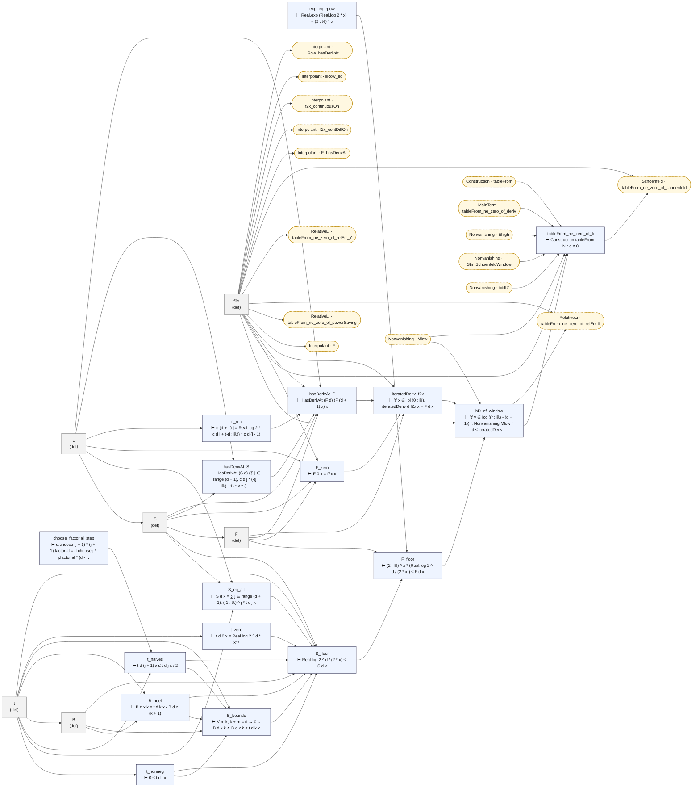

# `lean/Expansion.lean`

**What it does** (its own header): Expansion — stage 2b: the derivative of 2^x/x, explicitly, and its floor. `MainTerm.lean` reduced O67's main-term hypothesis to `hD`: a floor on the `(d+1)`-th derivative of the li-interpolant on the window — equivalently, on the `d`-th derivative of `2^x/x`. This module supplies both halves:

**Imports:** [`MainTerm`](../lean/MainTerm.md).
**Imported by:** [`RelativeLi`](../lean/RelativeLi.md), [`Schoenfeld`](../lean/Schoenfeld.md).

Blue: theorem. Green: a theorem nothing else uses (an end). Dashed white: connects to nothing. Grey: definition. Red: contains `sorry`. Yellow: in another file. An arrow A → B reads "A is used by B".

## Every declaration

| declaration | proves (output) | needs (input) | why (its own docstring) | uses | used by |
|---|---|---|---|---|---|
| `Expansion.c` def, line 43 | ℝ | d j : ℕ | The expansion coefficients: `C(d,j)·(log 2)^(d−j)·(−1)^j·j!`. `Nat.choose` vanishes past the diagonal, so no `ite` is needed. | — | `Expansion.F_zero`, `Expansion.S`, `Expansion.S_eq_alt`, `Expansion.c_rec`, `Expansion.hasDerivAt_F`, `Expansion.hasDerivAt_S` |
| `Expansion.S` def, line 47 | ℝ | d : ℕ; x : ℝ | The rational part of the `d`-th derivative of `2^x/x`. | `Expansion.c` | `Expansion.F`, `Expansion.F_zero`, `Expansion.S_eq_alt`, `Expansion.S_floor`, `Expansion.hasDerivAt_F`, `Expansion.hasDerivAt_S` |
| `Expansion.F` def, line 51 | ℝ | d : ℕ; x : ℝ | The `d`-th derivative of `2^x/x`, in closed form. | `Expansion.S` | `Expansion.F_floor`, `Expansion.F_zero`, `Expansion.hasDerivAt_F`, `Expansion.iteratedDeriv_f2x` |
| `Expansion.f2x` def, line 54 | ℝ | x : ℝ | The function itself, in the exp form the calculus uses. | — | `Expansion.F_zero`, `Expansion.hD_of_window`, `Expansion.hasDerivAt_F`, `Expansion.iteratedDeriv_f2x`, `Expansion.tableFrom_ne_zero_of_li`, `Interpolant.F`, `Interpolant.F_hasDerivAt`, `Interpolant.f2x_contDiffOn`, `Interpolant.f2x_continuousOn`, `Interpolant.liRow_eq`, `Interpolant.liRow_hasDerivAt`, `RelativeLi.tableFrom_ne_zero_of_powerSaving`, `RelativeLi.tableFrom_ne_zero_of_relErr_li`, `RelativeLi.tableFrom_ne_zero_of_relErr_li'`, `Schoenfeld.tableFrom_ne_zero_of_schoenfeld` |
| `Expansion.exp_eq_rpow` theorem, line 57 | Real.exp (Real.log 2 * x) = (2 : ℝ) ^ x | x : ℝ | `e^((log 2)·x) = 2^x`. | — | `Expansion.F_floor` |
| `Expansion.F_zero` theorem, line 61 | F 0 x = f2x x | x : ℝ | `F 0` is the function itself. | `Expansion.F`, `Expansion.S`, `Expansion.c`, `Expansion.f2x` | `Expansion.iteratedDeriv_f2x` |
| `Expansion.c_rec` theorem, line 67 | c (d + 1) j = Real.log 2 * c d j + (-(j : ℝ)) * c d (j - 1) | d j : ℕ | The coefficient recurrence — Pascal with the factorial absorbed; the `j = 0` edge dies against the `−j` factor. | `Expansion.c` | `Expansion.hasDerivAt_F` |
| `Expansion.hasDerivAt_S` theorem, line 107 | HasDerivAt (S d) (∑ j ∈ range (d + 1), c d j * (-(j : ℝ) - 1) * x ^ (-(j + 2 : ℤ))) x | d : ℕ; hx : x ≠ 0 | `S` differentiates term-by-term into the pre-recombination sum. | `Expansion.S`, `Expansion.c` | `Expansion.hasDerivAt_F` |
| `Expansion.hasDerivAt_F` theorem, line 128 | HasDerivAt (F d) (F (d + 1) x) x | d : ℕ; hx : x ≠ 0 | The expansion advances: `F d` has derivative `F (d+1)` at `x ≠ 0`. Product rule, the coefficient recurrence, and one `sum_range_succ'` reindex. | `Expansion.F`, `Expansion.S`, `Expansion.c`, `Expansion.c_rec`, `Expansion.f2x`, `Expansion.hasDerivAt_S` | `Expansion.iteratedDeriv_f2x` |
| `Expansion.iteratedDeriv_f2x` theorem, line 183 | ∀ x ∈ Ioi (0 : ℝ), iteratedDeriv d f2x x = F d x | d : ℕ | `iteratedDeriv d` of `2^x/x` IS `F d`, on `(0,∞)`. Induction; the step replaces `iteratedDeriv d f2x` by `F d` through `EventuallyEq.deriv_eq` on the open half-line, then advances by `hasDerivAt_F`. | `Expansion.F`, `Expansion.F_zero`, `Expansion.f2x`, `Expansion.hasDerivAt_F` | `Expansion.hD_of_window` |
| `Expansion.t` def, line 200 | ℝ | d j : ℕ; x : ℝ | The unsigned term of `S`. | — | `Expansion.B`, `Expansion.B_bounds`, `Expansion.B_peel`, `Expansion.S_eq_alt`, `Expansion.S_floor`, `Expansion.t_halves`, `Expansion.t_nonneg`, `Expansion.t_zero` |
| `Expansion.t_nonneg` theorem, line 204 | 0 ≤ t d j x | hx : 0 &lt; x | Every unsigned term is nonnegative on `x &gt; 0`. | `Expansion.t` | `Expansion.B_bounds`, `Expansion.S_floor` |
| `Expansion.S_eq_alt` theorem, line 212 | S d x = ∑ j ∈ range (d + 1), (-1 : ℝ) ^ j * t d j x | d : ℕ; x : ℝ | `S` is the alternating sum of the unsigned terms. | `Expansion.S`, `Expansion.c`, `Expansion.t` | `Expansion.S_floor` |
| `Expansion.choose_factorial_step` theorem, line 219 | d.choose (j + 1) * (j + 1).factorial = d.choose j * j.factorial * (d - j) | d j : ℕ | The choose-ratio identity, in ℕ where it is clean: `C(d,j+1)·(j+1)! = C(d,j)·j!·(d−j)`. | — | `Expansion.t_halves` |
| `Expansion.t_halves` theorem, line 226 | t d (j + 1) x ≤ t d j x / 2 | hx : 0 &lt; x; hw : 2 * (d : ℝ) ≤ Real.log 2 * x; j : ℕ | The terms halve in the wedge `2d ≤ (log 2)·x`: `t (j+1) ≤ t j / 2`. | `Expansion.choose_factorial_step`, `Expansion.t` | `Expansion.B_bounds`, `Expansion.S_floor` |
| `Expansion.B` def, line 281 | ℝ | d : ℕ; x : ℝ; k : ℕ | The downward tail `B k = Σ_{j&lt;d+1−k} (−1)^j t(k+j)`. | `Expansion.t` | `Expansion.B_bounds`, `Expansion.B_peel`, `Expansion.S_floor` |
| `Expansion.B_peel` theorem, line 285 | B d x k = t d k x - B d x (k + 1) | hk : k ≤ d | Peeling the head of the tail: `B k = t k − B (k+1)` for `k ≤ d`. | `Expansion.B`, `Expansion.t` | `Expansion.B_bounds`, `Expansion.S_floor` |
| `Expansion.B_bounds` theorem, line 304 | ∀ m k, k + m = d → 0 ≤ B d x k ∧ B d x k ≤ t d k x | hx : 0 &lt; x; hw : 2 * (d : ℝ) ≤ Real.log 2 * x | The tail bound `0 ≤ B k ≤ t k`, by downward induction on the tail length, using only that the terms halve. | `Expansion.B`, `Expansion.B_peel`, `Expansion.t`, `Expansion.t_halves`, `Expansion.t_nonneg` | `Expansion.S_floor` |
| `Expansion.t_zero` theorem, line 334 | t d 0 x = Real.log 2 ^ d * x⁻¹ | d : ℕ; x : ℝ | The leading term: `t 0 = (log 2)^d / x`. | `Expansion.t` | `Expansion.S_floor` |
| `Expansion.S_floor` theorem, line 339 | Real.log 2 ^ d / (2 * x) ≤ S d x | hx : 0 &lt; x; hw : 2 * (d : ℝ) ≤ Real.log 2 * x | The floor on `S`: in the wedge, `S d x ≥ t₀/2 = (log 2)^d/(2x)`. | `Expansion.B`, `Expansion.B_bounds`, `Expansion.B_peel`, `Expansion.S`, `Expansion.S_eq_alt`, `Expansion.t`, `Expansion.t_halves`, `Expansion.t_nonneg`, `Expansion.t_zero` | `Expansion.F_floor` |
| `Expansion.F_floor` theorem, line 365 | (2 : ℝ) ^ x * (Real.log 2 ^ d / (2 * x)) ≤ F d x | hx : 0 &lt; x; hw : 2 * (d : ℝ) ≤ Real.log 2 * x | The full floor on the closed form: `F d x ≥ (1/2)·2^x·(log 2)^d/x`. | `Expansion.F`, `Expansion.S_floor`, `Expansion.exp_eq_rpow` | `Expansion.hD_of_window` |
| `Expansion.hD_of_window` theorem, line 376 | ∀ y ∈ Icc ((r : ℝ) - (d + 1)) r, Nonvanishing.Mlow r d ≤ iteratedDeriv (d + 1) G y | hG' : ∀ x ∈ Ioi ((1 : ℝ) / 2), HasDerivAt G (f2x x) x; hbot : (1 : ℝ) ≤ (r : ℝ) - (d + 1); hw : 2 * (d : ℝ) ≤ Real.log 2 * ((r : ℝ) - (d + 1)) | `hD` discharged. On the window `[r−(d+1), r]` with the window bottom positive and the wedge holding there, the `(d+1)`-th derivative of any smooth interpolant whose derivative is `2^x/x` on `(0,∞)` clears `Mlow`. The chain: `iteratedDeriv (d+1) G = iteratedDeriv d (2^x/x) = F d ≥ floor ≥ Mlow`. | `Expansion.F_floor`, `Expansion.f2x`, `Expansion.iteratedDeriv_f2x`, `Nonvanishing.Mlow` | `Expansion.tableFrom_ne_zero_of_li`, `RelativeLi.tableFrom_ne_zero_of_relErr_li` |
| `Expansion.tableFrom_ne_zero_of_li` theorem, line 438 | Construction.tableFrom N r d ≠ 0 | hG : ContDiff ℝ (⊤ : ℕ∞) G; hG' : ∀ x ∈ Ioi ((1 : ℝ) / 2), HasDerivAt G (f2x x) x; hrow : ∀ k ∈ range (d + 2), ((N (r - k) : ℤ) : ℝ) = Nonvanishing.bdiffZ f (r - k); hr : ((d + 1 : ℕ) : ℤ) ≤ r; hS : Nonvanishing.StmtSchoenfeldWindow f (fun k : ℤ =&gt; G k) r (d + 1); hbot : (1 : ℝ) ≤ (r : ℝ) - (d + 1); hw : 2 * (d : ℝ) ≤ Real.log 2 * ((r : ℝ) - (d + 1)); hgap : Nonvanishing.Ehigh r (d + 1) &lt; Nonvanishing.Mlow r d | O67's conditional theorem, with the analysis discharged. The hypotheses are now exactly: the interpolant and its derivative structure (what "li" means here), Schoenfeld on the window (stage 3), the row agreement, the gap arithmetic, and the wedge/positivity arithmetic. The MVT, the alternating series, the expansion of `2^x/x` — all under the kernel. | `Construction.tableFrom`, `Expansion.f2x`, `Expansion.hD_of_window`, `MainTerm.tableFrom_ne_zero_of_deriv`, `Nonvanishing.Ehigh`, `Nonvanishing.Mlow`, `Nonvanishing.StmtSchoenfeldWindow`, `Nonvanishing.bdiffZ` | `Schoenfeld.tableFrom_ne_zero_of_schoenfeld` |
