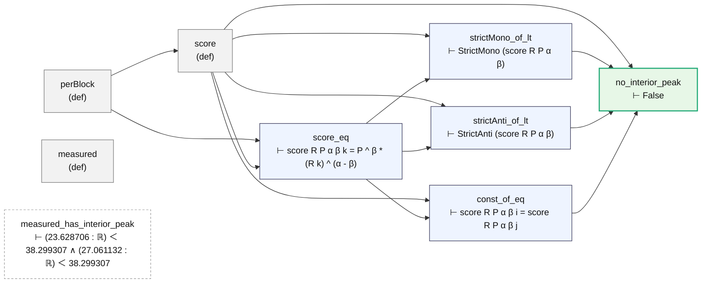

# `lean/GeneratorPeak.lean`

**What it does** (its own header): GeneratorPeak — why the block-size account cannot explain a peak at four. THE MEASUREMENT (results/O24_gen_xmax3e9_run.log, and the 1.5e8 and 1e9 logs): `P_max/median` over generator sets G1..G8 rises to G4 = {2,3,5,7} and falls after, at every xmax measured. The peak is interior.

**Imports:** nothing in this tree.
**Imported by:** nothing.

Blue: theorem. Green: a theorem nothing else uses (an end). Dashed white: connects to nothing. Grey: definition. Red: contains `sorry`. Yellow: in another file. An arrow A → B reads "A is used by B".

## Every declaration

| declaration | proves (output) | needs (input) | why (its own docstring) | uses | used by |
|---|---|---|---|---|---|
| `GeneratorPeak.perBlock` def, line 35 | ℝ | R : ℕ → ℝ; P : ℝ; k : ℕ | Primes per block: the fixed prime supply `P` split over `R k` rungs. | — | `GeneratorPeak.score`, `GeneratorPeak.score_eq` |
| `GeneratorPeak.score` def, line 38 | ℝ | R : ℕ → ℝ; P α β : ℝ; k : ℕ | The proposed score: resolution to the `α`, per-block signal to the `β`. | `GeneratorPeak.perBlock` | `GeneratorPeak.const_of_eq`, `GeneratorPeak.no_interior_peak`, `GeneratorPeak.score_eq`, `GeneratorPeak.strictAnti_of_lt`, `GeneratorPeak.strictMono_of_lt` |
| `GeneratorPeak.score_eq` theorem, line 45 | score R P α β k = P ^ β * (R k) ^ (α - β) | hR : ∀ k, 0 &lt; R k; hP : 0 &lt; P; k : ℕ | The two terms are not independent. `n = P / R` collapses the product to a single power of `R`. This is the whole content: the tradeoff is not a tradeoff. | `GeneratorPeak.perBlock`, `GeneratorPeak.score` | `GeneratorPeak.const_of_eq`, `GeneratorPeak.strictAnti_of_lt`, `GeneratorPeak.strictMono_of_lt` |
| `GeneratorPeak.strictMono_of_lt` theorem, line 55 | StrictMono (score R P α β) | hR : ∀ k, 0 &lt; R k; hRmono : StrictMono R; hP : 0 &lt; P; hab : β &lt; α | If resolution outweighs per-block signal, the score strictly increases with the generator count — more generators is always better, so no interior peak. | `GeneratorPeak.score`, `GeneratorPeak.score_eq` | `GeneratorPeak.no_interior_peak` |
| `GeneratorPeak.strictAnti_of_lt` theorem, line 65 | StrictAnti (score R P α β) | hR : ∀ k, 0 &lt; R k; hRmono : StrictMono R; hP : 0 &lt; P; hab : α &lt; β | If per-block signal outweighs resolution, the score strictly decreases — fewer generators is always better, so again no interior peak. | `GeneratorPeak.score`, `GeneratorPeak.score_eq` | `GeneratorPeak.no_interior_peak` |
| `GeneratorPeak.const_of_eq` theorem, line 74 | score R P α β i = score R P α β j | hR : ∀ k, 0 &lt; R k; hP : 0 &lt; P; hab : α = β; i j : ℕ | If the exponents match, the score does not depend on the generator count. | `GeneratorPeak.score`, `GeneratorPeak.score_eq` | `GeneratorPeak.no_interior_peak` |
| `GeneratorPeak.no_interior_peak` theorem, line 87 | False | hR : ∀ k, 0 &lt; R k; hRmono : StrictMono R; hP : 0 &lt; P; k : ℕ; hk : 0 &lt; k; hpeak : score R P α β (k - 1) &lt; score R P α β k ∧ score R P α β (k + 1) &lt; score R P α β k | No power-law tradeoff of this form has an interior peak. | `GeneratorPeak.const_of_eq`, `GeneratorPeak.score`, `GeneratorPeak.strictAnti_of_lt`, `GeneratorPeak.strictMono_of_lt` | — |
| `GeneratorPeak.measured` def, line 110 | List ℝ | — | G1..G8 at xmax = 3e9. | — | — |
| `GeneratorPeak.measured_has_interior_peak` theorem, line 114 | (23.628706 : ℝ) &lt; 38.299307 ∧ (27.061132 : ℝ) &lt; 38.299307 | — | The measurement is not monotone: G4 exceeds both G3 and G5. | — | — |
