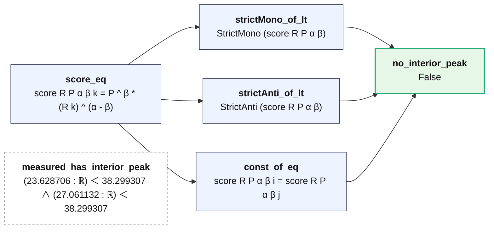

# `lean/GeneratorPeak.lean`

GeneratorPeak — why the block-size account cannot explain a peak at four. THE MEASUREMENT (results/O24_gen_xmax3e9_run.log, and the 1.5e8 and 1e9 logs): `P_max/median` over generator sets G1..G8 rises to G4 = {2,3,5,7} and falls after, at every xmax measured. The peak is interior.

6 theorems, 3 definitions, 151 lines. Arrows are Lean's own record of what each proof uses.

**Imports:** nothing in this tree  
**Imported by:** nothing

## The picture



An arrow A → B reads "A is used in the proof of B". Blue: theorem. Green: a theorem nothing else uses (an end). Dashed: connects to nothing. Red: contains `sorry`. Yellow: theorems in another file, counted; a dotted arrow crosses files. Definitions are not drawn; they are listed below the diagram.

## Definitions

<a name="GeneratorPeak-perBlock"></a>
### `GeneratorPeak.perBlock`

def · line 35

Primes per block: the fixed prime supply `P` split over `R k` rungs.

- **Is:** `` perBlock (R : ℕ → ℝ) (P : ℝ) (k : ℕ) : ℝ := P / R k ``
- **Used by 2:** [`GeneratorPeak.score`](#GeneratorPeak-score), [`GeneratorPeak.score_eq`](#GeneratorPeak-score_eq)

<a name="GeneratorPeak-score"></a>
### `GeneratorPeak.score`

def · line 38

The proposed score: resolution to the `α`, per-block signal to the `β`.

- **Is:** `` score (R : ℕ → ℝ) (P α β : ℝ) (k : ℕ) : ℝ := (R k) ^ α * (perBlock R P k) ^ β ``
- **Built from:** [`GeneratorPeak.perBlock`](#GeneratorPeak-perBlock)
- **Used by 5:** [`GeneratorPeak.const_of_eq`](#GeneratorPeak-const_of_eq), [`GeneratorPeak.no_interior_peak`](#GeneratorPeak-no_interior_peak), [`GeneratorPeak.score_eq`](#GeneratorPeak-score_eq), [`GeneratorPeak.strictAnti_of_lt`](#GeneratorPeak-strictAnti_of_lt), [`GeneratorPeak.strictMono_of_lt`](#GeneratorPeak-strictMono_of_lt)

<a name="GeneratorPeak-measured"></a>
### `GeneratorPeak.measured`

def · line 110

G1..G8 at xmax = 3e9.

- **Is:** `` measured : List ℝ := [5.501266, 8.192902, 23.628706, 38.299307, 27.061132, 18.321235, 14.885732, 12.039652] ``
- **Used by 0:** nothing

## Theorems

<a name="GeneratorPeak-score_eq"></a>
### `GeneratorPeak.score_eq`

line 45

**Why.** The two terms are not independent. `n = P / R` collapses the product to a single power of `R`. This is the whole content: the tradeoff is not a tradeoff.

**Proves**

```lean
score R P α β k = P ^ β * (R k) ^ (α - β)
```

**Needs** (its hypotheses)

  - `` hR : ∀ k, 0 < R k ``
  - `` hP : 0 < P ``
  - `` k : ℕ ``

**Stated with:** [`GeneratorPeak.score`](#GeneratorPeak-score)

**Fed by:** no theorem of this repo; it stands on Mathlib and the definitions below.

**Definitions its proof touches:** [`GeneratorPeak.perBlock`](#GeneratorPeak-perBlock)

**Feeds** (3 that use it)

  - [`GeneratorPeak.const_of_eq`](#GeneratorPeak-const_of_eq) — `` score R P α β i = score R P α β j ``
  - [`GeneratorPeak.strictAnti_of_lt`](#GeneratorPeak-strictAnti_of_lt) — `` StrictAnti (score R P α β) ``
  - [`GeneratorPeak.strictMono_of_lt`](#GeneratorPeak-strictMono_of_lt) — `` StrictMono (score R P α β) ``

<a name="GeneratorPeak-strictMono_of_lt"></a>
### `GeneratorPeak.strictMono_of_lt`

line 55

**Why.** If resolution outweighs per-block signal, the score strictly increases with the generator count — more generators is always better, so no interior peak.

**Proves**

```lean
StrictMono (score R P α β)
```

**Needs** (its hypotheses)

  - `` hR : ∀ k, 0 < R k ``
  - `` hRmono : StrictMono R ``
  - `` hP : 0 < P ``
  - `` hab : β < α ``

**Stated with:** [`GeneratorPeak.score`](#GeneratorPeak-score)

**Fed by** (1 theorem its proof uses)

  - [`GeneratorPeak.score_eq`](#GeneratorPeak-score_eq) — `` score R P α β k = P ^ β * (R k) ^ (α - β) ``

**Feeds** (1 that use it)

  - [`GeneratorPeak.no_interior_peak`](#GeneratorPeak-no_interior_peak) — `` False ``

<a name="GeneratorPeak-strictAnti_of_lt"></a>
### `GeneratorPeak.strictAnti_of_lt`

line 65

**Why.** If per-block signal outweighs resolution, the score strictly decreases — fewer generators is always better, so again no interior peak.

**Proves**

```lean
StrictAnti (score R P α β)
```

**Needs** (its hypotheses)

  - `` hR : ∀ k, 0 < R k ``
  - `` hRmono : StrictMono R ``
  - `` hP : 0 < P ``
  - `` hab : α < β ``

**Stated with:** [`GeneratorPeak.score`](#GeneratorPeak-score)

**Fed by** (1 theorem its proof uses)

  - [`GeneratorPeak.score_eq`](#GeneratorPeak-score_eq) — `` score R P α β k = P ^ β * (R k) ^ (α - β) ``

**Feeds** (1 that use it)

  - [`GeneratorPeak.no_interior_peak`](#GeneratorPeak-no_interior_peak) — `` False ``

<a name="GeneratorPeak-const_of_eq"></a>
### `GeneratorPeak.const_of_eq`

line 74

**Why.** If the exponents match, the score does not depend on the generator count.

**Proves**

```lean
score R P α β i = score R P α β j
```

**Needs** (its hypotheses)

  - `` hR : ∀ k, 0 < R k ``
  - `` hP : 0 < P ``
  - `` hab : α = β ``
  - `` i j : ℕ ``

**Stated with:** [`GeneratorPeak.score`](#GeneratorPeak-score)

**Fed by** (1 theorem its proof uses)

  - [`GeneratorPeak.score_eq`](#GeneratorPeak-score_eq) — `` score R P α β k = P ^ β * (R k) ^ (α - β) ``

**Feeds** (1 that use it)

  - [`GeneratorPeak.no_interior_peak`](#GeneratorPeak-no_interior_peak) — `` False ``

<a name="GeneratorPeak-no_interior_peak"></a>
### `GeneratorPeak.no_interior_peak`

line 87

**Why.** No power-law tradeoff of this form has an interior peak.

**Proves**

```lean
False
```

**Needs** (its hypotheses)

  - `` hR : ∀ k, 0 < R k ``
  - `` hRmono : StrictMono R ``
  - `` hP : 0 < P ``
  - `` k : ℕ ``
  - `` hk : 0 < k ``
  - `` hpeak : score R P α β (k - 1) < score R P α β k ∧ score R P α β (k + 1) < score R P α β k ``

**Stated with:** [`GeneratorPeak.score`](#GeneratorPeak-score)

**Fed by** (3 theorems its proof uses)

  - [`GeneratorPeak.const_of_eq`](#GeneratorPeak-const_of_eq) — `` score R P α β i = score R P α β j ``
  - [`GeneratorPeak.strictAnti_of_lt`](#GeneratorPeak-strictAnti_of_lt) — `` StrictAnti (score R P α β) ``
  - [`GeneratorPeak.strictMono_of_lt`](#GeneratorPeak-strictMono_of_lt) — `` StrictMono (score R P α β) ``

**Feeds:** nothing. It is an end.

<a name="GeneratorPeak-measured_has_interior_peak"></a>
### `GeneratorPeak.measured_has_interior_peak`

line 114

**Why.** The measurement is not monotone: G4 exceeds both G3 and G5.

**Proves**

```lean
(23.628706 : ℝ) < 38.299307 ∧ (27.061132 : ℝ) < 38.299307
```

**Fed by:** no theorem of this repo; it stands on Mathlib.

**Feeds:** nothing. It connects to nothing.

