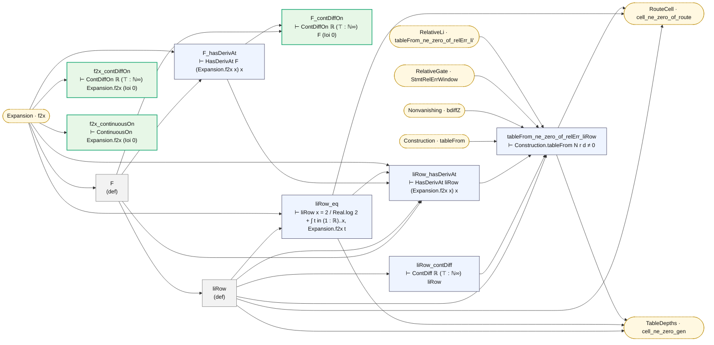

# `lean/Interpolant.lean`

**What it does** (its own header): Interpolant — the smooth interpolant of the main term, constructed. Block C1 of `lean_stage3/design/joints.md`. 2026-11-22.

**Imports:** [`RelativeLi`](../lean/RelativeLi.md).
**Imported by:** [`RouteCell`](../lean/RouteCell.md).

Blue: theorem. Green: a theorem nothing else uses (an end). Dashed white: connects to nothing. Grey: definition. Red: contains `sorry`. Yellow: in another file. An arrow A → B reads "A is used by B".

## Every declaration

| declaration | proves (output) | needs (input) | why (its own docstring) | uses | used by |
|---|---|---|---|---|---|
| `Interpolant.F` def, line 32 | ℝ | x : ℝ | The antiderivative of `2^x/x` through the value `2/log 2` at `x = 1`. | `Expansion.f2x` | `Interpolant.F_contDiffOn`, `Interpolant.F_hasDerivAt`, `Interpolant.liRow`, `Interpolant.liRow_hasDerivAt` |
| `Interpolant.liRow` def, line 35 | ℝ | x : ℝ | The interpolant: `F` cut off smoothly below one half. | `Interpolant.F` | `Interpolant.liRow_contDiff`, `Interpolant.liRow_eq`, `Interpolant.liRow_hasDerivAt`, `Interpolant.tableFrom_ne_zero_of_relErr_liRow`, `RouteCell.cell_ne_zero_of_route`, `TableDepths.cell_ne_zero_gen` |
| `Interpolant.f2x_contDiffOn` theorem, line 37 | ContDiffOn ℝ (⊤ : ℕ∞) Expansion.f2x (Ioi 0) | — | — | `Expansion.f2x` | — |
| `Interpolant.f2x_continuousOn` theorem, line 45 | ContinuousOn Expansion.f2x (Ioi 0) | — | — | `Expansion.f2x` | — |
| `Interpolant.F_hasDerivAt` theorem, line 48 | HasDerivAt F (Expansion.f2x x) x | hx : 0 &lt; x | — | `Expansion.f2x`, `Interpolant.F` | `Interpolant.F_contDiffOn`, `Interpolant.liRow_hasDerivAt` |
| `Interpolant.F_contDiffOn` theorem, line 64 | ContDiffOn ℝ (⊤ : ℕ∞) F (Ioi 0) | — | — | `Interpolant.F`, `Interpolant.F_hasDerivAt` | — |
| `Interpolant.liRow_contDiff` theorem, line 69 | ContDiff ℝ (⊤ : ℕ∞) liRow | — | — | `Interpolant.liRow` | `Interpolant.tableFrom_ne_zero_of_relErr_liRow` |
| `Interpolant.liRow_eq` theorem, line 87 | liRow x = 2 / Real.log 2 + ∫ t in (1 : ℝ)..x, Expansion.f2x t | hx : 1 / 2 ≤ x | — | `Expansion.f2x`, `Interpolant.liRow` | `Interpolant.liRow_hasDerivAt`, `RouteCell.cell_ne_zero_of_route`, `TableDepths.cell_ne_zero_gen` |
| `Interpolant.liRow_hasDerivAt` theorem, line 93 | HasDerivAt liRow (Expansion.f2x x) x | hx : x ∈ Ioi ((1 : ℝ) / 2) | — | `Expansion.f2x`, `Interpolant.F`, `Interpolant.F_hasDerivAt`, `Interpolant.liRow`, `Interpolant.liRow_eq` | `Interpolant.tableFrom_ne_zero_of_relErr_liRow` |
| `Interpolant.tableFrom_ne_zero_of_relErr_liRow` theorem, line 103 | Construction.tableFrom N r d ≠ 0 | hrow : ∀ k ∈ Finset.range (d + 2), ((N (r - k) : ℤ) : ℝ) = Nonvanishing.bdiffZ f (r - k); hS : RelativeGate.StmtRelErrWindow f (fun k : ℤ =&gt; liRow k) r (d + 1) ρ; hbot : (1 : ℝ) ≤ (r : ℝ) - (d + 1); hw : 2 * (d : ℝ) ≤ Real.log 2 * ((r : ℝ) - (d + 1)); hρ : ρ &lt; Real.log 2 ^ d / (2 * r * 3 ^ (d + 1)) | The gate with nothing assumed about the main term. | `Construction.tableFrom`, `Interpolant.liRow`, `Interpolant.liRow_contDiff`, `Interpolant.liRow_hasDerivAt`, `Nonvanishing.bdiffZ`, `RelativeGate.StmtRelErrWindow`, `RelativeLi.tableFrom_ne_zero_of_relErr_li'` | `RouteCell.cell_ne_zero_of_route`, `TableDepths.cell_ne_zero_gen` |
