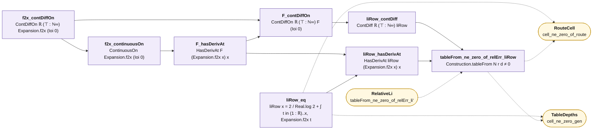

# `lean/Interpolant.lean`

Interpolant — the smooth interpolant of the main term, constructed. Block C1 of `lean_stage3/design/joints.md`. 2026-11-22.

8 theorems, 2 definitions, 158 lines. Arrows are Lean's own record of what each proof uses.

**Imports:** [`RelativeLi`](../lean/RelativeLi.md)  
**Imported by:** [`RouteCell`](../lean/RouteCell.md)

## The picture



An arrow A → B reads "A is used in the proof of B". Green: counting, integers only. Violet: shape, analysis with no ζ. Blue: reads ζ. A name ending in ■ is an end: nothing else uses it. Red: contains `sorry`. Yellow: theorems in another file, counted; a dotted arrow crosses files. Definitions are not drawn; they are listed below the diagram.

## Definitions

<a name="Interpolant-F"></a>
### `Interpolant.F`

def · line 32

The antiderivative of `2^x/x` through the value `2/log 2` at `x = 1`.

- **Is:** `` F (x : ℝ) : ℝ := 2 / Real.log 2 + ∫ t in (1 : ℝ)..x, Expansion.f2x t ``
- **Built from:** [`Expansion.f2x`](../lean/Expansion.md#Expansion-f2x)
- **Used by 6:** [`Interpolant.F_contDiffOn`](#Interpolant-F_contDiffOn), [`Interpolant.F_hasDerivAt`](#Interpolant-F_hasDerivAt), [`Interpolant.liRow`](#Interpolant-liRow), [`Interpolant.liRow_contDiff`](#Interpolant-liRow_contDiff), [`Interpolant.liRow_eq`](#Interpolant-liRow_eq), [`Interpolant.liRow_hasDerivAt`](#Interpolant-liRow_hasDerivAt)

<a name="Interpolant-liRow"></a>
### `Interpolant.liRow`

def · line 35

The interpolant: `F` cut off smoothly below one half.

- **Is:** `` liRow (x : ℝ) : ℝ := Real.smoothTransition (4 * x - 1) * F x ``
- **Built from:** [`Interpolant.F`](#Interpolant-F)
- **Used by 6:** [`Interpolant.liRow_contDiff`](#Interpolant-liRow_contDiff), [`Interpolant.liRow_eq`](#Interpolant-liRow_eq), [`Interpolant.liRow_hasDerivAt`](#Interpolant-liRow_hasDerivAt), [`Interpolant.tableFrom_ne_zero_of_relErr_liRow`](#Interpolant-tableFrom_ne_zero_of_relErr_liRow), [`RouteCell.cell_ne_zero_of_route`](../lean/RouteCell.md#RouteCell-cell_ne_zero_of_route), [`TableDepths.cell_ne_zero_gen`](../lean_stage3/TableDepths.md#TableDepths-cell_ne_zero_gen)

## Theorems

<a name="Interpolant-f2x_contDiffOn"></a>
### `Interpolant.f2x_contDiffOn`

line 38

**Shape.** Uses real or complex analysis; nothing in it or beneath it reads ζ.

**Why.** Helper: the integrand `f2x` (`2^x/x`) is smooth on the positive half-line.

**Proves**

```lean
ContDiffOn ℝ (⊤ : ℕ∞) Expansion.f2x (Ioi 0)
```

**Stated with:** [`Expansion.f2x`](../lean/Expansion.md#Expansion-f2x)

**Fed by:** no theorem of this repo; it stands on Mathlib and the definitions below.

**Feeds** (2 that use it)

  - [`Interpolant.F_contDiffOn`](#Interpolant-F_contDiffOn) — `` ContDiffOn ℝ (⊤ : ℕ∞) F (Ioi 0) ``
  - [`Interpolant.f2x_continuousOn`](#Interpolant-f2x_continuousOn) — `` ContinuousOn Expansion.f2x (Ioi 0) ``

<a name="Interpolant-f2x_continuousOn"></a>
### `Interpolant.f2x_continuousOn`

line 47

**Shape.** Uses real or complex analysis; nothing in it or beneath it reads ζ.

**Why.** Helper: the integrand `f2x` is continuous on the positive half-line.

**Proves**

```lean
ContinuousOn Expansion.f2x (Ioi 0)
```

**Stated with:** [`Expansion.f2x`](../lean/Expansion.md#Expansion-f2x)

**Fed by** (1 theorem its proof uses)

  - [`Interpolant.f2x_contDiffOn`](#Interpolant-f2x_contDiffOn) — `` ContDiffOn ℝ (⊤ : ℕ∞) Expansion.f2x (Ioi 0) ``

**Feeds** (1 that use it)

  - [`Interpolant.F_hasDerivAt`](#Interpolant-F_hasDerivAt) — `` HasDerivAt F (Expansion.f2x x) x ``

<a name="Interpolant-F_hasDerivAt"></a>
### `Interpolant.F_hasDerivAt`

line 51

**Shape.** Uses real or complex analysis; nothing in it or beneath it reads ζ.

**Why.** For `x > 0`, the antiderivative `F` has derivative `f2x x` at `x`.

**Proves**

```lean
HasDerivAt F (Expansion.f2x x) x
```

**Needs** (its hypotheses)

  - `` hx : 0 < x ``

**Stated with:** [`Expansion.f2x`](../lean/Expansion.md#Expansion-f2x), [`Interpolant.F`](#Interpolant-F)

**Fed by** (1 theorem its proof uses)

  - [`Interpolant.f2x_continuousOn`](#Interpolant-f2x_continuousOn) — `` ContinuousOn Expansion.f2x (Ioi 0) ``

**Feeds** (2 that use it)

  - [`Interpolant.F_contDiffOn`](#Interpolant-F_contDiffOn) — `` ContDiffOn ℝ (⊤ : ℕ∞) F (Ioi 0) ``
  - [`Interpolant.liRow_hasDerivAt`](#Interpolant-liRow_hasDerivAt) — `` HasDerivAt liRow (Expansion.f2x x) x ``

<a name="Interpolant-F_contDiffOn"></a>
### `Interpolant.F_contDiffOn`

line 68

**Shape.** Uses real or complex analysis; nothing in it or beneath it reads ζ.

**Why.** The antiderivative `F` is smooth on the positive half-line.

**Proves**

```lean
ContDiffOn ℝ (⊤ : ℕ∞) F (Ioi 0)
```

**Stated with:** [`Interpolant.F`](#Interpolant-F)

**Fed by** (2 theorems its proof uses)

  - [`Interpolant.F_hasDerivAt`](#Interpolant-F_hasDerivAt) — `` HasDerivAt F (Expansion.f2x x) x ``
  - [`Interpolant.f2x_contDiffOn`](#Interpolant-f2x_contDiffOn) — `` ContDiffOn ℝ (⊤ : ℕ∞) Expansion.f2x (Ioi 0) ``

**Definitions its proof touches:** [`Expansion.f2x`](../lean/Expansion.md#Expansion-f2x)

**Feeds** (1 that use it)

  - [`Interpolant.liRow_contDiff`](#Interpolant-liRow_contDiff) — `` ContDiff ℝ (⊤ : ℕ∞) liRow ``

<a name="Interpolant-liRow_contDiff"></a>
### `Interpolant.liRow_contDiff`

line 74

**Shape.** Uses real or complex analysis; nothing in it or beneath it reads ζ.

**Why.** The interpolant `liRow` is smooth on the whole real line.

**Proves**

```lean
ContDiff ℝ (⊤ : ℕ∞) liRow
```

**Stated with:** [`Interpolant.liRow`](#Interpolant-liRow)

**Fed by** (1 theorem its proof uses)

  - [`Interpolant.F_contDiffOn`](#Interpolant-F_contDiffOn) — `` ContDiffOn ℝ (⊤ : ℕ∞) F (Ioi 0) ``

**Definitions its proof touches:** [`Interpolant.F`](#Interpolant-F)

**Feeds** (1 that use it)

  - [`Interpolant.tableFrom_ne_zero_of_relErr_liRow`](#Interpolant-tableFrom_ne_zero_of_relErr_liRow) — `` Construction.tableFrom N r d ≠ 0 ``

<a name="Interpolant-liRow_eq"></a>
### `Interpolant.liRow_eq`

line 94

**Shape.** Uses real or complex analysis; nothing in it or beneath it reads ζ.

**Why.** For `x ≥ 1/2`, the interpolant equals the antiderivative: `liRow x = 2/log 2 + ∫ t in 1..x, f2x t`.

**Proves**

```lean
liRow x = 2 / Real.log 2 + ∫ t in (1 : ℝ)..x, Expansion.f2x t
```

**Needs** (its hypotheses)

  - `` hx : 1 / 2 ≤ x ``

**Stated with:** [`Expansion.f2x`](../lean/Expansion.md#Expansion-f2x), [`Interpolant.liRow`](#Interpolant-liRow)

**Fed by:** no theorem of this repo; it stands on Mathlib and the definitions below.

**Definitions its proof touches:** [`Interpolant.F`](#Interpolant-F)

**Feeds** (3 that use it)

  - [`Interpolant.liRow_hasDerivAt`](#Interpolant-liRow_hasDerivAt) — `` HasDerivAt liRow (Expansion.f2x x) x ``
  - [`RouteCell.cell_ne_zero_of_route`](../lean/RouteCell.md#RouteCell-cell_ne_zero_of_route) (RouteCell) — `` Construction.tableFrom N r 6 ≠ 0 ``
  - [`TableDepths.cell_ne_zero_gen`](../lean_stage3/TableDepths.md#TableDepths-cell_ne_zero_gen) (TableDepths) — `` Construction.tableFrom TableRoute.rowN r d ≠ 0 ``

<a name="Interpolant-liRow_hasDerivAt"></a>
### `Interpolant.liRow_hasDerivAt`

line 101

**Shape.** Uses real or complex analysis; nothing in it or beneath it reads ζ.

**Why.** For `x > 1/2`, the interpolant `liRow` has derivative `f2x x` at `x`.

**Proves**

```lean
HasDerivAt liRow (Expansion.f2x x) x
```

**Needs** (its hypotheses)

  - `` hx : x ∈ Ioi ((1 : ℝ) / 2) ``

**Stated with:** [`Expansion.f2x`](../lean/Expansion.md#Expansion-f2x), [`Interpolant.liRow`](#Interpolant-liRow)

**Fed by** (2 theorems its proof uses)

  - [`Interpolant.F_hasDerivAt`](#Interpolant-F_hasDerivAt) — `` HasDerivAt F (Expansion.f2x x) x ``
  - [`Interpolant.liRow_eq`](#Interpolant-liRow_eq) — `` liRow x = 2 / Real.log 2 + ∫ t in (1 : ℝ)..x, Expansion.f2x t ``

**Definitions its proof touches:** [`Interpolant.F`](#Interpolant-F)

**Feeds** (1 that use it)

  - [`Interpolant.tableFrom_ne_zero_of_relErr_liRow`](#Interpolant-tableFrom_ne_zero_of_relErr_liRow) — `` Construction.tableFrom N r d ≠ 0 ``

<a name="Interpolant-tableFrom_ne_zero_of_relErr_liRow"></a>
### `Interpolant.tableFrom_ne_zero_of_relErr_liRow`

line 111

**Shape.** Uses real or complex analysis; nothing in it or beneath it reads ζ.

**Why.** The gate with nothing assumed about the main term.

**Proves**

```lean
Construction.tableFrom N r d ≠ 0
```

**Needs** (its hypotheses)

  - `` hrow : ∀ k ∈ Finset.range (d + 2), ((N (r - k) : ℤ) : ℝ) = Nonvanishing.bdiffZ f (r - k) ``
  - `` hS : RelativeGate.StmtRelErrWindow f (fun k : ℤ => liRow k) r (d + 1) ρ ``
  - `` hbot : (1 : ℝ) ≤ (r : ℝ) - (d + 1) ``
  - `` hw : 2 * (d : ℝ) ≤ Real.log 2 * ((r : ℝ) - (d + 1)) ``
  - `` hρ : ρ < Real.log 2 ^ d / (2 * r * 3 ^ (d + 1)) ``

**Stated with:** [`Construction.tableFrom`](../lean/Construction.md#Construction-tableFrom), [`Interpolant.liRow`](#Interpolant-liRow), [`Nonvanishing.bdiffZ`](../lean/Nonvanishing.md#Nonvanishing-bdiffZ), [`RelativeGate.StmtRelErrWindow`](../lean/RelativeGate.md#RelativeGate-StmtRelErrWindow)

**Fed by** (3 theorems its proof uses)

  - [`Interpolant.liRow_contDiff`](#Interpolant-liRow_contDiff) — `` ContDiff ℝ (⊤ : ℕ∞) liRow ``
  - [`Interpolant.liRow_hasDerivAt`](#Interpolant-liRow_hasDerivAt) — `` HasDerivAt liRow (Expansion.f2x x) x ``
  - [`RelativeLi.tableFrom_ne_zero_of_relErr_li'`](../lean/RelativeLi.md#RelativeLi-tableFrom_ne_zero_of_relErr_li-) (RelativeLi) — `` Construction.tableFrom N r d ≠ 0 ``

**Feeds** (2 that use it)

  - [`RouteCell.cell_ne_zero_of_route`](../lean/RouteCell.md#RouteCell-cell_ne_zero_of_route) (RouteCell) — `` Construction.tableFrom N r 6 ≠ 0 ``
  - [`TableDepths.cell_ne_zero_gen`](../lean_stage3/TableDepths.md#TableDepths-cell_ne_zero_gen) (TableDepths) — `` Construction.tableFrom TableRoute.rowN r d ≠ 0 ``

