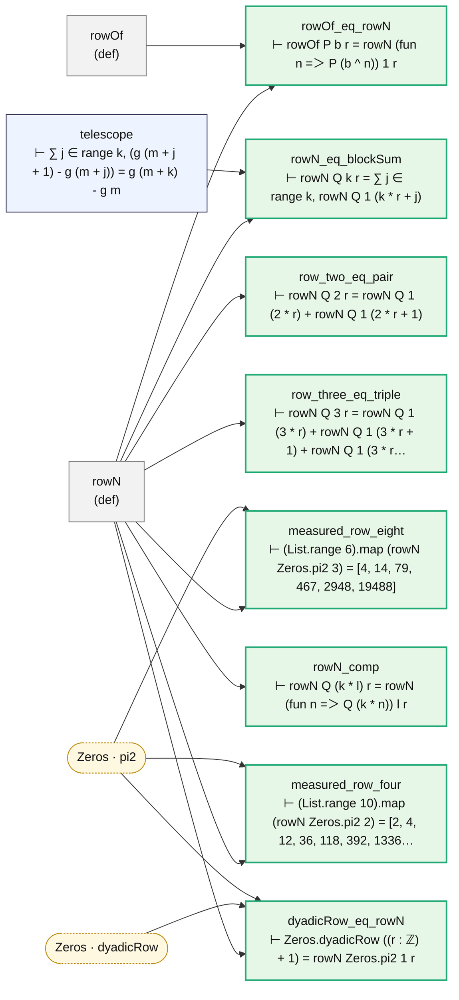

# `lean/Isogeny.lean`

**What it does** (its own header): Isogeny — what the isogeny does to the row. `Transform.tau_ratio_of_meet` proves that two ladders which meet have rationally related modular parameters: `bⁿ = cᵐ → τ(b)/τ(c) = n/m`. That is a statement about the tori `ℂ*/b^ℤ`, and the torus knows only `b`. No prime enters it.

**Imports:** [`Zeros`](../lean/Zeros.md).
**Imported by:** nothing.

Blue: theorem. Green: a theorem nothing else uses (an end). Dashed white: connects to nothing. Grey: definition. Red: contains `sorry`. Yellow: in another file. An arrow A → B reads "A is used by B".

## Every declaration

| declaration | proves (output) | needs (input) | why (its own docstring) | uses | used by |
|---|---|---|---|---|---|
| `Isogeny.rowN` def, line 44 | ℤ | Q : ℕ → ℤ; k : ℕ; r : ℕ | The row of an exponent-indexed count `Q` at decimation `k`: the count on the block from exponent `k*r` to exponent `k*(r+1)`. `k = 1` is the base row. | — | `Isogeny.dyadicRow_eq_rowN`, `Isogeny.measured_row_eight`, `Isogeny.measured_row_four`, `Isogeny.rowN_comp`, `Isogeny.rowN_eq_blockSum`, `Isogeny.rowOf_eq_rowN`, `Isogeny.row_three_eq_triple`, `Isogeny.row_two_eq_pair` |
| `Isogeny.rowOf` def, line 48 | ℤ | P : ℕ → ℤ; b : ℕ; r : ℕ | The "count up to `x`" reading, for a `P` that eats values rather than exponents. | — | `Isogeny.rowOf_eq_rowN` |
| `Isogeny.rowOf_eq_rowN` theorem, line 51 | rowOf P b r = rowN (fun n =&gt; P (b ^ n)) 1 r | P : ℕ → ℤ; b r : ℕ | The bridge: composing `P` with `b^·` turns one into the other. | `Isogeny.rowN`, `Isogeny.rowOf` | — |
| `Isogeny.telescope` theorem, line 58 | ∑ j ∈ range k, (g (m + j + 1) - g (m + j)) = g (m + k) - g m | g : ℕ → ℤ; m k : ℕ | Telescoping over `Finset.range`. Stated for an arbitrary `g : ℕ → ℤ` because that is all the identity below needs. | — | `Isogeny.rowN_eq_blockSum` |
| `Isogeny.rowN_eq_blockSum` theorem, line 68 | rowN Q k r = ∑ j ∈ range k, rowN Q 1 (k * r + j) | Q : ℕ → ℤ; k r : ℕ | The isogeny on the row. Passing from a ladder to its `k`-th power sums the row in blocks of `k`. Holds for any `Q`; no arithmetic input is used. | `Isogeny.rowN`, `Isogeny.telescope` | — |
| `Isogeny.row_two_eq_pair` theorem, line 78 | rowN Q 2 r = rowN Q 1 (2 * r) + rowN Q 1 (2 * r + 1) | Q : ℕ → ℤ; r : ℕ | Base 4's row is base 2's row summed in pairs. | `Isogeny.rowN` | — |
| `Isogeny.row_three_eq_triple` theorem, line 85 | rowN Q 3 r = rowN Q 1 (3 * r) + rowN Q 1 (3 * r + 1) + rowN Q 1 (3 * r + 2) | Q : ℕ → ℤ; r : ℕ | Base 8's row is base 2's row summed in triples. | `Isogeny.rowN` | — |
| `Isogeny.rowN_comp` theorem, line 94 | rowN Q (k * l) r = rowN (fun n =&gt; Q (k * n)) l r | Q : ℕ → ℤ; k l r : ℕ | Decimation composes. Reading a ladder at `k` and then at `l` is reading it at `k*l` — so `{2,4,8}` is a chain and not three separate relations. | `Isogeny.rowN` | — |
| `Isogeny.dyadicRow_eq_rowN` theorem, line 102 | Zeros.dyadicRow ((r : ℤ) + 1) = rowN Zeros.pi2 1 r | r : ℕ; h : r ≤ 19 | The weld to the measured row. `Zeros.dyadicRow` indexes from the top over `ℤ` and is windowed to `1 ≤ r ≤ 20`; inside that window it is `rowN Zeros.pi2 1` shifted by one. | `Isogeny.rowN`, `Zeros.dyadicRow`, `Zeros.pi2` | — |
| `Isogeny.measured_row_four` theorem, line 115 | (List.range 10).map (rowN Zeros.pi2 2) = [2, 4, 12, 36, 118, 392, 1336, 4642, 16458, 59025] | — | The measured base-4 row, from the 21 pinned values and nothing else. These are the numbers `row_two_eq_pair` says are base 2's row summed in pairs. | `Isogeny.rowN`, `Zeros.pi2` | — |
| `Isogeny.measured_row_eight` theorem, line 121 | (List.range 6).map (rowN Zeros.pi2 3) = [4, 14, 79, 467, 2948, 19488] | — | The measured base-8 row, same 21 values read at decimation 3. | `Isogeny.rowN`, `Zeros.pi2` | — |
