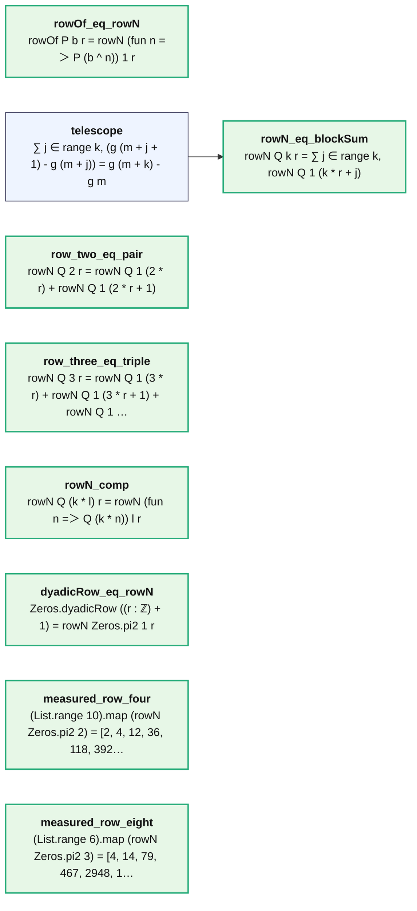

# `lean/Isogeny.lean`

Isogeny — what the isogeny does to the row. `Transform.tau_ratio_of_meet` proves that two ladders which meet have rationally related modular parameters: `bⁿ = cᵐ → τ(b)/τ(c) = n/m`. That is a statement about the tori `ℂ*/b^ℤ`, and the torus knows only `b`. No prime enters it.

9 theorems, 2 definitions, 162 lines. Arrows are Lean's own record of what each proof uses.

**Imports:** [`Zeros`](../lean/Zeros.md)  
**Imported by:** nothing

## The picture



An arrow A → B reads "A is used in the proof of B". Blue: theorem. Green: a theorem nothing else uses (an end). Dashed: connects to nothing. Red: contains `sorry`. Yellow: theorems in another file, counted; a dotted arrow crosses files. Definitions are not drawn; they are listed below the diagram.

## Definitions

<a name="Isogeny-rowN"></a>
### `Isogeny.rowN`

def · line 44

The row of an exponent-indexed count `Q` at decimation `k`: the count on the block from exponent `k*r` to exponent `k*(r+1)`. `k = 1` is the base row.

- **Is:** `` rowN (Q : ℕ → ℤ) (k : ℕ) (r : ℕ) : ℤ := Q (k * (r + 1)) - Q (k * r) ``
- **Used by 8:** [`Isogeny.dyadicRow_eq_rowN`](#Isogeny-dyadicRow_eq_rowN), [`Isogeny.measured_row_eight`](#Isogeny-measured_row_eight), [`Isogeny.measured_row_four`](#Isogeny-measured_row_four), [`Isogeny.rowN_comp`](#Isogeny-rowN_comp), [`Isogeny.rowN_eq_blockSum`](#Isogeny-rowN_eq_blockSum), [`Isogeny.rowOf_eq_rowN`](#Isogeny-rowOf_eq_rowN), [`Isogeny.row_three_eq_triple`](#Isogeny-row_three_eq_triple), [`Isogeny.row_two_eq_pair`](#Isogeny-row_two_eq_pair)

<a name="Isogeny-rowOf"></a>
### `Isogeny.rowOf`

def · line 48

The "count up to `x`" reading, for a `P` that eats values rather than exponents.

- **Is:** `` rowOf (P : ℕ → ℤ) (b : ℕ) (r : ℕ) : ℤ := P (b ^ (r + 1)) - P (b ^ r) ``
- **Used by 1:** [`Isogeny.rowOf_eq_rowN`](#Isogeny-rowOf_eq_rowN)

## Theorems

<a name="Isogeny-rowOf_eq_rowN"></a>
### `Isogeny.rowOf_eq_rowN`

line 51

**Why.** The bridge: composing `P` with `b^·` turns one into the other.

**Proves**

```lean
rowOf P b r = rowN (fun n => P (b ^ n)) 1 r
```

**Needs** (its hypotheses)

  - `` P : ℕ → ℤ ``
  - `` b r : ℕ ``

**Stated with:** [`Isogeny.rowN`](#Isogeny-rowN), [`Isogeny.rowOf`](#Isogeny-rowOf)

**Fed by:** no theorem of this repo; it stands on Mathlib and the definitions below.

**Feeds:** nothing. It is an end.

<a name="Isogeny-telescope"></a>
### `Isogeny.telescope`

line 58

**Why.** Telescoping over `Finset.range`. Stated for an arbitrary `g : ℕ → ℤ` because that is all the identity below needs.

**Proves**

```lean
∑ j ∈ range k, (g (m + j + 1) - g (m + j)) = g (m + k) - g m
```

**Needs** (its hypotheses)

  - `` g : ℕ → ℤ ``
  - `` m k : ℕ ``

**Fed by:** no theorem of this repo; it stands on Mathlib.

**Feeds** (1 that use it)

  - [`Isogeny.rowN_eq_blockSum`](#Isogeny-rowN_eq_blockSum) — `` rowN Q k r = ∑ j ∈ range k, rowN Q 1 (k * r + j) ``

<a name="Isogeny-rowN_eq_blockSum"></a>
### `Isogeny.rowN_eq_blockSum`

line 68

**Why.** The isogeny on the row. Passing from a ladder to its `k`-th power sums the row in blocks of `k`. Holds for any `Q`; no arithmetic input is used.

**Proves**

```lean
rowN Q k r = ∑ j ∈ range k, rowN Q 1 (k * r + j)
```

**Needs** (its hypotheses)

  - `` Q : ℕ → ℤ ``
  - `` k r : ℕ ``

**Stated with:** [`Isogeny.rowN`](#Isogeny-rowN)

**Fed by** (1 theorem its proof uses)

  - [`Isogeny.telescope`](#Isogeny-telescope) — `` ∑ j ∈ range k, (g (m + j + 1) - g (m + j)) = g (m + k) - g m ``

**Feeds:** nothing. It is an end.

<a name="Isogeny-row_two_eq_pair"></a>
### `Isogeny.row_two_eq_pair`

line 78

**Why.** Base 4's row is base 2's row summed in pairs.

**Proves**

```lean
rowN Q 2 r = rowN Q 1 (2 * r) + rowN Q 1 (2 * r + 1)
```

**Needs** (its hypotheses)

  - `` Q : ℕ → ℤ ``
  - `` r : ℕ ``

**Stated with:** [`Isogeny.rowN`](#Isogeny-rowN)

**Fed by:** no theorem of this repo; it stands on Mathlib and the definitions below.

**Feeds:** nothing. It is an end.

<a name="Isogeny-row_three_eq_triple"></a>
### `Isogeny.row_three_eq_triple`

line 85

**Why.** Base 8's row is base 2's row summed in triples.

**Proves**

```lean
rowN Q 3 r = rowN Q 1 (3 * r) + rowN Q 1 (3 * r + 1) + rowN Q 1 (3 * r + 2)
```

**Needs** (its hypotheses)

  - `` Q : ℕ → ℤ ``
  - `` r : ℕ ``

**Stated with:** [`Isogeny.rowN`](#Isogeny-rowN)

**Fed by:** no theorem of this repo; it stands on Mathlib and the definitions below.

**Feeds:** nothing. It is an end.

<a name="Isogeny-rowN_comp"></a>
### `Isogeny.rowN_comp`

line 94

**Why.** Decimation composes. Reading a ladder at `k` and then at `l` is reading it at `k*l` — so `{2,4,8}` is a chain and not three separate relations.

**Proves**

```lean
rowN Q (k * l) r = rowN (fun n => Q (k * n)) l r
```

**Needs** (its hypotheses)

  - `` Q : ℕ → ℤ ``
  - `` k l r : ℕ ``

**Stated with:** [`Isogeny.rowN`](#Isogeny-rowN)

**Fed by:** no theorem of this repo; it stands on Mathlib and the definitions below.

**Feeds:** nothing. It is an end.

<a name="Isogeny-dyadicRow_eq_rowN"></a>
### `Isogeny.dyadicRow_eq_rowN`

line 102

**Why.** The weld to the measured row. `Zeros.dyadicRow` indexes from the top over `ℤ` and is windowed to `1 ≤ r ≤ 20`; inside that window it is `rowN Zeros.pi2 1` shifted by one.

**Proves**

```lean
Zeros.dyadicRow ((r : ℤ) + 1) = rowN Zeros.pi2 1 r
```

**Needs** (its hypotheses)

  - `` r : ℕ ``
  - `` h : r ≤ 19 ``

**Stated with:** [`Isogeny.rowN`](#Isogeny-rowN), [`Zeros.dyadicRow`](../lean/Zeros.md#Zeros-dyadicRow), [`Zeros.pi2`](../lean/Zeros.md#Zeros-pi2)

**Fed by:** no theorem of this repo; it stands on Mathlib and the definitions below.

**Feeds:** nothing. It is an end.

<a name="Isogeny-measured_row_four"></a>
### `Isogeny.measured_row_four`

line 115

**Why.** The measured base-4 row, from the 21 pinned values and nothing else. These are the numbers `row_two_eq_pair` says are base 2's row summed in pairs.

**Proves**

```lean
(List.range 10).map (rowN Zeros.pi2 2) = [2, 4, 12, 36, 118, 392, 1336, 4642, 16458, 59025]
```

**Stated with:** [`Isogeny.rowN`](#Isogeny-rowN), [`Zeros.pi2`](../lean/Zeros.md#Zeros-pi2)

**Fed by:** no theorem of this repo; it stands on Mathlib and the definitions below.

**Feeds:** nothing. It is an end.

<a name="Isogeny-measured_row_eight"></a>
### `Isogeny.measured_row_eight`

line 121

**Why.** The measured base-8 row, same 21 values read at decimation 3.

**Proves**

```lean
(List.range 6).map (rowN Zeros.pi2 3) = [4, 14, 79, 467, 2948, 19488]
```

**Stated with:** [`Isogeny.rowN`](#Isogeny-rowN), [`Zeros.pi2`](../lean/Zeros.md#Zeros-pi2)

**Fed by:** no theorem of this repo; it stands on Mathlib and the definitions below.

**Feeds:** nothing. It is an end.

