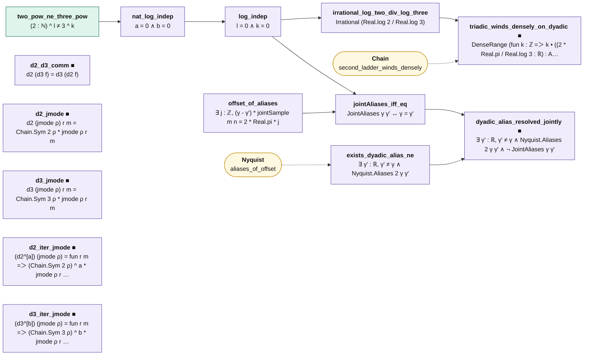

# `lean/JointLadder.lean`

JointLadder — the joint `{2^m 3^n}` grid has NO aliases, and its difference operator carries two Euler factors.

14 theorems, 5 definitions, 435 lines. Arrows are Lean's own record of what each proof uses.

**Imports:** [`Chain`](../lean/Chain.md), [`Nyquist`](../lean/Nyquist.md)  
**Imported by:** nothing

## The picture



An arrow A → B reads "A is used in the proof of B". Green: counting, integers only. Violet: shape, analysis with no ζ. Blue: reads ζ. A name ending in ■ is an end: nothing else uses it. Red: contains `sorry`. Yellow: theorems in another file, counted; a dotted arrow crosses files. Definitions are not drawn; they are listed below the diagram.

## Definitions

<a name="JointLadder-jointSample"></a>
### `JointLadder.jointSample`

def · line 200

The rungs of the joint `{2^m 3^n}` grid, in `log x`.

- **Is:** `` jointSample (m n : ℤ) : ℝ := (m : ℝ) * Real.log 2 + (n : ℝ) * Real.log 3 ``
- **Used by 3:** [`JointLadder.JointAliases`](#JointLadder-JointAliases), [`JointLadder.jointAliases_iff_eq`](#JointLadder-jointAliases_iff_eq), [`JointLadder.offset_of_aliases`](#JointLadder-offset_of_aliases)

<a name="JointLadder-JointAliases"></a>
### `JointLadder.JointAliases`

def · line 206

Indistinguishable on the joint grid. `γ` and `γ'` alias when their modes agree at every rung of `{2^m 3^n}` — the exact analogue of `Nyquist.Aliases`, with the one-parameter ladder replaced by the two-parameter orbit.

- **Is:** `` JointAliases (γ γ' : ℝ) : Prop := ∀ m n : ℤ, Complex.exp ((γ * jointSample m n : ℝ) * Complex.I) = Complex.exp ((γ' * jointSample m n : ℝ) * Complex.I) ``
- **Built from:** [`JointLadder.jointSample`](#JointLadder-jointSample)
- **Used by 3:** [`JointLadder.dyadic_alias_resolved_jointly`](#JointLadder-dyadic_alias_resolved_jointly), [`JointLadder.jointAliases_iff_eq`](#JointLadder-jointAliases_iff_eq), [`JointLadder.offset_of_aliases`](#JointLadder-offset_of_aliases)

<a name="JointLadder-jmode"></a>
### `JointLadder.jmode`

def · line 302

The joint mode: `2^(rρ)·3^(mρ)`, the term a zero contributes on the `{2^m 3^n}` grid.

- **Is:** `` jmode (ρ : ℂ) : ℤ → ℤ → ℂ := fun r m => (2 : ℂ) ^ ((r : ℂ) * ρ) * (3 : ℂ) ^ ((m : ℂ) * ρ) ``
- **Used by 4:** [`JointLadder.d2_iter_jmode`](#JointLadder-d2_iter_jmode), [`JointLadder.d2_jmode`](#JointLadder-d2_jmode), [`JointLadder.d3_iter_jmode`](#JointLadder-d3_iter_jmode), [`JointLadder.d3_jmode`](#JointLadder-d3_jmode)

<a name="JointLadder-d2"></a>
### `JointLadder.d2`

def · line 306

Backward differencing in the dyadic index.

- **Is:** `` d2 (f : ℤ → ℤ → ℂ) : ℤ → ℤ → ℂ := fun r m => f r m - f (r - 1) m ``
- **Used by 3:** [`JointLadder.d2_d3_comm`](#JointLadder-d2_d3_comm), [`JointLadder.d2_iter_jmode`](#JointLadder-d2_iter_jmode), [`JointLadder.d2_jmode`](#JointLadder-d2_jmode)

<a name="JointLadder-d3"></a>
### `JointLadder.d3`

def · line 309

Backward differencing in the triadic index.

- **Is:** `` d3 (f : ℤ → ℤ → ℂ) : ℤ → ℤ → ℂ := fun r m => f r m - f r (m - 1) ``
- **Used by 3:** [`JointLadder.d2_d3_comm`](#JointLadder-d2_d3_comm), [`JointLadder.d3_iter_jmode`](#JointLadder-d3_iter_jmode), [`JointLadder.d3_jmode`](#JointLadder-d3_jmode)

## Theorems

<a name="JointLadder-two_pow_ne_three_pow"></a>
### `JointLadder.two_pow_ne_three_pow`

line 72

**Counting.** Integers only: nothing in its statement or proof, or in anything it rests on, uses analysis or ζ.

**Why.** Parity kills it. A positive power of two is never a power of three: `2 ∣ 2^l` while `2 ∤ 3^k`.

**Proves**

```lean
(2 : ℕ) ^ l ≠ 3 ^ k
```

**Needs** (its hypotheses)

  - `` hl : 0 < l ``

**Fed by:** no theorem of this repo; it stands on Mathlib.

**Feeds** (1 that use it)

  - [`JointLadder.nat_log_indep`](#JointLadder-nat_log_indep) — `` a = 0 ∧ b = 0 ``

<a name="JointLadder-nat_log_indep"></a>
### `JointLadder.nat_log_indep`

line 81

**Shape.** Uses real or complex analysis; nothing in it or beneath it reads ζ.

**Why.** The same, over `ℕ` and in logarithmic form: `a·log 2 = b·log 3` forces `a = b = 0`.

**Proves**

```lean
a = 0 ∧ b = 0
```

**Needs** (its hypotheses)

  - `` h : (a : ℝ) * Real.log 2 = (b : ℝ) * Real.log 3 ``

**Fed by** (1 theorem its proof uses)

  - [`JointLadder.two_pow_ne_three_pow`](#JointLadder-two_pow_ne_three_pow) — `` (2 : ℕ) ^ l ≠ 3 ^ k ``

**Feeds** (1 that use it)

  - [`JointLadder.log_indep`](#JointLadder-log_indep) — `` l = 0 ∧ k = 0 ``

<a name="JointLadder-log_indep"></a>
### `JointLadder.log_indep`

line 111

**Shape.** Uses real or complex analysis; nothing in it or beneath it reads ζ.

**Why.** `log 2` and `log 3` are independent over `ℤ`. This is the fact `Chain.second_ladder_winds_densely` needs to fire at `(2, 3)`, and the fact that closes the joint alias lattice.

**Proves**

```lean
l = 0 ∧ k = 0
```

**Needs** (its hypotheses)

  - `` h : (l : ℝ) * Real.log 2 = (k : ℝ) * Real.log 3 ``

**Fed by** (1 theorem its proof uses)

  - [`JointLadder.nat_log_indep`](#JointLadder-nat_log_indep) — `` a = 0 ∧ b = 0 ``

**Feeds** (2 that use it)

  - [`JointLadder.irrational_log_two_div_log_three`](#JointLadder-irrational_log_two_div_log_three) — `` Irrational (Real.log 2 / Real.log 3) ``
  - [`JointLadder.jointAliases_iff_eq`](#JointLadder-jointAliases_iff_eq) — `` JointAliases γ γ' ↔ γ = γ' ``

<a name="JointLadder-irrational_log_two_div_log_three"></a>
### `JointLadder.irrational_log_two_div_log_three`

line 171

**Shape.** Uses real or complex analysis; nothing in it or beneath it reads ζ.

**Why.** `log 2 / log 3` is irrational. A rational value `p/n` gives `n·log 2 = p·log 3`, which `log_indep` forces to `n = p = 0`, against `n ≠ 0`.

**Proves**

```lean
Irrational (Real.log 2 / Real.log 3)
```

**Fed by** (1 theorem its proof uses)

  - [`JointLadder.log_indep`](#JointLadder-log_indep) — `` l = 0 ∧ k = 0 ``

**Feeds** (1 that use it)

  - [`JointLadder.triadic_winds_densely_on_dyadic`](#JointLadder-triadic_winds_densely_on_dyadic) — `` DenseRange (fun k : ℤ => k • ((2 * Real.pi / Real.log 3 : ℝ) : AddCircle (2 * Real.pi / Real.log 2))) ``

<a name="JointLadder-triadic_winds_densely_on_dyadic"></a>
### `JointLadder.triadic_winds_densely_on_dyadic`

line 190

**Shape.** Uses real or complex analysis; nothing in it or beneath it reads ζ.

**Why.** The triadic ladder winds densely on the dyadic circle. The general theorem, instantiated: the `3`-ladder's period steps around the `2`-ladder's circle never close, so the two ladders share no period at any scale. `Chain.joint_gain_periodic_of_commensurate` is the opposite case — commensurate ladders, whose orbit is finite — and this shows `(2, 3)` is not in it.

**Proves**

```lean
DenseRange (fun k : ℤ => k • ((2 * Real.pi / Real.log 3 : ℝ) : AddCircle (2 * Real.pi / Real.log 2)))
```

**Fed by** (2 theorems its proof uses)

  - [`Chain.second_ladder_winds_densely`](../lean/Chain.md#Chain-second_ladder_winds_densely) (Chain) — `` DenseRange (fun k : ℤ => k • ((2 * Real.pi / Real.log b₂ : ℝ) : AddCircle (2 * Real.pi / Real.log b₁))) ↔ Irrational (Real.log b₁ / Real.log b₂) ``
  - [`JointLadder.irrational_log_two_div_log_three`](#JointLadder-irrational_log_two_div_log_three) — `` Irrational (Real.log 2 / Real.log 3) ``

**Feeds:** nothing. It is an end.

<a name="JointLadder-offset_of_aliases"></a>
### `JointLadder.offset_of_aliases`

line 212

**Shape.** Uses real or complex analysis; nothing in it or beneath it reads ζ.

**Why.** Reading the aliasing relation at a single rung: the phase offset is an integer multiple of `2π`.

**Proves**

```lean
∃ j : ℤ, (γ - γ') * jointSample m n = 2 * Real.pi * j
```

**Needs** (its hypotheses)

  - `` h : JointAliases γ γ' ``
  - `` m n : ℤ ``

**Stated with:** [`JointLadder.JointAliases`](#JointLadder-JointAliases), [`JointLadder.jointSample`](#JointLadder-jointSample)

**Fed by:** no theorem of this repo; it stands on Mathlib and the definitions below.

**Feeds** (1 that use it)

  - [`JointLadder.jointAliases_iff_eq`](#JointLadder-jointAliases_iff_eq) — `` JointAliases γ γ' ↔ γ = γ' ``

<a name="JointLadder-jointAliases_iff_eq"></a>
### `JointLadder.jointAliases_iff_eq`

line 234

**Shape.** Uses real or complex analysis; nothing in it or beneath it reads ζ.

**Why.** THE JOINT NO-GO, in reverse. On the `{2^m 3^n}` grid two frequencies agree at every rung only if they are EQUAL. The grid has no nonzero alias whatsoever — the obstruction that makes `γ₁` unidentifiable from a single integer base does not exist here.

**Proves**

```lean
JointAliases γ γ' ↔ γ = γ'
```

**Needs** (its hypotheses)

  - `` γ γ' : ℝ ``

**Stated with:** [`JointLadder.JointAliases`](#JointLadder-JointAliases)

**Fed by** (2 theorems its proof uses)

  - [`JointLadder.log_indep`](#JointLadder-log_indep) — `` l = 0 ∧ k = 0 ``
  - [`JointLadder.offset_of_aliases`](#JointLadder-offset_of_aliases) — `` ∃ j : ℤ, (γ - γ') * jointSample m n = 2 * Real.pi * j ``

**Definitions its proof touches:** [`JointLadder.jointSample`](#JointLadder-jointSample)

**Feeds** (1 that use it)

  - [`JointLadder.dyadic_alias_resolved_jointly`](#JointLadder-dyadic_alias_resolved_jointly) — `` ∃ γ' : ℝ, γ' ≠ γ ∧ Nyquist.Aliases 2 γ γ' ∧ ¬ JointAliases γ γ' ``

<a name="JointLadder-exists_dyadic_alias_ne"></a>
### `JointLadder.exists_dyadic_alias_ne`

line 267

**Shape.** Uses real or complex analysis; nothing in it or beneath it reads ζ.

**Why.** Every frequency has a dyadic alias distinct from it — the single ladder's obstruction, restated from `Nyquist.aliases_of_offset`.

**Proves**

```lean
∃ γ' : ℝ, γ' ≠ γ ∧ Nyquist.Aliases 2 γ γ'
```

**Needs** (its hypotheses)

  - `` γ : ℝ ``

**Stated with:** [`Nyquist.Aliases`](../lean/Nyquist.md#Nyquist-Aliases)

**Fed by** (1 theorem its proof uses)

  - [`Nyquist.aliases_of_offset`](../lean/Nyquist.md#Nyquist-aliases_of_offset) (Nyquist) — `` Aliases b γ (γ - 2 * π * k / Real.log b) ``

**Feeds** (1 that use it)

  - [`JointLadder.dyadic_alias_resolved_jointly`](#JointLadder-dyadic_alias_resolved_jointly) — `` ∃ γ' : ℝ, γ' ≠ γ ∧ Nyquist.Aliases 2 γ γ' ∧ ¬ JointAliases γ γ' ``

<a name="JointLadder-dyadic_alias_resolved_jointly"></a>
### `JointLadder.dyadic_alias_resolved_jointly`

line 287

**Shape.** Uses real or complex analysis; nothing in it or beneath it reads ζ.

**Why.** THE CONTRAST, AS ONE STATEMENT. For every frequency there is a different frequency that the dyadic ladder cannot separate from it and the joint grid can. This is the precise sense in which the joint instrument is not obstructed by what obstructs the single one, and it is what makes a NULL reading on the joint orbit a statement about the estimator rather than about identifiability.

**Proves**

```lean
∃ γ' : ℝ, γ' ≠ γ ∧ Nyquist.Aliases 2 γ γ' ∧ ¬ JointAliases γ γ'
```

**Needs** (its hypotheses)

  - `` γ : ℝ ``

**Stated with:** [`JointLadder.JointAliases`](#JointLadder-JointAliases), [`Nyquist.Aliases`](../lean/Nyquist.md#Nyquist-Aliases)

**Fed by** (2 theorems its proof uses)

  - [`JointLadder.exists_dyadic_alias_ne`](#JointLadder-exists_dyadic_alias_ne) — `` ∃ γ' : ℝ, γ' ≠ γ ∧ Nyquist.Aliases 2 γ γ' ``
  - [`JointLadder.jointAliases_iff_eq`](#JointLadder-jointAliases_iff_eq) — `` JointAliases γ γ' ↔ γ = γ' ``

**Feeds:** nothing. It is an end.

<a name="JointLadder-d2_d3_comm"></a>
### `JointLadder.d2_d3_comm`

line 313

**Shape.** Uses real or complex analysis; nothing in it or beneath it reads ζ.

**Why.** The two directions commute, so `Δ₂^a Δ₃^b` is well defined regardless of the order the differences are taken in.

**Proves**

```lean
d2 (d3 f) = d3 (d2 f)
```

**Needs** (its hypotheses)

  - `` f : ℤ → ℤ → ℂ ``

**Stated with:** [`JointLadder.d2`](#JointLadder-d2), [`JointLadder.d3`](#JointLadder-d3)

**Fed by:** no theorem of this repo; it stands on Mathlib and the definitions below.

**Feeds:** nothing. It is an end.

<a name="JointLadder-d2_jmode"></a>
### `JointLadder.d2_jmode`

line 319

**Shape.** Uses real or complex analysis; nothing in it or beneath it reads ζ.

**Why.** The dyadic direction carries the Euler factor at 2.

**Proves**

```lean
d2 (jmode ρ) r m = Chain.Sym 2 ρ * jmode ρ r m
```

**Needs** (its hypotheses)

  - `` ρ : ℂ ``
  - `` r m : ℤ ``

**Stated with:** [`Chain.Sym`](../lean/Chain.md#Chain-Sym), [`JointLadder.d2`](#JointLadder-d2), [`JointLadder.jmode`](#JointLadder-jmode)

**Fed by:** no theorem of this repo; it stands on Mathlib and the definitions below.

**Feeds:** nothing. It is an end.

<a name="JointLadder-d3_jmode"></a>
### `JointLadder.d3_jmode`

line 333

**Shape.** Uses real or complex analysis; nothing in it or beneath it reads ζ.

**Why.** The triadic direction carries the Euler factor at 3.

**Proves**

```lean
d3 (jmode ρ) r m = Chain.Sym 3 ρ * jmode ρ r m
```

**Needs** (its hypotheses)

  - `` ρ : ℂ ``
  - `` r m : ℤ ``

**Stated with:** [`Chain.Sym`](../lean/Chain.md#Chain-Sym), [`JointLadder.d3`](#JointLadder-d3), [`JointLadder.jmode`](#JointLadder-jmode)

**Fed by:** no theorem of this repo; it stands on Mathlib and the definitions below.

**Feeds:** nothing. It is an end.

<a name="JointLadder-d2_iter_jmode"></a>
### `JointLadder.d2_iter_jmode`

line 347

**Shape.** Uses real or complex analysis; nothing in it or beneath it reads ζ.

**Why.** Iterating the dyadic direction.

**Proves**

```lean
(d2^[a]) (jmode ρ) = fun r m => (Chain.Sym 2 ρ) ^ a * jmode ρ r m
```

**Needs** (its hypotheses)

  - `` ρ : ℂ ``
  - `` a : ℕ ``

**Stated with:** [`Chain.Sym`](../lean/Chain.md#Chain-Sym), [`JointLadder.d2`](#JointLadder-d2), [`JointLadder.jmode`](#JointLadder-jmode)

**Fed by:** no theorem of this repo; it stands on Mathlib and the definitions below.

**Feeds:** nothing. It is an end.

<a name="JointLadder-d3_iter_jmode"></a>
### `JointLadder.d3_iter_jmode`

line 366

**Shape.** Uses real or complex analysis; nothing in it or beneath it reads ζ.

**Why.** Iterating the triadic direction.

**Proves**

```lean
(d3^[b]) (jmode ρ) = fun r m => (Chain.Sym 3 ρ) ^ b * jmode ρ r m
```

**Needs** (its hypotheses)

  - `` ρ : ℂ ``
  - `` b : ℕ ``

**Stated with:** [`Chain.Sym`](../lean/Chain.md#Chain-Sym), [`JointLadder.d3`](#JointLadder-d3), [`JointLadder.jmode`](#JointLadder-jmode)

**Fed by:** no theorem of this repo; it stands on Mathlib and the definitions below.

**Feeds:** nothing. It is an end.

