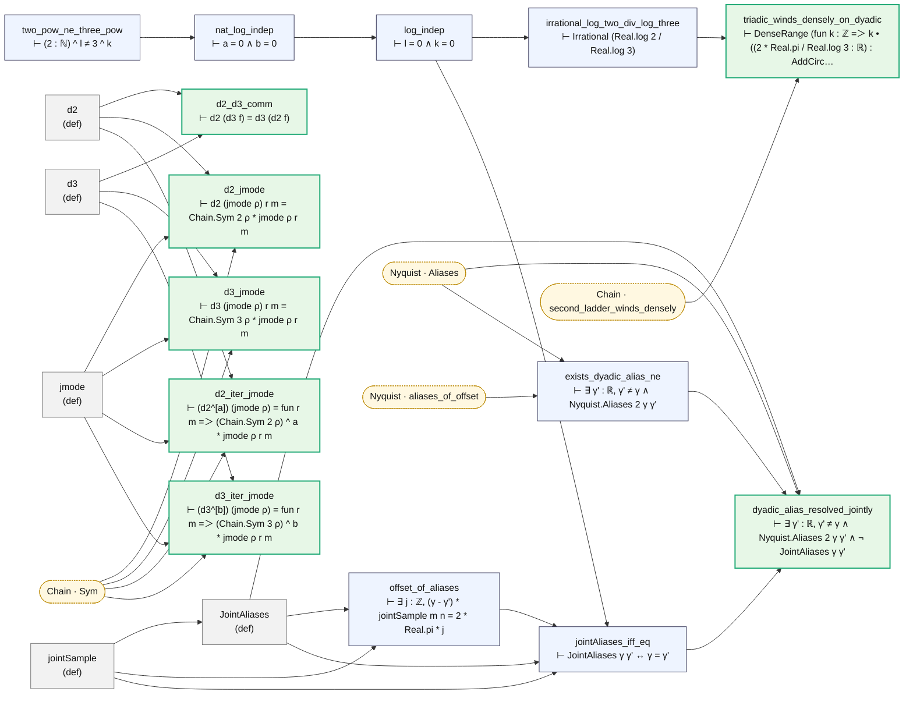

# `lean/JointLadder.lean`

**What it does** (its own header): JointLadder — the joint `{2^m 3^n}` grid has NO aliases, and its difference operator carries two Euler factors.

**Imports:** [`Chain`](../lean/Chain.md), [`Nyquist`](../lean/Nyquist.md).
**Imported by:** nothing.

Blue: theorem. Green: a theorem nothing else uses (an end). Dashed white: connects to nothing. Grey: definition. Red: contains `sorry`. Yellow: in another file. An arrow A → B reads "A is used by B".

## Every declaration

| declaration | proves (output) | needs (input) | why (its own docstring) | uses | used by |
|---|---|---|---|---|---|
| `JointLadder.two_pow_ne_three_pow` theorem, line 72 | (2 : ℕ) ^ l ≠ 3 ^ k | hl : 0 &lt; l | Parity kills it. A positive power of two is never a power of three: `2 ∣ 2^l` while `2 ∤ 3^k`. | — | `JointLadder.nat_log_indep` |
| `JointLadder.nat_log_indep` theorem, line 81 | a = 0 ∧ b = 0 | h : (a : ℝ) * Real.log 2 = (b : ℝ) * Real.log 3 | The same, over `ℕ` and in logarithmic form: `a·log 2 = b·log 3` forces `a = b = 0`. | `JointLadder.two_pow_ne_three_pow` | `JointLadder.log_indep` |
| `JointLadder.log_indep` theorem, line 111 | l = 0 ∧ k = 0 | h : (l : ℝ) * Real.log 2 = (k : ℝ) * Real.log 3 | `log 2` and `log 3` are independent over `ℤ`. This is the fact `Chain.second_ladder_winds_densely` needs to fire at `(2, 3)`, and the fact that closes the joint alias lattice. | `JointLadder.nat_log_indep` | `JointLadder.irrational_log_two_div_log_three`, `JointLadder.jointAliases_iff_eq` |
| `JointLadder.irrational_log_two_div_log_three` theorem, line 171 | Irrational (Real.log 2 / Real.log 3) | — | `log 2 / log 3` is irrational. A rational value `p/n` gives `n·log 2 = p·log 3`, which `log_indep` forces to `n = p = 0`, against `n ≠ 0`. | `JointLadder.log_indep` | `JointLadder.triadic_winds_densely_on_dyadic` |
| `JointLadder.triadic_winds_densely_on_dyadic` theorem, line 190 | DenseRange (fun k : ℤ =&gt; k • ((2 * Real.pi / Real.log 3 : ℝ) : AddCircle (2 * Real.pi / Real.log 2))) | — | The triadic ladder winds densely on the dyadic circle. The general theorem, instantiated: the `3`-ladder's period steps around the `2`-ladder's circle never close, so the two ladders share no period at any scale. `Chain.joint_gain_periodic_of_commensurate` is the opposite case — commensurate ladders, whose orbit is finite — and this shows `(2, 3)` is not in … | `Chain.second_ladder_winds_densely`, `JointLadder.irrational_log_two_div_log_three` | — |
| `JointLadder.jointSample` def, line 200 | ℝ | m n : ℤ | The rungs of the joint `{2^m 3^n}` grid, in `log x`. | — | `JointLadder.JointAliases`, `JointLadder.jointAliases_iff_eq`, `JointLadder.offset_of_aliases` |
| `JointLadder.JointAliases` def, line 206 | Prop | γ γ' : ℝ | Indistinguishable on the joint grid. `γ` and `γ'` alias when their modes agree at every rung of `{2^m 3^n}` — the exact analogue of `Nyquist.Aliases`, with the one-parameter ladder replaced by the two-parameter orbit. | `JointLadder.jointSample` | `JointLadder.dyadic_alias_resolved_jointly`, `JointLadder.jointAliases_iff_eq`, `JointLadder.offset_of_aliases` |
| `JointLadder.offset_of_aliases` theorem, line 212 | ∃ j : ℤ, (γ - γ') * jointSample m n = 2 * Real.pi * j | h : JointAliases γ γ'; m n : ℤ | Reading the aliasing relation at a single rung: the phase offset is an integer multiple of `2π`. | `JointLadder.JointAliases`, `JointLadder.jointSample` | `JointLadder.jointAliases_iff_eq` |
| `JointLadder.jointAliases_iff_eq` theorem, line 234 | JointAliases γ γ' ↔ γ = γ' | γ γ' : ℝ | THE JOINT NO-GO, in reverse. On the `{2^m 3^n}` grid two frequencies agree at every rung only if they are EQUAL. The grid has no nonzero alias whatsoever — the obstruction that makes `γ₁` unidentifiable from a single integer base does not exist here. | `JointLadder.JointAliases`, `JointLadder.jointSample`, `JointLadder.log_indep`, `JointLadder.offset_of_aliases` | `JointLadder.dyadic_alias_resolved_jointly` |
| `JointLadder.exists_dyadic_alias_ne` theorem, line 267 | ∃ γ' : ℝ, γ' ≠ γ ∧ Nyquist.Aliases 2 γ γ' | γ : ℝ | Every frequency has a dyadic alias distinct from it — the single ladder's obstruction, restated from `Nyquist.aliases_of_offset`. | `Nyquist.Aliases`, `Nyquist.aliases_of_offset` | `JointLadder.dyadic_alias_resolved_jointly` |
| `JointLadder.dyadic_alias_resolved_jointly` theorem, line 287 | ∃ γ' : ℝ, γ' ≠ γ ∧ Nyquist.Aliases 2 γ γ' ∧ ¬ JointAliases γ γ' | γ : ℝ | THE CONTRAST, AS ONE STATEMENT. For every frequency there is a different frequency that the dyadic ladder cannot separate from it and the joint grid can. This is the precise sense in which the joint instrument is not obstructed by what obstructs the single one, and it is what makes a NULL reading on the joint orbit a statement about the estimator rather than… | `JointLadder.JointAliases`, `JointLadder.exists_dyadic_alias_ne`, `JointLadder.jointAliases_iff_eq`, `Nyquist.Aliases` | — |
| `JointLadder.jmode` def, line 302 | ℤ → ℤ → ℂ | ρ : ℂ | The joint mode: `2^(rρ)·3^(mρ)`, the term a zero contributes on the `{2^m 3^n}` grid. | — | `JointLadder.d2_iter_jmode`, `JointLadder.d2_jmode`, `JointLadder.d3_iter_jmode`, `JointLadder.d3_jmode` |
| `JointLadder.d2` def, line 306 | ℤ → ℤ → ℂ | f : ℤ → ℤ → ℂ | Backward differencing in the dyadic index. | — | `JointLadder.d2_d3_comm`, `JointLadder.d2_iter_jmode`, `JointLadder.d2_jmode` |
| `JointLadder.d3` def, line 309 | ℤ → ℤ → ℂ | f : ℤ → ℤ → ℂ | Backward differencing in the triadic index. | — | `JointLadder.d2_d3_comm`, `JointLadder.d3_iter_jmode`, `JointLadder.d3_jmode` |
| `JointLadder.d2_d3_comm` theorem, line 313 | d2 (d3 f) = d3 (d2 f) | f : ℤ → ℤ → ℂ | The two directions commute, so `Δ₂^a Δ₃^b` is well defined regardless of the order the differences are taken in. | `JointLadder.d2`, `JointLadder.d3` | — |
| `JointLadder.d2_jmode` theorem, line 319 | d2 (jmode ρ) r m = Chain.Sym 2 ρ * jmode ρ r m | ρ : ℂ; r m : ℤ | The dyadic direction carries the Euler factor at 2. | `Chain.Sym`, `JointLadder.d2`, `JointLadder.jmode` | — |
| `JointLadder.d3_jmode` theorem, line 333 | d3 (jmode ρ) r m = Chain.Sym 3 ρ * jmode ρ r m | ρ : ℂ; r m : ℤ | The triadic direction carries the Euler factor at 3. | `Chain.Sym`, `JointLadder.d3`, `JointLadder.jmode` | — |
| `JointLadder.d2_iter_jmode` theorem, line 347 | (d2^[a]) (jmode ρ) = fun r m =&gt; (Chain.Sym 2 ρ) ^ a * jmode ρ r m | ρ : ℂ; a : ℕ | Iterating the dyadic direction. | `Chain.Sym`, `JointLadder.d2`, `JointLadder.jmode` | — |
| `JointLadder.d3_iter_jmode` theorem, line 366 | (d3^[b]) (jmode ρ) = fun r m =&gt; (Chain.Sym 3 ρ) ^ b * jmode ρ r m | ρ : ℂ; b : ℕ | Iterating the triadic direction. | `Chain.Sym`, `JointLadder.d3`, `JointLadder.jmode` | — |
