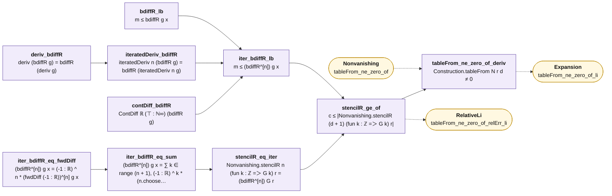

# `lean/MainTerm.lean`

MainTerm — stage 2: the difference calculus that discharges hM's structure. `Nonvanishing.lean` proved the arrow of O67's theorem with three named hypotheses. This module attacks `hM` — the main-term floor `Mlow ≤ |stencil of li|` — by formalising the calculus O67 verified numerically: the MVT step, replaced by something better.

10 theorems, 1 definition, 258 lines. Arrows are Lean's own record of what each proof uses.

**Imports:** [`Nonvanishing`](../lean/Nonvanishing.md)  
**Imported by:** [`Expansion`](../lean/Expansion.md)

## The picture



An arrow A → B reads "A is used in the proof of B". Green: counting, integers only. Violet: shape, analysis with no ζ. Blue: reads ζ. A name ending in ■ is an end: nothing else uses it. Red: contains `sorry`. Yellow: theorems in another file, counted; a dotted arrow crosses files. Definitions are not drawn; they are listed below the diagram.

## Definitions

<a name="MainTerm-bdiffR"></a>
### `MainTerm.bdiffR`

def · line 58

Unit backward differencing on real functions of a real variable.

- **Is:** `` bdiffR (g : ℝ → ℝ) : ℝ → ℝ := fun x => g x - g (x - 1) ``
- **Used by 9:** [`MainTerm.bdiffR_lb`](#MainTerm-bdiffR_lb), [`MainTerm.contDiff_bdiffR`](#MainTerm-contDiff_bdiffR), [`MainTerm.deriv_bdiffR`](#MainTerm-deriv_bdiffR), [`MainTerm.iter_bdiffR_eq_fwdDiff`](#MainTerm-iter_bdiffR_eq_fwdDiff), [`MainTerm.iter_bdiffR_eq_sum`](#MainTerm-iter_bdiffR_eq_sum), [`MainTerm.iter_bdiffR_lb`](#MainTerm-iter_bdiffR_lb), [`MainTerm.iteratedDeriv_bdiffR`](#MainTerm-iteratedDeriv_bdiffR), [`MainTerm.stencilR_eq_iter`](#MainTerm-stencilR_eq_iter), [`MainTerm.stencilR_ge_of`](#MainTerm-stencilR_ge_of)

## Theorems

<a name="MainTerm-iter_bdiffR_eq_fwdDiff"></a>
### `MainTerm.iter_bdiffR_eq_fwdDiff`

line 61

**Shape.** Uses real or complex analysis; nothing in it or beneath it reads ζ.

**Why.** The ℝ-domain twin of `Nonvanishing.iter_bdiffZ_eq_fwdDiff`.

**Proves**

```lean
(bdiffR^[n]) g x = (-1 : ℝ) ^ n * (fwdDiff (-1 : ℝ))^[n] g x
```

**Needs** (its hypotheses)

  - `` g : ℝ → ℝ ``
  - `` x : ℝ ``
  - `` n : ℕ ``

**Stated with:** [`MainTerm.bdiffR`](#MainTerm-bdiffR)

**Fed by:** no theorem of this repo; it stands on Mathlib and the definitions below.

**Feeds** (1 that use it)

  - [`MainTerm.iter_bdiffR_eq_sum`](#MainTerm-iter_bdiffR_eq_sum) — `` (bdiffR^[n]) g x = ∑ k ∈ range (n + 1), (-1 : ℝ) ^ k * (n.choose k) * g (x - k) ``

<a name="MainTerm-iter_bdiffR_eq_sum"></a>
### `MainTerm.iter_bdiffR_eq_sum`

line 76

**Shape.** Uses real or complex analysis; nothing in it or beneath it reads ζ.

**Why.** `n` unit differences are the stencil, on the real line. At an integer point this meets `Nonvanishing.stencilR` (the bridge below).

**Proves**

```lean
(bdiffR^[n]) g x = ∑ k ∈ range (n + 1), (-1 : ℝ) ^ k * (n.choose k) * g (x - k)
```

**Needs** (its hypotheses)

  - `` g : ℝ → ℝ ``
  - `` x : ℝ ``
  - `` n : ℕ ``

**Stated with:** [`MainTerm.bdiffR`](#MainTerm-bdiffR)

**Fed by** (1 theorem its proof uses)

  - [`MainTerm.iter_bdiffR_eq_fwdDiff`](#MainTerm-iter_bdiffR_eq_fwdDiff) — `` (bdiffR^[n]) g x = (-1 : ℝ) ^ n * (fwdDiff (-1 : ℝ))^[n] g x ``

**Feeds** (1 that use it)

  - [`MainTerm.stencilR_eq_iter`](#MainTerm-stencilR_eq_iter) — `` Nonvanishing.stencilR n (fun k : ℤ => G k) r = (bdiffR^[n]) G r ``

<a name="MainTerm-stencilR_eq_iter"></a>
### `MainTerm.stencilR_eq_iter`

line 94

**Shape.** Uses real or complex analysis; nothing in it or beneath it reads ζ.

**Why.** The bridge to `Nonvanishing.stencilR`. At an integer point, the real iterate reads the same values the ℤ-indexed stencil reads.

**Proves**

```lean
Nonvanishing.stencilR n (fun k : ℤ => G k) r = (bdiffR^[n]) G r
```

**Needs** (its hypotheses)

  - `` G : ℝ → ℝ ``
  - `` r : ℤ ``
  - `` n : ℕ ``

**Stated with:** [`MainTerm.bdiffR`](#MainTerm-bdiffR), [`Nonvanishing.stencilR`](../lean/Nonvanishing.md#Nonvanishing-stencilR)

**Fed by** (1 theorem its proof uses)

  - [`MainTerm.iter_bdiffR_eq_sum`](#MainTerm-iter_bdiffR_eq_sum) — `` (bdiffR^[n]) g x = ∑ k ∈ range (n + 1), (-1 : ℝ) ^ k * (n.choose k) * g (x - k) ``

**Feeds** (1 that use it)

  - [`MainTerm.stencilR_ge_of`](#MainTerm-stencilR_ge_of) — `` c ≤ |Nonvanishing.stencilR (d + 1) (fun k : ℤ => G k) r| ``

<a name="MainTerm-deriv_bdiffR"></a>
### `MainTerm.deriv_bdiffR`

line 104

**Shape.** Uses real or complex analysis; nothing in it or beneath it reads ζ.

**Why.** Δ commutes with d/dx. Needs differentiability of `g`; the shift is `HasDerivAt.comp` with `x ↦ x − 1`.

**Proves**

```lean
deriv (bdiffR g) = bdiffR (deriv g)
```

**Needs** (its hypotheses)

  - `` hg : Differentiable ℝ g ``

**Stated with:** [`MainTerm.bdiffR`](#MainTerm-bdiffR)

**Fed by:** no theorem of this repo; it stands on Mathlib and the definitions below.

**Feeds** (1 that use it)

  - [`MainTerm.iteratedDeriv_bdiffR`](#MainTerm-iteratedDeriv_bdiffR) — `` iteratedDeriv n (bdiffR g) = bdiffR (iteratedDeriv n g) ``

<a name="MainTerm-contDiff_bdiffR"></a>
### `MainTerm.contDiff_bdiffR`

line 116

**Shape.** Uses real or complex analysis; nothing in it or beneath it reads ζ.

**Why.** Δ preserves smoothness.

**Proves**

```lean
ContDiff ℝ (⊤ : ℕ∞) (bdiffR g)
```

**Needs** (its hypotheses)

  - `` hg : ContDiff ℝ (⊤ : ℕ∞) g ``

**Stated with:** [`MainTerm.bdiffR`](#MainTerm-bdiffR)

**Fed by:** no theorem of this repo; it stands on Mathlib and the definitions below.

**Feeds** (1 that use it)

  - [`MainTerm.iter_bdiffR_lb`](#MainTerm-iter_bdiffR_lb) — `` m ≤ (bdiffR^[n]) g x ``

<a name="MainTerm-iteratedDeriv_bdiffR"></a>
### `MainTerm.iteratedDeriv_bdiffR`

line 121

**Shape.** Uses real or complex analysis; nothing in it or beneath it reads ζ.

**Why.** Δ commutes with iterated derivatives.

**Proves**

```lean
iteratedDeriv n (bdiffR g) = bdiffR (iteratedDeriv n g)
```

**Needs** (its hypotheses)

  - `` hg : ContDiff ℝ (⊤ : ℕ∞) g ``
  - `` n : ℕ ``

**Stated with:** [`MainTerm.bdiffR`](#MainTerm-bdiffR)

**Fed by** (1 theorem its proof uses)

  - [`MainTerm.deriv_bdiffR`](#MainTerm-deriv_bdiffR) — `` deriv (bdiffR g) = bdiffR (deriv g) ``

**Feeds** (1 that use it)

  - [`MainTerm.iter_bdiffR_lb`](#MainTerm-iter_bdiffR_lb) — `` m ≤ (bdiffR^[n]) g x ``

<a name="MainTerm-bdiffR_lb"></a>
### `MainTerm.bdiffR_lb`

line 132

**Shape.** Uses real or complex analysis; nothing in it or beneath it reads ζ.

**Why.** The single step: derivative floor ⟹ difference floor. Shift by `m·y` and cite monotonicity-from-derivative on `[x−1, x]`.

**Proves**

```lean
m ≤ bdiffR g x
```

**Needs** (its hypotheses)

  - `` hg : Differentiable ℝ g ``
  - `` hm : ∀ y ∈ Icc (x - 1) x, m ≤ deriv g y ``

**Stated with:** [`MainTerm.bdiffR`](#MainTerm-bdiffR)

**Fed by:** no theorem of this repo; it stands on Mathlib and the definitions below.

**Feeds** (1 that use it)

  - [`MainTerm.iter_bdiffR_lb`](#MainTerm-iter_bdiffR_lb) — `` m ≤ (bdiffR^[n]) g x ``

<a name="MainTerm-iter_bdiffR_lb"></a>
### `MainTerm.iter_bdiffR_lb`

line 158

**Shape.** Uses real or complex analysis; nothing in it or beneath it reads ζ.

**Why.** The induction: MVT retired. If the `n`-th derivative clears `m` on `[x−n, x]`, the `n`-fold difference does.

**Proves**

```lean
m ≤ (bdiffR^[n]) g x
```

**Needs** (its hypotheses)

  - `` hg : ContDiff ℝ (⊤ : ℕ∞) g ``
  - `` n : ℕ ``
  - `` x : ℝ ``
  - `` hm : ∀ y ∈ Icc (x - n) x, m ≤ iteratedDeriv n g y ``

**Stated with:** [`MainTerm.bdiffR`](#MainTerm-bdiffR)

**Fed by** (3 theorems its proof uses)

  - [`MainTerm.bdiffR_lb`](#MainTerm-bdiffR_lb) — `` m ≤ bdiffR g x ``
  - [`MainTerm.contDiff_bdiffR`](#MainTerm-contDiff_bdiffR) — `` ContDiff ℝ (⊤ : ℕ∞) (bdiffR g) ``
  - [`MainTerm.iteratedDeriv_bdiffR`](#MainTerm-iteratedDeriv_bdiffR) — `` iteratedDeriv n (bdiffR g) = bdiffR (iteratedDeriv n g) ``

**Feeds** (1 that use it)

  - [`MainTerm.stencilR_ge_of`](#MainTerm-stencilR_ge_of) — `` c ≤ |Nonvanishing.stencilR (d + 1) (fun k : ℤ => G k) r| ``

<a name="MainTerm-stencilR_ge_of"></a>
### `MainTerm.stencilR_ge_of`

line 185

**Shape.** Uses real or complex analysis; nothing in it or beneath it reads ζ.

**Why.** The floor, on the stencil. If the `(d+1)`-th derivative of the interpolant clears `c > 0` on the window, the stencil clears `c` — and hence its absolute value does, which is `hM`'s shape.

**Proves**

```lean
c ≤ |Nonvanishing.stencilR (d + 1) (fun k : ℤ => G k) r|
```

**Needs** (its hypotheses)

  - `` hG : ContDiff ℝ (⊤ : ℕ∞) G ``
  - `` hD : ∀ y ∈ Icc ((r : ℝ) - (d + 1)) r, c ≤ iteratedDeriv (d + 1) G y ``

**Stated with:** [`Nonvanishing.stencilR`](../lean/Nonvanishing.md#Nonvanishing-stencilR)

**Fed by** (2 theorems its proof uses)

  - [`MainTerm.iter_bdiffR_lb`](#MainTerm-iter_bdiffR_lb) — `` m ≤ (bdiffR^[n]) g x ``
  - [`MainTerm.stencilR_eq_iter`](#MainTerm-stencilR_eq_iter) — `` Nonvanishing.stencilR n (fun k : ℤ => G k) r = (bdiffR^[n]) G r ``

**Definitions its proof touches:** [`MainTerm.bdiffR`](#MainTerm-bdiffR)

**Feeds** (2 that use it)

  - [`MainTerm.tableFrom_ne_zero_of_deriv`](#MainTerm-tableFrom_ne_zero_of_deriv) — `` Construction.tableFrom N r d ≠ 0 ``
  - [`RelativeLi.tableFrom_ne_zero_of_relErr_li`](../lean/RelativeLi.md#RelativeLi-tableFrom_ne_zero_of_relErr_li) (RelativeLi) — `` Construction.tableFrom N r d ≠ 0 ``

<a name="MainTerm-tableFrom_ne_zero_of_deriv"></a>
### `MainTerm.tableFrom_ne_zero_of_deriv`

line 198

**Shape.** Uses real or complex analysis; nothing in it or beneath it reads ζ.

**Why.** The arrow, with hM discharged into a derivative bound. `Nonvanishing.tableFrom_ne_zero_of` again, but the main-term hypothesis is now about the `(d+1)`-th derivative of a smooth interpolant of li — the difference calculus between them is proved. What remains: the expansion of that derivative (stage 2b) and Schoenfeld (stage 3).

**Proves**

```lean
Construction.tableFrom N r d ≠ 0
```

**Needs** (its hypotheses)

  - `` hG : ContDiff ℝ (⊤ : ℕ∞) G ``
  - `` hrow : ∀ k ∈ range (d + 2), ((N (r - k) : ℤ) : ℝ) = Nonvanishing.bdiffZ f (r - k) ``
  - `` hr : ((d + 1 : ℕ) : ℤ) ≤ r ``
  - `` hS : Nonvanishing.StmtSchoenfeldWindow f (fun k : ℤ => G k) r (d + 1) ``
  - `` hD : ∀ y ∈ Icc ((r : ℝ) - (d + 1)) r, Nonvanishing.Mlow r d ≤ iteratedDeriv (d + 1) G y ``
  - `` hgap : Nonvanishing.Ehigh r (d + 1) < Nonvanishing.Mlow r d ``

**Stated with:** [`Construction.tableFrom`](../lean/Construction.md#Construction-tableFrom), [`Nonvanishing.Ehigh`](../lean/Nonvanishing.md#Nonvanishing-Ehigh), [`Nonvanishing.Mlow`](../lean/Nonvanishing.md#Nonvanishing-Mlow), [`Nonvanishing.StmtSchoenfeldWindow`](../lean/Nonvanishing.md#Nonvanishing-StmtSchoenfeldWindow), [`Nonvanishing.bdiffZ`](../lean/Nonvanishing.md#Nonvanishing-bdiffZ)

**Fed by** (2 theorems its proof uses)

  - [`MainTerm.stencilR_ge_of`](#MainTerm-stencilR_ge_of) — `` c ≤ |Nonvanishing.stencilR (d + 1) (fun k : ℤ => G k) r| ``
  - [`Nonvanishing.tableFrom_ne_zero_of`](../lean/Nonvanishing.md#Nonvanishing-tableFrom_ne_zero_of) (Nonvanishing) — `` Construction.tableFrom N r d ≠ 0 ``

**Feeds** (1 that use it)

  - [`Expansion.tableFrom_ne_zero_of_li`](../lean/Expansion.md#Expansion-tableFrom_ne_zero_of_li) (Expansion) — `` Construction.tableFrom N r d ≠ 0 ``

