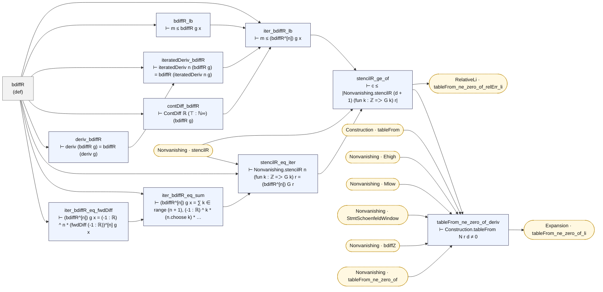

# `lean/MainTerm.lean`

**What it does** (its own header): MainTerm — stage 2: the difference calculus that discharges hM's structure. `Nonvanishing.lean` proved the arrow of O67's theorem with three named hypotheses. This module attacks `hM` — the main-term floor `Mlow ≤ |stencil of li|` — by formalising the calculus O67 verified numerically: the MVT step, replaced by something better.

**Imports:** [`Nonvanishing`](../lean/Nonvanishing.md).
**Imported by:** [`Expansion`](../lean/Expansion.md).

Blue: theorem. Green: a theorem nothing else uses (an end). Dashed white: connects to nothing. Grey: definition. Red: contains `sorry`. Yellow: in another file. An arrow A → B reads "A is used by B".

## Every declaration

| declaration | proves (output) | needs (input) | why (its own docstring) | uses | used by |
|---|---|---|---|---|---|
| `MainTerm.bdiffR` def, line 58 | ℝ → ℝ | g : ℝ → ℝ | Unit backward differencing on real functions of a real variable. | — | `MainTerm.bdiffR_lb`, `MainTerm.contDiff_bdiffR`, `MainTerm.deriv_bdiffR`, `MainTerm.iter_bdiffR_eq_fwdDiff`, `MainTerm.iter_bdiffR_eq_sum`, `MainTerm.iter_bdiffR_lb`, `MainTerm.iteratedDeriv_bdiffR`, `MainTerm.stencilR_eq_iter` |
| `MainTerm.iter_bdiffR_eq_fwdDiff` theorem, line 61 | (bdiffR^[n]) g x = (-1 : ℝ) ^ n * (fwdDiff (-1 : ℝ))^[n] g x | g : ℝ → ℝ; x : ℝ; n : ℕ | The ℝ-domain twin of `Nonvanishing.iter_bdiffZ_eq_fwdDiff`. | `MainTerm.bdiffR` | `MainTerm.iter_bdiffR_eq_sum` |
| `MainTerm.iter_bdiffR_eq_sum` theorem, line 76 | (bdiffR^[n]) g x = ∑ k ∈ range (n + 1), (-1 : ℝ) ^ k * (n.choose k) * g (x - k) | g : ℝ → ℝ; x : ℝ; n : ℕ | `n` unit differences are the stencil, on the real line. At an integer point this meets `Nonvanishing.stencilR` (the bridge below). | `MainTerm.bdiffR`, `MainTerm.iter_bdiffR_eq_fwdDiff` | `MainTerm.stencilR_eq_iter` |
| `MainTerm.stencilR_eq_iter` theorem, line 94 | Nonvanishing.stencilR n (fun k : ℤ =&gt; G k) r = (bdiffR^[n]) G r | G : ℝ → ℝ; r : ℤ; n : ℕ | The bridge to `Nonvanishing.stencilR`. At an integer point, the real iterate reads the same values the ℤ-indexed stencil reads. | `MainTerm.bdiffR`, `MainTerm.iter_bdiffR_eq_sum`, `Nonvanishing.stencilR` | `MainTerm.stencilR_ge_of` |
| `MainTerm.deriv_bdiffR` theorem, line 104 | deriv (bdiffR g) = bdiffR (deriv g) | hg : Differentiable ℝ g | Δ commutes with d/dx. Needs differentiability of `g`; the shift is `HasDerivAt.comp` with `x ↦ x − 1`. | `MainTerm.bdiffR` | `MainTerm.iteratedDeriv_bdiffR` |
| `MainTerm.contDiff_bdiffR` theorem, line 116 | ContDiff ℝ (⊤ : ℕ∞) (bdiffR g) | hg : ContDiff ℝ (⊤ : ℕ∞) g | Δ preserves smoothness. | `MainTerm.bdiffR` | `MainTerm.iter_bdiffR_lb` |
| `MainTerm.iteratedDeriv_bdiffR` theorem, line 121 | iteratedDeriv n (bdiffR g) = bdiffR (iteratedDeriv n g) | hg : ContDiff ℝ (⊤ : ℕ∞) g; n : ℕ | Δ commutes with iterated derivatives. | `MainTerm.bdiffR`, `MainTerm.deriv_bdiffR` | `MainTerm.iter_bdiffR_lb` |
| `MainTerm.bdiffR_lb` theorem, line 132 | m ≤ bdiffR g x | hg : Differentiable ℝ g; hm : ∀ y ∈ Icc (x - 1) x, m ≤ deriv g y | The single step: derivative floor ⟹ difference floor. Shift by `m·y` and cite monotonicity-from-derivative on `[x−1, x]`. | `MainTerm.bdiffR` | `MainTerm.iter_bdiffR_lb` |
| `MainTerm.iter_bdiffR_lb` theorem, line 158 | m ≤ (bdiffR^[n]) g x | hg : ContDiff ℝ (⊤ : ℕ∞) g; n : ℕ; x : ℝ; hm : ∀ y ∈ Icc (x - n) x, m ≤ iteratedDeriv n g y | The induction: MVT retired. If the `n`-th derivative clears `m` on `[x−n, x]`, the `n`-fold difference does. | `MainTerm.bdiffR`, `MainTerm.bdiffR_lb`, `MainTerm.contDiff_bdiffR`, `MainTerm.iteratedDeriv_bdiffR` | `MainTerm.stencilR_ge_of` |
| `MainTerm.stencilR_ge_of` theorem, line 185 | c ≤ \|Nonvanishing.stencilR (d + 1) (fun k : ℤ =&gt; G k) r\| | hG : ContDiff ℝ (⊤ : ℕ∞) G; hD : ∀ y ∈ Icc ((r : ℝ) - (d + 1)) r, c ≤ iteratedDeriv (d + 1) G y | The floor, on the stencil. If the `(d+1)`-th derivative of the interpolant clears `c &gt; 0` on the window, the stencil clears `c` — and hence its absolute value does, which is `hM`'s shape. | `MainTerm.iter_bdiffR_lb`, `MainTerm.stencilR_eq_iter`, `Nonvanishing.stencilR` | `MainTerm.tableFrom_ne_zero_of_deriv`, `RelativeLi.tableFrom_ne_zero_of_relErr_li` |
| `MainTerm.tableFrom_ne_zero_of_deriv` theorem, line 198 | Construction.tableFrom N r d ≠ 0 | hG : ContDiff ℝ (⊤ : ℕ∞) G; hrow : ∀ k ∈ range (d + 2), ((N (r - k) : ℤ) : ℝ) = Nonvanishing.bdiffZ f (r - k); hr : ((d + 1 : ℕ) : ℤ) ≤ r; hS : Nonvanishing.StmtSchoenfeldWindow f (fun k : ℤ =&gt; G k) r (d + 1); hD : ∀ y ∈ Icc ((r : ℝ) - (d + 1)) r, Nonvanishing.Mlow r d ≤ iteratedDeriv (d + 1) G y; hgap : Nonvanishing.Ehigh r (d + 1) &lt; Nonvanishing.Mlow r d | The arrow, with hM discharged into a derivative bound. `Nonvanishing.tableFrom_ne_zero_of` again, but the main-term hypothesis is now about the `(d+1)`-th derivative of a smooth interpolant of li — the difference calculus between them is proved. What remains: the expansion of that derivative (stage 2b) and Schoenfeld (stage 3). | `Construction.tableFrom`, `MainTerm.stencilR_ge_of`, `Nonvanishing.Ehigh`, `Nonvanishing.Mlow`, `Nonvanishing.StmtSchoenfeldWindow`, `Nonvanishing.bdiffZ`, `Nonvanishing.tableFrom_ne_zero_of` | `Expansion.tableFrom_ne_zero_of_li` |
