# `lean/Measured.lean`

**What it does** (its own header): The chain's numbers, as a Lean object. Third layer of `lean/`. Not a proof file — a RECORD file with checkable numeric relations.

**Imports:** [`Chain`](../lean/Chain.md).
**Imported by:** nothing.

```mermaid
flowchart LR
  n0["predicted_radius_smooth<br/>(def)"]:::dfn
  n1["predicted_radius_resid<br/>(def)"]:::dfn
  n2["measured_radius_smooth<br/>(def)"]:::dfn
  n3["measured_radius_resid<br/>(def)"]:::dfn
  n4["measured_offset_smooth<br/>(def)"]:::dfn
  n5["measured_offset_resid<br/>(def)"]:::dfn
  n6["agreement_offsets_match<br/>⊢ |measured_offset_smooth - measured_offset_resid| ＜ 0.001"]:::end_
  n7["agreement_radius_smooth<br/>⊢ |measured_radius_smooth - 0.5 * (1 + measured_offset_smooth)| ＜ 1e-9"]:::end_
  n8["predicted_rank_11a1<br/>(def)"]:::dfn
  n9["predicted_rank_37a1<br/>(def)"]:::dfn
  n10["predicted_rank_389a1<br/>(def)"]:::dfn
  n11["measured_rank_11a1<br/>(def)"]:::dfn
  n12["measured_rank_37a1<br/>(def)"]:::dfn
  n13["measured_rank_389a1<br/>(def)"]:::dfn
  n14["agreement_rank_11a1<br/>⊢ |measured_rank_11a1 - predicted_rank_11a1| ＜ 0.05"]:::end_
  n15["agreement_rank_389a1<br/>⊢ |measured_rank_389a1 - predicted_rank_389a1| ＜ 0.01"]:::end_
  n16["agreement_rank_37a1<br/>⊢ |measured_rank_37a1 - predicted_rank_37a1| ＜ 0.3"]:::end_
  n17["predicted_elliptic_re<br/>(def)"]:::dfn
  n18["measured_elliptic_max_dev<br/>(def)"]:::dfn
  n19["agreement_elliptic<br/>⊢ measured_elliptic_max_dev ＜ 1e-15"]:::end_
  n20["measured_weil_arithmetic<br/>(def)"]:::dfn
  n21["measured_weil_spectral<br/>(def)"]:::dfn
  n22["agreement_weil_balance<br/>⊢ |measured_weil_arithmetic - measured_weil_spectral| ＜ 1e-6 * measured_…"]:::end_
  n23["measured_exact_zeros<br/>(def)"]:::dfn
  n24["measured_residual_from_zeros<br/>(def)"]:::dfn
  n25["measured_breakdown_prime<br/>(def)"]:::dfn
  n26["measured_breakdown_resid<br/>(def)"]:::dfn
  n27["measured_G4_peak<br/>(def)"]:::dfn
  n28["measured_contributing_primes<br/>(def)"]:::dfn
  n10 --> n15
  n11 --> n14
  n12 --> n16
  n13 --> n15
  n18 --> n19
  n2 --> n7
  n20 --> n22
  n21 --> n22
  n4 --> n6
  n4 --> n7
  n5 --> n6
  n8 --> n14
  n9 --> n16
  classDef thm fill:#eef4ff,stroke:#335,color:#111
  classDef dfn fill:#f2f2f2,stroke:#777,color:#111
  classDef end_ fill:#e7f7e7,stroke:#2a7,color:#111,stroke-width:2px
  classDef lone fill:#fff,stroke:#999,color:#111,stroke-dasharray:4 3
  classDef bad fill:#ffe5e5,stroke:#c22,color:#111,stroke-width:2px
  classDef ext fill:#fff8e1,stroke:#b80,color:#111,stroke-dasharray:2 2
```

Blue: theorem. Green: a theorem nothing else uses (an end). Dashed white: connects to nothing. Grey: definition. Red: contains `sorry`. Yellow: in another file. An arrow A → B reads "A is used by B".

## Every declaration

| declaration | proves (output) | needs (input) | why (its own docstring) | uses | used by |
|---|---|---|---|---|---|
| `Measured.predicted_radius_smooth` def, line 39 | ℝ | b : ℝ | Predicted radius of the smooth part's z-transform: `b^(-1)`. Chain G2. | — | — |
| `Measured.predicted_radius_resid` def, line 42 | ℝ | b : ℝ | Predicted radius of the residual's z-transform: `b^(-1/2)`. Chain G2. | — | — |
| `Measured.measured_radius_smooth` def, line 46 | ℝ | — | Measured mean \|z\| of the smooth control's roots at depth 0, b = 2. `results/transform_radius.json` → `summary.truncation_offsets.smooth.measured_mean_abs`. | — | `Measured.agreement_radius_smooth` |
| `Measured.measured_radius_resid` def, line 50 | ℝ | — | Measured mean \|z\| of the residual's roots at depth 6, b = 2. `results/transform_radius.json` → `summary.truncation_offsets.resid`. | — | — |
| `Measured.measured_offset_smooth` def, line 54 | ℝ | — | Fractional offset of the smooth control above its theoretical radius. `results/transform_radius.json` → `summary.truncation_offset_comparison.smooth_minus_theory_frac`. | — | `Measured.agreement_offsets_match`, `Measured.agreement_radius_smooth` |
| `Measured.measured_offset_resid` def, line 58 | ℝ | — | Fractional offset of the residual above its theoretical radius. `results/transform_radius.json` → `summary.truncation_offset_comparison.resid_minus_theory_frac`. | — | `Measured.agreement_offsets_match` |
| `Measured.agreement_offsets_match` theorem, line 65 | \|measured_offset_smooth - measured_offset_resid\| &lt; 0.001 | — | The one numeric relation that carries an inference. The two offsets agree to well under a tenth of a percentage point. That agreement is what identifies them as a truncation artifact rather than a real difference between the two circles — a signal would not produce the same offset in both. `results/transform_radius.json` → `difference_of_offsets = 0.00062009… | `Measured.measured_offset_resid`, `Measured.measured_offset_smooth` | — |
| `Measured.agreement_radius_smooth` theorem, line 71 | \|measured_radius_smooth - 0.5 * (1 + measured_offset_smooth)\| &lt; 1e-9 | — | The smooth control sits above `b^(-1) = 0.5` by the measured offset. | `Measured.measured_offset_smooth`, `Measured.measured_radius_smooth` | — |
| `Measured.predicted_rank_11a1` def, line 82 | ℝ | — | Predicted: the exponent in `∏ #E(F_p)/p ~ C (log X)^r` is the rank. Birch & Swinnerton-Dyer 1965. Ranks from LMFDB, quoted not computed. | — | `Measured.agreement_rank_11a1` |
| `Measured.predicted_rank_37a1` def, line 83 | ℝ | — | — | — | `Measured.agreement_rank_37a1` |
| `Measured.predicted_rank_389a1` def, line 84 | ℝ | — | — | — | `Measured.agreement_rank_389a1` |
| `Measured.measured_rank_11a1` def, line 87 | ℝ | — | Fitted exponent, curve 11a1. `results/bsd_rank_product.json` → `summary.11a1.fitted_r`. | — | `Measured.agreement_rank_11a1` |
| `Measured.measured_rank_37a1` def, line 89 | ℝ | — | Fitted exponent, curve 37a1. `results/bsd_rank_product.json` → `summary.37a1.fitted_r`. | — | `Measured.agreement_rank_37a1` |
| `Measured.measured_rank_389a1` def, line 91 | ℝ | — | Fitted exponent, curve 389a1. `results/bsd_rank_product.json` → `summary.389a1.fitted_r`. | — | `Measured.agreement_rank_389a1` |
| `Measured.agreement_rank_11a1` theorem, line 96 | \|measured_rank_11a1 - predicted_rank_11a1\| &lt; 0.05 | — | Ranks 0 and 2 land inside 0.05. Rank 1 does NOT — it is 0.25 high, which is the slow convergence of the product at `X ≤ 30000`, not a disagreement about the rank. Encoded at the honest tolerance rather than a flattering one. | `Measured.measured_rank_11a1`, `Measured.predicted_rank_11a1` | — |
| `Measured.agreement_rank_389a1` theorem, line 101 | \|measured_rank_389a1 - predicted_rank_389a1\| &lt; 0.01 | — | Rank 2 lands inside 0.01 — the tightest of the three curves. | `Measured.measured_rank_389a1`, `Measured.predicted_rank_389a1` | — |
| `Measured.agreement_rank_37a1` theorem, line 107 | \|measured_rank_37a1 - predicted_rank_37a1\| &lt; 0.3 | — | Rank 1 needs a tolerance of 0.3. Recorded as such — the separation between ranks is unambiguous, the third decimal is not. | `Measured.measured_rank_37a1`, `Measured.predicted_rank_37a1` | — |
| `Measured.predicted_elliptic_re` def, line 117 | ℝ | — | Predicted: the roots of `1 - a_p x + p x²` lie on `Re(s) = 1/2`. Hasse 1933 — the Riemann Hypothesis for curves over finite fields, a theorem. | — | — |
| `Measured.measured_elliptic_max_dev` def, line 121 | ℝ | — | Maximum \|Re(s) - 1/2\| over 43 curve-prime pairs, ranks 0, 1 and 2. `results/elliptic_symbol_zeros.json` → `summary.max_abs_dev_from_half`. | — | `Measured.agreement_elliptic` |
| `Measured.agreement_elliptic` theorem, line 124 | measured_elliptic_max_dev &lt; 1e-15 | — | Agreement at machine epsilon: the deviation is one ulp of a float64. | `Measured.measured_elliptic_max_dev` | — |
| `Measured.measured_weil_arithmetic` def, line 133 | ℝ | — | Arithmetic side of Weil's explicit formula on the mollified stencil. `results/O37_weil_form_balance_run1.log`. | — | `Measured.agreement_weil_balance` |
| `Measured.measured_weil_spectral` def, line 136 | ℝ | — | Spectral side, 600 zero pairs plus a smoothed tail estimate. Same log. | — | `Measured.agreement_weil_balance` |
| `Measured.agreement_weil_balance` theorem, line 140 | \|measured_weil_arithmetic - measured_weil_spectral\| &lt; 1e-6 * measured_weil_arithmetic | — | The two sides agree to 5.7e-7 relative. NOTE: this is a normalisation check, not a test — summing over known zeros presupposes they lie on the line. | `Measured.measured_weil_arithmetic`, `Measured.measured_weil_spectral` | — |
| `Measured.measured_exact_zeros` def, line 159 | List (ℕ × ℕ) | — | The four exact zeros of the dyadic prime difference table, `(r, d)`, over `r ≤ 62, d ≤ 61`. `results/O16_run2.log`. No theorem predicts these. | — | — |
| `Measured.measured_residual_from_zeros` def, line 165 | List ℝ | — | Fraction of the row-20 residual reproduced from the zeta zeros alone, at depths 0, 3, 6, with 200 zero pairs. PROSE-ONLY — `lab_notebook.md` entry 38; `O34_zeta_residual_model.py` writes no results file. No theorem predicts these fractions. | — | — |
| `Measured.measured_breakdown_prime` def, line 171 | ℕ | — | Depth at which the root structure breaks down: prime table, residual, and the smooth control (which never does). `results/transform_radius.json` → `summary.breakdown_depth`. No theorem predicts 13 or 10. | — | — |
| `Measured.measured_breakdown_resid` def, line 172 | ℕ | — | — | — | — |
| `Measured.measured_G4_peak` def, line 177 | List ℝ | — | Generator-orbit peak: `P_max/median` at G4 = {2,3,5,7} across three xmax settings. `results/O24_gen_*_run.log`. No theorem predicts that the peak sits at four primes. | — | — |
| `Measured.measured_contributing_primes` def, line 182 | ℕ | — | Primes contributing to the mollified Weil form, out of 36 in the window. `results/O37_weil_form_on_stencil_run1.log`. No theorem predicts 25, and it depends on the mollifier parameters. | — | — |
