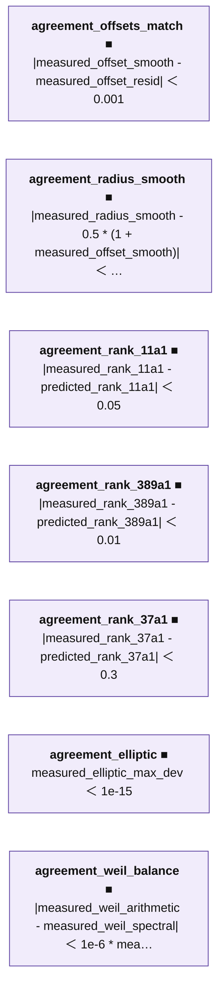

# `lean/Measured.lean`

The chain's numbers, as a Lean object. Third layer of `lean/`. Not a proof file — a RECORD file with checkable numeric relations.

7 theorems, 22 definitions, 223 lines. Arrows are Lean's own record of what each proof uses.

**Imports:** [`Chain`](../lean/Chain.md)  
**Imported by:** nothing

## The picture



An arrow A → B reads "A is used in the proof of B". Green: counting, integers only. Violet: shape, analysis with no ζ. Blue: reads ζ. A name ending in ■ is an end: nothing else uses it. Red: contains `sorry`. Yellow: theorems in another file, counted; a dotted arrow crosses files. Definitions are not drawn; they are listed below the diagram.

## Definitions

<a name="Measured-predicted_radius_smooth"></a>
### `Measured.predicted_radius_smooth`

def · line 39

Predicted radius of the smooth part's z-transform: `b^(-1)`. Chain G2.

- **Is:** `` predicted_radius_smooth (b : ℝ) : ℝ := b ⁻¹ ``
- **Used by 0:** nothing

<a name="Measured-predicted_radius_resid"></a>
### `Measured.predicted_radius_resid`

def · line 42

Predicted radius of the residual's z-transform: `b^(-1/2)`. Chain G2.

- **Is:** `` predicted_radius_resid (b : ℝ) : ℝ := b ^ (-(1:ℝ)/2) ``
- **Used by 0:** nothing

<a name="Measured-measured_radius_smooth"></a>
### `Measured.measured_radius_smooth`

def · line 46

Measured mean |z| of the smooth control's roots at depth 0, b = 2. `results/transform_radius.json` → `summary.truncation_offsets.smooth.measured_mean_abs`.

- **Is:** `` measured_radius_smooth : ℝ := 0.5330466333805305 ``
- **Used by 1:** [`Measured.agreement_radius_smooth`](#Measured-agreement_radius_smooth)

<a name="Measured-measured_radius_resid"></a>
### `Measured.measured_radius_resid`

def · line 50

Measured mean |z| of the residual's roots at depth 6, b = 2. `results/transform_radius.json` → `summary.truncation_offsets.resid`.

- **Is:** `` measured_radius_resid : ℝ := 0.7542802496369435 ``
- **Used by 0:** nothing

<a name="Measured-measured_offset_smooth"></a>
### `Measured.measured_offset_smooth`

def · line 54

Fractional offset of the smooth control above its theoretical radius. `results/transform_radius.json` → `summary.truncation_offset_comparison.smooth_minus_theory_frac`.

- **Is:** `` measured_offset_smooth : ℝ := 0.06609326676106098 ``
- **Used by 2:** [`Measured.agreement_offsets_match`](#Measured-agreement_offsets_match), [`Measured.agreement_radius_smooth`](#Measured-agreement_radius_smooth)

<a name="Measured-measured_offset_resid"></a>
### `Measured.measured_offset_resid`

def · line 58

Fractional offset of the residual above its theoretical radius. `results/transform_radius.json` → `summary.truncation_offset_comparison.resid_minus_theory_frac`.

- **Is:** `` measured_offset_resid : ℝ := 0.06671335886672924 ``
- **Used by 1:** [`Measured.agreement_offsets_match`](#Measured-agreement_offsets_match)

<a name="Measured-predicted_rank_11a1"></a>
### `Measured.predicted_rank_11a1`

def · line 82

Predicted: the exponent in `∏ #E(F_p)/p ~ C (log X)^r` is the rank. Birch & Swinnerton-Dyer 1965. Ranks from LMFDB, quoted not computed.

- **Is:** `` predicted_rank_11a1 : ℝ := 0 ``
- **Used by 1:** [`Measured.agreement_rank_11a1`](#Measured-agreement_rank_11a1)

<a name="Measured-predicted_rank_37a1"></a>
### `Measured.predicted_rank_37a1`

def · line 83

- **Is:** `` predicted_rank_37a1 : ℝ := 1 ``
- **Used by 1:** [`Measured.agreement_rank_37a1`](#Measured-agreement_rank_37a1)

<a name="Measured-predicted_rank_389a1"></a>
### `Measured.predicted_rank_389a1`

def · line 84

- **Is:** `` predicted_rank_389a1 : ℝ := 2 ``
- **Used by 1:** [`Measured.agreement_rank_389a1`](#Measured-agreement_rank_389a1)

<a name="Measured-measured_rank_11a1"></a>
### `Measured.measured_rank_11a1`

def · line 87

Fitted exponent, curve 11a1. `results/bsd_rank_product.json` → `summary.11a1.fitted_r`.

- **Is:** `` measured_rank_11a1 : ℝ := 0.0301198144374232 ``
- **Used by 1:** [`Measured.agreement_rank_11a1`](#Measured-agreement_rank_11a1)

<a name="Measured-measured_rank_37a1"></a>
### `Measured.measured_rank_37a1`

def · line 89

Fitted exponent, curve 37a1. `results/bsd_rank_product.json` → `summary.37a1.fitted_r`.

- **Is:** `` measured_rank_37a1 : ℝ := 1.2498415688932238 ``
- **Used by 1:** [`Measured.agreement_rank_37a1`](#Measured-agreement_rank_37a1)

<a name="Measured-measured_rank_389a1"></a>
### `Measured.measured_rank_389a1`

def · line 91

Fitted exponent, curve 389a1. `results/bsd_rank_product.json` → `summary.389a1.fitted_r`.

- **Is:** `` measured_rank_389a1 : ℝ := 1.9933396889613508 ``
- **Used by 1:** [`Measured.agreement_rank_389a1`](#Measured-agreement_rank_389a1)

<a name="Measured-predicted_elliptic_re"></a>
### `Measured.predicted_elliptic_re`

def · line 117

Predicted: the roots of `1 - a_p x + p x²` lie on `Re(s) = 1/2`. Hasse 1933 — the Riemann Hypothesis for curves over finite fields, a theorem.

- **Is:** `` predicted_elliptic_re : ℝ := 1/2 ``
- **Used by 0:** nothing

<a name="Measured-measured_elliptic_max_dev"></a>
### `Measured.measured_elliptic_max_dev`

def · line 121

Maximum |Re(s) - 1/2| over 43 curve-prime pairs, ranks 0, 1 and 2. `results/elliptic_symbol_zeros.json` → `summary.max_abs_dev_from_half`.

- **Is:** `` measured_elliptic_max_dev : ℝ := 2.220446049250313e-16 ``
- **Used by 1:** [`Measured.agreement_elliptic`](#Measured-agreement_elliptic)

<a name="Measured-measured_weil_arithmetic"></a>
### `Measured.measured_weil_arithmetic`

def · line 133

Arithmetic side of Weil's explicit formula on the mollified stencil. `results/O37_weil_form_balance_run1.log`.

- **Is:** `` measured_weil_arithmetic : ℝ := 2644.2756560191 ``
- **Used by 1:** [`Measured.agreement_weil_balance`](#Measured-agreement_weil_balance)

<a name="Measured-measured_weil_spectral"></a>
### `Measured.measured_weil_spectral`

def · line 136

Spectral side, 600 zero pairs plus a smoothed tail estimate. Same log.

- **Is:** `` measured_weil_spectral : ℝ := 2644.2741566957 ``
- **Used by 1:** [`Measured.agreement_weil_balance`](#Measured-agreement_weil_balance)

<a name="Measured-measured_exact_zeros"></a>
### `Measured.measured_exact_zeros`

def · line 159

The four exact zeros of the dyadic prime difference table, `(r, d)`, over `r ≤ 62, d ≤ 61`. `results/O16_run2.log`. No theorem predicts these.

- **Is:** `` measured_exact_zeros : List (ℕ × ℕ) := [(2,1), (4,1), (8,3), (20,6)] ``
- **Used by 0:** nothing

<a name="Measured-measured_residual_from_zeros"></a>
### `Measured.measured_residual_from_zeros`

def · line 165

Fraction of the row-20 residual reproduced from the zeta zeros alone, at depths 0, 3, 6, with 200 zero pairs. PROSE-ONLY — `lab_notebook.md` entry 38; `O34_zeta_residual_model.py` writes no results file. No theorem predicts these fractions.

- **Is:** `` measured_residual_from_zeros : List ℝ := [0.94, 0.92, 0.80] ``
- **Used by 0:** nothing

<a name="Measured-measured_breakdown_prime"></a>
### `Measured.measured_breakdown_prime`

def · line 171

Depth at which the root structure breaks down: prime table, residual, and the smooth control (which never does). `results/transform_radius.json` → `summary.breakdown_depth`. No theorem predicts 13 or 10.

- **Is:** `` measured_breakdown_prime : ℕ := 13 ``
- **Used by 0:** nothing

<a name="Measured-measured_breakdown_resid"></a>
### `Measured.measured_breakdown_resid`

def · line 172

- **Is:** `` measured_breakdown_resid : ℕ := 10 ``
- **Used by 0:** nothing

<a name="Measured-measured_G4_peak"></a>
### `Measured.measured_G4_peak`

def · line 177

Generator-orbit peak: `P_max/median` at G4 = {2,3,5,7} across three xmax settings. `results/O24_gen_*_run.log`. No theorem predicts that the peak sits at four primes.

- **Is:** `` measured_G4_peak : List ℝ := [26.733822, 31.371849, 38.299307] ``
- **Used by 0:** nothing

<a name="Measured-measured_contributing_primes"></a>
### `Measured.measured_contributing_primes`

def · line 182

Primes contributing to the mollified Weil form, out of 36 in the window. `results/O37_weil_form_on_stencil_run1.log`. No theorem predicts 25, and it depends on the mollifier parameters.

- **Is:** `` measured_contributing_primes : ℕ := 25 ``
- **Used by 0:** nothing

## Theorems

<a name="Measured-agreement_offsets_match"></a>
### `Measured.agreement_offsets_match`

line 65

**Shape.** Uses real or complex analysis; nothing in it or beneath it reads ζ.

**Why.** The one numeric relation that carries an inference. The two offsets agree to well under a tenth of a percentage point. That agreement is what identifies them as a truncation artifact rather than a real difference between the two circles — a signal would not produce the same offset in both. `results/transform_radius.json` → `difference_of_offsets = 0.0006200921056682684`.

**Proves**

```lean
|measured_offset_smooth - measured_offset_resid| < 0.001
```

**Stated with:** [`Measured.measured_offset_resid`](#Measured-measured_offset_resid), [`Measured.measured_offset_smooth`](#Measured-measured_offset_smooth)

**Fed by:** no theorem of this repo; it stands on Mathlib and the definitions below.

**Feeds:** nothing. It is an end.

<a name="Measured-agreement_radius_smooth"></a>
### `Measured.agreement_radius_smooth`

line 71

**Shape.** Uses real or complex analysis; nothing in it or beneath it reads ζ.

**Why.** The smooth control sits above `b^(-1) = 0.5` by the measured offset.

**Proves**

```lean
|measured_radius_smooth - 0.5 * (1 + measured_offset_smooth)| < 1e-9
```

**Stated with:** [`Measured.measured_offset_smooth`](#Measured-measured_offset_smooth), [`Measured.measured_radius_smooth`](#Measured-measured_radius_smooth)

**Fed by:** no theorem of this repo; it stands on Mathlib and the definitions below.

**Feeds:** nothing. It is an end.

<a name="Measured-agreement_rank_11a1"></a>
### `Measured.agreement_rank_11a1`

line 96

**Shape.** Uses real or complex analysis; nothing in it or beneath it reads ζ.

**Why.** Ranks 0 and 2 land inside 0.05. Rank 1 does NOT — it is 0.25 high, which is the slow convergence of the product at `X ≤ 30000`, not a disagreement about the rank. Encoded at the honest tolerance rather than a flattering one.

**Proves**

```lean
|measured_rank_11a1 - predicted_rank_11a1| < 0.05
```

**Stated with:** [`Measured.measured_rank_11a1`](#Measured-measured_rank_11a1), [`Measured.predicted_rank_11a1`](#Measured-predicted_rank_11a1)

**Fed by:** no theorem of this repo; it stands on Mathlib and the definitions below.

**Feeds:** nothing. It is an end.

<a name="Measured-agreement_rank_389a1"></a>
### `Measured.agreement_rank_389a1`

line 101

**Shape.** Uses real or complex analysis; nothing in it or beneath it reads ζ.

**Why.** Rank 2 lands inside 0.01 — the tightest of the three curves.

**Proves**

```lean
|measured_rank_389a1 - predicted_rank_389a1| < 0.01
```

**Stated with:** [`Measured.measured_rank_389a1`](#Measured-measured_rank_389a1), [`Measured.predicted_rank_389a1`](#Measured-predicted_rank_389a1)

**Fed by:** no theorem of this repo; it stands on Mathlib and the definitions below.

**Feeds:** nothing. It is an end.

<a name="Measured-agreement_rank_37a1"></a>
### `Measured.agreement_rank_37a1`

line 107

**Shape.** Uses real or complex analysis; nothing in it or beneath it reads ζ.

**Why.** Rank 1 needs a tolerance of 0.3. Recorded as such — the separation between ranks is unambiguous, the third decimal is not.

**Proves**

```lean
|measured_rank_37a1 - predicted_rank_37a1| < 0.3
```

**Stated with:** [`Measured.measured_rank_37a1`](#Measured-measured_rank_37a1), [`Measured.predicted_rank_37a1`](#Measured-predicted_rank_37a1)

**Fed by:** no theorem of this repo; it stands on Mathlib and the definitions below.

**Feeds:** nothing. It is an end.

<a name="Measured-agreement_elliptic"></a>
### `Measured.agreement_elliptic`

line 124

**Shape.** Uses real or complex analysis; nothing in it or beneath it reads ζ.

**Why.** Agreement at machine epsilon: the deviation is one ulp of a float64.

**Proves**

```lean
measured_elliptic_max_dev < 1e-15
```

**Stated with:** [`Measured.measured_elliptic_max_dev`](#Measured-measured_elliptic_max_dev)

**Fed by:** no theorem of this repo; it stands on Mathlib and the definitions below.

**Feeds:** nothing. It is an end.

<a name="Measured-agreement_weil_balance"></a>
### `Measured.agreement_weil_balance`

line 140

**Shape.** Uses real or complex analysis; nothing in it or beneath it reads ζ.

**Why.** The two sides agree to 5.7e-7 relative. NOTE: this is a normalisation check, not a test — summing over known zeros presupposes they lie on the line.

**Proves**

```lean
|measured_weil_arithmetic - measured_weil_spectral| < 1e-6 * measured_weil_arithmetic
```

**Stated with:** [`Measured.measured_weil_arithmetic`](#Measured-measured_weil_arithmetic), [`Measured.measured_weil_spectral`](#Measured-measured_weil_spectral)

**Fed by:** no theorem of this repo; it stands on Mathlib and the definitions below.

**Feeds:** nothing. It is an end.

