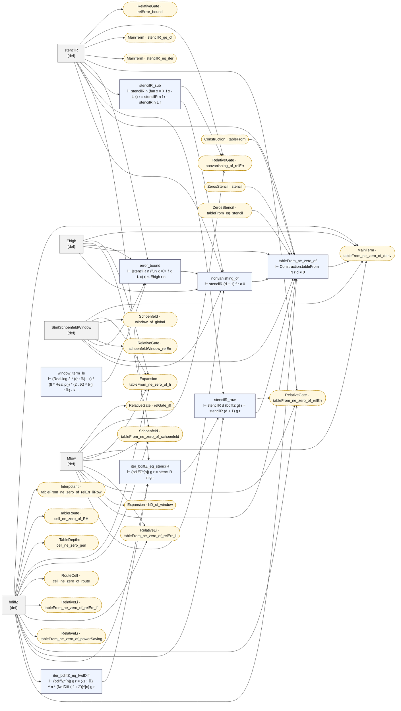

# `lean/Nonvanishing.lean`

**What it does** (its own header): Nonvanishing — the arrow of O67's conditional theorem, in the house pattern. `papers/The-Four-Zeros.md` § I states: under RH, `cell(r,d) ≠ 0` for every `r ≥ R(d)`, which with O43's census makes the four zeros complete at every depth `d ≤ 15`. The proof has two analytic inputs and one arithmetic gap condition; everything joining them is algebra. Following `Chain.lean`'s design — take the antecedents as HYPOTHESES, prove the arrows, let the kernel check that the "therefore" is real — this module proves the joins:

**Imports:** [`Zeros`](../lean/Zeros.md), [`ZerosStencil`](../lean/ZerosStencil.md).
**Imported by:** [`MainTerm`](../lean/MainTerm.md), [`RelativeGate`](../lean/RelativeGate.md).

Blue: theorem. Green: a theorem nothing else uses (an end). Dashed white: connects to nothing. Grey: definition. Red: contains `sorry`. Yellow: in another file. An arrow A → B reads "A is used by B".

## Every declaration

| declaration | proves (output) | needs (input) | why (its own docstring) | uses | used by |
|---|---|---|---|---|---|
| `Nonvanishing.bdiffZ` def, line 52 | ℤ → ℝ | g : ℤ → ℝ | Backward differencing on ℤ-indexed real sequences — `Chain.bdiff`'s twin one level down (ℤ index, ℝ values). | — | `Expansion.tableFrom_ne_zero_of_li`, `Interpolant.tableFrom_ne_zero_of_relErr_liRow`, `MainTerm.tableFrom_ne_zero_of_deriv`, `Nonvanishing.iter_bdiffZ_eq_fwdDiff`, `Nonvanishing.iter_bdiffZ_eq_stencilR`, `Nonvanishing.stencilR_row`, `Nonvanishing.tableFrom_ne_zero_of`, `RelativeGate.tableFrom_ne_zero_of_relErr`, `RelativeLi.tableFrom_ne_zero_of_powerSaving`, `RelativeLi.tableFrom_ne_zero_of_relErr_li`, `RelativeLi.tableFrom_ne_zero_of_relErr_li'`, `RouteCell.cell_ne_zero_of_route`, `Schoenfeld.tableFrom_ne_zero_of_schoenfeld`, `TableDepths.cell_ne_zero_gen`, `TableRoute.cell_ne_zero_of_RH` |
| `Nonvanishing.stencilR` def, line 56 | ℝ | n : ℕ; g : ℤ → ℝ; r : ℤ | The real alternating binomial stencil of order `n` on `g`, read at `r` downward. The ℝ twin of `Zeros.stencil`. | — | `MainTerm.stencilR_eq_iter`, `MainTerm.stencilR_ge_of`, `Nonvanishing.error_bound`, `Nonvanishing.iter_bdiffZ_eq_stencilR`, `Nonvanishing.nonvanishing_of`, `Nonvanishing.stencilR_row`, `Nonvanishing.stencilR_sub`, `Nonvanishing.tableFrom_ne_zero_of`, `RelativeGate.nonvanishing_of_relErr`, `RelativeGate.relError_bound`, `RelativeGate.tableFrom_ne_zero_of_relErr` |
| `Nonvanishing.iter_bdiffZ_eq_fwdDiff` theorem, line 61 | (bdiffZ^[n]) g r = (-1 : ℝ) ^ n * (fwdDiff (-1 : ℤ))^[n] g r | g : ℤ → ℝ; r : ℤ; n : ℕ | Backward differencing is `(−1)·fwdDiff` at step `−1` — the ℝ copy of `Zeros.tableFrom_eq_fwdDiff`'s bridge. | `Nonvanishing.bdiffZ` | `Nonvanishing.iter_bdiffZ_eq_stencilR` |
| `Nonvanishing.iter_bdiffZ_eq_stencilR` theorem, line 77 | (bdiffZ^[n]) g r = stencilR n g r | g : ℤ → ℝ; r : ℤ; n : ℕ | `n` differences are the stencil. `Zeros.tableFrom_eq_stencil` transplanted to ℝ: Mathlib's `fwdDiff_iter_eq_sum_shift` does the binomial bookkeeping. | `Nonvanishing.bdiffZ`, `Nonvanishing.iter_bdiffZ_eq_fwdDiff`, `Nonvanishing.stencilR` | `Nonvanishing.stencilR_row` |
| `Nonvanishing.stencilR_row` theorem, line 94 | stencilR d (bdiffZ g) r = stencilR (d + 1) g r | d : ℕ; g : ℤ → ℝ; r : ℤ | The Pascal step. The depth-`d` stencil on the row `x ↦ g(x) − g(x−1)` is the depth-`(d+1)` stencil on `g`. One more iterate, nothing else. | `Nonvanishing.bdiffZ`, `Nonvanishing.iter_bdiffZ_eq_stencilR`, `Nonvanishing.stencilR` | `Nonvanishing.tableFrom_ne_zero_of`, `RelativeGate.tableFrom_ne_zero_of_relErr` |
| `Nonvanishing.stencilR_sub` theorem, line 100 | stencilR n (fun x =&gt; f x - L x) r = stencilR n f r - stencilR n L r | n : ℕ; f L : ℤ → ℝ; r : ℤ | Linearity. Splitting `π = li + (π − li)` under the stencil. | `Nonvanishing.stencilR` | `Nonvanishing.nonvanishing_of`, `RelativeGate.nonvanishing_of_relErr` |
| `Nonvanishing.Ehigh` def, line 109 | ℝ | r : ℤ; n : ℕ | The error ceiling: `(log 2 · r / 8π) · 2^(r/2) · (1 + 2^(−1/2))^(n)`. | — | `Expansion.tableFrom_ne_zero_of_li`, `MainTerm.tableFrom_ne_zero_of_deriv`, `Nonvanishing.error_bound`, `Nonvanishing.nonvanishing_of`, `Nonvanishing.tableFrom_ne_zero_of`, `Schoenfeld.tableFrom_ne_zero_of_schoenfeld` |
| `Nonvanishing.StmtSchoenfeldWindow` def, line 117 | Prop | f L : ℤ → ℝ; r : ℤ; n : ℕ | Schoenfeld on the window, as a statement: each of the `n+1` values the stencil reads obeys the RH bound at `x = 2^(r−k)`, where `√x = 2^((r−k)/2)` and `log x = (r−k)·log 2`. This is the hypothesis Schoenfeld's theorem would discharge; it is not discharged here. | — | `Expansion.tableFrom_ne_zero_of_li`, `MainTerm.tableFrom_ne_zero_of_deriv`, `Nonvanishing.error_bound`, `Nonvanishing.nonvanishing_of`, `Nonvanishing.tableFrom_ne_zero_of`, `RelativeGate.schoenfeldWindow_relErr`, `Schoenfeld.window_of_global` |
| `Nonvanishing.window_term_le` theorem, line 125 | (Real.log 2 * ((r : ℝ) - k) / (8 * Real.pi)) * (2 : ℝ) ^ (((r : ℝ) - k) / 2) ≤ (Real.log 2 * r / (8 * Real.pi)) * (2 : ℝ) ^ ((r : ℝ) / 2) * ((2 : ℝ) ^ (-(1 : ℝ) / 2)) ^ k | hr : (n : ℤ) ≤ r; k : ℕ; hk : k ∈ range (n + 1) | Each windowed Schoenfeld bound is at most the top-of-window bound times `2^(−k/2)`: `(r−k) ≤ r` handles the linear factor and `rpow_add` splits the power. Needs `0 ≤ r − k` inside the window, supplied by `hr`. | — | `Nonvanishing.error_bound` |
| `Nonvanishing.error_bound` theorem, line 152 | \|stencilR n (fun x =&gt; f x - L x) r\| ≤ Ehigh r n | hr : (n : ℤ) ≤ r; hS : StmtSchoenfeldWindow f L r n | The error bound. Triangle inequality, the per-term comparison, and the binomial theorem `Σ C(n,k) t^k = (1+t)^n` at `t = 2^(−1/2)`. | `Nonvanishing.Ehigh`, `Nonvanishing.StmtSchoenfeldWindow`, `Nonvanishing.stencilR`, `Nonvanishing.window_term_le` | `Nonvanishing.nonvanishing_of` |
| `Nonvanishing.Mlow` def, line 178 | ℝ | r : ℤ; d : ℕ | The main-term floor `0.5 · 2^(r−d−1) · (log 2)^d / r`. O67's step 3. | — | `Expansion.hD_of_window`, `Expansion.tableFrom_ne_zero_of_li`, `MainTerm.tableFrom_ne_zero_of_deriv`, `Nonvanishing.nonvanishing_of`, `Nonvanishing.tableFrom_ne_zero_of`, `RelativeGate.nonvanishing_of_relErr`, `RelativeGate.relGate_iff`, `RelativeGate.tableFrom_ne_zero_of_relErr`, `RelativeLi.tableFrom_ne_zero_of_relErr_li`, `Schoenfeld.tableFrom_ne_zero_of_schoenfeld` |
| `Nonvanishing.nonvanishing_of` theorem, line 185 | stencilR (d + 1) f r ≠ 0 | hr : ((d + 1 : ℕ) : ℤ) ≤ r; hS : StmtSchoenfeldWindow f L r (d + 1); hM : Mlow r d ≤ \|stencilR (d + 1) L r\|; hgap : Ehigh r (d + 1) &lt; Mlow r d | The arrow. If Schoenfeld holds on the window (`hS`), the smooth main term clears its floor (`hM` — stage 2's target), and the floor beats the error ceiling (`hgap` — O67's `r ≥ R(d)` table), then the depth-`(d+1)` stencil of the counting function does not vanish. | `Nonvanishing.Ehigh`, `Nonvanishing.Mlow`, `Nonvanishing.StmtSchoenfeldWindow`, `Nonvanishing.error_bound`, `Nonvanishing.stencilR`, `Nonvanishing.stencilR_sub` | `Nonvanishing.tableFrom_ne_zero_of` |
| `Nonvanishing.tableFrom_ne_zero_of` theorem, line 201 | Construction.tableFrom N r d ≠ 0 | hrow : ∀ k ∈ range (d + 2), ((N (r - k) : ℤ) : ℝ) = bdiffZ f (r - k); hr : ((d + 1 : ℕ) : ℤ) ≤ r; hS : StmtSchoenfeldWindow f L r (d + 1); hM : Mlow r d ≤ \|stencilR (d + 1) L r\|; hgap : Ehigh r (d + 1) &lt; Mlow r d | Onto the integer table. If the integer row is the backward difference of a counting function `f` across the window a cell reads (cast to ℝ), then the cell's vanishing is the depth-`(d+1)` stencil of `f` vanishing — so the arrow above forbids it. The cast bridge is `Zeros.tableFrom_eq_stencil` plus `push_cast`. | `Construction.tableFrom`, `Nonvanishing.Ehigh`, `Nonvanishing.Mlow`, `Nonvanishing.StmtSchoenfeldWindow`, `Nonvanishing.bdiffZ`, `Nonvanishing.nonvanishing_of`, `Nonvanishing.stencilR`, `Nonvanishing.stencilR_row`, `Zeros.stencil`, `Zeros.tableFrom_eq_stencil` | `MainTerm.tableFrom_ne_zero_of_deriv` |
